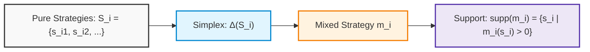
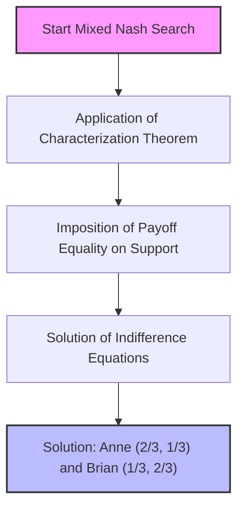
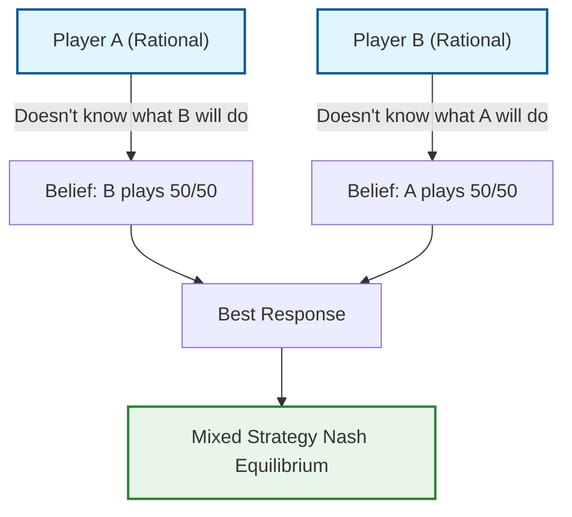

# Game Theory: Extension of Nash Equilibrium and Introduction to Mixed Strategies

## Educational Overview

This lecture addresses the fundamental limitation of the **Nash Equilibrium** in its classical formulation using pure strategies, namely the impossibility of describing or predicting the outcome of strictly competitive zero-sum games, such as the game of "Odds and Evens". In such contexts, the inevitable presence of *regret* for the defeated party and the impossibility of formulating mutually consistent beliefs result in the absence of a deterministic equilibrium.

To overcome this conceptual deadlock, the notion of **Mixed Strategy** is introduced, classified as a **Key Concept** of the course:
* **Controlled randomness:** Unlike exogenous risk (as in lotteries), the randomization here is endogenous; the rational player deliberately chooses to make their action unpredictable.
* **Mathematical formalization:** A mixed strategy for player $i$ is formally defined as a probability distribution $\mu_i$ on the discrete set of pure strategies $S_i$, belonging to the probability simplex denoted as $\Delta(S_i)$, such that:
  $$\sum_{s \in S_i} \mu_i(s) = 1 \quad \text{with} \quad \mu_i(s) \in [0, 1]$$
* **Equilibrium intuition:** Through the heuristic extension of the game with intermediate probabilistic choices (for example, playing with probability $1/2$), the idea is introduced that equilibrium emerges when expected payoffs balance out, making opponents indifferent to unilateral deviations.

---

### Beyond Pure Equilibrium: The Need for Mixed Strategies

In the games analyzed so far, the **Nash Equilibrium** has proven to be a formidable predictive tool. However, one soon encounters an obvious limitation: there are games in which no Nash equilibrium seems to exist.

A striking example is the classic **Odds and Evens Game**. In this context, two players simultaneously show a number (for example $0$ or $1$):
* If the sum is even, the *Even* player wins.
* If the sum is odd, the *Odd* player wins.

Being a zero-sum game, one wins and the other loses. Consequently, the loser will always have "regret" over what they played and would have preferred to change their move. Furthermore, if each player formulates a rational *belief* about the opponent's move and plays their best response, it is impossible for both beliefs to be correct simultaneously. The game is designed to simulate a coin toss: by its very nature, it seems unpredictable. 

Yet, the idea of not being able to apply the Nash equilibrium to such a common class of interactions is unacceptable. The equilibrium actually exists, but to find it, one must broaden the space of admissible actions by introducing **Mixed Strategies**.

#### The Randomness Paradox: External Case vs. Controlled Randomization

At the beginning of the study of decision theory, it was assumed that a rational agent dislikes uncertainty understood as exogenous randomness (as in passively suffered lotteries). 

In mixed strategies, however, randomness does not fall from above: **the players themselves choose deliberately to randomize their move**. The decision-maker maintains full control over the probability distribution with which they will act. 
An effective analogy is that of collectible card games (such as *Magic: The Gathering*, devised precisely by mathematicians and game theorists): drawing a card from the deck introduces a random element, but the composition of the deck has been programmed and optimized a priori in a completely rational way.

---

### Mathematical Formalization: Distributions and Simplex

In a normal-form game, we denote by $S_i$ the non-empty and discrete set of **Pure Strategies** available to player $i$.

A **Mixed Strategy** for player $i$, denoted by $m_i$, is a probability distribution defined on $S_i$:
$$m_i: S_i \to [0, 1] \quad \text{such that} \quad \sum_{s_i \in S_i} m_i(s_i) = 1$$

The set of all possible probability distributions on $S_i$ is called the **Probability Simplex** and is denoted by $\Delta(S_i)$ or $\Delta S_i$.

#### Support of a Mixed Strategy

Given a generic mixed strategy $m_i \in \Delta(S_i)$, the **Support** is defined as the set of pure strategies played with strictly positive probability:
$$\text{supp}(m_i) = \{ s_i \in S_i \mid m_i(s_i) > 0 \}$$

* **Pure strategies as degenerate cases**: If the support is a singleton ($\text{supp}(m_i) = \{s_i\}$), it means that the player assigns probability $1$ to a specific action and $0$ to all others. Pure strategies are therefore simply degenerate mixed strategies.
* **Strictly mixed strategies**: When the support contains two or more pure strategies, the player is effectively randomizing among multiple alternatives.

---

### Utility Extension: Calculation of Expected Utility

In games of complete information and simultaneous moves, the players' choices are mutually independent. If each player $j \in \{1, \dots, n\}$ adopts a mixed strategy $m_j$, the joint probability of a specific profile of pure strategies $s = (s_1, s_2, \dots, s_n) \in S$ occurring is given by the product of the individual probabilities:
$$P(s) = \prod_{j=1}^n m_j(s_j)$$

A player's utility is no longer a deterministic value, but becomes an **Expected Utility**. Following the von Neumann-Morgenstern approach, the utility extended to the joint profile of mixed strategies $m = (m_1, \dots, m_n)$ is calculated as:
$$u_i(m) = \sum_{s \in S} \left( \prod_{j=1}^n m_j(s_j) \right) u_i(s)$$

This formulation fully satisfies the linearity property with respect to probabilities and extends the domain of the utility function from $S$ to the joint simplex $\Delta(S_1) \times \dots \times \Delta(S_n)$.

---

### Operational Example: Solving Odds and Evens

Consider the Odds and Evens game with the following pure utility matrix:

| Odd \ Even | $0$ | $1$ |
| :---: | :---: | :---: |
| **$0$** | $(-4, +4)$ | $(+4, -4)$ |
| **$1$** | $(+4, -4)$ | $(-4, +4)$ |

Let us parameterize the probabilistic choices:
* The **Odd** player chooses the pure strategy $0$ with probability $q$, and the strategy $1$ with probability $1 - q$.
* The **Even** player chooses the pure strategy $0$ with probability $r$, and the strategy $1$ with probability $1 - r$.

The pairs of pure strategies $(s_{\text{Odd}}, s_{\text{Even}})$ therefore have independent probabilities:
* $(0, 0)$ with probability $q \cdot r \implies$ payoff: $(-4, +4)$
* $(0, 1)$ with probability $q(1 - r) \implies$ payoff: $(+4, -4)$
* $(1, 0)$ with probability $(1 - q)r \implies$ payoff: $(+4, -4)$
* $(1, 1)$ with probability $(1 - q)(1 - r) \implies$ payoff: $(-4, +4)$

#### Calculation of Expected Payoff for the Odd Player

Let us calculate the expected utility $u_{\text{Odd}}(q, r)$:
$$u_{\text{Odd}}(q, r) = -4qr + 4q(1 - r) + 4(1 - q)r - 4(1 - q)(1 - r)$$

Factoring out $-4$:
$$u_{\text{Odd}}(q, r) = -4 \Big[ qr - q(1 - r) - (1 - q)r + (1 - q)(1 - r) \Big]$$

Expanding the products inside the square brackets:
$$\begin{aligned}
qr - q + qr - r + qr + 1 - q - r + qr &= 4qr - 2q - 2r + 1 \\
&= (2q - 1)(2r - 1)
\end{aligned}$$

We thus obtain:
$$u_{\text{Odd}}(q, r) = -4(2q - 1)(2r - 1)$$

Since the game is zero-sum ($u_{\text{Even}} = -u_{\text{Odd}}$):
$$u_{\text{Even}}(q, r) = +4(2q - 1)(2r - 1)$$

#### Interpretation of the Result

If the Odd player chooses $q = \frac{1}{2}$, the term $(2q - 1)$ vanishes:
$$u_{\text{Odd}}\left(\frac{1}{2}, r\right) = -4 \left(2 \cdot \frac{1}{2} - 1\right)(2r - 1) = 0 \quad \forall r$$

Similarly, if the Even player sets $r = \frac{1}{2}$:
$$u_{\text{Even}}\left(q, \frac{1}{2}\right) = 0 \quad \forall q$$

The combination $(q^*, r^*) = \left(\frac{1}{2}, \frac{1}{2}\right)$ yields a payoff of $(0, 0)$. No player can obtain a strictly greater utility by deviating unilaterally: both obtain $0$ regardless of any other probability they decide to adopt. This profile constitutes the **Mixed Strategy Nash Equilibrium** of the game.

---

### Dominance with Mixed Strategies

The concepts of strict and weak dominance can be extended directly to mixed strategies:

* A mixed strategy $m_i' \in \Delta(S_i)$ **strictly dominates** $m_i \in \Delta(S_i)$ if:
  $$u_i(m_i', m_{-i}) > u_i(m_i, m_{-i}) \quad \forall m_{-i} \in \Delta(S_{-i})$$

* A mixed strategy $m_i' \in \Delta(S_i)$ **weakly dominates** $m_i \in \Delta(S_i)$ if:
  $$u_i(m_i', m_{-i}) \ge u_i(m_i, m_{-i}) \quad \forall m_{-i} \in \Delta(S_{-i})$$
  with strict inequality for at least one profile $m_{-i}$.

#### Key Concept: Reduction to Opponents' Pure Strategies

The formal definition requires testing the inequality for every possible profile $m_{-i}$. Since the space of the rivals' mixed strategies $\Delta(S_{-i})$ is continuous and infinite, verifying this condition element by element would be unmanageable.

Fortunately, a fundamental principle based on the linearity of expected utility comes into play:

> **Reduction Criterion for Dominance**:
> To verify whether a mixed strategy $m_i'$ dominates a strategy $m_i$, **it is sufficient to test the inequality solely against the opponents' pure strategies** $s_{-i} \in S_{-i}$.
>
> $$u_i(m_i', m_{-i}) > u_i(m_i, m_{-i}) \quad \forall m_{-i} \in \Delta(S_{-i}) \iff u_i(m_i', s_{-i}) > u_i(m_i, s_{-i}) \quad \forall s_{-i} \in S_{-i}$$

#### Proof Intuition

1. **Necessity ($\implies$)**: If the inequality holds for every mixed profile $m_{-i}$, it also holds for the degenerate profiles where opponents play pure strategies with probability $1$.
2. **Sufficiency ($\impliedby$)**: The expected utility against a mixed profile $m_{-i}$ is a convex linear combination of the utilities obtained against the individual pure profiles $s_{-i}$:
   $$u_i(m_i, m_{-i}) = \sum_{s_{-i} \in S_{-i}} P(s_{-i}) \cdot u_i(m_i, s_{-i})$$
   If for every pure component $s_{-i}$ it holds that $u_i(m_i', s_{-i}) > u_i(m_i, s_{-i})$, multiplying both sides by the non-negative weights $P(s_{-i})$ (whose sum is $1$), the strict inequality is preserved for any convex combination.

This result transforms a theoretically impracticable check on an infinite space into a trivial check on a finite number of cases.

---

### Mixed Strategy Nash Equilibrium, IESDSM, and Characterization Theorem

#### Extension of the Nash Equilibrium Concept
We now extend the definition of Nash Equilibrium moving from pure strategies to mixed strategies. A joint mixed strategy profile $m = (m_1, m_2, \dots, m_N)$, belonging to the Cartesian product of all individual mixed strategy spaces $\Delta(S_i)$, is a **Mixed Strategy Nash Equilibrium** if for every player $i$ the following condition holds:

$$u_i(m) \ge u_i(m'_i, m_{-i}) \quad \forall m'_i \in \Delta(S_i)$$

The conceptual meaning does not change compared to pure strategies: the equilibrium guarantees that no player has an incentive for a unilateral deviation towards another mixed strategy, as they would not obtain a superior payoff.

Returning to the *Odds and Evens* game, we had demonstrated that if both players choose probability $1/2$ (playing *even* or *odd* with equal probability, $q = 1/2$ and $r = 1/2$), no player has a unilateral incentive to change their move. If, for example, the *Odd* player plays with probability $1/2$ and the *Even* player deterministically chooses a fixed move, then *Odd* would find it advantageous to deviate to maximize their earnings. When both play $1/2$, they are in a mutual best response.

---

#### IESDSM: Iterated Elimination of Strictly Dominated Mixed Strategies
We have previously seen the Iterated Elimination of Strictly Dominated Strategies (IESDS). We now extend this technique to mixed strategies, obtaining **IESDSM** (*Iterated Elimination of Strictly Dominated Strategies in Mixed Strategies*).

Consider a payoff matrix where, upon a superficial analysis based only on pure strategies, we might find no strictly dominated strategy to eliminate. For example, a pure strategy $R$ might always guarantee a constant payoff (e.g., $1$), while another strategy might oscillate between $0$ and $4$. In this case, $R$ is not dominated by any single *pure* strategy taken individually.

However, if a player chooses to randomize between two pure strategies (flipping a coin, e.g., between $L$ and $C$), they can obtain an expected value superior to the pure strategy $R$. 

> **Key Concept: Dominance of a Mixed Combination**
> A pure strategy may not be dominated by any other single pure strategy, but may turn out to be **strictly dominated by a mixed combination** of other strategies.

Applying IESDSM:
1. Pure strategies dominated by mixed combinations are identified (such as strategy $R$ in our example) and eliminated.
2. The reduction of the strategy space reveals new dominances (e.g., elimination of strategies that have become suboptimal such as $D$).
3. The process converges to a more powerful and efficient equilibrium solution.

The theorems seen for classical IESDS hold identically for IESDSM: the order of elimination is irrelevant, and Nash Equilibria survive elimination.

> **Caution**: It is crucial to use **only strict dominance**. Eliminating weakly dominated strategies risks mistakenly discarding the Nash equilibrium itself or part of the support necessary to find it.

---

#### Characterization Theorem
To find and verify mixed strategy Nash equilibria without having to explore the entire probability space by trial and error, we use a fundamental theorem.

Let $G$ be a normal-form game and $m$ a joint mixed strategy profile. $m$ is a **Nash Equilibrium** if and only if, for each player $i$:
1. $u_i(m) = u_i(s_i, m_{-i})$ for every pure strategy $s_i$ that belongs to the **support** of $m_i$ (i.e., strategies played with a probability greater than zero).
2. $u_i(m) \ge u_i(s_i, m_{-i})$ for every pure strategy $s_i$ that does **not** belong to the support.

##### Theorem Intuition
If a player is mixing two or more pure strategies in a Nash equilibrium, **all pure strategies present in their support must necessarily guarantee them the exact same identical expected payoff**. 

If this were not the case (if a pure strategy in the support gave a lower payoff than another), the player would have a profitable unilateral deviation: it would suffice to zero out the probability associated with the strategy with the lower return and increase that with the higher return, contradicting the very definition of Nash equilibrium.

---

#### Practical Exercise: Battle of the Sexes
Let us revisit the *Battle of the Sexes* game, in which players Anne and Brian must choose between a Romantic ($R$) or Sci-Fi ($S$) show. We know there are two pure strategy Nash equilibria $(R, R)$ and $(S, S)$. Let us now look for any **mixed strategy Nash equilibrium**.

Let $q$ be the probability with which Anne chooses $R$ and $r$ the probability with which Brian chooses $R$. The complementary probabilities for $S$ will be $(1-q)$ and $(1-r)$.

Applying the Characterization Theorem, suppose that the support for both players includes both $R$ and $S$ (both choices have probabilities strictly between $0$ and $1$). To ensure Anne is indifferent between playing $R$ and playing $S$, the expected payoff must be identical in both cases, evaluated based on the probability chosen by Brian ($B$).

Setting up the indifference equations:
- Anne's expected payoff playing $R$ and $S$ must be equal, which allows us to derive Brian's optimal probability.
- Developing the symmetric calculations for Brian, we find Anne's optimal probability.

The algebraic procedure leads to identifying the following equilibrium mixed strategy profile:
- Anne chooses $R$ with probability $q = \frac{2}{3}$ (and $S$ with $1/3$).
- Brian chooses $R$ with probability $r = \frac{1}{3}$ (and $S$ with $2/3$).

##### Interpretation of the Results
While in *Odds and Evens* the symmetric solution $(1/2, 1/2)$ reflected the need for total unpredictability (like flipping a coin), in the *Battle of the Sexes* the probabilities are unbalanced ($\frac{2}{3}$ and $\frac{1}{3}$). This happens because the players want to meet, but each prefers their own favored setting. 

Adopting this mixed planning represents the best long-term strategy to maximize their expected payoffs, even if in some specific cases the two actors will end up missing each other. The mixed strategy Nash equilibrium is to be interpreted as an **optimal planning strategy** under uncertainty.

---

### Conclusions and Further Reading: Nash's Theorem and the Interpretation of Mixed Strategies

#### Nash's Theorem and the necessity of mixed strategies

So far we have analyzed various games, noting how in some cases (such as the *Odds and Evens* game) no pure strategy Nash equilibrium seems to exist. To solve this problem, John Nash acted in 1950 similarly to subatomic physicists when they postulate the existence of a missing particle to complete a theoretical table: **he postulated the existence of an equilibrium**, introducing the concept of **mixed strategies**.

> **Key Concept: Nash's Existence Theorem**
> Proved by John Nash in 1950, the theorem establishes that *every game with finite strategy sets possesses at least one Nash equilibrium*, provided that mixed strategies are admitted.

This result is extremely powerful, although it has limitations. Indeed, it is purely an *existence* theorem: it guarantees that a solution always exists, but does not state how easy or difficult it is to calculate. Moreover, while in some games (such as *Battle of the Sexes*) equilibria can be multiple, in others where pure strategies failed (such as *Odds and Evens*), the introduction of mixed strategies nonetheless guarantees a solution.

---

#### The problem of the physical interpretation of mixed strategies

Mathematically accepting mixed strategies raises a problem of practical interpretation: *what do they mean in reality?* Being rational players, the idea that an individual acts like Batman's villain "Two-Face"—relying on a coin flip to decide—seems the epitome of irrationality. 

Furthermore, at the end of the game, the player must still make a concrete action (play a pure strategy). It is not possible to "play halfway" a move in a static game of complete information. Over time, three different interpretations have been proposed to make physical sense of mixed strategies:

1. **The Law of Large Numbers:** 
   Nash's original idea was that if the game is repeated many times ($M$ times) and the player randomizes according to a certain probability $Q$, then by the law of large numbers they will obtain a certain percentage of successes. 
   * *Critique:* This interpretation adapts poorly to static games, which by definition are one-shot (played only once). Real players remember past history and do not reset their memory every turn like a computer would.

2. **Fuzzy Logic:**
   Developed in the 20th century, it suggests that playing with a probability of $50\%$ ($1/2$) means being in an intermediate state of indecision between zero and one.
   * *Critique:* While it well describes the mental state of someone who does not know what to do (especially in games like *Odds and Evens*), it does not rigorously justify rational strategic behavior.

3. **Interpretation via Beliefs:**
   This is the most valid and commonly accepted modern interpretation in contemporary game theory.

---

#### The interpretation based on Beliefs

The conceptual breakthrough consists in understanding that the uncertainty expressed by mixed strategies does not reflect the indecision or erratic nature of the individual player, but rather **the opponents' perception**.

* I know exactly what I have decided to play (my choice is determined, even if I do not communicate it).
* From the opponent's point of view, however, my move is completely uncertain. 

If two players are perfectly rational in a game like *Odds and Evens*, their correct belief about the opponent is precisely one of total uncertainty (assuming the other plays $50/50$). If a player made the mistake of believing that the opponent deterministically chooses an option, they would adapt their response accordingly, becoming vulnerable to a counter-move.

Paradoxically, through this reading key, we achieve the goal of Nash's theorem: **we manage to predict that we cannot predict**, and this collective prediction turns out to be perfectly correct. In the *Prisoner's Dilemma*, the correct belief is that the other will confess (pure strategy); in pure conflict games like *Odds and Evens*, the correct belief is mixed. 

In conclusion, the interpretation via beliefs respects the physical meaning of the impossibility of predicting immediate moves, while elevating the analysis to a higher level of common deduction among intelligent agents.