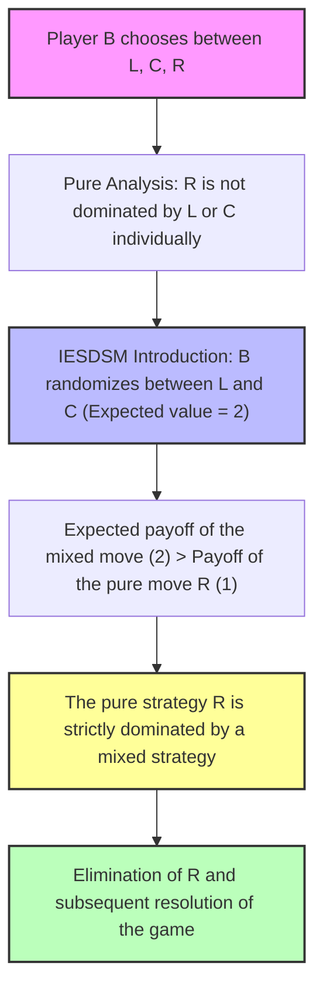
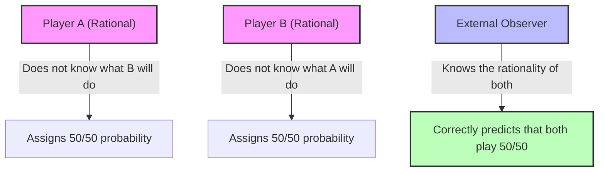

# Game Theory: Extension of Nash Equilibrium and Introduction to Mixed Strategies

## Educational Overview

In previous lessons, the **Nash Equilibrium** was introduced as a fundamental predictive tool for determining stable configurations in a normal-form game. However, the classical concept applied exclusively to pure strategies has a structural limitation: there are strictly competitive interaction games in which no pure-strategy equilibrium exists. A paradigmatic example is the **Odds and Evens** game, comparable to a coin toss, in which every strategy profile always leaves the defeated player with the regret of the choice made and makes it impossible for both players to simultaneously formulate correct and stable beliefs.

To overcome this theoretical shortcoming and guarantee the existence of an equilibrium, an extension of the action space via **Mixed Strategies** becomes necessary. Although at first glance rationality appears incompatible with this case, the player does not undergo uncontrolled exogenous randomness (as in external lotteries), but deliberately chooses and controls their own probability distribution over the available pure strategies. Formally, a mixed strategy for player $i$ is defined as a probability distribution belonging to the simplex $\Delta(S_i)$ associated with their set of pure strategies $S_i$. This randomized combination eliminates the agent's predictability and allows for the re-establishment of the absence of a unilateral incentive to deviate, defining an operational equilibrium point even in the most conflictual zero-sum contexts.

---

### Fundamentals of Mixed Strategies

#### Why expand the concept of Nash Equilibrium?
In previous modules we introduced the **Nash Equilibrium**, an extremely powerful predictive tool. Unfortunately, there are games in which no Nash equilibrium seems to exist. 

A classic example is the **Odds and Evens** game. In this game, one person ultimately wins and the other loses: consequently, the defeated player will always feel a certain amount of regret for the move made. Reasoning in terms of best responses to beliefs, it is impossible for the beliefs of both players to be correct simultaneously. This is an unpleasant situation, as something seems to be lacking in order to make effective predictions. 

However, the Nash equilibrium actually exists in this game as well, but to see it we must broaden our horizons and introduce **mixed strategies**.

> **Key Concept:** Mixed strategies represent the most difficult concept to digest in game theory. Unlike previous concepts (such as strictly dominated strategies or Pareto efficiency), mixed strategies are counterintuitive and seem to contradict the initial idea that rational players shun randomness. In reality, players dislike *external* randomness (such as an externally imposed lottery), but want to maintain control of the game. They can therefore decide deliberately to introduce uncertainty, autonomously programming a random generator (for example, a deck of cards or a coin toss).

---

#### Formalization of Mixed Strategies and the Simplex
Recall that a probability distribution on a discrete and non-empty set $A$ is a function $P: A \to [0, 1]$ such that the sum of all probability values is equal to $1$:
$$\sum_{a \in A} P(a) = 1$$

The set of all possible probability distributions on the set $A$ is called the **simplex** of $A$, and is denoted by $\Delta(A)$.

In a Normal Form Game, player $i$ typically chooses from a set of pure strategies $S_i$. We extend this definition:
* **Pure Strategy:** A single element $s_i \in S_i$.
* **Mixed Strategy:** A probability distribution $m_i$ defined on the set of pure strategies $S_i$. We denote the set of mixed strategies for player $i$ as $\Delta(S_i)$.

In practice, rather than choosing a single fixed option, the player chooses a linear combination of options by assigning a certain probability to each. For example, if $S_i = \{s_{i1}, s_{i2}\}$, the mixed strategy $m_i$ will assign probabilities $m_i(s_{i1})$ and $m_i(s_{i2})$ such that their sum equals $1$.

---

#### Expected Utility in Mixed Strategies
When players adopt mixed strategies, the payoff is no longer deterministic. We must therefore calculate the **expected utility**. There are two equivalent ways to interpret it:
1. **Physical meaning:** It is the expected value of a stochastic process, given that all players' moves are governed by independent probability distributions.
2. **Mathematical extension:** It is calculated by utility-weighting the payoffs of individual pure strategies based on the probability with which they are jointly activated.

Formally, given the mixed strategy profiles $M = (m_1, m_2, \dots, m_n)$, the probability with which a specific combination of joint pure strategies $s = (s_1, s_2, \dots, s_n)$ (where $s \in S_1 \times S_2 \times \dots \times S_n$) is chosen is given by the product of the individual probabilities, due to the independence of choices:
$$\Pr(s) = m_1(s_1) \cdot m_2(s_2) \cdots m_n(s_n)$$

The expected utility $u_i$ for player $i$ is therefore the weighted sum of the pure strategies' utilities, weighted by the respective joint probabilities:
$$u_i(m_1, m_2, \dots, m_n) = \sum_{s \in S_1 \times \dots \times S_n} \left[ \prod_{j=1}^{n} m_j(s_j) \right] u_i(s)$$

---

#### Applied Example: The Odds and Evens Game
Let us revisit the *Odds and Evens* game in which the players (named *Odd* and *Even*) choose between two pure options, which we can identify numerically as $0$ and $1$.

Assume that:
* Player *Odd* chooses pure strategy $0$ with probability $q$, and consequently pure strategy $1$ with probability $1 - q$. Their mixed strategy is identified by the parameter $q$.
* Player *Even* chooses pure strategy $0$ with probability $r$, and pure strategy $1$ with probability $1 - r$. Their mixed strategy is identified by the parameter $r$.

Let us analyze the four possible joint outcomes:
1. Outcome $(0,0)$ with probability $qr$: *Odd*'s Payoff = $-4$, *Even*'s Payoff = $+4$.
2. Outcome $(0,1)$ with probability $q(1-r)$: *Odd*'s Payoff = $+4$, *Even*'s Payoff = $-4$.
3. Outcome $(1,0)$ with probability $(1-q)r$: *Odd*'s Payoff = $+4$, *Even*'s Payoff = $-4$.
4. Outcome $(1,1)$ with probability $(1-q)(1-r)$: *Odd*'s Payoff = $-4$, *Even*'s Payoff = $+4$.

Multiplying each payoff by its respective probability and summing everything up, we obtain the expected utility for player *Odd*:
$$u_{\text{Odd}}(q, r) = -4qr + 4q(1-r) + 4(1-q)r - 4(1-q)(1-r)$$

Carrying out the algebraic calculations and collecting terms, the expression simplifies to:
$$u_{\text{Odd}}(q, r) = -4(2q - 1)(2r - 1)$$

Similarly, for player *Even* (whose payoffs are opposite to those of *Odd*):
$$u_{\text{Even}}(q, r) = 4(2q - 1)(2r - 1)$$

If we analyze this system by setting $q = \frac{1}{2}$ and $r = \frac{1}{2}$, we obtain an expected utility equal to zero for both, configuring precisely that mixed-strategy Nash equilibrium in which no one has a unilateral incentive to deviate.

---

#### The Support of a Mixed Strategy
A fundamental concept linked to mixed strategies is the **support**.

> **Definition:** Given a generic mixed strategy profile, the *support* of that strategy is the set of all pure strategies that are played with non-zero probability.

* In the case where a player is effectively "mixing" their options (e.g., choosing $q$ strictly between $0$ and $1$), the support will comprise all available pure strategies (for example, both $0$ and $1$).
* In the case where $q = 0$ or $q = 1$, the player is betting everything on a single option ($100\%$ probability). In this scenario, the mixed strategy degenerates into a **pure strategy**, and the support becomes a *singleton* (a set containing only a single element).

Although a subtle theoretical difference exists between a native pure strategy and a mixed strategy whose support contains a single element (a distinction analogous to the one seen for lotteries and information theory), using the concept of support allows us to conveniently ignore all actions that have a zero probability of occurring, focusing solely on what is actually executed in the game.

---

### Dominance, Mixed Nash Equilibrium, and Iterated Elimination (IESDSM)

So far we have introduced the concepts of dominance and Nash Equilibrium making reference primarily to pure strategy cases. However, the general concept of strategy naturally includes both pure and mixed strategies, where pure strategies simply represent a particular and degenerate case of mixed strategies. 

The fundamental question is: do the definitions given previously remain valid when extended to mixed strategies? And how does their practical application change?

---

### Extension of Dominance to Mixed Strategies

If we redefine the reference sets by moving from pure strategy profiles $S$ to probability sets over mixed strategies $\Delta S$, the definitions of strict and weak dominance retain their formal validity.

We say that a mixed strategy $m_i'$ strictly dominates strategy $m_i$ if for every opponents' mixed strategy profile $m_{-i}$ the following expected utility inequality holds:
$$u_i(m_i', m_{-i}) > u_i(m_i, m_{-i}) \quad \forall m_{-i} \in \Delta S_{-i}$$

#### The problem of practical verification
Although the formal definition is correct, applying it directly is extremely difficult in practice. The reason lies in the fact that the set of opponents' mixed strategies $m_{-i}$ belongs to a continuous and infinitely large space ($\Delta S_1 \times \dots \times \nolinebreak \Delta S_n$). Verifying the inequality for infinite combinations is impossible.

Fortunately, there is a much simpler practical criterion based on pure strategies.

> **Key Concept: Mixed Dominance Verification Criterion**
> A mixed strategy $m_i'$ strictly dominates a strategy $m_i$ if and only if the dominance inequality is satisfied for **every pure strategy** of the opponents $s_{-i} \in S_{-i}$.

*Intuition:* Since expected utility is a linear combination of the utilities associated with pure strategy profiles, if the inequality holds for all vertices of the space (the pure strategies $s_{-i}$), then it must hold for any convex combination of them (the mixed strategies $m_{-i}$). This provides us with an immediate operational tool to verify whether a mixed strategy dominates another.

---

### Extension of Nash Equilibrium to Mixed Profiles

Similarly, we extend the concept of Nash Equilibrium to mixed strategy profiles $m = (m_1, \dots, m_n)$.

A mixed strategy profile $m \in \Delta S_1 \times \dots \times \Delta S_n$ is a **Mixed Strategy Nash Equilibrium** if for every player $i$ and for every possible deviation to another mixed strategy $m_i' \in \Delta S_i$ it holds that:
$$u_i(m_i, m_{-i}) \ge u_i(m_i', m_{-i})$$

This means that no player has a unilateral incentive to deviate from their mixed strategy, as they would not obtain a superior expected utility.

#### Example: Odds and Evens
In the "Odds and Evens" game, we know that assigning probability $q = 1/2$ to the Odd player and $r = 1/2$ to the Even player zeroes out the expected payoffs, making every move optimal for the opponent. If one player chooses probability $1/2$, the other has no incentive to deviate from their mixed strategy of $1/2$, confirming that $(1/2, 1/2)$ is a stable Nash Equilibrium. 

*(Note for self-study: it can be formally verified that for the Odds and Evens game, $(1/2, 1/2)$ is the unique equilibrium by analyzing the various possible cases).*

---

### Iterated Elimination of Strictly Dominated Strategies in Mixed Strategies (IESDSM)

The introduction of mixed strategies makes our prediction tools much more powerful. Let us consider the use of Iterated Elimination of Strictly Dominated Strategies (IESDS), which in its extended version we call **IESDSM**.

#### Practical advantage of IESDSM
Take a game in which, upon superficial analysis using only pure strategies, no move can be eliminated because no pure strategy is dominated by another pure strategy. 

* **The problem of pure strategies:** A fixed strategy (e.g., move $R$ for player B) guarantees a constant payoff of $1$, while the other pure moves ($L$ or $C$) offer variations (e.g., $4$ or $0$). At first glance $R$ is not dominated by $L$ or $C$.
* **The solution with mixed strategies:** If player B decides to randomize between $L$ and $C$ (for example, by tossing a coin with $50/50$ probability), they can obtain a guaranteed expected value equal to $2$. Since $2 > 1$, the pure strategy $R$ is **strictly dominated by a mixed combination** of $L$ and $C$.

Once strategy $R$ is eliminated, the game simplifies considerably, allowing the subsequent elimination of the other players' inferior strategies (such as player A's move $D$) and directly reaching the Nash Equilibrium.

#### Fundamental theoretical properties of IESDSM
1. **Preservation of Equilibria:** Nash Equilibria survive the application of IESDSM.
2. **Order of elimination is irrelevant:** Similarly to the pure case, the order in which strictly dominated strategies are eliminated does not alter the final outcome of the process.

> **Key Concept: The danger of weak dominance**
> It is essential to apply elimination **exclusively** based on strict dominance. If weakly dominated strategies were eliminated, one would run the serious risk of:
> * Excluding and eliminating a valid Nash Equilibrium.
> * Eliminating essential components of the support (the strategies that compose the equilibrium mixed strategy), compromising the search for the correct solution to the game.

---

### The Characterization Theorem (Indifference on the Support)

When we study normal-form games, a fundamental concept is that of Nash Equilibrium. We have seen that in a Nash equilibrium none of the players has an incentive for unilateral deviation, i.e., to change their strategy to obtain a better payoff.

But what happens when we move to mixed strategies? There is a very important theorem, known as the **Characterization Theorem** (or indifference principle on the support), which explains to us precisely when a joint mixed strategy constitutes a Nash equilibrium. 

Although we will not do the formal proof, the intuition behind this theorem is extremely logical.

#### Statement of the Theorem

Let $G$ be a normal-form game and let $m$ be a joint mixed strategy. Saying that $m$ is a Nash equilibrium is equivalent to saying that:

1. For each player $i$, the expected utility of playing the mixed strategy $u_i(m)$ must be equal to the utility obtained by playing any pure strategy $s_i$ that belongs to the **support** of the mixed strategy:
   $$u_i(m) = u_i(s_i, m_{-i}) \quad \text{for every } s_i \in \text{support}$$
2. The expected utility $u_i(m)$ must be greater than or equal to the utility obtained by deviating towards any pure strategy $s_i$ that does *not* belong to the support:
   $$u_i(m) \ge u_i(s_i, m_{-i}) \quad \text{for every } s_i \notin \text{support}$$

The second part is the classical definition of absence of profitable deviation. The **first part**, however, is the true novelty and the most surprising one: if a player assigns a probability greater than zero to more than one pure strategy (i.e., those strategies form part of the support), **the utility obtained by playing each of them must be exactly the same**.

#### The Logical Intuition: The Law of Compensation

Why must utilities be identical for all strategies in the support? Let us reason by contradiction.

Imagine that your total utility $u_i(m)$ is a linear combination (a weighted average by probabilities) of different utility values associated with the pure strategies in the support. 
* If one of these pure strategies gives you a utility lower than the average and another gives you a utility higher, what happens?
* By the "law of compensation", you could make a profitable unilateral deviation: simply **decrease the probability** of playing the alternative with the lower utility and **increase the probability** of playing the one with the higher utility.

By modifying the weights in this way, your overall expected utility would increase. Consequently, the initial situation *could not* be a Nash equilibrium, because you have just found a profitable unilateral deviation.

The only way to avoid the existence of a profitable deviation (while maintaining a mixture of multiple strategies) is for **all pure strategies present in the support to yield the exact same identical payoff**.

> **Key Concept:** In a mixed Nash equilibrium, the player is "indifferent" among all the pure strategies they choose to play with non-zero probability, because each of them guarantees them the exact same expected payoff.

#### Corollary on Pure Strategies
As a consequence of this theorem, the definition of mixed-strategy Nash equilibrium is perfectly consistent with that of pure strategies. If the mixed strategy is actually a pure strategy, the support is composed of a single element (a *singleton*) and the theorem reduces to the standard definition of absence of unilateral deviation.

---

#### Calculation of Mixed Equilibrium: The "Battle of the Sexes" Game

Now that we have the Characterization Theorem, we can use it as a practical tool to calculate mixed Nash equilibria in games. Let us see how to apply it to the **Battle of the Sexes**.

Recall the dynamic: Anna and Brian must choose between a Romantic movie ($R$) and a Sci-Fi movie ($S$). Both prefer to be together, but Anna prefers $R$ and Brian prefers $S$. 
In addition to the two well-known pure strategy equilibria $(R, R)$ and $(S, S)$, we want to find out if a mixed strategy equilibrium exists.

#### Problem Setup
Assume that:
* Anna chooses strategy $R$ with probability $q$ (and therefore $S$ with probability $1-q$).
* Brian chooses strategy $R$ with probability $r$ (and therefore $S$ with probability $1-r$).

The joint mixed strategy is therefore defined by the pair $(q, r)$.

Using probabilities, we can calculate the expected utility for Anna ($u_A$) and for Brian ($u_B$) as a function of their choices. For example, Anna's expected utility will be a linear combination based on the game's payoffs weighted by the probabilities $q$ and $r$.

#### Application of the Characterization Theorem
Since we are looking for a mixed equilibrium in which both players choose both options with probability strictly between 0 and 1, the support for both comprises both $R$ and $S$.

By the Characterization Theorem, Anna's expected utility must be equal whether she chooses the pure strategy $R$ (corresponding to probability value $1$ for her choice) or whether she chooses $S$ (corresponding to value $0$). The same goes for Brian.

Let us set up the equation for Anna, equating the payoff deriving from playing her first pure strategy and the second:
* If Anna plays $R$ with certainty ($A = 1$), her expected payoff depends entirely on Brian's probability $r$.
* If Anna plays $S$ with certainty ($A = 0$), the expected utility changes.

By developing the analytical expression of Anna's utility based on the mixture $(q, r)$ and equating the pure options, we obtain the value of the opponent's strategy. Specifically:
* By imposing the indifference condition for Anna, we derive the optimal probability for **Brian**: 
  $$r = \frac{1}{3}$$
* By imposing the indifference condition for Brian, we derive the optimal probability for **Anna**: 
  $$q = \frac{2}{3}$$

> **Note:** Remember the practical "trick" for binary problems: by imposing the indifference condition for one player, one solves the equation by finding the probability of the *other* player's move.

We have thus found a new mixed strategy Nash equilibrium:
$$(q, r) = \left(\frac{2}{3}, \frac{1}{3}\right)$$
where Anna chooses $R$ with probability $\frac{2}{3}$ and Brian chooses $R$ with probability $\frac{1}{3}$ (which means Brian chooses $S$ with probability $\frac{2}{3}$, accommodating his preference for science fiction).

#### Intuitive Interpretation of Mixed Equilibrium
What does this result mean at a practical level? 
In games like *Odds and Evens*, the equilibrium solution is symmetric and $50\%$ unpredictable ($\frac{1}{2}, \frac{1}{2}$), just like a fair coin toss.

In the *Battle of the Sexes*, however, preferences are asymmetric (Anna loves romance, Brian science fiction). The mixed solution reflects this asymmetry:
* Anna chooses her favorite movie ($R$) more often ($\frac{2}{3}$ of the time).
* Brian chooses his favorite movie ($S$) more often (meaning he chooses $R$ only $\frac{1}{3}$ of the time).

This randomized behavior is closer to certain real-world dynamics than the rigidity of pure strategies. 

*One final reflection:* It can happen that, following this random planning, Anna and Brian end up in different cinemas (because probabilities sometimes do not align). However, the Nash equilibrium should not be seen as the result of a single isolated attempt, but as **the long-term optimal planning strategy** to maximize one's expected payoffs under conditions of uncertainty.

---

### Nash's Theorem and the Introduction of Mixed Strategies

#### Nash's Theorem and the mixed-strategy postulate
Observing normal-form games, we realize that many of them seem to possess no pure-strategy Nash equilibrium (as in the case of the *Odds and Evens* game). To resolve this impasse, John Nash adopted an approach conceptually similar to that of theoretical physicists: when a theoretical model presents a gap but an elegant architecture, the existence of the missing element is hypothesized to complete the picture. 

Nash therefore postulated that players, rather than deterministically choosing a single move, could **randomize** their choice. This behavior can lead to a stable situation in which no player has a unilateral incentive to deviate, thus defining a **Nash Equilibrium** in mixed strategies.

> **Key Concept: Nash's Existence Theorem (1950)**
> *Any game with finite strategy sets possesses at least one Nash equilibrium, provided that the use of mixed strategies is allowed.*

This theorem guarantees the existence of a solution for every finite game. However, it presents some limitations:
1. It is a theorem of **existence** only: it tells us that the solution exists, but does not explain how easy or difficult it is to actually calculate it.
2. In some games, equilibria can be multiple (for example, in the *Battle of the Sexes* we have three), requiring a selection criterion among them.

---

#### The problem of the physical and rational interpretation of mixed strategies
Accepting mixed strategies from a mathematical point of view is simple, but a problem of physical and behavioral interpretation arises: does it make sense for **rational** players to rely on chance? 

If a player decides to toss a coin to choose what to do, they are abdicating their rationality. Furthermore, at the end of the game, the player will still have to perform a concrete action (play a pure strategy). No one plays "half a move": at the moment of execution, the choice becomes deterministic. Over time, various interpretations have been proposed to give concrete meaning to mixed strategies:

1. **The Law of Large Numbers:**
   If a game is repeated a very large number of times ($M$ times) and the player chooses to act with a certain probability $Q$, they will obtain a frequency of successes equal to $Q \cdot M$. 
   *Limitation of the approach:* Game theory typically studies *static games of complete information* played **only once** (one-shot). Even assuming the game is repeated multiple times while wiping out memory, real players retain memory of past history.

2. **Fuzzy Logic:**
   Inspired by fuzzy logic developed in the 20th century, this interpretation suggests that playing with probability $1/2$ (as in the *Odds and Evens* game) does not mean drawing lots, but rather being in a state of "indecision" or in an intermediate condition between zero and one.

3. **The Interpretation via Beliefs — *The most accepted in modern Game Theory***
   The uncertainty described by mixed strategies does not reflect erratic or random behavior of the individual player, but **the opponent's lack of information**.
   * I know exactly what I decided to play (my choice is determined in my mind, even if I do not communicate it).
   * From the point of view of my opponent, however, my move is entirely uncertain.
   
If players are rational, their correct belief in pure conflict games like *Odds and Evens* is precisely the admission of ignorance: *"I don't know what the opponent will do"*. If we erroneously hypothesized that the opponent plays a certain pure move, we would commit an exploitable error. The optimal attitude is therefore to assign a probability distribution to the opponent's moves.

---

#### The prediction of unpredictability
By applying the interpretation via beliefs, we arrive at a paradoxical yet coherent result: **we succeed in predicting that it is impossible to predict**.

If we observe two people playing *Odds and Evens* on the street, assuming they are both perfectly rational:
* Player A believes the opponent plays $50/50$.
* Player B believes the opponent plays $50/50$.
* The external observer deduces the exact same thing.

In this way, the theoretical prediction turns out to be correct: **the Nash equilibrium is reached precisely at the moment we predict that we cannot predict the specific moves of the opponent**, fully respecting the physical and rational meaning of the model.