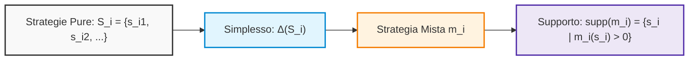
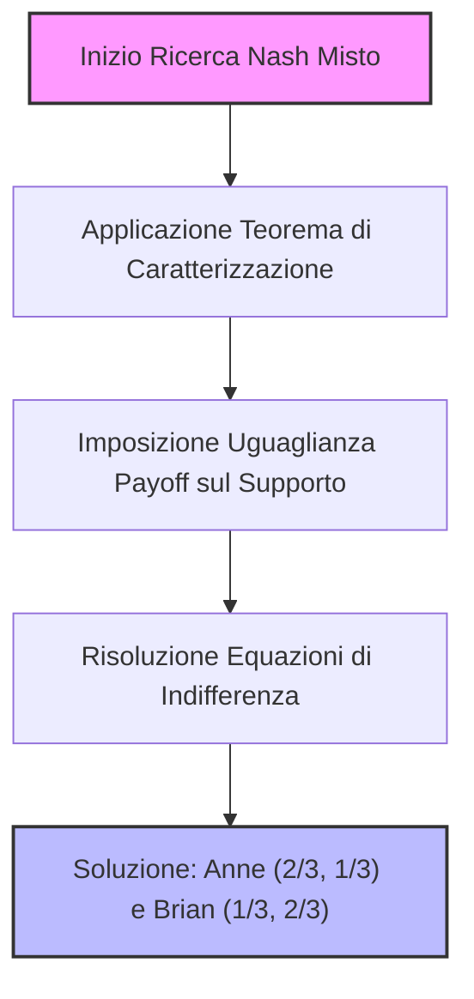
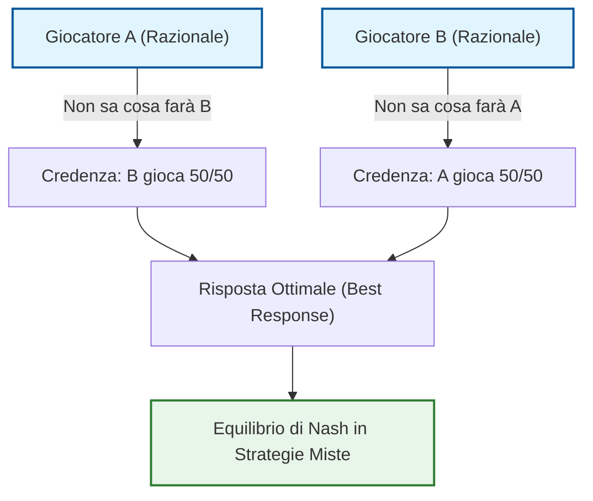

# Teoria dei Giochi: Estensione dell'Equilibrio di Nash e Introduzione alle Strategie Miste

## Overview Didattica

In questa lezione viene affrontato il limite fondamentale dell'**Equilibrio di Nash** (*Nash Equilibrium*) nella sua formulazione classica in strategie pure, ovvero l'impossibilità di descrivere o prevedere l'esito di giochi strettamente competitivi a somma zero, come il gioco del "Pari o Dispari" (*Odds and Evens*). In tali contesti, la presenza inevitabile del rimpianto (*regret*) per lo sconfitto e l'impossibilità di formulare credenze mutuamente consistenti determinano l'assenza di un equilibrio deterministico.

Per superare questo stallo concettuale, viene introdotta la nozione di **Strategia Mista** (*Mixed Strategy*), classificata come **Concetto Chiave** dell'insegnamento:
* **Aleatorietà controllata:** A differenza del rischio esogeno (come nelle lotterie), la randomizzazione è qui endogena; il giocatore razionale sceglie deliberatamente di rendere imprevedibile la propria azione.
* **Formalizzazione matematica:** Una strategia mista per il giocatore $i$ è definita formalmente come una distribuzione di probabilità $\mu_i$ sull'insieme discreto delle strategie pure $S_i$, appartenente al simplesso di probabilità (*simplex*) indicato con $\Delta(S_i)$, tale per cui:
  $$\sum_{s \in S_i} \mu_i(s) = 1 \quad \text{con} \quad \mu_i(s) \in [0, 1]$$
* **Intuizione dell'equilibrio:** Tramite l'estensione euristica del gioco con scelte intermedie probabilistiche (ad esempio, giocare con probabilità $1/2$), si introduce l'idea che l'equilibrio emerga quando i payoff attesi si bilanciano, rendendo gli avversari indifferenti rispetto alle deviazioni unilaterali.

---

### Oltre l'Equilibrio Puro: La Necessità delle Strategie Miste

Nei giochi analizzati finora, l'**Equilibrio di Nash** (*Nash Equilibrium*) si è dimostrato uno strumento predittivo formidabile. Tuttavia, ci si scontra presto con un limite evidente: esistono giochi in cui sembra non esserci alcun equilibrio di Nash.

Un esempio lampante è il classico **Gioco Pari e Dispari** (*Odds and Evens Game*). In questo contesto, due giocatori mostrano contemporaneamente un numero (ad esempio $0$ oppure $1$):
* Se la somma è pari, vince il giocatore *Pari* (*Even*).
* Se la somma è dispari, vince il giocatore *Dispari* (*Odd*).

Trattandosi di un gioco a somma zero, uno vince e l'altro perde. Di conseguenza, chi perde avrà sempre un "rimorso" (*regret*) su ciò che ha giocato e avrebbe preferito cambiare mossa. Inoltre, se ciascun giocatore formula una congettura (*belief*) razionale sulla mossa dell'avversario e gioca la propria migliore risposta, è impossibile che le convinzioni di entrambi siano corrette simultaneamente. Il gioco è progettato per simulare il lancio di una moneta: sembra per sua natura imprevedibile. 

Eppure, l'idea di non poter applicare l'equilibrio di Nash a una classe così comune di interazioni è inaccettabile. L'equilibrio in realtà esiste, ma per trovarlo è necessario ampliare lo spazio delle azioni ammissibili introducendo le **Strategie Miste** (*Mixed Strategies*).

#### Il Paradosso dell'Aleatorietà: Caso Esterno vs Randomizzazione Controllata

All'inizio dello studio della teoria delle decisioni si è assunto che un agente razionale non ami l'incertezza intesa come aleatorietà esogena (come nelle lotterie subite passivamente). 

Nelle strategie miste, tuttavia, la casualità non piove dall'alto: **sono i giocatori stessi a scegliere deliberatamente di randomizzare la propria mossa**. Il decisore mantiene il pieno controllo della distribuzione di probabilità con cui agirà. 
Un'analogia efficace è quella dei giochi di carte collezionabili (come *Magic: The Gathering*, ideato proprio da matematici e teorici dei giochi): pescare una carta dal mazzo introduce un elemento casuale, ma la composizione del mazzo è stata programmata e ottimizzata a priori in modo del tutto razionale.

---

### Formalizzazione Matematica: Distribuzioni e Simplesso

In un gioco in forma normale, indichiamo con $S_i$ l'insieme non vuoto e discreto delle **Strategie Pure** (*Pure Strategies*) a disposizione del giocatore $i$.

Una **Strategia Mista** (*Mixed Strategy*) per il giocatore $i$, indicata con $m_i$, è una distribuzione di probabilità definita su $S_i$:
$$m_i: S_i \to [0, 1] \quad \text{tale che} \quad \sum_{s_i \in S_i} m_i(s_i) = 1$$

L'insieme di tutte le possibili distribuzioni di probabilità su $S_i$ prende il nome di **Simplesso di Probabilità** (*Probability Simplex*) e si denota con $\Delta(S_i)$ o $\Delta S_i$.

#### Supporto di una Strategia Mista

Data una strategia mista generica $m_i \in \Delta(S_i)$, si definisce **Supporto** (*Support*) l'insieme delle strategie pure giocate con probabilità strettamente positiva:
$$\text{supp}(m_i) = \{ s_i \in S_i \mid m_i(s_i) > 0 \}$$

* **Strategie pure come casi degeneri**: Se il supporto è un singoletto ($\text{supp}(m_i) = \{s_i\}$), significa che il giocatore assegna probabilità $1$ a una specifica azione e $0$ a tutte le altre. Le strategie pure sono quindi semplicemente strategie miste degeneri.
* **Strategie strettamente miste**: Quando il supporto contiene due o più strategie pure, il giocatore sta effettivamente randomizzando tra più alternative.

---

### Estensione dell'Utilità: Il Calcolo dell'Utilità Attesa

Nei giochi a informazione completa e mosse simultanee, le scelte dei giocatori sono mutuamente indipendenti. Se ogni giocatore $j \in \{1, \dots, n\}$ adotta una strategia mista $m_j$, la probabilità congiunta che si realizzi uno specifico profilo di strategie pure $s = (s_1, s_2, \dots, s_n) \in S$ è data dal prodotto delle singole probabilità:
$$P(s) = \prod_{j=1}^n m_j(s_j)$$

L'utilità di un giocatore non è più un valore deterministico, ma diventa un'**Utilità Attesa** (*Expected Utility*). Seguendo l'approccio di von Neumann-Morgenstern, l'utilità estesa al profilo congiunto di strategie miste $m = (m_1, \dots, m_n)$ si calcola come:
$$u_i(m) = \sum_{s \in S} \left( \prod_{j=1}^n m_j(s_j) \right) u_i(s)$$

Questa formulazione soddisfa pienamente la proprietà di linearità rispetto alle probabilità ed estende il dominio della funzione di utilità da $S$ al simplesso congiunto $\Delta(S_1) \times \dots \times \Delta(S_n)$.

---

### Esempio Operativo: Risoluzione di Pari e Dispari

Consideriamo il gioco Pari e Dispari con la seguente matrice delle utilità pure:

| Dispari \ Pari | $0$ | $1$ |
| :---: | :---: | :---: |
| **$0$** | $(-4, +4)$ | $(+4, -4)$ |
| **$1$** | $(+4, -4)$ | $(-4, +4)$ |

Parametrizziamo le scelte probabilistiche:
* Il giocatore **Dispari** sceglie la strategia pura $0$ con probabilità $q$, e la strategia $1$ con probabilità $1 - q$.
* Il giocatore **Pari** sceglie la strategia pura $0$ con probabilità $r$, e la strategia $1$ con probabilità $1 - r$.

Le coppie di strategie pure $(s_{\text{Dispari}}, s_{\text{Pari}})$ hanno dunque probabilità indipendenti:
* $(0, 0)$ con probabilità $q \cdot r \implies$ payoff: $(-4, +4)$
* $(0, 1)$ con probabilità $q(1 - r) \implies$ payoff: $(+4, -4)$
* $(1, 0)$ con probabilità $(1 - q)r \implies$ payoff: $(+4, -4)$
* $(1, 1)$ con probabilità $(1 - q)(1 - r) \implies$ payoff: $(-4, +4)$

#### Calcolo del Payoff Atteso per il Giocatore Dispari

Calcoliamo l'utilità attesa $u_{\text{Dispari}}(q, r)$:
$$u_{\text{Dispari}}(q, r) = -4qr + 4q(1 - r) + 4(1 - q)r - 4(1 - q)(1 - r)$$

Raccogliendo il fattore $-4$:
$$u_{\text{Dispari}}(q, r) = -4 \Big[ qr - q(1 - r) - (1 - q)r + (1 - q)(1 - r) \Big]$$

Sviluppando i prodotti all'interno della parentesi quadra:
$$\begin{aligned}
qr - q + qr - r + qr + 1 - q - r + qr &= 4qr - 2q - 2r + 1 \\
&= (2q - 1)(2r - 1)
\end{aligned}$$

Otteniamo quindi:
$$u_{\text{Dispari}}(q, r) = -4(2q - 1)(2r - 1)$$

Poiché il gioco è a somma zero ($u_{\text{Pari}} = -u_{\text{Dispari}}$):
$$u_{\text{Pari}}(q, r) = +4(2q - 1)(2r - 1)$$

#### Interpretazione del Risultato

Se il giocatore Dispari sceglie $q = \frac{1}{2}$, il termine $(2q - 1)$ si annulla:
$$u_{\text{Dispari}}\left(\frac{1}{2}, r\right) = -4 \left(2 \cdot \frac{1}{2} - 1\right)(2r - 1) = 0 \quad \forall r$$

Allo stesso modo, se il giocatore Pari imposta $r = \frac{1}{2}$:
$$u_{\text{Pari}}\left(q, \frac{1}{2}\right) = 0 \quad \forall q$$

La combinazione $(q^*, r^*) = \left(\frac{1}{2}, \frac{1}{2}\right)$ genera un payoff pari a $(0, 0)$. Nessun giocatore può ottenere un'utilità strettamente maggiore deviando unilateralmente: entrambi ottengono $0$ qualsiasi altra probabilità decidano di adottare. Questo profilo costituisce l'**Equilibrio di Nash in strategie miste** del gioco.

---

### Dominanza con Strategie Miste

I concetti di dominanza stretta e debole possono essere estesi direttamente alle strategie miste:

* Una strategia mista $m_i' \in \Delta(S_i)$ **domina strettamente** (*strictly dominates*) $m_i \in \Delta(S_i)$ se:
  $$u_i(m_i', m_{-i}) > u_i(m_i, m_{-i}) \quad \forall m_{-i} \in \Delta(S_{-i})$$

* Una strategia mista $m_i' \in \Delta(S_i)$ **domina debolmente** (*weakly dominates*) $m_i \in \Delta(S_i)$ se:
  $$u_i(m_i', m_{-i}) \ge u_i(m_i, m_{-i}) \quad \forall m_{-i} \in \Delta(S_{-i})$$
  con disuguaglianza stretta per almeno un profilo $m_{-i}$.

#### Concetto Chiave: Riduzione alle Strategie Pure degli Avversari

La definizione formale richiede di testare la disuguaglianza per ogni possibile profilo $m_{-i}$. Poiché lo spazio delle strategie miste dei rivali $\Delta(S_{-i})$ è continuo e infinito, verificare questa condizione elemento per elemento sarebbe ingestibile.

Fortunatamente, entra in gioco un principio fondamentale basato sulla linearità dell'utilità attesa:

> **Criterio di Riduzione per la Dominanza**:
> Per verificare se una strategia mista $m_i'$ domina una strategia $m_i$, **è sufficiente testare la disuguaglianza unicamente contro le strategie pure degli avversari** $s_{-i} \in S_{-i}$.
>
> $$u_i(m_i', m_{-i}) > u_i(m_i, m_{-i}) \quad \forall m_{-i} \in \Delta(S_{-i}) \iff u_i(m_i', s_{-i}) > u_i(m_i, s_{-i}) \quad \forall s_{-i} \in S_{-i}$$

#### Intuizione della Dimostrazione

1. **Necessità ($\implies$)**: Se la disuguaglianza vale per ogni profilo misto $m_{-i}$, vale anche per i profili degeneri in cui gli avversari giocano strategie pure con probabilità $1$.
2. **Sufficienza ($\impliedby$)**: L'utilità attesa contro un profilo misto $m_{-i}$ è una combinazione lineare convessa delle utilità ottenute contro i singoli profili puri $s_{-i}$:
   $$u_i(m_i, m_{-i}) = \sum_{s_{-i} \in S_{-i}} P(s_{-i}) \cdot u_i(m_i, s_{-i})$$
   Se per ogni componente pura $s_{-i}$ vale $u_i(m_i', s_{-i}) > u_i(m_i, s_{-i})$, moltiplicando ambo i membri per i pesi non negativi $P(s_{-i})$ (la cui somma è $1$), la disuguaglianza stretta si conserva per qualsiasi combinazione convessa.

Questo risultato trasforma una verifica teoricamente impraticabile su uno spazio infinito in un controllo banale su un numero finito di casi.

---

### Equilibrio di Nash in Strategie Miste, IESDSM e Teorema di Caratterizzazione

#### Estensione del concetto di Equilibrio di Nash
Estendiamo ora la definizione di Equilibrio di Nash (Nash Equilibrium) passando dalle strategie pure alle strategie miste (mixed strategies). Un profilo di strategie miste congiunte $m = (m_1, m_2, \dots, m_N)$, appartenente al prodotto cartesiano di tutti i singoli spazi delle strategie miste $\Delta(S_i)$, è un **Equilibrio di Nash in Strategie Miste** se per ogni giocatore $i$ vale la condizione:

$$u_i(m) \ge u_i(m'_i, m_{-i}) \quad \forall m'_i \in \Delta(S_i)$$

Il significato concettuale non cambia rispetto alle strategie pure: l'equilibrio garantisce che nessun giocatore abbia un incentivo a una deviazione unilaterale (unilateral deviation) verso un'altra strategia mista, poiché non otterrebbe un payoff superiore.

Riprendendo il gioco del *Pari o Dispari* (Odds and Evens), avevamo dimostrato che se entrambi i giocatori scelgono la probabilità $1/2$ (giocare *pari* o *dispari* con pari probabilità, $q = 1/2$ e $r = 1/2$), nessun giocatore ha un incentivo unilaterale a cambiare la propria mossa. Se per esempio il giocatore *Dispari* gioca con probabilità $1/2$ e il giocatore *Pari* sceglie deterministicamente una mossa fissa, allora *Dispari* troverebbe vantaggioso deviare per massimizzare il proprio guadagno. Quando entrambi giocano $1/2$, si trovano in una risposta ottima (best response) reciproca.

---

#### IESDSM: Eliminazione Iterata delle Strategie Miste Dominate
Abbiamo visto in precedenza l'eliminazione iterata delle strategie rigorosamente dominate (IESDS, *Iterated Elimination of Strictly Dominated Strategies*). Estendiamo ora questa tecnica alle strategie miste, ottenendo la **IESDSM** (*Iterated Elimination of Strictly Dominated Strategies in Mixed Strategies*).

Consideriamo una matrice di payoff in cui, a un'analisi superficiale basata solo sulle strategie pure, potremmo non trovare alcuna strategia rigorosamente dominata da eliminare. Ad esempio, una strategia pura $R$ potrebbe garantire sempre un payoff costante (es. $1$), mentre un'altra strategia potrebbe oscillare tra $0$ e $4$. In questo caso, $R$ non è dominata da alcuna strategia *pura* presa singolarmente.

Tuttavia, se un giocatore sceglie di randomizzare tra due strategie pure (lanciare una moneta, es. tra $L$ e $C$), può ottenere un valore atteso (expected value) superiore rispetto alla strategia pura $R$. 

> **Concetto Chiave: Dominanza di una Combinazione Mista**
> Una strategia pura può non essere dominata da alcuna altra singola strategia pura, ma risultare **strettamente dominata da una combinazione mista** di altre strategie.

Applicando la IESDSM:
1. Si identificano le strategie pure dominate da combinazioni miste (come la strategia $R$ nel nostro esempio) e le si elimina.
2. La riduzione dello spazio delle strategie rende visibili nuove dominanze (es. eliminazione di strategie divenute sub-ottimali come $D$).
3. Il processo converge a una soluzione di equilibrio più potente ed efficiente.

I teoremi visti per la IESDS classica valgono identici anche per la IESDSM: l'ordine di eliminazione è ininfluente e gli Equilibri di Nash sopravvivono all'eliminazione.

> **Attenzione**: È fondamentale utilizzare **solo la dominanza rigorosa** (strict dominance). Eliminare strategie debolmente dominate (weakly dominated strategies) rischia di scartare per errore l'equilibrio di Nash stesso o parte del supporto (support) necessario per trovarlo.

---

#### Teorema di Caratterizzazione (Characterization Theorem)
Per trovare e verificare gli equilibri di Nash in strategie miste senza dover esplorare l'intero spazio delle probabilità per tentativi, utilizziamo un teorema fondamentale.

Sia $G$ un gioco in forma normale e $m$ un profilo di strategie miste congiunte. $m$ è un **Equilibrio di Nash** se e solo se, per ciascun giocatore $i$:
1. $u_i(m) = u_i(s_i, m_{-i})$ per ogni strategia pura $s_i$ che appartiene al **supporto** (support) di $m_i$ (cioè le strategie giocate con probabilità maggiore di zero).
2. $u_i(m) \ge u_i(s_i, m_{-i})$ per ogni strategia pura $s_i$ che **non** appartiene al supporto.

##### Intuizione del Teorema
Se un giocatore sta mescolando due o più strategie pure in un equilibrio di Nash, **tutte le strategie pure presenti nel suo supporto devono necessariamente garantirgli esattamente lo stesso identico payoff atteso**. 

Se così non fosse (se una strategia pura del supporto desse un payoff inferiore a un'altra), il giocatore avrebbe una deviazione unilaterale vantaggiosa: basterebbe azzerare la probabilità associata alla strategia con rendimento minore e aumentare quella con rendimento maggiore, contraddicendo la definizione stessa di equilibrio di Nash.

---

#### Esercizio Pratico: Battaglia dei Sessi (Battle of the Sexes)
Riprendiamo il gioco della *Battaglia dei Sessi*, in cui i giocatori Anne e Brian devono scegliere tra uno spettacolo Romantico ($R$) o Sci-Fi ($S$). Sappiamo che esistono due equilibri di Nash in strategie pure $(R, R)$ e $(S, S)$. Cerchiamo ora un eventuale **equilibrio di Nash in strategie miste**.

Sia $q$ la probabilità con cui Anne sceglie $R$ e $r$ la probabilità con cui Brian sceglie $R$. Le probabilità complementari per $S$ saranno $(1-q)$ e $(1-r)$.

Applicando il Teorema di Caratterizzazione, supponiamo che il supporto per entrambi i giocatori includa sia $R$ che $S$ (entrambe le scelte hanno probabilità comprese tra $0$ e $1$). Per fare in modo che Anne sia indifferente tra giocare $R$ e giocare $S$, il payoff atteso deve essere identico in entrambi i casi, valutato in base alla probabilità scelta da Brian ($B$).

Impostando le equazioni di indifferenza:
- Il payoff atteso di Anne giocando $R$ e $S$ deve uguagliarsi, il che ci permette di ricavare la probabilità ottima di Brian.
- Sviluppando i calcoli simmetrici per Brian, troviamo la probabilità ottima di Anne.

Il procedimento algebrico porta a identificare il seguente profilo di strategie miste di equilibrio:
- Anne sceglie $R$ con probabilità $q = \frac{2}{3}$ (e $S$ con $1/3$).
- Brian sceglie $R$ con probabilità $r = \frac{1}{3}$ (e $S$ con $2/3$).

##### Interpretazione dei Risultati
Mentre nel *Pari o Dispari* la soluzione simmetrica $(1/2, 1/2)$ rifletteva l'esigenza di totale imprevedibilità (come lanciare una moneta), nella *Battaglia dei Sessi* le probabilità sono sbilanciate ($\frac{2}{3}$ e $\frac{1}{3}$). Questo accade perché i giocatori desiderano incontrarsi, ma ciascuno preferisce la propria ambientazione preferita. 

Adottare questa pianificazione mista rappresenta la strategia migliore di lungo termine per massimizzare i propri payoff attesi, anche se in alcuni casi specifici i due attori finiranno per non incontrarsi. L'equilibrio di Nash in strategie miste va interpretato come una **strategia di pianificazione ottimale** sotto incertezza.

---

### Conclusioni e Approfondimenti: Il Teorema di Nash e l'Interpretazione delle Strategie Miste

#### Il Teorema di Nash e la necessità delle strategie miste

Finora abbiamo analizzato vari giochi, notando come in alcuni casi (come il gioco *Odds and Evens*) sembri non esistere alcun equilibrio di Nash in strategie pure. Per risolvere questo problema, John Nash operò nel 1950 in modo simile a quanto fanno i fisici subatomici quando postulano l'esistenza di una particella mancante per completare una tabella teorica: **postulò l'esistenza di un equilibrio**, introducendo il concetto di **strategie miste (mixed strategies)**.

> **Concetto Chiave: Il Teorema di Esistenza di Nash**
> Dimostrato da John Nash nel 1950, il teorema stabilisce che *ogni gioco con insiemi di strategie finiti possiede almeno un equilibrio di Nash*, a patto di ammettere strategie miste.

Questo risultato è estremamente potente, sebbene presenti dei limiti. Si tratta infatti di un teorema di sola *esistenza*: garantisce che una soluzione esista sempre, ma non dice quanto sia facile o difficile calcolarla. Inoltre, mentre in alcuni giochi (come *Battle of the Sexes*) gli equilibri possono essere molteplici, in altri dove le strategie pure fallivano (come *Odds and Evens*), l'introduzione delle strategie miste garantisce comunque una soluzione.

---

#### Il problema dell'interpretazione fisica delle strategie miste

Accettare matematicamente le strategie miste solleva un problema di interpretazione pratica: *che cosa significano nella realtà?* Trattandosi di giocatori razionali, l'idea che un individuo agisca come il personaggio "Due Facce" di Batman—affidandosi al lancio di una moneta per decidere—sembra l'epitome dell'irrazionalità. 

Inoltre, alla fine del gioco, il giocatore deve comunque compiere un'azione concreta (giocare una strategia pura). Non è possibile "giocare a metà" una mossa in un gioco statico a informazione completa. Nel corso del tempo sono state proposte tre diverse interpretazioni per dare un senso fisico alle strategie miste:

1. **La legge dei grandi numeri (Large Numbers):** 
   L'idea originaria di Nash era che, se il gioco viene ripetuto molte volte ($M$ volte) e il giocatore randomizza secondo una certa probabilità $Q$, allora per la legge dei grandi numeri otterrà una certa percentuale di successi. 
   * *Critica:* Questa interpretazione mal si adatta ai giochi statici, che per definizione sono one-shot (giocati una sola volta). I giocatori reali mantengono memoria della storia passata e non resettano la propria memoria a ogni turno come farebbe un computer.

2. **La logica fuzzy (Fuzzy Logic):**
   Sviluppata nel XX secolo, suggerisce che giocare con una probabilità del $50\%$ ($1/2$) significhi trovarsi in uno stato intermedio di indecisione tra zero e uno.
   * *Critica:* Sebbene descriva bene lo stato mentale di chi non sa cosa fare (specialmente in giochi come *Odds and Evens*), non giustifica rigorosamente il comportamento strategico razionale.

3. **L'interpretazione tramite le Credenze (Beliefs):**
   È l'interpretazione moderna più valida e comunemente accettata nella teoria dei giochi contemporanea.

---

#### L'interpretazione basata sulle credenze (*Beliefs*)

La svolta concettuale consiste nel comprendere che l'incertezza espressa dalle strategie miste non rifplica l'indecisione o l'erraticità del singolo giocatore, bensì **la percezione degli avversari**.

* Io so esattamente cosa ho deciso di giocare (la mia scelta è determinata, anche se non la comunico).
* Dal punto di vista dell'avversario, tuttavia, la mia mossa è del tutto incerta. 

Se due giocatori sono perfettamente razionali in un gioco come *Odds and Evens*, la loro credenza corretta sull'avversario è proprio di totale incertezza (ipotizzare che l'altro giochi $50/50$). Se un giocatore commettesse l'errore di credere che l'avversario scelga deterministicamente un'opzione, adatterebbe la sua risposta di conseguenza, diventando vulnerabile a una contromossa.

Paradossalmente, attraverso questa chiave di lettura, raggiungiamo l'obiettivo del teorema di Nash: **riusciamo a prevedere che non possiamo prevedere**, e questa previsione collettiva risulta essere perfettamente corretta. Nel *Dilemma del Prigioniero*, la credenza corretta è che l'altro confesserà (strategia pura); in giochi di puro conflitto come *Odds and Evens*, la credenza corretta è mista. 

In conclusione, l'interpretazione tramite le credenze rispetta il significato fisico dell'impossibilità di prevedere le mosse immediate, elevando però l'analisi a un livello superiore di deduzione comune tra agenti intelligenti.