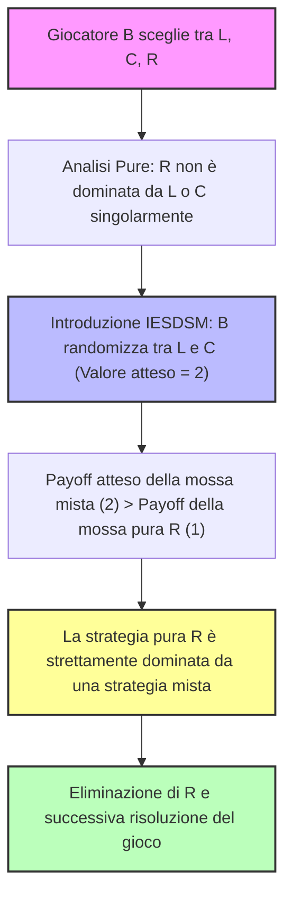
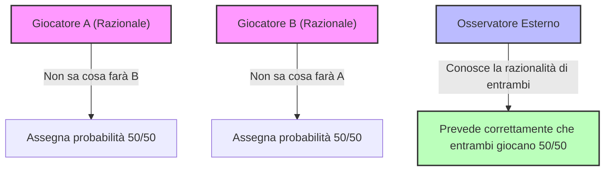

# Teoria dei Giochi: Estensione dell'Equilibrio di Nash e Introduzione alle Strategie Miste

## Overview Didattica

Nelle lezioni precedenti l'**Equilibrio di Nash (Nash Equilibrium)** è stato introdotto come uno strumento predittivo fondamentale per determinare le configurazioni stabili in un gioco in forma normale. Tuttavia, il concetto classico applicato alle sole strategie pure presenta un limite strutturale: esistono giochi a interazione strettamente competitiva in cui non esiste alcun equilibrio in strategie pure. Un esempio paradigmatico è il gioco di **Pari e Dispari (Odds and Evens)**, assimilabile al lancio di una moneta (*coin toss*), nel quale ogni profilo di strategie lascia sempre lo sconfitto con il rimpianto (*regret*) della scelta effettuata e rende impossibile per entrambi i giocatori formulare credenze corrette e stabili in modo simultaneo.

Per superare questa lacuna teorica e garantire l'esistenza dell'equilibrio, si rende necessaria un'estensione dello spazio delle azioni tramite le **Strategie Miste (Mixed Strategies)**. Sebbene a una prima analisi la razionalità sembri incompatibile con il caso, il giocatore non subisce una casualità esogena incontrollata (come nelle lotterie esterne), ma sceglie deliberatamente e controlla una propria distribuzione di probabilità sulle strategie pure disponibili. Formalmente, una strategia mista per il giocatore $i$ è definita come una distribuzione di probabilità appartenente al simplesso $\Delta(S_i)$ associato al suo insieme di strategie pure $S_i$. Questa combinazione randomizzata elimina la prevedibilità dell'agente e consente di ristabilire l'assenza di incentivo unilaterale alla deviazione, definendo un punto di equilibrio operativo anche nei contesti a somma zero più conflittuali.

---

### Fondamenti delle Strategie Miste

#### Perché espandere il concetto di Equilibrio di Nash?
Nei moduli precedenti abbiamo introdotto l'**Equilibrio di Nash (Nash Equilibrium)**, uno strumento predittivo estremamente potente. Purtroppo, esistono giochi in cui sembra non esistere alcun equilibrio di Nash. 

Un esempio classico è il **gioco di Pari e Dispari (Odds and Evens)**. In questo gioco, alla fine una persona vince e l'altra perde: di conseguenza, il giocatore sconfitto proverà sempre un certo rimpianto (regret) per la mossa fatta. Ragionando in termini di risposte ottimali alle credenze (beliefs), è impossibile che le credenze di entrambi i giocatori siano corrette contemporaneamente. Si tratta di una situazione spiacevole, poiché sembra mancare qualcosa per poter fare previsioni efficaci. 

Tuttavia, l'equilibrio di Nash in realtà esiste anche in questo gioco, ma per vederlo dobbiamo estendere i nostri orizzonti e introdurre le **strategie miste (mixed strategies)**.

> **Concetto Chiave:** Le strategie miste rappresentano il concetto più complesso da digerire in teoria dei giochi. A differenza di concetti precedenti (come le strategie strettamente dominate o l'efficienza paretiana), le strategie miste risultano poco intuitive e sembrano contraddire l'idea iniziale che i giocatori razionali rifuggano la casualità (*randomness*). In realtà, i giocatori non amano la casualità *esterna* (come una lotteria imposta dall'esterno), ma vogliono mantenere il controllo del gioco. Possono quindi decidere deliberatamente di introdurre dell'incertezza, programmando in autonomia un generatore casuale (ad esempio, un mazzo di carte o il lancio di una moneta).

---

#### Formalizzazione delle Strategie Miste e del Simplesso
Ricordiamo che una distribuzione di probabilità su un insieme discreto e non vuoto $A$ è una funzione $P: A \to [0, 1]$ tale che la somma di tutti i valori di probabilità sia pari a $1$:
$$\sum_{a \in A} P(a) = 1$$

L'insieme di tutte le possibili distribuzioni di probabilità sull'insieme $A$ prende il nome di **simplesso (simplex)** di $A$, e viene denotato con $\Delta(A)$.

In un gioco in forma normale (Normal Form Game), un giocatore $i$ sceglie solitamente tra un insieme di strategie pure $S_i$. Estendiamo questa definizione:
* **Strategia Pura (Pure Strategy):** Un singolo elemento $s_i \in S_i$.
* **Strategia Mista (Mixed Strategy):** Una distribuzione di probabilità $m_i$ definita sull'insieme delle strategie pure $S_i$. Denotiamo l'insieme delle strategie miste per il giocatore $i$ come $\Delta(S_i)$.

In pratica, invece di scegliere un'unica opzione fissa, il giocatore sceglie una combinazione lineare di opzioni assegnando a ciascuna una certa probabilità. Ad esempio, se $S_i = \{s_{i1}, s_{i2}\}$, la strategia mista $m_i$ assegnerà probabilità $m_i(s_{i1})$ e $m_i(s_{i2})$ tali che la loro somma faccia $1$.

---

#### Utilità Attesa (Expected Utility) nelle Strategie Miste
Quando i giocatori adottano strategie miste, la ricompensa (payoff) non è più deterministica. Dobbiamo quindi calcolare l'**utilità attesa (expected utility)**. Esistono due modi equivalenti per interpretarla:
1. **Significato fisico:** È il valore atteso di un processo stocastico, dato che le mosse di tutti i giocatori sono regolate da distribuzioni di probabilità indipendenti.
2. **Estensione matematica:** Si calcola l'utilità ponderando i payoff delle singole strategie pure in base alla probabilità con cui vengono attivate congiuntamente.

Formalmente, dati i profili di strategie miste $M = (m_1, m_2, \dots, m_n)$, la probabilità con cui viene scelta una specifica combinazione di strategie pure congiunte $s = (s_1, s_2, \dots, s_n)$ (dove $s \in S_1 \times S_2 \times \dots \times S_n$) è data dal prodotto delle singole probabilità, per l'indipendenza delle scelte:
$$\Pr(s) = m_1(s_1) \cdot m_2(s_2) \cdots m_n(s_n)$$

L'utilità attesa $u_i$ per il giocatore $i$ è quindi la somma pesata delle utilità delle strategie pure, ponderate sulle rispettive probabilità congiunte:
$$u_i(m_1, m_2, \dots, m_n) = \sum_{s \in S_1 \times \dots \times S_n} \left[ \prod_{j=1}^{n} m_j(s_j) \right] u_i(s)$$

---

#### Esempio Applicato: Il Gioco di Pari e Dispari
Riprendiamo il gioco di *Pari e Dispari* in cui i giocatori (Chiamati *Odd* ed *Even*) scelgono tra due opzioni pure, che possiamo identificare numericamente come $0$ e $1$.

Supponiamo che:
* Il giocatore *Odd* scelga la strategia pura $0$ con probabilità $q$, e di conseguenza la strategia pura $1$ con probabilità $1 - q$. La sua strategia mista è identificata dal parametro $q$.
* Il giocatore *Even* scelga la strategia pura $0$ con probabilità $r$, e la strategia pura $1$ con probabilità $1 - r$. La sua strategia mista è identificata dal parametro $r$.

Analizziamo i quattro possibili esiti congiunti:
1. Esito $(0,0)$ con probabilità $qr$: Payoff di *Odd* = $-4$, Payoff di *Even* = $+4$.
2. Esito $(0,1)$ con probabilità $q(1-r)$: Payoff di *Odd* = $+4$, Payoff di *Even* = $-4$.
3. Esito $(1,0)$ con probabilità $(1-q)r$: Payoff di *Odd* = $+4$, Payoff di *Even* = $-4$.
4. Esito $(1,1)$ con probabilità $(1-q)(1-r)$: Payoff di *Odd* = $-4$, Payoff di *Even* = $+4$.

Moltiplicando ogni payoff per la rispettiva probabilità e sommando il tutto, otteniamo l'utilità attesa per il giocatore *Odd*:
$$u_{\text{Odd}}(q, r) = -4qr + 4q(1-r) + 4(1-q)r - 4(1-q)(1-r)$$

Svolgendo i calcoli algebrici e raccogliendo i termini, l'espressione si semplifica in:
$$u_{\text{Odd}}(q, r) = -4(2q - 1)(2r - 1)$$

Similmente, per il giocatore *Even* (i cui payoff sono opposti a quelli di *Odd*):
$$u_{\text{Even}}(q, r) = 4(2q - 1)(2r - 1)$$

Se analizziamo questo sistema, impostando $q = \frac{1}{2}$ e $r = \frac{1}{2}$, otteniamo un'utilità attesa pari a zero per entrambi, configurando proprio quell'equilibrio di Nash basato su strategie miste in cui nessuno ha un incentivo unilaterale a deviare.

---

#### Il Supporto di una Strategia Mista
Un concetto fondamentale legato alle strategie miste è il **supporto (support)**.

> **Definizione:** Dato un generico profilo di strategia mista, il *supporto* di tale strategia è l'insieme di tutte le strategie pure che vengono giocate con probabilità non nulla.

* Nel caso in cui un giocatore stia effettivamente "mischiando" le sue opzioni (es. scegliendo $q strictly$ compreso tra $0$ e $1$), il supporto comprenderà tutte le strategie pure disponibili (ad esempio, sia $0$ che $1$).
* Nel caso in cui $q = 0$ oppure $q = 1$, il giocatore sta puntando tutto su un'unica opzione (probabilità al $100\%$). In questo scenario, la strategia mista degenera in una **strategia pura**, e il supporto diventa un *singleton* (un insieme contenente un solo elemento).

Sebbene esista una sottile differenza teorica tra una strategia pura nativa e una strategia mista il cui supporto contiene un solo elemento (distinzione analoga a quella vista per le lotte e la teoria dell'informazione), l'uso del concetto di supporto ci permette di ignorare comodamente tutte le azioni che hanno probabilità di accadimento pari a zero, concentrandoci unicamente su ciò che viene effettivamente eseguito nel gioco.

---

### Dominanza, Equilibrio di Nash Misto ed Eliminazione Iterata (IESDSM)

Finora abbiamo introdotto i concetti di dominanza e di Equilibrio di Nash (Nash Equilibrium) facendo riferimento principalmente ai casi di strategia pura. Tuttavia, il concetto generale di strategia include naturalmente sia le strategie pure che quelle miste (Mixed Strategy), dove le strategie pure rappresentano semplicemente un caso particolare e degenere delle strategie miste. 

La domanda fondamentale è: le definizioni date in precedenza rimangono valide se estese alle strategie miste? E come cambia la loro applicazione pratica?

---

### Estensione della Dominanza alle Strategie Miste

Se ridefiniamo gli insiemi di riferimento passando dai profili di strategie pure $S$ agli insiemi di probabilità sulle strategie miste $\Delta S$, le definizioni di dominanza stretta e debole mantengono la loro validità formale.

Diciamo che una strategia mista $m_i'$ domina strettamente la strategia $m_i$ se per ogni profilo di strategie miste degli avversari $m_{-i}$ vale la seguente disuguaglianza di utilità attesa:
$$u_i(m_i', m_{-i}) > u_i(m_i, m_{-i}) \quad \forall m_{-i} \in \Delta S_{-i}$$

#### Il problema della verifica pratica
Sebbene la definizione formale sia corretta, applicarla direttamente è estremamente difficile nella pratica. Il motivo risiede nel fatto che l'insieme delle strategie miste degli avversari $m_{-i}$ appartiene a uno spazio continuo e infinitamente grande ($\Delta S_1 \times \dots \times \nolinebreak \Delta S_n$). Verificare la disuguaglianza per infinite combinazioni è impossibile.

Fortunatamente, esiste un criterio pratico molto più semplice basato sulle strategie pure.

> **Concetto Chiave: Criterio di Verifica della Dominanza Mista**
> Una strategia mista $m_i'$ domina strettamente una strategia $m_i$ se e solo se la disuguaglianza di dominanza è soddisfatta per **ogni strategia pura** degli avversari $s_{-i} \in S_{-i}$.

*Intuizione:* Poiché l'utilità attesa è una combinazione lineare delle utilità associate ai profili di strategie pure, se la disuguaglianza vale per tutti i vertici dello spazio (le strategie pure $s_{-i}$), allora deve valere per qualsiasi combinazione convessa di essi (le strategie miste $m_{-i}$). Questo ci fornisce uno strumento operativo immediato per verificare se una strategia mista domina un'altra.

---

### Estensione dell'Equilibrio di Nash ai Profili Misti

Analogamente, estendiamo il concetto di Equilibrio di Nash ai profili di strategie miste $m = (m_1, \dots, m_n)$.

Un profilo di strategie miste $m \in \Delta S_1 \times \dots \times \Delta S_n$ è un **Equilibrio di Nash in strategie miste (Mixed Strategy Nash Equilibrium)** se per ogni giocatore $i$ e per ogni possibile deviazione verso un'altra strategia mista $m_i' \in \Delta S_i$ vale:
$$u_i(m_i, m_{-i}) \ge u_i(m_i', m_{-i})$$

Questo significa che nessun giocatore ha un incentivo unilaterale a deviare dalla propria strategia mista, poiché non otterrebbe un'utilità attesa superiore.

#### Esempio: Pari e Dispari (Odds and Evens)
Nel gioco del "Pari e Dispari", sappiamo che assegnare probabilità $q = 1/2$ al giocatore Dispari e $r = 1/2$ al giocatore Pari azzera i payoff attesi, rendendo ogni mossa ottimale per l'avversario. Se un giocatore sceglie la probabilità $1/2$, l'altro non ha alcun incentivo a deviare dalla propria strategia mista di $1/2$, confermando che $(1/2, 1/2)$ è un Equilibrio di Nash stabile. 

*(Nota per lo studio autonomo: si può verificare formalmente che per il gioco del Pari e Dispari, $(1/2, 1/2)$ è l'unico equilibrio analizzando i diversi casi possibili).*

---

### Eliminazione Iterata delle Strategie Strettamente Dominate in Strategie Miste (IESDSM)

L'introduzione delle strategie miste rende molto più potenti i nostri strumenti di previsione. Consideriamo l'utilizzo dell'Eliminazione Iterata delle Strategie Strettamente Dominate (Iterated Elimination of Strictly Dominated Strategies - IESDS), che nella sua versione estesa chiamiamo **IESDSM**.

#### Vantaggio pratico della IESDSM
Prendiamo un gioco in cui, a un'analisi superficiale con le sole strategie pure, non è possibile eliminare alcuna mossa perché nessuna strategia pura è dominata da un'altra strategia pura. 

* **Il problema delle strategie pure:** Una strategia fissa (es. la mossa $R$ per il giocatore B) garantisce un payoff costante di $1$, mentre le altre mosse pure ($L$ o $C$) offrono variazioni (es. $4$ o $0$). A prima vista $R$ non è dominata da $L$ o $C$.
* **La soluzione con le strategie miste:** Se il giocatore B decide di randomizzare tra $L$ e $C$ (ad esempio lanciando una moneta con probabilità $50/50$), può ottenere un valore atteso garantito pari a $2$. Poiché $2 > 1$, la strategia pura $R$ risulta **strettamente dominata da una combinazione mista** di $L$ e $C$.

Una volta eliminata la strategia $R$, il gioco si semplifica notevolmente, permettendo di eliminare successivamente le strategie inferiori degli altri giocatori (come la mossa $D$ del giocatore A) e di raggiungere direttamente l'Equilibrio di Nash.

#### Proprietà teoriche fondamentali della IESDSM
1. **Conservazione degli Equilibri:** Gli Equilibri di Nash sopravvivono all'applicazione della IESDSM.
2. **Ordine di eliminazione ininfluente:** Analogamente al caso puro, l'ordine con cui si eliminano le strategie strettamente dominate non altera il risultato finale del processo.

> **Concetto Chiave: Il pericolo della dominanza debole**
> È fondamentale applicare l'eliminazione **unicamente** basandosi sulla dominanza stretta. Se si eliminassero strategie debolmente dominate, si corre il serio rischio di:
> * Escludere ed eliminare un Equilibrio di Nash valido.
> * Eliminare componenti essenziali del supporto (le strategie che compongono la strategia mista di equilibrio), compromettendo la ricerca della soluzione corretta del gioco.

---

### Il Teorema di Caratterizzazione (Indifferenza sul Supporto)

Quando studiamo i giochi in forma normale, un concetto fondamentale è quello di Equilibrio di Nash (Nash Equilibrium). Abbiamo visto che in un equilibrio di Nash nessuno dei giocatori ha un incentivo a una deviazione unilaterale (unilateral deviation), ovvero a cambiare la propria strategia per ottenere un payoff migliore.

Ma cosa succede quando passiamo alle strategie miste (mixed strategies)? Esiste un teorema molto importante, noto come **Teorema di Caratterizzazione** (o principio di indifferenza sul supporto), che ci spiega esattamente quando una strategia mista congiunta costituisce un equilibrio di Nash. 

Anche se non faremo la dimostrazione formale, l'intuizione dietro questo teorema è estremamente logica.

#### Enunciato del Teorema

Sia $G$ un gioco in forma normale e sia $m$ una strategia mista congiunta. Dire che $m$ è un equilibrio di Nash equivale a dire che:

1. Per ciascun giocatore $i$, l'utilità attesa giocando la strategia mista $u_i(m)$ deve essere uguale all'utilità ottenuta giocando qualsiasi strategia pura $s_i$ che appartiene al **supporto** (support) della strategia mista:
   $$u_i(m) = u_i(s_i, m_{-i}) \quad \text{per ogni } s_i \in \text{supporto}$$
2. L'utilità attesa $u_i(m)$ deve essere maggiore o uguale all'utilità ottenuta deviando verso qualsiasi strategia pura $s_i$ che *non* appartiene al supporto:
   $$u_i(m) \ge u_i(s_i, m_{-i}) \quad \text{per ogni } s_i \notin \text{supporto}$$

La seconda parte è la definizione classica di assenza di deviazione conveniente. La **prima parte**, invece, è la vera novità e la più sorprendente: se un giocatore assegna una probabilità maggiore di zero a più di una strategia pura (cioè quelle strategie fanno parte del supporto), **l'utilità ottenuta giocando ciascuna di esse deve essere esattamente la stessa**.

#### L'Intuizione Logica: La Legge della Compensazione

Perché le utilità devono essere identiche per tutte le strategie nel supporto? Facciamo un ragionamento per assurdo.

Immagina che la tua utilità totale $u_i(m)$ sia una combinazione lineare (una media pesata dalle probabilità) di diversi valori di utilità associati alle strategie pure nel supporto. 
* Se una di queste strategie pure ti dà un'utilità inferiore alla media e un'altra ti dà un'utilità superiore, cosa succede?
* Per la "legge di compensazione", potresti fare una deviazione unilaterale vantaggiosa: basta **diminuire la probabilità** di giocare l'alternativa con utilità più bassa e **aumentare la probabilità** di giocare quella con utilità più alta.

Modificando i pesi in questo modo, la tua utilità attesa complessiva aumenterebbe. Di conseguenza, la situazione iniziale *non* poteva essere un equilibrio di Nash, perché hai appena trovato una deviazione unilaterale profittevole.

L'unico modo per evitare che esista una deviazione conveniente (mantenendo una miscela di più strategie) è che **tutte le strategie pure presenti nel supporto diano esattamente lo stesso identico payoff**.

> **Concetto Chiave:** In un equilibrio di Nash misto, il giocatore è "indifferente" tra tutte le strategie pure che sceglie di giocare con probabilità non nulla, perché ciascuna di esse gli garantisce esattamente lo stesso payoff atteso.

#### Corollario sulle Strategie Pure
Come conseguenza di questo teorema, la definizione di equilibrio di Nash in strategie miste è perfettamente coerente con quella in strategie pure. Se la strategia mista è in realtà una strategia pura, il supporto è composto da un unico elemento (un *singleton*) e il teorema si riduce alla definizione standard di assenza di deviazione unilaterale.

---

### Calcolo dell'Equilibrio Misto: Il Gioco "Battaglia dei SessI" (Battle of the Sexes)

Ora che abbiamo il Teorema di Caratterizzazione, possiamo usarlo come uno strumento pratico per calcolare gli equilibri di Nash misti nei giochi. Vediamo come applicarlo alla **Battaglia dei Sessi** (*Battle of the Sexes*).

Ricordiamo la dinamica: Anna e Brian devono scegliere tra un film Romantico ($R$) e un film di fantascienza ($S$). Entrambi preferiscono stare insieme, ma Anna preferisce $R$ e Brian preferisce $S$. 
Oltre ai due noti equilibri in strategie pure $(R, R)$ e $(S, S)$, vogliamo scoprire se esiste un equilibrio in strategie miste.

#### Impostazione del Problema
Supponiamo che:
* Anna scelga la strategia $R$ con probabilità $q$ (e quindi $S$ con probabilità $1-q$).
* Brian scelga la strategia $R$ con probabilità $r$ (e quindi $S$ con probabilità $1-r$).

La strategia mista congiunta è quindi definita dalla coppia $(q, r)$.

Usando le probabilità, possiamo calcolare l'utilità attesa per Anna ($u_A$) e per Brian ($u_B$) in funzione delle loro scelte. Per esempio, l'utilità attesa di Anna sarà una combinazione lineare basata sui payoff del gioco ponderati per le probabilità $q$ e $r$.

#### Applicazione del Teorema di Caratterizzazione
Poiché cerchiamo un equilibrio misto in cui entrambi i giocatori scelgono entrambe le opzioni con probabilità strettamente compresa tra 0 e 1, il supporto per entrambi comprende sia $R$ che $S$.

Per il Teorema di Caratterizzazione, l'utilità attesa di Anna deve essere uguale sia che scelga la pura strategia $R$ (corrispondente al valore di probabilità $1$ per la sua scelta) sia che scelga $S$ (corrispondente al valore $0$). Lo stesso vale per Brian.

Impostiamo l'equazione per Anna, uguagliando il payoff derivante dal giocare la sua prima pure strategy e la seconda:
* Se Anna gioca $R$ con certezza ($A = 1$), il suo payoff atteso dipende interamente dalla probabilità $r$ di Brian.
* Se Anna gioca $S$ con certezza ($A = 0$), il payoff atteso cambia.

Sviluppando l'espressione analitica dell'utilità di Anna basata sulla miscela $(q, r)$ eguagliando le opzioni pure, otteniamo il valore della strategia dell'avversario. Nello specifico:
* Imponendo la condizione di indifferenza per Anna, ricaviamo la probabilità ottimale per **Brian**: 
  $$r = \frac{1}{3}$$
* Imponendo la condizione di indifferenza per Brian, ricaviamo la probabilità ottimale per **Anna**: 
  $$q = \frac{2}{3}$$

> **Nota:** Ricorda il "trucco" pratico per i problemi binari: imponendo la condizione di indifferenza per un giocatore, si risolve l'equazione trovando la probabilità della mossa *dell'altro* giocatore.

Abbiamo così trovato un nuovo equilibrio di Nash in strategie miste:
$$(q, r) = \left(\frac{2}{3}, \frac{1}{3}\right)$$
dove Anna sceglie $R$ con probabilità $\frac{2}{3}$ e Brian sceglie $R$ con probabilità $\frac{1}{3}$ (il che significa che Brian sceglie $S$ con probabilità $\frac{2}{3}$, assecondando la sua preferenza per la fantascienza).

#### Interpretazione Intuitiva dell'Equilibrio Misto
Cosa significa questo risultato a livello pratico? 
Nei giochi come *Pari o Dispari* (Odds and Evens), la soluzione di equilibrio è simmetrica e imprevedibile al $50\%$ ($\frac{1}{2}, \frac{1}{2}$), proprio come il lancio di una moneta equa.

Nella *Battaglia dei Sessi*, invece, le preferenze sono asimmetriche (Anna ama il romantico, Brian la fantascienza). La soluzione mista riflette questa asimmetria:
* Anna sceglie il suo film preferito ($R$) più spesso ($\frac{2}{3}$ delle volte).
* Brian sceglie il suo film preferito ($S$) più spesso (ovvero sceglie $R$ solo $\frac{1}{3}$ delle volte).

Questo comportamento randomizzato è più vicino a certe dinamiche reali rispetto alla rigidità delle strategie pure. 

*Un'ultima riflessione:* Può capitare che, seguendo questa pianificazione casuale, Anna e Brian vadano a finire in cinema diversi (perché le probabilità a volte non si allineano). Tuttavia, l'equilibrio di Nash non va visto come il risultato di un singolo tentativo isolato, ma come **la strategia di pianificazione ottima a lungo termine** per massimizzare i propri payoff attesi in condizioni di incertezza.

---

### Il Teorema di Nash e l'Introduzione delle Strategie Miste

#### Il Teorema di Nash e il postulato delle strategie miste
Osservando i giochi in forma normale, ci accorgiamo che molti di essi sembrano non possedere alcun equilibrio di Nash in strategie pure (come nel caso del gioco *Pari e Dispari* (Odds and Evens)). Per risolvere questa impasse, John Nash ha adottato un approccio concettualmente simile a quello dei fisici teorici: quando un modello teorico presenta una lacuna ma un'architettura elegante, si ipotizza l'esistenza dell'elemento mancante per completare il quadro. 

Nash ha quindi postulato che i giocatori, anziché scegliere in modo deterministico una singola mossa, possano **randomizzare** la propria scelta. Questo comportamento può condurre a una situazione stabile in cui nessun giocatore ha un incentivo unilaterale a deviare, definendo così un **equilibrio di Nash (Nash Equilibrium)** in strategie miste.

> **Concetto Chiave: Il Teorema di Esistenza di Nash (1950)**
> *Qualsiasi gioco con insiemi di strategie finiti possiede almeno un equilibrio di Nash, purché si permetta l'uso di strategie miste.*

Questo teorema garantisce l'esistenza di una soluzione per ogni gioco finito. Tuttavia, presenta alcuni limiti:
1. È un teorema di sola **esistenza**: ci dice che la soluzione esiste, ma non spiega quanto sia facile o difficile calcolarla effettivamente.
2. In alcuni giochi gli equilibri possono essere molteplici (ad esempio, nella *Battaglia dei Sessi* (Battle of Sexes) ne abbiamo tre), richiedendo un criterio di selezione tra di essi.

---

#### Il problema dell'interpretazione fisica e razionale delle strategie miste
Accettare le strategie miste dal punto di vista matematico è semplice, ma sorge un problema di interpretazione fisica e comportamentale: ha senso per dei giocatori **razionali** affidarsi al caso? 

Se un giocatore decide di lanciare una moneta per scegliere cosa fare, sta abdicando alla propria razionalità. Inoltre, alla fine del gioco, il giocatore dovrà comunque compiere un'azione concreta (giocare una strategia pura). Nessuno gioca "metà di una mossa": nel momento dell'esecuzione, la scelta diventa deterministica. Nel corso del tempo sono state proposte diverse interpretazioni per dare un senso concreto alle strategie miste:

1. **La Legge dei Grandi Numeri (Law of Large Numbers):**
   Se un gioco viene ripetuto un numero molto elevato di volte ($M$ volte) e il giocatore sceglie di agire con una certa probabilità $Q$, otterrà una frequenza di successi pari a $Q \cdot M$. 
   *Limite dell'approccio:* La teoria dei giochi studia tipicamente giochi *statici a informazione completa* giocati **una sola volta** (one-shot). Anche ipotizzando di ripetere il gioco più volte azzerando la memoria, i giocatori reali mantengono memoria della storia passata.

2. **La Logica Sfumata (Fuzzy Logic):**
   Ispirata alla logica fuzzy sviluppata nel XX secolo, questa interpretazione suggerisce che giocare con probabilità $1/2$ (come nel gioco *Pari e Dispari*) non significhi tirare a sorte, bensì trovarsi in uno stato di "indcisione" o in una condizione intermedia tra zero e uno.

3. **L'Interpretazione tramite Credenze (Beliefs) — *La più accettata in Teoria dei Giochi moderna***
   L'incertezza descritta dalle strategie miste non riflette una natura erratica o casuale del singolo giocatore, ma **la mancanza di informazione dell'avversario**.
   * Io so esattamente cosa ho deciso di giocare (la mia scelta è determinessa nella mia mente, anche se non la comunico).
   * Dal punto di vista del mio avversario, tuttavia, la mia mossa è del tutto incerta.
   
Se i giocatori sono razionali, la loro credenza corretta in giochi di puro conflitto come il *Pari e Dispari* è proprio l'ammissione di ignoranza: *"Non so cosa farà l'avversario"*. Se ipotizzassimo erroneamente che l'avversario giochi una determinata mossa pura, commetteremmo un errore sfruttabile. L'atteggiamento ottimale è dunque quello di assegnare una distribuzione di probabilità alle mosse dell'avversario.

---

#### La previsione dell'imprevedibilità
Applicando l'interpretazione tramite le credenze, arriviamo a un risultato paradossale ma coerente: **riusciamo a prevedere che non è possibile prevedere**.

Se osserviamo due persone che giocano a *Pari e Dispari* per strada, assumendo che siano entrambe perfettamente razionali:
* Il Giocatore A crede che l'avversario giochi $50/50$.
* Il Giocatore B crede che l'avversario giochi $50/50$.
* L'osservatore esterno deduce esattamente la stessa cosa.

In questo modo, la previsione teorica risulta corretta: **l'equilibrio di Nash viene raggiunto proprio nel momento in cui prevediamo di non poter prevedere le mosse specifiche dell'avversario**, rispettando pienamente il significato fisico e razionale del modello.