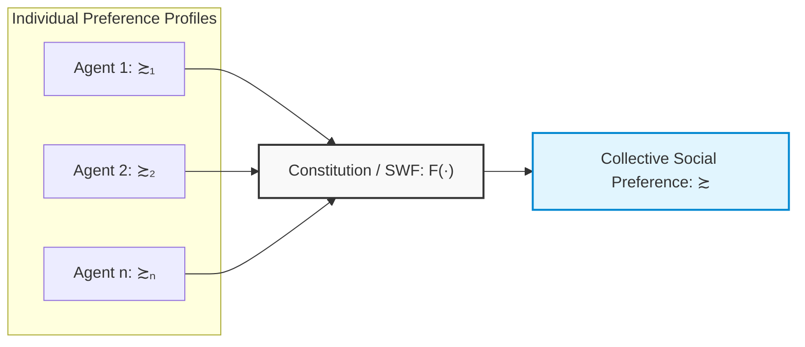
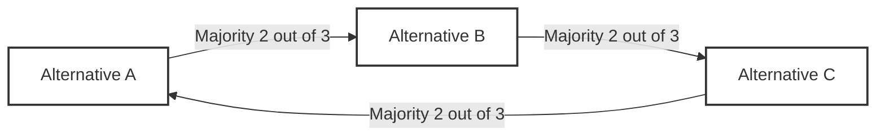
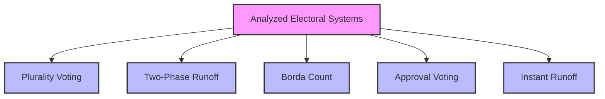
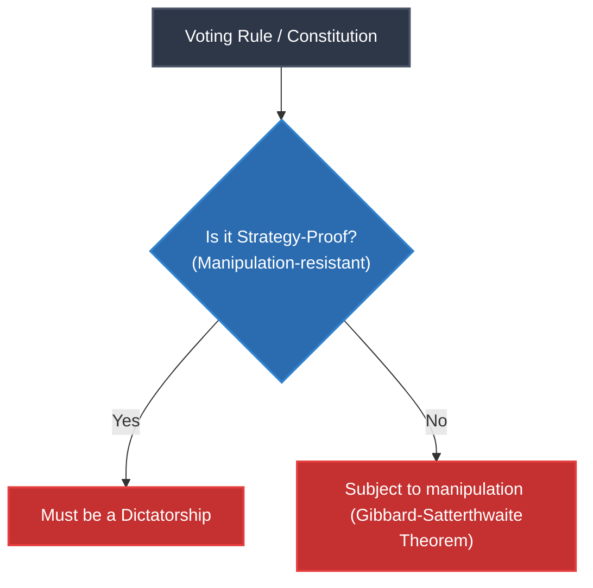
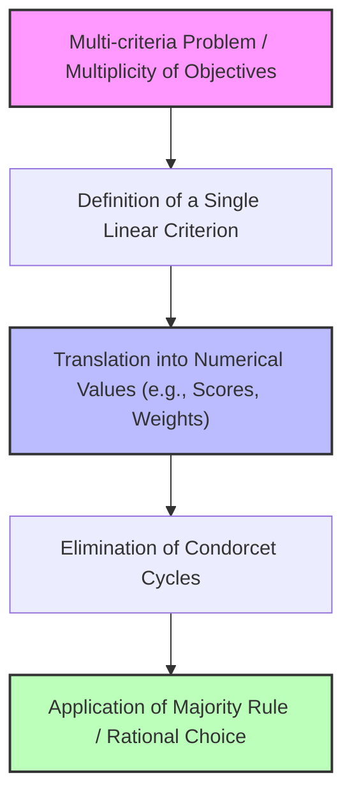

# Game Theory: Constitutions and Preference Aggregation (Arrow's Impossibility Theorem)

## Didactic Overview
This lecture addresses the fundamental problem of aggregating individual preferences into a collective social preference, introducing the concept of a **constitution** or **social welfare function**. Unlike single-agent optimization problems, the presence of multiple agents with divergent objectives generates intrinsic tensions that cannot be resolved simply by increasing computational power. We analyze attempts to unify preferences in various contexts (from political decisions to sports tournaments) and introduce the desirable axiomatic properties for an ideal constitution, including **Independence of Irrelevant Alternatives (IIA)** and Pareto efficiency.

---

### The Preference Aggregation Problem

#### From a Single Agent to Multi-Agent Systems
In decision-making problems with a single agent and a single objective, resolution is conceptually straightforward: if the problem is computationally demanding, the solution trivially consists of having superior computing power (as in the famous line from the movie *Jaws*: *"We're gonna need a bigger boat"*). 

In Game Theory, the situation is radically different:
* There are **multiple agents**, each bearing their own objective and their own preference ordering.
* This plurality generates an intrinsic tension that **cannot be resolved by increasing computational power**. 

A fundamental question thus arises: is it possible to unify the preferences of individual individuals to derive a coherent collective preference for the entire population?

#### Real-World Examples
This aggregation process is not a mere theoretical exercise, but a mechanism we constantly apply:
* **Sports tournaments**: determining the best team by aggregating the results of individual matches.
* **Beauty contests or music festivals** (such as Sanremo): decreeing the best song by combining the votes of the technical jury and televoting.
* **Political elections**: aggregating the individual preferences of citizens to select a leader or government representation.

---

### Formal Definition of a Constitution (Social Welfare Function)

#### Set of Preferences and Domain
Let $A$ be a set of possible alternatives. We define $\mathcal{R}_A$ as the set of all rational preferences definable on $A$. A preference is considered rational if it satisfies the properties of:
1. **Completeness**: for every pair of alternatives $a, b \in A$, either $a \succsim b$ or $b \succsim a$ holds.
2. **Transitivity**: if $a \succsim b$ and $b \succsim c$, then $a \succsim c$.

Consider a society composed of $n$ individuals, indexed by $i \in \{1, \dots, n\}$. Each individual $i$ expresses their own rational preference ordering $\succsim_i \in \mathcal{R}_A$. 

The set of all individual preferences constitutes a **preference profile**, denoted as:
$$(\succsim_1, \succsim_2, \dots, \succsim_n) \in \mathcal{R}_A^n$$

> **Definition: Constitution or Social Welfare Function**  
> A **Constitution** (also known as a **Social Welfare Function - SWF**) is a mapping that associates each profile of individual preferences with a single collective rational preference:
> $$F: \mathcal{R}_A^n \to \mathcal{R}_A$$
> In short:
> $$F(\succsim_1, \succsim_2, \dots, \succsim_n) = \succsim$$
> where $\succsim$ represents the preference ordering of society as a whole.

#### Notation: Restriction to a Subset of Alternatives
If we consider a subset of alternatives $Y \subseteq A$, we denote by $\succsim\vert_Y$ the restriction of the preference relation to that subset. 

Formally, since a preference is a binary relation defined on the Cartesian product of the alternatives, the restriction to a subset $Y$ operates formally on $Y \times Y$:
$$\succsim\vert_Y \; \subseteq Y \times Y$$
In common parlance, one says that "the preference is restricted to $Y$", meaning that the comparison is limited exclusively to pairs of elements belonging to $Y$.

---

### Axiomatic Properties of an Ideal Constitution

Just as defined for von Neumann-Morgenstern utilities, it is necessary to identify which axiomatic properties an "ideal" or "reasonable" aggregation function must satisfy.

#### 1. Independence of Irrelevant Alternatives (IIA)
The **Independence of Irrelevant Alternatives (IIA)** property states that the social ordering between two specific alternatives $a$ and $b$ must depend **exclusively** on how individual individuals order $a$ relative to $b$, without being influenced by the presence or positioning of a third irrelevant alternative $c$.

> **Key Concept: Intuitive Definition of IIA**  
> Consider two preference profiles. If for every individual the relative preference between $a$ and $b$ remains unchanged when moving from the first to the second profile, then the collective social preference between $a$ and $b$ **must also remain identical**, regardless of how preferences regarding any other alternative $c \in A \setminus \{a, b\}$ have changed.

If the introduction or modification of the judgment on a third element $c$ alters the social verdict between $a$ and $b$, the aggregation rule violates the IIA axiom.

#### 2. Pareto Efficiency (Unanimity)
**Pareto Efficiency** guarantees respect for the unanimity of the population:

> **Definition: Pareto Efficiency**  
> If for a pair of alternatives $a, b \in A$, **every** individual in society strictly prefers $a$ to $b$:
> $$\forall i \in \{1, \dots, n\}, \quad a \succ_i b$$
> then the resulting social preference must necessarily strictly prefer $a$ to $b$:
> $$a \succ b$$

This principle prevents society from making decisions contrary to the absolute totality of its members (for example, if all citizens unanimously agree that option $a$ is superior to option $b$, the constitution cannot mandate that society prefers $b$ to $a$).

---

### Properties of Social Choice Functions (Constitutions)

A **constitution** (or Social Welfare Function) $F$ maps citizens' individual preference profiles into a rational collective preference for the entire society. To evaluate whether a constitution is fair or democratic, we define several formal properties.

#### Dictatorship
A constitution $F$ is defined as a **dictatorship** if society's preference coincides strictly and systematically with the preference of a single individual $d$ (the dictator), regardless of what everyone else votes or desires:

$$\exists \, d \in N \quad \text{such that} \quad \forall \, A, B \in X, \quad A \succ_d B \implies A \succ_{\text{soc}} B$$

If the dictator prefers $A$ to $B$, society adopts $A \succ_{\text{soc}} B$, rendering the opinion of the rest of the population irrelevant.

#### Monotonicity
The **monotonicity** property states that an increase in consensus toward a given option must never harm it at the social level. 

Suppose society already prefers alternative $B$ to alternative $A$ ($B \succ_{\text{soc}} A$). If some individuals change their minds, moving from preferring $A$ to preferring $B$ (while all others keep their preferences unchanged), consensus toward $B$ strictly increases. A constitution is monotonic if it guarantees that, in the face of this favorable shift toward $B$, society continues to prefer $B$ over $A$. 

It would be paradoxical if, following the conversion of some voters in favor of prison sentences over the death penalty, society suddenly decided to reinstate the death penalty.

#### Non-imposition (Surjectivity)
A function satisfies **non-imposition** if it is *surjective*: for every rational preference ordering, there exists at least one individual voting profile capable of producing it as a social outcome.

In practical terms, no permissible outcome or ranking is excluded a priori by law or external constraint: there are no candidates forbidden from winning due to characteristics such as gender, skin color, or orientation, nor are there arbitrarily prohibited ranking combinations.

---

### Arrow's Impossibility Theorem (1951)

> **Key Concept: Arrow's Theorem**  
> There is no social choice function (with at least three alternatives and a finite number of individuals) capable of simultaneously satisfying:
> 1. **Non-dictatorship**
> 2. **Weak Pareto Efficiency / Unanimity**
> 3. **Independence of Irrelevant Alternatives (IIA)**
> 4. **Unrestricted Domain**

A synthetic and equivalent formulation of the theorem shows that:
$$\text{If a constitution satisfies Pareto Efficiency and the IIA condition, then it is necessarily a Dictatorship.}$$

#### Why does dictatorship satisfy Pareto and IIA?
From a purely logical-mathematical standpoint, the dictatorial system trivially verifies both Pareto efficiency and IIA:

1. **Verification of Pareto Efficiency:**  
   If every individual prefers $A$ to $B$ ($A \succ_i B, \; \forall i$), then the dictator $d$ also prefers $A$ to $B$ ($A \succ_d B$). Consequently, society will express $A \succ_{\text{soc}} B$.
2. **Verification of IIA:**  
   The social preference between $A$ and $B$ depends solely on the dictator's preference between $A$ and $B$. The introduction, removal, or repositioning of a third option $C$ does not alter the dictator's relative judgment on $A$ and $B$; hence the social choice between $A$ and $B$ remains unchanged.

Arrow's result highlights how the formal properties of rationality and axiomatic consistency collide with the minimum requirements of a democratic system as soon as there are three or more alternatives.

---

### Voting Systems and Majority Rule

In representative democracies, the quintessential decision-making tool is the **Majority Rule**.

* **Binary choice ($2$ alternatives):**  
  With only two candidates $\{A, B\}$ and $3$ voters, if two vote for $A$ and one votes for $B$, the collective decision awards victory to $A$. The minority voter is dissatisfied, but the outcome is unambiguous and stable.
* **Multiple choice ($|X| \ge 3$):**  
  In the presence of multiple alternatives, discrepancies arise between:
  * **Plurality:** The option that gets the most votes compared to any other single choice.
  * **Absolute majority:** The option that exceeds $50\% + 1$ of the total consensus.

When the choice involves three options $\{A, B, C\}$, aggregation conflicts emerge among complete orderings.

---

### Condorcet's Paradox and Majority Cycles

Consider a society composed of three individuals $\{1, 2, 3\}$ called upon to order three alternatives $\{A, B, C\}$. Let the individual preference profiles be:

* **Voter 1:** $A \succ B \succ C$
* **Voter 2:** $C \succ A \succ B$
* **Voter 3:** $B \succ C \succ A$

Each voter has perfectly rational and transitive individual preferences. We proceed by aggregating preferences via majority **Pairwise Comparisons**:

1. **Comparison between $A$ and $B$:**
   * Voter 1 prefers $A$ to $B$ ($A \succ B$)
   * Voter 2 prefers $A$ to $B$ ($A \succ B$)
   * Voter 3 prefers $B$ to $A$ ($B \succ A$)  
   $\implies$ With 2 votes against 1, society prefers $A$ to $B$ ($A \succ_{\text{soc}} B$).

2. **Comparison between $B$ and $C$:**
   * Voter 1 prefers $B$ to $C$ ($B \succ C$)
   * Voter 2 prefers $C$ to $B$ ($C \succ B$)
   * Voter 3 prefers $B$ to $C$ ($B \succ C$)  
   $\implies$ With 2 votes against 1, society prefers $B$ to $C$ ($B \succ_{\text{soc}} C$).

3. **Comparison between $C$ and $A$:**
   * Voter 1 prefers $A$ to $C$ ($A \succ C$)
   * Voter 2 prefers $C$ to $A$ ($C \succ A$)
   * Voter 3 prefers $C$ to $A$ ($C \succ A$)  
   $\implies$ With 2 votes against 1, society prefers $C$ to $A$ ($C \succ_{\text{soc}} A$).

Putting the three results together, we obtain a cyclic social preference relation:

$$A \succ_{\text{soc}} B \succ_{\text{soc}} C \succ_{\text{soc}} A$$

This phenomenon is named the **Condorcet Paradox** or **Condorcet Cycle**: majority aggregation of transitive individual preferences generates an intransitive collective preference. In such a scenario, no single alternative dominates all the others.

* An alternative that beats every other alternative in a pairwise majority comparison is called a **Condorcet Winner**.
* If a Condorcet cycle is present, no Condorcet winner exists.

#### Historical Origins of the Problem
The vulnerability of majority decision-making on multiple choices has been known since classical antiquity. Pliny the Younger documented a similar case that occurred in the Roman Senate during a treason trial: the assembly was divided into three equally sized factions favoring the death penalty, exile, and acquittal. Depending on the order in which the pairwise comparisons were put to a vote by the assembly, the final result varied arbitrarily, allowing a decision cycle to form.

---

### Engineering, Economic, and Political Applications of Condorcet Cycles and Electoral Systems

#### The Problem of Condorcet Cycles and Their Probability

We have seen that the existence of a Condorcet winner is not guaranteed. If voters' preferences generate a paradox, we face a **Condorcet cycle**. 

An important aspect to consider is how the probability of encountering a Condorcet cycle varies as alternatives and voters grow:
* With only $3$ alternatives, the probability of a cycle is not very high if the number of voters is limited.
* However, as alternatives increase, the probability of a Condorcet cycle grows very rapidly.
* In the limiting case of an infinite number of alternatives, the appearance of a Condorcet cycle is virtually guaranteed.

These cycles represent a fundamental theoretical obstacle when we want to aggregate individual preferences into a coherent collective preference for the entire society.

#### Engineering and Optimization Applications

Although political elections or historical contexts (such as the Roman Senate) are frequently discussed, these dynamics are not limited to politics. Engineers, mathematicians, and scientists face the exact same structural problem across various fields:

1. **Queue Management and Scheduling:** When a system must receive data from multiple queues and decide which priority to assign. One queue may have urgent contents, another a large backlog, and yet another light but less urgent contents. Combining these criteria to make a single sequential decision is equivalent to solving a preference aggregation problem.
2. **Multi-criteria Optimization:** Imagine having to evaluate procurement bids or choose a supplier. One company offers fast times but high costs, another offers low prices but longer times. What is the priority criterion (time or money)? 
3. **Complex Engineering Choices:** Even when choosing a job position, one balances salary, distance from home, and personal satisfaction. Often, the absolute ideal option does not exist, and compromises must be made.

#### Political Example: Fractional Dynamics in Parliaments

A classic example studied by political scientists concerns the dynamics within a parliament divided into three main currents (e.g., conservatives, liberals, and anti-deficit rigor supporters):
* **Conservatives:** Prefer low taxes and reduced public spending (to favor the private market).
* **Liberals (left):** Prefer high taxes and high public spending (to guarantee services and welfare).
* **Anti-Deficit Party:** Bound by budget rules (e.g., European Union), it favors raising taxes combined with cutting spending to raise cash.

Comparing these alternatives pairwise ($A$ vs $B$, $B$ vs $C$, $C$ vs $A$) generates precisely a **Condorcet cycle**, demonstrating how the absence of a stable equilibrium is a structural phenomenon rather than an exception.

#### Engineering Example: Communication Channel Allocation

An analogous multi-criteria optimization problem arises in telecommunications when allocating different types of traffic (e.g., Voice over IP - VoIP, video streaming, and best-effort data downloads) over channels with different characteristics (optimal channel, high-latency but high-bandwidth channel, very noisy channel). Depending on the channel state, various services scale their preferences, once again generating a Condorcet cycle in choosing the optimal mapping between service and channel.

---

### Analysis of Electoral Systems

Since Condorcet cycles make the perfect choice complex, various voting systems have historically been devised to determine a winner. However, each presents intrinsic flaws and paradoxes.

#### 1. Plurality Voting
This is the most common system: there are $N$ candidates, and whoever gets the most votes wins (relative majority).
* **The problem:** A candidate $A$ strongly supported by a compact minority can win, while the vast majority of the population detests $A$, yet remains divided in proposing different alternatives ($B$ or $C$). In this scenario, $A$ wins despite the possible existence of another candidate who would be the true Condorcet winner.

#### 2. Two-Phase Runoff
Used, for example, in mayoral elections in large municipalities: if no one obtains an absolute majority in the first round, the two most voted candidates go to a runoff.
* **The problem:** This system also fails to resolve the Condorcet issue. A moderate candidate who would represent an excellent synthesis for the community could be eliminated as early as the first round because they do not gather enough "first preference" votes, leaving two polarized options to clash.

#### 3. Borda Count
Conceived by the Chevalier de Borda (an opponent of Condorcet), this system assigns graded scores to all positions rather than looking only at first place. 
* With $N$ candidates, the first preference gets $N-1$ points, the second $N-2$, down to the last which gets $0$ points.
* **The advantage:** It rewards compromise solutions and intermediate positions (a system similar to the one used in Formula 1).
* **The problem (Violation of Independence of Irrelevant Alternatives - IIA):** If a candidate is disqualified or withdraws, the entire ranking among the remaining candidates can completely overturn, altering the competition's outcome in a paradoxical way.

#### 4. Approval Voting
This consists of allowing voters to express multiple preferences (e.g., approving the best two or three candidates, instead of just one).
* **The problem:** The final result changes radically depending on how many preferences one is allowed to express on the ballot. This leaves ample room for manipulation of electoral rules by those in power.

#### 5. Instant Runoff
One starts with $N$ candidates and conducts successive counts: if there is no absolute majority, the worst candidate is eliminated and their votes are redistributed based on the voters' second preferences.
* **The problem:** This method also suffers from non-monotonicity: sometimes, an increase in consensus in the first round can paradoxically cause a candidate to lose the election in subsequent rounds.

#### Conclusion on Voting Systems
Politicians often spend a lot of time discussing and modifying **electoral rules** rather than solving the country's real problems, because the choice of the voting system is the main tool to pre-determine the winner of a competition.

---

### The Gibbard-Satterthwaite Theorem and the Manipulability of Electoral Systems

Why are politicians so obsessed with defining electoral systems? Because very often it is possible to **manipulate the outcome** simply by establishing the rules by which people vote.

#### The Role of the Agenda and the Vulnerability of Elimination Tournaments
Imagine a situation where an alternative $D$ is terrible for everyone. Any sensible voting rule that respects Pareto efficiency will exclude $D$ from winning, barring bizarre rules. However, if we structure the votes through a semifinal and final phase (for example, by pairing candidates), the order of matches (the **agenda**) plays a crucial role. 

In situations where the main candidates form a Condorcet cycle (e.g., $A$, $B$, and $C$), anyone paired against the weak candidate $D$ in the semifinal is mathematically guaranteed to win and advance to the final. This phenomenon is not merely theoretical: analytical studies on sports tournaments (such as the Soccer World Cup) show that teams that advantageously face weaker opponents in the elimination phase derive a structural benefit not only from the lower risk of elimination, but also because potential worse opponents are eliminated earlier by others.

#### The Phenomenon of Strategic Voting (Cheating)
Another critical problem linked to Condorcet cycles arises when voters engage in strategic behavior, lying about their true preferences to avoid a worse outcome.

*   **Example of manipulation:** Suppose that by adopting plurality voting or the Borda count, candidate $A$ wins. A faction of voters for whom $A$ represents the worst option decides to lie, stating that their preference is $B$ (while preferring $C$ to $B$), knowing that $C$ has no hope of winning. This shift of votes makes $B$ win.
*   **The chain reaction:** At this point, the original voters (for whom $B$ is the worst possible outcome) try to remedy the situation by modifying their support in turn, triggering a spiral in which **the winner is not the best candidate, but whoever "cheats first"**. This makes the system extremely unstable and unfair.

---

### The Gibbard-Satterthwaite Theorem

Since traditional voting systems suffer from these vulnerabilities, one might wonder if a voting mechanism immune to manipulation exists. The answer is provided by an extension of Arrow's theorem: the **Gibbard-Satterthwaite Theorem**.

> **Key Concept: The Gibbard-Satterthwaite Theorem**
> We define a constitution (or voting rule) as *strategy-proof* or *non-manipulable* if, following a change of preferences by a voter $j$ (from an initial preference to a modified preference), voter $j$ does not obtain an outcome more favorable to them through lying. In other words, the agent has no incentive for unilateral manipulation.
> 
> The theorem states that: **the only strategy-proof constitution that does not a priori reserve victory for a single candidate (i.e., does not impose restrictions that empty the choice) must be a dictatorship.**

Why does this hold for dictatorship? Under a dictatorial regime, no one has an incentive to lie: the dictator gets exactly what they want, and their behavior determines the outcome regardless of other voters' cheating attempts. Consequently, there is no "democratic" way out that is completely immune to manipulation.

---

### Practical Solutions for Engineers and Decision Makers

Since impossibility theorems (Arrow and Gibbard-Satterthwaite) prove that it is mathematically impossible to design a perfect voting system, engineers and social decision-makers must adopt engineering compromise solutions to avoid decision deadlocks.

One of the most widespread techniques in modern digital practice is **Free Approval Voting**.

*   **How it works:** It is the system "digital natives" are most familiar with. Instead of expressing a single preference or a rigid ranking, the user can express binary approval judgments ("thumbs up" or "thumbs down") for an arbitrary number of alternatives.
*   **Practical applications:** Many social network platforms and recommendation systems adopt this approach precisely to bypass the complexities and paradoxes of traditional voting systems, simplifying user interaction and reducing the incentive for extreme strategic voting behavior.

---

### Conclusions and Further Reading: The Role of Majority Rule and Arrow's Theorem

In modern digital ecosystems, such as social platforms, the primary goal is almost never to organize perfect elections to democratically decide who the best "influencer" or ideal content is. Metrics based on likes or approval reactions are often used. 

Dislikes are frequently avoided or limited because the real value for these platforms is generating *engagement*. Rage-bait and interaction in general demonstrate economic value and the ability to move audiences. Fortunately, expressing simple approval does not suffer from the problem of Condorcet cycles, as it does not require a global transitive ranking, but only showing how much attention a given content receives.

Returning to the fundamental theoretical problem of collective choice, let's analyze in detail the **majority rule** and why, despite seeming like a natural choice, it fails as a "constitution".

#### Formal Definition of Majority Rule

Formally, we say that alternative $A$ is preferred to $B$ by society if the number of decision-makers preferring $A$ to $B$ is greater than or equal to the number of decision-makers preferring $B$ to $A$. Written in formulas:

$$A \succ_{soc} B \iff |\{ i \in I \mid A \succ_i B \}| \ge |\{ i \in I \mid B \succ_i A \}|$$

Where $I$ represents the set of all decision-makers (voters).

#### Why Majority Rule Is Not a "Constitution"

At first glance, this definition seems excellent and satisfies several desirable properties:
* **Pareto efficiency:** If all decision-makers prefer $A$ to $B$, the inequality is widely respected.
* **Independence of Irrelevant Alternatives (IIA):** In direct comparison, only $A$ and $B$ are considered, without a third element altering the relative preference.
* **Non-dictatorship:** It does not reflect the choice of a single individual.

However, **it does not constitute a valid constitution** within the meaning of collective choice theory because **it does not generate a rational preference**. 

> **Key Concept:** A rational preference requires two fundamental properties: **completeness** (it is always possible to compare two elements) and **transitivity** (if $A$ is preferred to $B$, and $B$ is preferred to $C$, then $A$ must be preferred to $C$). 
> Majority rule is *complete*, but **it is not transitive** due to the presence of **Condorcet cycles** ($A \succ B$, $B \succ C$ and $C \succ A$). This explains the inevitability of Arrow's Impossibility Theorem.

#### How to Eliminate Condorcet Cycles: Solutions for Engineers

In designing political or electoral systems, to use majority rule safely, Condorcet cycles must be eliminated upstream. Economists like Amartya Sen and Duncan Black have studied conditions to bypass the problem.

From an engineering standpoint, the most effective way to avoid Condorcet cycles consists in **mapping the multidimensional preference space onto a single linear numerical scale** (total order relationship).

##### Practical Applicability in Engineering and Evaluation
When studying an engineering problem (for example, network performance optimization), we cannot let multiple conflicting metrics create a deadlock. The correct procedure consists of:
1. Fixing the primary objective (e.g., throughput, cost, latency).
2. Translating everything into cold numbers, perhaps through a linear combination with pre-assigned weights:
   $$\text{Global Score} = w_1 \cdot (\text{Metric 1}) + w_2 \cdot (\text{Metric 2})$$
3. Once the problem is flattened onto a single numerical dimension, the transitivity problem disappears, and Arrow's Theorem is "bypassed".

This approach also justifies why, in public procurement tenders or academic evaluations, evaluation criteria and their relative weights must be declared **strictly in advance**. If the rules and numerical weights are fixed beforehand, those managing the process are prevented from "adjusting the agenda" a posteriori to make a specific candidate win, guaranteeing a scientifically rigorous and manipulation-free process.