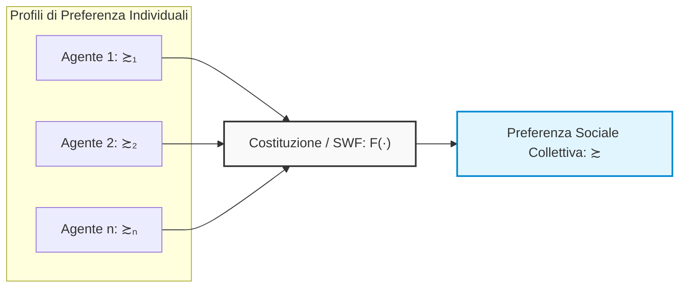
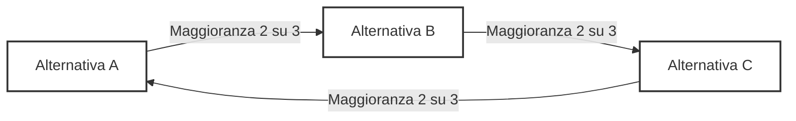
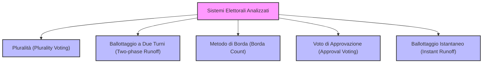
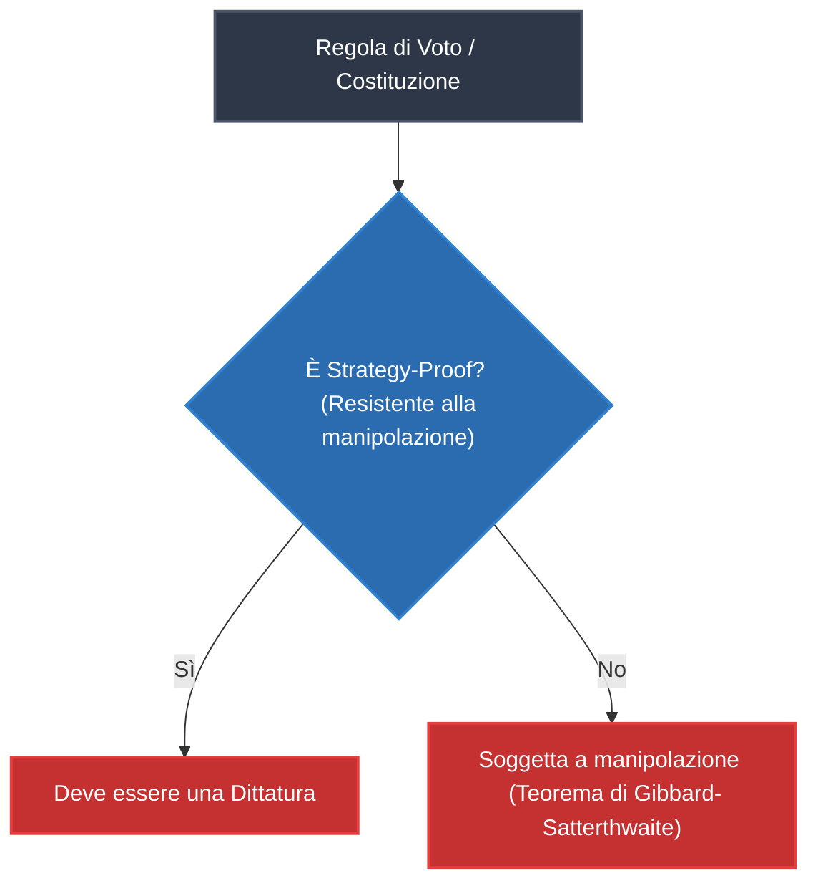
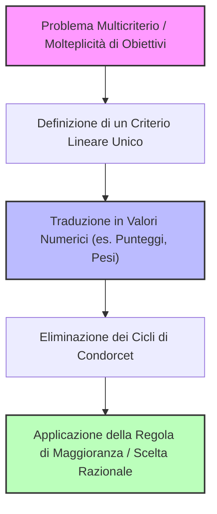

# Teoria dei Giochi: Costituzioni e Aggregazione delle Preferenze (Arrow's Impossibility Theorem)

## Overview Didattica
Questa lezione affronta il problema fondamentale dell'aggregazione delle preferenze individuali in una preferenza sociale collettiva, introducendo il concetto di **costituzione** o **funzione del benessere sociale** (*social welfare function*). A differenza dei problemi di ottimizzazione a singolo agente, la presenza di agenti multipli con obiettivi divergenti genera tensioni intrinseche che non possono essere risolte semplicemente aumentando la potenza di calcolo. Vengono analizzati i tentativi di unificare le preferenze in vari contesti (dalle decisioni politiche ai tornei sportivi) e si introducono le proprietà assiomatiche desiderabili per una costituzione ideale, tra cui l'**Indipendenza delle Alternative Irrilevanti (IIA - *Independence of Irrelevant Alternatives*)** e l'efficienza paretiana.

---

### Il Problema dell'Aggregazione delle Preferenze

#### Dal Singolo Agente ai Sistemi Multi-Agente
Nei problemi decisionali con un singolo agente e un singolo obiettivo, la risoluzione è concettualmente lineare: se il problema è computazionalmente oneroso, la soluzione consiste banalmente nel disporre di una capacità di calcolo superiore (come nella celebre battuta del film *Lo Squalo*: *"Ci serve una barca più grande"*). 

Nella Teoria dei Giochi (Game Theory) la situazione è radicalmente diversa:
* Sono presenti **molteplici agenti**, ciascuno portatore di un proprio obiettivo e di un proprio ordinamento di preferenze.
* Questa pluralità genera una tensione intrinseca che **non può essere risolta aumentando la potenza di calcolo**. 

Emerge quindi una questione fondamentale: è possibile unificare le preferenze dei singoli individui per derivare una preferenza collettiva coerente dell'intera popolazione?

#### Esempi nel Mondo Reale
Questo processo di aggregazione non è un mero esercizio teorico, ma un meccanismo che applichiamo costantemente:
* **Tornei sportivi**: determinare quale sia la squadra migliore aggregando i risultati delle singole partite.
* **Concorsi di bellezza o festival musicali** (come Sanremo): decretare la canzone migliore combinando i voti della giuria tecnica e del televoto.
* **Elezioni politiche**: aggregare le preferenze individuali dei cittadini per selezionare il leader o la rappresentanza di governo.

---

### Definizione Formale di Costituzione (Social Welfare Function)

#### Insieme delle Preferenze e Dominio
Sia $A$ un insieme di alternative possibili. Definiamo con $\mathcal{R}_A$ l'insieme di tutte le preferenze razionali definibili su $A$. Una preferenza è considerata razionale se soddisfa le proprietà di:
1. **Completezza**: per ogni coppia di alternative $a, b \in A$, si ha $a \succsim b$ oppure $b \succsim a$.
2. **Transitività**: se $a \succsim b$ e $b \succsim c$, allora $a \succsim c$.

Consideriamo una società composta da $n$ individui, indicizzati con $i \in \{1, \dots, n\}$. Ciascun individuo $i$ esprime un proprio ordinamento di preferenza razionale $\succsim_i \in \mathcal{R}_A$. 

L'insieme di tutte le preferenze individuali costituisce un **profilo di preferenze** (preference profile), indicato come:
$$(\succsim_1, \succsim_2, \dots, \succsim_n) \in \mathcal{R}_A^n$$

> **Definizione: Costituzione o Funzione di Benessere Sociale**  
> Una **Costituzione** (nota anche come **Funzione di Benessere Sociale** (*Social Welfare Function - SWF*)) è una mappa che associa a ciascun profilo di preferenze individuali una singola preferenza razionale collettiva:
> $$F: \mathcal{R}_A^n \to \mathcal{R}_A$$
> In sintesi:
> $$F(\succsim_1, \succsim_2, \dots, \succsim_n) = \succsim$$
> dove $\succsim$ rappresenta l'ordinamento di preferenza della società nel suo complesso.

#### Notazione: Restrizione a un Sottoinsieme di Alternative
Se consideriamo un sottoinsieme di alternative $Y \subseteq A$, indichiamo con $\succsim\vert_Y$ la restrizione della relazione di preferenza a tale sottoinsieme. 

Formalmente, poiché una preferenza è una relazione binaria definita sul prodotto cartesiano delle alternative, la restrizione ad un sottoinsieme $Y$ opera formalmente su $Y \times Y$:
$$\succsim\vert_Y \; \subseteq Y \times Y$$
Nel linguaggio comune si dice che "si restringe la preferenza a $Y$", intendendo che il confronto viene limitato esclusivamente alle coppie di elementi appartenenti a $Y$.

---

### Proprietà Assiomatiche di una Costituzione Ideale

Così come definito per le utilità alla von Neumann-Morgenstern, è necessario identificare quali proprietà assiomatiche una funzione di aggregazione "ideale" o "ragionevole" debba soddisfare.

#### 1. Indipendenza dalle Alternative Irrilevanti (IIA)
La proprietà di **Indipendenza dalle Alternative Irrilevanti** (*Independence of Irrelevant Alternatives - IIA*) stabilisce che l'ordinamento sociale tra due specifiche alternative $a$ e $b$ deve dipendere **esclusivamente** da come i singoli individui ordinano $a$ rispetto a $b$, senza essere influenzato dalla presenza o dal posizionamento di una terza alternativa irrilevante $c$.

> **Concetto Chiave: Definizione Intuitiva di IIA**  
> Consideriamo due profili di preferenze. Se per ogni individuo la preferenza relativa tra $a$ e $b$ rimane invariata passando dal primo al secondo profilo, allora anche la preferenza sociale collettiva tra $a$ e $b$ **deve rimanere identica**, a prescindere da come siano mutate le preferenze rispetto a qualsiasi altra alternativa $c \in A \setminus \{a, b\}$.

Se l'introduzione o la modifica del giudizio su un terzo elemento $c$ altera il verdetto sociale tra $a$ e $b$, la regola di aggregazione viola l'assioma di IIA.

#### 2. Efficienza Paretiana (Pareto Efficiency / Unanimità)
L'**Efficienza Paretiana** (*Pareto Efficiency*) garantisce il rispetto dell'unanimità della popolazione:

> **Definizione: Efficienza Paretiana**  
> Se per una coppia di alternative $a, b \in A$, **ogni** individuo nella società preferisce strettamente $a$ rispetto a $b$:
> $$\forall i \in \{1, \dots, n\}, \quad a \succ_i b$$
> allora la preferenza sociale risultante deve necessariamente preferire strettamente $a$ rispetto a $b$:
> $$a \succ b$$

Questo principio impedisce che la società prenda decisioni contrarie alla totalità assoluta dei suoi componenti (ad esempio, se tutti i cittadini concordano all'unanimità che l'opzione $a$ è superiore all'opzione $b$, la costituzione non può imporre che la società preferisca $b$ ad $a$).

---

### Proprietà delle Funzioni di Scelta Sociale (Costituzioni)

Una **costituzione** (o funzione di benessere sociale, *Social Welfare Function*) $F$ mappa i profili delle preferenze individuali dei cittadini in una preferenza collettiva razionale per l'intera società. Per poter valutare se una costituzione sia equa o democratica, definiamo alcune proprietà formali.

#### Dittatura (*Dictatorship*)
Una costituzione $F$ è definita una **dittatura** se la preferenza della società coincide strettamente e sistematicamente con la preferenza di un singolo individuo $d$ (il dittatore), a prescindere da ciò che votano o desiderano tutti gli altri:

$$\exists \, d \in N \quad \text{tale che} \quad \forall \, A, B \in X, \quad A \succ_d B \implies A \succ_{\text{soc}} B$$

Se il dittatore preferisce $A$ rispetto a $B$, la società adotta $A \succ_{\text{soc}} B$, rendendo irrilevante l'opinione del resto della popolazione.

#### Monotonicità (*Monotonicity*)
La proprietà di **monotonicità** stabilisce che un incremento di consenso verso una determinata opzione non debba mai danneggiarla a livello sociale. 

Supponiamo che la società preferisca già l'alternativa $B$ rispetto all'alternativa $A$ ($B \succ_{\text{soc}} A$). Se alcuni individui cambiano idea, passando dal preferire $A$ al preferire $B$ (mentre tutti gli altri mantengono invariate le proprie preferenze), il consenso verso $B$ aumenta strettamente. Una costituzione è monotona se garantisce che, a fronte di questo spostamento favorevole a $B$, la società continui a preferire $B$ su $A$. 

Sarebbe paradossale se, a seguito della conversione di alcuni elettori a favore della pena detentiva rispetto alla pena di morte, la società decidesse improvvisamente di ripristinare la pena di morte.

#### Non-imposizione o Suriettività (*Non-imposition*)
Una funzione soddisfa la **non-imposizione** se è *suriettiva*: per ogni ordinamento razionale delle preferenze, esiste almeno un profilo di voti individuali in grado di produrlo come risultato sociale.

In termini pratici, nessun esito o classifica ammissibile è escluso a priori per legge o vincolo esterno: non esistono candidati a cui sia vietato vincere per caratteristiche quali genere, colore della pelle o orientamento, né combinazioni di graduatorie arbitrariamente proibite.

---

### Il Teorema di Impossibilità di Arrow (1951)

> **Concetto Chiave: Teorema di Arrow**  
> Non esiste alcuna funzione di scelta sociale (con almeno tre alternative e un numero finito di individui) in grado di soddisfare simultaneamente:
> 1. **Assenza di dittatura** (*Non-dictatorship*)
> 2. **Efficienza Paretiana debole / Unanimità** (*Pareto Efficiency*)
> 3. **Indipendenza dalle Alternative Irrilevanti** (*Independence of Irrelevant Alternatives*, IIA)
> 4. **Dominio universale** (*Unrestricted Domain*)

Una formulazione sintetica ed equivalente del teorema dimostra che:
$$\text{Se una costituzione soddisfa l'Efficienza di Pareto e la condizione IIA, allora è necessariamente una Dittatura.}$$

#### Perché la dittatura soddisfa Pareto e IIA?
A livello puramente logico-matematico, il sistema dittatoriale verifica in modo banale sia l'efficienza paretiana sia l'IIA:

1. **Verifica della Pareto-Efficienza:**  
   Se ogni individuo preferisce $A$ rispetto a $B$ ($A \succ_i B, \; \forall i$), allora anche il dittatore $d$ preferisce $A$ su $B$ ($A \succ_d B$). Di conseguenza, la società esprimerà $A \succ_{\text{soc}} B$.
2. **Verifica dell'IIA:**  
   La preferenza sociale tra $A$ e $B$ dipende unicamente dalla preferenza del dittatore tra $A$ e $B$. L'introduzione, la rimozione o il riposizionamento di una terza opzione $C$ non altera il giudizio relativo del dittatore su $A$ e $B$; quindi la scelta sociale tra $A$ e $B$ rimane invariata.

Il risultato di Arrow evidenzia come le proprietà formali di razionalità e consistenza assiomatica collidano con i requisiti minimi di un sistema democratico non appena si hanno tre o più alternative.

---

### Sistemi di Voto e Regola di Maggioranza

Nelle democrazie rappresentative, lo strumento decisionale d'elezione è la **regola di maggioranza** (*Majority Rule*).

* **Scelta binaria ($2$ alternative):**  
  Con due soli candidati $\{A, B\}$ e $3$ votanti, se due votano $A$ e uno vota $B$, la decisione collettiva assegna la vittoria ad $A$. L'elettore di minoranza è insoddisfatto, ma l'esito è non ambiguo e stabile.
* **Scelta multipla ($|X| \ge 3$):**  
  In presenza di più alternative sorgono discrepanze tra:
  * **Maggioranza relativa:** L'opzione che ottiene più voti rispetto a qualsiasi altra singola scelta.
  * **Maggioranza assoluta:** L'opzione che supera il $50\% + 1$ del totale dei consensi.

Quando la scelta investe tre opzioni $\{A, B, C\}$, emergono conflitti di aggregazione tra ordinamenti completi.

---

### Il Paradosso di Condorcet e i Cicli di Maggioranza

Consideriamo una società composta da tre individui $\{1, 2, 3\}$ chiamati a ordinare tre alternative $\{A, B, C\}$. I profili di preferenza individuali siano:

* **Votante 1:** $A \succ B \succ C$
* **Votante 2:** $C \succ A \succ B$
* **Votante 3:** $B \succ C \succ A$

Ciascun votante ha preferenze individuali perfettamente razionali e transitive. Procediamo aggregando le preferenze tramite **confronti a coppie** (*Pairwise Comparisons*) a maggioranza:

1. **Confronto tra $A$ e $B$:**
   * Votante 1 preferisce $A$ a $B$ ($A \succ B$)
   * Votante 2 preferisce $A$ a $B$ ($A \succ B$)
   * Votante 3 preferisce $B$ ad $A$ ($B \succ A$)  
   $\implies$ Con 2 voti contro 1, la società preferisce $A$ rispetto a $B$ ($A \succ_{\text{soc}} B$).

2. **Confronto tra $B$ e $C$:**
   * Votante 1 preferisce $B$ a $C$ ($B \succ C$)
   * Votante 2 preferisce $C$ a $B$ ($C \succ B$)
   * Votante 3 preferisce $B$ a $C$ ($B \succ C$)  
   $\implies$ Con 2 voti contro 1, la società preferisce $B$ rispetto a $C$ ($B \succ_{\text{soc}} C$).

3. **Confronto tra $C$ e $A$:**
   * Votante 1 preferisce $A$ a $C$ ($A \succ C$)
   * Votante 2 preferisce $C$ a $A$ ($C \succ A$)
   * Votante 3 preferisce $C$ a $A$ ($C \succ A$)  
   $\implies$ Con 2 voti contro 1, la società preferisce $C$ rispetto a $A$ ($C \succ_{\text{soc}} A$).

Mettendo insieme i tre risultati, otteniamo una relazione di preferenza sociale ciclica:

$$A \succ_{\text{soc}} B \succ_{\text{soc}} C \succ_{\text{soc}} A$$

Questo fenomeno prende il nome di **Paradosso di Condorcet** (*Condorcet Paradox*) o **Ciclo di Condorcet** (*Condorcet Cycle*): l'aggregazione a maggioranza di preferenze individuali transitive genera una preferenza collettiva intransitiva. In tale scenario non esiste un'alternativa dominante su tutte le altre.

* Un'alternativa che batte ogni altra alternativa in un confronto a due a maggioranza è detta **Vincitore di Condorcet** (*Condorcet Winner*).
* Se è presente un ciclo di Condorcet, non esiste alcun vincitore di Condorcet.

#### Origini storiche del problema
La vulnerabilità della decisione a maggioranza su scelte multiple era nota fin dall'antichità classica. Plinio il Giovane documentò un caso analogo verificatosi nel Senato Romano durante un processo per tradimento: l'assemblea era divisa in tre fazioni di pari consistenza tra condanna a morte, condanna all'esilio e assoluzione. A seconda dell'ordine con cui i confronti a coppie venivano messi ai voti dall'assemblea, il risultato finale variava arbitrariamente, consentendo la formazione di un ciclo decisionale.

---

### Applicazioni Ingegneristiche, Economiche e Politiche dei Cicli di Condorcet e Sistemi Elettorali

#### Il Problema dei Cicli di Condorcet e la loro Probabilità

Abbiamo visto che la presenza di un vincitore di Condorcet (Condorcet winner) non è garantita. Se le preferenze dei votanti generano un paradosso, ci troviamo di fronte a un **ciclo di Condorcet** (Condorcet cycle). 

Un aspetto importante da considerare è come la probabilità di incontrare un ciclo di Condorcet vari al crescere delle alternative e dei votanti:
* Con sole $3$ alternative, la probabilità di un ciclo non è altissima se il numero di votanti è limitato.
* Tuttavia, all'aumentare delle alternative, la probabilità di un ciclo di Condorcet cresce molto rapidamente.
* Nel caso limite di un numero infinito di alternative, la comparsa di un ciclo di Condorcet è praticamente garantita.

Questi cicli rappresentano un ostacolo teorico fondamentale quando vogliamo aggregare le preferenze individuali in una preferenza collettiva coerente per l'intera società.

#### Applicazioni Ingegneristiche e di Ottimizzazione

Sebbene si parli spesso di elezioni politiche o contesti storici (come il Senato Romano), queste dinamiche non riguardano solo la politica. Gli ingegneri, i matematici e gli scienziati affrontano esattamente lo stesso problema strutturale in diversi ambiti:

1. **Gestione delle code e Scheduling (Scheduling):** Quando un sistema deve ricevere dati da più code e decidere quale priorità assegnare. Una coda può avere contenuti urgenti, un'altra un grande *backlog*, un'altra ancora contenuti leggeri ma meno urgenti. Combinare questi criteri per prendere un'unica decisione sequenziale equivale a risolvere un problema di aggregazione di preferenze.
2. **Ottimizzazione Multicriterio (Multi-criteria Optimization):** Immaginiamo di dover valutare dei bandi di gara o di scegliere un fornitore. Un'azienda offre tempi rapidi ma costi elevati, un'altra offre prezzi bassi ma tempi più lunghi. Qual è il criterio prioritario (tempo o denaro)? 
3. **Scelte ingegneristiche complesse:** Anche nella scelta di una posizione lavorativa, si bilanciano stipendio, distanza da casa e soddisfazione personale. Spesso non esiste l'opzione ideale in assoluto e bisogna scendere a compromessi.

#### Esempio Politico: La Dinamica Frazionale nei Parlamenti

Un esempio classico studiato dai politologi riguarda le dinamiche all'interno di un parlamento diviso in tre correnti principali (es. conservatori, liberali e sostenitori del rigore anti-deficit):
* **Conservatori:** Preferiscono tasse basse e spesa pubblica ridotta (per favorire il mercato privato).
* **Liberali (sinistra):** Preferiscono tasse alte e alta spesa pubblica (per garantire servizi e welfare).
* **Partito Anti-deficit:** Vincolato da regole di bilancio (es. Unione Europea), privilegia l'aumento delle tasse unito al taglio della spesa per fare cassa.

Confrontando a coppie queste alternative ($A$ vs $B$, $B$ vs $C$, $C$ vs $A$), si genera esattamente un **ciclo di Condorcet**, dimostrando come l'assenza di un equilibrio stabile sia un fenomeno strutturale e non un'eccezione.

#### Esempio Ingegneristico: Allocazione di Canali di Comunicazione

Un analogo problema di ottimizzazione multicriterio si presenta nelle telecomunicazioni quando bisogna allocare diversi tipi di traffico (es. *Voice over IP* - VoIP, streaming video, e download di dati *best-effort*) su canali con caratteristiche differenti (canale ottimo, canale ad alto ritardo ma grande banda, canale molto rumoroso). In base allo stato del canale, i vari servizi scalano le preferenze, generando nuovamente un ciclo di Condorcet nella scelta del mapping ottimale tra servizio e canale.

---

### Analisi dei Sistemi Elettorali

Dato che i cicli di Condorcet rendono complessa la scelta perfetta, sono stati ideati storicamente diversi sistemi di voto per determinare un vincitore. Ciascuno presenta però difetti e paradossi intrinseci.

#### 1. Voto di Pluralità (Plurality Voting)
È il sistema più comune: vi sono $N$ candidati e vince chi ottiene più voti (maggioranza relativa).
* **Il problema:** Può vincere un candidato $A$ fortemente sostenuto da una minoranza compatta, mentre la vasta maggioranza della popolazione detesta $A$, ma risulta divisa nel proporre alternative diverse ($B$ o $C$). In questo scenario, $A$ vince nonostante possa esistere un altro candidato che risulterebbe il vero vincitore di Condorcet.

#### 2. Ballottaggio a Due Turni (Two-Phase Runoff)
Utilizzato ad esempio per l'elezione dei sindaci nei grandi comuni: se nessuno ottiene la maggioranza assoluta al primo turno, i due candidati più votati vanno al ballottaggio.
* **Il problema:** Anche questo sistema non risolve la criticità di Condorcet. Un candidato moderato che rappresenterebbe un'ottima sintesi per la collettività potrebbe essere eliminato già al primo turno perché non raccoglie abbastanza voti "di prima preferenza", lasciando scontrarsi due opzioni polarizzate.

#### 3. Il Metodo di Borda (Borda Count)
Ideato dal Cavaliere di Borda (oppositore di Condorcet), questo sistema assegna punteggi graduati a tutte le posizioni anziché guardare solo al primo posto. 
* Con $N$ candidati, la prima preferenza ottiene $N-1$ punti, la seconda $N-2$, fino all'ultima che ottiene $0$ punti.
* **Il vantaggio:** Premia le soluzioni di compromesso e le posizioni intermedie (un sistema simile a quello usato in Formula 1).
* **Il problema (Violazione dell'Indipendenza dalle Alternative Irrilevanti - IIA):** Se un candidato viene squisqualificato o si ritira, l'intera classifica tra i candidati rimanenti può ribaltarsi completamente, alterando l'esito della competizione in modo paradossale.

#### 4. Voto di Approvazione (Approval Voting)
Consiste nel permettere agli elettori di esprimere più preferenze (es. approvare i migliori due o tre candidati, anziché uno solo).
* **Il problema:** Il risultato finale cambia radicalmente a seconda di quante preferenze viene concesso di esprimere sulla scheda. Questo lascia ampio margine di manipolazione delle regole elettorali da parte di chi detiene il potere.

#### 5. Ballottaggio Istantaneo (Instant Runoff)
Si parte con $N$ candidati e si effettuano conteggi successivi: se non c'è una maggioranza assoluta, viene eliminato il candidato peggiore e i suoi voti vengono redistribuiti in base alle seconde preferenze dei votanti.
* **Il problema:** Anche questo metodo soffre di non-monotonicità: a volte, un incremento di consenso al primo turno può paradossalmente far perdere le elezioni a un candidato nei turni successivi.

#### Conclusione sui Sistemi di Voto
Spesso i politici dedicano molto tempo a discutere e modificare le **regole elettorali** piuttosto che a risolvere i reali problemi del paese, poiché la scelta del sistema di voto è lo strumento principale per pre determinare il vincitore di una competizione.

---

### Il Teorema di Gibbard-Satterthwaite e la Manipolabilità dei Sistemi Elettorali

Perché i politici sono così ossessionati dalla definizione dei sistemi elettorali (electoral systems)? Perché molto spesso è possibile **manipolare il risultato** semplicemente stabilendo le regole con cui si vota.

#### Il ruolo dell'agenda e la vulnerabilità dei tornei a eliminazione
Immaginiamo una situazione in cui un'alternativa $D$ è pessima per tutti. Ogni regola di voto sensata che rispetti l'efficienza di Pareto (Pareto efficiency) escluderà $D$ dalla vittoria, a meno di non adottare regole bizzarre. Tuttavia, se strutturiamo le votazioni tramite una fase di semifinali e finali (ad esempio accoppiando i candidati), l'ordine degli incontri (l'**agenda**) gioca un ruolo cruciale. 

Nelle situazioni in cui i candidati principali formano un ciclo di Condorcet (Condorcet cycle, es. $A$, $B$ e $C$), chiunque venga accoppiato contro il candidato debole $D$ in semifinale è matematicamente garantito di vincere e accedere alla finale. Questo fenomeno non è solo teorico: studi analitici sui tornei sportivi (come i Mondiali di calcio) dimostrano che le squadre che affrontano avvantaggiate avversari più deboli nella fase a eliminazione traggono un beneficio strutturale non solo per il minor rischio di eliminazione, ma anche perché potenziali avversari peggiori vengono eliminati prima da altri.

#### Il fenomeno del voto strategico (Cheating)
Un altro problema critico legato ai cicli di Condorcet emerge quando gli elettori mettono in atto comportamenti strategici, mentendo sulle proprie reali preferenze per evitare un esito peggiore.

*   **Esempio di manipolazione:** Supponiamo che, adottando un sistema a pluralità (plurality voting) o il metodo di Borda (Borda count), il candidato $A$ vinca. Una fazione di elettori per cui $A$ rappresenta l'opzione peggiore decide di mentire, dichiarando che la propria preferenza è $B$ (pur preferendo $C$ a $B$), sapendo che $C$ non ha speranze di vittoria. Questo spostamento di voti fa vincere $B$.
*   **La reazione a catena:** A questo punto, gli elettori originari (per i quali $B$ è il peggior esito possibile) cercano di correre ai ripari modificando a loro volta il supporto, innescando una spirale in cui **il vincitore non è il candidato migliore, ma chi "cheats first" (chi mente per primo)**. Questo rende il sistema estremamente instabile e ingiusto.

---

### Il Teorema di Gibbard-Satterthwaite

Dato che i sistemi di voto tradizionali soffrono di queste vulnerabilità, ci si potrebbe chiedere se esista un meccanismo di voto immune alla manipolazione. La risposta è fornita da un'estensione del Teorema di Arrow (Arrow's theorem): il **Teorema di Gibbard-Satterthwaite (Gibbard-Satterthwaite theorem)**.

> **Concetto Chiave: Il Teorema di Gibbard-Satterthwaite**
> Definiamo una costituzione (o regola di voto) come *resistente alla strategia* o *non manipolabile* (strategy-proof o non-manipulable) se, a seguito di un cambiamento di preferenze da parte di un elettore $j$ (da una preferenza iniziale a una preferenza modificata), l'elettore $j$ non ottiene un esito a lui più favorevole grazie alla menzogna. In altre parole, l'agente non ha alcun incentivo alla manipolazione unilaterale.
> 
> Il teorema afferma che: **l'unica costituzione resistente alla strategia che non prenoti a priori la vittoria a un unico candidato (ovvero non imponga restrizioni tali da svuotare la scelta) deve essere una dittatura (dictatorship).**

Perché questo vale per la dittatura? Sotto un regime dittatoriale nessuno ha un incentivo a mentire: il dittatore ottiene esattamente ciò che vuole e il suo comportamento determina l'esito indipendentemente dai tentativi di imbroglio degli altri elettori. Di conseguenza, non esiste una via d'uscita "democratica" che sia completamente immune alla manipolazione.

---

### Soluzioni Pratiche per Ingegneri e Decision Maker

Poiché i teoremi di impossibilità (Arrow e Gibbard-Satterthwaite) dimostrano che è matematicamente impossibile progettare un sistema di voto perfetto, ingegneri e decisori sociali devono adottare soluzioni ingegneristiche di compromesso per evitare stalli decisionali.

Una delle tecniche più diffuse nella pratica digitale moderna è il **voto di approvazione libero (Free Approval Voting)**.

*   **Come funziona:** È il sistema con cui i "nativi digitali" hanno maggiore familiarità. Invece di esprimere un'unica preferenza o una classifica rigida, l'utente può esprimere giudizi binari di gradimento ("mi piace" o "non mi piace", pollice alto o pollice basso) per un numero arbitrario di alternative.
*   **Applicazioni pratiche:** Molte piattaforme di social network e sistemi di raccomandazione adottano questo approccio proprio per aggirare le complessità e i paradossi dei sistemi di voto tradizionali, semplificando l'interazione dell'utente e riducendo l'incentivo a comportamenti di voto strategico estremo.

---

### Conclusioni e Approfondimenti: Il Ruolo della Regola di Maggioranza e il Teorema di Arrow

Negli ecosistemi digitali moderni, come le piattaforme social, l'obiettivo principale non è quasi mai quello di organizzare elezioni perfette per decidere democraticamente chi sia il miglior "influencer" o il contenuto ideale. Spesso si utilizzano metriche basate su like o reazioni di gradimento. 

I dislike vengono spesso evitati o limitati perché il vero valore per queste piattaforme è generare *engagement* (coinvolgimento). Il rage-bait e l'interazione in generale dimostrano interesse economico e capacità di movimentare pubblico. Fortunatamente, esprimere semplice gradimento non soffre del problema dei cicli di Condorcet (Condorcet cycles), poiché non richiede una classifica transitiva globale, ma solo di mostrare quanta attenzione riceve un determinato contenuto.

Tornando al problema teorico fondamentale della scelta collettiva, analizziamo nel dettaglio la **regola di maggioranza (majority rule)** e il motivo per cui, nonostante sembri una scelta naturale, fallisce come "costituzione".

#### Definizione Formale della Regola di Maggioranza

Formalmente, diciamo che l'alternativa $A$ è preferita a $B$ dalla società se il numero di decisori che preferisce $A$ a $B$ è maggiore o uguale al numero di decisori che preferiscono $B$ ad $A$. Scritto in formule:

$$A \succ_{soc} B \iff |\{ i \in I \mid A \succ_i B \}| \ge |\{ i \in I \mid B \succ_i A \}|$$

Dove $I$ rappresenta l'insieme di tutti i decisori (elettori).

#### Perché la Regola di Maggioranza non è una "Costituzione"?

A un primo sguardo, questa definizione sembra ottima e soddisfa diverse proprietà desiderabili:
* **Efficienza di Pareto (Pareto efficiency):** Se tutti i decisori preferiscono $A$ a $B$, la disuguaglianza è ampiamente rispettata.
* **Indipendenza dalle Alternative Irrilevanti (IIA - Independence of Irrelevant Alternatives):** Nel confronto diretto si considerano solo $A$ e $B$, senza che un terzo elemento alteri la preferenza relativa.
* **Non-dittatura:** Non riflette la scelta di un singolo individuo.

Tuttavia, **non costituisce una costituzione valida** ai sensi della teoria delle scelte collettive perché **non genera una preferenza razionale**. 

> **Concetto Chiave:** Una preferenza razionale richiede due proprietà fondamentali: la **completezza** (è sempre possibile confrontare due elementi) e la **transitività** (se $A$ è preferito a $B$, e $B$ è preferito a $C$, allora $A$ deve essere preferito a $C$). 
> La regola di maggioranza è *completa*, ma **non è transitiva** a causa della presenza dei **cicli di Condorcet** ($A \succ B$, $B \succ C$ e $C \succ A$). Questo spiega l'inevitabilità del Teorema di Impossibilità di Arrow (Arrow's theorem).

#### Come Eliminare i Cicli di Condorcet: Soluzioni per Ingegneri

Nel design di sistemi politici o elettorali, per poter usare la regola di maggioranza in modo sicuro, è necessario eliminare a monte i cicli di Condorcet. Economisti come Amartya Sen e Duncan Black hanno studiato condizioni per aggirare il problema.

Dal punto di vista ingegneristico, il modo più efficace per evitare i cicli di Condorcet consiste nel **mappare lo spazio multidimensionale delle preferenze su un'unica scala numerica lineare** (total order relationship).

##### Applicabilità Pratica nell'Ingegneria e nella Valutazione
Quando studiamo un problema ingegneristico (ad esempio, l'ottimizzazione delle prestazioni di una rete), non possiamo lasciare che molteplici metriche in conflitto tra loro creino stallo. La procedura corretta consiste nel:
1. Fissare l'obiettivo primario (es. throughput, costo, latenza).
2. Tradurre tutto in numeri freddi, magari attraverso una combinazione lineare con pesi preassegnati:
   $$\text{Punteggio Globale} = w_1 \cdot (\text{Metrica 1}) + w_2 \cdot (\text{Metrica 2})$$
3. Una volta schiacciato il problema su un'unica dimensione numerica, il problema della transitività scompare e il Teorema di Arrow viene "aggirato".

Questo approccio giustifica anche perché, nei bandi di concorso pubblici o nelle valutazioni accademiche, i criteri di valutazione e i relativi pesi debbano essere dichiarati **rigorosamente in anticipo**. Se le regole e i pesi numerici sono fissati prima, si impedisce a chi gestisce il processo di "aggiustare l'agenda" a posteriori per far vincere un candidato specifico, garantendo un processo scientificamente rigoroso e privo di manipolazioni.