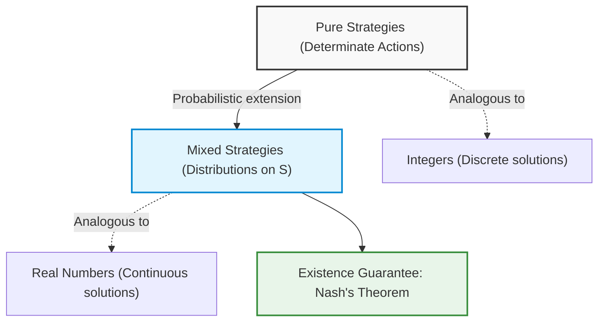
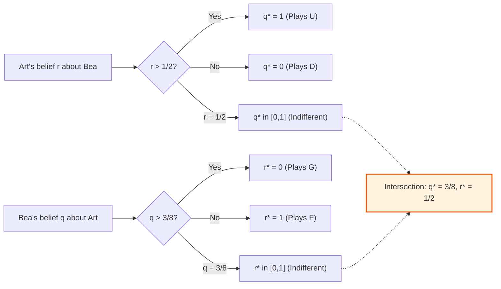
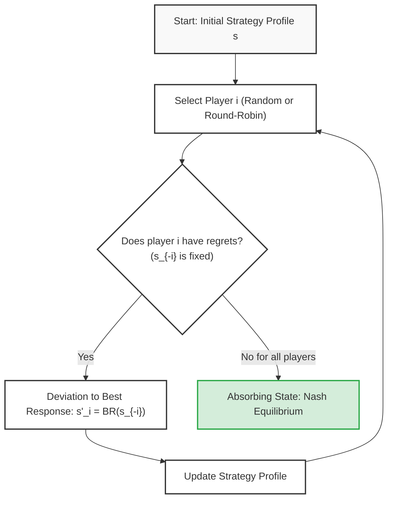
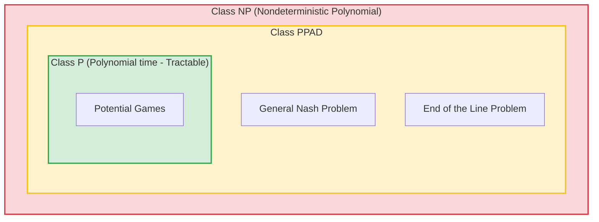
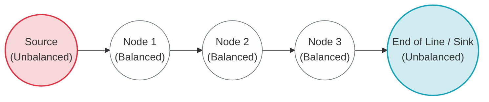

# Game Theory: Mixed Strategies, Nash's Theorem, and Best Response Correspondence

## Educational Overview

In this lecture, the extension of the strategy space from **pure strategy** profiles to **mixed strategies** is formalized, overcoming the restrictive equivalence between a single action and a strategy typical of static games of complete information. 

The key points addressed include:
* **Formal analogy between integers and real numbers**: pure strategies represent special cases (discrete points) embedded within the continuum of the probability distribution space of mixed strategies, analogous to how integers constitute a subset of real numbers.
* **Nash's Existence Theorem**: a fundamental statement in game theory according to which every finite game (with a finite number of players and pure strategies) possesses at least one Nash Equilibrium, provided mixed strategies are allowed. Three essential features are emphasized: it is a purely non-constructive theorem (existence only), admissible solutions may not be unique, and the equilibrium may consist solely of mixed profiles.
* **Epistemic interpretation based on Beliefs**: randomization does not necessarily describe random behavior of the decision-maker at the moment of acting (who selects a specific action), but rather models the intrinsic uncertainty and informational state of opponents regarding the player's final choice.
* **Formal generalization of Beliefs and Best Response**:
  * The belief space of a player $i$ extends from the simple set of opponents' pure strategies $S_{-i}$ to the probability simplex $\Delta(S_{-i})$.
  * The **Best Response Correspondence** is rigorously redefined as a set-valued map:
    $$BR_i: \Delta(S_{-i}) \rightrightarrows \Delta(S_i) \quad \text{ovvero} \quad BR_i: \Delta(S_{-i}) \to \mathcal{P}(\Delta(S_i))$$
    where $\mathcal{P}(\cdot)$ denotes the power set, formalizing the fact that the best response to a given configuration of beliefs is not necessarily unique (a multifunction or correspondence structure, not a single-valued function).
  * The Nash equilibrium is traced back to the fixed-point condition in which each player adopts a best response with respect to beliefs that turn out to be correct and mutually consistent.

---

### From Pure Strategies to Mixed Strategies: Motivation and Interpretation

In the initial study of static games of complete information, the distinction between action and strategy seemed almost superfluous: the strategy consisted simply of the pure action chosen by the player. However, restricting oneself to pure strategies alone often prevents finding a stable equilibrium point.

To understand the transition to **mixed strategies**, it is useful to use an analogy with number systems:
* **Pure strategies** are equivalent to **integers**. Integers are intuitive and useful for counting, but do not allow solving elementary equations such as $2x = 1$.
* **Mixed strategies** correspond to the introduction of **real numbers**. They allow exploring what lies "between" discrete points. A pure strategy does not disappear: it simply becomes a special case of a mixed strategy with probability mass concentrated on a single element (just as the integer $5$ coincides with the real $5.000\dots$).

The introduction of randomization guarantees a fundamental result: the certain existence of at least one solution for every finite game, formalized by the celebrated **Nash's Theorem**.

#### Belief-Based Interpretation
A common objection concerns practical plausibility: do rational decision-makers really flip a coin before acting? In reality, at the moment of choice, each player selects a specific action with probability equal to $1$.

The mixed strategy does not model erratic or irrational behavior of the individual agent, but rather captures the opponents' **intrinsic uncertainty and beliefs**. Not knowing which pure action player $i$will choose, the other participants associate a subjective probability distribution with each of their options. 

Consequently, the belief space for player $i$ is no longer restricted to the discrete set of rivals' pure strategy profiles $S_{-i}$, but extends to the probability simplex:

$$\Delta S_{-i}$$

---

### The Best Response Correspondence

With the probabilistic extension, the notion of best response must accommodate the possibility that multiple equivalent optimal responses correspond to a given belief. For this reason, the best response is not a simple function, but a **correspondence**, that is, a set-valued map:

$$\mathcal{BR}_i: \Delta S_{-i} \rightrightarrows \Delta S_i \quad \text{oppure} \quad \mathcal{BR}_i: \Delta S_{-i} \to \mathcal{P}(\Delta S_i)$$

where $\mathcal{P}(\cdot)$ denotes the power set. If the best response is unique, the image will be a singleton; if there are multiple indifferent strategies that maximize payoff, the image will contain the entire set of such strategies.

Formally, given a mixed strategy profile of the opponents $m_{-i} \in \Delta S_{-i}$:

$$\mathcal{BR}_i(m_{-i}) = \left\{ m_i \in \Delta S_i \;\middle|\; U_i(m_i, m_{-i}) \ge U_i(m'_i, m_{-i}), \; \forall m'_i \in \Delta S_i \right\}$$

#### Key Concept: The Support of the Mixed Best Response
If a mixed strategy $m_i$ belongs to $\mathcal{BR}_i(m_{-i})$, then **all pure strategies belonging to its support** (that is, played with strictly positive probability) **must themselves be pure best responses** and guarantee an identical expected payoff. 
If this were not the case, the player could shift probability weight from the sub-optimal pure action to the one with higher return, obtaining a strictly greater expected payoff and contradicting the optimality assumption of $m_i$.

#### Joint Correspondence and Fixed Point
Aggregating the best responses of all $N$ players, the joint correspondence $\mathbf{BR}$:

$$\mathbf{BR}: \Delta S \rightrightarrows \Delta S$$

$$\mathbf{BR}(m) = \mathcal{BR}_1(m_{-1}) \times \mathcal{BR}_2(m_{-2}) \times \dots \times \mathcal{BR}_N(m_{-N})$$

is defined:

In this global formulation:
* A joint profile $m^* = (m_1^*, \dots, m_N^*)$ is a **Nash Equilibrium** if and only if each player plays a best response to the others' strategies.
* In set-theoretic terms, this is equivalent to requiring that $m^*$ be a **fixed point** of the correspondence $\mathbf{BR}$:

$$m^* \in \mathbf{BR}(m^*)$$

---

### Practical Example: Graphical Solution of Best Responses

Consider a two-player game, Art (row player) and Bea (column player), with no pure-strategy Nash equilibria:

| Art \ Bea | F | G |
| :---: | :---: | :---: |
| **U** | $(6, 0)$ | $(0, 5)$ |
| **D** | $(2, 4)$ | $(4, 1)$ |

*(Note: Bea's payoffs have been integrated consistently with the thresholds calculated below to ensure completeness of the game).*

Mixed strategies are defined as follows:
* Art plays $U$ with probability $q \in [0, 1]$ and $D$ with probability $1 - q$.
* Bea plays $F$ with probability $r \in [0, 1]$ and $G$ with probability $1 - r$.

#### 1. Art's Best Response, $q^*(r)$
Art computes the expected payoff resulting from his two pure options as a function of the belief $r$:
* If he plays $U$: $U_A(U, r) = 6 \cdot r + 0 \cdot (1 - r) = 6r$
* If he plays $D$: $U_A(D, r) = 2 \cdot r + 4 \cdot (1 - r) = 4 - 2r$

Art compares the two values:

$$6r \ge 4 - 2r \iff 8r \ge 4 \iff r \ge \frac{1}{2}$$

Art's best response correspondence $q^*(r)$ takes the form of a stepwise function:

$$q^*(r) = \begin{cases} 0 & \text{se } r < \frac{1}{2} \quad (\text{gioca } D) \\ [0, 1] & \text{se } r = \frac{1}{2} \quad (\text{indifferente tra qualsiasi combinazione}) \\ 1 & \text{se } r > \frac{1}{2} \quad (\text{gioca } U) \end{cases}$$

#### 2. Bea's Best Response, $r^*(q)$
Mirroring this, Bea evaluates her expected payoffs as a function of $q$:
* If she plays $F$: $U_B(q, F) = 0 \cdot q + 4 \cdot (1 - q) = 4 - 4q$
* If she plays $G$: $U_B(q, G) = 5 \cdot q + 1 \cdot (1 - q) = 1 + 4q$

Bea chooses $F$ if and only if:

$$4 - 4q \ge 1 + 4q \iff 3 \ge 8q \iff q \le \frac{3}{8}$$

*(Note: The theoretical value mentioned in the lecture indicated the fraction $5/8$; adopting the example matrix, the derivation yields the critical threshold $q^* = 3/8$).*

The correspondence for Bea $r^*(q)$ is therefore:

$$r^*(q) = \begin{cases} 1 & \text{se } q < \frac{3}{8} \quad (\text{gioca } F) \\ [0, 1] & \text{se } q = \frac{3}{8} \quad (\text{indifferente}) \\ 0 & \text{se } q > \frac{3}{8} \quad (\text{gioca } G) \end{cases}$$

#### 3. Intersection and Equilibrium Identification
Plotting both curves in the plane $(r, q)$:
* Art's piecewise curve starts at $q = 0$ for $r < 1/2$, includes the vertical segment at $r = 1/2$ connecting $0$ to $1$, and continues at $q = 1$ for $r > 1/2$.
* Bea's piecewise curve starts at $r = 1$ for $q < 3/8$, includes the horizontal segment at $q = 3/8$, and continues at $r = 0$ for $q > 3/8$.

The two curves cannot avoid each other in the unit square $[0, 1] \times [0, 1]$: their intersection uniquely identifies the mixed-strategy Nash Equilibrium:

$$\left( q^* = \frac{3}{8}, \; r^* = \frac{1}{2} \right)$$

*Extension (Battle of the Sexes):* In the Battle of the Sexes game, the step shape intersects the boundaries of the unit square at points $(0, 0)$ and $(1, 1)$, in addition to crossing in the interior segment (for example at $(2/3, 1/3)$). The system thus admits **three Nash equilibria**: two pure and one mixed.

---

### Existence Proof: From Brouwer to Kakutani Fixed Points

The intersection observed graphically is not accidental: it stems from topological properties of the strategy space.

#### Brouwer's Theorem (Functions on Numerical Spaces)
In mathematical analysis, Brouwer's fixed-point theorem states that:
> Every continuous function $f: C \to C$, where $C \subset \mathbb{R}^n$ is a non-empty, compact, and convex set, admits at least one fixed point $x^* \in C$ such that $f(x^*) = x^*$.

In the one-dimensional case on $C = [0, 1]$, the theorem is a direct consequence of Bolzano's intermediate value theorem: defining $g(x) = f(x) - x$, the function ranges from $g(0) = f(0) \ge 0$ to $g(1) = f(1) - 1 \le 0$. Being continuous, it must intersect the horizontal axis at at least one point $x^*$ where $g(x^*) = 0 \implies f(x^*) = x^*$.

#### Kakutani's Theorem (Set-Valued Correspondences)
Brouwer's theorem is not directly applicable to the Nash Equilibrium, because the joint correspondence $\mathbf{BR}$ is not a single-valued function: at points of indifference it generates entire sets of best responses.

It is necessary to resort to the generalization provided by **Kakutani's Fixed Point Theorem**:

> Let $A \subset \mathbb{R}^n$ be a non-empty, compact, and convex set. Let $\Phi: A \rightrightarrows A$ be a correspondence satisfying the following conditions for every $x \in A$:
> 1. $\Phi(x)$ is **non-empty**;
> 2. $\Phi(x)$ is **convex**;
> 3. $\Phi$ has a **closed graph**: for every sequence $x_k \to x$ and $y_k \to y$ such that $y_k \in \Phi(x_k)$ for every $k$, one has that $y \in \Phi(x)$.
>
> Under these hypotheses, there exists at least one fixed point $x^* \in A$ such that:
> $$x^* \in \Phi(x^*)$$

#### Application to Nash's Theorem
John Nash proved the existence of the equilibrium by applying Kakutani's theorem to the joint correspondence $\mathbf{BR}$:

1. **Domain $A = \Delta S$**: The space of mixed strategy profiles $\Delta S = \prod_{i=1}^N \Delta S_i$ is a Cartesian product of finite probability simplexes. Therefore it is **non-empty, closed, bounded (compact), and convex**.
2. **$\mathbf{BR}(m)$ is non-empty**: Each player operates on a compact simplex, maximizing a utility function that is linear in their own weights. By the Weierstrass theorem, the maximum always exists.
3. **$\mathbf{BR}(m)$ is convex**: If two mixed strategies $m_i'$ and $m_i''$ are best responses against $m_{-i}$, they guarantee the same maximum expected value. Given the linearity of expected utility (arising from the von Neumann-Morgenstern axioms), any convex combination of them will yield the exact same expected payoff, being in turn a best response.
4. **Closed graph**: Since the expected utility function is continuous with respect to the joint strategy profile, taking the limit preserves the optimality inequality: it is not possible to "escape" from the limit of best responses.

Since all hypotheses are satisfied, the correspondence $\mathbf{BR}$ possesses at least one fixed point $m^* \in \Delta S$:

$$m^* \in \mathbf{BR}(m^*)$$

It is thus proven that **every finite game possesses at least one Nash Equilibrium in (possibly) mixed strategies**.

---

### Convergence Dynamics and Fictitious Play

In static games of complete information, decisions are formally made at a single instant in time and simultaneously. However, we may ask whether it is possible to introduce an iterative dimension to model how players reach an equilibrium. This procedure is known as **Fictitious Play**.

#### Concept and Operation of Fictitious Play

The idea behind *Fictitious Play* consists in solving a static game by simulating the correction of choices step-by-step:
1. Each player selects an initial strategy (pure or mixed).
2. The outcome of the resulting strategy profile is observed.
3. In turn (for example, via a *Round-Robin* mechanism or random selection), a player $i$ is selected and asked whether they have any **regrets**.
4. In evaluating their regret, player $i$ assumes that the strategies of all other players, denoted by $s_{-i}$, remain frozen. If the player finds that they would have obtained a higher payoff with another strategy $s'_i$, they are allowed to deviate to their **Best Response**.
5. The process iterates sequentially.

> **Key Concept: Negation of Full Rationality and Absorbing Equilibria**  
> Allowing a player to "change the past" is conceptually equivalent to denying their ex-ante perfect rationality: had their beliefs been accurate and their move been a best response, they would have no reason to feel regret.  
> Nevertheless, this dynamic possesses a fundamental property: **Nash Equilibria are absorbing states**. If the interaction arrives at a Nash Equilibrium, no player has an incentive to unilaterally deviate; the queries regarding regret will yield negative outcomes for everyone, and the process will halt.

#### Convergence Properties and Engineering Interpretation

*Fictitious Play* does not always converge to a fixed point. In strictly competitive or cyclical games (such as Rock-Paper-Scissors), sequential deviations trigger infinite cyclic oscillations without ever settling on pure strategies:
- If Player 1 plays Rock and Player 2 plays Paper, Player 1 deviates to Scissors;
- At that point, Player 2 deviates to Rock;
- Player 1 switches to Paper, and so on indefinitely.

However, there are important classes of games where convergence is mathematically guaranteed:
- Games solvable by Iterated Elimination of Strictly Dominated Strategies (IESDS);
- Generic $2 \times n$ games (with strictly distinct payoffs to avoid indifference deadlocks);
- **Potential Games**.

For an engineer, *Fictitious Play* is not merely an economic abstraction, but represents the equivalent of a **distributed algorithm**.

A fitting parallel is the **Bellman-Ford** routing algorithm: it does not require a central authority to synchronize all network nodes instantaneously. Nodes can announce their routing tables asynchronously; observing others' moves, each node adapts its table locally, and the entire network eventually converges toward the minimum-cost state.

Likewise, if a game admits convergence via *Fictitious Play*, a distributed protocol does not need to impose the choice upstream: it suffices to allow nodes to communicate their intention, adapt to neighbors' moves, and converge autonomously to the Nash Equilibrium. In the *Battle of the Sexes*, for instance, two people who end up by mistake at different movie theaters due to a lack of coordination can, noticing their partner's absence, move sequentially to the other cinema, reaching one of the two stable equilibria.

---

### Potential Games

A Potential Game is a special class of games in which the utility variations resulting from a unilateral deviation can be described by a single global scalar function, called the **potential function** $\Phi$ (or $\Omega$), shared by all players.

#### Formal Definitions

Given a normal-form game defined by the set of players $N = \{1, \dots, n\}$, the strategy space $S = S_1 \times S_2 \times \dots \times S_n$ , and the utility functions $u_i: S \to \mathbb{R}$, we define three levels of potential:

1. **Exact Potential**:  
   A function $\Phi: S \to \mathbb{R}$ is an exact potential if, for every player $i$, for every profile $s_{-i} \in S_{-i}$ , and for every pair of strategies $s_i, s'_i \in S_i$, it holds that:
   $$\Phi(s'_i, s_{-i}) - \Phi(s_i, s_{-i}) = u_i(s'_i, s_{-i}) - u_i(s_i, s_{-i})$$
   The quantitative change in the function $\Phi$ coincides exactly with the utility change of the deviating player.

2. **Weighted Potential**:  
   Given a vector of strictly positive weights $w = (w_1, w_2, \dots, w_n)$ with $w_i > 0$:
   $$\Phi(s'_i, s_{-i}) - \Phi(s_i, s_{-i}) = w_i \left[ u_i(s'_i, s_{-i}) - u_i(s_i, s_{-i}) \right]$$

3. **Ordinal Potential**:  
   Only sign concordance in unilateral deviations is required:
   $$\Phi(s'_i, s_{-i}) - \Phi(s_i, s_{-i}) > 0 \iff u_i(s'_i, s_{-i}) - u_i(s_i, s_{-i}) > 0$$

A game that admits an exact, weighted, or ordinal potential function is called an exact, weighted, or ordinal potential game, respectively.

#### Physical Intuition and Fundamental Property

The physical analogy corresponds to a topographic map or a gravitational potential energy field:
- The **local maxima** of the potential function correspond to **pure-strategy Nash Equilibria**.
- If on a slope, every player making a selfish choice pushes the system uphill along the potential surface. Since the function $\Phi$ is identical for all participants, there are no conflicting directions: improving one's own utility is equivalent to moving the entire system up toward the mountain peak.

> **Key Concept: Existence Theorem in Finite Potential Games**  
> **Every finite ordinal potential game admits at least one pure-strategy Nash Equilibrium.**  
> *Intuitive explanation:* Since the set of pure strategy profiles is finite, the function $\Phi(s)$ takes on a finite number of values and must necessarily admit at least one local (and global) maximum. Applying the *Fictitious Play* algorithm, at each step a deviating player strictly increases the value of $\Phi$. Since the values are finite, cycling is impossible: the system deterministically reaches a local maximum from which no one can deviate while improving the potential (and thus their own utility).

This property transforms a distributed, conflicting multi-agent optimization problem into an equivalent problem of maximizing a single objective function.

#### Notable Examples

##### 1. Cournot Duopoly as an Ordinal Potential Game
Consider the standard Cournot duopoly with market price $P(Q) = a - (q_1 + q_2)$ and constant unit marginal cost $c$. The utility of firm $i$ is:
$$u_i(q_i, q_j) = q_i \left( a - q_i - q_j - c \right)$$

We define the following candidate function:
$$\Phi(q_1, q_2) = q_1 q_2 \left( a - q_1 - q_2 - c \right)$$

We observe that for strictly positive admissible quantities ($q_1, q_2 > 0$):
$$u_i(q_i, q_j) = \frac{\Phi(q_i, q_j)}{q_j}$$
Since $q_j > 0$ is fixed with respect to unilateral variations of $q_i$, any deviation of $q_i$ that increases $u_i$ proportionally increases $\Phi$as well. Consequently, the Cournot game is an ordinal potential game.

##### 2. The Prisoner's Dilemma as an Exact Potential Game
Contrary to common intuition, the Prisoner's Dilemma is also an exact potential game. Consider the strategies Silent ($M$) and Fink ($F$).

Take the standard payoff matrix:
- $(M, M) \to (-1, -1)$
- $(M, F) \to (-3, 0)$
- $(F, M) \to (0, -3)$
- $(F, F) \to (-2, -2)$

We construct a matrix for the scalar potential function $\Phi$:

| $\Phi$ | $M$ | $F$ |
| :---: | :---: | :---: |
| **$M$** | $0$ | $1$ |
| **$F$** | $1$ | $4$ |

*Verification of unilateral deviations:*
- From $(M, M)$ to $(M, F)$: Player 2 deviates from $M$ to $F$.  
  - Payoff change: $u_2(M,F) - u_2(M,M) = 0 - (-1) = +1$.  
  - Potential change: $\Phi(M,F) - \Phi(M,M) = 1 - 0 = +1$.
- From $(M, F)$ to $(F, F)$: Player 1 deviates from $M$ to $F$.  
  - Payoff change: $u_1(F,F) - u_1(M,F) = -2 - (-3) = +1$.  
  - Note: *If the payoffs of profile $(F,F)$ had been rescaled to produce a jump equal to $+3$ (as happens by setting $u_1(M,F) = -3$ and $u_1(F,F) = 0$), the potential would rise exactly to $4$, maintaining exact concordance.*
  
The point $(F, F)$ represents the global maximum of the potential, confirming why it constitutes the absorbing Nash Equilibrium of the system.

##### 3. Congestion Games
In congestion games, players share a set of resources (e.g., road segments or data transmission channels). The cost or delay associated with each resource depends solely on the number of users concurrently using it.

- **Connection with the potential:** Minimizing total network congestion is formally equivalent to maximizing a potential function (with inverted sign).
- **Application: Minority Games:** Imagine choosing between two pizzerias of identical quality. Individual utility is inversely proportional to crowding (shorter waiting times). This anti-congestion structure admits a potential formulation that guarantees the convergence of flows to a balanced load equilibrium.

---

### Game Taxonomy: Coordination, Anti-coordination, and Discoordination

Games with shared or opposing strategic motivations fall into three distinct structural categories:

| Typology | Relative Objective | Typical Example | Engineering Counterpart |
| :--- | :--- | :--- | :--- |
| **Coordination** | Choosing the same action | Stag Hunt, Battle of the Sexes | TX/RX pairing on the same channel (*Rendezvous*) |
| **Anti-coordination** | Choosing distinct actions | Hawk-Dove, Chicken | Channel access: transmitting nodes on separate frequencies |
| **Discoordination** | Structural disagreement: one player seeks agreement, the other opposition | Rock-Paper-Scissors, Matching Pennies, Soccer penalty kick | Jammer evasion / anti-jamming techniques |

#### Coordination Games and the Stag Hunt

Philosophically introduced by Jean-Jacques Rousseau, the *Stag Hunt* formalizes social cooperation between two hunters. Each can choose whether to cooperate to hunt a Stag ($S$) or act alone hunting a Hare ($H$):
- The hare is caught individually and guarantees a payoff equal to $7$;
- The stag requires the cooperation of both: if caught together it yields $10$ to each, but if a hunter pursues the stag alone he gets $0$.

The payoff bimatrix is:

| | Stag ($S$) | Hare ($H$) |
| :---: | :---: |
| **Stag ($S$)** | $(10, 10)$ | $(0, 7)$ |
| **Hare ($H$)** | $(7, 0)$ | $(7, 7)$ |

There exist two pure-strategy Nash Equilibria:
1. $(S, S)$: It is the **Pareto-dominant** outcome (maximum social welfare, payoff 10 each);
2. $(H, H)$: It is the risk-dominant equilibrium (*Risk-Dominant*).

Analyzing the game from the perspective of potential, both equilibria are local maxima. However, depending on the exact potential formulation, the equilibrium $(H, H)$ may exhibit a more robust potential basin of attraction. *Fictitious Play* guarantees convergence to a local maximum, but which equilibrium is actually reached depends solely on the initial conditions and the iterative path.

#### Anti-coordination Games

In the **Hawk-Dove** or **Chicken** model, two agents compete for a resource:
- Behaving like a Hawk ($H$) implies an aggressive escalation attitude;
- Behaving like a Dove ($D$) implies retreating peacefully.

| | Hawk ($H$) | Dove ($D$) |
| :---: | :---: |
| **Hawk ($H$)** | $(-99, -99)$ | $(+10, -10)$ |
| **Dove ($D$)** | $(-10, +10)$ | $(0, 0)$ |

The pure Nash equilibria are the disjoint configurations $(H, D)$ and $(D, H)$. If both choose aggressiveness ($H, H$), the outcome is disastrous (head-on collision or military conflict). In telecommunication networks, two transmitters must implement anti-coordination: if they transmit simultaneously on the same carrier they cause a collision (destructive payoff), whereas if they transmit on separate channels they operate successfully.

---

### Dummy Games and Decomposition of Potential Games

#### Definition of Pure Externality Game

A **Dummy Game**, or pure externality game, is a game in which the utility function of each player $i$ does not depend on their own strategic choice $s_i$, but depends solely on the vector of choices of the other players $s_{-i}$:
$$u_i(s_i, s_{-i}) = f_i(s_{-i}) \quad \forall s_i \in S_i$$

From an engineering perspective, an externality represents a disturbance source or **exogenous noise**: an input signal that affects individual performance but over which the node possesses no operational control (e.g., restrictions due to a pandemic or background traffic generated by external users). In a *Dummy Game*, any move is a best response; consequently, **every strategy profile is trivially a Nash Equilibrium**.

#### Decomposition Theorem of Potential Games

> **Fundamental Analytical Property:**  
> **Every Potential Game $G$ can be decomposed into the sum of a Pure Coordination Game ($G_{coord}$) and a Pure Externality Dummy Game ($G_{dummy}$):**  
> $$G = G_{coord} + G_{dummy}$$

):**  
>$G_{coord}$This decomposition analytically explains the apparent paradox of the Prisoner's Dilemma:
1. **The potential component ( $(F, F)$):** It is a pure coordination drive toward bilateral confession$G_{dummy}$, which aligns the players' incentives and determines the Nash Equilibrium;
2. **The dummy component ( $9$ ):** It is a destructive externality. A player's decision to confess imposes a fixed penalty on the other (for example, a loss of

### Computational Complexity of the Nash Equilibrium

The celebrated Nash's Theorem guarantees that every finite game admits at least one equilibrium in mixed strategies. However, this is a **theorem of pure existence**: it assures us that a solution must necessarily exist, but provides no indication of the computational difficulty of finding it.

From an applied and engineering perspective, viewing the Nash Equilibrium (NE) as the natural evolution of a system forces us to ask a fundamental question: *how difficult is it to compute in practice?*

* In some specific scenarios, the answer is positive: for example, in **Potential Games**, learning dynamics such as *Fictitious Play* converge to equilibrium, rendering computation tractable.
* In the general case, however, modern computational theory provides a **negative result**: finding a Nash equilibrium is an inherently difficult (*computationally hard*) problem.

---

### The Complexity Class PPAD

In the early 2000s, Christos Papadimitriou and other co-authors formalized the complexity of computing the Nash equilibrium. The standard classification of computation theory proved inadequate for this problem:

* **Why is it not NP-complete?** A standard decision problem belongs to $\mathbf{NP}$ if it concerns verifying the *possible existence* of a solution within polynomial time. In the Nash problem (sometimes denoted as the *Nash Problem*), we know analytically a priori that a solution **always exists**. There is no decision question about existence to be resolved in non-polynomial time; the difficulty lies solely in locating the solution (or one among multiple possible ones).

To formally frame this type of search problem (*total search problems*), Papadimitriou introduced (beginning in 1994) the complexity class **PPAD** (*Polynomial Parity Arguments on Directed Graphs*).

#### Relationship Between Complexity Classes

In conceptual and intuitive terms, the PPAD class lies at an intermediate level between the class of problems solvable in polynomial time ($\mathbf{P}$) and the class of non-deterministic polynomial problems ($\mathbf{NP}$):

$$\mathbf{P} \subseteq \mathbf{PPAD} \subseteq \mathbf{NP}$$

If in the future it were proven that $\mathbf{P} = \mathbf{NP}$, by the squeeze theorem (the sandwich theorem) the PPAD class would also collapse to $\mathbf{P}$. As long as this equivalence remains open, **PPAD-complete** problems are considered computationally intractable in the general case.

---

### The "End of the Line" Problem

To prove membership and completeness with respect to a complexity class, isomorphic reductions from a known root problem are used. For the class PPAD, the foundational reference problem is the **End of the Line** problem.

#### Parity Argument on Directed Graphs

Consider a directed graph where each vertex has in-degree at most 1 and out-degree at most 1 ($\text{in-degree} \le 1$, $\text{out-degree} \le 1$):
* A generic node is **balanced** if it has exactly 1 incoming edge and 1 outgoing edge (net balance equal to 0).
* A node is **unbalanced** if it acts as a source (has only an outgoing edge) or as a sink (has only an incoming edge).

If we are given a known source (a node with an outgoing edge but no incoming edge), by a simple **topological parity argument** there must necessarily exist another unbalanced node in the graph (the "end of the line", i.e., a sink). 

However, if the graph is exponentially large and described only implicitly by local logical transition functions, the only general way to locate this sink is to traverse the entire sequence of nodes. There is no global analytical shortcut: one must explore the graph step by step.

#### The Bridge to Nash Equilibrium

Papadimitriou's proof maps the search for a Nash equilibrium directly onto the *End of the Line* problem:
1. **Fixed Point:** Finding an equilibrium is equivalent to identifying a fixed point of the Best Response correspondence ( $BR$), guaranteed by Kakutani's fixed-point theorem:
   $$s^* \in BR(s^*)$$
2. **Triangulation and Coloring:** The continuous space of mixed strategies (a simplex) is discretized via a triangular tessellation (*triangulation*). The vertices of the triangles are labeled/colored based on the local best response (recalling concepts analogous to Sperner's Lemma).
3. **Navigation between Triangles:** The coloring criterion defines unique directed trajectories from one triangle to the adjacent one. Moving along these arrows is equivalent to traversing a path on the graph.
4. **Isomorphism:** The terminal triangle where one gets stuck (*fully labeled simplex*) approximates the sought fixed point, corresponding exactly to the sink of the *End of the Line* problem.

In the worst case, the search requires traversing an intractable number of triangles, making the exact calculation of the fixed point PPAD-complete.

---

### Engineering Implications and Relaxation to $\epsilon$-Nash

> **Key Concept:** In engineering, it is not sufficient to prove that a game solution exists via Nash's theorem; it is indispensable to provide a constructive and computable procedure to reach it within a reasonable time.

Faced with the PPAD-complexity of the exact problem, engineering practice adopts two countermeasures:

#### 1. Search for Constructive Algorithms on Specific Classes
Instead of attempting to solve arbitrary games, one analyzes the symmetries and structural properties of the problem (e.g., supermodularity, potential games, low-rank matrices) for which the transition graph features shortcuts and rapid convergence paths.

#### 2. The Concept of $\epsilon$-Nash Equilibrium ($\epsilon$-Nash Equilibrium)
In real practice, it is almost never necessary to locate the mathematically perfect equilibrium. It is sufficient to reach a state where improving deviations are not profitable.

In an exact equilibrium, no player can increase their utility by deviating unilaterally:
$$u_i(s_i^*, s_{-i}^*) \ge u_i(s_i, s_{-i}^*), \quad \forall s_i \in S_i$$

In an **$\epsilon$-Nash Equilibrium**, a player is tolerated to deviate, provided that the obtainable gain is at most equal to a threshold $\epsilon > 0$:
$$u_i(s_i, s_{-i}^*) - u_i(s_i^*, s_{-i}^*) \le \epsilon, \quad \forall s_i \in S_i$$

* **Practical meaning:** If $\epsilon$ is a modest value (e.g., a fraction of a cent in an economic transaction, or a fraction of a milliwatt in radio power allocation), the computational, reconfiguration, or signaling cost to implement the deviation exceeds the marginal benefit obtained.
* **Numerical resolution:** Often such $\epsilon$ lies below the machine precision or the measurement noise of the system, making the deviation physically irrelevant.
* **Computational advantage:** Finding an $\epsilon$-Nash equilibrium for a fixed $\epsilon$ is no longer PPAD-complete; via suitable numerical approximation methods, the problem falls into **class P**, becoming computationally tractable once again.