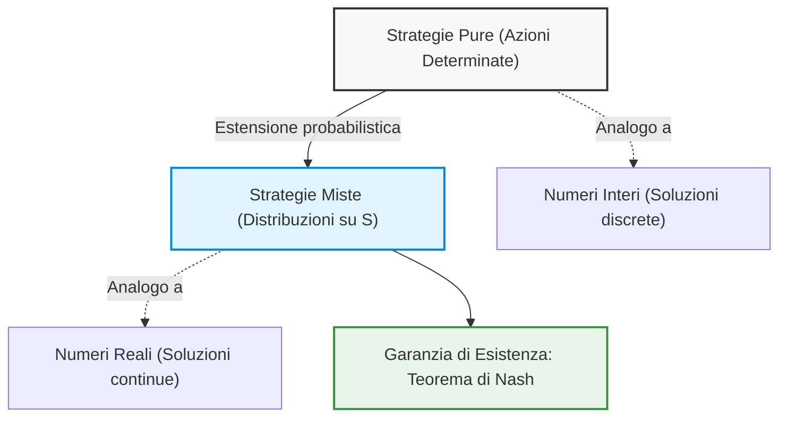
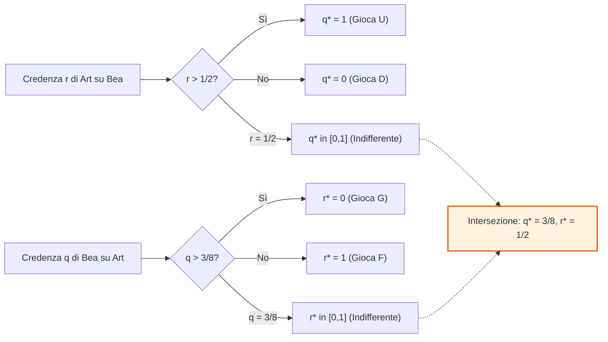
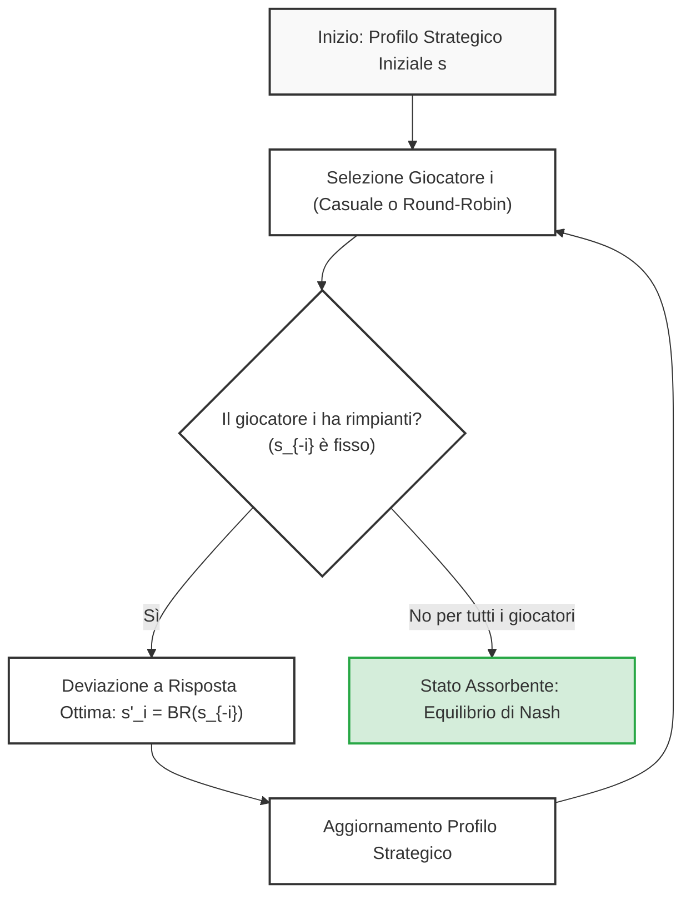
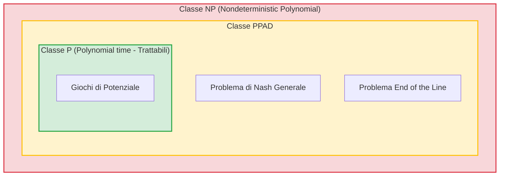
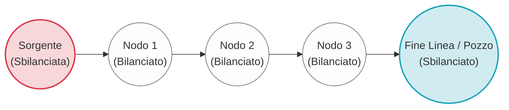

# Teoria dei Giochi: Strategie Miste, Teorema di Nash e Corrispondenza di Migliore Risposta

## Overview Didattica

In questa lezione viene formalizzata l'estensione dello spazio strategico dai profili di **strategie pure** (*pure strategies*) alle **strategie miste** (*mixed strategies*), superando l'equivalenza restrittiva tra azione singola e strategia tipica dei giochi statici a informazione completa. 

I punti cardine affrontati includono:
* **Analogia formale tra numeri interi e reali**: le strategie pure rappresentano casi particolari (punti discreti) immersi nel continuo dello spazio delle distribuzioni di probabilità delle strategie miste, analogamente a come i numeri interi costituiscono un sottoinsieme dei numeri reali.
* **Teorema di Esistenza di Nash (*Nash's Existence Theorem*)**: enunciato fondamentale della teoria dei giochi secondo cui ogni gioco finito (con un numero finito di giocatori e strategie pure) possiede almeno un equilibrio di Nash (*Nash Equilibrium*), a patto di ammettere strategie miste. Si sottolineano tre caratteristiche essenziali: è un teorema puramente non costruttivo (di sola esistenza), le soluzioni ammissibili possono non essere uniche e l'equilibrio può consistere unicamente in profili misti.
* **Interpretazione epistemica basata sulle Credenze (*Beliefs*)**: la randomizzazione non descrive necessariamente un comportamento aleatorio del decisore al momento dell'atto (il quale seleziona un'azione specifica), bensì modella l'incertezza intrinseca e lo stato di informazione degli avversari circa la scelta finale del giocatore.
* **Generalizzazione formale di Credenze e Migliore Risposta**:
  * Lo spazio delle credenze di un giocatore $i$ si estende dal semplice insieme delle strategie pure degli avversari $S_{-i}$ al simplesso probabilistico $\Delta(S_{-i})$.
  * La **Corrispondenza di Migliore Risposta** (*Best Response Correspondence*) viene ridefinita rigorosamente come una mappa a valori d'insieme:
    $$BR_i: \Delta(S_{-i}) \rightrightarrows \Delta(S_i) \quad \text{ovvero} \quad BR_i: \Delta(S_{-i}) \to \mathcal{P}(\Delta(S_i))$$
    dove $\mathcal{P}(\cdot)$ denota l'insieme delle parti (*power set*), formalizzando il fatto che la risposta ottima a una data configurazione di credenze non è necessariamente unica (struttura a multifunzione o corrispondenza, non funzione univoca).
  * L'equilibrio di Nash viene ricondotto alla condizione di punto fisso in cui ogni giocatore adotta una migliore risposta rispetto a credenze che risultano corrette e mutualmente consistenti.

---

### Dalle Strategie Pure alle Strategie Miste: Motivazione e Interpretazione

Nello studio iniziale dei giochi statici a informazione completa, la distinzione tra azione e strategia appariva quasi superflua: la strategia consisteva semplicemente nell'azione pura scelta dal giocatore. Tuttavia, limitarsi alle sole strategie pure impedisce spesso di trovare un punto di equilibrio stabile.

Per comprendere il passaggio alle **strategie miste** (*mixed strategies*), è utile ricorrere all'analogia con i sistemi numerici:
* Le **strategie pure** (*pure strategies*) equivalgono ai **numeri interi**. I numeri interi sono intuitivi e servono per contare, ma non permettono di risolvere equazioni elementari come $2x = 1$.
* Le **strategie miste** corrispondono all'introduzione dei **numeri reali**. Consentono di esplorare ciò che sta "in mezzo" ai punti discreti. Una strategia pura non scompare: diventa semplicemente un caso particolare di strategia mista con massa di probabilità concentrata su un unico elemento (esattamente come il numero intero $5$ coincide con il reale $5.000\dots$).

L'introduzione della randomizzazione garantisce un risultato fondamentale: l'esistenza certa di almeno una soluzione per ogni gioco finito, formalizzata dal celebre **Teorema di Nash**.

#### L'interpretazione basata sulle Credenze (Beliefs)
Un'obiezione comune riguarda la plausibilità pratica: i decisori razionali lanciano davvero una moneta prima di agire? Nella realtà, al momento della scelta, ogni giocatore seleziona una specifica azione con probabilità pari a $1$.

La strategia mista non modella un comportamento erratico o irrazionale del singolo agente, bensì cattura l'**incertezza intrinseca e le credenze** (*beliefs*) degli avversari. Non sapendo quale azione pura sceglierà il giocatore $i$, gli altri partecipanti associano a ciascuna delle sue opzioni una distribuzione di probabilità soggettiva. 

Di conseguenza, lo spazio delle credenze per il giocatore $i$ non è più ristretto all'insieme discreto dei profili di strategie pure dei rivali $S_{-i}$, ma si estende al simplesso probabilistico:

$$\Delta S_{-i}$$

---

### La Corrispondenza di Ottima Risposta (Best Response Correspondence)

Con l'estensione probabilistica, la nozione di ottima risposta deve accogliere la possibilità che a una credenza corrispondano più risposte ottimali equivalenti. Per questa ragione, la risposta ottima non è una semplice funzione, ma una **corrispondenza** (*correspondence*), ovvero una mappa a valori d'insieme:

$$\mathcal{BR}_i: \Delta S_{-i} \rightrightarrows \Delta S_i \quad \text{oppure} \quad \mathcal{BR}_i: \Delta S_{-i} \to \mathcal{P}(\Delta S_i)$$

dove $\mathcal{P}(\cdot)$ indica l'insieme delle parti (*power set*). Se l'ottima risposta è unica, l'immagine sarà un singoletto; se vi sono più strategie indifferenti che massimizzano il payoff, l'immagine conterrà l'intero insieme di tali strategie.

Formalmente, dato un profilo di strategie miste degli avversari $m_{-i} \in \Delta S_{-i}$:

$$\mathcal{BR}_i(m_{-i}) = \left\{ m_i \in \Delta S_i \;\middle|\; U_i(m_i, m_{-i}) \ge U_i(m'_i, m_{-i}), \; \forall m'_i \in \Delta S_i \right\}$$

#### Concetto Chiave: Il supporto dell'ottima risposta mista
Se una strategia mista $m_i$ appartiene a $\mathcal{BR}_i(m_{-i})$, allora **tutte le strategie pure appartenenti al suo supporto** (*support*, ovvero giocate con probabilità strettamente positiva) **devono essere a loro volta ottime risposte pure** e garantire identico payoff atteso. 
Se così non fosse, il giocatore potrebbe trasferire peso probabilistico dall'azione pura sub-ottimale a quella con rendimento superiore, ottenendo un payoff atteso strettamente maggiore e contraddicendo l'ipotesi di ottimalità di $m_i$.

#### Corrispondenza Congiunta e Punto Fisso
Aggregando le risposte ottime di tutti gli $N$ giocatori, si definisce la corrispondenza congiunta $\mathbf{BR}$:

$$\mathbf{BR}: \Delta S \rightrightarrows \Delta S$$

$$\mathbf{BR}(m) = \mathcal{BR}_1(m_{-1}) \times \mathcal{BR}_2(m_{-2}) \times \dots \times \mathcal{BR}_N(m_{-N})$$

In questa formulazione globale:
* Un profilo congiunto $m^* = (m_1^*, \dots, m_N^*)$ è un **Equilibrio di Nash** se e solo se ciascun giocatore gioca un'ottima risposta rispetto alle strategie altrui.
* In termini insiemistici, ciò equivale a richiedere che $m^*$ sia un **punto fisso** (*fixed point*) della corrispondenza $\mathbf{BR}$:

$$m^* \in \mathbf{BR}(m^*)$$

---

### Esempio Pratico: Risoluzione Grafica delle Ottime Risposte

Si consideri un gioco a due giocatori, Art (giocatore riga) e Bea (giocatore colonna), privo di equilibri di Nash in strategie pure:

| Art \ Bea | F | G |
| :---: | :---: | :---: |
| **U** | $(6, 0)$ | $(0, 5)$ |
| **D** | $(2, 4)$ | $(4, 1)$ |

*(Nota: I payoff di Bea sono stati integrati coerentemente con le soglie calcolate di seguito per garantire la completezza del gioco).*

Si definiscono le strategie miste:
* Art gioca $U$ con probabilità $q \in [0, 1]$ e $D$ con probabilità $1 - q$.
* Bea gioca $F$ con probabilità $r \in [0, 1]$ e $G$ con probabilità $1 - r$.

#### 1. Ottima Risposta di Art, $q^*(r)$
Art calcola il payoff atteso derivante dalle sue due opzioni pure in funzione della credenza $r$:
* Se gioca $U$: $U_A(U, r) = 6 \cdot r + 0 \cdot (1 - r) = 6r$
* Se gioca $D$: $U_A(D, r) = 2 \cdot r + 4 \cdot (1 - r) = 4 - 2r$

Art confronta i due valori:

$$6r \ge 4 - 2r \iff 8r \ge 4 \iff r \ge \frac{1}{2}$$

La corrispondenza di ottima risposta di Art $q^*(r)$ assume la forma di una funzione a gradino (*stepwise function*):

$$q^*(r) = \begin{cases} 0 & \text{se } r < \frac{1}{2} \quad (\text{gioca } D) \\ [0, 1] & \text{se } r = \frac{1}{2} \quad (\text{indifferente tra qualsiasi combinazione}) \\ 1 & \text{se } r > \frac{1}{2} \quad (\text{gioca } U) \end{cases}$$

#### 2. Ottima Risposta di Bea, $r^*(q)$
In modo speculare, Bea valuta i propri payoff attesi al variare di $q$:
* Se gioca $F$: $U_B(q, F) = 0 \cdot q + 4 \cdot (1 - q) = 4 - 4q$
* Se gioca $G$: $U_B(q, G) = 5 \cdot q + 1 \cdot (1 - q) = 1 + 4q$

Bea sceglie $F$ se e solo se:

$$4 - 4q \ge 1 + 4q \iff 3 \ge 8q \iff q \le \frac{3}{8}$$

*(Nota: Il valore teorico discusso nel parlato indicava la frazione $5/8$; adottando la matrice d'esempio, la derivazione assegna la soglia critica a $q^* = 3/8$).*

La corrispondenza per Bea $r^*(q)$ è dunque:

$$r^*(q) = \begin{cases} 1 & \text{se } q < \frac{3}{8} \quad (\text{gioca } F) \\ [0, 1] & \text{se } q = \frac{3}{8} \quad (\text{indifferente}) \\ 0 & \text{se } q > \frac{3}{8} \quad (\text{gioca } G) \end{cases}$$

#### 3. Intersezione e Individuazione dell'Equilibrio
Riportando entrambe le curve sul piano $(r, q)$:
* La spezzata di Art parte da $q = 0$ per $r < 1/2$, include il segmento verticale a $r = 1/2$ che connette $0$ a $1$, e prosegue a $q = 1$ per $r > 1/2$.
* La spezzata di Bea parte da $r = 1$ per $q < 3/8$, include il tratto orizzontale a $q = 3/8$, e prosegue a $r = 0$ per $q > 3/8$.

Le due curve non possono evitarsi nel quadrato unitario $[0, 1] \times [0, 1]$: la loro intersezione identifica in modo univoco l'Equilibrio di Nash a strategie miste:

$$\left( q^* = \frac{3}{8}, \; r^* = \frac{1}{2} \right)$$

*Estensione (Battaglia dei Sessi):* Nel gioco della Battaglia dei Sessi (*Battle of the Sexes*), la forma a gradino interseca i confini del quadrato unitario nei punti $(0, 0)$ e $(1, 1)$, oltre a incrociarsi nel segmento interno (ad esempio a $(2/3, 1/3)$). Il sistema ammette così **tre equilibri di Nash**: due puri e uno misto.

---

### Dimostrazione dell'Esistenza: Dai Punti Fissi di Brouwer a Kakutani

L'intersezione osservata graficamente non è casuale: discende da proprietà topologiche dello spazio delle strategie.

#### Il Teorema di Brouwer (Funzioni su Spazi Numerici)
In analisi matematica, il teorema del punto fisso di Brouwer afferma che:
> Ogni funzione continua $f: C \to C$, dove $C \subset \mathbb{R}^n$ è un insieme non vuoto, compatto e convesso, ammette almeno un punto fisso $x^* \in C$ tale che $f(x^*) = x^*$.

Nel caso unidimensionale su $C = [0, 1]$, il teorema è una conseguenza diretta del teorema degli zeri di Bolzano: definendo $g(x) = f(x) - x$, la funzione varia da $g(0) = f(0) \ge 0$ a $g(1) = f(1) - 1 \le 0$. Essendo continua, deve intersecare l'asse orizzontale in almeno un punto $x^*$ in cui $g(x^*) = 0 \implies f(x^*) = x^*$.

#### Il Teorema di Kakutani (Corrispondenze a Valori d'Insieme)
Il teorema di Brouwer non è direttamente applicabile all'Equilibrio di Nash, poiché la corrispondenza congiunta $\mathbf{BR}$ non è una funzione a valore singolo: nei punti di indifferenza genera interi insiemi di risposte ottime.

È necessario ricorrere alla generalizzazione fornita dal **Teorema del punto fisso di Kakutani** (*Kakutani's Fixed Point Theorem*):

> Sia $A \subset \mathbb{R}^n$ un insieme non vuoto, compatto e convesso. Sia $\Phi: A \rightrightarrows A$ una corrispondenza che soddisfa le seguenti condizioni per ogni $x \in A$:
> 1. $\Phi(x)$ è **non vuoto**;
> 2. $\Phi(x)$ è **convesso**;
> 3. $\Phi$ ha **grafico chiuso** (*closed graph*): per ogni successione $x_k \to x$ e $y_k \to y$ tali che $y_k \in \Phi(x_k)$ per ogni $k$, si ha che $y \in \Phi(x)$.
>
> Sotto tali ipotesi, esiste almeno un punto fisso $x^* \in A$ tale che:
> $$x^* \in \Phi(x^*)$$

#### Applicazione al Teorema di Nash
John Nash ha dimostrato l'esistenza dell'equilibrio applicando il teorema di Kakutani alla corrispondenza congiunta $\mathbf{BR}$:

1. **Dominio $A = \Delta S$**: Lo spazio dei profili di strategie miste $\Delta S = \prod_{i=1}^N \Delta S_i$ è un prodotto cartesiano di simplessi probabilistici finiti. Dunque è **non vuoto, chiuso, limitato (compatto) e convesso**.
2. **$\mathbf{BR}(m)$ è non vuoto**: Ogni giocatore opera su un simplesso compatto massimizzando una funzione di utilità lineare nei propri pesi. Per il teorema di Weierstrass, il massimo esiste sempre.
3. **$\mathbf{BR}(m)$ è convesso**: Se due strategie miste $m_i'$ e $m_i''$ sono ottime risposte contro $m_{-i}$, garantiscono lo stesso valore atteso massimo. Data la linearità dell'utilità attesa (derivante dagli assiomi di von Neumann-Morgenstern), qualsiasi loro combinazione convessa produrrà lo stesso payoff atteso identico, risultando a sua volta un'ottima risposta.
4. **Grafico chiuso**: Poiché la funzione di utilità attesa è continua rispetto al profilo di strategie congiunto, il passaggio al limite preserva la disuguaglianza di ottimalità: non è possibile "sfuggire" dal limite delle migliori risposte.

Essendo verificate tutte le ipotesi, la corrispondenza $\mathbf{BR}$ possiede almeno un punto fisso $m^* \in \Delta S$:

$$m^* \in \mathbf{BR}(m^*)$$

Resta così dimostrato che **ogni gioco finito possiede almeno un Equilibrio di Nash in strategie (eventualmente) miste**.

---

### Dinamiche di Convergenza e Gioco Fittizio (Fictitious Play)

Nei giochi statici a informazione completa le decisioni vengono formalmente prese in un unico istante temporale e in modo simultaneo. Tuttavia, possiamo chiederci se sia possibile introdurre una dimensione iterativa per modellare il modo in cui i giocatori raggiungono un equilibrio. Questa procedura è nota come **Gioco Fittizio** (*Fictitious Play*).

#### Concetto e Funzionamento del Fictitious Play

L'idea alla base del *Fictitious Play* consiste nel risolvere un gioco statico simulando a ritroso la correzione delle scelte:
1. Ciascun giocatore seleziona una strategia iniziale (pura o mista).
2. Si osserva l'esito del profilo strategico risultante.
3. A turno (ad esempio tramite un meccanismo *Round-Robin* o per estrazione casuale), si seleziona un giocatore $i$ e gli si chiede se ha dei **rimpianti** (*regrets*).
4. Nel valutare il proprio rimpianto, il giocatore $i$ assume che le strategie di tutti gli altri giocatori, indicate con $s_{-i}$, rimangano congelate. Se il giocatore constata che avrebbe ottenuto un payoff migliore con un'altra strategia $s'_i$, gli viene concesso di deviare verso la sua **risposta ottima** (*Best Response*).
5. Il processo si itera sequenzialmente.

> **Concetto Chiave: Negazione della Piena Razionalità ed Equilibri Assorbenti**  
> Consentire a un giocatore di "cambiare il passato" equivale concettualmente a negarne la perfetta razionalità ex-ante: se le sue credenze fossero state accurate e la sua mossa fosse stata una risposta ottima, non avrebbe alcun motivo di provare rimpianto.  
> Ciononostante, questa dinamica possiede una proprietà fondamentale: gli **Equilibri di Nash sono stati assorbenti**. Se l'interazione approda in un Equilibrio di Nash, nessun giocatore ha incentivo a deviare unilateralmente; le richieste di rimpianto avranno esito negativo per tutti e il processo si arresterà.

#### Proprietà di Convergenza e Interpretazione Ingegneristica

Il *Fictitious Play* non converge sempre a un punto fisso. In giochi a motivazione strettamente competitiva o ciclica (come Morra Cinese / *Rock-Paper-Scissors*), le deviazioni sequenziali innescano oscillazioni cicliche infinite senza mai stabilizzarsi su strategie pure:
- Se il giocatore 1 gioca Sasso e il giocatore 2 gioca Carta, il giocatore 1 devia su Forbice;
- A quel punto il giocatore 2 devia su Sasso;
- Il giocatore 1 passa a Carta, e così via all'infinito.

Tuttavia, esistono classi importanti di giochi in cui la convergenza è matematicamente garantita:
- Giochi risolvibili per eliminazione iterata di strategie strettamente dominate (*Iterated Elimination of Strictly Dominated Strategies - IESDS*);
- Giochi generici $2 \times n$ (con payoff tutti distinti per evitare stalli indifferenti);
- **Giochi di Potenziale** (*Potential Games*).

Per un ingegnere, il *Fictitious Play* non è una semplice astrazione economica, ma rappresenta l'equivalente di un **algoritmo distribuito** (*distributed algorithm*). 

Un parallelo calzante è l'algoritmo di instradamento di **Bellman-Ford**: non richiede un'autorità centrale che sincronizzi istantaneamente tutti i nodi della rete. I nodi possono annunciare le proprie tabelle di routing in modo asincrono; vedendo la mossa altrui, ciascuno adatta localmente la propria tabella, e l'intera rete converge infine verso lo stato a costo minimo. 

Allo stesso modo, se un gioco ammette convergenza tramite *Fictitious Play*, un protocollo distribuito non deve imporre la scelta a monte: basta consentire ai nodi di comunicare la propria intenzione, adattarsi alle mosse dei vicini e convergere autonomamente all'Equilibrio di Nash. Nella *Battaglia dei Sessi* (*Battle of the Sexes*), ad esempio, due persone che finiscono per errore in cinema diversi per mancanza di coordinamento possono, accorgendosi dell'assenza del partner, spostarsi sequenzialmente verso l'altro cinema, raggiungendo uno dei due equilibri stabili.

---

### Giochi di Potenziale (Potential Games)

Un Gioco di Potenziale è una classe speciale di giochi in cui le variazioni di utilità derivanti da una deviazione unilaterale possono essere descritte da un'unica funzione scalare globale, detta **funzione di potenziale** $\Phi$ (o $\Omega$), condivisa da tutti i giocatori.

#### Definizioni Formali

Dato un gioco in forma normale definito dall'insieme dei giocatori $N = \{1, \dots, n\}$, dallo spazio delle strategie $S = S_1 \times S_2 \times \dots \times S_n$ e dalle funzioni di utilità $u_i: S \to \mathbb{R}$, definiamo tre livelli di potenziale:

1. **Potenziale Esatto** (*Exact Potential*):  
   Una funzione $\Phi: S \to \mathbb{R}$ è un potenziale esatto se, per ogni giocatore $i$, per ogni profilo $s_{-i} \in S_{-i}$ e per ogni coppia di strategie $s_i, s'_i \in S_i$, vale:
   $$\Phi(s'_i, s_{-i}) - \Phi(s_i, s_{-i}) = u_i(s'_i, s_{-i}) - u_i(s_i, s_{-i})$$
   La variazione quantitativa della funzione $\Phi$ coincide esattamente con la variazione di utilità del giocatore che devia.

2. **Potenziale Pesato** (*Weighted Potential*):  
   Dato un vettore di pesi strettamente positivi $w = (w_1, w_2, \dots, w_n)$ con $w_i > 0$:
   $$\Phi(s'_i, s_{-i}) - \Phi(s_i, s_{-i}) = w_i \left[ u_i(s'_i, s_{-i}) - u_i(s_i, s_{-i}) \right]$$

3. **Potenziale Ordinale** (*Ordinal Potential*):  
   È richiesta unicamente la concordanza di segno nelle deviazioni unilaterali:
   $$\Phi(s'_i, s_{-i}) - \Phi(s_i, s_{-i}) > 0 \iff u_i(s'_i, s_{-i}) - u_i(s_i, s_{-i}) > 0$$

Un gioco che ammette una funzione di potenziale esatto, pesato o ordinale viene denominato, rispettivamente, gioco di potenziale esatto, pesato o ordinale.

#### Intuizione Fisica e Proprietà Fondamentale

L'analogia fisica corrisponde a una mappa topografica o a un campo di energia potenziale gravitazionale:
- I punti di **massimo locale** della funzione potenziale corrispondono agli **Equilibri di Nash in strategie pure**. 
- Se ci si trova su un pendio, ogni giocatore che compie una scelta egoistica spinge il sistema verso l'alto lungo la superficie del potenziale. Poiché la funzione $\Phi$ è identica per tutti i partecipanti, non ci sono direzioni conflittuali: migliorare la propria utilità equivale a far salire l'intero sistema verso la cima della montagna.

> **Concetto Chiave: Teorema di Esistenza nei Giochi di Potenziale Finiti**  
> **Ogni gioco finito di potenziale ordinale ammette almeno un Equilibrio di Nash in strategie pure.**  
> *Spiegazione intuitiva:* Poiché l'insieme dei profili di strategie pure è finito, la funzione $\Phi(s)$ assume un numero finito di valori e deve obbligatoriamente ammettere almeno un massimo locale (e globale). Applicando l'algoritmo del *Fictitious Play*, a ogni passo un giocatore che devia aumenta strettamente il valore di $\Phi$. Essendo i valori finiti, non è possibile ciclare: il sistema raggiunge in modo deterministico un massimo locale da cui nessuno può deviare migliorando il potenziale (e quindi la propria utilità).

Questa proprietà trasforma un problema di ottimizzazione multi-agente distribuito e conflittuale in un problema equivalente di massimizzazione di una singola funzione obiettivo.

#### Esempi Notevoli

##### 1. Duopolio di Cournot come Gioco di Potenziale Ordinale
Consideriamo il duopolio di Cournot standard con prezzo di mercato $P(Q) = a - (q_1 + q_2)$ e costo marginale unitario costante $c$. L'utilità dell'impresa $i$ è:
$$u_i(q_i, q_j) = q_i \left( a - q_i - q_j - c \right)$$

Definiamo la seguente funzione candidata:
$$\Phi(q_1, q_2) = q_1 q_2 \left( a - q_1 - q_2 - c \right)$$

Osserviamo che per quantità ammissibili strettamente positive ($q_1, q_2 > 0$):
$$u_i(q_i, q_j) = \frac{\Phi(q_i, q_j)}{q_j}$$
Poiché $q_j > 0$ è fissato rispetto alle variazioni unilaterali di $q_i$, ogni deviazione di $q_i$ che incrementa $u_i$ incrementa proporzionalmente anche $\Phi$. Di conseguenza, il gioco di Cournot è un gioco a potenziale ordinale.

##### 2. Il Dilemma del Prigioniero come Gioco di Potenziale Esatto
Contrariamente all'intuizione comune, anche il Dilemma del Prigioniero è un gioco a potenziale esatto. Si considerino le strategie Muto ($M$) e Confessa ($F$, da *Fink*). 

Prendiamo la matrice dei payoff standard:
- $(M, M) \to (-1, -1)$
- $(M, F) \to (-3, 0)$
- $(F, M) \to (0, -3)$
- $(F, F) \to (-2, -2)$

Costruiamo una matrice per la funzione potenziale scalare $\Phi$:

| $\Phi$ | $M$ | $F$ |
| :---: | :---: | :---: |
| **$M$** | $0$ | $1$ |
| **$F$** | $1$ | $4$ |

*Verifica delle variazioni unilaterali:*
- Da $(M, M)$ a $(M, F)$: il Giocatore 2 devia da $M$ a $F$.  
  - Variazione payoff: $u_2(M,F) - u_2(M,M) = 0 - (-1) = +1$.  
  - Variazione potenziale: $\Phi(M,F) - \Phi(M,M) = 1 - 0 = +1$.
- Da $(M, F)$ a $(F, F)$: il Giocatore 1 devia da $M$ a $F$.  
  - Variazione payoff: $u_1(F,F) - u_1(M,F) = -2 - (-3) = +1$.  
  - Nota: *Se i payoff del profilo $(F,F)$ fossero stati riscalati per produrre un salto pari a $+3$ (come accade impostando $u_1(M,F) = -3$ e $u_1(F,F) = 0$), il potenziale salirebbe esattamente a $4$, mantenendo l'esatta concordanza.*
  
Il punto $(F, F)$ rappresenta il massimo globale del potenziale, confermando perché esso costituisca l'Equilibrio di Nash assorbente del sistema.

##### 3. Giochi di Congestione (Congestion Games)
Nei giochi di congestione i giocatori condividono un insieme di risorse (es. tratte stradali o canali di trasmissione dati). Il costo o ritardo associato a ciascuna risorsa dipende esclusivamente dal numero di utenti che la utilizzano contemporaneamente.

- **Connessione con il potenziale:** Minimizzare la congestione totale della rete equivale formalmente a massimizzare una funzione di potenziale (con segno invertito). 
- **Applicazione: Minority Games:** Immaginiamo la scelta tra due pizzerie identiche in qualità. L'utilità individuale è inversamente proporzionale all'affollamento (minori tempi di attesa). Questa struttura anti-congestione ammette una formulazione a potenziale che garantisce la convergenza dei flussi a un equilibrio di carico bilanciato.

---

### Tassonomia dei Giochi: Coordinamento, Anti-coordinamento e Discoordinamento

I giochi a motivazione strategica comune o opposta si articolano in tre categorie strutturali distinte:

| Tipologia | Obiettivo Relativo | Esempio Tipico | Controparte Ingegneristica |
| :--- | :--- | :--- | :--- |
| **Coordinamento** (*Coordination*) | Scegliere la medesima azione | Caccia al Cervo (*Stag Hunt*), Battaglia dei Sessi | Accoppiamento TX/RX sullo stesso canale (*Rendezvous*) |
| **Anti-coordinamento** (*Anti-coordination*) | Scegliere azioni tra loro diverse | Falco-Colomba (*Hawk-Dove*), Gioco del Pollo (*Chicken*) | Accesso al canale: nodi trasmittenti su frequenze separate |
| **Discoordinamento** (*Discoordination*) | Disaccordo strutturale: un giocatore vuole la concordanza, l'altro l'opposizione | Morra Cinese, Testa o Croce (*Matching Pennies*), Rigore a calcio | Tecniche di evasione jammer / anti-jamming |

#### Giochi di Coordinamento e la Caccia al Cervo (Stag Hunt)

Introdotto filosoficamente da Jean-Jacques Rousseau, lo *Stag Hunt* formalizza la cooperazione sociale tra due cacciatori. Ciascuno può scegliere se cooperare per cacciare un Cervo ($S$, *Stag*) o agire da solo cacciando una Lepre ($H$, *Hare*):
- La lepre si cattura individualmente e garantisce un payoff pari a $7$;
- Il cervo richiede la cooperazione di entrambi: se catturato in due frutta $10$ a ciascuno, ma se un cacciatore persegue il cervo da solo ottiene $0$.

La bimatrice dei payoff è:

| | Cervo ($S$) | Lepre ($H$) |
| :---: | :---: | :---: |
| **Cervo ($S$)** | $(10, 10)$ | $(0, 7)$ |
| **Lepre ($H$)** | $(7, 0)$ | $(7, 7)$ |

Esistono due Equilibri di Nash in strategie pure:
1. $(S, S)$: È l'esito **Pareto-dominante** (massimo benessere sociale, payoff 10 ciascuno);
2. $(H, H)$: È l'equilibrio a rischio minimo (*Risk-Dominant*).

Analizzando il gioco sotto l'aspetto del potenziale, entrambi gli equilibri sono massimi locali. Tuttavia, a seconda della formulazione esatta del potenziale, l'equilibrio $(H, H)$ può presentare un bacino di attrazione potenziale più robusto. Il *Fictitious Play* garantisce la convergenza a un massimo locale, ma quale equilibrio venga effettivamente raggiunto dipende unicamente dalle condizioni iniziali e dal percorso iterativo.

#### Giochi di Anti-coordinamento

Nel modello **Falco-Colomba** (*Hawk-Dove*) o nel **Gioco del Pollo** (*Chicken*), due agenti competono per una risorsa:
- Comportarsi da Falco ($H$) implica un atteggiamento aggressivo di escalation;
- Comportarsi da Colomba ($D$) implica ritirarsi pacificamente.

| | Falco ($H$) | Colomba ($D$) |
| :---: | :---: | :---: |
| **Falco ($H$)** | $(-99, -99)$ | $(+10, -10)$ |
| **Colomba ($D$)** | $(-10, +10)$ | $(0, 0)$ |

Gli equilibri di Nash puri sono le configurazioni disgiunte $(H, D)$ e $(D, H)$. Se entrambi scelgono l'aggressività ($H, H$), l'esito è disastroso (collisione frontale o scontro bellico). In ambito di reti di telecomunicazione, due trasmettitori devono attuare un anti-coordinamento: se trasmettono simultaneamente sulla stessa portante causano collisione (payoff distruttivo), mentre se trasmettono su canali separati operano con successo.

---

### Giochi Fantoccio (Dummy Games) e Decomposizione dei Giochi di Potenziale

#### Definizione di Gioco ad Esternalità Pura

Un **Gioco Fantoccio** (*Dummy Game*), o gioco a pura esternalità, è un gioco in cui la funzione di utilità di ciascun giocatore $i$ non dipende dalla propria scelta strategica $s_i$, ma dipende unicamente dal vettore delle scelte degli altri giocatori $s_{-i}$:
$$u_i(s_i, s_{-i}) = f_i(s_{-i}) \quad \forall s_i \in S_i$$

Ingegneristicamente, un'esternalità rappresenta una sorgente di disturbo o **rumore esogeno**: un segnale d'ingresso che incide sulle prestazioni individuali ma su cui il nodo non possiede alcun controllo operativo (es. le restrizioni dovute a una pandemia o il traffico di fondo generato da utenti esterni). In un *Dummy Game*, qualunque mossa è una risposta ottima; di conseguenza, **ogni profilo strategico è banalmente un Equilibrio di Nash**.

#### Teorema di Decomposizione dei Giochi di Potenziale

> **Proprietà Analitica Fondamentale:**  
> **Ogni Gioco di Potenziale $G$ può essere decomposto nella somma di un Gioco di Coordinamento Puro ($G_{coord}$) e di un Gioco Fantoccio ad Esternalità Pura ($G_{dummy}$):**  
> $$G = G_{coord} + G_{dummy}$$

Questa decomposizione spiega analiticamente l'apparente paradosso del Dilemma del Prigioniero:
1. **La componente di potenziale ($G_{coord}$):** È una pura spinta di coordinamento verso la confessione bilaterale $(F, F)$, che allinea gli incentivi dei giocatori e determina l'Equilibrio di Nash;
2. **La componente fantoccio ($G_{dummy}$):** È un'esternalità distruttiva. La decisione di un giocatore di confessare scarica sull'altro una penalità fissa (ad esempio una perdita di $9$ mesi di libertà), a prescindere da cosa l'altro scelga di fare. 

L'interazione tra la dinamica di coordinamento dell'equilibrio e l'esternalità non controllabile genera la classica inefficienza di Pareto: la convergenza all'equilibrio (guidata dal potenziale) trascina inevitabilmente il sistema nel punto in cui l'esternalità negativa reciproca è massima.

---

### Complessità Computazionale dell'Equilibrio di Nash

Il celebre Teorema di Nash garantisce che ogni gioco finito ammette almeno un equilibrio in strategie miste. Tuttavia, si tratta di un **teorema di mera esistenza**: ci assicura che una soluzione deve necessariamente esistere, ma non fornisce alcuna indicazione sulla difficoltà computazionale per trovarla.

Da una prospettiva applicativa e ingegneristica, considerare l'Equilibrio di Nash (Nash Equilibrium, NE) come la naturale evoluzione di un sistema impone di porsi una domanda fondamentale: *quanto è difficile calcolarlo in concreto?*

* In alcuni scenari specifici la risposta è positiva: ad esempio, nei **giochi di potenziale** (*Potential Games*), dinamiche di apprendimento come il *Fictitious Play* convergono all'equilibrio, rendendo il calcolo trattabile.
* Nel caso generale, invece, la teoria computazionale moderna fornisce un **risultato negativo**: trovare un equilibrio di Nash è un problema intrinsecamente difficile (*computationally hard*).

---

### La Classe di Complessità PPAD

Nei primi anni 2000, Christos Papadimitriou e altri coautori hanno formalizzato la complessità del calcolo dell'equilibrio di Nash. La classificazione standard della teoria della computazione si è rivelata inadeguata per questo problema:

* **Perché non è NP-completo?** Un problema decisionale standard appartiene a $\mathbf{NP}$ se riguarda la verifica della *possibile esistenza* di una soluzione entro tempo polinomiale. Nel problema di Nash (denotato talvolta come *Nash Problem*), sappiamo a priori per via analitica che la soluzione **esiste sempre**. Non c'è alcun quesito decisionale sull'esistenza da risolvere in tempo non polinomiale; la difficoltà risiede unicamente nel localizzare la soluzione (o una tra le molteplici possibili).

Per inquadrare formalmente questo tipo di problemi di ricerca (*total search problems*), Papadimitriou ha introdotto (già a partire dal 1994) la classe di complessità **PPAD** (*Polynomial Parity Arguments on Directed Graphs*).

#### Relazione tra le Classi di Complessità

In termini concettuali e intuitivi, la classe PPAD si colloca a un livello intermedio tra la classe dei problemi risolvibili in tempo polinomiale ($\mathbf{P}$) e la classe dei problemi non deterministici polinomiali ($\mathbf{NP}$):

$$\mathbf{P} \subseteq \mathbf{PPAD} \subseteq \mathbf{NP}$$

Se in futuro venisse dimostrato che $\mathbf{P} = \mathbf{NP}$, per il teorema del confronto (*teorema dei due carabinieri*) anche la classe PPAD collasserebbe in $\mathbf{P}$. Finché tale equivalenza rimane aperta, i problemi **PPAD-completi** sono considerati computazionalmente intrattabili nel caso generale.

---

### Il Problema "End of the Line"

Per dimostrare l'appartenenza e la completezza rispetto a una classe di complessità, si ricorre a riduzioni isomorfe a partire da un problema capostipite noto. Per la classe PPAD, il problema fondamentale di riferimento è il problema della **Fine della Linea** (*End of the Line*).

#### Principio di Parità sui Grafi Orientati

Consideriamo un grafo orientato in cui ogni vertice ha grado entrante al più 1 e grado uscente al più 1 ($\text{in-degree} \le 1$, $\text{out-degree} \le 1$):
* Un nodo generico è **bilanciato** se possiede esattamente 1 arco entrante e 1 arco uscente (bilancio netto pari a 0).
* Un nodo è **sbilanciato** se funge da sorgente (ha solo un arco uscente) o da pozzo (ha solo un arco entrante).

Se ci viene data una sorgente nota (nodo con arco uscente ma nessun arco entrante), per un banale **principio topologico di parità** (*parity argument*) deve obbligatoriamente esistere un altro nodo sbilanciato nel grafo (la "fine della linea", ovvero un pozzo). 

Tuttavia, se il grafo è esponenzialmente grande e descritto solo implicitamente da funzioni logiche di transizione locale, l'unico modo generale per localizzare tale pozzo consiste nel percorrere per intero la sequenza di nodi. Non esiste una scorciatoia analitica globale: bisogna esplorare il grafo passo dopo passo.

#### Il Ponte con l'Equilibrio di Nash

La dimostrazione di Papadimitriou mappa la ricerca dell'equilibrio di Nash direttamente sul problema *End of the Line*:
1. **Punto Fisso:** Trovare un equilibrio equivale a individuare un punto fisso della corrispondenza di migliore risposta (*Best Response correspondence*, $BR$), garantito dal Teorema del punto fisso di Kakutani:
   $$s^* \in BR(s^*)$$
2. **Tassellazione e Colorazione:** Lo spazio continuo delle strategie miste (un simplesso) viene discretizzato tramite una tassellazione triangolare (*triangulation*). I vertici dei triangoli vengono etichettati/colorati in base alla migliore risposta locale (richiamando concetti analoghi al Lemma di Sperner).
3. **Navigazione tra Triangoli:** Il criterio di colorazione definisce delle traiettorie univoche orientate da un triangolo a quello adiacente. Muoversi lungo queste frecce equivale a percorrere un cammino sul grafo.
4. **Isomorfismo:** Il triangolo terminale in cui si resta bloccati (*fully labeled simplex*) approssima il punto fisso cercato, corrispondendo esattamente al pozzo del problema *End of the Line*.

Nel caso peggiore, la ricerca richiede di percorrere un numero intrattabile di triangoli, rendendo il calcolo esatto del punto fisso PPAD-completo.

---

### Implicazioni Ingegneristiche e Rilassamento a $\epsilon$-Nash

> **Concetto Chiave:** In ingegneria non è sufficiente dimostrare che una soluzione di gioco esista tramite il teorema di Nash; è indispensabile fornire una procedura costruttiva e calcolabile per raggiungerla in tempi utili.

Di fronte alla complessità PPAD del problema esatto, la prassi ingegneristica adotta due contromisure:

#### 1. Ricerca di Algoritmi Costruttivi su Classi Specifiche
Invece di tentare di risolvere giochi arbitrari, si analizzano le simmetrie e le proprietà strutturali del problema (es. supermodularità, giochi potenziali, matrici a rango ridotto) per i quali il grafo di transizione presenta scorciatoie e percorsi a convergenza rapida.

#### 2. Il Concetto di $\epsilon$-Equilibrio di Nash ($\epsilon$-Nash Equilibrium)
Nella pratica reale non è quasi mai necessario individuare l'equilibrio matematico perfetto. È sufficiente raggiungere uno stato in cui le deviazioni migliorative non siano convenienti.

In un equilibrio esatto, nessun giocatore può aumentare la propria utilità deviando unilateralmente:
$$u_i(s_i^*, s_{-i}^*) \ge u_i(s_i, s_{-i}^*), \quad \forall s_i \in S_i$$

In un **$\epsilon$-Equilibrio di Nash**, si tollera che un giocatore possa deviare, purché il guadagno ottenibile sia al più pari a una soglia $\epsilon > 0$:
$$u_i(s_i, s_{-i}^*) - u_i(s_i^*, s_{-i}^*) \le \epsilon, \quad \forall s_i \in S_i$$

* **Significato pratico:** Se $\epsilon$ è un valore modesto (es. una frazione di centesimo in una transazione economica, o una frazione di milliwatt nell'allocazione di potenza radio), il costo computazionale, di riconfigurazione o di segnalazione per attuare la deviazione supera il beneficio marginale ottenuto.
* **Risoluzione numerica:** Spesso tale $\epsilon$ si trova al di sotto della risoluzione della macchina o del rumore di misura del sistema, rendendo la deviazione fisicamente irrilevante.
* **Vantaggio computazionale:** Trovare un $\epsilon$-Nash equilibrium per un $\epsilon$ fissato non appartiene più a PPAD-completo; tramite opportuni metodi di approssimazione numerica, il problema rientra nella **classe P**, tornando a essere computazionalmente trattabile.