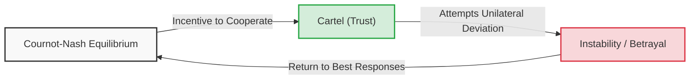
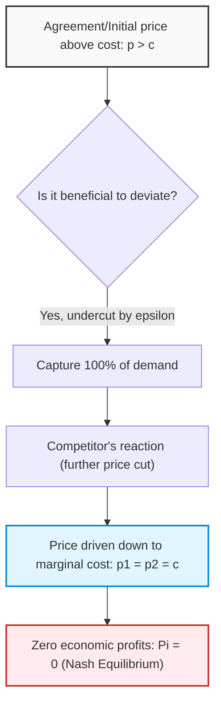
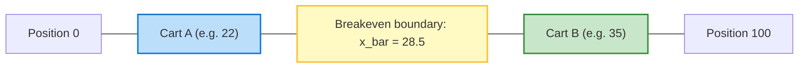
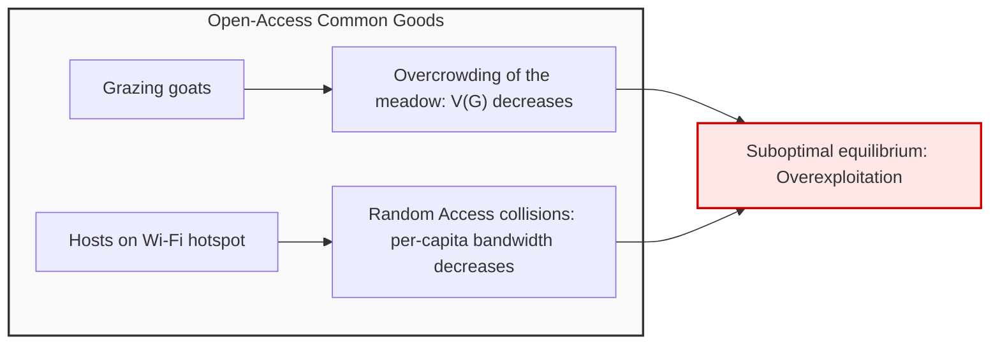
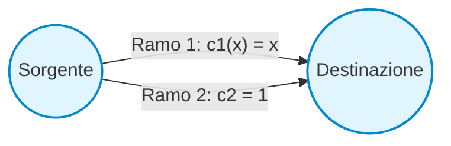
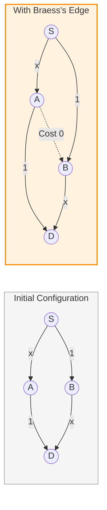

# Applications of Nash Equilibrium and the Cournot Duopoly

## Educational Overview

In this lecture, classical applications of Game Theory are analyzed, with an in-depth focus on the characterization of the Nash Equilibrium and on the mathematical abstraction criteria necessary for modeling real-world problems.

The fundamental concepts covered include:
* **Analysis of the Nash Equilibrium**: Study of the NE as a steady state and predictive tool for competitive systems (with applications extendable to telecommunication networks, data science, and cybersecurity). Issues related to the non-uniqueness of equilibria and the structural gap between the spontaneity of competitive equilibrium and its actual Pareto Efficiency are discussed.
* **Engineering Modeling Principles**: The fundamental trade-off between fidelity to reality and Mathematical Tractability. It is emphasized that model construction should prioritize capturing the macroscopic trends of the system rather than over-characterizing details.
* **The Cournot Duopoly Model**: Introduction to the classical quantity competition game between two firms ($Q_1$ and $Q_2$). Formalization of the production cost structure and of the Inverse Demand Function, defined in the simplified form $P(Q) = A - Q$ with $Q = Q_1 + Q_2$.

---

### Applications of Nash Equilibrium: Introduction and Engineering Relevance

The analysis of the Nash Equilibrium (NE) finds applications well beyond pure economic theory. Many fundamental problems in modern engineering — from resource allocation in telecommunication networks to traffic routing, from cybersecurity to cluster management for data science — can be formalized as strategic games equivalent to classical models.

A Nash equilibrium represents a stable configuration and a natural prediction of the evolution of a decentralized system: no agent has a unilateral incentive to deviate from their choice. However, two critical considerations emerge:

1. **Existence and Uniqueness:** Under relatively weak mathematical hypotheses, a Nash equilibrium almost always exists, but it is not necessarily unique. In the presence of multiple equilibria, the engineer must define selection criteria or prove uniqueness conditions to ensure system predictability.
2. **Competition and Pareto Efficiency:** A competitive equilibrium that is easy to reach does not guarantee systemic efficiency at all. Often, the Nash equilibrium **is not Pareto-efficient** (collective welfare turns out to be sub-optimal compared to coordinated solutions). The task of systems engineering consists precisely in evaluating the gap between the Nash solution and the Pareto optimum, designing corrective mechanisms to bridge this divide.

---

### The Cournot Duopoly Model (1838)

The Cournot model is one of the historical cornerstones of oligopoly theory, formulated more than a century before modern game theory. It studies quantity competition between two competing firms.

#### The Trade-off between Realism and Mathematical Tractability
An essential methodological principle lies in simplification: to formalize a real-world problem, an over-detailed model is not needed, but rather an analytically tractable formulation that faithfully captures the phenomenological trend.

In the Cournot model, the fundamental qualitative dynamic is:
$$\text{Quantità prodotta alta} \implies \text{Prezzo di mercato basso}$$

#### Model Definition
- **Players:** Two firms, $i \in \{1, 2\}$.
- **Actions/Strategies:** Each firm independently chooses the quantity to put on the market: $Q_1 \ge 0$ and $Q_2 \ge 0$.
- **Total Production:** $Q = Q_1 + Q_2$.
- **Cost Function:** Constant marginal production cost $c > 0$ per unit of product:
  $$C(Q_i) = c \cdot Q_i$$
- **Inverse Demand Function (Market Price):** The price $P$ is determined by a decreasing linear relationship with respect to the aggregate quantity $Q$:
  $$P(Q) = \max\{a - Q, 0\} = \max\{a - (Q_1 + Q_2), 0\}$$
  where $a$ is a positive market constant representing the maximum willingness to pay (with $a > c$).

Although a theoretical action can belong to $[0, +\infty)$, any choice $Q_i > a$ yields a price of zero against strictly positive costs, resulting in a strictly dominated strategy. The relevant strategy space is therefore $Q_i \in [0, a]$.

#### Utility Function (Profit)
The utility of each player coincides with their economic profit $\pi_i$, defined as total revenues minus production costs:

$$\pi_i(Q_i, Q_j) = Q_i \cdot P(Q) - C(Q_i) = Q_i \cdot [a - (Q_i + Q_j)] - c \cdot Q_i$$

Factoring out $Q_i$:
$$\pi_i(Q_i, Q_j) = Q_i \cdot (a - Q_i - Q_j - c)$$

The presence of both decision variables ($Q_i$ and $Q_j$) within the utility function of an individual player strategically couples the decision-makers: the profit of agent $i$ directly depends on the move chosen by rival $j$.

---

### Solution of the Cournot Nash Equilibrium

To determine the Nash equilibrium $(Q_1^*, Q_2^*)$, each player solves a constrained maximization problem with respect to their own decision variable, assuming the rival's production is fixed at the respective equilibrium choice:

$$Q_i^* = \arg\max_{Q_i \ge 0} \pi_i(Q_i, Q_j^*) = \arg\max_{Q_i \ge 0} \left[ Q_i (a - Q_i - Q_j^* - c) \right]$$

The profit function $\pi_i$ is a concave quadratic polynomial in $Q_i$. The First-Order Condition (FOC) requires setting the first derivative to zero:

$$\frac{\partial \pi_i}{\partial Q_i} = a - 2Q_i - Q_j^* - c = 0$$

From which the **best response function** of player $i$:
$$Q_i(Q_j^*) = \frac{a - Q_j^* - c}{2}$$

#### Exploiting the Symmetry of the Game
Since the two firms are statistically and structurally identical (same marginal cost $c$, same influence on price), the equilibrium must be symmetric:

$$Q_1^* = Q_2^* = Q^*$$

Substituting the symmetry condition into the FOC:
$$a - 2Q^* - Q^* - c = 0 \implies a - 3Q^* - c = 0$$

The individual equilibrium quantity is obtained:
$$Q_1^* = Q_2^* = \frac{a - c}{3}$$

#### Equilibrium Market Variables
- **Aggregate quantity produced:**
  $$Q^*_{\text{tot}} = Q_1^* + Q_2^* = \frac{2(a - c)}{3}$$
- **Equilibrium price:**
  $$P^* = a - \frac{2(a - c)}{3} = \frac{a + 2c}{3}$$
- **Equilibrium profit per individual firm:**
  $$\pi_i^* = Q^* \cdot (P^* - c) = \left( \frac{a - c}{3} \right) \left( \frac{a + 2c}{3} - c \right) = \left( \frac{a - c}{3} \right) \left( \frac{a - c}{3} \right) = \frac{(a - c)^2}{9}$$

---

### The Monopoly Case

What would happen if competition were eliminated and a single firm controlled the entire market?
Setting the absence of the second operator ($Q_2 = 0$), the monopolist optimizes production:

$$Q_M = \arg\max_{Q \ge 0} \left[ Q(a - Q - c) \right]$$

Setting the first derivative to zero:
$$\frac{d\pi_M}{dQ} = a - 2Q - c = 0 \implies Q_M = \frac{a - c}{2}$$

The equilibrium values of the monopoly are:
- **Total quantity on the market:**
  $$Q_M = \frac{a - c}{2} = 0.5(a - c)$$
- **Monopoly price:**
  $$P_M = a - \frac{a - c}{2} = \frac{a + c}{2}$$
- **Total profit of the monopolist:**
  $$\pi_M = Q_M \cdot (P_M - c) = \left(\frac{a - c}{2}\right)^2 = \frac{(a - c)^2}{4}$$

#### Comparison: Duopoly vs. Monopoly
| Parameter | Cournot Duopoly ($N=2$) | Monopoly ($N=1$) |
| :--- | :--- | :--- |
| **Total Quantity** | $\frac{2}{3}(a - c) \approx 0.67(a - c)$ | $\frac{1}{2}(a - c) = 0.5(a - c)$ |
| **Market Price** | $\frac{a + 2c}{3}$ | $\frac{a + c}{2}$ (higher) |
| **Total Profit** | $2 \cdot \frac{(a - c)^2}{9} = \frac{2(a - c)^2}{9} \approx 0.22(a - c)^2$ | $\frac{(a - c)^2}{4} = 0.25(a - c)^2$ (higher) |

The monopolist deliberately chooses to **produce less** in order to **sustain a higher selling price**, thereby maximizing aggregate profit at the expense of the consumer.

---

### Collusion, Cartels, and Their Intrinsic Instability

Observing the disparity between the overall profit of the duopoly ($\frac{2}{9}(a - c)^2$) and that of the monopoly ($\frac{1}{4}(a - c)^2$), the two firms might decide to cooperate by establishing a collusive agreement or **cartel** (Trust).

#### The Cartel Agreement
The two firms agree to perfectly mimic the monopoly by splitting the optimal production in half:
$$Q_1^{\text{cartello}} = Q_2^{\text{cartello}} = \frac{Q_M}{2} = \frac{a - c}{4}$$

- The total quantity returns to being $Q = Q_M = \frac{a - c}{2}$.
- The price rises to $P_M = \frac{a + c}{2}$.
- The profit for each firm becomes:
  $$\pi_i^{\text{cartello}} = \frac{\pi_M}{2} = \frac{(a - c)^2}{8}$$

Since $\frac{1}{8} > \frac{1}{9}$ (that is, $0.125 > 0.111$), cooperation guarantees both a strictly higher payoff compared to the Cournot equilibrium.

#### Why the Cartel Fails: The Incentive to Deviate
Despite the mutual advantage, **the cartel is not a Nash equilibrium**.

In the context of a static game with complete information without enforceable contracts, verbal promises have no binding value. If firm 2 complies with the agreement by producing $Q_2 = \frac{a - c}{4}$, firm 1 has no interest in producing $\frac{a - c}{4}$. On the contrary, it will maximize its profit by calculating its best response:

$$Q_1^{\text{deviazione}} = \text{BR}_1\left(\frac{a - c}{4}\right) = \frac{a - \left(\frac{a - c}{4}\right) - c}{2} = \frac{\frac{3(a - c)}{4}}{2} = \frac{3(a - c)}{8}$$

Noting that:
$$\frac{3(a - c)}{8} > \frac{a - c}{4} \quad \left(\text{poiché } \frac{3}{8} = 0.375 > 0.25\right)$$

Firm 1 finds it advantageous to increase its production: it exploits the high price artificially maintained by firm 2 to sell a larger share of goods, unilaterally increasing its profit.

Dato che entrambe le aziende ragionano nello stesso modo and anticipate each other's betrayal, simultaneous deviation destroys the cartel agreement, pushing production back down to the only stable and self-enforcing point: the **Cournot-Nash Equilibrium** at $Q^* = \frac{a - c}{3}$.

> **Key Concept:** A cartel represents a Pareto optimum for producers, but it is intrinsically unstable because it does not constitute a Nash equilibrium. Each member faces a strong temptation to deviate (incentive for free-riding or overproduction), which leads to the collapse of the collusive agreement in the absence of repeated punishment mechanisms or external regulations.

---

### Bertrand Duopoly: Price Competition

In 1883, the economist Joseph Bertrand raised a famous criticism of the Cournot model: in everyday economic reality, firms do not primarily decide production volumes, but rather set the selling **price**, letting market demand (and their internal production capacity) absorb the corresponding quantity.

From the perspective of game theory and systems engineering, there is no a priori "right" or "wrong" model: Cournot and Bertrand represent **two different games**, with distinct action spaces and payoff matrices, suitable for analyzing different industrial contexts.

---

#### Structure of the Classical Model and Undercutting Mechanism

Consider a market with two identical firms offering a homogeneous good (perfect substitutes).

- **Decision variable (Strategy):** Each firm $i \in \{1, 2\}$ simultaneously and non-cooperatively chooses a price $p_i \in [0, +\infty)$.
- **Cost function:** Production cost is purely linear, with no fixed costs:
  $$C(q_i) = c \cdot q_i$$
  where $c > 0$ is the constant marginal cost, identical for both operators.
- **Market demand:** Consumers purchase exclusively from the firm offering the lowest price. The goods considered are **ordinary goods** (or non-Giffen goods), for which the total quantity demanded $Q$ decreases as price increases. In the case of equal prices ($p_1 = p_2$), customers split equally at $50\%$ between the two competitors.

The quantity $q_i$ sold by firm $i$ relative to the competitor's price $p_j$ is expressed as:

$$q_i(p_i, p_j) = 
\begin{cases} 
D(p_i) & \text{se } p_i < p_j \\
\frac{1}{2} D(p_i) & \text{se } p_i = p_j \\
0 & \text{se } p_i > p_j 
\end{cases}$$

The profit of firm $i$ is given by:
$$\Pi_i(p_i, p_j) = (p_i - c) \cdot q_i(p_i, p_j)$$

---

#### The "Bertrand Paradox" and the Nash Equilibrium

To understand the outcome of this game, we can refer to an intuitive dynamic of continuous price cuts (price war), similar to the classical commercial rivalry portrayed in comics between Scrooge McDuck and Rockerduck running two competing lemonade stands:

1. If a competitor sets the price at $1.00\,\$$, the other finds it advantageous to deviate by setting $0.99\,\$$, capturing $100\%$ of the customer base.
2. The first responds by dropping to $0.98\,\$$, and the undercutting process continues.
3. This price-cutting stops only when the price reaches the threshold of the unit cost of production ($c = 0.50\$$ in the example). Below $c$, the firm would operate at a loss ($\Pi < 0$).

> **Key Concept — Bertrand Paradox:**  
> The unique **Nash Equilibrium** of the simultaneous game occurs when both firms set the price exactly equal to marginal cost:
> $$p_1^* = p_2^* = c$$
> At equilibrium, the economic profits of both firms are zero:
> $$\Pi_1^* = \Pi_2^* = 0$$

##### Intuitive Proof of the Equilibrium
- **No incentive to raise the price:** If firm 1 sets $p_1 > c$ while $p_2 = c$, its demand becomes zero and its profit remains zero.
- **No incentive to lower the price:** If firm 1 sets $p_1 < c$, it captures the entire demand, but sells below cost generating a negative unit margin ($p_1 - c < 0$), resulting in negative total profit.
- **Instability of collusive agreements:** If the contenders tried to cooperate by agreeing on the monopoly price $p_{monopolio} > c$ to split the market equally with positive profit, the agreement would not constitute a Nash equilibrium: each operator would always have the unilateral incentive to deviate by selling at $p_{monopolio} - \varepsilon$, capturing the entire market from the rival.

---

#### Limitations of the Baseline Model and Realistic Conditions

Bertrand's result appears counterintuitive: only two firms are needed to cause the market to collapse to the perfectly competitive outcome with zero profits. In industrial reality, fundamental corrective factors come into play:

##### 1. Granularity and Cost Asymmetry
If firms have different marginal costs (for example $c_1 < c_2$), the more efficient firm (Firm 1) wins the competition.
- In a continuous domain, Firm 1 would like to set $p_1 = c_2 - \varepsilon$, where $\varepsilon \to 0$, to drive Firm 2 out of the market while securing the maximum possible margin.
- In the real world, **monetary discretization** intervenes (currency has a minimum unit, e.g., cents). If $c_1 = 1.00\,€$ and $c_2 = 2.00\,€$, the discrete best response for Firm 1 consists in setting $p_1 = 1.99\,€$, excluding Firm 2 and retaining a positive unit profit of $0.99\,€$.

##### 2. Predatory Strategies (Predatory Pricing)
In a multi-period horizon (dynamic game), an operator with large liquidity could deliberately choose a price below marginal cost ($p < c$, selling below cost or dumping), accepting temporary losses in order to force the competitor into bankruptcy or exit from the market, and subsequently establish a monopoly regime and raise prices arbitrarily.

##### 3. Product Differentiation and Imperfect Substitution
Goods are almost never perfect substitutes. A consumer does not choose exclusively based on nominal price: geographic distance, brand trust, or urgency of purchase matter (e.g., buying a drink at the corner convenience store at a higher price instead of driving miles to reach a cheaper hypermarket).

Introducing differentiation, the demand of the individual store $i$ depends on its own price $p_i$ but also on the price charged by the competitor $p_j$:

$$q_i = a - b\,p_i + \beta\,p_j$$

where:
- $a$ represents the baseline autonomous demand.
- $b$ is the price sensitivity of demand to its own price ($b > 0$).
- $\beta$ is the cross-price substitution coefficient ($\beta > 0$): an increase in the competitor's price shifts part of the customer base toward firm $i$.

In the presence of differentiated goods, the equilibrium price no longer collapses to marginal cost $c$, but converges to a higher value proportional to the low substitutability of the good, restoring positive profit margins for both sellers.

---

### Hotelling's Model: Spatial Competition

Formulated by Harold Hotelling in 1929, this model addresses competition between agents when differentiation is **spatial** (or geographic).

#### The Problem of Ice Cream Vendors on the Beach

Imagine a beach or straight promenade of finite length normalized, for example, to the continuous interval $[0, 100]$ (or discretized into fixed points).

- **Customers:** A population of beachgoers is uniformly distributed along the entire promenade. Each customer purchases a single unit of product (an ice cream) from the geographically closest vendor to minimize their travel cost.
- **Vendors:** Two street vendors ($A$ and $B$) sell the exact same ice cream at the same price; their only strategic choice is the **location** $x_A, x_B \in [0, 100]$ at which to place their cart.
- **Market division:** The customer base divides exactly halfway between the two carts. The indifferent breakeven location $\bar{x}$ is the intermediate coordinate:
  $$\bar{x} = \frac{x_A + x_B}{2}$$
  - The vendor located on the left captures all beachgoers in the interval $[0, \bar{x}]$.
  - The vendor located on the right captures all beachgoers in the interval $[\bar{x}, 100]$.

#### Strategic Dynamics and the Principle of Minimum Differentiation

Suppose that initially Vendor $A$ is located at position $x_A = 22$ and Vendor $B$ at position $x_B = 35$:
1. The boundary between the two markets is located at:
   $$\bar{x} = \frac{22 + 35}{2} = 28.5$$
2. Vendor $A$ captures the share $[0;\, 28.5]$ (equal to $28.5\%$ of the beach), while Vendor $B$ secures the interval $[28.5;\, 100]$ (equal to $71.5\%$).
3. In this configuration, the position of $A$ **is not a best response**: by moving to the right (for example positioning at $34$, right next to the rival), $A$ would continue to keep all customers to its left and would conquer almost all the space up to $B$.
4. Similarly, Vendor $B$ will move to the left to protect its market share.

> **Key Concept — Convergence to the Center (Principle of Minimum Differentiation):**  
> The unique stable **Nash Equilibrium** for two operators is achieved when both choose exactly the median of the distribution interval:
> $$x_A^* = x_B^* = 50$$
> Each vendor obtains $50\%$ of the market. Neither of them has a unilateral incentive to move away from the center, since any shift toward the edges would result in an immediate loss of customers to the competitor.

---

#### Extension: Hotelling's Political Metaphor

The Hotelling model is widely used in public choice theory and political science to analyze the ideological positioning of parties:

- **Two-party systems (e.g. United States):**  
  With only two candidates (e.g. Democrats and Republicans) competing on a one-dimensional left-right political axis, the optimal strategy that maximizes consensus is **convergence toward the median voter** (Median Voter Theorem). Platforms therefore tend to overlap on key issues to vie for the center votes, since voters located on the extreme wings have no preferred alternatives and will still vote for the party closest to them.

- **Multi-party systems (e.g. Italy and continental Europe):**  
  When there are three or more contenders ($N \ge 3$), the equilibrium with all actors clustered at the center ceases to be stable. The simultaneous convergence of multiple parties to the center creates large empty spaces on the outer wings; hence, a strategic incentive emerges for new actors to position themselves toward the radical right or left, exclusively capturing the fringes of the electorate.

---

### The Tragedy of the Commons

A fundamental problem in game theory and public economics is the **Tragedy of the Commons**, a concept already intuited by David Hume in the 18th century and analytically formalized by Garrett Hardin in 1950.

The underlying principle is simple: when a resource is public, accessible, and shared freely by a community, individual agents tend to overuse it until it degrades. The prime real-world example is global pollution and environmental exploitation, but the phenomenon manifests identically in telecommunication networks and computer engineering.

#### The Classical Herdsmen Model
Imagine a village in which $N$ identical herdsmen reside. In the center of the village is a common, green, public pasture, accessible to anyone without any toll.
- Each herdsman $i$ decides to graze a number $G_i$ of goats.
- The total number of goats on the meadow is:
  $$G = \sum_{j=1}^N G_j = G_i + G_{-i}$$
- The maintenance cost per goat (barn, care, basic feeding) is equal to $c$, assumed to be proportional.
- The yield or value that a goat derives from the common pasture is given by a decreasing function $V(G)$.

Because the available grass is limited, as the total number of goats $G$increases, each animal eats less:
$$V'(G) < 0$$
It is often also assumed that $V''(G) \le 0$, indicating that the resource tends to saturate: beyond a certain crowding threshold, the value of the pasture drops toward zero.

> **Analogy with Information Engineering**  
> Think of a public Wi-Fi access point (Wi-Fi hotspot). Each user who establishes a connection gains an individual benefit. However, due to the Random Access protocol, the more users connect simultaneously, the more collisions increase at the MAC layer. Consequently, the available bandwidth per user is drastically reduced until the channel is saturated with zero useful throughput.

#### Payoff and Nash Equilibrium
The payoff (utility function) of individual herdsman $i$ is given by total revenues minus costs incurred:
$$\Pi_i(G_i, G_{-i}) = G_i \cdot V(G) - c \cdot G_i = G_i \left[ V(G_i + G_{-i}) - c \right]$$

The utility of $i$ depends not only on their own choice $G_i$, but also on that of the others $G_{-i}$. To determine the individual optimal choice, each herdsman maximizes their payoff by setting the partial derivative with respect to $G_i$ equal to zero:
$$\frac{\partial \Pi_i}{\partial G_i} = V(G) + G_i V'(G) - c = 0$$

Assuming that the herdsmen are identical (symmetry assumption analogous to that seen in the Cournot model), at equilibrium each agent will own a share equal to $G_i = \frac{G^*}{N}$, where $G^*$ is the total number of goats:
$$V(G^*) + \frac{G^*}{N} V'(G^*) - c = 0$$

**Key Concept: Decomposition of the Individual Trade-off**  
In the equilibrium condition we find three distinct components:
1. **$V(G^*)$ (Positive term):** The marginal gain derived from adding one more goat.
2. **$-c$ (Negative term):** The marginal cost incurred to maintain the animal.
3. **$\frac{G^*}{N} V'(G^*)$ (Negative term):** The loss of value due to the degradation of the pasture ($V' < 0$).

Because the player is self-interested, they perceive only the share of damage that falls on themselves, namely the fraction $\frac{1}{N}$. The rest of the negative impact is dumped onto the other $N-1$ individuals.

#### Social Optimum vs. Nash Equilibrium
What would a central planner (for example, the community mayor) decide instead to maximize Global Welfare?  
Collective welfare $W(G)$ is the sum of the payoffs of all individuals:
$$W(G) = \sum_{i=1}^N \Pi_i = G \cdot [V(G) - c]$$

Differentiating with respect to $G$ to find the social optimum $G^{\text{opt}}$:
$$\frac{dW}{dG} = V(G^{\text{opt}}) + G^{\text{opt}} V'(G^{\text{opt}}) - c = 0$$

Comparing the two conditions:
- **Nash Equilibrium:** $V(G^*) + \frac{G^*}{N} V'(G^*) = c$
- **Social Optimum:** $V(G^{\text{opt}}) + G^{\text{opt}} V'(G^{\text{opt}}) = c$

In the social case, the resource degradation term is not divided by $N$: the planner accounts for 100% of the negative externality produced. Since $V'(G) < 0$, for the equality to hold it follows undeniably that:
$$G^* > G^{\text{opt}}$$

Aggregate resource consumption at the Nash Equilibrium is significantly higher than what is socially desirable. Individuals do not behave "irrationally": they rationally recognize that individual action harms the environment, but that damage affects their personal payoff by only a fraction $\frac{1}{N}$.

---

### Selfish Routing & Price of Anarchy

In modern networks, from urban transportation to server selection for Artificial Intelligence computational tasks (such as routing queries to the compute clusters of a Large Language Model), decisions are often made by independent agents. The combined effect of these selfish decisions leads to the problem of **Selfish Routing**.

#### Pigou's Example (1920)
Consider a population of users that must travel from an origin to a destination moving a unit mass of traffic ($1$). Two alternative routes are available:
- **Route 1 (Highway / Fast but congestible server):** The cost (travel time or latency) depends linearly on the assigned traffic load $x$ :
  $$c_1(x) = x$$
- **Route 2 (Secondary road / Constant capacity server):** The travel time is constant and unaffected by traffic:
  $$c_2 = 1$$

##### 1. Nash Equilibrium (Individual Choice)
Each user chooses the route to minimize their own travel time.
If a fraction $x$ takes Route 1, the cost incurred is $x \le 1$. On Route 2 the cost is constantly $1$.  
As long as $x < 1$, Route 1 is strictly preferable. When $x = 1$, the cost on Route 1 becomes exactly equal to $1$, making the two branches equivalent. Since no agent obtains a strictly positive gain by deviating to Route 2 (they would still pay $1$), all traffic concentrates on the first route:
$$x_{\text{Nash}} = 1$$
The average cost per user at Nash is:
$$C_{\text{Nash}} = 1$$

##### 2. Social Optimum (Centralized Allocation)
A central planner instead aims to minimize the average total cost incurred by the population:
$$C(x) = x \cdot c_1(x) + (1-x) \cdot c_2 = x \cdot x + (1-x) \cdot 1 = x^2 - x + 1$$

We minimize the function with respect to $x$:
$$\frac{dC(x)}{dx} = 2x - 1 = 0 \implies x_{\text{opt}} = \frac{1}{2}$$

Splitting the traffic equally ($50\%$ on route 1 and $50\%$ on route 2), the average cost becomes:
$$C_{\text{opt}} = C\left(\frac{1}{2}\right) = \left(\frac{1}{2}\right)^2 - \frac{1}{2} + 1 = \frac{1}{4} - \frac{1}{2} + 1 = \frac{3}{4} = 0.75$$

*Why is the social optimum not stable?*  
If traffic were split in half, users on Route 1 would pay a cost equal to $\frac{1}{2}$, while those on Route 2 would pay $1$. A user on Route 2 would have a very strong incentive to unilaterally deviate to Route 1, destroying the optimal allocation until falling back into the Nash equilibrium.

#### The Price of Anarchy (PoA)
The **Price of Anarchy** measures the loss of efficiency due to the lack of central coordination and is defined as the ratio between the cost at the Nash equilibrium and the cost at the social optimum:
$$\text{PoA} = \frac{C_{\text{Nash}}}{C_{\text{opt}}} = \frac{1}{\frac{3}{4}} = \frac{4}{3} \approx 1.33$$

This demonstrates that, in Pigou's linear model, selfish routing produces an excess cost (or inefficiency) of **$33\%$**.

#### Extensions: Non-linear Functions and Unbounded Price of Anarchy
If the cost function of the congestible route is non-linear, the inefficiency can worsen drastically.  
Suppose:
$$c_1(x) = x^a \quad \text{con } a \gg 1$$
At the Nash equilibrium, all users will still choose branch 1 ($x=1$), paying a cost equal to $1^a = 1$.  
However, with a very high exponent $a$ , it would suffice for a tiny fraction $\varepsilon$ to deviate to Route 2 for the cost on 1 to drop to $(1-\varepsilon)^a \approx 0$. Under these circumstances, the cost of the social optimum tends to zero, causing the Price of Anarchy to diverge:
$$\text{PoA} \to \infty$$

---

### Pathological Behaviors in Networks: Braess's Paradox and Roughgarden's Results

#### Braess's Paradox
Engineering intuition would suggest that adding capacity or links to a network always improves overall performance. **Braess's Paradox** analytically proves that adding capacity to an unregulated network can cause a degradation of performance at the Nash equilibrium.

1. **Initial Network:** Two symmetric branches, each consisting of a traffic-dependent section ($x$) and a fixed-cost section ($1$). Splitting the traffic $50-50$, each user experiences a travel cost equal to:
   $$c = \frac{1}{2} + 1 = \frac{3}{2} = 1.5$$
2. **Addition of the zero-cost link:** If a direct link channel is added from $A$ to $B$ with zero latency cost ($c_{AB} = 0$), the path $S \to A \to B \to D$ becomes weakly dominant for every user.
3. **New Equilibrium:** All traffic converges on the new shortcut. The flow $x$ on both variable branches $S \to A$ and $B \to D$ rises to $1$. The total cost paid by each user becomes:
   $$C = 1 + 0 + 1 = 2$$
   The average travel time has increased from $1.5$ to $2$ despite having increased the physical resources of the network.

> **Real-World Example**  
> A practical confirmation of this paradox occurred in Palermo with the construction of a new expressway. The opening of the new artery prompted all motorists to abandon secondary routes to converge on the newly opened infrastructure, paralyzing the entire city traffic system.

#### The Universality of Roughgarden's Bound
In the early 2000s, Tim Roughgarden proved a series of fundamental theorems on selfish routing:
- **Topology Independence:** If latency functions are restricted to the class of affine functions ($c(x) = ax + b$), the worst-case bound of the Price of Anarchy is always equal to:
  $$\text{PoA} \le \frac{4}{3}$$
- The simple two-branch network proposed by Pigou already represents the absolute theoretical worst case. Any arbitrarily complex network, with thousands of nodes, edges, or $M/M/1$queues, can never generate an inefficiency greater than $33\%$ as long as costs vary linearly with flow.

---

> [!NOTE]
> ### Exam Notes and Instructor Notices
> - **Written exam exercises**: The instructor notes that on the written exam, some exercises may be revisited or reformulated versions of the classic Nash equilibrium application problems seen in class, set in application contexts different from economics (for example, telecommunications, networking, data science, or cybersecurity scenarios).