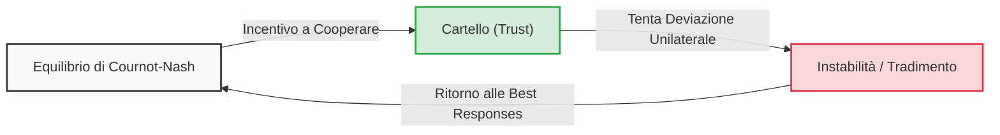
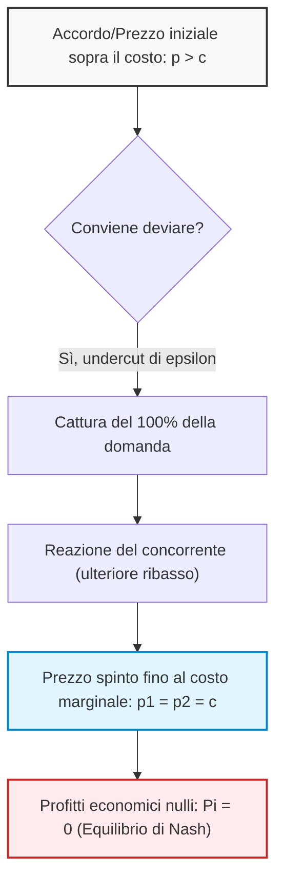
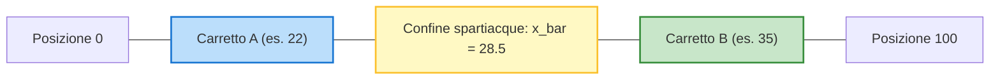
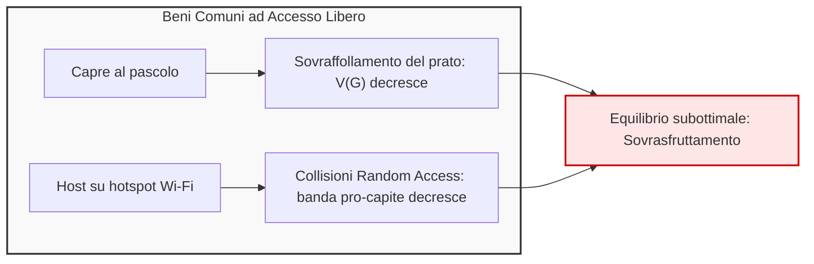
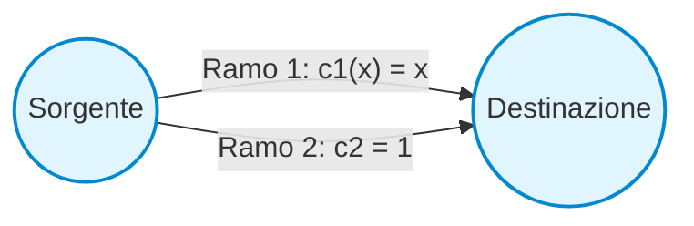
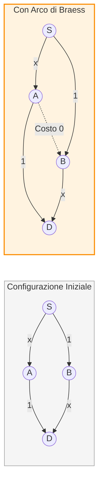

# Applicazioni dell'Equilibrio di Nash e il Duopolio di Cournot

## Overview Didattica

In questa lezione vengono analizzate le applicazioni classiche della Teoria dei Giochi (*Game Theory*), con un focus approfondito sulla caratterizzazione dell'Equilibrio di Nash (*Nash Equilibrium*) e sui criteri di astrazione matematica necessari per la modellizzazione di problemi reali.

I concetti fondamentali trattati includono:
* **Analisi dell'Equilibrio di Nash (*Nash Equilibrium*)**: Studio del NE come stato stazionario e strumento predittivo per sistemi competitivi (con applicazioni estendibili alle reti di telecomunicazione, data science e *cybersecurity*). Vengono discusse le problematiche legate alla non-unicità degli equilibri e il divario strutturale tra la spontaneità dell'equilibrio competitivo e la sua effettivo Efficienza di Pareto (*Pareto Efficiency*).
* **Principi di Modellizzazione Ingegneristica**: Il compromesso fondamentale tra aderenza alla realtà e Trattabilità Matematica (*Mathematical Tractability*). Si evidenzia come la costruzione di un modello debba privilegiare la cattura dei trend macroscopici del sistema piuttosto che l'iper-caratterizzazione dei dettagli.
* **Il Modello del Duopolio di Cournot (*Cournot Duopoly*)**: Introduzione al classico gioco di competizione sulle quantità prodotte tra due imprese ($Q_1$ e $Q_2$). Formalizzazione della struttura dei costi di produzione e della Funzione di Domanda Inversa (*Inverse Demand Function*), definita nella forma semplificata $P(Q) = A - Q$ con $Q = Q_1 + Q_2$.

---

### Applicazioni dell'Equilibrio di Nash: Introduzione e Rilevanza Ingegneristica

L'analisi dell'Equilibrio di Nash (Nash Equilibrium, NE) trova spazio ben oltre la teoria economica pura. Molti problemi fondamentali nell'ingegneria moderna — dall'allocazione delle risorse nelle reti di telecomunicazioni al routing del traffico, dalla sicurezza informatica (cybersecurity) alla gestione di cluster per la data science — possono essere formalizzati come giochi strategici equivalenti a modelli classici.

Un equilibrio di Nash rappresenta una configurazione stabile e una previsione naturale dell'evoluzione di un sistema decentralizzato: nessun agente ha un incentivo unilaterale a deviare dalla propria scelta. Tuttavia, emergono due considerazioni critiche:

1. **Esistenza e Unicità:** Sotto ipotesi matematiche relativamente deboli, un equilibrio di Nash esiste quasi sempre, ma non è necessariamente unico. In presenza di equilibri multipli, l'ingegnere deve definire criteri di selezione o dimostrare condizioni di unicità per garantire la prevedibilità del sistema.
2. **Competizione ed Efficienza di Pareto:** Un equilibrio competitivo facile da raggiungere non garantisce affatto l'efficienza sistemica. Spesso l'equilibrio di Nash **non è Pareto-efficiente** (il benessere collettivo risulta sub-ottimale rispetto a soluzioni coordinate). Il compito dell'ingegneria dei sistemi consiste proprio nel valutare la distanza tra la soluzione di Nash e l'ottimo di Pareto, progettando meccanismi correttivi per colmare questo divario.

---

### Il Modello del Duopolio di Cournot (1838)

Il modello di Cournot è uno dei capisaldi storici dell'oligopolio, formulato oltre un secolo prima della teoria dei giochi moderna. Studia la competizione su quantità (*quantity competition*) tra due aziende concorrenti.

#### Il Trade-off tra Realismo e Trattabilità Matematica
Un principio metodologico essenziale risiede nella semplificazione: per formalizzare un problema reale non serve un modello iper-dettagliato, bensì una formulazione analiticamente trattabile che catturi fedelmente il trend fenomenologico.

Nel modello di Cournot, la dinamica qualitativa fondamentale è:
$$\text{Quantità prodotta alta} \implies \text{Prezzo di mercato basso}$$

#### Definizione del Modello
- **Giocatori:** Due aziende, $i \in \{1, 2\}$.
- **Azioni/Strategie:** Ciascuna azienda sceglie in modo indipendente la quantità da immettere sul mercato: $Q_1 \ge 0$ e $Q_2 \ge 0$.
- **Produzione Totale:** $Q = Q_1 + Q_2$.
- **Funzione di Costo:** Costo di produzione marginale costante $c > 0$ per unità di prodotto:
  $$C(Q_i) = c \cdot Q_i$$
- **Funzione Inversa di Domanda (Prezzo di Mercato):** Il prezzo $P$ è stabilito da una relazione lineare decrescente rispetto alla quantità aggregata $Q$:
  $$P(Q) = \max\{a - Q, 0\} = \max\{a - (Q_1 + Q_2), 0\}$$
  dove $a$ è una costante di mercato positiva che rappresenta la massima disponibilità a pagare (con $a > c$).

Sebbene un'azione teorica possa appartenere a $[0, +\infty)$, qualsiasi scelta $Q_i > a$ produce un prezzo pari a zero a fronte di costi strettamente positivi, risultando in una strategia strettamente dominata. Lo spazio strategico rilevante è quindi $Q_i \in [0, a]$.

#### Funzione di Utilità (Profitto)
L'utilità di ciascun giocatore coincide con il proprio profitto economico $\pi_i$, definito come ricavi totali meno costi di produzione:

$$\pi_i(Q_i, Q_j) = Q_i \cdot P(Q) - C(Q_i) = Q_i \cdot [a - (Q_i + Q_j)] - c \cdot Q_i$$

Raccogliendo $Q_i$:
$$\pi_i(Q_i, Q_j) = Q_i \cdot (a - Q_i - Q_j - c)$$

La presenza di entrambe le variabili decisionali ($Q_i$ e $Q_j$) all'interno della funzione di utilità del singolo giocatore accoppia strategicamente i decisori: il profitto dell'agente $i$ dipende direttamente dalla mossa scelta dal rivale $j$.

---

### Risoluzione dell'Equilibrio di Nash di Cournot

Per determinare l'equilibrio di Nash $(Q_1^*, Q_2^*)$, ciascun giocatore risolve un problema di massimizzazione vincolata rispetto alla propria variabile decisionale, assumendo la produzione dell'avversario fissata alla rispettiva scelta d'equilibrio:

$$Q_i^* = \arg\max_{Q_i \ge 0} \pi_i(Q_i, Q_j^*) = \arg\max_{Q_i \ge 0} \left[ Q_i (a - Q_i - Q_j^* - c) \right]$$

La funzione di profitto $\pi_i$ è un polinomio concavo di secondo grado rispetto a $Q_i$. La condizione di ottimo del primo ordine (First-Order Condition, FOC) impone l'annullamento della derivata prima:

$$\frac{\partial \pi_i}{\partial Q_i} = a - 2Q_i - Q_j^* - c = 0$$

Da cui si ricava la **funzione di miglior risposta** (Best Response Function) del giocatore $i$:
$$Q_i(Q_j^*) = \frac{a - Q_j^* - c}{2}$$

#### Sfruttare la Simmetria del Gioco
Poiché le due aziende sono statisticamente e strutturalmente identiche (stesso costo marginale $c$, stessa influenza sul prezzo), l'equilibrio deve essere simmetrico:

$$Q_1^* = Q_2^* = Q^*$$

Sostituendo la condizione di simmetria nella FOC:
$$a - 2Q^* - Q^* - c = 0 \implies a - 3Q^* - c = 0$$

Si ottiene la quantità di equilibrio individuale:
$$Q_1^* = Q_2^* = \frac{a - c}{3}$$

#### Variabili di Mercato all'Equilibrio
- **Quantità aggregata prodotta:**
  $$Q^*_{\text{tot}} = Q_1^* + Q_2^* = \frac{2(a - c)}{3}$$
- **Prezzo di equilibrio:**
  $$P^* = a - \frac{2(a - c)}{3} = \frac{a + 2c}{3}$$
- **Profitto di equilibrio per singola azienda:**
  $$\pi_i^* = Q^* \cdot (P^* - c) = \left( \frac{a - c}{3} \right) \left( \frac{a + 2c}{3} - c \right) = \left( \frac{a - c}{3} \right) \left( \frac{a - c}{3} \right) = \frac{(a - c)^2}{9}$$

---

### Il Caso del Monopolio

Cosa accadrebbe se la concorrenza venisse rimossa e una sola azienda controllasse l'intero mercato?
Ponendo l'assenza del secondo operatore ($Q_2 = 0$), il monopolista ottimizza la produzione:

$$Q_M = \arg\max_{Q \ge 0} \left[ Q(a - Q - c) \right]$$

Annullando la derivata prima:
$$\frac{d\pi_M}{dQ} = a - 2Q - c = 0 \implies Q_M = \frac{a - c}{2}$$

I valori di equilibrio del monopolio sono:
- **Quantità totale sul mercato:**
  $$Q_M = \frac{a - c}{2} = 0.5(a - c)$$
- **Prezzo di monopolio:**
  $$P_M = a - \frac{a - c}{2} = \frac{a + c}{2}$$
- **Profitto totale del monopolista:**
  $$\pi_M = Q_M \cdot (P_M - c) = \left(\frac{a - c}{2}\right)^2 = \frac{(a - c)^2}{4}$$

#### Confronto Duopolio vs. Monopolio
| Parametro | Duopolio di Cournot ($N=2$) | Monopolio ($N=1$) |
| :--- | :--- | :--- |
| **Quantità Totale** | $\frac{2}{3}(a - c) \approx 0.67(a - c)$ | $\frac{1}{2}(a - c) = 0.5(a - c)$ |
| **Prezzo di Mercato** | $\frac{a + 2c}{3}$ | $\frac{a + c}{2}$ (più alto) |
| **Profitto Totale** | $2 \cdot \frac{(a - c)^2}{9} = \frac{2(a - c)^2}{9} \approx 0.22(a - c)^2$ | $\frac{(a - c)^2}{4} = 0.25(a - c)^2$ (più alto) |

Il monopolista sceglie deliberatamente di **produrre di meno** per **sostenere un prezzo di vendita più elevato**, massimizzando così il profitto aggregato a spese del consumatore.

---

### Collusione, Cartelli e la loro Intrinseca Instabilità

Osservando la disparità tra il profitto complessivo del duopolio ($\frac{2}{9}(a - c)^2$) e quello del monopolio ($\frac{1}{4}(a - c)^2$), le due aziende potrebbero decidere di cooperare istituendo un accordo collusivo o **cartello** (Trust).

#### L'Accordo di Cartello
Le due aziende concordano di mimare perfettamente il monopolio dividendo la produzione ottimale a metà:
$$Q_1^{\text{cartello}} = Q_2^{\text{cartello}} = \frac{Q_M}{2} = \frac{a - c}{4}$$

- La quantità complessiva torna a essere $Q = Q_M = \frac{a - c}{2}$.
- Il prezzo sale a $P_M = \frac{a + c}{2}$.
- Il profitto per ciascuna azienda diventa:
  $$\pi_i^{\text{cartello}} = \frac{\pi_M}{2} = \frac{(a - c)^2}{8}$$

Poiché $\frac{1}{8} > \frac{1}{9}$ (ossia $0.125 > 0.111$), la cooperazione garantisce a entrambe un payoff rigorosamente superiore rispetto all'equilibrio di Cournot.

#### Perché il Cartello Fallisce: L'Incentivo alla Deviazione
Nonostante il vantaggio reciproco, **il cartello non è un equilibrio di Nash**.

Nel contesto di un gioco statico a informazione completa senza contratti vincolanti (enforceable contracts), le promesse verbali non hanno valore esecutivo. Se l'azienda 2 rispetta l'accordo producendo $Q_2 = \frac{a - c}{4}$, l'azienda 1 non ha alcun interesse a produrre $\frac{a - c}{4}$. Al contrario, massimizzerà il proprio profitto calcolando la propria miglior risposta:

$$Q_1^{\text{deviazione}} = \text{BR}_1\left(\frac{a - c}{4}\right) = \frac{a - \left(\frac{a - c}{4}\right) - c}{2} = \frac{\frac{3(a - c)}{4}}{2} = \frac{3(a - c)}{8}$$

Notando che:
$$\frac{3(a - c)}{8} > \frac{a - c}{4} \quad \left(\text{poiché } \frac{3}{8} = 0.375 > 0.25\right)$$

L'azienda 1 trova vantaggioso aumentare la propria produzione: sfrutta il prezzo elevato mantenuto artificialmente dall'azienda 2 per vendere una quota maggiore di beni, aumentando unilateralmente il proprio profitto.

Dato che entrambe le aziende ragionano nello stesso modo e anticipano il tradimento reciproco, la deviazione simultanea distrugge l'accordo di cartello, spingendo la produzione indietro fino all'unico punto stabile e auto-vincolante: l'**Equilibrio di Cournot-Nash** a $Q^* = \frac{a - c}{3}$.

> **Concetto Chiave:** Un cartello rappresenta un ottimo paretiano per i produttori, ma è intrinsecamente instabile poiché non costituisce un equilibrio di Nash. Ciascun membro fronteggia una forte tentazione a deviare (incentivo al free-riding o sovrapproduzione), che porta al collasso dell'accordo collusivo in assenza di meccanismi di punizione ripetuti o regolamentazioni esterne.

---

### Duopolio di Bertrand: Competizione sui Prezzi

Nel 1883 l'economista Joseph Bertrand mosse una celebre critica al modello di Cournot: nella realtà economica quotidiana, le aziende non decidono primariamente i volumi di produzione, bensì fissano il **prezzo** di vendita, lasciando che sia la domanda di mercato (e la propria capacità produttiva interna) ad assorbire la quantità corrispondente. 

Dal punto di vista della teoria dei giochi e dell'ingegneria dei sistemi, non esiste un modello a priori "giusto" e uno "sbagliato": Cournot e Bertrand rappresentano **due giochi differenti**, con spazi di azione e matrici di payoff distinti, adatti ad analizzare contesti industriali diversi.

---

#### Struttura del Modello Classico e Meccanismo di Sottocosto

Consideriamo un mercato con due imprese identiche che offrono un bene omogeneo (perfetti sostituti, *perfect substitutes*).

- **Variabile decisionale (Strategia):** Ciascuna impresa $i \in \{1, 2\}$ sceglie in modo simultaneo e non cooperativo un prezzo $p_i \in [0, +\infty)$.
- **Funzione di costo:** Il costo di produzione è puramente lineare, senza costi fissi:
  $$C(q_i) = c \cdot q_i$$
  dove $c > 0$ è il costo marginale costante, identico per entrambi gli operatori.
- **Domanda di mercato:** I consumatori acquistano esclusivamente dall'impresa che offre il prezzo più basso. I beni considerati sono **beni ordinari** (o beni non-Giffen, *non-Giffen goods*), per i quali la quantità totale richiesta $Q$ diminuisce all'aumentare del prezzo. In caso di parità di prezzo ($p_1 = p_2$), i clienti si distribuiscono equamente al $50\%$ tra i due concorrenti.

La quantità $q_i$ venduta dall'impresa $i$ rispetto al prezzo del concorrente $p_j$ si esprime come:

$$q_i(p_i, p_j) = 
\begin{cases} 
D(p_i) & \text{se } p_i < p_j \\
\frac{1}{2} D(p_i) & \text{se } p_i = p_j \\
0 & \text{se } p_i > p_j 
\end{cases}$$

Il profitto dell'impresa $i$ è dato da:
$$\Pi_i(p_i, p_j) = (p_i - c) \cdot q_i(p_i, p_j)$$

---

#### Il "Paradosso di Bertrand" e l'Equilibrio di Nash

Per comprendere l'esito di questo gioco, possiamo fare riferimento a una dinamica intuitiva di ribasso continuo (*price war* o guerra dei prezzi), simile alla rivalità commerciale classica raccontata nei fumetti tra Paperon de' Paperoni e Rockerduck che gestiscono due chioschi di limonata concorrenti:

1. Se un concorrente fissa il prezzo a $1.00\,\$$, l'altro ha convenienza a deviare fissando $0.99\,\$$, accaparrandosi il $100\%$ della clientela.
2. Il primo reagisce scendendo a $0.98\,\$$, e il processo di ribasso (*undercutting*) prosegue.
3. Questo taglio dei prezzi si arresta unicamente quando il prezzo raggiunge la soglia del costo unitario di produzione ($c = 0.50\$$ nell'esempio). Al di sotto di $c$, l'impresa opererebbe in perdita ($\Pi < 0$).

> **Concetto Chiave — Paradosso di Bertrand (*Bertrand Paradox*):**  
> L'unico **Equilibrio di Nash** del gioco simultaneo si verifica quando entrambe le imprese fissano il prezzo esattamente pari al costo marginale:
> $$p_1^* = p_2^* = c$$
> All'equilibrio, i profitti economici di entrambe le imprese sono nulli:
> $$\Pi_1^* = \Pi_2^* = 0$$

##### Dimostrazione Intuitiva dell'Equilibrio
- **Nessun incentivo ad alzare il prezzo:** Se l'impresa 1 fissa $p_1 > c$ mentre $p_2 = c$, la sua domanda diventa zero e il suo profitto rimane nullo.
- **Nessun incentivo ad abbassare il prezzo:** Se l'impresa 1 fissa $p_1 < c$, cattura l'intera domanda, ma vende sotto costo generando un margine unitario negativo ($p_1 - c < 0$), con conseguente profitto totale negativo.
- **Instabilità di accordi collusivi:** Se i contendenti provassero a cooperare accordandosi sul prezzo di monopolio $p_{monopolio} > c$ per spartirsi equamente il mercato con profitto positivo, l'accordo non costituirebbe un equilibrio di Nash: ciascun operatore avrebbe sempre l'incentivo unilaterale a deviare vendendo a $p_{monopolio} - \varepsilon$, sottraendo l'intero mercato al rivale.

---

#### Limiti del Modello Base e Condizioni Realistiche

Il risultato di Bertrand appare controintuitivo: bastano due sole imprese per far collassare il mercato al risultato perfettamente concorrenziale con profitti nulli. Nella realtà industriale intervengono fattori correttivi fondamentali:

##### 1. Granularità e Asimmetria dei Costi
Se le imprese hanno costi marginali differenti (ad esempio $c_1 < c_2$), l'impresa più efficiente (Impresa 1) vince la competizione. 
- In un dominio continuo, l'Impresa 1 vorrebbe fissare $p_1 = c_2 - \varepsilon$, dove $\varepsilon \to 0$, per estromettere l'Impresa 2 dal mercato garantendosi il massimo margine possibile.
- Nel mondo reale interviene la **discretizzazione monetaria** (la valuta ha un'unità minima, es. i centesimi). Se $c_1 = 1.00\,€$ e $c_2 = 2.00\,€$, la migliore risposta (*best response*) discreta per l'Impresa 1 consiste nel fissare $p_1 = 1.99\,€$, escludendo l'Impresa 2 e trattenendo un profitto unitario positivo di $0.99\,€$.

##### 2. Strategie Predatorie (*Predatory Pricing*)
In un orizzonte multi-periodale (gioco dinamico), un operatore dotato di grande liquidità potrebbe scegliere deliberatamente un prezzo inferiore al costo marginale ($p < c$, vendita sottocosto o *dumping*) accettando perdite temporanee pur di costringere il concorrente al fallimento o all'uscita dal mercato, per poi instaurare un regime di monopolio e alzare i prezzi arbitrariamente.

##### 3. Differenziazione del Prodotto e Sostituzione Imperfetta
I beni non sono quasi mai perfetti sostituti. Un consumatore non sceglie esclusivamente in base al prezzo nominale: pesano la distanza geografica, la fiducia nel marchio o l'urgenza dell'acquisto (es. comprare una bibita al minimarket sotto casa a prezzo più alto invece di percorrere chilometri per raggiungere un ipermercato economico).

Introducendo la differenziazione, la domanda del singolo negozio $i$ dipende dal proprio prezzo $p_i$ ma anche dal prezzo praticato dal concorrente $p_j$:

$$q_i = a - b\,p_i + \beta\,p_j$$

dove:
- $a$ rappresenta la domanda autonoma di base.
- $b$ è la sensibilità della domanda rispetto al proprio prezzo ($b > 0$).
- $\beta$ è il coefficiente di sostituibilità incrociata ($\beta > 0$): un aumento del prezzo del concorrente sposta parte della clientela verso l'impresa $i$.

In presenza di beni differenziati, il prezzo di equilibrio non collassa più sul costo marginale $c$, ma converge a un valore superiore proporzionale alla scarsa sostituibilità del bene, ripristinando margini di profitto positivi per entrambi i venditori.

---

### Modello di Hotelling: Competizione Spaziale

Formulato da Harold Hotelling nel 1929, questo modello affronta la competizione tra agenti quando la differenziazione è di tipo **spaziale** (o geografico).

#### Il Problema dei Venditori di Gelato sulla Spiaggia

Immaginiamo una spiaggia o un lungomare rettilineo di lunghezza finita normalizzato, ad esempio, nell'intervallo continuo $[0, 100]$ (o discretizzato in punti fissi).

- **Clienti:** Una popolazione di bagnanti è distribuita uniformemente lungo tutto il lungomare. Ciascun cliente acquista una singola unità di prodotto (un gelato) dal venditore geograficamente più vicino per minimizzare il proprio costo di spostamento.
- **Venditori:** Due venditori ambulanti ($A$ e $B$) vendono lo stesso identico gelato allo stesso prezzo; la loro unica scelta strategica è la **posizione** $x_A, x_B \in [0, 100]$ in cui piazzare il proprio carretto.
- **Spartizione del mercato:** La clientela si divide esattamente a metà strada tra i due carretti. Il punto indifferente di confine (*breakeven location*) $\bar{x}$ è la coordinata intermedia:
  $$\bar{x} = \frac{x_A + x_B}{2}$$
  - Il venditore situato a sinistra si aggiudica tutti i bagnanti nell'intervallo $[0, \bar{x}]$.
  - Il venditore situato a destra si aggiudica tutti i bagnanti nell'intervallo $[\bar{x}, 100]$.

#### Dinamica Strategica e Principio di Minima Differenziazione

Supponiamo che inizialmente il Venditore $A$ sia collocato in posizione $x_A = 22$ e il Venditore $B$ in posizione $x_B = 35$:
1. Il confine tra i due mercati si colloca a:
   $$\bar{x} = \frac{22 + 35}{2} = 28.5$$
2. Il Venditore $A$ cattura la quota $[0;\, 28.5]$ (pari al $28.5\%$ della spiaggia), mentre il Venditore $B$ si assicura l'intervallo $[28.5;\, 100]$ (pari al $71.5\%$).
3. In questa configurazione, la posizione di $A$ **non è una migliore risposta**: spostandosi verso destra (ad esempio posizionandosi a $34$, a ridosso del rivale), $A$ continuerebbe a mantenere tutti i clienti alla propria sinistra e conquisterebbe quasi tutto lo spazio fino a $B$.
4. Analogamente, il Venditore $B$ si sposterà verso sinistra per proteggere la propria fetta di mercato.

> **Concetto Chiave — Convergenza al Centro (Principio di Minima Differenziazione):**  
> L'unico **Equilibrio di Nash** stabile per due operatori si ottiene quando entrambi scelgono esattamente la mediana dell'intervallo di distribuzione:
> $$x_A^* = x_B^* = 50$$
> Ciascun venditore ottiene il $50\%$ del mercato. Nessuno dei due ha un incentivo unilaterale ad allontanarsi dal centro, poiché qualsiasi spostamento verso i bordi comporterebbe una perdita immediata di clienti a favore del concorrente.

---

#### Estensione: La Metafora Politica di Hotelling

Il modello di Hotelling è ampiamente utilizzato nella teoria delle scelte pubbliche e nella scienza politica per analizzare il posizionamento ideologico dei partiti:

- **Sistemi bipartitici (es. Stati Uniti):**  
  Con due soli candidati (es. Democratici e Repubblicani) che competono su un asse politico monodimensionale sinistra-destra, la strategia ottima che massimizza il consenso è la **convergenza verso l'elettore mediano** (*Median Voter Theorem*). I programmi tendono quindi a sovrapporsi sulle questioni chiave per contendersi i voti del centro, poiché gli elettori collocati alle ali estreme non hanno alternative preferibili e voteranno comunque il partito a loro più affine.

- **Sistemi multipartitici (es. Italia ed Europa continentale):**  
  Quando i contendenti sono tre o più ($N \ge 3$), l'equilibrio con tutti gli attori ammassati al centro cessa di essere stabile. La convergenza simultanea di più partiti al centro crea ampi spazi vuoti sulle ali esterne; emerge quindi l'incentivo strategico per nuovi attori a posizionarsi verso la destra o la sinistra radicale, catturando in modo esclusivo gli estremi dell'elettorato.

---

### La Tragedia dei Beni Comuni (Tragedy of the Commons)

Un problema fondamentale nella teoria dei giochi e nell'economia pubblica è la **Tragedia dei Beni Comuni** (*Tragedy of the Commons*), un concetto già intuito da David Hume nel XVIII secolo e formalizzato dal punto di vista analitico da Garrett Hardin nel 1950. 

Il principio alla base è semplice: quando una risorsa è pubblica, accessibile e condivisa gratuitamente da una collettività, i singoli agenti tendono a sovrasfruttarla fino a degradarla. L'esempio cardine del mondo reale è l'inquinamento globale e lo sfruttamento ambientale, ma il fenomeno si manifesta identico nelle reti di telecomunicazione e nell'ingegneria informatica.

#### Il Modello Classico dei Pastori
Immaginiamo un villaggio in cui risiedono $N$ pastori identici. Al centro del villaggio si trova un pascolo comune, verde e pubblico, accessibile a chiunque senza alcun pedaggio.
- Ciascun pastore $i$ decide di far pascolare un numero $G_i$ di capre.
- Il numero totale di capre presenti sul prato è:
  $$G = \sum_{j=1}^N G_j = G_i + G_{-i}$$
- Il costo di mantenimento per capra (stalla, cure, alimentazione di base) è pari a $c$, assunto proporzionale.
- Il rendimento o valore che una capra ricava dal pascolo comune è dato da una funzione decrescente $V(G)$.

Poiché l'erba a disposizione è limitata, all'aumentare del numero totale di capre $G$, ciascun animale mangia meno:
$$V'(G) < 0$$
Spesso si assume anche $V''(G) \le 0$, a indicare che la risorsa tende a saturare: oltre una certa soglia di affollamento, il valore del pascolo crolla verso zero.

> **Analogia con l'Ingegneria dell'Informazione**  
> Pensiamo a un punto di accesso Wi-Fi pubblico (*Wi-Fi hotspot*). Ogni utente che stabilisce una connessione ottiene un beneficio individuale. Tuttavia, a causa del protocollo ad accesso casuale (*Random Access*), più utenti si connettono contemporaneamente, più aumentano le collisioni a livello MAC. Di conseguenza, la banda disponibile per singolo utente si riduce drasticamente fino a saturare il canale a zero throughput utile.

#### Payoff ed Equilibrio di Nash
Il payoff (funzione di utilità) del singolo pastore $i$ è dato dai ricavi totali meno i costi sostenuti:
$$\Pi_i(G_i, G_{-i}) = G_i \cdot V(G) - c \cdot G_i = G_i \left[ V(G_i + G_{-i}) - c \right]$$

L'utilità di $i$ dipende non solo dalla propria scelta $G_i$, ma anche da quella degli altri $G_{-i}$. Per determinare la scelta ottima individuale, ciascun pastore massimizza il proprio payoff ponendo la derivata parziale rispetto a $G_i$ pari a zero:
$$\frac{\partial \Pi_i}{\partial G_i} = V(G) + G_i V'(G) - c = 0$$

Assumendo che i pastori siano identici (ipotesi di simmetria analoga a quanto visto nel modello di Cournot), all'equilibrio ogni agente possiederà una quota pari a $G_i = \frac{G^*}{N}$, dove $G^*$ è il numero totale di capre:
$$V(G^*) + \frac{G^*}{N} V'(G^*) - c = 0$$

**Concetto Chiave: La scomposizione del trade-off individuale**  
Nella condizione di equilibrio troviamo tre componenti distinte:
1. **$V(G^*)$ (Termine positivo):** Il guadagno marginale ricavato dall'aggiunta di una capra in più.
2. **$-c$ (Termine negativo):** Il costo marginale sostenuto per mantenere l'animale.
3. **$\frac{G^*}{N} V'(G^*)$ (Termine negativo):** La perdita di valore dovuta al degrado del prato ($V' < 0$).

Poiché il giocatore è egoista, percepisce solo la quota di danno che ricade su se stesso, ovvero la frazione $\frac{1}{N}$. Il resto dell'impatto negativo viene scaricato sugli altri $N-1$ individui.

#### Ottimo Sociale vs Equilibrio di Nash
Cosa deciderebbe invece un pianificatore centralizzato (ad esempio il sindaco della comunità) per massimizzare il benessere globale (*Global Welfare*)?  
Il benessere collettivo $W(G)$ è la somma dei payoff di tutti gli individui:
$$W(G) = \sum_{i=1}^N \Pi_i = G \cdot [V(G) - c]$$

Derivando rispetto a $G$ per trovare l'ottimo sociale $G^{\text{opt}}$:
$$\frac{dW}{dG} = V(G^{\text{opt}}) + G^{\text{opt}} V'(G^{\text{opt}}) - c = 0$$

Confrontando le due condizioni:
- **Equilibrio di Nash:** $V(G^*) + \frac{G^*}{N} V'(G^*) = c$
- **Ottimo Sociale:** $V(G^{\text{opt}}) + G^{\text{opt}} V'(G^{\text{opt}}) = c$

Nel caso sociale, il termine di degrado della risorsa non è diviso per $N$: il pianificatore tiene conto del 100% dell'esternalità negativa prodotta. Poiché $V'(G) < 0$, affinché l'uguaglianza regga si ricava inconfutabilmente che:
$$G^* > G^{\text{opt}}$$

Il consumo aggregato di risorse all'Equilibrio di Nash è nettamente superiore a quello socialmente desiderabile. Gli individui non si comportano in modo "irrazionale": razionalmente riconoscono che l'azione individuale danneggia l'ambiente, ma tale danno incide sul loro tornaconto personale solo per una frazione $\frac{1}{N}$.

---

### Instradamento Egoistico e Prezzo dell'Anarchia (Selfish Routing & Price of Anarchy)

Nelle reti moderne, dai trasporti urbani alla selezione dei server (*server selection*) per compiti computazionali di Intelligenza Artificiale (come l'instradamento delle query verso i cluster di calcolo di un Large Language Model), le decisioni sono spesso prese da agenti indipendenti. L'effetto combinato di queste decisioni egoistiche porta al problema del **Selfish Routing**.

#### L'Esempio di Pigou (1920)
Consideriamo una popolazione di utenti che deve spostarsi da un'origine a una destinazione muovendo una massa unitaria di traffico ($1$). Sono disponibili due percorsi alternativi:
- **Percorso 1 (Autostrada / Server veloce ma congestionabile):** Il costo (tempo di percorrenza o latenza) dipende linearmente dal carico di traffico $x$ assegnato:
  $$c_1(x) = x$$
- **Percorso 2 (Strada secondaria / Server a capacità costante):** Il tempo di percorrenza è costante e non risente del traffico:
  $$c_2 = 1$$

##### 1. Equilibrio di Nash (Scelta Individuale)
Ciascun utente sceglie la strada per minimizzare il proprio tempo di percorrenza. 
Se una frazione $x$ imbocca il Percorso 1, il costo sostenuto è $x \le 1$. Sul Percorso 2 il costo è costantemente $1$.  
Fintanto che $x < 1$, il Percorso 1 risulta strettamente preferibile. Quando $x = 1$, il costo sul Percorso 1 diventa esattamente pari a $1$, rendendo i due rami equivalenti. Poiché nessun agente ottiene un vantaggio strettamente positivo deviando verso il Percorso 2 (pagherebbe comunque $1$), tutto il traffico si concentra sul primo percorso:
$$x_{\text{Nash}} = 1$$
Il costo medio per utente a Nash è:
$$C_{\text{Nash}} = 1$$

##### 2. Ottimo Sociale (Allocazione Centralizzata)
Un pianificatore centralizzato mira invece a minimizzare il costo totale medio sostenuto dalla popolazione:
$$C(x) = x \cdot c_1(x) + (1-x) \cdot c_2 = x \cdot x + (1-x) \cdot 1 = x^2 - x + 1$$

Minimizziamo la funzione rispetto a $x$:
$$\frac{dC(x)}{dx} = 2x - 1 = 0 \implies x_{\text{opt}} = \frac{1}{2}$$

Dividendo equamente il traffico ($50\%$ sul percorso 1 e $50\%$ sul percorso 2), il costo medio diventa:
$$C_{\text{opt}} = C\left(\frac{1}{2}\right) = \left(\frac{1}{2}\right)^2 - \frac{1}{2} + 1 = \frac{1}{4} - \frac{1}{2} + 1 = \frac{3}{4} = 0.75$$

*Perché l'ottimo sociale non è stabile?*  
Se il traffico fosse diviso a metà, gli utenti sul Percorso 1 pagherebbero un costo pari a $\frac{1}{2}$, mentre quelli sul Percorso 2 pagherebbero $1$. Un utente sul Percorso 2 avrebbe un incentivo fortissimo a deviare unilateralmente sul Percorso 1, distruggendo l'allocazione ottimale fino a ricadere nell'equilibrio di Nash.

#### Il Prezzo dell'Anarchia (Price of Anarchy - PoA)
Il **Prezzo dell'Anarchia** misura la perdita di efficienza dovuta alla mancanza di coordinamento centrale ed è definito come il rapporto tra il costo all'equilibrio di Nash e il costo dell'ottimo sociale:
$$\text{PoA} = \frac{C_{\text{Nash}}}{C_{\text{opt}}} = \frac{1}{\frac{3}{4}} = \frac{4}{3} \approx 1.33$$

Ciò dimostra che, nel modello lineare di Pigou, l'instradamento egoistico produce un sovraccosto (o inefficienza) del **$33\%$**.

#### Estensioni: Funzioni Non Lineari e Prezzo dell'Anarchia Illimitato
Se la funzione di costo del percorso congestionabile non è lineare, l'inefficienza può peggiorare in modo drastico.  
Ipotizziamo:
$$c_1(x) = x^a \quad \text{con } a \gg 1$$
All'equilibrio di Nash tutti gli utenti sceglieranno comunque il ramo 1 ($x=1$), pagando un costo pari a $1^a = 1$.  
Tuttavia, con un esponente $a$ molto elevato, basterebbe che una piccolissima frazione $\varepsilon$ deviasse sul Percorso 2 affinché il costo su 1 crollasse a $(1-\varepsilon)^a \approx 0$. In queste circostanze, il costo dell'ottimo sociale tende a zero, portando il Prezzo dell'Anarchia a divergere:
$$\text{PoA} \to \infty$$

---

### Comportamenti Patologici nelle Reti: Il Paradosso di Braess e Risultati di Roughgarden

#### Il Paradosso di Braess (Braess's Paradox)
L'intuizione ingegneristica suggerirebbe che aggiungere capacità o collegamenti a una rete migliori sempre le prestazioni complessive. Il **Paradosso di Braess** dimostra analiticamente che l'aggiunta di capacità in una rete non regolata può causare un peggioramento delle prestazioni all'equilibrio di Nash.

1. **Rete Iniziale:** Due rami simmetrici composti ciascuno da un tratto dipendente dal traffico ($x$) e da un tratto a costo fisso ($1$). Distribuendo il traffico $50-50$, ogni utente sperimenta un costo di percorrenza pari a:
   $$c = \frac{1}{2} + 1 = \frac{3}{2} = 1.5$$
2. **Aggiunta del collegamento a costo zero:** Se si inserisce un canale di collegamento diretto da $A$ verso $B$ con costo di latenza nullo ($c_{AB} = 0$), il percorso $S \to A \to B \to D$ diventa debolmente dominante per qualsiasi utente.
3. **Nuovo Equilibrio:** Tutto il traffico converge sulla nuova scorciatoia. Il flusso $x$ su entrambi i rami variabili $S \to A$ e $B \to D$ sale a $1$. Il costo totale pagato da ciascun utente diventa:
   $$C = 1 + 0 + 1 = 2$$
   Il tempo medio di viaggio è aumentato da $1.5$ a $2$ pur avendo aumentato le risorse fisiche della rete.

> **Esempio del Mondo Reale**  
> Un riscontro pratico di questo paradosso si è verificato a Palermo con la realizzazione di un nuovo asse viario ad alto scorrimento. L'apertura della nuova arteria ha spinto la totalità degli automobilisti ad abbandonare i percorsi secondari per convergere sull'infrastruttura appena inaugurata, paralizzando l'intero sistema del traffico cittadino.

#### L'Universalità del Limite di Roughgarden
Nei primi anni 2000, Tim Roughgarden ha dimostrato una serie di teoremi fondamentali sull'instradamento egoistico:
- **Indipendenza dalla Topologia:** Se le funzioni di latenza sono ristrette alla classe delle funzioni affini ($c(x) = ax + b$), il limite peggiore del Prezzo dell'Anarchia è sempre pari a:
  $$\text{PoA} \le \frac{4}{3}$$
- La semplice rete a due rami proposta da Pigou rappresenta già il caso pessimo teorico assoluto. Qualsiasi rete arbitrariamente complessa, con migliaia di nodi, archi o code $M/M/1$, non potrà mai generare un'inefficienza superiore al $33\%$ a patto che i costi varino linearmente con il flusso.

---

> [!NOTE]
> ### Note per l'Esame e Avvisi del Docente
> - **Esercizi della prova scritta**: Il docente segnala che all'esame scritto alcuni esercizi potrebbero essere versioni rivisitate o riformulate dei problemi classici di applicazione dell'equilibrio di Nash visti a lezione, calati in contesti applicativi differenti rispetto a quello economico (ad esempio scenari di telecomunicazioni, networking, data science o cybersecurity).