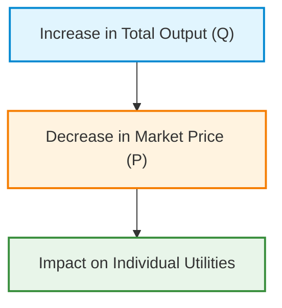
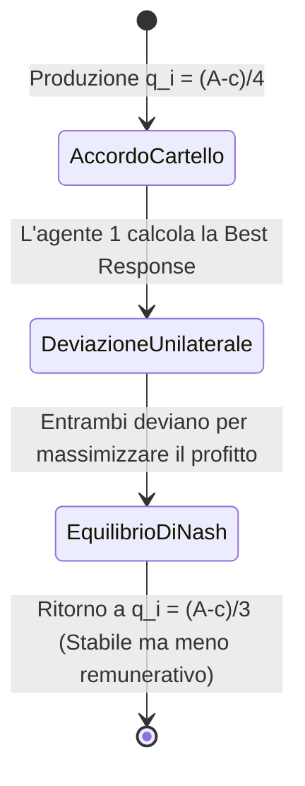
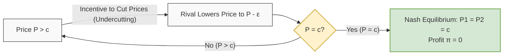
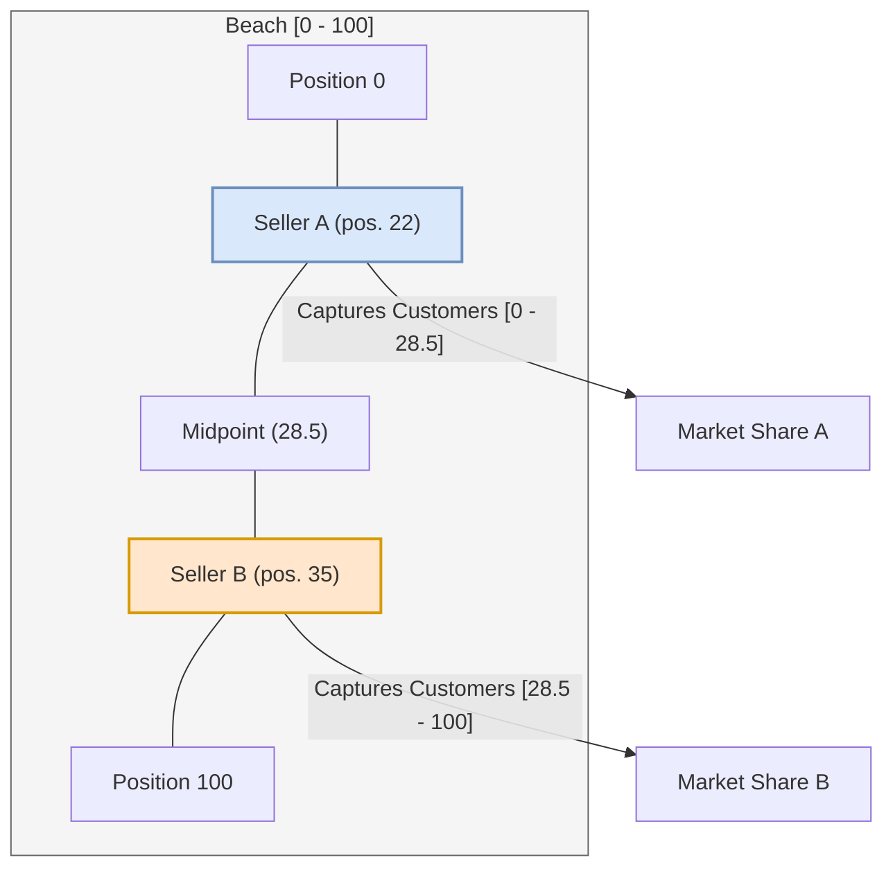
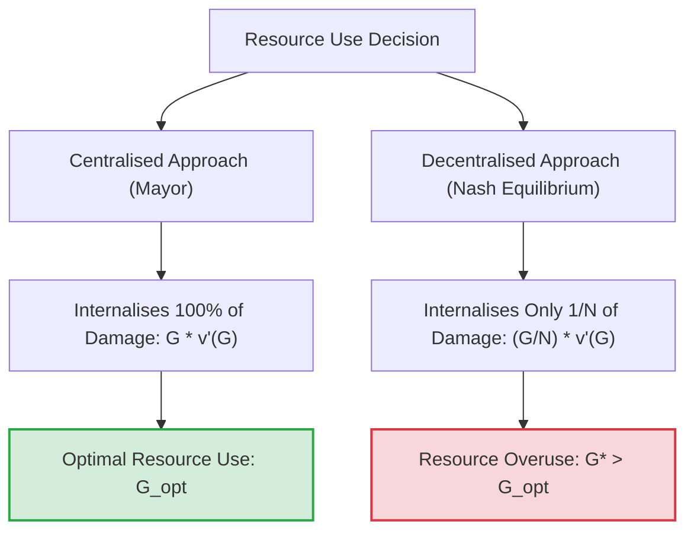
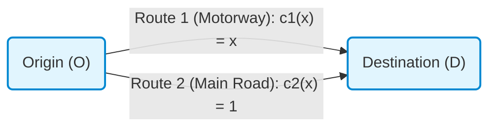
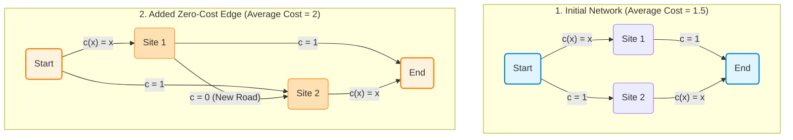

# Applied Game Theory: Nash Equilibria and the Cournot Duopoly Model

## Teaching Overview

This lecture introduces the application of fundamental Game Theory models to real-world scenarios, showing how complex problems in telecommunications, networking, cyber security and data science can be formulated and solved as variants of classical games.

The key concepts covered include:

* **Properties of Nash Equilibria**: Analysis of existence, potential non-uniqueness and their relationship with Pareto Efficiency, showing that the spontaneous outcome of non-cooperative competition does not necessarily guarantee social optimality.
* **Modelling Duopolies**: Introduction to market competition between two agents as a simplified case of oligopoly.
* **The Cournot Duopoly Model**: Formulation of the classical model (1838), in which two firms compete over the quantities produced ($q_1, q_2$). The linear production cost function $C(q) = c \cdot q$ and the inverse demand function $P(Q) = A - Q$, with $Q = q_1 + q_2$.
* **Engineering Modelling Trade-off**: Methodological reflection on the importance of balancing model accuracy against mathematical tractability, prioritising the representation of qualitative system trends over excessive analytical complexity.

---

### Applications of Game Theory and Modelling

In advanced Game Theory, classical models are studied for more than historical or economic reasons: they provide a practical training ground for methodology. Many complex problems in modern engineering, such as resource management in telecommunications networks, networking, data science and cybersecurity, can be formulated as adaptations of these classical games.

#### Existence, Uniqueness and Efficiency of Nash Equilibrium

The Nash Equilibrium (NE) represents the natural evolution of a system in which agents act non-cooperatively to maximise their own utility.

1. **Existence vs Uniqueness**: Under very weak mathematical conditions, the existence of at least one Nash Equilibrium is always guaranteed. However, the equilibrium **is not necessarily unique**. Multiple equilibria require selection criteria and introduce the need to assess which stable outcome is more likely or desirable.
2. **System Efficiency**: The outcome of a competitive equilibrium does not guarantee a socially efficient result.

> **Key Concept: Spontaneous Competition vs Efficiency**  
> A competitive outcome is extremely easy to establish spontaneously: the system converges to it without external intervention. However, it may be disastrous in terms of overall efficiency. An intuitive parallel is an extreme competition such as a "Battle Royale": by allowing agents to eliminate one another freely, the architecture designer need not make any effort to manage the system, but the final outcome will be highly inefficient for the group.

From an engineering perspective, the central problem is to determine whether a Nash Equilibrium is **Pareto-efficient**. If it is not, the goal becomes to redesign the mechanism (Mechanism Design) to guide the system towards Pareto-optimal outcomes.

---

### The Cournot Duopoly

The Cournot Duopoly model, dating back to 1838, analyses competition between two firms that must simultaneously decide how much to produce. Although it originated in economics, it provides a fundamental structure for modelling resource sharing, such as bandwidth allocation or transmission power allocation between competing network providers.

#### Philosophy of Engineering Modelling
The model adopts highly simplified assumptions. Engineering does not require over-characterising every real-world detail and producing mathematically intractable models. A good model must capture **the fundamental trend of the phenomenon** while keeping the mathematics analytically solvable.

#### Game Formulation
Consider two firms ($i \in \{1, 2\}$) that independently and simultaneously choose their production quantities:
* **Individual strategies**: $q_1 \ge 0$ and $q_2 \ge 0$.
* **Total market output**: $Q = q_1 + q_2$.
* **Production cost**: A constant marginal cost model with $c > 0$:
  $$C(q_i) = c \cdot q_i$$
* **Inverse demand function (Market Price)**: Cournot assumes a decreasing linear relationship between price $P$ and total quantity $Q$:
  $$P(Q) = \begin{cases} A - Q & \text{se } Q \le A \\ 0 & \text{se } Q > A \end{cases}$$
  where $A > c$ is a market demand constant.

> **Teaching note on negative/zero prices**: In practice, extreme overproduction ($Q > A$) eliminates the value of the good or creates disposal costs, mirroring phenomena in agriculture or energy markets with negative prices. Choosing $q_i > A$ is a strictly dominated strategy, because it generates certain costs of $c \cdot q_i$ with no revenue.

---

### Computing the Nash Equilibrium

Each firm aims to maximise its profit/utility function $U_i(q_i, q_j)$, defined as total revenue minus the costs incurred:

$$U_i(q_i, q_j) = q_i \cdot P(Q) - C(q_i) = q_i (A - q_i - q_j) - c \cdot q_i = q_i (A - q_i - q_j - c)$$

To find the Nash Equilibrium $(q_1^*, q_2^*)$, each player chooses its Best Response by maximising its utility with respect to $q_i$, taking the other player's decision $q_j^*$ as fixed:

$$q_i^* = \arg\max_{q_i \ge 0} \left[ q_i (A - q_i - q_j^* - c) \right]$$

#### Step-by-Step Mathematical Derivation

Since the utility function $U_i$ is a concave parabola with respect to $q_i$, the first-order condition, obtained by setting the partial derivative to zero, is necessary and sufficient for the optimum:

$$\frac{\partial U_i}{\partial q_i} = \frac{\partial}{\partial q_i} \left( A q_i - q_i^2 - q_i q_j^* - c q_i \right) = A - 2q_i - q_j^* - c = 0$$

Solving for $q_i$, we obtain the **Best Response Function** for agent $i$:

$$q_i = R_i(q_j^*) = \frac{A - c - q_j^*}{2}$$

*(Note: Intermediate step added for teaching clarity)*  
Using the game's perfect statistical and structural symmetry, the equilibrium solution must satisfy $q_1^* = q_2^* = q^*$. Substituting this symmetry into the first-order condition:

$$A - 2q^* - q^* - c = 0 \implies A - 3q^* - c = 0$$

This gives the equilibrium values for individual quantities, total quantity and individual profits:

* **Equilibrium quantity for each duopolist**:
  $$q_1^* = q_2^* = \frac{A - c}{3}$$
* **Total market quantity**:
  $$Q^* = q_1^* + q_2^* = \frac{2(A - c)}{3}$$
* **Equilibrium profit for each firm**:
  $$U_1^* = U_2^* = \left(\frac{A - c}{3}\right) \left( A - \frac{2(A - c)}{3} - c \right) = \frac{(A - c)^2}{9}$$

---

### Comparison with the Monopoly Benchmark

To understand whether the competitive Nash Equilibrium is efficient for the firms, it is compared with a scenario in which a single agent controls the entire market: Monopoly.

Under Monopoly, the sole firm sets $q_2 = 0$ and chooses the monopoly quantity $q_M$:

$$U_M(q_M) = q_M (A - q_M - c)$$

Setting the derivative with respect to $q_M$:

$$\frac{d U_M}{d q_M} = A - 2q_M - c = 0 \implies q_M = \frac{A - c}{2}$$

The monopolist's total profit is:

$$U_M = \left(\frac{A - c}{2}\right)\left(A - \frac{A - c}{2} - c\right) = \frac{(A - c)^2}{4}$$

#### Comparative Analysis

| Parameter | Competitive duopoly (Nash) | Monopoly |
| :--- | :--- | :--- |
| **Total Quantity ($Q$)** | $\frac{2(A - c)}{3} \approx 0.67(A-c)$ | $\frac{A - c}{2} = 0.5(A-c)$ |
| **Market Price ($P$)** | $\frac{A + 2c}{3}$ | $\frac{A + c}{2}$ (Higher) |
| **Total Profit ($\Pi_{tot}$)** | $2 \cdot \frac{(A - c)^2}{9} = \frac{2(A - c)^2}{9} \approx 0.22(A-c)^2$ | $\frac{(A - c)^2}{4} = 0.25(A-c)^2$ (Greater) |

The monopolist produces **a lower total quantity** than the duopoly, maintaining **a higher price** and therefore obtaining greater total profit.

---

### Cartels, Collusion and Strategic Instability

Noticing the greater profitability of monopoly, the two duopolists might be tempted to enter into a secret agreement, forming a **Cartel / Trust** to imitate a monopolist and divide the optimal output equally:

$$q_1^{cartello} = q_2^{cartello} = \frac{q_M}{2} = \frac{A - c}{4}$$

If the agreement is honoured, each firm's individual profit becomes:

$$U_i^{cartello} = \frac{U_M}{2} = \frac{(A - c)^2}{8}$$

Since $\frac{(A - c)^2}{8} > \frac{(A - c)^2}{9}$, the agreement guarantees both firms a higher profit than the Nash Equilibrium. However, in static non-cooperative games with complete information, **the cartel is not a Nash Equilibrium**.

> **Key Concept: The Temptation of Unilateral Deviation**  
> If Firm 2 honours the agreement by producing $q_2 = \frac{A-c}{4}$, Firm 1's best response is **not** to produce $\frac{A-c}{4}$. Firm 1 has a strong unilateral incentive to break the agreement, increasing its production to take further profits from its rival.

#### Demonstrating the Incentive to Deviate
If Firm 2 produces the agreed quota $q_2 = \frac{A-c}{4}$, Firm 1's optimal response is:

$$q_1^{deviazione} = R_1\left(\frac{A - c}{4}\right) = \frac{A - c - \frac{A - c}{4}}{2} = \frac{3(A - c)}{8} > \frac{A - c}{4}$$

Substituting $q_1^{deviazione} = \frac{3(A - c)}{8}$ into the utility function yields an individual gain strictly greater than $U^{cartello}$. Consequently, without an external binding mechanism, which static non-cooperative games do not provide, the collusive agreement collapses and the firms inevitably return to the **Cournot Nash Equilibrium**. This confirms that the selfish pursuit of individual maximisation guarantees system stability at the expense of maximum group efficiency.

---

3. The Bertrand Model (Price Competition)

#### Criticism of the Cournot Model and Formal Assumptions
In 1883, economist Joseph Bertrand raised a fundamental criticism of Cournot's model: in practice, firms rarely choose output quantities directly and leave the market to determine the price. More intuitively, firms set the **selling price** (Price Competition), while the quantity sold is determined by market demand in response to that price.

In the **Bertrand Duopoly**, the game changes radically compared with Cournot. Consider "regular" or Non-Giffen Goods, namely goods for which demand decreases as price rises:

*   Prices are continuous strategies: $P_i \in [0, +\infty)$.
*   The quantity $Q_i$ purchased by consumers from firm $i$ is a linear function of its chosen price:
    $$Q_i = A - B \cdot P_i$$
*   The cost function remains linear, with no fixed costs:
    $$C(Q_i) = c \cdot Q_i$$
    where $c$ represents the constant marginal production cost per unit of product.

---

#### Bertrand's Paradox and Nash Equilibrium
To understand this game's dynamics, consider the analogy of two competing lemonade stands, as in the famous rivalry between Scrooge McDuck and John D. Rockerduck:
1. If Firm 1 sets a price $P_1 > c$, Firm 2 always has an incentive for **Unilateral Deviation**. By cutting its price by as little as one cent ($P_2 = P_1 - \epsilon$), Firm 2 captures the entire market demand, assuming consumers buy exclusively from the cheapest seller.
2. Firm 1 responds by cutting its price further ($P_1 = P_2 - \epsilon$).
3. This **Price War** stops only when the price reaches the marginal production cost $c$.

> **KEY CONCEPT: Bertrand's Paradox**
> 
> In the Bertrand model with homogeneous goods and equal costs, the unique **Nash Equilibrium** occurs when both firms set their prices equal to marginal cost:
> $$P_1^* = P_2^* = c$$
> This implies that both firms earn zero economic profit:
> $$\pi_1^* = \pi_2^* = 0$$
> The result is paradoxical: **just two firms** in the market suffice to reproduce exactly the outcome of **Perfect Competition**.

*Proof note:*
*   If a firm tried setting $P > c$, it would sell $0$ units because all customers would buy from its rival, earning zero profit.
*   If it tried setting $P < c$, it would sell to all customers but incur negative profits, or losses.
*   The only mutually compatible best response is $P = c$.

---

#### Differentiated Products and Substitutability
Bertrand's paradoxical outcome relies on the assumption that the goods are **Perfect Substitutes**. In practice, consumers do not always buy exclusively from the seller with the lowest price. Factors such as geographical location, transport costs, for example petrol used to reach a hypermarket rather than the local convenience store, and brand preferences affect purchasing behaviour.

To model **Product Differentiation**, firm $i$ has its demand function modified to include the price charged by rival firm $j$:

$$Q_i = A - P_i + b \cdot P_j$$

Where:
*   $b > 0$ represents the degree of substitutability, or "exchange rate", between the two competitors' products.

In this modified scenario, the Nash Equilibrium leads to prices above marginal cost:

$$P^* = \frac{A + c}{2 - b}$$

As $b$ takes higher values, dependence on the rival's price increases. Conversely, if the products are completely differentiated, firms enjoy power comparable to **Monopoly**, allowing them to set significantly higher prices without losing all their customers.

---

#### Cost Asymmetry and Predatory Pricing
If we break cost symmetry by setting $c_1 < c_2$ (Firm 1 is more efficient than Firm 2):
*   Firm 1 can capture the entire market by setting a price slightly below Firm 2's marginal cost: $P_1 = c_2 - \epsilon$.
*   Firm 2 cannot match the offer without making a loss and is driven out of the market.

*Note on price granularity:* From a strictly continuous mathematical perspective, the ideal value $c_2 - \epsilon$ does not admit a formal maximum ($1.99$ is better than $2$, but $1.999$ is better than $1.99$). In practice, currency granularity, such as the euro cent, resolves this discontinuity by imposing the smallest permissible discrete increment.

##### Predatory Pricing
In some dynamic or competitive settings, a firm may temporarily set a price below its own marginal cost ($P < c_1$). Although this generates negative profits in the short term, the strategy aims to drive the rival out of the market by bankrupting it, and then operate as a monopolist, setting arbitrarily high prices in the long term.

---

### 4. The Hotelling Model (Spatial Positioning)

#### The Ice Cream Sellers Problem
**Hotelling's Spatial Competition Model** addresses competition not only over price but also over **strategic location (Spatial Positioning)**.

Imagine a beach or promenade represented by a continuous or discrete linear interval of positions $[0, L]$ (e.g. from $0$ to $100$ metres). Customers are uniformly distributed along the promenade and prefer to walk as little as possible to buy an ice cream, minimising transport costs. Each customer chooses the geographically closest seller.

*   If Seller A is located at position $22$ and Seller B at position $35$, the midpoint at which consumers are indifferent is $\frac{22 + 35}{2} = 28.5$.
*   Seller A captures all customers in the interval $[0, 28.5]$.
*   Seller B captures all customers in the interval $[28.5, 100]$.

---

#### Incentive to Move and the Principle of Minimum Differentiation
Analysing the best responses:
1. Seller A has a clear incentive to move right, for example towards position $34$) to "steal" market share from B on the left while still serving the area at the far left.
2. Similarly, Seller B has an incentive to move left to expand its customer base on the right.

> **KEY CONCEPT: Convergence to the Centre**
> 
> The unique **Nash Equilibrium** of the Hotelling model occurs when both sellers locate exactly at the **centre of the available space**:
> $$x_A^* = x_B^* = \frac{L}{2}$$
> This phenomenon is called the **Principle of Minimum Differentiation**.

---

#### Application to Political Systems
The Hotelling model is widely used in public choice theory to explain political parties and voter behaviour (Median Voter Theorem):

*   **Two-party systems (e.g. the USA):** With just two main actors, Democrats and Republicans, political platforms inevitably tend to **converge towards the centre** to capture the majority of moderate voters. Their programmes end up overlapping substantially on many key issues.
*   **Multiparty systems (e.g. Italy):** More than two actors break the stability of convergence towards the centre. If two parties cluster in the centre, gaps emerge at the extremes, on the radical right or left. It therefore becomes strategically advantageous for a new actor to position itself on an extreme flank to capture voters on the periphery.

---

### The Tragedy of the Commons

A classic and fundamental problem in Game Theory is the **Tragedy of the Commons**. This observation was already formulated by David Hume in the eighteenth century: when people have free access to a public good, they tend to abuse it or use it inefficiently.

The quintessential example is pollution: the environment is a shared natural resource, but because we do not directly pay for its use, we tend to overexploit it, leading to climate crises and ecological catastrophes.

The classical model formalising this phenomenon was introduced by **Garrett Hardin** in 1968, drawing on earlier studies.

#### Application to Information Engineering
Although the classical model is explained using farmers and pastures, the concept applies directly to information engineering systems.

Consider a **public Wi-Fi Access Point (Hotspot)**:
* The more devices connect, the greater the channel congestion.
* The effective bandwidth ($bandwidth$) available to each user decreases as the total number of connections increases.
* Because of random channel access mechanisms, such as CSMA/CA, more devices cause more collisions, making network throughput degrade nonlinearly until it falls to zero.

---

### Mathematical Model Formulation

Imagine a village with $N$ farmers (players). Each farmer brings their goats to graze on a shared green pasture, a public good.

* $N$: total number of farmers (players).
* $g_i$: number of goats owned by farmer $i$.
* $G = \sum_{i=1}^{N} g_i$: total number of goats on the shared pasture.
* $c$: unit cost of keeping a goat, including purchase, shelter and care. A linear cost proportional to $g_i$.
* $v(G)$: value/utility generated by each goat through grazing.

#### Properties of the Value Function $v(G)$
The more goats graze on the shared pasture, the less grass is available to each one. Consequently, the value extracted from each goat $v(G)$ decreases as the total number of goats $G$increases:
1. $v'(G) < 0$ (the function is strictly decreasing).
2. $v''(G)$ tends to saturate the resource: above a certain critical threshold $G$, the pasture is so depleted that the extracted value becomes zero.

#### Payoff Function (Individual Farmer's Utility)
The utility function of a generic farmer $i$ is total revenue minus the costs incurred:

$$\Pi_i(g_i, G_{-i}) = g_i \cdot v(G) - c \cdot g_i = g_i \left[ v(G) - c \right]$$

Here, $G = g_i + G_{-i}$ highlights the twofold dependence:
1. Directly on the farmer's own decisions $g_i$.
2. Indirectly on the decisions of others $G_{-i} = \sum_{j \neq i} g_j$.

---

### Nash Equilibrium Analysis (Decentralised)

To find the Nash Equilibrium, assume **symmetry** among players: since all farmers are identical, each owns the same number of goats at equilibrium:

$$g_i^* = \frac{G^*}{N}$$

Each farmer maximises their utility $\Pi_i$ with respect to $g_i$, taking the others' decisions as given:

$$\frac{\partial \Pi_i}{\partial g_i} = 0$$

Compute the first derivative using the product rule:

$$\frac{\partial}{\partial g_i} \left[ g_i \cdot v(G) - c \cdot g_i \right] = v(G) + g_i \cdot v'(G) \frac{\partial G}{\partial g_i} - c = 0$$

Since $\frac{\partial G}{\partial g_i} = 1$ and applying the symmetry condition $g_i^* = \frac{G^*}{N}$, we obtain the **First-Order Condition (FOC) for the individual player**:

$$v(G^*) + \frac{G^*}{N} v'(G^*) - c = 0$$

#### Interpreting the Terms in the Nash Equilibrium
The derivative consists of three elements that must balance at equilibrium:
1. $+v(G^*)$ **(Marginal gain):** The additional value the farmer obtains by introducing one more goat.
2. $-c$ **(Direct marginal cost):** The direct expense of buying and keeping that additional goat.
3. $+\frac{G^*}{N} v'(G^*)$ **(Marginal resource degradation):** Since $v'(G^*) < 0$, this term is **negative**. It represents the loss of value caused by depletion of the shared pasture.

> **[Key Concept] The Short-sighted Perception of Damage:**  
> Notice the factor $\frac{1}{N}$ multiplying the resource degradation term. In pursuing their own self-interest, an individual farmer **internalises only a fraction $\frac{1}{N}$ of the overall damage** to the environment, because the negative effect is shared with all the other $N-1$ individuals.

---

### Social Optimum (Centralised Approach / "The Mayor")

What would happen if the decision were made by a benevolent central authority, such as the village mayor, aiming to maximise **Global Social Welfare**?

The global welfare function $W(G)$ is the sum of all players' payoffs:

$$W(G) = \sum_{i=1}^{N} \Pi_i = G \cdot v(G) - c \cdot G$$

To find the socially optimal number of goats $G^{opt}$, the mayor differentiates with respect to the total $G$ and sets the derivative to zero:

$$\frac{d W}{d G} = 0 \implies v(G^{opt}) + G^{opt} v'(G^{opt}) - c = 0$$

---

### Comparison and Inefficiency of Nash Equilibrium

Compare the two resulting equations:

* **Nash Equilibrium (Decentralised):**  
  $$v(G^*) + \frac{1}{N} G^* v'(G^*) - c = 0$$

* **Social Optimum (Centralised):**  
  $$v(G^{opt}) + G^{opt} v'(G^{opt}) - c = 0$$

> **[Key Concept] Structural Inefficiency of Nash Equilibrium:**  
> Since $v'(G) < 0$, the presence of the term $\frac{1}{N}$ in the Nash condition reduces the perceived impact of pollution/degradation costs. Consequently, the mathematics yields:
> $$G^* > G^{opt}$$
> Resource consumption at the Nash Equilibrium is **strictly greater** than the socially optimal level. Nash Equilibrium inevitably leads to **overuse** of the shared resource.

#### Why Do People Pollute? "Rationality" vs Inefficiency
This mathematical result explains why selfish individual responses lead to collective disasters. People who pollute or abuse public goods are not "stupid" or "irrational"; on the contrary, they are acting **perfectly rationally from an individual perspective**.

* **Private good (One's own home):** If I dirty my own chair, the damage is $100\%$ mine. The entire cost of degradation falls on me ($N=1$).
* **Public good (Train/Environment):** If I put my shoes on a train seat or pollute the air, the benefit of the effort saved is entirely mine, but the resulting degradation is shared by all passengers/citizens. I perceive only the fraction $\frac{1}{N}$.

---

3. Selfish Routing and the Price of Anarchy

**Selfish Routing** is one of the best-known and most important applications of Game Theory to networks. Although initially formalised to model road traffic, it is now widely applied in computer and telecommunications engineering, particularly to **Server Selection**.

A modern example is routing queries to Large Language Models (LLMs), such as ChatGPT: when a user submits a request, the system must decide which server should receive it. Some servers are theoretically very fast but prone to congestion, while others are inherently slower but deliver consistent performance.

#### The Pigou Model (1920)

To understand the dynamics, consider the classical problem proposed by economist Arthur Pigou.

Imagine a population of users, commuters or data packets, that must travel from an origin to a destination. The total amount of traffic to route is normalised to $1$ unit. There are two alternative routes:

1. **Upper Route (Motorway / Fast Server):** Its cost/latency depends on congestion according to $c_1(x) = x$, where $x \in [0, 1]$ is the fraction of traffic choosing this route. If the route is empty ($x=0$), the cost is zero; if it is completely congested ($x=1$), the cost is $1$.
2. **Lower Route (Main Road / Slow Server):** It has a fixed cost/latency of $c_2(x) = 1$, independent of the volume of traffic.

#### Nash Equilibrium Analysis (Selfish Behaviour)

What happens if each user chooses a route purely selfishly to minimise their individual cost?

From the individual user's perspective, the cost of Route 1 always satisfies $c_1(x) = x \le 1$, while the cost of Route 2 is always $c_2(x) = 1$. Consequently, choosing Route 1 is a **weakly dominant strategy**.

All users choose Route 1, resulting in a traffic fraction of $x_{NE} = 1$.

* **Cost at the Nash Equilibrium ($C_{NE}$):** Since $x = 1$, all users pay a cost of:
  $$c_1(1) = 1$$
* **No Incentive for Unilateral Deviation:** If one user switched to Route 2 to "decongest" the motorway, they would still pay a fixed cost of $1$. They would gain no personal benefit and would merely be doing the others a favour. Consequently, nobody has an incentive to move.

#### Social Optimum

We now ask whether a traffic allocation $x$ can minimise the total or average cost borne by the entire population.

The total network cost $C_{tot}(x)$ as a function of the fraction $x$ sent along Route 1 is the weighted sum of the costs on the two branches:

$$C_{tot}(x) = x \cdot c_1(x) + (1 - x) \cdot c_2(x)$$
$$C_{tot}(x) = x \cdot x + (1 - x) \cdot 1 = x^2 - x + 1$$

To find the value $x^*$ minimising total cost, compute the first derivative with respect to $x$ and set it to zero:

$$\frac{d C_{tot}(x)}{dx} = 2x - 1 = 0 \implies x^* = \frac{1}{2}$$

*Note: Intermediate step added for teaching clarity to make the social optimum calculation explicit.*

Substituting $x^* = 1/2$ into the total cost function gives the minimum system cost:

$$C_{OPT} = C_{tot}\left(\frac{1}{2}\right) = \left(\frac{1}{2}\right)^2 - \frac{1}{2} + 1 = \frac{1}{4} - \frac{1}{2} + 1 = \frac{3}{4}$$

By splitting traffic $50\%$, the average cost per user decreases from $1$ to $3/4 = 0.75$.

#### Computing the Price of Anarchy (PoA)

The **Price of Anarchy (PoA)** measures the efficiency loss caused by agents' selfish behaviour relative to an optimal central coordinator. It is defined as the ratio of the cost at the Nash Equilibrium to the cost at the Social Optimum:

$$\text{PoA} = \frac{C_{NE}}{C_{OPT}} = \frac{1}{\frac{3}{4}} = \frac{4}{3} \approx 1.333$$

> **KEY CONCEPT: Meaning of a Price of Anarchy of 4/3**
> In the Pigou model with linear latencies, the Price of Anarchy is $4/3$. This means that lack of coordination and selfish user behaviour cause a **33.3% increase in inefficiency (or total cost)** relative to the ideal scenario.

---

### Model Extensions: Nonlinear Costs and PoA Bounds

What happens if the cost function on the congestible route is nonlinear? Consider a nonlinear cost on the upper route of $c_1(x) = x^a$, with an exponent $a \gg 1$.

1. **Nash Equilibrium:** Choosing the upper route remains the dominant choice as long as $x \le 1$. Therefore, $x_{NE} = 1$ and the users' equilibrium cost remains $C_{NE} = 1$.
2. **Social Optimum:** With a very large exponent $a$ , even a tiny reduction in traffic $x$ (for example, sending a tiny fraction of "scapegoats" $\epsilon$ along the secondary route) causes the cost $x^a = (1-\epsilon)^a$ to fall almost to zero.
3. **Implication for PoA:** With nonlinear latency functions that depend strongly on congestion, the Social Optimum tends to extremely small values, while the Nash Equilibrium remains stuck at $1$. Consequently, the Price of Anarchy **has no upper bound ($\text{PoA} \to \infty$)**.

---

### Braess's Paradox

Another fundamental counterintuitive phenomenon in selfish routing is **Braess's Paradox**. It shows that **adding capacity or a new road to an existing network can worsen overall performance for all users** when the network is governed by individual decisions (Nash Equilibrium).

#### Mechanism of the Paradox

1. **Initial Network:** Two symmetric routes, each with two segments. Traffic splits $50/50$. The total average cost per user is $1.5$.
2. **Adding the zero-cost link ($c=0$):** A new fast connecting road is added between Site 1 and Site 2.
3. **New Nash Equilibrium:** The route `Start -> Sito 1 -> Sito 2 -> End` becomes strictly dominant for each individual user because it theoretically offers two very low-cost segments.
4. **Result:** All users move onto the new combined route. Both congestible segments ($c(x)=x$) become saturated at $x=1$.
5. **Final Cost:** The new cost for each user becomes $1 + 0 + 1 = 2$. The cost has **increased from $1.5$ to $2$** because a resource was added.

> **KEY CONCEPT: Network Engineering and Braess's Paradox**
> When designing or connecting communication or road networks governed by individual self-interest, expanding the topology without centralised routing control can be counterproductive. In real-world settings, such as applied studies of urban road systems or data traffic, opening new high-speed routes has sometimes caused traffic to collapse precisely because of the Braess effect.

---

### Generalisations and Guarantee Theorems

The analysis of selfish routing leads to important theoretical conclusions, proved in the celebrated work of **Roughgarden and Tardos** in the early 2000s:

* **Universality of the 4/3 bound:** For any arbitrarily complex network topology, with multiple nodes, edges and branches, provided edge latency functions are strictly **linear**, the value $\text{PoA} = 4/3$ is the **absolute worst case**. The topology cannot worsen inefficiency beyond the basic Pigou example.
* **Queueing Models ($M/M/1$):** Similar Price of Anarchy results are widely found in telecommunications networks where costs are linked to Queueing Delay modelled using M/M/1 queues. In many such configurations, the factor $4/3$ reappears as a structural benchmark for system performance.

---

> [!NOTE]
> ### Exam Notes and Lecturer's Announcements
> - **Types of written exam exercises**: Some exercises in the written examination may be adapted or "disguised" versions of the classical problems covered in class, for example applied to telecommunications, networks, data science or cybersecurity rather than purely economic settings. The lecturer expects students to recognise the structure of the underlying theoretical problem and solve it.