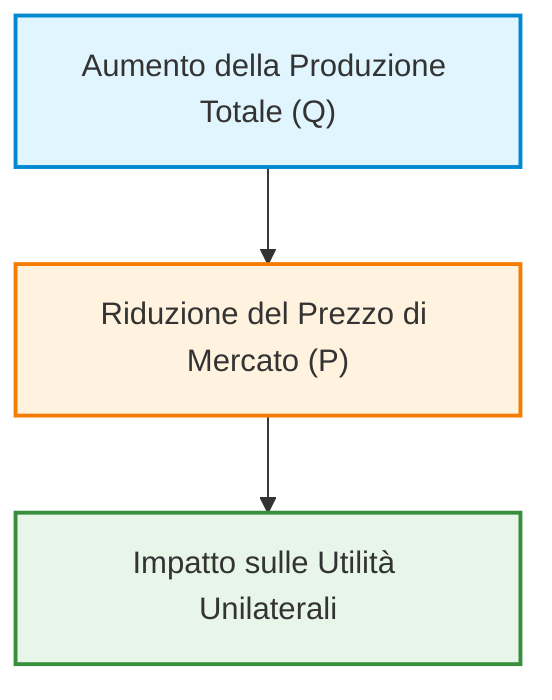
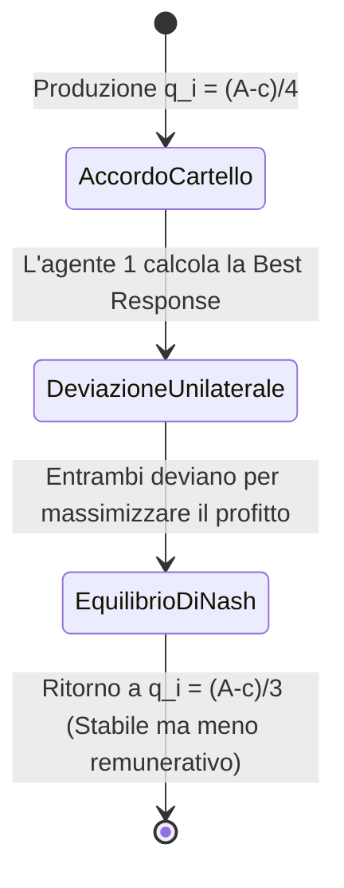
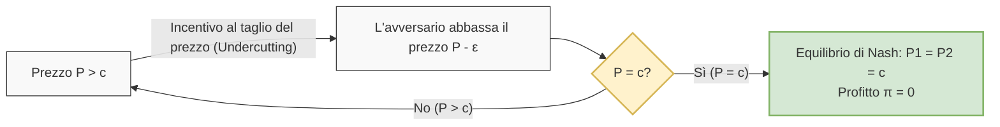
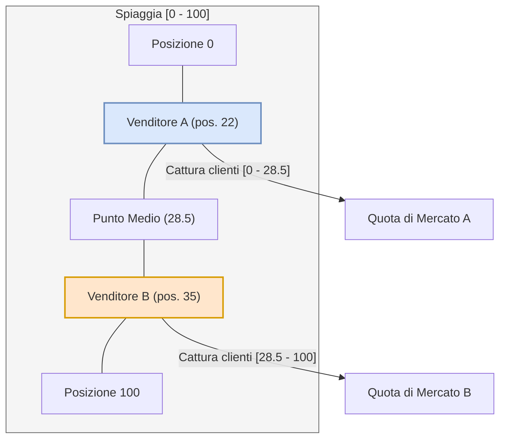
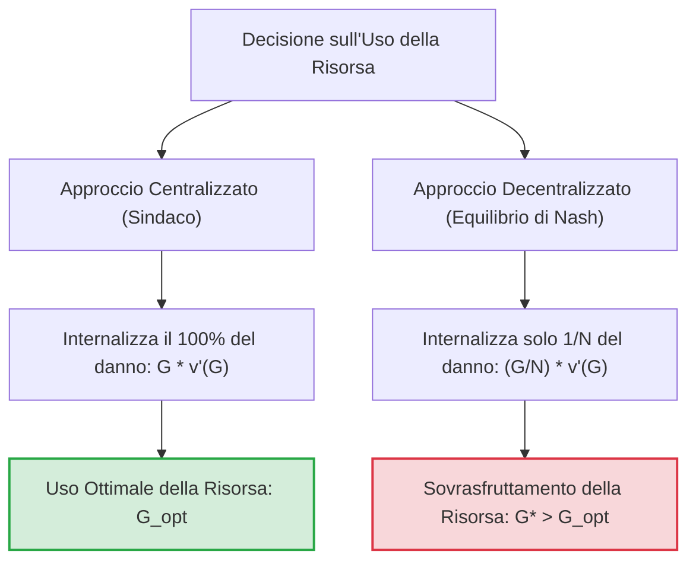
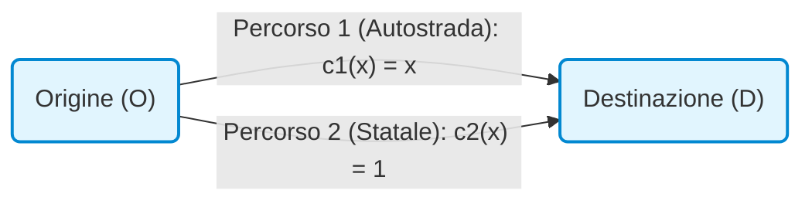
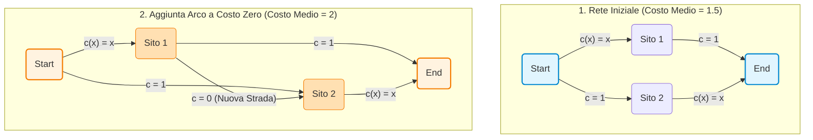

# Teoria dei Giochi Applicata: Equilibri di Nash e Modello del Duopolio di Cournot

## Overview Didattica

Questa lezione introduce l'applicazione dei modelli fondamentali della Teoria dei Giochi (*Game Theory*) a scenari reali, evidenziando come problemi complessi in ambiti quali le telecomunicazioni, la gestione delle reti (*networking*), la sicurezza informatica (*cyber security*) e la scienza dei dati (*data science*) possano essere formulati e risolti come varianti di giochi classici.

I concetti chiave trattati includono:

* **Proprietà degli Equilibri di Nash (*Nash Equilibrium*)**: Analisi dell'esistenza, della potenziale non unicità degli equilibri e della loro relazione con l'Efficienza Paretiana (*Pareto Efficiency*), evidenziando come l'esito spontaneo della competizione non cooperativa non garantisca necessariamente l'ottimalità sociale.
* **Modellistica nei Duopoli (*Duopolies*)**: Introduzione alla competizione di mercato tra due agenti come caso semplificato di oligopolio (*oligopoly*).
* **Il Modello di Duopolio di Cournot (*Cournot Duopoly Model*)**: Formulazione del modello classico (1838) in cui due imprese competono sulla quantità prodotta ($q_1, q_2$). Vengono definite la funzione di costo di produzione lineare $C(q) = c \cdot q$ e la funzione di prezzo inversa (*inverse demand function*) $P(Q) = A - Q$, con $Q = q_1 + q_2$.
* **Compromesso di Modellazione Ingegneristica**: Riflessione metodologica sull'importanza del bilanciamento tra l'accuratezza del modello e la sua trattabilità matematica (*mathematical tractability*), privilegiando la rappresentazione dei trend qualitativi del sistema rispetto a un'eccesiva complessità analitica.

---

### Applicazioni della Teoria dei Giochi e Modellizzazione

Nello studio avanzato della Teoria dei Giochi (*Game Theory*), la trattazione dei modelli classici non ha una pura valenza storica o economica, ma rappresenta una vera e propria palestra metodologica. Molti problemi complessi nell'ingegneria moderna — come la gestione delle risorse nelle reti di telecomunicazione (*Telecommunications*), il *networking*, la *data science* e la *cybersecurity* — possono essere formulati come riadattamenti di questi giochi classici.

#### Esistenza, Unicità ed Efficienza dell'Equilibrio di Nash

L'Equilibrio di Nash (*Nash Equilibrium - NE*) rappresenta la naturale evoluzione di un sistema in cui gli agenti agiscono in modo non cooperativo per massimizzare la propria utilità.

1. **Esistenza vs Unicità**: Sotto condizioni matematiche molto deboli, l'esistenza di almeno un Equilibrio di Nash è sempre garantita. Tuttavia, l'equilibrio **non è necessariamente unico**. La presenza di equilibri multipli richiede criteri di selezione e introduce la necessità di valutare quale stabilità sia più probabile o desiderabile.
2. **Efficienza del Sistema**: L'esito di un equilibrio competitivo non garantisce un risultato socialmente efficiente.

> **Concetto Chiave: Competizione Spontanea vs Efficienza**  
> Un risultato competitivo è estremamente facile da instaurare spontaneamente (il sistema ci converge senza interventi esterni), ma può rivelarsi disastroso in termini di efficienza globale. Un parallelo intuitivo è quello di una competizione estrema tipo "Battle Royale": lasciando gli agenti liberi di eliminarsi a vicenda, il designer dell'architettura non deve fare alcuno sforzo per gestire il sistema, ma l'esito finale sarà altamente inefficiente per la collettività.

Dal punto di vista ingegneristico, il problema cardine consiste nel verificare se un Equilibrio di Nash sia **Pareto-efficiente** (*Pareto Efficient*). Qualora non lo sia, l'obiettivo diventa quello di riprogettare il meccanismo (*Mechanism Design*) per guidare il sistema verso esiti Pareto-ottimali.

---

### Il Duopolio di Cournot (Cournot Duopoly)

Il modello del Duopolio di Cournot (risalente al 1838) analizza la competizione tra due imprese che devono decidere simultaneamente la quantità di beni da produrre. Sebbene sia nato in ambito economico, costituisce la struttura fondamentale per modellare la condivisione di risorse (es. allocazione di banda o potenza di trasmissione tra provider di rete rivali).

#### Filosofia della Modellizzazione Ingegneristica
Il modello adotta ipotesi fortemente semplificate. In ingegneria non occorre sovra-caratterizzare ogni dettaglio reale producendo modelli matematicamente intrattabili. Un buon modello deve catturare **il trend fondamentale del fenomeno** mantenendo la matematica analiticamente risolvibile.

#### Formulazione del Gioco
Si considerano due aziende ($i \in \{1, 2\}$) che scelgono indipendentemente e simultaneamente la propria quantità di produzione:
* **Strategie individuali**: $q_1 \ge 0$ e $q_2 \ge 0$.
* **Produzione totale di mercato**: $Q = q_1 + q_2$.
* **Costo di produzione**: Modello a costo marginale costante $c > 0$:
  $$C(q_i) = c \cdot q_i$$
* **Funzione di prezzo inversa (Prezzo di Mercato)**: Cournot ipotizza una relazione lineare decrescente tra prezzo $P$ e quantità totale $Q$:
  $$P(Q) = \begin{cases} A - Q & \text{se } Q \le A \\ 0 & \text{se } Q > A \end{cases}$$
  dove $A > c$ è una costante di domanda di mercato.

> **Nota didattica sul prezzo negativo/nullo**: Nella realtà, una sovrapproduzione estrema ($Q > A$) azzera il valore del bene o genera costi di smaltimento (fenomeno speculare a quello che avviene in agricoltura o nei mercati energetici con prezzi negativi). Scegliere $q_i > A$ rappresenta una strategia strettamente dominata (*strictly dominated strategy*), in quanto genera costi certi $c \cdot q_i$ a fronte di ricavi nulli.

---

### Calcolo dell'Equilibrio di Nash

Ciascuna impresa intende massimizzare la propria funzione di profitto/utilità $U_i(q_i, q_j)$, definita come il ricavo totale meno i costi sostenuti:

$$U_i(q_i, q_j) = q_i \cdot P(Q) - C(q_i) = q_i (A - q_i - q_j) - c \cdot q_i = q_i (A - q_i - q_j - c)$$

Per trovare l'Equilibrio di Nash $(q_1^*, q_2^*)$, ciascun giocatore risponde con la propria Best Response massimizzando la propria utilità rispetto a $q_i$, assumendo la decisione dell'altro giocatore $q_j^*$ come fissa:

$$q_i^* = \arg\max_{q_i \ge 0} \left[ q_i (A - q_i - q_j^* - c) \right]$$

#### Derivazione Matematica Step-by-Step

Poiché la funzione d'utilità $U_i$ è una parabola concava rispetto a $q_i$, la condizione del primo ordine (annullamento della derivata parziale) è necessaria e sufficiente per l'ottimo:

$$\frac{\partial U_i}{\partial q_i} = \frac{\partial}{\partial q_i} \left( A q_i - q_i^2 - q_i q_j^* - c q_i \right) = A - 2q_i - q_j^* - c = 0$$

Risolvendo per $q_i$, otteniamo la **Funzione di Miglior Risposta** (*Best Response Function*) dell'agente $i$:

$$q_i = R_i(q_j^*) = \frac{A - c - q_j^*}{2}$$

*(Nota: Passaggio integrato con chiarezza didattica)*  
Sfruttando la perfetta simmetria statistica e strutturale del gioco, la soluzione di equilibrio deve soddisfare $q_1^* = q_2^* = q^*$. Sostituendo la simmetria nella condizione del primo ordine:

$$A - 2q^* - q^* - c = 0 \implies A - 3q^* - c = 0$$

Si ricavano così i valori di equilibrio per le singole quantità, la quantità totale e i profitti individuali:

* **Quantità di equilibrio del singolo duopolista**:
  $$q_1^* = q_2^* = \frac{A - c}{3}$$
* **Quantità totale sul mercato**:
  $$Q^* = q_1^* + q_2^* = \frac{2(A - c)}{3}$$
* **Profitto di equilibrio per ciascuna impresa**:
  $$U_1^* = U_2^* = \left(\frac{A - c}{3}\right) \left( A - \frac{2(A - c)}{3} - c \right) = \frac{(A - c)^2}{9}$$

---

### Confronto con il Benchmark del Monopolio

Per capire se l'Equilibrio di Nash competitivo sia efficiente per le aziende, lo si confronta con lo scenario in cui un singolo agente controlla l'intero mercato (Monopolio).

In regime di Monopolio, l'unica azienda imposta $q_2 = 0$ e sceglie la quantità monopolistica $q_M$:

$$U_M(q_M) = q_M (A - q_M - c)$$

Annullando la derivata rispetto a $q_M$:

$$\frac{d U_M}{d q_M} = A - 2q_M - c = 0 \implies q_M = \frac{A - c}{2}$$

Il profitto totale del monopolista risulta essere:

$$U_M = \left(\frac{A - c}{2}\right)\left(A - \frac{A - c}{2} - c\right) = \frac{(A - c)^2}{4}$$

#### Analisi Comparativa

| Parametro | Duopolio competitivo (Nash) | Monopolio |
| :--- | :--- | :--- |
| **Quantità Totale ($Q$)** | $\frac{2(A - c)}{3} \approx 0.67(A-c)$ | $\frac{A - c}{2} = 0.5(A-c)$ |
| **Prezzo di Mercato ($P$)** | $\frac{A + 2c}{3}$ | $\frac{A + c}{2}$ (Più alto) |
| **Profitto Totale ($\Pi_{tot}$)** | $2 \cdot \frac{(A - c)^2}{9} = \frac{2(A - c)^2}{9} \approx 0.22(A-c)^2$ | $\frac{(A - c)^2}{4} = 0.25(A-c)^2$ (Maggiore) |

Il monopolista produce **meno quantità** complessiva rispetto al duopolio, riuscendo a mantenere il **prezzo più alto** e ottenendo così un profitto complessivo superiore.

---

### Cartelli, Collusione e Instabilità strategica

Notando la maggiore redditività del monopolio, i due duopolisti potrebbero essere tentati di stipulare un accordo segreto, formando un **Cartello** (*Cartel / Trust*) per simulare il comportamento di un monopolista e dividersi equamente la produzione optimal:

$$q_1^{cartello} = q_2^{cartello} = \frac{q_M}{2} = \frac{A - c}{4}$$

In caso di rispetto dell'accordo, il profitto individuale per ciascuna impresa diventa:

$$U_i^{cartello} = \frac{U_M}{2} = \frac{(A - c)^2}{8}$$

Poiché $\frac{(A - c)^2}{8} > \frac{(A - c)^2}{9}$, l'accordo garantisce a entrambe un utile maggiore rispetto all'Equilibrio di Nash. Tuttavia, nei giochi statici non cooperativi a informazione completa, **il cartello non costituisce un Equilibrio di Nash**.

> **Concetto Chiave: La Tentazione della Deviazione Unilaterale**  
> Se l'Impresa 2 rispetta l'accordo producendo $q_2 = \frac{A-c}{4}$, la miglior risposta dell'Impresa 1 **non** è produrre $\frac{A-c}{4}$. L'Impresa 1 ha un forte incentivo unilaterale a tradire l'accordo (*unilateral deviation*), aumentando la propria produzione per sottrarre ulteriori profitti all'avversario.

#### Dimostrazione dell'Incentivo a Deviare
Se l'Impresa 2 produce la quota concordata $q_2 = \frac{A-c}{4}$, la risposta ottimale dell'Impresa 1 è:

$$q_1^{deviazione} = R_1\left(\frac{A - c}{4}\right) = \frac{A - c - \frac{A - c}{4}}{2} = \frac{3(A - c)}{8} > \frac{A - c}{4}$$

Sostituendo $q_1^{deviazione} = \frac{3(A - c)}{8}$ nella funzione di utilità, si ottiene un guadagno individuale strettamente superiore a $U^{cartello}$. Di conseguenza, in assenza di un meccanismo vincolante esterno (non previsto nei giochi non cooperativi statici), l'accordo collusivo crolla e le aziende ricadono inevitabilmente nell'**Equilibrio di Nash di Cournot**, confermando che la spinta egoistica alla massimizzazione individuale garantisce la stabilità del sistema a discapito della massima efficienza di gruppo.

---

3. Il Modello di Bertrand (Concorrenza sui Prezzi)

#### Critica al Modello di Cournot e Presupposti Formali
Nel 1883, l'economista Joseph Bertrand mosse una fondamentale critica al modello di Cournot: nella realtà operativa, le imprese raramente scelgono direttamente le quantità da produrre lasciando che il mercato determini il prezzo. Più intuitivamente, le aziende fissano il **prezzo di vendita** (*Price Competition*), mentre la quantità venduta è determinata dalla domanda di mercato in risposta a tale prezzo.

Nel **Duopolio di Bertrand** (*Bertrand Duopoly*), il gioco cambia radicalmente rispetto a Cournot. Consideriamo beni "regolari" o non di Giffen (*Non-Giffen Goods*), ossia beni per i quali all'aumentare del prezzo la domanda diminuisce:

*   I prezzi rappresentano strategie continue: $P_i \in [0, +\infty)$.
*   La quantità $Q_i$ acquistata dai consumatori per l'impresa $i$ è funzione lineare del prezzo fissato:
    $$Q_i = A - B \cdot P_i$$
*   La funzione di costo rimane lineare e priva di costi fissi:
    $$C(Q_i) = c \cdot Q_i$$
    dove $c$ rappresenta il costo marginale costante di produzione per unità di prodotto.

---

#### Il Paradosso di Bertrand ed Equilibrio di Nash
Per comprendere la dinamica di questo gioco, si può fare ricorso all'analogia dei due chioschi di limonata competitivi (come nella celebre sfida tra Zio Paperone e Rockerduck):
1. Se l'Impresa 1 fissa un prezzo $P_1 > c$, l'Impresa 2 ha sempre un incentivo alla **deviazione unilaterale** (*Unilateral Deviation*). Tagliando il prezzo anche solo di un centesimo ($P_2 = P_1 - \epsilon$), l'Impresa 2 cattura l'intera domanda di mercato, supponendo che i consumatori acquistino esclusivamente dal venditore più economico.
2. L'Impresa 1 risponderà riducendo ulteriormente il prezzo ($P_1 = P_2 - \epsilon$).
3. Questa corsa al ribasso (*Price War*) si arresta unicamente quando il prezzo raggiunge il costo marginale di produzione $c$.

> **CONCETTO CHIAVE: Il Paradosso di Bertrand**
> 
> Nel modello di Bertrand con beni omogenei e costi uguali, l'unico **Equilibrio di Nash** (*Nash Equilibrium*) si verifica quando entrambe le imprese fissano il prezzo pari al costo marginale:
> $$P_1^* = P_2^* = c$$
> Ciò implica che i profitti economici di entrambe le imprese sono nulli:
> $$\pi_1^* = \pi_2^* = 0$$
> Questo risultato è paradossale: bastano **solamente due imprese** nel mercato per replicare esattamente l'esito di un mercato in **Concorrenza Perfetta** (*Perfect Competition*).

*Nota dimostrativa:*
*   Se un'impresa provasse a fissare $P > c$, venderà $0$ unità poiché tutti i clienti si rivolgerebbero al concorrente, ottenendo profitto zero.
*   Se provasse a fissare $P < c$, venderebbe a tutta la clientela ma accumulerebbe profitti negativi (perdite).
*   L'unica risposta ottima mutualmente compatibile è $P = c$.

---

#### Prodotti Differenziati e Sostitutibilità
L'esito paradossale di Bertrand deriva dal presupposto che i beni offerti siano **Sostituti Perfetti** (*Perfect Substitutes*). Nella realtà, i consumatori non acquistano sempre e solo dal venditore al prezzo più basso. Fattori come la localizzazione geografica, i costi di trasporto (es. consumo di benzina per raggiungere un ipermercato rispetto al minimarket sotto casa) o la preferenza di marca modificano il comportamento d'acquisto.

Per modellare la **differenziazione del prodotto** (*Product Differentiation*), si modifica la funzione di domanda dell'impresa $i$ integrando il prezzo dell'impresa rivale $j$:

$$Q_i = A - P_i + b \cdot P_j$$

Dove:
*   $b > 0$ rappresenta il grado di sostitutibilità o "tasso di cambio" tra i prodotti dei due concorrenti.

In questo scenario modificato, l'Equilibrio di Nash porta a prezzi superiori al costo marginale:

$$P^* = \frac{A + c}{2 - b}$$

Quando $b$ si avvicina a valori elevati, la dipendenza dal prezzo altrui aumenta; al contrario, se i prodotti sono totalmente differenziati, le aziende beneficiano di un potere assimilabile al **Monopolio** (*Monopoly*), potendo fissare prezzi significativamente più alti senza perdere la totalità dei clienti.

---

#### Asimmetria dei Costi e Prezzi Predatori
Se rompiamo la simmetria dei costi ponendo $c_1 < c_2$ (l'Impresa 1 è più efficiente dell'Impresa 2):
*   L'Impresa 1 può catturare l'intero mercato fissando un prezzo di poco inferiore al costo marginale dell'Impresa 2: $P_1 = c_2 - \epsilon$.
*   L'Impresa 2 non può pareggiare l'offerta senza andare in perdita e viene estromessa dal mercato.

*Nota sulla granularità dei prezzi:* Dal punto di vista strettamente matematico continuo, il valore ideale $c_2 - \epsilon$ non ammette un massimo formale ($1.99$ è meglio di $2$, ma $1.999$ è meglio di $1.99$). Nella realtà operativa la granularità della moneta (es. il centesimo di euro) risolve questa discontinuità imponendo il valore discreto minimo ammissibile.

##### Prezzi Predatori (*Predatory Pricing*)
In alcuni contesti dinamici o competitivi, un'impresa potrebbe fissare temporaneamente un prezzo inferiore al proprio costo marginale ($P < c_1$). Sebbene generi profitti negativi nel breve termine, questa strategia punta a estromettere il rivale dal mercato (mandandolo in bancarotta) per poi operare da monopolista e fissare prezzi arbitrariamente elevati nel lungo periodo.

---

### 4. Il Modello di Hotelling (Posizionamento Spaziale)

#### Il Problema dei Venditori di Gelato
Il **Modello di Posizionamento Spaziale di Hotelling** (*Hotelling's Spatial Competition Model*) affronta la competizione non solo sul prezzo, ma sulla **localizzazione strategica** (*Spatial Positioning*).

Immaginiamo una spiaggia o un viale rappresentato da un intervallo lineare continuo o discreto di posizioni $[0, L]$ (es. da $0$ a $100$ metri). I clienti sono distribuiti in modo uniforme lungo il viale e preferiscono camminare il meno possibile per acquistare un gelato (minimizzazione dei costi di trasporto). Ogni cliente si rivolgerà al venditore geograficamente più vicino.

*   Se il Venditore A si posiziona al punto $22$ e il Venditore B al punto $35$, il punto medio di indifferenza per i consumatori è $\frac{22 + 35}{2} = 28.5$.
*   Il Venditore A cattura tutti i clienti nell'intervallo $[0, 28.5]$.
*   Il Venditore B cattura tutti i clienti nell'intervallo $[28.5, 100]$.

---

#### Incentivo allo Spostamento e Principio di Massima Omologazione
Analizzando le risposte ottime:
1. Il Venditore A ha un chiaro incentivo a spostarsi verso destra (es. verso la posizione $34$) per "rubare" quota di mercato a B verso sinistra, mantenendo comunque coperta la zona alla sua estrema sinistra.
2. Allo stesso modo, il Venditore B ha un incentivo a spostarsi verso sinistra per espandere il proprio bacino d'utenza verso destra.

> **CONCETTO CHIAVE: Convergenza al Centro**
> 
> L'unico **Equilibrio di Nash** del modello di Hotelling si ha quando entrambi i venditori si posizionano esattamente al **centro dello spazio disponibile**:
> $$x_A^* = x_B^* = \frac{L}{2}$$
> Questo fenomeno prende il nome di **Principio di Massima Omologazione** (*Principle of Minimum Differentiation*).

---

#### Applicazione ai Sistemi Politici
Il modello di Hotelling è ampiamente utilizzato nella teoria delle scelte pubbliche per spiegare il comportamento dei partiti politici e l'elettorato (Teorema dell'Elettore Medio):

*   **Sistemi Bipartitici (es. USA):** Con due soli attori principali (Democratici e Repubblicani), le piattaforme politiche tendono inevitabilmente a **convergere verso il centro** per catturare la maggioranza degli elettori moderati. I programmi politici finiscono per sovrapporsi nettamente su molti temi chiave.
*   **Sistemi Multipartitici (es. Italia):** La presenza di più di due attori rompe la stabilità della convergenza centrale. Se due partiti si schiacciano al centro, si creano spazi vuoti alle estremità (destra o sinistra radicale). Diventa quindi strategicamente vantaggioso per un nuovo attore posizionarsi sulle ali estreme per catturare l'elettorato periferico.

---

### La Tragedia dei Beni Comuni (The Tragedy of the Commons)

Un problema classico e fondamentale nella Teoria dei Giochi è la **Tragedia dei Beni Comuni (Tragedy of the Commons)**. Si tratta di un'osservazione già formulata da David Hume nel XVIII secolo: quando si dispone di un bene pubblico a fruizione gratuita (free access), le persone tendono ad abusarne o a usarlo in modo inefficiente.

L'esempio classico per eccellenza è l'inquinamento: l'ambiente è una risorsa naturale condivisa ma, non pagandone direttamente il costo d'uso, tendiamo a sovrasfruttarlo, portando a crisi climatiche e catastrofi ecologiche.

Il modello classico per formalizzare questo fenomeno è stato introdotto da **Garrett Hardin** nel 1968 (ispirato a studi precedenti). 

#### Applicazione in Ingegneria dell'Informazione
Anche se il modello classico viene spiegato tramite agricoltori e pascoli, il concetto si applica direttamente ai sistemi dell'ingegneria dell'informazione. 

Si pensi ad un **Access Point Wi-Fi pubblico (Hotspot)**:
* Più dispositivi stabiliscono una connessione, maggiore è la congestione del canale.
* La banda effettiva ($bandwidth$) disponibile per ciascun utente diminuisce all'aumentare delle connessioni totali.
* A causa dei meccanismi di accesso casuale al canale (es. CSMA/CA), all'aumentare dei dispositivi aumentano le collisioni, portando la resa della rete a degradare in modo non lineare fino a saturare a zero.

---

### Formulazione del Modello Matematico

Immaginiamo un villaggio con $N$ agricoltori (giocatori). Ciascun agricoltore porta le proprie capre a pascolare in un prato verde comune (bene pubblico).

* $N$: numero totale di agricoltori (giocatori).
* $g_i$: numero di capre possedute dal singolo agricoltore $i$.
* $G = \sum_{i=1}^{N} g_i$: numero totale di capre presenti nel pascolo comune.
* $c$: costo unitario per mantenere una capra (acquisto, stalla, cura). Si ipotizza un costo lineare proporzionale a $g_i$.
* $v(G)$: valore/utilità generata da ciascuna capra grazie al pascolo. 

#### Proprietà della funzione di valore $v(G)$
Più capre pascolano sul prato comune, meno erba c'è a disposizione per ciascuna. Di conseguenza, il valore estratto da ogni singola capra $v(G)$ diminuisce all'aumentare del numero totale di capre $G$:
1. $v'(G) < 0$ (la funzione è strettamente decrescente).
2. $v''(G)$ tende a saturare la risorsa: superata una certa soglia critica $G$, il pascolo è talmente impoverito che il valore estratto si annulla.

#### Funzione di Payoff (Utilità del Singolo Agricoltore)
La funzione di utilità del generico agricoltore $i$ è data dai ricavi totali meno i costi sostenuti:

$$\Pi_i(g_i, G_{-i}) = g_i \cdot v(G) - c \cdot g_i = g_i \left[ v(G) - c \right]$$

Dove $G = g_i + G_{-i}$ evidenzia la dipendenza doppia:
1. Diretta dalle proprie decisioni $g_i$.
2. Indiretta dalle decisioni altrui $G_{-i} = \sum_{j \neq i} g_j$.

---

### Analisi dell'Equilibrio di Nash (Decentralizzato)

Per trovare l'Equilibrio di Nash, ipotizziamo una condizione di **simmetria** tra i giocatori: dato che tutti gli agricoltori sono identici, al punto di equilibrio ciascuno possederà lo stesso numero di capre:

$$g_i^* = \frac{G^*}{N}$$

Ciascun agricoltore massimizza la propria utilità $\Pi_i$ rispetto a $g_i$, prendendo come date le decisioni degli altri:

$$\frac{\partial \Pi_i}{\partial g_i} = 0$$

Calcoliamo la derivata prima sfruttando la regola del prodotto:

$$\frac{\partial}{\partial g_i} \left[ g_i \cdot v(G) - c \cdot g_i \right] = v(G) + g_i \cdot v'(G) \frac{\partial G}{\partial g_i} - c = 0$$

Poiché $\frac{\partial G}{\partial g_i} = 1$ e applicando la condizione di simmetria $g_i^* = \frac{G^*}{N}$, otteniamo la **Condizione del Primo Ordine (FOC) per il singolo giocatore**:

$$v(G^*) + \frac{G^*}{N} v'(G^*) - c = 0$$

#### Interpretazione dei Termini dell'Equilibrio di Nash
La derivata è composta da tre elementi che devono bilanciarsi all'equilibrio:
1. $+v(G^*)$ **(Guadagno marginale):** Il valore aggiuntivo che l'agricoltore ottiene introducendo una capra in più.
2. $-c$ **(Costo marginale diretto):** La spesa diretta per comprare e mantenere quella capra in più.
3. $+\frac{G^*}{N} v'(G^*)$ **(Degrado marginale della risorsa):** Poiché $v'(G^*) < 0$, questo termine è **negativo**. Rappresenta la perdita di valore causata dal deperimento del pascolo comune.

> **[Concetto Chiave] La percezione miope del danno:**  
> Notate il fattore $\frac{1}{N}$ che moltiplica il termine di degrado della risorsa. Nel cercare il proprio interesse personale, il singolo agricoltore **internalizza solo una frazione $\frac{1}{N}$ del danno globale** arrecato all'ambiente, poiché suddivide l'effetto negativo con tutti gli altri $N-1$ individui.

---

### Ottimo Sociale (Approccio Centralizzato / "Il Sindaco")

Cosa succederebbe se la decisione fosse presa da un’autorità centrale benevola (es. il Sindaco del villaggio) che punta a massimizzare il **Benessere Sociale Globale (Global Welfare)**?

La funzione di benessere globale $W(G)$ è la somma dei payoff di tutti i giocatori:

$$W(G) = \sum_{i=1}^{N} \Pi_i = G \cdot v(G) - c \cdot G$$

Per trovare il numero di capre socialmente ottimale $G^{opt}$, il Sindaco calcola la derivata rispetto al totale $G$ e la pone pari a zero:

$$\frac{d W}{d G} = 0 \implies v(G^{opt}) + G^{opt} v'(G^{opt}) - c = 0$$

---

### Confronto e Inefficienza dell'Equilibrio di Nash

Mettiamo a confronto le due equazioni ottenute:

* **Equilibrio di Nash (Decentralizzato):**  
  $$v(G^*) + \frac{1}{N} G^* v'(G^*) - c = 0$$

* **Ottimo Sociale (Centralizzato):**  
  $$v(G^{opt}) + G^{opt} v'(G^{opt}) - c = 0$$

> **[Concetto Chiave] Inefficienza strutturale dell'Equilibrio di Nash:**  
> Poiché $v'(G) < 0$, la presenza del termine $\frac{1}{N}$ nella condizione di Nash riduce l'impatto percepito del costo d'inquinamento/degrado. Di conseguenza, si ottiene matematicamente che:
> $$G^* > G^{opt}$$
> Il consumo di risorse nell'Equilibrio di Nash è **strettamente superiore** all'utilizzo socialmente ottimale. L'Equilibrio di Nash porta inevitabilmente al **sovrasfruttamento** (overuse) della risorsa comune.

#### Perché le persone inquinano? "Razionalità" vs Inefficienza
Questo risultato matematico spiega perché le risposte individuali egoistiche portano a disastri collettivi. Le persone che inquinano o abusano di beni pubblici non sono "stupide" o "irrazionali"; al contrario, stanno agendo in modo **perfettamente razionale dal punto di vista individuale**.

* **Bene Privato (Casa propria):** Se sporco la mia sedia, il danno è al $100\%$ mio. Il costo del degrado graviterà interamente su di me ($N=1$).
* **Bene Pubblico (Treno/Ambiente):** Se metto le scarpe sul sedile di un treno o inquino l'aria, il beneficio dello sforzo risparmiato è totalmente mio, ma il degrado causato è ripartito su tutti i passeggeri/cittadini. Io ne percepisco soltanto la frazione $\frac{1}{N}$.

---

3. Routing Egoistico e il Prezzo dell'Anarchia (Selfish Routing and Price of Anarchy)

Il problema del **Routing Egoistico (Selfish Routing)** rappresenta una delle applicazioni più famose e rilevanti della Teoria dei Giochi alle reti. Nonostante sia stato formalizzato inizialmente per modellare il traffico automobilistico, oggi trova ampissima applicazione nell'ingegneria informatica e delle telecomunicazioni, in particolare nell'ambito della **Selezione del Server (Server Selection)**. 

Un esempio moderno è l'instradamento delle query verso i Modelli di Linguaggio di Grandi Dimensioni (Large Language Models - LLM), come ChatGPT: quando un utente invia una richiesta, il sistema deve decidere a quale server inoltrarla. Alcuni server sono teoricamente molto veloci ma soggetti a congestione, mentre altri sono strutturalmente più lenti ma con prestazioni costanti.

#### Il Modello di Pigou (1920)

Per comprendere la dinamica, consideriamo il problema classico proposto dall'economista Arthur Pigou. 

Immaginiamo una popolazione di utenti (pendolari o pacchetti dati) che deve spostarsi da un'origine ad una destinazione. La quantità totale di traffico da instradare viene normalizzata ad $1$ unità. Esistono due rotte alternative:

1. **Percorso Superiore (Autostrada / Server Veloce):** presenta un costo/latenza dipendente dalla congestione $c_1(x) = x$, dove $x \in [0, 1]$ rappresenta la frazione di traffico che sceglie questo percorso. Se il percorso è vuoto ($x=0$), il costo è nullo; se è completamente intasato ($x=1$), il costo è $1$.
2. **Percorso Inferiore (Strada Statale / Server Lento):** presenta un costo/latenza fisso $c_2(x) = 1$, indipendente dalla quantità di traffico.

#### Analisi dell'Equilibrio di Nash (Comportamento Egoistico)

Se ciascun utente sceglie la propria rotta in modo puramente egoistico per minimizzare il proprio costo individuale, cosa accade?

Analizzando le opzioni dal punto di vista del singolo utente, il costo del Percorso 1 soddisfa sempre $c_1(x) = x \le 1$, mentre il costo del Percorso 2 è sempre $c_2(x) = 1$. Di conseguenza, la scelta del Percorso 1 è una **strategia debolmente dominante**. 

Tutti gli utenti sceglieranno il Percorso 1, portando ad una frazione di traffico $x_{NE} = 1$.

* **Costo all'Equilibrio di Nash ($C_{NE}$):** Poiché $x = 1$, tutti gli utenti pagano un costo pari a:
  $$c_1(1) = 1$$
* **Assenza di Incentivo alla Deviazione Unilaterale (Unilateral Deviation):** Se un singolo utente decidesse di deviare verso il Percorso 2 per "decongestionare" l'autostrada, pagherebbe comunque un costo fisso pari a $1$. Non trarrebbe alcun beneficio personale, ma farebbe solo un favore agli altri. Di conseguenza, nessuno ha incentivo a spostarsi.

#### Ottimo Sociale (Social Optimum)

Ci chiediamo ora se esista una ripartizione del traffico $x$ capace di minimizzare il costo totale (o medio) sostenuto dall'intera collettività. 

Il costo totale della rete $C_{tot}(x)$ in funzione della frazione $x$ inviata sul Percorso 1 è espresso dalla somma pesata dei costi sui due rami:

$$C_{tot}(x) = x \cdot c_1(x) + (1 - x) \cdot c_2(x)$$
$$C_{tot}(x) = x \cdot x + (1 - x) \cdot 1 = x^2 - x + 1$$

Per trovare il valore $x^*$ che minimizza il costo totale, calcoliamo la derivata prima rispetto ad $x$ e la imponiamo pari a zero:

$$\frac{d C_{tot}(x)}{dx} = 2x - 1 = 0 \implies x^* = \frac{1}{2}$$

*Nota: Passaggio integrato con chiarezza didattica per esplicitare il calcolo dell'ottimo sociale.*

Sostituendo $x^* = 1/2$ all'interno della funzione di costo totale, otteniamo il costo minimo di sistema:

$$C_{OPT} = C_{tot}\left(\frac{1}{2}\right) = \left(\frac{1}{2}\right)^2 - \frac{1}{2} + 1 = \frac{1}{4} - \frac{1}{2} + 1 = \frac{3}{4}$$

Spartendo il traffico al $50\%$, il costo medio per utente scende da $1$ a $3/4 = 0.75$.

#### Calcolo del Prezzo dell'Anarchia (Price of Anarchy - PoA)

Il **Prezzo dell'Anarchia (Price of Anarchy - PoA)** misura la perdita di efficienza causata dal comportamento egoistico degli agenti rispetto ad un coordinatore centrale ottimale. È definito come il rapporto tra il costo all'Equilibrio di Nash e il costo all'Ottimo Sociale:

$$\text{PoA} = \frac{C_{NE}}{C_{OPT}} = \frac{1}{\frac{3}{4}} = \frac{4}{3} \approx 1.333$$

> **CONCETTO CHIAVE: Significato del Prezzo dell'Anarchia (4/3)**
> Nel modello di Pigou con latenze lineari, il Prezzo dell'Anarchia è pari a $4/3$. Ciò significa che la mancanza di coordinamento e il comportamento egoistico degli utenti causano un **aumento dell'inefficienza (o del costo totale) del 33.3%** rispetto allo scenario ideale.

---

### Estensioni del Modello: Costi Non Lineari e Limiti del PoA

Cosa succede se la funzione di costo del percorso soggetto a congestione non è lineare? Consideriamo un costo non lineare per il percorso superiore pari a $c_1(x) = x^a$, con un esponente $a \gg 1$.

1. **Equilibrio di Nash:** Scegliere il percorso superiore rimane la scelta dominante finché $x \le 1$. Pertanto, $x_{NE} = 1$ e il costo per gli utenti all'equilibrio rimane $C_{NE} = 1$.
2. **Ottimo Sociale:** Con un esponente $a$ molto grande, se riduciamo anche di pochissimo il traffico $x$ (ad esempio inviando una piccolissima frazione di "capri espiatori" $\epsilon$ sul percorso secondario), il costo $x^a = (1-\epsilon)^a$ crolla quasi a zero.
3. **Implicazione sul PoA:** In presenza di funzioni di latenza non lineari ad alta dipendenza dalla congestione, l'Ottimo Sociale tende a valori estremamente piccoli, mentre l'Equilibrio di Nash rimane bloccato a $1$. Di conseguenza, il Prezzo dell'Anarchia **non è superiormente limitato ($\text{PoA} \to \infty$)**.

---

### Il Paradosso di Braess (Braess's Paradox)

Un altro fenomeno controintuitivo fondamentale legato al routing egoistico è il **Paradosso di Braess**. Esso dimostra che **aggiungere capacità o una nuova strada a una rete esistente può peggiorare le prestazioni complessive per tutti gli utenti** se la rete è guidata da decisioni individuali (Equilibrio di Nash).

#### Meccanismo del Paradosso

1. **Rete Iniziale:** Due percorsi simmetrici a due tratte. Il traffico si divide $50/50$. Il costo medio totale per utente è $1.5$.
2. **Aggiunta del collegamento a costo zero ($c=0$):** Si inserisce una nuova strada di collegamento veloce tra il Sito 1 e il Sito 2.
3. **Nuovo Equilibrio di Nash:** La rotta `Start -> Sito 1 -> Sito 2 -> End` diventa strettamente dominante per ogni singolo utente, poiché offre teoricamente due tratti a bassissimo costo.
4. **Risultato:** Tutti gli utenti si riversano sul nuovo percorso combinato. Entrambi i segmenti soggetti a congestione ($c(x)=x$) si sataturano a $x=1$. 
5. **Costo Finale:** Il nuovo costo per ciascun utente diventa $1 + 0 + 1 = 2$. Il costo è **aumentato da $1.5$ a $2$** a causa dell'aggiunta di una risorsa.

> **CONCETTO CHIAVE: Ingegneria di Rete e Paradosso di Braess**
> Quando si progettano o si collegano reti di comunicazione o stradali guidate dall'interesse individuale, potenziare la topologia senza un controllo centralizzato dell'instradamento può essere controproducente. In contesti reali (come studi applicati sulla viabilità urbana o il traffico dati), l'apertura di nuove arterie ad alta velocità ha talvolta causato un collasso della circolazione proprio a causa dell'effetto Braess.

---

### Generalizzazioni e Teoremi di Garanzia

L'analisi del routing egoistico porta ad importanti conclusioni teoriche (dimostrate nei celebri lavori di *Roughgarden e Tardos* nei primi anni 2000):

* **Universalità del bound 4/3:** Per qualsiasi topologia di rete arbitrariamente complessa (con più nodi, archi e ramificazioni), purché le funzioni di latenza sugli archi siano strettamente **lineari**, il valore $\text{PoA} = 4/3$ rappresenta il **caso peggiore assoluto**. La topologia non può peggiorare ulteriormente l'inefficienza rispetto all'esempio base di Pigou.
* **Modelli di Coda ($M/M/1$):** Risultati analoghi sul Prezzo dell'Anarchia si riscontrano ampiamente nelle reti di telecomunicazione dove i costi sono legati al ritardo di accodamento (Queueing Delay) modellabile tramite code M/M/1. In molte di queste configurazioni, il fattore $4/3$ riemerge come parametro di riferimento strutturale per le prestazioni del sistema.

---

> [!NOTE]
> ### Note per l'Esame e Avvisi del Docente
> - **Tipologia di esercizi per l'esame scritto**: Alcuni esercizi della prova scritta potranno consistere in versioni riadattate o "sotto mentite spoglie" dei problemi classici trattati a lezione (ad esempio applicati a scenari di telecomunicazioni, reti, data science o cybersecurity, piuttosto che a contesti puramente economici). L'aspettativa del docente è che gli studenti siano in grado di riconoscere la struttura del problema teorico sottostante e risolverlo.