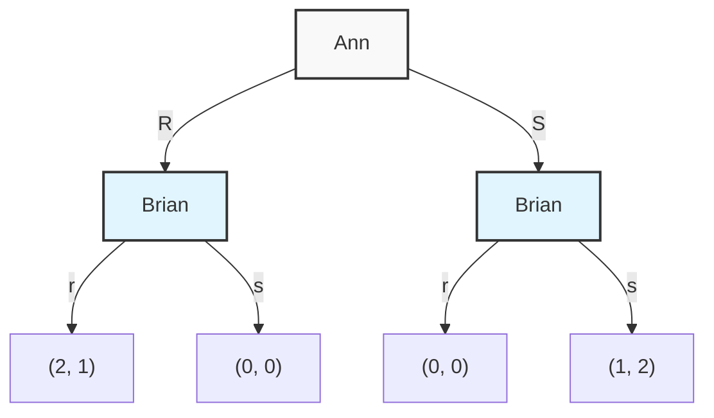
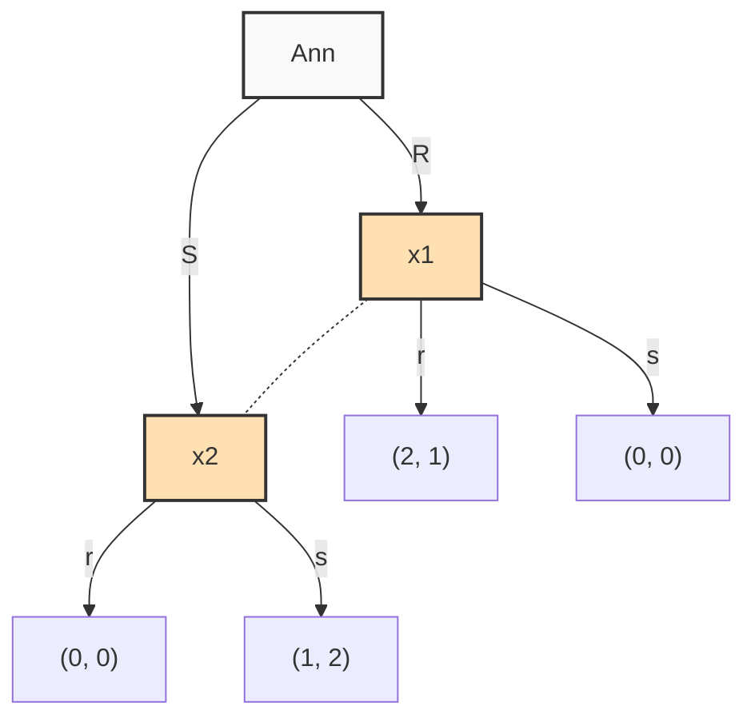
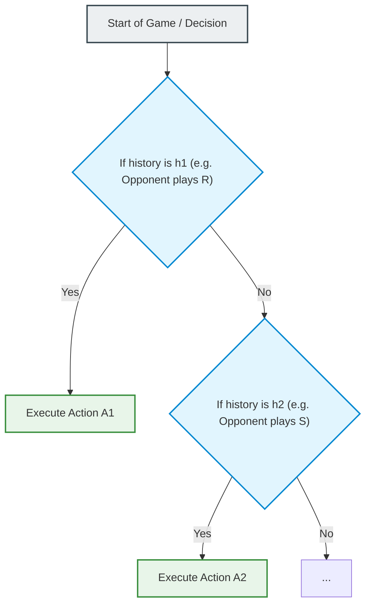
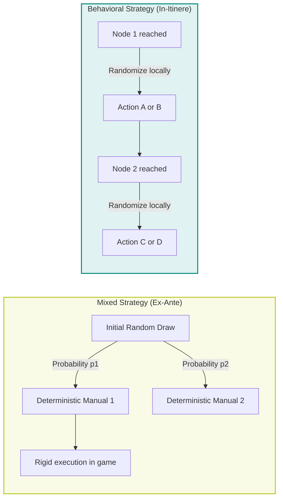
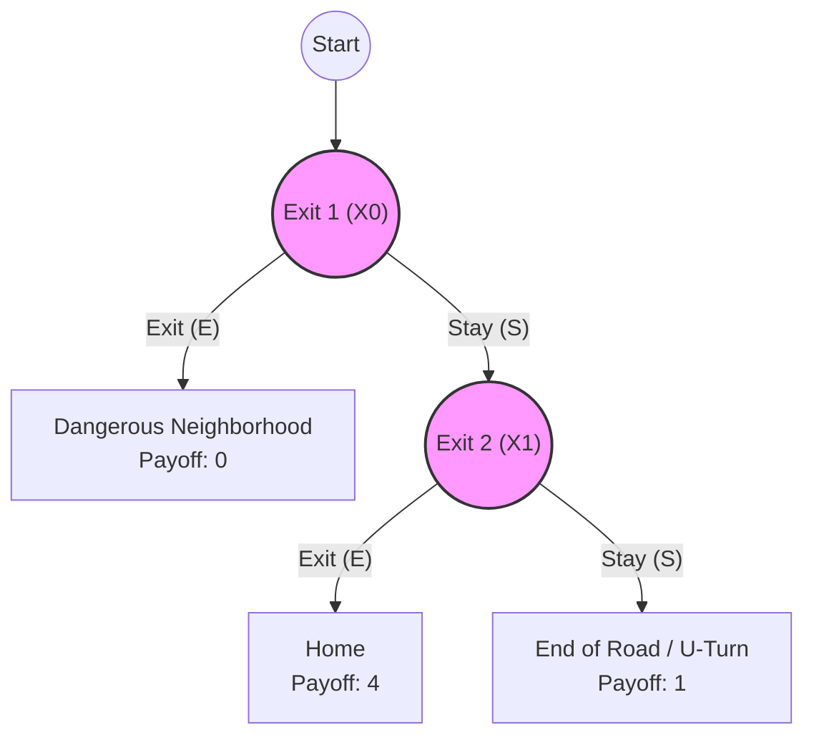
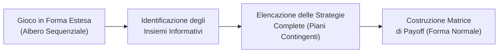

# Dynamic Games and Perfect Information

## Educational Overview

The lecture introduces the second part of the course, focusing on the transition from static games to **Dynamic Games**. The introduction of the time dimension and the sequentiality of decisions requires a precise redefinition of the concept of information available to players.

Throughout the introduction, the following conceptual and methodological aspects are defined:

* **Complete Information vs. Perfect Information:** The fundamental difference is clarified between **Complete Information**, in which the rules, payoffs, and preferences are common knowledge, and **Perfect Information**, in which a player knows with certainty the past history of the game and the actions previously taken by opponents when making their choice (e.g., Chess).
* **Imperfect Information in Dynamic Games:** It is highlighted how a dynamic game can still feature **Imperfect Information** in the presence of simultaneous moves ordered over time or stochastic interventions by Nature.
* **First-mover Advantage:** By reorganizing the classic "Battle of the Sexes" game sequentially, we analyze how sequentiality allows the first player to anticipate the best response of the second, leading to a deterministic outcome in pure strategies without the need for balancing in mixed strategies.
* **Limitations of Matrix Representation:** The theoretical need to move beyond normal (or matrix) form, which is adequate for simultaneous choices, is introduced in favor of representational structures capable of describing the temporal evolution of the game.

---

### Introduction to Dynamic Games and Information Structure

In static games, we study situations where decisions occur simultaneously. When we introduce the time dimension, we enter the realm of **Dynamic Games**. In dynamic games, the order of play has strategic value: one player moves before another, and the sequence of actions influences subsequent choices.

To analyze dynamic games, it is essential to clarify the concept of **information**. In static games, we limited ourselves to requiring the condition of **Complete Information**. In dynamic games, complete information alone is no longer sufficient, and it is necessary to introduce the distinction between **Perfect Information** and **Imperfect Information**.

> **Key Concept: Complete Information vs. Perfect Information**
> * **Complete Information:** All players know the rules of the game, the set of players, the available actions, and the payoff functions of each player. Furthermore, **Common Knowledge** holds: everyone knows that everyone knows, and so on.
> * **Perfect Information:** This is a specific property of dynamic games. In addition to having complete information, every player, when making a move, **knows exactly the entire history of the game**, i.e., all previous moves made by the other players (or by Nature).

A classic example of a game with complete and perfect information is **Chess**:
1. It has complete information: both players know the rules, how the pieces move, and the ultimate goal (checkmate).
2. It has perfect information: players move alternately, and the player whose turn it is to move sees and knows perfectly the chessboard configuration resulting from the opponent's previous moves.

If a dynamic game involves simultaneous moves in a given turn, or if unobservable random events occur (moves by Nature), the game becomes one of **imperfect information**.

---

### Revisiting the Battle of the Sexes in Sequential Form

Consider the classic **Battle of the Sexes** between Ann and Brian. In the static version, the two players simultaneously decide whether to watch a Romance movie ($R$, *Romance*) or a Sci-Fi movie ($S$, *Sci-Fi*), without being able to communicate.

Now suppose a **dynamic/sequential version**:
1. Ann moves first by proposing or choosing the movie: $R$ (Romance) or $S$ (Sci-Fi).
2. Brian receives Ann's decision and, having perfect information, chooses his move between $r$ (romance) and $s$ (sci-fi).

To visually distinguish the moves of the two players, we use uppercase for Ann ($R, S$) and lowercase for Brian ($r, s$).

#### Logical Analysis of Choices
The payoffs reflect the following preferences: both prefer going to the cinema together rather than alone. Ann prefers the romance movie together, while Brian prefers sci-fi together.

* If Ann chooses $R$, Brian knows he is faced with the option between $r$ (which gives him payoff $1$) and $s$ (which gives him payoff $0$). Brian's best response is to play $r$.
* If Ann chooses $S$, Brian compares $r$ (payoff $0$) and $s$ (payoff $2$). Brian's best response is to play $s$.

Ann, being rational and knowing Brian's rationality (by Common Knowledge), **anticipates** these decisions:
* If she plays $R$, she knows that Brian will respond with $r$, obtaining the outcome $(R, r)$ with payoff $2$ for her.
* If she plays $S$, she knows that Brian will respond with $s$, obtaining the outcome $(S, s)$ with payoff $1$ for her.

Since $2 > 1$, Ann will definitely choose $R$. Brian will respond with $r$.
In this dynamic version, there is no uncertainty: the outcome is predetermined, and there is no need to resort to mixed strategies.

---

### The Extensive Form and the Decision Tree

The matrix (or bimatrix) representation typical of the normal form is suited for simultaneous choices, but loses the temporal dimension. For dynamic games, the **Extensive Form** is used, whose graphical representation is the **Decision Tree**.



#### Formal Elements of the Extensive Form
Formally and rigorously, an extensive form is defined by a tuple containing **7 elements**:

1. **Set of Players ( $N$):** The list of all participants in the game.
2. **Order of Turns:** The sequence in which players make their moves.
3. **Set of Actions ( $A_i$):** The moves allowed for each player $i$ at each decision node.
4. **Information Sets ( $H_i$):** What each player knows about the past history of the game at the moment of choosing.
5. **Payoff Functions ( $u_i$):** The values assigned to each player at all terminal nodes (leaves of the tree). Payoffs are represented as column vectors or ordered tuples corresponding to the order of the players.
6. **Lottery Probabilities:** If the game includes moves by Nature, the relevant probability distributions must be perfectly defined.
7. **Common Knowledge:** The assumption that the complete tree structure, probabilities, and payoffs are known to all players.

#### Degenerate Nodes and Dummy Players
* **Dummy Player:** A player who makes no active moves in the tree (or in a given branch), but still receives a final payoff dependent on others' choices.
* **Single Action Nodes:** If at a node a player has only one move available, from a topological and strategic perspective, that node is equivalent to having no choice. Modeling a situation by setting a single available action is equivalent to saying that the action is forced.

---

### Information Sets

The **Information Set**, denoted by $H_i$, represents the set of decision nodes that a player $i$ cannot distinguish from one another at the moment of taking an action.

#### Classification of Information Sets
1. **Singleton:** The information set contains a single node:
   $$H_i = \{x_j\}$$
   The player knows exactly where in the tree they are located. This implies **Perfect Information**.
2. **Non-singleton:** The information set contains multiple nodes:
   $$H_i = \{x_1, x_2, \dots, x_k\}$$
   The player knows that they are at one of these nodes, but does not know exactly which one. This implies **Imperfect Information**.

Graphically, non-singleton information sets are represented by connecting indistinguishable nodes with a **dashed line** or enclosing them within a **bubble** (oval).



#### Mathematical Constraints on Information Sets
For an information structure to be consistent and well-defined from a theoretical perspective, two rigorous conditions must be satisfied:

1. **Membership of the Actual Node:** The real node $x_j$ at which the game is located must belong to the information set perceived by the player:
   $$x_j \in H_i(x_j)$$
   *(A player may be confused among several alternatives, but reality must be included among the considered possibilities)*.

2. **Identity of Available Actions:** If two or more nodes belonging to the same player belong to the same information set $H_i$, the set of available actions $A_i(x)$ must be **rigorously identical** for all nodes in the set:
   $$\text{Se } x_1, x_2 \in H_i, \quad \text{allora } A_i(x_1) = A_i(x_2)$$

> **Pedagogical explanation of the action constraint:**
> If at $x_1$ I had available the options $\{F, G, H\}$ and at $x_2$ I had only $\{G, H\}$, I could immediately deduce that I am at $x_1$ simply by observing the presence of move $F$. Indistinguishability would cease to hold.

#### Technique for Modeling Unavailable Actions
In engineering or modeling contexts, if at a node $x_2$ an action $F$ is physically forbidden while at $x_1$ it is allowed, it is possible to make the action sets identical by applying a formal transformation:
* The action $F$ is made selectable at $x_2$as well, but it is assigned an extremely penalizing payoff (e.g., $-\infty$ or a disproportionate penalty).

*Note: Passage integrated with pedagogical clarity.*
In this way, choosing $F$ at $x_2$ becomes a **strictly dominated** move. A rational player will never choose it, achieving a game behavior perfectly equivalent to the formal prohibition of the action, while preserving the mathematical regularity of the information set.

---

### Exogenous vs. Endogenous Uncertainty

The structure of information sets allows for a fundamental classification of the nature of uncertainty in dynamic games:

```
                          ┌───────────────────────────┐
                          │   Informazione nel Gioco  │
                          └─────────────┬─────────────┘
                                        │
                 ┌──────────────────────┴──────────────────────┐
                 ▼                                             ▼
  ┌─────────────────────────────┐               ┌─────────────────────────────┐
  │    Informazione Perfetta    │               │   Informazione Imperfetta   │
  │ (Tutti insiemi singoletti)  │               │   (Insiemi non singoletti   │
  └─────────────────────────────┘               │   o presenza della Natura)  │
                                                └──────────────┬──────────────┘
                                                               │
                                        ┌──────────────────────┴──────────────────────┐
                                        ▼                                             ▼
                         ┌─────────────────────────────┐               ┌─────────────────────────────┐
                         │      Incertezza Esogena     │               │     Incertezza Endogena     │
                         │ (Scelte casuali di Natura)  │               │  (Mosse altrui non viste)   │
                         └─────────────────────────────┘               └─────────────────────────────┘
```

1. **Exogenous Uncertainty:**
   Stems from external factors not controlled by rational players, modeled as moves by **Nature** that occur according to a given probability distribution.
   * *Example:* The canteen lottery, in which the quality of the food (good or bad) is determined randomly by Nature independently of the student's decisions.

2. **Endogenous Uncertainty:**
   Stems from the structure of the game itself and the inability to observe the moves made by other players (e.g., simultaneous or uncommunicated moves).
   * *Example:* The Battle of the Sexes in static form or with disrupted communication.

In the presence of uncertainty (exogenous or endogenous), rational players form **Beliefs**, i.e., subjective probability distributions over the nodes of the information set in which they are located, necessary to compute the optimal response.

---

### Redefinition of Strategy in Dynamic Games

In static games, the distinction between action and strategy is blurred: a strategy simply consists of choosing an action. In **dynamic games**, however, the history of the game — formally represented by **information sets** — fundamentally changes this concept.

A **pure strategy** is not a single action, but a **complete plan of action**. It must deterministically specify which action to take for *every possible situation* in which the player might find themselves called upon to make a move.

#### Strategy as an "If-Then-Else" Structure
For an engineer, the most natural way to conceptualize a pure strategy in a dynamic game is to compare it to a software program structured with conditional statements of the type `if-then-else`:
* **Action:** Is the concrete instruction executed inside the `then` or `else`block.
* **Strategy:** Is the entire coded algorithm. It defines the conditions (the history of the game) and associates with each of them a specific action.



Because a player must specify their move for every potential scenario, the size of the strategy space grows combinatorially with respect to the number of available actions.

---

### The Complexity of Strategy Space and Complete Specification

To understand the quantitative difference between actions and strategies, let us consider two practical examples.

#### Example 1: The Sequential Battle of the Sexes
Imagine the Battle of the Sexes in which Anne ($A$) moves first and Brian ($B$) moves second, observing Anne's move.
* **Action Set:** For both Anne and Brian, it is $A_i = \{R, S\}$ (where $R$ stands for *Romance* and $S$ for *Sci-Fi*).
* **Anne's Strategies:** Anne moves at the start of the game (she has a single information set). Consequently, her strategies coincide with her actions: $S_A = \{R, S\}$.
* **Brian's Strategies:** Brian must plan his move both in the node where Anne played $R$ (green node) and in the node where Anne played $S$ (orange node). Brian has 2 available actions, but **4 pure strategies**.

A strategy for Brian is represented as a pair $(a_1, a_2) \in A_B \times A_B$, where:
* $a_1$ is the action to play if Anne chose $R$.
* $a_2$ .
* $S$is the action to play if Anne chose $(R, R)$.

Brian's 4 pure strategies are:
1. $(S, S)$: Always goes to see the romance movie, regardless of Anne.
2. $(R, S)$: Always goes to see the sci-fi movie, regardless of Anne.
3. $R$ : Follows Anne's choice (plays $R$if Anne plays $S$ , plays $S$if Anne plays $(S, R)$).
4. $S$ : Does the opposite of Anne (plays $R$if Anne plays $R$ , plays $S$).

#### Example 2: Two-Stage Game (Two Consecutive Nights at the Cinema)
Suppose Anne and Brian go to the cinema for two consecutive evenings. On the first evening, they play statically/simultaneously. On the second evening, each player remembers the outcome of the first evening.

At the end of the first evening, there are 4 possible outcomes: $(RR, RS, SR, SS)$.
For the second evening, a player must plan their action in response to each of the 4 outcomes of the first evening, in addition to deciding their move for the first evening.

Therefore, a pure strategy is defined by a **quintuple of actions**:
$$s_i = (a^1, a^{2, RR}, a^{2, RS}, a^{2, SR}, a^{2, SS})$$
where $a^1$ is the decision for the first evening and $a^{2, \text{esito}}$ is the decision for the second evening conditional on the outcome of the first.

> **KEY CONCEPT: Planning for Unreachable Nodes (Counterfactuals)**
>
> In an exam setting or during formal modeling, a strategy **must specify an action for EVERY information set**, even for those that will never be reached due to choices made within the same strategic plan.
>
> *Example:* If Brian plans to play $R$ on the first evening, the outcome of the first evening can never be $SS$ (if Brian is consistent with his choice). Nevertheless, the formalization **requires** specifying what Brian would do if the outcome $SS$were to occur.
>
> A strategic plan lacking a specification for counterfactual nodes is to be considered **incomplete and incorrect**.

---

### Randomization in Dynamic Games: Mixed Strategies vs. Behavioral Strategies

In static games, a **mixed strategy** is introduced as a probability distribution over the set of pure strategies. Let us now apply this concept and compare it with a new form of randomization: the **behavioral strategy**.

#### 1. Mixed Strategy ($m_i$)
A mixed strategy is a probability distribution defined ex-ante over the entire space of pure strategies.
* *Interpretation:* The player randomly selects (by drawing lots at the start of the game) **an entire deterministic instruction manual** and then follows it to the end of the game without randomizing further.

#### 2. Behavioral Strategy ($\sigma_i$)
A behavioral strategy assigns an independent probability distribution over the **actions available at each information set**.
* *Interpretation:* The player possesses a single instruction manual. When the game reaches a node/information set, the manual requires them to flip a coin (randomize) on the spot to decide the immediate action.



#### Formal Definition of Behavioral Strategy
Let $H_i$ be the set of information sets of player $i$, and let $h_i \in H_i$ be a generic information set. Let $A_i(h_i)$ be the set of admissible actions in $h_i$.

A behavioral strategy $\sigma_i$ is a function:
$$\sigma_i : H_i \to \Delta(A_i(h_i))$$

where $\Delta(A_i(h_i))$ denotes the simplex of probability distributions over available actions in the information set $h_i$.

*Consistency Constraint:* Since a player cannot distinguish individual nodes within the same information set $h_i$, the behavioral strategy must assign the **same probability distribution** to actions at all nodes belonging to the same $h_i$.

---

### Equivalence and the Role of Perfect Recall

A fundamental question is whether mixed strategies and behavioral strategies describe the same stochastic possibilities for a player.

#### Intuitive Proof of Equivalence (Battle of the Sexes)
Let us analyze Brian's choices in the sequential Battle of the Sexes:

1. **Mixed Representation:** Brian assigns 4 probabilities to his pure strategies:
   * $p_{RR} = P(R, R)$
   * $p_{RS} = P(R, S)$
   * $p_{SR} = P(S, R)$
   * $p_{SS} = P(S, S)$
   with the constraint: $p_{RR} + p_{RS} + p_{SR} + p_{SS} = 1$.

2. **Behavioral Representation:** Brian defines the conditional action probabilities at his two distinct decision nodes $x_1$ (after Anne plays $R$) and $x_2$ (after Anne plays $S$):
   * $\sigma_B(R \mid x_1)$: Probability of playing $R$ at node $x_1$.
   * $\sigma_B(R \mid x_2)$: Probability of playing $R$ at node $x_2$.

We can map the joint probabilities of the mixed strategy into the conditional probabilities of the behavioral strategy:
$$\sigma_B(R \mid x_1) = p_{RR} + p_{RS}$$
$$\sigma_B(R \mid x_2) = p_{RR} + p_{SR}$$

The respective complementary probabilities will be:
$$\sigma_B(S \mid x_1) = 1 - \sigma_B(R \mid x_1) = p_{SR} + p_{SS}$$
$$\sigma_B(S \mid x_2) = 1 - \sigma_B(R \mid x_2) = p_{RS} + p_{SS}$$

In this system, it is always possible to map uniquely from one representation to the other. The two descriptions are **equivalent from the perspective of game outcomes**.

> **KEY CONCEPT: Perfect Recall**
>
> The equivalence between mixed strategies and behavioral strategies holds **if and only if** the game satisfies the property of **Perfect Recall** (Kuhn's Theorem).
>
> **Definition:** A game has perfect recall if every player perfectly remembers:
> 1. All information they were aware of at their previous decision stages.
> 2. All of their own past moves.
>
> If perfect recall fails (games with *Imperfect Recall*, where a player suffers from amnesia or forgets their previous actions), there exist mixed strategies that cannot be represented by any equivalent behavioral strategy, and vice versa.
>
> *Course Convention:* Unless specified otherwise, **we will always assume that the games treated have Perfect Recall**.

---

### The Absent-minded Driver Paradox

In games with imperfect information, we previously assumed that **Mixed Strategies** and **Behavioral Strategies** lead to equivalent results (Kuhn's Theorem). However, an important theoretical exception occurs when the assumption of **Perfect Recall** fails.

The classic example illustrating this breakdown is the **Absent-minded Driver Paradox**.

#### Game Structure
Imagine a driver (Andrew) driving along a highway at night to get back home. Andrew knows he is close to his destination, but he is very tired and cannot distinguish the exits:

1. **First exit ($X_0$):** Leads to a dangerous neighborhood. Payoff = $0$.
2. **Second exit ($X_1$):** Leads directly home. Payoff = $4$ (optimal outcome).
3. **Missing both exits:** The road ends, a U-turn is required, and a very long route must be taken. Payoff = $1$.



The novelty of this single-player game is that nodes $X_0$ and $X_1$ belong to the **same Information Set**, but are located at **different levels of the game tree** (i.e., at distinct sequential times). Andrew, upon arriving at an exit, does not know whether he is at node $X_0$ or at node $X_1$.

> **[KEY CONCEPT]**
> If the player's uncertainty/confusion occurs between nodes at the same level (same instant in time), perfect recall is preserved. If the uncertainty occurs between nodes located at **different levels** of the tree structure, there is a violation of **Perfect Recall**: the player is confused between their past and their present.

---

#### Mathematical Analysis: Mixed vs Behavioral Strategy

Since $X_0$ and $X_1$ belong to the same information set, the player must define a single decision rule. The available actions at both nodes are $E$ (*Exit*) and $S$ (*Stay*).

##### 1. Solution with Mixed Strategy
In a mixed strategy, the player chooses only once at the beginning of the game with what probability $P$ they will execute action $E$ every time they encounter an exit, and with probability $(1-P)$ action $S$.

Let us calculate the Expected Utility $U(P)$:
* Probability of exiting immediately at node $X_0$: $P \implies \text{Payoff } 0$
* Probability of staying at $X_0$ and exiting at $X_1$: $(1-P) \cdot P \implies \text{Payoff } 4$
* Probability of staying at $X_0$ and staying at $X_1$: $(1-P) \cdot (1-P) = (1-P)^2 \implies \text{Payoff } 1$

The expected utility equation is:
$$U(P) = 0 \cdot P + 4P(1-P) + 1(1-P)^2$$

Expanding the calculations:
$$U(P) = 4P - 4P^2 + 1 - 2P + P^2 = 1 + 2P - 3P^2$$

*(Note: Passage integrated with pedagogical clarity to correct the algebraic form presented in the spoken lecture).*

To find the optimal probability $P^*$, we compute the first derivative with respect to $P$ and set it to zero:
$$\frac{dU(P)}{dP} = 2 - 6P = 0 \implies P^* = \frac{1}{3}$$

Substituting $P^* = 1/3$, we obtain the maximum utility in mixed strategy:
$$U\left(\frac{1}{3}\right) = 1 + 2\left(\frac{1}{3}\right) - 3\left(\frac{1}{9}\right) = \frac{4}{3} \approx 1.33$$

##### 2. Solution with Behavioral Strategy
In a behavioral strategy, the player locally re-evaluates the action by assigning prior probabilities (*Beliefs*) of being at node $X_0$ or at node $X_1$. Let $Q$ be the player's estimated probability of being at node $X_0$, and $(1-Q)$ the probability of being at node $X_1$.

The expected utility in this case becomes dependent on both $P$ and $Q$. Analyzing the utility function as $Q$varies:
* If $Q = 1$ (the player is certain of being at the beginning of the game), the optimal choice remains $P^* = 1/3$.
* If $Q < 1$ (the player estimates having already advanced in the game with a certain probability), the maximum point of the expected utility curve shifts to the right ($P^* > 1/3$), pushing the player to exit with a higher probability.

> **[KEY CONCEPT]**
> In the absence of *Perfect Recall*, mixed strategy and behavioral strategy **are not equivalent**. Behavioral strategies introduce additional local belief parameters ($Q$) that modify the optimal value of action $P^*$. It follows that Kuhn's Theorem holds strictly **only** in the presence of Perfect Recall.

---

### Conversion from Extensive Form to Normal Form

A fundamental question in Game Theory is: *does the introduction of the Extensive (dynamic) Form render the Normal (matrix) Form obsolete?*

The answer is **no**. A game in extensive form can always be converted into an equivalent game in normal form.

#### The Principle of Ex-Ante Planning
Players are modeled as perfectly rational and farsighted agents. A player is capable of drawing up a **complete plan of action** (*Contingency Plan*) before the game even begins.

* A pure strategy in extensive form requires specifying the action to be taken for **every single Information Set** of the player.
* If a player has multiple sequential decision nodes, the list of all combinations of choices constitutes their set of pure strategies in the normal form matrix.

##### Practical Example:
If Player 2 (Brian) must respond to a move by Player 1 (Anne) having two possible choices, and Brian possesses two distinct information sets with 2 options each ($R$ and $S$), his pure strategies will not simply be $2$, but $2 \times 2 = 4$:
$$\text{Strategie di Brian} = \{RR, RS, SR, SS\}$$

: $4$ Brian's decision among these




#### Impact of Imperfect Information
When imperfect information is introduced (e.g., information sets grouping multiple nodes), the number of pure strategies available to a player is reduced, since they cannot differentiate actions between nodes belonging to the same information set. The game "collapses" into a reduced-dimension normal form (as in the classic *Battle of the Sexes*).

---

### Multiplicity of Extensive Form Representations

While conversion from an Extensive Form to a Normal Form yields **a single unique result**, the reverse path **is not unique**: the same game expressed in Normal Form can be represented by **multiple different Extensive Forms**.

#### Example: Game between Alex and Beth
Consider a game where:
* Alex can choose to exit immediately ($E$) or keep going ($K$).
* If Alex chooses $E$, the game ends with payoff equal to $(2, 2)$.
* If Alex chooses $K$, the turn passes to Beth.

This scenario can be modeled in two graphically distinct ways in extensive form:

1. **Tree with immediate termination:** Alex's choice $E$ leads to a direct terminal node $(2, 2)$. Beth's choice node exists only if Alex plays $K$.
2. **Tree with dummy move:** Beth makes a choice in an information set of uncertainty regardless of Alex's choice. However, if Alex played $E$, any move by Beth yields the same payoff $(2, 2)$.

| Representation 1 | Representation 2 |
| :--- | :--- |
| Beth moves **only** after Alex plays $K$. | Beth always moves, but her choice is irrelevant if Alex plays $E$. |
| The tree terminates at branch $E$. | The tree has symmetric branches with identical payoffs. |

Both tree structures describe the exact same dynamic of strategic interaction and generate **the exact same matrix in Normal Form**. Therefore, the two extensive forms are to be considered totally equivalent from the strategic analysis perspective.

---

> [!NOTE]
> ### Exam Notes and Instructor Warnings
> - **Complete representation of strategies in dynamic/extensive form games**: When asked in an exam to identify or write down a player's strategy, it is necessary to list the intended action for **every possible information set/scenario** (e.g., the entire tuple of elements), including scenarios that might seem unreachable or inapplicable following choices made in previous turns.
> - **Explicit explanation of notation in answers**: In the exam, you should not limit yourself to writing a sequence/tuple of letters (e.g., $RR$, $RSR$), but you must clearly define and explain what each letter represents and which past node or outcome each component of the strategy corresponds to.