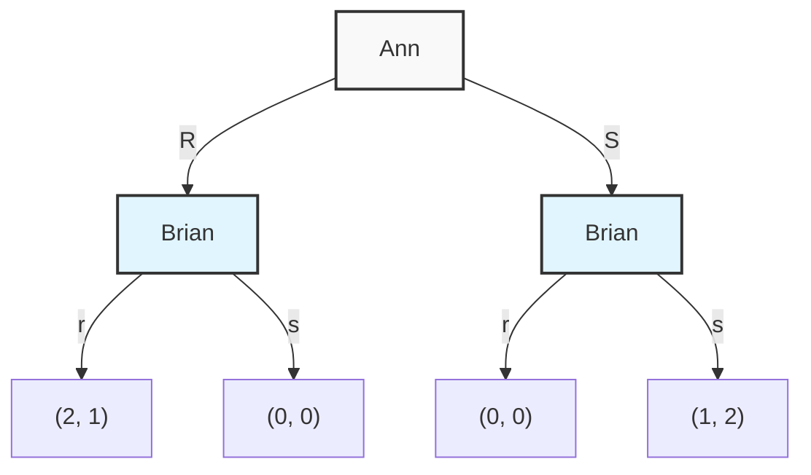
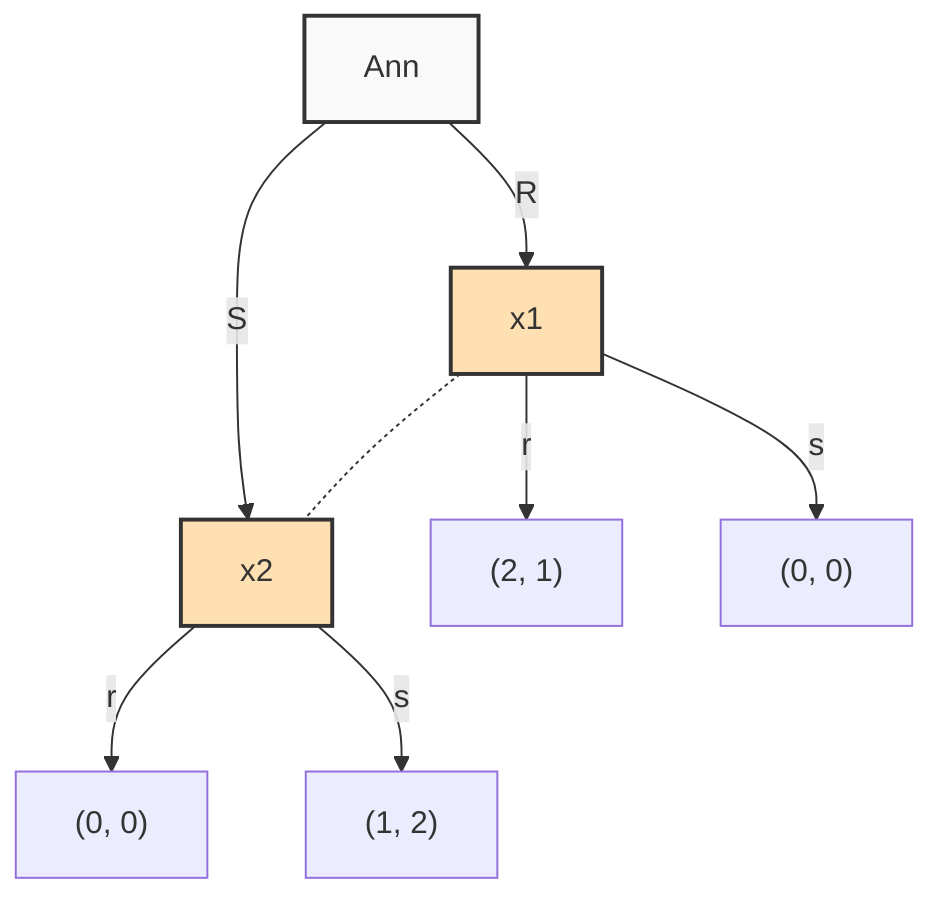
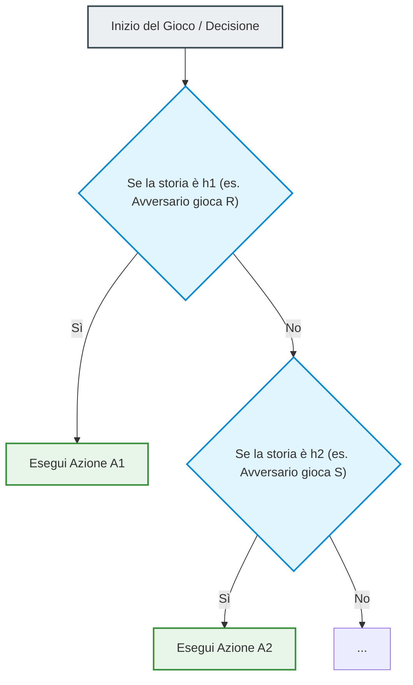
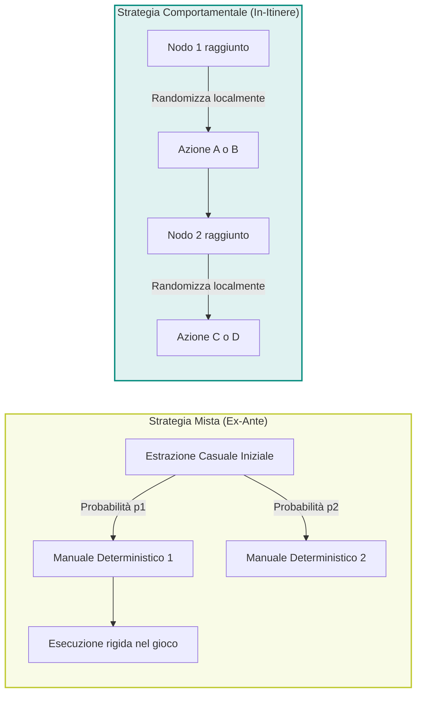
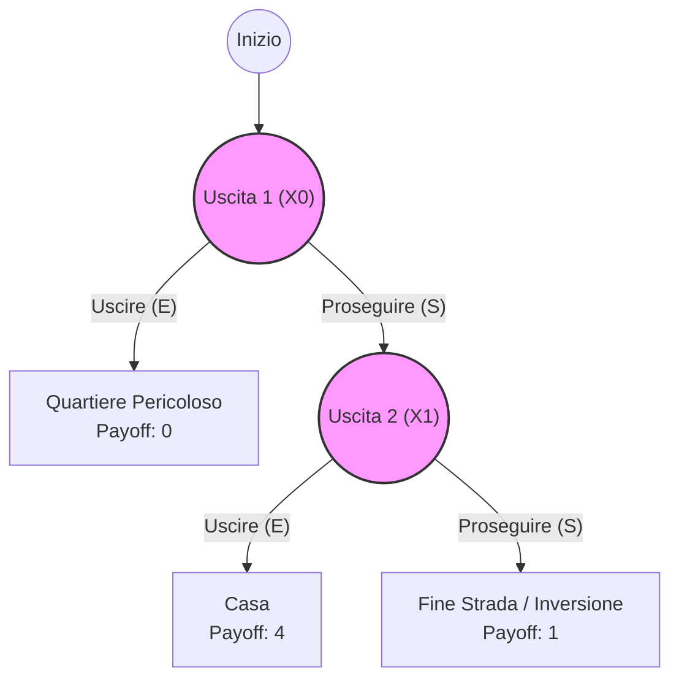
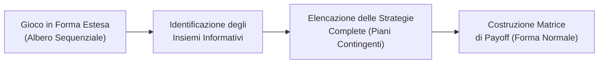

# Giochi Dinamici e Informazione Perfetta

## Overview Didattica

La lezione introduce la seconda parte del corso, focalizzandosi sul passaggio dai giochi statici ai **Giochi Dinamici** (*Dynamic Games*). L'introduzione della dimensione temporale e della sequenzialità delle decisioni richiede una precisa ridefinizione del concetto di informazione a disposizione dei giocatori. 

Nel corso dell'introduzione vengono definiti i seguenti aspetti concettuali e metodologici:

* **Informazione Completa vs. Informazione Perfetta:** Si chiarisce la differenza sostanziale tra **Informazione Completa** (*Complete Information*), in cui le regole, i payoff e le preferenze sono conoscenza comune (*common knowledge*), ed **Informazione Perfetta** (*Perfect Information*), in cui un giocatore conosce con certezza la storia passata del gioco e le azioni precedentemente compiute dagli avversari al momento di effettuare la propria scelta (es. gli Scacchi).
* **Informazione Imperfetta nei Giochi Dinamici:** Si evidenzia come un gioco dinamico possa comunque presentare **Informazione Imperfetta** (*Imperfect Information*) in presenza di mosse simultanee ordinate nel tempo o di interventi stocastici da parte della Natura.
* **Vantaggio della Prima Mossa (*First-mover Advantage*):** Attraverso la riorganizzazione sequenziale del classico gioco della "Battaglia dei Sessi" (*Battle of the Sexes*), si analizza come la sequenzialità consenta al primo giocatore di anticipare la risposta ottima (*best response*) del secondo, portando a un esito deterministico in strategie pure senza la necessità di bilanciamento in strategie miste.
* **Limiti della Rappresentazione Matriciale:** Si introduce la necessità teorica di superare la forma normale (o matriciale), adeguata per scelte simultanee, a favore di strutture rappresentative capaci di descrivere l'evoluzione temporale del gioco.

---

### Introduzione ai Giochi Dinamici e Struttura dell'Informazione

Nei giochi statici studiamo situazioni in cui le decisioni avvengono simultaneamente. Quando introduciamo la dimensione temporale, entriamo nell'ambito dei **Giochi Dinamici** (*Dynamic Games*). Nei giochi dinamici l'ordine delle giocate ha valore strategico: un giocatore muove prima di un altro e la sequenza delle azioni influenza le scelte successive.

Per analizzare i giochi dinamici è fondamentale chiarire il concetto di **informazione**. Nei giochi statici ci limitavamo a richiedere la condizione di **Informazione Completa** (*Complete Information*). Nei giochi dinamici, la sola informazione completa non è più sufficiente ed è necessario introdurre la distinzione tra **Informazione Perfetta** (*Perfect Information*) e **Informazione Imperfetta** (*Imperfect Information*).

> **Concetto Chiave: Informazione Completa vs. Informazione Perfetta**
> * **Informazione Completa (*Complete Information*):** Tutti i giocatori conoscono le regole del gioco, l'insieme dei giocatori, le azioni disponibili e le funzioni di payoff (*payoff functions*) di ciascuno. Inoltre, vale la **Conoscenza Comune** (*Common Knowledge*): tutti sanno che tutti sanno, e così via.
> * **Informazione Perfetta (*Perfect Information*):** È una proprietà specifica dei giochi dinamici. Oltre ad avere informazione completa, ogni giocatore, nel momento in cui deve effettuare una mossa, **conosce esattamente l'intera storia del gioco**, cioè tutte le mosse precedentemente effettuate dagli altri giocatori (o dalla Natura).

Un esempio classico di gioco ad informazione completa e perfetta sono gli **Scacchi** (*Chess*):
1. È a informazione completa: entrambi i giocatori conoscono le regole, come si muovono i pezzi e l'obiettivo finale (lo scacco matto).
2. È ad informazione perfetta: i giocatori muovono alternativamente e chi deve muovere vede e conosce perfettamente la configurazione della scacchiera risultante dalle mosse precedenti dell'avversario.

Se un gioco dinamico prevede mosse simultanee in un determinato turno, o se intervengono eventi casuali non osservabili (mosse della Natura), il gioco diventa ad **informazione imperfetta**.

---

### Rivisitazione della Battaglia dei Sessi in Forma Sequenziale

Consideriamo la classica **Battaglia dei Sessi** (*Battle of the Sexes*) tra Ann e Brian. Nella versione statica, i due giocatori decidono contemporaneamente se andare a vedere un film d'Amore ($R$, *Romance*) o di Fantascienza ($S$, *Sci-Fi*), senza poter comunicare.

Ipotizziamo ora una **versione dinamica/sequenziale**:
1. Ann muove per prima proponendo o scegliendo il film: $R$ (Romance) oppure $S$ (Sci-Fi).
2. Brian riceve la decisione di Ann e, avendo informazione perfetta, sceglie la propria mossa tra $r$ (romance) ed $s$ (sci-fi).

Per distinguere visivamente le mosse dei due giocatori usiamo le maiuscole per Ann ($R, S$) e le minuscole per Brian ($r, s$).

#### Analisi Logica delle Scelte
I payoff riflettono le seguenti preferenze: entrambi preferiscono andare al cinema insieme piuttosto che da soli. Ann preferisce il film d'amore insieme, mentre Brian preferisce la fantascienza insieme.

* Se Ann sceglie $R$, Brian sa di trovarsi di fronte all'opzione tra $r$ (che gli dà payoff $1$) ed $s$ (che gli dà payoff $0$). La migliore risposta (*best response*) di Brian è giocare $r$.
* Se Ann sceglie $S$, Brian confronta $r$ (payoff $0$) ed $s$ (payoff $2$). La migliore risposta di Brian è giocare $s$.

Ann, essendo razionale e conoscendo la razionalità di Brian (per la Conoscenza Comune), **anticipa** queste decisioni:
* Se gioca $R$, sa che Brian risponderà con $r$, ottenendo il risultato $(R, r)$ con payoff $2$ per lei.
* Se gioca $S$, sa che Brian risponderà con $s$, ottenendo il risultato $(S, s)$ con payoff $1$ per lei.

Poiché $2 > 1$, Ann sceglierà con certezza $R$. Brian risponderà con $r$.
In questa versione dinamica non c'è incertezza: il risultato è predeterminato e non occorre ricorrere ad strategie miste.

---

### La Forma Estesa (Extensive Form) e l'Albero di Decisione

La rappresentazione tramite matrice (o bimatrice) tipica della forma normale (*normal form*) è adatta a scelte simultanee, ma perde la dimensione temporale. Per i giochi dinamici si utilizza la **Forma Estesa** (*Extensive Form*), la cui rappresentazione grafica è l'**Albero Decisionale** (*Decision Tree*).



#### Elementi Formali della Forma Estesa
Formale e rigorosamente, una forma estesa è definita da una tupla contenente **7 elementi**:

1. **Insieme dei Giocatori (*Set of Players*, $N$):** L'elenco di tutti i partecipanti al gioco.
2. **Ordine dei Turni (*Order of Turns*):** La sequenza con cui i giocatori effettuano le loro mosse.
3. **Insieme delle Azioni Disponibili (*Set of Actions*, $A_i$):** Le mosse consentite a ciascun giocatore $i$ in ciascun nodo decisionale.
4. **Insiemi di Informazione (*Information Sets*, $H_i$):** Ciò che ciascun giocatore conosce della storia passata del gioco nel momento in cui deve scegliere.
5. **Funzioni di Payoff (*Payoff Functions*, $u_i$):** I valori assegnati a ciascun giocatore in tutti i nodi terminali (foglie dell'albero). I payoff sono rappresentati come vettori colonna o tuple ordinate corrispondenti all'ordine dei giocatori.
6. **Probabilità degli Eventi Casuali (*Lottery Probabilities*):** Se il gioco prevede mosse della Natura, le relative distribuzioni di probabilità devono essere perfettamente definite.
7. **Conoscenza Comune (*Common Knowledge*):** L'assunzione che la struttura completa dell'albero, le probabilità e i payoff siano noti a tutti i giocatori.

#### Nodi Degeneri e Giocatori Fantasma
* **Giocatore Fantasma (*Dummy Player*):** Un giocatore che non compie alcuna mossa attiva nell'albero (o in un determinato ramo), ma che riceve comunque un payoff finale dipendente dalle scelte altrui.
* **Nodi Degeneri (*Single Action Nodes*):** Se in un nodo un giocatore ha una sola mossa disponibile, dal punto di vista topologico e strategico quel nodo equivale a non avere alcuna scelta. Modellare una situazione ponendo una singola azione disponibile equivale a dire che l'azione è forzata.

---

### Insiemi di Informazione (Information Sets)

L'**Insieme di Informazione** (*Information Set*), indicato con $H_i$, rappresenta l'insieme dei nodi decisionali che un giocatore $i$ non è in grado di distinguere tra loro nel momento in cui deve compiere un'azione.

#### Classificazione degli Insiemi di Informazione
1. **Insieme Singoletto (*Singleton*):** L'insieme di informazione contiene un unico nodo:
   $$H_i = \{x_j\}$$
   Il giocatore sa esattamente in quale punto dell'albero si trova. Questo implica **Informazione Perfetta**.
2. **Insieme Non Singoletto (*Non-singleton*):** L'insieme di informazione contiene più nodi:
   $$H_i = \{x_1, x_2, \dots, x_k\}$$
   Il giocatore sa che si trova in uno di questi nodi, ma non sa esattamente in quale. Questo implica **Informazione Imperfetta**.

Graficamente, gli insiemi di informazione non singoletti si rappresentano congiungendo i nodi indistinguibili tramite una **linea tratteggiata** o racchiudendoli all'interno di una **bolla** (ovale).



#### Vincoli Matematici sugli Insiemi di Informazione
Affinché una struttura di informazione sia coerente e ben definita dal punto di vista teorico, devono essere rispettate due condizioni rigorose:

1. **Appartenenza del Nodo Effettivo:** Il nodo reale $x_j$ in cui si trova il gioco deve appartenere all'insieme di informazione percepito dal giocatore:
   $$x_j \in H_i(x_j)$$
   *(Un giocatore può essere confuso tra varie alternative, ma la realtà deve figurare tra le possibilità considerate)*.

2. **Identità delle Azioni Disponibili:** Se due o più nodi appartenenti allo stesso giocatore appartengono al medesimo insieme di informazione $H_i$, l'insieme delle azioni disponibili $A_i(x)$ deve essere **rigorosamente identico** per tutti i nodi dell'insieme:
   $$\text{Se } x_1, x_2 \in H_i, \quad \text{allora } A_i(x_1) = A_i(x_2)$$

> **Spiegazione didattica del vincolo sulle azioni:**
> Se in $x_1$ avessi a disposizione le opzioni $\{F, G, H\}$ e in $x_2$ avessi solo $\{G, H\}$, potrei capire immediatamente di trovarmi in $x_1$ semplicemente osservando la presenza della mossa $F$. L'indistinguibilità verrebbe meno.

#### Tecnica di Modellazione delle Azioni Non Disponibili
In contesti ingegneristici o modellistici, se in un nodo $x_2$ un'azione $F$ è fisicamente vietata mentre in $x_1$ è permessa, è possibile rendere gli insiemi di azioni identici applicando una trasformazione formale:
* Si rende l'azione $F$ selezionabile anche in $x_2$, ma le si assegna un payoff estremamente penalizzante (es. $-\infty$ o una sanzione sproporzionata).

*Nota: Passaggio integrato con chiarezza didattica.*
In questo modo, la scelta $F$ in $x_2$ diventa una mossa **strettamente dominata** (*strictly dominated*). Il giocatore razionale non la sceglierà mai, ottenendo un comportamento di gioco perfettamente equivalente alla proibizione formale dell'azione, ma preservando la regolarità matematica dell'insieme di informazione.

---

### Incertezza Esogena vs. Incertezza Endogena

La struttura degli insiemi di informazione permette di effettuare una classificazione fondamentale della natura dell'incertezza nei giochi dinamici:

```
                          ┌───────────────────────────┐
                          │   Informazione nel Gioco  │
                          └─────────────┬─────────────┘
                                        │
                 ┌──────────────────────┴──────────────────────┐
                 ▼                                             ▼
  ┌─────────────────────────────┐               ┌─────────────────────────────┐
  │    Informazione Perfetta    │               │   Informazione Imperfetta   │
  │ (Tutti insiemi singoletti)  │               │   (Insiemi non singoletti   │
  └─────────────────────────────┘               │   o presenza della Natura)  │
                                                └──────────────┬──────────────┘
                                                               │
                                        ┌──────────────────────┴──────────────────────┐
                                        ▼                                             ▼
                         ┌─────────────────────────────┐               ┌─────────────────────────────┐
                         │      Incertezza Esogena     │               │     Incertezza Endogena     │
                         │ (Scelte casuali di Natura)  │               │  (Mosse altrui non viste)   │
                         └─────────────────────────────┘               └─────────────────────────────┘
```

1. **Incertezza Esogena (*Exogenous Uncertainty*):**
   Deriva da fattori esterni non controllati dai giocatori razionali, modellati come mosse della **Natura** (*Nature*) che avvengono con una determinata distribuzione di probabilità.
   * *Esempio:* La lotteria della mensa (*Canteen Lottery*), in cui la qualità del cibo (buono o cattivo) è stabilita casualmente dalla Natura indipendentemente dalle decisioni dello studente.

2. **Incertezza Endogena (*Endogenous Uncertainty*):**
   Deriva dalla struttura del gioco stesso e dall'impossibilità di osservare le mosse effettuate dagli altri giocatori (es. mosse simultanee o non comunicate).
   * *Esempio:* La Battaglia dei Sessi statica o con comunicazione interrotta.

In presenza di incertezza (esogena o endogena), i giocatori razionali formano delle **Convinzioni** (*Beliefs*), ovvero distribuzioni di probabilità soggettive sui nodi dell'insieme di informazione in cui si trovano, necessarie per calcolare la risposta ottimale.

---

### Ridefinizione della Strategia nei Giochi Dinamici

Nei giochi statici la differenza tra azione e strategia è sfumata: una strategia consiste semplicemente nel scegliere un'azione. Nei **giochi dinamici (dynamic games)**, invece, la storia del gioco — rappresentata formalmente dagli **insiemi di informazione (information sets)** — cambia radicalmente questo concetto.

Una **strategia pura (pure strategy)** non è una singola azione, ma un **piano di azione completo (plan of action)**. Essa deve specificare deterministicamente quale azione intraprendere per *ogni possibile situazione* in cui il giocatore potrebbe trovarsi a dovere effettuare una mossa.

#### La Strategia come Struttura "If-Then-Else"
Per un ingegnere, il modo più naturale di concettualizzare una strategia pura in un gioco dinamico è paragonarla a un programma software articolato in strutture condizionali del tipo `if-then-else`:
* **Azione (Action):** È l'istruzione concreta eseguita all'interno del blocco `then` o `else`.
* **Strategia (Strategy):** È l'intero algoritmo codificato. Definisce le condizioni (la storia del gioco) e associa a ciascuna di esse una specifica azione.



Poiché un giocatore deve prevedere la propria mossa per ogni scenario potenziale, la dimensione dello spazio delle strategie cresce in modo combinatorio rispetto al numero di azioni disponibili.

---

### La Complessità dello Spazio delle Strategie e la Specificazione Completa

Per comprendere la differenza quantitativa tra azioni e strategie, consideriamo due esempi pratici.

#### Esempio 1: La Battaglia dei Sessi Sequenziale
Immaginiamo la Battaglia dei Sessi in cui Anne ($A$) muove per prima e Brian ($B$) muove per secondo, osservando la mossa di Anne.
* **Insieme delle Azioni:** Sia per Anne che per Brian è $A_i = \{R, S\}$ (dove $R$ sta per *Romance* ed $S$ per *Sci-Fi*).
* **Strategie di Anne:** Anne muove all'inizio del gioco (ha un solo insieme di informazione). Di conseguenza, le sue strategie coincidono con le sue azioni: $S_A = \{R, S\}$.
* **Strategie di Brian:** Brian deve pianificare la propria mossa sia nel nodo in cui Anne ha giocato $R$ (nodo verde), sia nel nodo in cui Anne ha giocato $S$ (nodo arancione). Brian ha 2 azioni disponibili, ma **4 strategie pure**.

Una strategia di Brian si rappresenta come una coppia $(a_1, a_2) \in A_B \times A_B$, dove:
* $a_1$ è l'azione da giocare se Anne ha scelto $R$.
* $a_2$ è l'azione da giocare se Anne ha scelto $S$.

Le 4 strategie pure di Brian sono:
1. $(R, R)$: Va sempre a vedere il film romantico, indipendentemente da Anne.
2. $(S, S)$: Va sempre a vedere il film di fantascienza, indipendentemente da Anne.
3. $(R, S)$: Segue la scelta di Anne (gioca $R$ se Anne fa $R$, gioca $S$ se Anne fa $S$).
4. $(S, R)$: Fa l'opposto di Anne (gioca $S$ se Anne fa $R$, gioca $R$ se Anne fa $S$).

#### Esempio 2: Gioco a Due Stadi (Due Notti Consecutive al Cinema)
Ipotizziamo che Anne e Brian vadano al cinema per due sere consecutive. Alla prima sera giocano in modo statico/simultaneo. Alla seconda sera, ciascun giocatore ricorda l'esito della prima sera.

Alla fine della prima sera vi sono 4 possibili esiti: $(RR, RS, SR, SS)$.
Per la seconda sera, un giocatore deve pianificare la propria azione in risposta a ciascuno dei 4 esiti della prima sera, oltre a decidere la mossa per la prima sera.

Pertanto, una strategia pura è definita da una **quintupla di azioni**:
$$s_i = (a^1, a^{2, RR}, a^{2, RS}, a^{2, SR}, a^{2, SS})$$
dove $a^1$ è la decisione per la prima sera e $a^{2, \text{esito}}$ è la decisione per la seconda sera condizionata all'esito della prima.

> **CONCETTO CHIAVE: Pianificazione di Nodi Non Raggiungibili (Controfattuali)**
>
> In sede d'esame o durante la modellazione formale, una strategia **deve specificare un'azione per OGNI insieme di informazione**, anche per quelli che non verranno mai raggiunti a causa delle scelte effettuate nello stesso piano strategico.
>
> *Esempio:* Se Brian pianifica di giocare $R$ la prima sera, l'esito della prima sera non potrà mai essere $SS$ (se Brian è coerente con la sua scelta). Ciononostante, la formalizzazione **impone** di specificare cosa farebbe Brian se si verificasse l'esito $SS$. 
>
> Un piano strategico privo della specifica per i nodi controfattuali è da considerarsi **incompleto ed errato**.

---

### Randomizzazione nei Giochi Dinamici: Strategie Miste vs. Strategie Comportamentali

Nei giochi statici si introduce la **strategia mista (mixed strategy)** come una distribuzione di probabilità sopra l'insieme delle strategie pure. Applichiamo ora questo concetto e confrontiamolo con una nuova forma di randomizzazione: la **strategia comportamentale (behavioral strategy)**.

#### 1. Strategia Mista ($m_i$)
Una strategia mista è una distribuzione di probabilità definita ex-ante sull'intero spazio delle strategie pure. 
* *Interpretazione:* Il giocatore seleziona in modo casuale (estraendo a sorte all'inizio del gioco) **un intero manuale di istruzioni deterministico** e poi lo segue fino alla fine del gioco senza più randomizzare.

#### 2. Strategia Comportamentale ($\sigma_i$)
Una strategia comportamentale assegna una distribuzione di probabilità indipendente sulle **azioni disponibili in ciascun insieme di informazione**.
* *Interpretazione:* Il giocatore possiede un unico manuale di istruzioni. Quando il gioco raggiunge un nodo/insieme di informazione, il manuale gli impone di lanciare una moneta (randomizzare) in loco per decidere l'azione immediata.



#### Definizione Formale di Strategia Comportamentale
Sia $H_i$ l'insieme degli insiemi di informazione del giocatore $i$, e sia $h_i \in H_i$ un generico insieme di informazione. Sia $A_i(h_i)$ l'insieme delle azioni ammissibili in $h_i$. 

Una strategia comportamentale $\sigma_i$ è una funzione:
$$\sigma_i : H_i \to \Delta(A_i(h_i))$$

dove $\Delta(A_i(h_i))$ indica il simplesso delle distribuzioni di probabilità sulle azioni disponibili nell'insieme di informazione $h_i$.

*Vincolo di Coerenza:* Poiché un giocatore non può distinguere i singoli nodi all'interno dello stesso insieme di informazione $h_i$, la strategia comportamentale deve assegnare la **medesima distribuzione di probabilità** alle azioni in tutti i nodi appartenenti allo stesso $h_i$.

---

### Equivalenza e il Ruolo della Memoria Perfetta (Perfect Recall)

Una domanda fondamentale è se le strategie miste e le strategie comportamentali descrivano le stesse possibilità stocastiche per un giocatore.

#### Dimostrazione Intuitiva dell'Equivalenza (Battaglia dei Sessi)
Analizziamo le scelte di Brian nella Battaglia dei Sessi sequenziale:

1. **Rappresentazione Mista:** Brian assegna 4 probabilità alle sue strategie pure:
   * $p_{RR} = P(R, R)$
   * $p_{RS} = P(R, S)$
   * $p_{SR} = P(S, R)$
   * $p_{SS} = P(S, S)$
   con il vincolo: $p_{RR} + p_{RS} + p_{SR} + p_{SS} = 1$.

2. **Rappresentazione Comportamentale:** Brian definisce le probabilità condizionate d'azione nei suoi due nodi decisionali distinti $x_1$ (dopo che Anne gioca $R$) e $x_2$ (dopo che Anne gioca $S$):
   * $\sigma_B(R \mid x_1)$: Probabilità di giocare $R$ al nodo $x_1$.
   * $\sigma_B(R \mid x_2)$: Probabilità di giocare $R$ al nodo $x_2$.

Possiamo mappare le probabilità composte della strategia mista nelle probabilità condizionate della strategia comportamentale:
$$\sigma_B(R \mid x_1) = p_{RR} + p_{RS}$$
$$\sigma_B(R \mid x_2) = p_{RR} + p_{SR}$$

Le rispettive probabilità complementari saranno:
$$\sigma_B(S \mid x_1) = 1 - \sigma_B(R \mid x_1) = p_{SR} + p_{SS}$$
$$\sigma_B(S \mid x_2) = 1 - \sigma_B(R \mid x_2) = p_{RS} + p_{SS}$$

In questo sistema, è sempre possibile passare in modo univoco da una rappresentazione all'altra. Le due descrizioni sono **equivalenti dal punto di vista degli esiti del gioco**.

> **CONCETTO CHIAVE: Memoria Perfetta (Perfect Recall)**
>
> L'equivalenza tra strategie miste e strategie comportamentali vale **se e solo se** il gioco soddisfa la proprietà di **Memoria Perfetta (Perfect Recall)** (Teorema di Kuhn).
>
> **Definizione:** Un gioco è a memoria perfetta se ogni giocatore ricorda perfettamente:
> 1. Tutte le informazioni di cui era a conoscenza nelle proprie fasi decisionali precedenti.
> 2. Tutte le proprie mosse passate.
>
> Se la memoria perfetta viene meno (giochi con *Imperfect Recall*, in cui un giocatore soffre di amnesia o dimentica le proprie azioni precedenti), esistono strategie miste che non possono essere rappresentate da alcuna strategia comportamentale equivalente e viceversa.
>
> *Convenzione per il Corso:* Salvo diversamente specificato, **assumeremo sempre che i giochi trattati siano a Memoria Perfetta**.

---

### Il Paradosso del Guidatore Distratto (The Absent-minded Driver Paradox)

Nei giochi a informazione imperfetta, abbiamo precedentemente assunto che le **Strategie Miste** (*Mixed Strategies*) e le **Strategie Comportamentali** (*Behavioral Strategies*) portino a risultati equivalenti (Teorema di Kuhn). Tuttavia, esiste un'importante eccezione teorica che si verifica quando viene meno l'ipotesi di **Memoria Perfetta** (*Perfect Recall*).

L'esempio classico per illustrare questa rottura è il **Paradosso del Guidatore Distratto** (*Absent-minded Driver Paradox*).

#### Struttura del Gioco
Immaginiamo un guidatore (Andrew) che sta percorrendo un'autostrada di notte per tornare a casa. Andrew sa di essere vicino a destinazione, ma è molto stanco e non riesce a distinguere le uscite:

1. **Prima uscita ($X_0$):** Conduce a un quartiere pericoloso. Payoff = $0$.
2. **Seconda uscita ($X_1$):** Conduce direttamente a casa. Payoff = $4$ (risultato ottimale).
3. **Mancare entrambe le uscite:** La strada finisce, occorre fare un'inversione a U e compiere un percorso molto lungo. Payoff = $1$.



La particolarità di questo gioco singolo giocatore (*Single-player Game*) è che i nodi $X_0$ ed $X_1$ appartengono allo **stesso Insieme Informativo** (*Information Set*), ma si trovano a **livelli differenti dell'albero di gioco** (cioè in tempi sequenziali distinti). Andrew, arrivando a un'uscita, non sa se si trova al nodo $X_0$ o al nodo $X_1$.

> **[CONCETTO CHIAVE]**
> Se l'incertezza/confusione del giocatore avviene tra nodi dello stesso livello (stesso istante temporale), la memoria perfetta è preservata. Se l'incertezza avviene tra nodi situati a **livelli diversi** della struttura ad albero, si ha una violazione della Memoria Perfetta (*Perfect Recall*): il giocatore è confuso tra il proprio passato e il proprio presente.

---

#### Analisi Matematica: Strategia Mista vs Comportamentale

Poiché $X_0$ e $X_1$ appartengono allo stesso insieme informativo, il giocatore deve definire un'unica regola di decisione. Le azioni disponibili in entrambi i nodi sono $E$ (*Exit*, uscire) ed $S$ (*Stay*, proseguire).

##### 1. Risoluzione con Strategia Mista
In una strategia mista, il giocatore sceglie una sola volta all'inizio del gioco con quale probabilità $P$ eseguirà l'azione $E$ ogni volta che incontra un'uscita, e con probabilità $(1-P)$ l'azione $S$.

Calcoliamo l'Utilità Attesa (*Expected Utility*) $U(P)$:
* Probabilità di uscire subito al nodo $X_0$: $P \implies \text{Payoff } 0$
* Probabilità di proseguire a $X_0$ e uscire a $X_1$: $(1-P) \cdot P \implies \text{Payoff } 4$
* Probabilità di proseguire a $X_0$ e proseguire a $X_1$: $(1-P) \cdot (1-P) = (1-P)^2 \implies \text{Payoff } 1$

L'equazione dell'utilità attesa è:
$$U(P) = 0 \cdot P + 4P(1-P) + 1(1-P)^2$$

Sviluppando i calcoli:
$$U(P) = 4P - 4P^2 + 1 - 2P + P^2 = 1 + 2P - 3P^2$$

*(Nota: Passaggio integrato con chiarezza didattica per correggere la forma algebrica esposta nel parlato).*

Per trovare la probabilità ottimale $P^*$, calcoliamo la derivata prima rispetto a $P$ e la azzeriamo:
$$\frac{dU(P)}{dP} = 2 - 6P = 0 \implies P^* = \frac{1}{3}$$

Sostituendo $P^* = 1/3$, otteniamo l'utilità massima in strategia mista:
$$U\left(\frac{1}{3}\right) = 1 + 2\left(\frac{1}{3}\right) - 3\left(\frac{1}{9}\right) = \frac{4}{3} \approx 1.33$$

##### 2. Risoluzione con Strategia Comportamentale
In una strategia comportamentale, il giocatore rivaluta localmente l'azione assegnando delle probabilità a priori (*Beliefs*) di trovarsi nel nodo $X_0$ o nel nodo $X_1$. Sia $Q$ la probabilità stimata dal giocatore di essere al nodo $X_0$, e $(1-Q)$ la probabilità di essere al nodo $X_1$.

L'utilità attesa in questo caso diventa dipendente sia da $P$ che da $Q$. Analizzando la funzione di utilità al variare di $Q$:
* Se $Q = 1$ (il giocatore è certo di trovarsi all'inizio del gioco), la scelta ottimale rimane $P^* = 1/3$.
* Se $Q < 1$ (il giocatore stima di essere già avanzato nel gioco con una certa probabilità), il punto di massimo della curva dell'utilità attesa si sposta verso destra ($P^* > 1/3$), spingendo il giocatore a uscire con una probabilità superiore.

> **[CONCETTO CHIAVE]**
> In assenza di *Perfect Recall*, la strategia mista e la strategia comportamentale **non sono equivalenti**. Le strategie comportamentali introducono parametri aggiuntivi di credenza locale ($Q$) che modificano il valore ottimo dell'azione $P^*$. Ne consegue che il Teorema di Kuhn vale rigorosamente **solo** in presenza di Memoria Perfetta.

---

### Conversione dalla Forma Estesa alla Forma Normale

Un quesito fondamentale nella Teoria dei Giochi è: *l'introduzione della Forma Estesa (dinamica) rende obsoleta la Forma Normale (a matrice)?*

La risposta è **no**. Un gioco in forma estesa può sempre essere convertito in un equivalente gioco in forma normale.

#### Il Principio della Pianificazione a Priori
I giocatori sono modellati come agenti perfettamente razionali e previdenti. Un giocatore è in grado di stilare un **piano d'azione completo** (*Contingency Plan*) prima ancora che il gioco abbia inizio.

* Una strategia pura in forma estesa richiede di specificare l'azione da intraprendere per **ogni singolo Insieme Informativo** del giocatore.
* Se un giocatore ha più nodi di decisione sequenziali, l'elenco di tutte le combinazioni di scelte costituisce il suo insieme di strategie pure nella matrice della forma normale.

##### Esempio pratico:
Se il Giocatore 2 (Brian) deve rispondere a una mossa del Giocatore 1 (Anne) avente due possibili scelte, e Brian possiede due insiemi informativi distinti con 2 opzioni ciascuno ($R$ ed $S$), le sue strategie pure non saranno semplicemente $2$, ma $2 \times 2 = 4$:
$$\text{Strategie di Brian} = \{RR, RS, SR, SS\}$$

La decisione di Brian tra queste $4$ strategie aggregate può essere considerata **simultanea** alla scelta di Anne. Brian non deve attendere di vedere la mossa di Anne per scegliere la propria strategia: sceglie preventivamente il "programma" da eseguire.



#### Impatto dell'Informazione Imperfetta
Quando si introduce informazione imperfetta (es. insiemi informativi che raggruppano più nodi), il numero di strategie pure disponibili per un giocatore si riduce, poiché non può differenziare l'azione tra nodi appartenenti allo stesso insieme informativo. Il gioco "collassa" verso una forma normale a dimensioni ridotte (come nella classica *Battaglia dei Sessi*).

---

### Molteplicità di Rappresentazioni in Forma Estesa

Mentre la conversione da una Forma Estesa a una Forma Normale produce **un unico risultato univoco**, il percorso inverso **non è univoco**: uno stesso gioco espresso in Forma Normale può essere rappresentato da **più Forme Estese differenti**.

#### Esempio: Gioco tra Alex e Beth
Consideriamo un gioco in cui:
* Alex può scegliere di uscire subito ($E$) o proseguire ($K$).
* Se Alex sceglie $E$, il gioco termina con payoff pari a $(2, 2)$.
* Se Alex sceglie $K$, la parola passa a Beth.

Questo scenario può essere modellato in due modi graficamente distinti in forma estesa:

1. **Albero con terminazione immediata:** La scelta $E$ di Alex porta a un nodo terminale diretto $(2, 2)$. Il nodo di scelta di Beth esiste solo se Alex gioca $K$.
2. **Albero con mossa fittizia (*Dummy Move*):** Beth compie una scelta in un insieme informativo d'incertezza a prescindere dalla scelta di Alex. Tuttavia, se Alex ha giocato $E$, qualsiasi mossa di Beth restituisce il medesimo payoff $(2, 2)$.

| Rappresentazione 1 | Rappresentazione 2 |
| :--- | :--- |
| Beth muove **solo** dopo che Alex gioca $K$. | Beth muove sempre, ma la sua scelta è ininfluente se Alex gioca $E$. |
| L'albero si interrompe al ramo $E$. | L'albero ha rami simmetrici con payoff identici. |

Entrambe le strutture ad albero descrivono la medesima dinamica di interazione strategica e generano **la stessa identica matrice in Forma Normale**. Pertanto, le due forme estese sono da considerarsi totalmente equivalenti dal punto di vista dell'analisi strategica.

---

> [!NOTE]
> ### Note per l'Esame e Avvisi del Docente
> - **Rappresentazione completa delle strategie nei giochi dinamici/in forma estesa**: Quando all'esame viene chiesto di identificare o scrivere la strategia di un giocatore, è necessario elencare l'azione prevista per **ogni possibile insieme informativo/scenario** (es. l'intera tupla di elementi), includendo anche gli scenari che potrebbero sembrare irraggiungibili o non applicabili a seguito delle scelte effettuate nei turni precedenti.
> - **Spiegazione esplicita della notazione nelle risposte**: All'esame non bisogna limitarsi a scrivere una sequenza/tupla di lettere (es. $RR$, $RSR$), ma occorre definire e spiegare chiaramente cosa rappresenta ciascuna lettera e a quale nodo o esito passato corrisponde ogni componente della strategia.