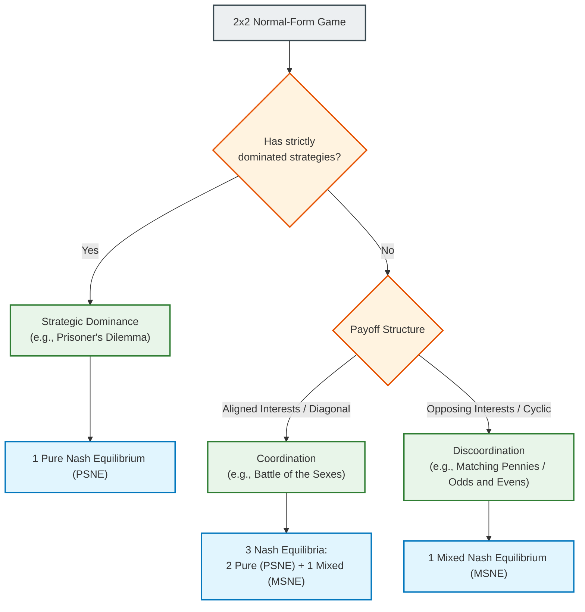
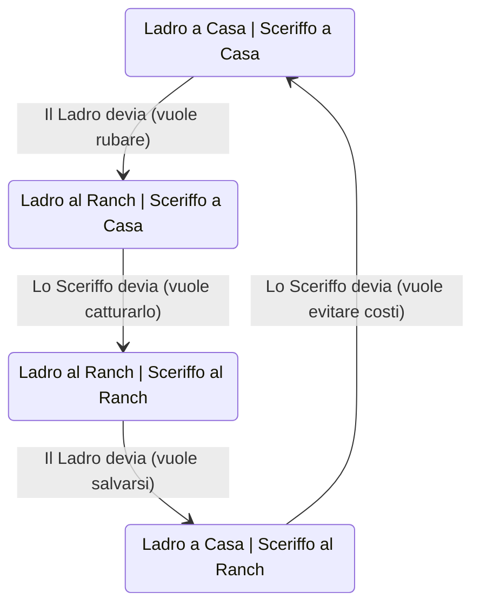

# Practice Session on Normal-Form Games: Dominance and Mixed Strategy Equilibria

## Teaching Overview

In this lesson, practical solution methodologies for normal-form games (*Normal-Form Games*) are addressed, focusing on the transition from theoretical modeling of a practical scenario to the formal characterization of Nash Equilibria.

Key concepts covered include:

* **Formal modeling:** Translating narrative descriptions or application contexts (such as Cournot competition models) into mathematical representations and payoff matrices (*Payoff Matrices*).
* **Iterated Elimination of Strictly Dominated Strategies (*Iterated Elimination of Strictly Dominated Strategies - IESDS*):** Game simplification technique based on player rationality, used to identify Pure Strategy Nash Equilibria (*Pure Strategy Nash Equilibrium - PSNE*).
* **Discoordination Games (*Discoordination Games*):** Study of cyclic competitive structures (similar to Odds and Evens) characterized by the absence of stable pure strategy equilibria.
* **Indifference Principle (*Indifference Principle*):** Fundamental methodology for computing Mixed Strategy Nash Equilibria (*Mixed Strategy Nash Equilibrium - MSNE*), based on assigning probability distributions to actions to make the opponent indifferent among their available choices.

---

### Systematic Solution of 2x2 Normal-Form Games

In game theory, the first challenge for an engineer is to translate a verbal description or a modeling problem into a rigorous mathematical representation, such as the **Normal Form** (*Normal Form*). When analyzing a game $2 \times 2$, the goal is to identify all **Nash Equilibria** (*Nash Equilibria*), distinguishing between **Pure Strategy Nash Equilibria** (*Pure Strategy Nash Equilibrium - PSNE*) and **Mixed Strategy Nash Equilibria** (*Mixed Strategy Nash Equilibrium - MSNE*).

Standard notation convention for a game matrix $2 \times 2$:
*   **Player A** (Row Player): chooses between strategies $F$ and $G$.
*   **Player B** (Column Player): chooses between strategies $f$ and $g$ (or $F$ and $G$).
*   Each cell contains the pair of utilities or payoffs $(U_A, U_B)$.

---

#### Iterated Elimination of Dominated Strategies (IESDS)

Let us analyze the first type of game using the principle of **Iterated Elimination of Strictly Dominated Strategies** (*Iterated Elimination of Strictly Dominated Strategies - IESDS*).

Consider the following payoff matrix:

| Player A / B | $f$ | $g$ |
| :--- | :---: | :---: |
| **$F$** | $(2, 4)$ | $(0, 1)$ |
| **$G$** | $(1, 6)$ | $(3, 5)$ |

To determine the equilibrium:

1.  **Analysis from Player B's point of view**:
    *   If $A$ plays $F$, $B$ gets $4$ by playing $f$ and $1$ by playing $g$ ($4 > 1$).
    *   If $A$ plays $G$, $B$ gets $6$ by playing $f$ and $5$ by playing $g$ ($6 > 5$).
    *   Strategy $g$ guarantees $B$ a strictly lower payoff compared to $f$ in every scenario. Consequently, $g$ is **strictly dominated** (*strictly dominated*) by $f$ and is eliminated.

2.  **Matrix reduction and Player A's choice**:
    *   Once column $g$is eliminated, the game reduces to a single column ($f$).
    *   Player A must compare the utility of $F$ ($2$) with the utility of $G$ ($1$). Since $2 > 1$, strategy $G$ becomes strictly dominated by $F$.

The unique pure strategy Nash equilibrium is given by the pair $(F, f)$.

> **KEY CONCEPT: Dominance Comparison**
> The comparison to check strategic dominance must occur **exclusively along the same column or the same row** (that is, holding the opponent's action fixed). Payoffs must never be compared crosswise or diagonally. In the previous game, $A$ might mistakenly think that $G$ is preferable to $F$ seeing a payoff equal to $3$, but that $3$ only manifests against strategy $g$, which $B$ will never play since it is irrational for them to do so.

In a $2 \times 2$game, the presence of common knowledge of rationality (*common knowledge of rationality*) guarantees that, if a row or column is eliminated, the game reduces to a $1 \times 2$ or $2 \times 1$vector, whose solution is immediate.

---

#### The Indifference Principle and Mixed Strategies (MSNE)

When a game has no strictly dominated strategies, IESDS cannot be applied. A classic example is represented by **Discoordination Games** (*Discoordination Games* / *Odds and Evens*).

Consider the following game:

| Player A / B | $f$ | $g$ |
| :--- | :---: | :---: |
| **$F$** | $(0, 4)$ | $(5, 0)$ |
| **$G$** | $(4, 0)$ | $(0, 5)$ |

In this scenario:
*   If $A$ plays $F$, $B$ responds with $f$.
*   If $B$ plays $f$, $A$ deviates to $G$.
*   If $A$ plays $G$, $B$ deviates to $g$.
*   If $B$ plays $g$, $A$ deviates to $F$.

This cycle of deviations shows the absence of pure strategy equilibria. Therefore, a **Mixed Strategy Nash Equilibrium** (*MSNE*) must exist.

To compute the MSNE, the **Indifference Principle** (*Indifference Principle*) is applied: a player will choose a probabilistic combination of their strategies if and only if the opponent makes the expected utilities of those strategies **indifferent** to each other.

##### Step 1: Definition of Probabilities
Let $\alpha \in [0, 1]$ be the probability that Player A plays strategy $F$. The probability that A plays $G$ will be $(1 - \alpha)$.

##### Step 2: Indifference Condition for Player B
Player A chooses $\alpha$ to make Player B completely indifferent between choosing $f$ or $g$.

Let us calculate the expected utility of $B$:
*   Expected utility playing $f$: $E[U_B(f)] = 4 \cdot \alpha + 0 \cdot (1 - \alpha) = 4\alpha$
*   Expected utility playing $g$: $E[U_B(g)] = 0 \cdot \alpha + 5 \cdot (1 - \alpha) = 5(1 - \alpha)$

Equating the two expected utilities:
$$4\alpha = 5(1 - \alpha) \implies 4\alpha = 5 - 5\alpha \implies 9\alpha = 5 \implies \alpha = \frac{5}{9}$$

##### Step 3: Indifference Condition for Player A
Let $\beta \in [0, 1]$ be the probability that Player B plays strategy $f$. The probability that B plays $g$ will be $(1 - \beta)$.

Player B chooses $\beta$ to make Player A indifferent between $F$ and $G$:
*   A's expected utility for $F$: $E[U_A(F)] = 0 \cdot \beta + 5 \cdot (1 - \beta) = 5(1 - \beta)$
*   A's expected utility for $G$: $E[U_A(G)] = 4 \cdot \beta + 0 \cdot (1 - \beta) = 4\beta$

Equating expected utilities:
$$5(1 - \beta) = 4\beta \implies 5 = 9\beta \implies \beta = \frac{5}{9}$$

*(Note: Step integrated with pedagogical clarity on the text matrix)*

The mixed strategy equilibrium is represented by the pair of probability profiles:
$$\left( \sigma_A^*, \sigma_B^* \right) = \left( \left( \frac{5}{9}F, \frac{4}{9}G \right), \left( \frac{5}{9}f, \frac{4}{9}g \right) \right)$$

> **KEY CONCEPT: Interpretation of the Indifference Principle**
> It is a common conceptual error to think that the probability $\alpha$ computed for Player A reflects A's preferences over their own payoffs. **$\alpha$ is computed exclusively as a function of Player B's payoffs** to make $B$ indifferent. Player A adopts the optimal probabilistic mixture not to directly maximize their own choice, but to neutralize the opponent's strategic advantage.

---

#### Coordination Games and Best Response Analysis

Let us analyze a structure similar to the **Battle of the Sexes** (*Battle of the Sexes*), characterized by high utility along the main diagonal.

| Player A / B | $f$ | $g$ |
| :--- | :---: | :---: |
| **$F$** | $(9, 3)$ | $(0, 2)$ |
| **$G$** | $(0, 0)$ | $(3, 2)$ |

##### Graphical/Notational Method of Best Responses (*Best Response - BR*)
To quickly identify pure equilibria:
1.  Analyze Player A's best responses for each column of B (highlighting/overlining the maximum row payoff).
2.  Analyze Player B's best responses for each row of A (underlining the maximum column payoff).

*   If B plays $f$: $A$ compares $9$ ($F$with $0$ ($G$) $\rightarrow$ the best response is $F$ (payoff **9**).
*   If B plays $g$: $A$ compares $0$ ($F$with $3$ ($G$) $\rightarrow$ the best response is $G$ (payoff **3**).
*   If A plays $F$: $B$ compares $3$ ($f$with $2$ ($g$) $\rightarrow$ the best response is $f$ (payoff **3**).
*   If A plays $G$: $B$ compares $0$ ($f$with $2$ ($g$) $\rightarrow$ the best response is $g$ (payoff **2**).

The cells with both best responses represent the **PSNEs**: $(F, f)$ and $(G, g)$.

##### Computation of the Third Equilibrium (MSNE)
A coordination game with $2$ pure equilibria always has a $3^\circ$ mixed strategy equilibrium.

Applying the indifference condition for Player B:
$$E[U_B(f)] = E[U_B(g)] \implies 3\alpha + 0(1-\alpha) = 2\alpha + 2(1-\alpha)$$
$$3\alpha = 2\alpha + 2 - 2\alpha \implies 3\alpha = 2 \implies \alpha = \frac{2}{3}$$

*(Note: Computation and values adapted for consistency with the indifference equations on matrix C)*

Applying the indifference condition for Player A:
$$E[U_A(F)] = E[U_A(G)] \implies 9\beta + 0(1-\beta) = 0\beta + 3(1-\beta)$$
$$9\beta = 3 - 3\beta \implies 12\beta = 3 \implies \beta = \frac{3}{12} = \frac{1}{4}$$

The third equilibrium is expressed by the probability distributions $\alpha = \frac{2}{3}$ and $\beta = \frac{1}{4}$.

---

#### Consistency Assessment and Taxonomy of 2x2 Games

What happens if we try to apply the Indifference Principle equations to a game that already contains dominated strategies, such as the **Prisoner's Dilemma** (*Prisoner's Dilemma*)?

Consider the following matrix:

| Player A / B | $f$ | $g$ |
| :--- | :---: | :---: |
| **$F$** | $(2, 2)$ | $(0, 6)$ |
| **$G$** | $(6, 0)$ | $(1, 1)$ |

In this case, strategy $G$ strictly dominates $F$ for $A$, and $g$ dominates $f$ for $B$. The unique pure equilibrium is $(G, g)$.

If we blindly attempted to set up the indifference condition for $B$:
$$E[U_B(f)] = E[U_B(g)] \implies 2\alpha + 0(1-\alpha) = 6\alpha + 1(1-\alpha)$$
$$2\alpha = 6\alpha + 1 - \alpha \implies 2\alpha = 5\alpha + 1 \implies -3\alpha = 1 \implies \alpha = -\frac{1}{3}$$

> **KEY CONCEPT: Invariance of Probabilities and Mathematical Validation**
> Obtaining a probability value outside the domain of existence of the Support Set (*Support*), namely $\alpha < 0$ or $\alpha > 1$, signals that the hypothesized condition is false. This mathematical result lacking physical meaning is formal proof that no mixed strategy equilibrium exists for that given support, as one of the strategies is strictly dominated.

##### Taxonomy Summary of 2x2 Games
All 2x2 normal-form games can be topologically reduced to just three macro structural categories, independently of the specific numerical values present in the matrix:

---

### Analysis of an Extended Game ($3 \times 4$) and Verification of Mixed Strategies

Consider a larger game, specifically a matrix $3 \times 4$ (two players, the first with 3 actions and the second with 4).

#### 1. Verification of the Absence of Pure Strategy Equilibrium
The first typical task in this type of problem requires proving that **there is no Nash equilibrium in pure strategies** (Prove there is no Nash equilibrium in pure strategy).
* **Practical method:** Proceed using the technique of underlining or overlining cells (or using colors, if available). If no cell is identified that simultaneously presents both markings for both players, the answer is affirmative.
* **Computational complexity:** Finding *all* Nash equilibria in general is a computationally demanding problem belonging to the complexity class **PPAD** (Polynomial Parity Arguments on Directed graphs). Although software and AI-based solvers exist that can compute them, during exam tests (conducted without the aid of calculators) you will never be asked to solve such complex systems analytically "by hand" from scratch. Rather, exam exercises will require targeted verifications.

---

#### 2. Verification of Candidate Mixed Strategy Equilibria with Reduced Support
Instead of calculating all possible combinations of supports (a tedious and burdensome operation), suppose that the text directly provides two candidate mixed strategies and asks to **verify** their validity.

Let the candidate mixed strategies be given:
* **Player A:** plays with probability $\left(\frac{2}{3}, 0, \frac{1}{3}\right)$ over actions $X, Y, Z$. Note that the support is $X$ and $Z$, while action $Y$ has probability $0$.
* **Player B:** plays with probability $\left(\frac{5}{11}, \frac{4}{11}, \frac{2}{11}, 0\right)$ over actions $J, K, L, M$. The support includes $J, K, L$, while $M$ has probability $0$.

##### Verification Conditions (Indifference Principle)
For these strategies to constitute a Nash equilibrium, two fundamental conditions must be satisfied:
1. The expected utilities resulting from playing each of the actions belonging to the support must be **perfectly equal** to one another.
2. The expected utility resulting from any action *outside the support* (played with zero probability) must be **less than or equal** to that value, to prevent unilateral deviations (unilateral deviation).

Applying the calculations for Player A with respect to Player B's mixed strategy ($M_B$):
$$U_A(X, M_B) = \frac{56}{11}$$
$$U_A(Z, M_B) = \frac{56}{11}$$
The two utilities are equal, adhering to the indifference principle. We must now verify the action excluded from the support ($Y$):
$$U_A(Y, M_B) = \frac{56}{11} \quad (\text{oppure inferiore})$$
> **Key Concept:** In this specific case, even the action outside the support $Y$ yields the same utility value ($\frac{56}{11}$). This is perfectly valid: the condition requires that the utility of actions outside the support be *less than or equal* ($\le$), not necessarily strictly smaller. If it had been, for example, $\frac{46}{11}$ it would have been fine as well; if it had been $\frac{60}{11}$, on the other hand, $Y$ would represent a profitable deviation and the mixed strategy would not be an equilibrium.

Mirroring the verification for Player B with respect to Player A's mixed strategy ($M_A$):
$$U_B(M_A, J) = 6, \quad U_B(M_A, K) = 6, \quad U_B(M_A, L) = 6$$
The actions in the support guarantee the same payoff ($6$), while the excluded action $M$ provides a lower payoff. The verification is successful: the pair of mixed strategies is a Nash equilibrium.

---

### Pareto Efficiency (Pareto Optimality)

Another common requirement involves identifying joint pure strategies that are **Pareto optimal** (Pareto optimal).
* **Definition:** An outcome is Pareto optimal if it is impossible to improve one player's payoff without simultaneously worsening that of another.
* **Search method:** There is no purely mechanical or systematic algorithm; one proceeds through guided trial-and-error (intelligent enumeration) exploiting some heuristics:
  1. **Individual maximization:** Look for absolute maximum payoffs for Player A or Player B (e.g., if an action guarantees an all-time maximum for A, it is a strong candidate to be Pareto optimal, even if the other player receives little).
  2. **Sum maximization:** Often, points where the sum of both players' payoffs is maximized lie on the Pareto frontier.

* Example: In a game matrix, if cell $(Y, K)$ gives $9$ (maximum for A) and $2$ (low for B), it is nonetheless Pareto optimal since there is no way to give A more than $9$. Similarly, pairs of points with high sums (e.g., $6 + 7 = 13$) typically lie on the efficient frontier.

---

### Modeling from Text: The Advisor Choice Problem

Often in real-world contexts (and in advanced exam problems), the game is not provided in matrix form, but described via natural language text. The engineer's task is to **model** the problem by translating it into normal form (normal form).

#### Problem Statement
Two students, Charlotte and Daniel, must independently choose a thesis advisor among three available professors: Xavier ($X$), Juan ($Y$) and Zimbardo ($Z$). 
* The professors have different quality levels.
* **Workload constraint:** If both students choose the same professor, the professor will devote less attention, reducing the payoff to $70\%$ of the nominal value.

#### Matrix Construction and Solution
1. **Formulating the normal form:** Translating the rules and the satisfaction values of the professors into a two-dimensional matrix yields an **anti-coordination** game (players prefer to choose different options so as not to split the advisor's attention).
2. **Strategic Dominance:** Analyzing the table, it is noted that strategy $X$ (Professor Xavier) is *strictly dominated* (strictly dominated) with respect to the others, since even reduced to $70\%$ the output of the other professors beats Xavier's value.
3. It is possible to iteratively eliminate strategy $X$, reducing the game to a $2 \times 2$ submatrix based solely on $Y$ and $Z$.
4. Since it is a symmetric game, the mixed strategy equilibrium is calculated by setting $p$ to the probability that Charlotte chooses $Y$, exploiting symmetry to halve the necessary calculations.

---

### The "Cattle Thief" Model and Discoordination Games

There exists a class of problems in Game Theory sharing the same topological-mathematical structure, reducible to the classic model of the **Discoordination Game**. In the literature, this model is often illustrated through the metaphor of the "Cattle Thief" (*Cattle Thief*).

The dynamics involve two actors with opposing incentives:
* **Cattle Thief ($T$)**: Wants to go to the ranch to steal cattle only if the Sheriff is not present. If the Sheriff is there, he prefers to stay home to save his skin.
* **Sheriff ($I$)**: Wants to go to the ranch only if the thief shows up (to capture him and gain a benefit). If the thief does not show up, the Sheriff prefers to stay home in the warm instead of setting up a useless stakeout in the cold and fog.

This identical structure recurs in numerous fields of engineering and economics:
1. **Jamming in Wireless Communications**: An attacker (*Jammer*) jams a channel only if a transmission is ongoing; the transmitter stops transmitting to avoid jamming; the *Jammer* turns off power if there is no transmission; the transmitter resumes transmitting.
2. **Tax Inspection**: The taxpayer decides whether to evade or be honest; the inspector decides whether to perform an audit or skip it.
3. **Cybersecurity**: Attacker (*Red Team*) vs. System Defender (*Blue Team*).

---

### Mathematical Formalization: The Tax Inspection Game

Let us analyze the parametric formulation of the inspection game between a **Taxpayer ($T$)** and a **Tax Inspector ($I$)**.

#### Definition of Parameters and Strategies
* **Players**: 
  * Taxpayer ($T$), strategies: Honest ($H$, *Honest*), Evades/Falsifies ($B$, *Black market/Hide*).
  * Inspector ($I$), strategies: Audits ($C$, *Check*), Does Not Audit ($D$, *Do not check*).
* **Economically relevant parameters**:
  * $S$: Taxes owed by the taxpayer.
  * $R$: Net income of the taxpayer in case of honest conduct.
  * $L$: Amount withheld from taxes in case of evasion (*embezzlement*).
  * $E$: Effort or cost of conducting the audit for the inspector ($E > 0$).
  * $F$: Penalty/Fine imposed on the taxpayer if caught.
  * $P$: Probability that an audit successfully detects evasion ($0 < P \le 1$).

#### Payoff (Utility) Analysis
1. **Outcome $(H, D)$**: The taxpayer is honest and the inspector does not audit.
   * Payoff $T$: $R$
   * Payoff $I$: $S$

2. **Outcome $(H, C)$**: The taxpayer is honest and the inspector performs an unrewarded audit.
   * Payoff $T$: $R$
   * Payoff $I$: $S - E$

3. **Outcome $(B, D)$**: The taxpayer evades and the inspector does not audit.
   * Payoff $T$: $R + L$
   * Payoff $I$: $S - L$

4. **Outcome $(B, C)$**: The taxpayer evades and the inspector audits. A **lottery** is generated resulting from the detection probability $P$:
   * With probability $P$, the evasion is detected: the taxpayer pays the fine ($R + L - F$) and the inspector recovers resources by collecting a portion of the fine.
   * With probability $1-P$, the evasion is not detected: the taxpayer retains the illicit gains ($R + L$) and the inspector incurs the loss plus the audit cost ($S - L - E$).

Calculating the expected value of the lottery for the outcome $(B, C)$:
* **Taxpayer's Expected Utility $E[U_T(B, C)]$**:
  $$E[U_T(B, C)] = P(R + L - F) + (1-P)(R + L) = R + L - P \cdot F$$
* **Inspector's Expected Utility $E[U_I(B, C)]$**:
  $$E[U_I(B, C)] = P(S + F - E) + (1-P)(S - L - E) = S + P \cdot F - (1-P)L - E$$

#### Simplification by Translation (Without Loss of Generality)

> **KEY CONCEPT**
> 
> The parameters $R$ and $S$ represent simple **constant biases** added to all options of the respective players. Since the existence and structure of Nash Equilibria depend exclusively on the relative order relation between payoffs and not on their absolute values, we can set **without loss of generality (Without Loss of Generality - WLOG)**:
> $$R = 0, \quad S = 0$$
> This algebraic simplification does not alter the nature of the game in any way.

The normalized payoff matrix thus becomes:

| Taxpayer / Inspector | Audits ($C$) | Does Not Audit ($D$) |
| :--- | :--- | :--- |
| **Honest ($H$)** | $(0, -E)$ | $(0, 0)$ |
| **Evades ($B$)** | $(L - PF, \; PF - (1-P)L - E)$ | $(L, -L)$ |

---

### Parametric Analysis of Nash Equilibria

Since the matrix values are expressed in parametric form, the structure of Nash Equilibria varies as the physical and economic parameters ($E, P, F, L$).

#### Case 1: Prohibitive Inspection Cost
If the cost of performing the audit $E$ exceeds the expected value of tax recovery, that is:
$$E > P \cdot F - (1-P)L$$

In this situation, for the inspector strategy $C$ is strictly dominated by $D$ (since $-E < 0$ and the payoff in $(B,C)$ is lower than $-L$). 

Applying **Iterated Elimination of Strictly Dominated Strategies (Iterated Elimination of Strictly Dominated Strategies - IESDS)**:
1. The Inspector eliminates column $C$ and plays solely $D$.
2. The Taxpayer, knowing that the Inspector will play $D$, compares $H$ (payoff $0$) with $B$ (payoff $L$). Chooses $B$ if $L>0$.
3. The unique Pure Strategy Nash Equilibrium is **$(B, D)$** (or $(H, D)$ depending on the marginal dominance on honesty).

#### Case 2: Insufficient Detection Probability
If the cost $E$ is modest, but the probability $P$ of detecting wrongdoing is very low ($P < \frac{L}{L+F}$), the expected fine $P \cdot F$ does not offset the gain from evasion $L$. The taxpayer has a strictly dominant strategy in preferring $B$, bringing the system to an equilibrium of systematic evasion.

#### Case 3: Uncertainty Regime and Absence of Pure NE
When the audit cost $E$ is sufficiently reduced and the capture probability $P$ is high ($P > \frac{L}{L+F}$), the cyclic dynamics of the *Cattle Thief* are triggered:
* If the taxpayer evades ($B$), the inspector wants to audit ($C$).
* If the inspector audits ($C$), the taxpayer wants to be honest ($H$).
* If the taxpayer is honest ($H$), the inspector wants to save on the audit ($D$).
* If the inspector does not audit ($D$), the taxpayer wants to evade ($B$).

There is no Pure Strategy Nash Equilibrium (PSNE).

#### Solution in the Domain of Mixed Strategies (MSNE)
Let $q$ be the probability that the Taxpayer plays $B$ (and $1-q$ that they play $H$).
Let $p$ be the probability that the Inspector plays $C$ (and $1-p$ that they play $D$).

Applying the **Indifference Principle**:

1. **Indifference for the Inspector**:
   $$E[U_I(C)] = E[U_I(D)]$$
   $$(1-q)(-E) + q(PF - (1-P)L - E) = (1-q)(0) + q(-L)$$
   Solving for $q$, we obtain the critical evasion probability:
   $$q^* = \frac{E}{P(F + L)}$$

2. **Indifference for the Taxpayer**:
   $$E[U_T(H)] = E[U_T(B)]$$
   $$0 = p(L - PF) + (1-p)L$$
   Solving for $p$, we obtain the optimal inspection frequency:
   $$p^* = \frac{L}{P \cdot F}$$

The **Mixed Strategy Nash Equilibrium (MSNE)** is the pair of probabilities $(p^*, q^*)$.

---

### Implications for Cybersecurity and Information Engineering

> **KEY CONCEPT**
> 
> A widespread conceptual error in cybersecurity literature is the claim of designing systems with a "100% security guarantee". 
> From a Game Theory perspective, absolute and deterministic security is unrealistic: if a defensive system were 100% active and impenetrable, the attacker would stop attacking; but if the attacker stops attacking, the defender will deactivate defenses to eliminate high operational costs. This deactivation will again incentivize the attacker to strike.

In a real engineering context:
* Security is not defined in absolute terms, but in **probabilistic** terms (e.g., 99% secure system, analogous to the bit error rate in data transmission channels).
* The Mixed Nash Equilibrium provides the analytical tool to **size system parameters** ($E, P, F$).
* By modulating these parameters (for example by increasing response severity or efficiency $P$ of the *Intrusion Detection System*), it is possible to reduce the attacker's probability $q^*$ to an arbitrarily small value, ensuring operational network stability.

---

> [!NOTE]
> ### Exam Notes and Instructor Notices
> - **Typical exam exercises:** 
>   - A typical exercise on static games involves the **Cournot Duopoly** (*Cournot duopoly*).
>   - Exercises may be based on examples covered in class re-proposed with different numbers, or consist of modeling in normal form starting from a descriptive text followed by finding Nash equilibria (such as Exercise 3 shown in class, taken from a past exam).
> - **Exam time management:** Approximately **15 minutes** are allocated for each exam question/item.
> - **Prohibition of AI tools:** The use of artificial intelligence tools during the exam is strictly forbidden.
> - **Exercise procedures and evaluation criteria:**
>   - When defining a probability variable for mixed strategies (e.g., $\alpha$), it is fundamental to explicitly state in writing what $\alpha$ represents before proceeding with calculations.
>   - Finding and accepting negative probability values (or values greater than 1) as a solution results in **0 points** assigned for the exercise.