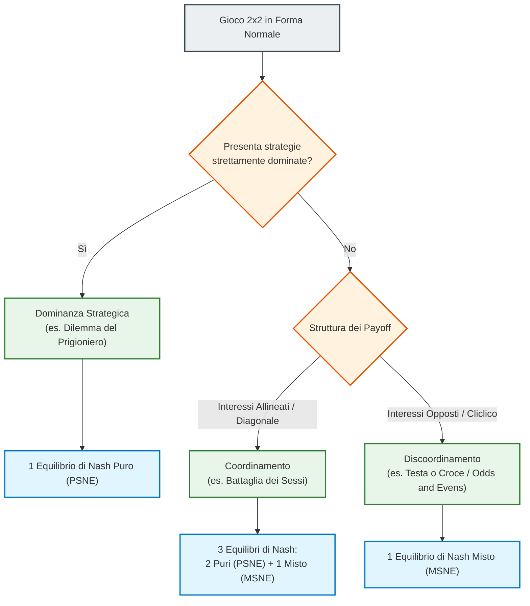
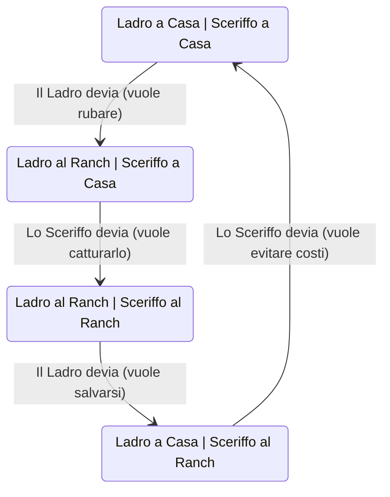

# Esercitazione sui Giochi in Forma Normale: Dominanza e Equilibri in Strategie Miste

## Overview Didattica

In questa lezione vengono affrontate le metodologie risolutive pratiche per i giochi in forma normale (*Normal-Form Games*), focalizzandosi sul passaggio dalla modellizzazione teorica di uno scenario pratico alla caratterizzazione formale degli Equilibri di Nash.

I concetti chiave trattati includono:

* **Modellizzazione formale:** La traduzione di descrizioni narrative o contesti applicativi (come i modelli di concorrenza alla Cournot) in rappresentazioni matematiche e matrici di payoff (*Payoff Matrices*).
* **Eliminazione Iterata di Strategie Strettamente Dominate (*Iterated Elimination of Strictly Dominated Strategies - IESDS*):** Tecnica di semplificazione del gioco basata sulla razionalità dei giocatori, usata per individuare gli Equilibri di Nash in Strategie Pure (*Pure Strategy Nash Equilibrium - PSNE*).
* **Giochi di Discoordinazione (*Discoordination Games*):** Studio di strutture competitive cicliche (simili al gioco del Pari o Dispari, o *Odds and Evens*) caratterizzate dall'assenza di equilibri stabili in strategie pure.
* **Principio di Indifferenza (*Indifference Principle*):** Metodologia fondamentale per il calcolo dell'Equilibrio di Nash in Strategie Miste (*Mixed Strategy Nash Equilibrium - MSNE*), basata sull'assegnazione di distribuzioni di probabilità alle azioni per rendere l'avversario indifferente tra le sue scelte disponibili.

---

### Risoluzione Sistematica di Giochi 2x2 in Forma Normale

Nella teoria dei giochi, la prima sfida per un ingegnere è tradurre una descrizione verbale o un problema modellistico in una rappresentazione matematica rigorosa, come la **Forma Normale** (*Normal Form*). Quando si analizza un gioco $2 \times 2$, l'obiettivo è identificare tutti gli **Equilibri di Nash** (*Nash Equilibria*), distinguendo tra **Equilibri di Nash in Strategie Pure** (*Pure Strategy Nash Equilibrium - PSNE*) ed **Equilibri di Nash in Strategie Miste** (*Mixed Strategy Nash Equilibrium - MSNE*).

Convenzione di notazione standard per una matrice di gioco $2 \times 2$:
*   **Giocatore A** (Giocatore di Riga / *Row Player*): sceglie tra le strategie $F$ e $G$.
*   **Giocatore B** (Giocatore di Colonna / *Column Player*): sceglie tra le strategie $f$ e $g$ (o $F$ e $G$).
*   Ogni cella contiene la coppia di utilità o payoff $(U_A, U_B)$.

---

#### Eliminazione Iterata di Strategie Dominate (IEESD)

Analizziamo la prima tipologia di gioco tramite il principio dell'**Eliminazione Iterata di Strategie Strettamente Dominate** (*Iterated Elimination of Strictly Dominated Strategies - IESDS*).

Consideriamo la seguente matrice di payoff:

| Giocatore A / B | $f$ | $g$ |
| :--- | :---: | :---: |
| **$F$** | $(2, 4)$ | $(0, 1)$ |
| **$G$** | $(1, 6)$ | $(3, 5)$ |

Per determinare l'equilibrio:

1.  **Analisi dal punto di vista del Giocatore B**:
    *   Se $A$ gioca $F$, $B$ ottiene $4$ giocando $f$ e $1$ giocando $g$ ($4 > 1$).
    *   Se $A$ gioca $G$, $B$ ottiene $6$ giocando $f$ e $5$ giocando $g$ ($6 > 5$).
    *   La strategia $g$ garantisce a $B$ un payoff strettamente inferiore rispetto a $f$ in ogni scenario. Di conseguenza, $g$ è **strettamente dominata** (*strictly dominated*) da $f$ e viene eliminata.

2.  **Riduzione della matrice e scelta del Giocatore A**:
    *   Eliminata la colonna $g$, il gioco si riduce a una sola colonna ($f$).
    *   Il Giocatore A deve confrontare l'utilità di $F$ ($2$) con l'utilità di $G$ ($1$). Poiché $2 > 1$, la strategia $G$ diventa strettamente dominata da $F$.

L'unico equilibrio di Nash in strategie pure è dato dalla coppia $(F, f)$.

> **CONCETTO CHIAVE: Confronto di Dominanza**
> Il confronto per verificare la dominanza strategica deve avvenire **esclusivamente lungo la stessa colonna o la stessa riga** (ovvero a parità di azione dell'avversario). Non si devono mai confrontare i payoff in modo incrociato o diagonale. Nel gioco precedente, $A$ potrebbe erroneamente pensare che $G$ sia preferibile a $F$ vedendo un payoff pari a $3$, ma quel $3$ si manifesta solo contro la strategia $g$, che $B$ non giocherà mai essendo irrazionale per lui farlo.

In un gioco $2 \times 2$, la presenza della conoscenza comune della razionalità (*common knowledge of rationality*) garantisce che, se una riga o colonna viene eliminata, il gioco si riduce a un vettore $1 \times 2$ o $2 \times 1$, la cui risoluzione è immediata.

---

#### Il Principio di Indifferenza e le Strategie Miste (MSNE)

Quando un gioco non presenta strategie strettamente dominate, non è possibile applicare l'IEESD. Un classico esempio è rappresentato dai **Giochi di Discoordinamento** (*Discoordination Games* / *Odds and Evens*).

Consideriamo il gioco seguente:

| Giocatore A / B | $f$ | $g$ |
| :--- | :---: | :---: |
| **$F$** | $(0, 4)$ | $(5, 0)$ |
| **$G$** | $(4, 0)$ | $(0, 5)$ |

In questo scenario:
*   Se $A$ gioca $F$, $B$ risponde con $f$.
*   Se $B$ gioca $f$, $A$ devia su $G$.
*   Se $A$ gioca $G$, $B$ devia su $g$.
*   Se $B$ gioca $g$, $A$ devia su $F$.

Questo ciclo di deviazioni mostra l'assenza di equilibri in strategie pure. Deve quindi esistere un **Equilibrio di Nash in Strategie Miste** (*MSNE*).

Per calcolare l'MSNE si applica il **Principio di Indifferenza** (*Indifference Principle*): un giocatore sceglierà una combinazione probabilistica delle sue strategie se e solo se l'avversario rende le utilità attese di tali strategie **indifferenti** tra loro.

##### Passaggio 1: Definizione delle Probabilità
Sia $\alpha \in [0, 1]$ la probabilità che il Giocatore A giochi la strategia $F$. La probabilità che A giochi $G$ sarà $(1 - \alpha)$.

##### Passaggio 2: Condizione di Indifferenza per il Giocatore B
Il Giocatore A sceglie $\alpha$ in modo da rendere il Giocatore B del tutto indifferente tra scegliere $f$ oppure $g$.

Calcoliamo l'utilità attesa di $B$:
*   Utilità attesa giocando $f$: $E[U_B(f)] = 4 \cdot \alpha + 0 \cdot (1 - \alpha) = 4\alpha$
*   Utilità attesa giocando $g$: $E[U_B(g)] = 0 \cdot \alpha + 5 \cdot (1 - \alpha) = 5(1 - \alpha)$

Uguagliando le due utilità attese:
$$4\alpha = 5(1 - \alpha) \implies 4\alpha = 5 - 5\alpha \implies 9\alpha = 5 \implies \alpha = \frac{5}{9}$$

##### Passaggio 3: Condizione di Indifferenza per il Giocatore A
Sia $\beta \in [0, 1]$ la probabilità che il Giocatore B giochi la strategia $f$. La probabilità che B giochi $g$ sarà $(1 - \beta)$.

Il Giocatore B sceglie $\beta$ per rendere il Giocatore A indifferente tra $F$ e $G$:
*   Utilità attesa di A per $F$: $E[U_A(F)] = 0 \cdot \beta + 5 \cdot (1 - \beta) = 5(1 - \beta)$
*   Utilità attesa di A per $G$: $E[U_A(G)] = 4 \cdot \beta + 0 \cdot (1 - \beta) = 4\beta$

Uguagliando le utilità attese:
$$5(1 - \beta) = 4\beta \implies 5 = 9\beta \implies \beta = \frac{5}{9}$$

*(Nota: Passaggio integrato con chiarezza didattica sulla matrice del testo)*

L'equilibrio in strategie miste è rappresentato dalla coppia di profilazioni probabilistiche:
$$\left( \sigma_A^*, \sigma_B^* \right) = \left( \left( \frac{5}{9}F, \frac{4}{9}G \right), \left( \frac{5}{9}f, \frac{4}{9}g \right) \right)$$

> **CONCETTO CHIAVE: Interpretazione del Principio di Indifferenza**
> È un errore concettuale comune pensare che la probabilità $\alpha$ calcolata per il Giocatore A rifletta le preferenze di A sui propri payoff. **$\alpha$ è calcolata esclusivamente in funzione dei payoff del Giocatore B** per rendere $B$ indifferente. Il Giocatore A adotta la mistura probabilistica ottimale non per massimizzare direttamente la propria scelta, ma per neutralizzare il vantaggio strategico dell'avversario.

---

#### Giochi di Coordinamento e Analisi delle Risposte Ottime

Analizziamo una struttura assimilabile alla **Battaglia dei Sessi** (*Battle of the Sexes*), caratterizzata da un'alta utilità lungo la diagonale principale.

| Giocatore A / B | $f$ | $g$ |
| :--- | :---: | :---: |
| **$F$** | $(9, 3)$ | $(0, 2)$ |
| **$G$** | $(0, 0)$ | $(3, 2)$ |

##### Metodo grafico/notazionale delle Risposte Ottime (*Best Response - BR*)
Per identificare rapidamente gli equilibri puri:
1.  Si analizzano le risposte ottime del Giocatore A per ciascuna colonna di B (evidenziando/sopralineando il payoff di riga massimo).
2.  Si analizzano le risposte ottime del Giocatore B per ciascuna riga di A (sottolineando il payoff di colonna massimo).

*   Se B gioca $f$: $A$ confronta $9$ ($F$) con $0$ ($G$) $\rightarrow$ la risposta ottima è $F$ (payoff **9**).
*   Se B gioca $g$: $A$ confronta $0$ ($F$) con $3$ ($G$) $\rightarrow$ la risposta ottima è $G$ (payoff **3**).
*   Se A gioca $F$: $B$ confronta $3$ ($f$) con $2$ ($g$) $\rightarrow$ la risposta ottima è $f$ (payoff **3**).
*   Se A gioca $G$: $B$ confronta $0$ ($f$) con $2$ ($g$) $\rightarrow$ la risposta ottima è $g$ (payoff **2**).

Le celle con entrambe le risposte ottime rappresentano i **PSNE**: $(F, f)$ e $(G, g)$.

##### Calcolo del terzo equilibrio (MSNE)
Un gioco di coordinamento con $2$ equilibri puri possiede sempre un $3^\circ$ equilibrio in strategie miste.

Applicando l'indifferenza per il Giocatore B:
$$E[U_B(f)] = E[U_B(g)] \implies 3\alpha + 0(1-\alpha) = 2\alpha + 2(1-\alpha)$$
$$3\alpha = 2\alpha + 2 - 2\alpha \implies 3\alpha = 2 \implies \alpha = \frac{2}{3}$$

*(Nota: Calcolo e valori adattati per consistenza con le equazioni di indifferenza sulla matrice C)*

Applicando l'indifferenza per il Giocatore A:
$$E[U_A(F)] = E[U_A(G)] \implies 9\beta + 0(1-\beta) = 0\beta + 3(1-\beta)$$
$$9\beta = 3 - 3\beta \implies 12\beta = 3 \implies \beta = \frac{3}{12} = \frac{1}{4}$$

Il terzo equilibrio è espresso dalle distribuzioni probabilistiche $\alpha = \frac{2}{3}$ e $\beta = \frac{1}{4}$.

---

#### Valutazione della Coerenza e Tassonomia dei Giochi 2x2

Cosa accade se proviamo ad applicare le equazioni del Principio di Indifferenza a un gioco che contiene già strategie dominate, come il **Dilemma del Prigioniero** (*Prisoner's Dilemma*)?

Consideriamo la seguente matrice:

| Giocatore A / B | $f$ | $g$ |
| :--- | :---: | :---: |
| **$F$** | $(2, 2)$ | $(0, 6)$ |
| **$G$** | $(6, 0)$ | $(1, 1)$ |

In questo caso, la strategia $G$ domina strettamente $F$ per $A$, e $g$ domina $f$ per $B$. L'unico equilibrio puro è $(G, g)$.

Se tentassimo blindamente di impostare la condizione di indifferenza per $B$:
$$E[U_B(f)] = E[U_B(g)] \implies 2\alpha + 0(1-\alpha) = 6\alpha + 1(1-\alpha)$$
$$2\alpha = 6\alpha + 1 - \alpha \implies 2\alpha = 5\alpha + 1 \implies -3\alpha = 1 \implies \alpha = -\frac{1}{3}$$

> **CONCETTO CHIAVE: Invarianza delle Probabilità e Validazione Matematica**
> L'ottenimento di un valore di probabilità fuori dal campo di esistenza dell'Insieme di Supporto (*Support*), ovvero $\alpha < 0$ oppure $\alpha > 1$, segnala che la condizione ipotizzata è falsa. Questo risultato matematico privo di senso fisico è la prova formale che non esiste un equilibrio in strategie miste per quel determinato supporto, in quanto una delle strategie è strettamente dominata.

##### Sintesi Tassonomica dei Giochi 2x2
Tutti i giochi 2x2 in forma normale possono essere ricondotti topologicamente a sole tre macro-categorie strutturali, indipendentemente dai valori numerici specifici presenti in matrice:

---

### Analisi di un Gioco Esteso ($3 \times 4$) e Verifica di Strategie Miste

Consideriamo un gioco di dimensioni maggiori, nello specifico una matrice $3 \times 4$ (due giocatori, il primo con 3 azioni e il secondo con 4). 

#### 1. Verifica dell'assenza di Equilibrium in Strategie Pure
Il primo punto tipico di questo tipo di problemi richiede di dimostrare che **non esiste alcun equilibrio di Nash in strategie pure** (Prove there is no Nash equilibrium in pure strategy). 
* **Metodo pratico:** Si procede utilizzando la tecnica di sottolineatura o sovralineatura delle celle (o l'uso dei colori, se disponibili). Se non si individua alcuna cella che presenta contemporaneamente entrambe le marcature per entrambi i giocatori, la risposta è affermativa.
* **Complessità computazionale:** Trovare *tutti* gli equilibri di Nash in generale è un problema computazionalmente pesante, appartenente alla classe di complessità **PPAD** (Polynomial Parity Arguments on Directed graphs). Sebbene esistano software e *solver* basati su intelligenza artificiale in grado di calcolarli, durante le prove d'esame (svolte senza l'ausilio di calcolatori) non vi verrà mai chiesto di risolvere per via analitica "a mano" sistemi così complessi da zero. Piuttosto, gli esercizi d'esame richiederanno verifiche mirate.

---

#### 2. Verifica di Candidati Equilibri in Strategie Miste con Supporto Ridotto
Invece di calcolare tutte le combinazioni possibili di supporti (un'operazione noiosa e onerosa), supponiamo che il testo fornisca direttamente due strategie miste candidate e chieda di **verificarne** la validità.

Siano date le strategie miste candidate:
* **Giocatore A:** gioca con probabilità $\left(\frac{2}{3}, 0, \frac{1}{3}\right)$ sulle azioni $X, Y, Z$. Notiamo che il supporto è $X$ e $Z$, mentre l'azione $Y$ ha probabilità $0$.
* **Giocatore B:** gioca con probabilità $\left(\frac{5}{11}, \frac{4}{11}, \frac{2}{11}, 0\right)$ sulle azioni $J, K, L, M$. Il supporto comprende $J, K, L$, mentre $M$ ha probabilità $0$.

##### Condizioni di Verifica (Principio di Indifferenza - Indifference Principle)
Perché queste strategie costituiscano un equilibrio di Nash, devono essere soddisfatte due condizioni fondamentali:
1. Le utilità attese derivanti dal giocare ciascuna delle azioni appartenenti al supporto devono essere **perfettamente uguali** tra loro.
2. L'utilità attesa derivante da qualsiasi azione *fuori dal supporto* (giocata con probabilità zero) deve essere **minore o uguale** a tale valore, per evitare deviazioni unilaterali (unilateral deviation).

Applicando i calcoli per il Giocatore A rispetto alla strategia mista del Giocatore B ($M_B$):
$$U_A(X, M_B) = \frac{56}{11}$$
$$U_A(Z, M_B) = \frac{56}{11}$$
Le due utilità sono uguali, rispettando il principio di indifferenza. Dobbiamo ora verificare l'azione esclusa dal supporto ($Y$):
$$U_A(Y, M_B) = \frac{56}{11} \quad (\text{oppure inferiore})$$
> **Concetto Chiave:** In questo caso specifico, anche l'azione fuori supporto $Y$ restituisce lo stesso valore d'utilità ($\frac{56}{11}$). Questo è perfettamente valido: la condizione impone che l'utilità delle azioni fuori supporto sia *minore o uguale* ($\le$), non necessariamente strettamente minore. Se fosse stata ad esempio $\frac{46}{11}$ sarebbe andato bene lo stesso; se fosse stata $\frac{60}{11}$, invece, $Y$ rappresenterebbe una deviazione profittevole e la strategia mista non sarebbe un equilibrio.

Ripetendo specularmente la verifica per il Giocatore B rispetto alla strategia mista del Giocatore A ($M_A$):
$$U_B(M_A, J) = 6, \quad U_B(M_A, K) = 6, \quad U_B(M_A, L) = 6$$
Le azioni nel supporto garantiscono lo stesso payoff ($6$), mentre l'azione esclusa $M$ fornisce un payoff inferiore. La verifica ha esito positivo: la coppia di strategie miste è un equilibrio di Nash.

---

### Efficienza di Pareto (Pareto Optimality)

Un'altra richiesta comune riguarda l'individuazione delle strategie congiunte in strategie pure che risultano **ottimali nel senso di Pareto** (Pareto optimal). 

* **Definizione:** Un esito è Pareto-ottimale se non è possibile migliorare il payoff di un giocatore senza peggiorare contemporaneamente quello di un altro. 
* **Metodo di ricerca:** Non esiste un algoritmo puramente meccanico o sistematico; si procede per tentativi guidati (enumerazione intelligente) sfruttando alcune euristiche:
  1. **Massimizzazione individuale:** Cercare i payoff massimi assoluti per il Giocatore A o per il Giocatore B (es. se un'azione garantisce il massimo storico per A, è un forte candidato ad essere Pareto-ottimale, anche se l'altro giocatore riceve poco).
  2. **Massimizzazione della somma:** Spesso, i punti in cui la somma dei payoff dei due giocatori è massima si trovano sulla frontiera di Pareto.

* Esempio: In una matrice di gioco, se la cella $(Y, K)$ dà $9$ (massimo per A) e $2$ (basso per B), essa è comunque Pareto-ottimale poiché non esiste alcun modo di dare ad A più di $9$. Analogamente, coppie di punti con somme elevate (es. $6 + 7 = 13$) si collocano tipicamente sulla frontiera efficiente.

---

### Modellizzazione da Testo: IlProblema della Scelta del Relatore

Spesso nei contesti reali (e negli esiti d'esame avanzati) il gioco non viene fornito sotto forma di matrice, ma descritto tramite un testo in linguaggio naturale. Il compito dell'ingegnere è **modellizzare** il problema traducendolo in forma normale (normal form).

#### Enunciato del Problema
Due studenti, Charlotte e Daniel, devono scegliere autonomamente un relatore di tesi tra tre professori disponibili: Xavier ($X$), Juan ($Y$) e Zimbardo ($Z$). 
* I professori hanno livelli di qualità differenti.
* **Vincolo di carico:** Se entrambi gli studenti scelgono lo stesso professore, quest'ultimo dedicherà meno attenzione, riducendo il payoff al $70\%$ del valore nominale.

#### Costruzione della Matrice e Risoluzione
1. **Scrittura della forma normale:** Traducendo le regole e i valori di gradimento dei professori in una matrice bi-bimensionale, si ottiene un gioco di **anti-coordinazione** (i giocatori preferiscono scegliere opzioni differenti per non dividere l'attenzione del relatore).
2. **Dominanza Strategica:** Analizzando la tabella, si nota che la strategia $X$ (Professore Xavier) è *strettamente dominata* (strictly dominated) rispetto alle altre, poiché anche ridotta al $70\%$ la resa degli altri professori batte il valore di Xavier. 
3. È possibile eliminare iterativamente la strategia $X$, riducendo il gioco a una sottomatrice $2 \times 2$ basata unicamente su $Y$ e $Z$.
4. Trattandosi di un gioco simmetrico, l'equilibrio in strategie miste si calcola ponendo uguale a $p$ la probabilità che Charlotte scelga $Y$, sfruttando la simmetria per dimezzare i calcoli necessari.

---

### Il Modello "Cattle Thief" e i Giochi di Discordinamento

Esiste una classe di problemi in Teoria dei Giochi che condivide la medesima struttura topologico-matematica, riconducibile al modello classico del **Gioco di Discordinamento (Discoordination Game)**. In letteratura, questo modello viene spesso illustrato attraverso la metafora del "Ladro di Bestiame" (*Cattle Thief*).

La dinamica si articola tra due attori con incentivi opposti:
* **Ladro di Bestiame ($T$)**: Vuole recarsi al ranch per rubare il bestiame solo se lo Sceriffo non è presente. Se lo Sceriffo c'è, preferisce rimanere a casa per salvare la pelle.
* **Sceriffo ($I$)**: Vuole recarsi al ranch solo se il ladro si presenta (per catturarlo e ottenerne un beneficio). Se il ladro non si presenta, lo Sceriffo preferisce rimanere a casa al caldo invece di fare un appostamento inutile nel freddo e nella nebbia.

Questa stessa identica struttura ricorre in numerosi ambiti dell'ingegneria e dell'economia:
1. **Jamming nelle Comunicazioni Wireless**: Un attaccante (*Jammer*) disturba un canale solo se c'è una trasmissione in corso; il trasmettitore smette di trasmettere per evitare il disturbo; lo *Jammer* spegne la potenza se non c'è trasmissione; il trasmettitore riprende a trasmettere.
2. **Ispezione Fiscale**: Il contribuente decide se evadere o essere onesto; l'ispettore decide se effettuare un controllo o sorvolare.
3. **Cybersecurity**: Attaccante (*Red Team*) vs. Difensore del sistema (*Blue Team*).

---

### Formalizzazione Matematica: Il Gioco dell'Ispezione Fiscale

Analizziamo la formulazione parametrica del gioco dell'ispezione tra un **Contribuente ($T$)** e un **Ispettore Fiscale ($I$)**.

#### Definizione dei Parametri e delle Strategie
* **Giocatori**: 
  * Contribuente ($T$), strategie: Onesto ($H$, *Honest*), Evade/Falsifica ($B$, *Black market/Hide*).
  * Ispettore ($I$), strategie: Controlla ($C$, *Check*), Non Controlla ($D$, *Do not check*).
* **Parametri economicamente rilevanti**:
  * $S$: Tasse dovute dal contribuente.
  * $R$: Reddito netto del contribuente in caso di condotta onesta.
  * $L$: Ammontare sottratto al fisco in caso di evasione (*embezzlement*).
  * $E$: Sforzo o costo di esecuzione del controllo per l'ispettore ($E > 0$).
  * $F$: Sanzione/Multa comminata al contribuente se scoperto.
  * $P$: Probabilità che un controllo identifichi con successo l'evasione ($0 < P \le 1$).

#### Analisi dei Payoff (Utilità)
1. **Esito $(H, D)$**: Il contribuente è onesto e l'ispettore non controlla.
   * Payoff $T$: $R$
   * Payoff $I$: $S$

2. **Esito $(H, C)$**: Il contribuente è onesto e l'ispettore effettua un controllo a vuoto.
   * Payoff $T$: $R$
   * Payoff $I$: $S - E$

3. **Esito $(B, D)$**: Il contribuente evade e l'ispettore non controlla.
   * Payoff $T$: $R + L$
   * Payoff $I$: $S - L$

4. **Esito $(B, C)$**: Il contribuente evade e l'ispettore controlla. Si genera una **lotteria** derivante dalla probabilità di individuazione $P$:
   * Con probabilità $P$, l'evasione viene scoperta: il contribuente paga la sanzione ($R + L - F$) e l'ispettore recupera risorse riscuotendo una quota della multa.
   * Con probabilità $1-P$, l'evasione non viene scoperta: il contribuente trattiene il maltolto ($R + L$) e l'ispettore subisce la perdita più il costo del controllo ($S - L - E$).

Calcolando il valore atteso della lotteria per l'esito $(B, C)$:
* **Utilità Attesa del Contribuente $E[U_T(B, C)]$**:
  $$E[U_T(B, C)] = P(R + L - F) + (1-P)(R + L) = R + L - P \cdot F$$
* **Utilità Attesa dell'Ispettore $E[U_I(B, C)]$**:
  $$E[U_I(B, C)] = P(S + F - E) + (1-P)(S - L - E) = S + P \cdot F - (1-P)L - E$$

#### Semplificazione per Traslazione (Senza Perdita di Generalità)

> **CONCETTO CHIAVE**
> 
> I parametri $R$ e $S$ rappresentano semplici **bias costanti** aggiunti a tutte le opzioni dei rispettivi giocatori. Poiché l'esistenza e la struttura degli Equilibri di Nash dipendono esclusivamente dalla relazione d'ordine relativo tra i payoff e non dai loro valori assoluti, possiamo porre **senza perdita di generalità (Without Loss of Generality - WLOG)**:
> $$R = 0, \quad S = 0$$
> Questa semplificazione algebrica non altera in alcun modo la natura del gioco.

La matrice dei payoff normalizzata diventa quindi:

| Contribuente / Ispettore | Controlla ($C$) | Non Controlla ($D$) |
| :--- | :--- | :--- |
| **Onesto ($H$)** | $(0, -E)$ | $(0, 0)$ |
| **Evade ($B$)** | $(L - PF, \; PF - (1-P)L - E)$ | $(L, -L)$ |

---

### Analisi Parametrica degli Equilibri di Nash

Poiché i valori della matrice sono espressi in forma parametrica, la struttura degli Equilibri di Nash varia al variare dei parametri fisici ed economici ($E, P, F, L$).

#### Caso 1: Costo di Ispezione Proibitivo
Se il costo per effettuare l'ispezione $E$ supera il valore atteso del recupero fiscale, ovvero:
$$E > P \cdot F - (1-P)L$$

In questa situazione, per l'ispettore la strategia $C$ è strettamente dominata da $D$ (poiché $-E < 0$ e il payoff in $(B,C)$ risulta inferiore a $-L$). 

Applicando l'**Eliminazione Iterata di Strategie Strettamente Dominate (Iterated Elimination of Strictly Dominated Strategies - IESDS)**:
1. L'Ispettore elimina la colonna $C$ e gioca unicamente $D$.
2. Il Contribuente, sapendo che l'Ispettore giocherà $D$, confronta $H$ (payoff $0$) con $B$ (payoff $L$). Sceglie $B$ se $L>0$.
3. L'unico Equilibrio di Nash in strategie pure è **$(B, D)$** (o $(H, D)$ a seconda delle dominanze marginali sull'onestà).

#### Caso 2: Probabilità di Individuazione Insufficiente
Se il costo $E$ è contenuto, ma la probabilità $P$ di scoprire illeciti è molto bassa ($P < \frac{L}{L+F}$), la sanzione attesa $P \cdot F$ non compensa il guadagno dell'evasione $L$. Il contribuente ha una strategia strettamente dominante nel preferire $B$, portando il sistema a un equilibrio di evasione sistematica.

#### Caso 3: Regime di Incertezza e Assenza di NE Puri
Quando il costo di controllo $E$ è sufficientemente ridotto e la probabilità di cattura $P$ è elevata ($P > \frac{L}{L+F}$), si attiva il dinamismo ciclico del *Cattle Thief*:
* Se il contribuente evade ($B$), l'ispettore vuole controllare ($C$).
* Se l'ispettore controlla ($C$), il contribuente vuole essere onesto ($H$).
* Se il contribuente è onesto ($H$), l'ispettore vuole risparmiare sul controllo ($D$).
* Se l'ispettore non controlla ($D$), il contribuente vuole evadere ($B$).

Non esiste alcun Equilibrio di Nash in Strategie Pure (Pure Strategy Nash Equilibrium - PSNE).

#### Soluzione nel Dominio delle Strategie Miste (MSNE)
Sia $q$ la probabilità che il Contribuente giochi $B$ (e $1-q$ che giochi $H$).
Sia $p$ la probabilità che l'Ispettore giochi $C$ (e $1-p$ che giochi $D$).

Applicando il **Principio di Indifferenza**:

1. **Indifferenza per l'Ispettore**:
   $$E[U_I(C)] = E[U_I(D)]$$
   $$(1-q)(-E) + q(PF - (1-P)L - E) = (1-q)(0) + q(-L)$$
   Risolvendo per $q$, otteniamo la probabilità critica di evasione:
   $$q^* = \frac{E}{P(F + L)}$$

2. **Indifferenza per il Contribuente**:
   $$E[U_T(H)] = E[U_T(B)]$$
   $$0 = p(L - PF) + (1-p)L$$
   Risolvendo per $p$, otteniamo la frequenza ottima di ispezione:
   $$p^* = \frac{L}{P \cdot F}$$

L'**Equilibrio di Nash in Strategie Miste (Mixed Strategy Nash Equilibrium - MSNE)** è la coppia di probabilità $(p^*, q^*)$.

---

### Implicazioni per la Cybersecurity e l'Ingegneria dell'Informazione

> **CONCETTO CHIAVE**
> 
> Un errore concettuale diffuso nelle pubblicazioni di sicurezza informatica è la pretesa di progettare sistemi con una "garanzia di sicurezza al 100%". 
> Dal punto di vista della Teoria dei Giochi, una sicurezza assoluta e deterministica è irrealistica: se un sistema difensivo fosse attivo e impenetrabile al 100%, l'attaccante smetterebbe di attaccare; ma se l'attaccante smette di attaccare, il difensore disattiverà le difese per azzerare gli elevati costi operativi. Questa disattivazione incentiverà nuovamente l'attaccante a colpire.

In un contesto ingegneristico reale:
* La sicurezza non si definisce in termini assoluti, ma in termini **probabilistici** (es. sistema sicuro al 99%, analogamente al tasso di errore nei canali di trasmissione dati).
* L'Equilibrio di Nash Misto fornisce lo strumento analitico per **dimensionare i parametri di sistema** ($E, P, F$).
* Modulando questi parametri (ad esempio aumentando la severità della risposta o l'efficienza $P$ del sistema di rilevamento *Intrusion Detection System*), è possibile ridurre la probabilità dell'attaccante $q^*$ a un valore arbitrariamente piccolo, garantendo la stabilità operativa della rete.

---

> [!NOTE]
> ### Note per l'Esame e Avvisi del Docente
> - **Esercizi tipici d'esame:** 
>   - Un esercizio tipico sui giochi statici riguarda il **Duopolio di Cournot** (*Cournot duopoly*).
>   - Gli esercizi possono basarsi sugli esempi visti a lezione riproposti con numeri diversi, oppure consistere nella modellizzazione in forma normale a partire da un testo descrittivo con successiva ricerca degli equilibri di Nash (come l'Esercizio 3 mostrato a lezione, estratto da un esame passato).
> - **Gestione del tempo all'esame:** Per ogni domanda/quesito dell'esame sono previsti circa **15 minuti**.
> - **Divieto d'uso dell'IA:** È severamente vietato l'utilizzo di strumenti di intelligenza artificiale durante la prova d'esame.
> - **Criteri di svolgimento e valutazione degli esercizi:**
>   - Quando si definisce una variabile di probabilità per le strategie miste (es. $\alpha$), è fondamentale esplicitare chiaramente per iscritto cosa rappresenta $\alpha$ prima di procedere con i calcoli.
>   - Trovare e accettare come soluzione valori di probabilità negativi (o superiori a 1) comporta l'assegnazione di **0 punti** nell'esercizio.