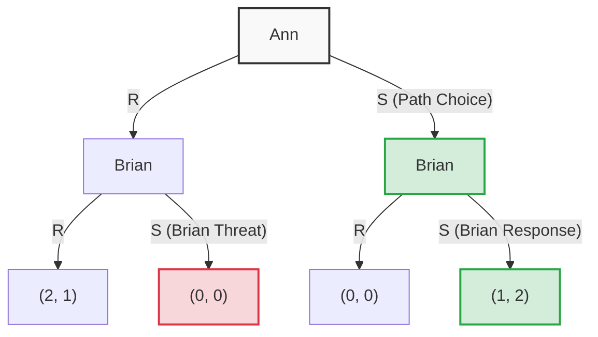
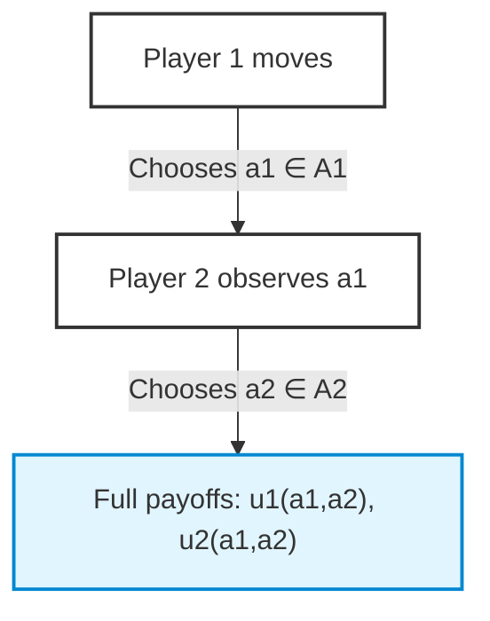
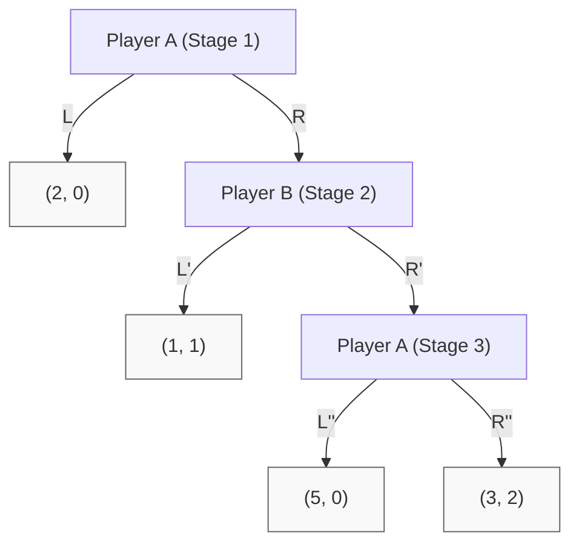
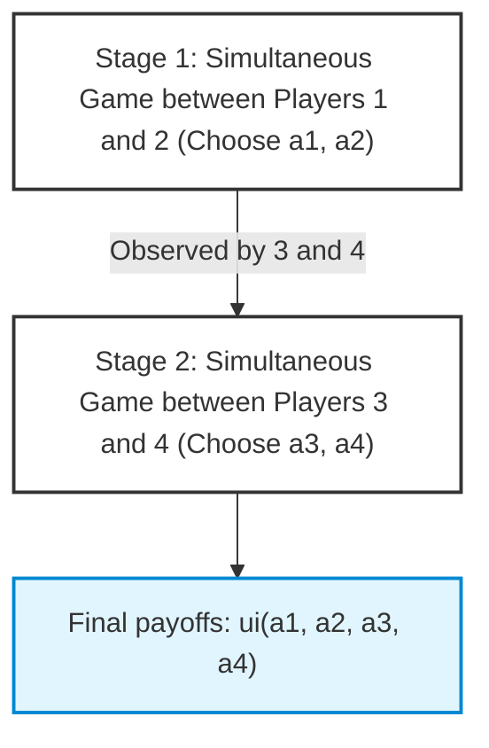
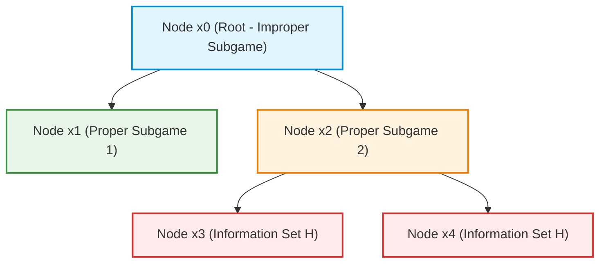
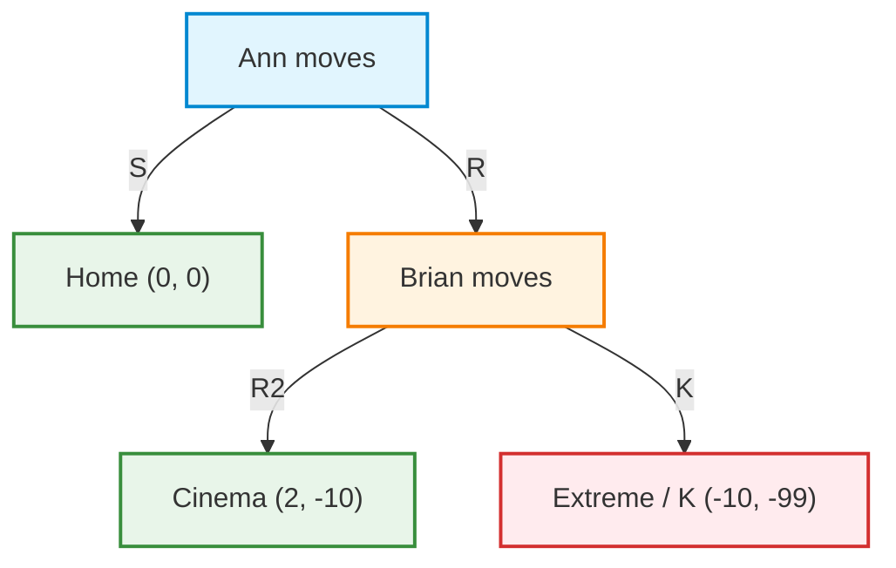

# Nash Equilibrium in Dynamic Games and Normal Form Representation

## Teaching Overview

In this lesson, we address the extension of the static concept of **Nash Equilibrium** (*Nash Equilibrium*) to dynamic or sequential contexts. Although the fundamental concepts of strategy and dominance translate almost directly into the **Extensive Form** (*Extensive Form*) of a game, the direct application of the Nash equilibrium reveals significant conceptual limitations that require formal refinement.

The key points covered include:
* **Translation of Sequential Games into Normal Form (*Normal Form*):** How to model sequential choices by transforming them into complete action plans drawn up in advance by players before the game begins.
* **Expansion of Strategy Space:** Analysis of the formulation of contingent strategies for the second-moving player, illustrated using a sequential variant of the **Battle of the Sexes** (*Battle of the Sexes*).
* **Identification of Pure Nash Equilibria:** Identifying strategy combinations that satisfy the condition of no unilateral deviation centered on **Best Responses** (*Best Responses*).
* **Limitations of Nash Equilibrium in Dynamic Games:** Comparison between equilibria leading to the same outcome on the actual path of play (*Equilibrium Path*), highlighting how the simple normal form includes equilibria based on **Irrational Responses** (*Irrational Responses*) or non-credible actions in branches of the game tree that are never reached (*Off-Equilibrium Path*).

---

### Extension of Nash Equilibrium to Dynamic Games

In strategic or static form games, the concept of **Nash Equilibrium** (*Nash Equilibrium* - NE) identifies a combination of strategies in which no player has an incentive to unilaterally deviate: each player's move represents the best response (*best response*) to the decisions of others.

When transitioning to a dynamic formulation (that is, a game described in extensive form, where players move in temporal sequence), the first intuition is to "flatten" the sequence into an equivalent normal form. Each player plans in advance all their moves for every possible evolution of the game history. However, direct application of the Nash equilibrium to the resulting matrix reveals an intrinsic limitation: the classical concept admits equilibria supported by choices or "threats" that would prove irrational at the exact moment a player were actually called upon to carry them out.

---

### The Dynamic Battle of the Sexes: Normal Form and Multiplicity of Equilibria

To understand how this discrepancy arises, consider the classic **Battle of the Sexes** (*Battle of the Sexes*) in its sequential version.

* **Game structure**: Ann ($A$) decides first whether to go to the romantic movie ($R$) or to the sci-fi movie ($S$). Brian ($B$) observes Ann's choice and makes his own decision ($R$ or $S$).
* **Ann's strategies**: Ann has a single decision to make at the beginning of the game, without any prior history. Her set of pure strategies is simply:
  $$S_A = \{R, S\}$$
* **Brian's strategies**: Brian moves after seeing Ann's decision. He must therefore plan an action for every possible initial move by Ann. A pure strategy for Brian is a function that maps the game history $\{R, S\}$ into an action $\{R, S\}$. Brian has $2 \times 2 = 4$ pure strategies:
  * $RR$: Plays $R$ if Ann chooses $R$, plays $R$ if Ann chooses $S$ (*"I always go to see R"*).
  * $RS$: Plays $R$ if Ann chooses $R$, plays $S$ if Ann chooses $S$ (*"I copy Ann's choice"*).
  * $SR$: Plays $S$ if Ann chooses $R$, plays $R$ if Ann chooses $S$ (*"I do the opposite of Ann"*).
  * $SS$: Plays $S$ if Ann chooses $R$, plays $S$ if Ann chooses $S$ (*"I always go to see S"*).

Conventional payoffs assign higher utility to attending together, with subjective preference for the movie:
* If both choose $R$: payoff $(2, 1)$ (preferred by Ann).
* If both choose $S$: payoff $(1, 2)$ (preferred by Brian).
* If they choose different movies: payoff $(0, 0)$.

Representing the game in strategic normal form $2 \times 4$:

| Ann \ Brian | $RR$ | $RS$ | $SR$ | $SS$ |
| :---: | :---: | :---: | :---: | :---: |
| **$R$** | $(2, 1)$ | $(2, 1)$ | $(0, 0)$ | $(0, 0)$ |
| **$S$** | $(0, 0)$ | $(1, 2)$ | $(0, 0)$ | $(1, 2)$ |

Analyzing best responses, **three pure-strategy Nash equilibria** emerge:
1. $(R, RR)$ with outcome $(2, 1)$
2. $(R, RS)$ with outcome $(2, 1)$
3. $(S, SS)$ with outcome $(1, 2)$

#### Comparison between $(R, RR)$ and $(R, RS)$

Both profiles lead to the same actual outcome: Ann chooses $R$, Brian chooses $R$, and the final payoff is $(2, 1)$. The difference between Brian's two strategies lies in a branch of the tree that **is never reached**:
* In $RS$, Brian plans that if Ann played $S$, he would respond with $S$ (rational choice: better 2 than 0).
* In $RR$, Brian plans that if Ann played $S$, he would still respond with $R$ (irrational choice: he would get 0 instead of 2).

Since Ann actually plays $R$, Brian's response to a deviation towards $S$ is not tested in actual play, making $RR$ indistinguishable from $RS$ on the path taken.

---

### Equilibrium Path and Off-Path Actions

> **Key Concept: Definition of Equilibrium Path**
> In an extensive-form game, given an equilibrium strategy profile (pure or mixed), the **Equilibrium Path** is the set of nodes in the decision tree that are reached with **probability strictly greater than zero** ($P > 0$).
> All nodes in the tree that are not visited (zero probability, $P = 0$) constitute the **off-equilibrium path** nodes.

Why is it mandatory to specify what a player does even on off-path nodes, if they will never occur?

The reason lies in the very verification of the Nash Equilibrium. To verify that a player does not want to deviate unilaterally, it is necessary to determine the payoff they would obtain by deviating. That payoff depends entirely on how the opponent planned to react on off-path nodes.

In the third equilibrium, $(S, SS)$:
* The equilibrium path is solely the branch $S \to S$, which yields Ann a payoff equal to $1$ and Brian equal to $2$.
* To verify that Ann does not want to deviate to $R$, we must observe the first component of Brian's strategy ($SS$). This component states that if Ann plays $R$, Brian will play $S$.
* If Ann deviates to $R$, she encounters the programmed response $S$, ending up with the payoff $(0, 0)$. Since $0 < 1$, Ann has no incentive to deviate.

However, the equilibrium $(S, SS)$ relies on an **incredible threat**: Brian claims that, if Ann chose $R$, he would choose $S$ (getting 0) instead of $R$ (which would give him 1). If Ann were firmly convinced of this threat, she would bend to choose $S$. But if the game is played sequentially and Ann moves first by choosing $R$, Brian on his turn would have no rational incentive to self-punish by choosing $S$.

Static Nash equilibrium is incapable of capturing the irrationality of this dynamic threat, because it evaluates strategies only as choices planned a priori (*ex-ante*).

---

### The Ultimatum Game

An even more striking example of the abundance of irrational Nash equilibria in dynamic contexts is the **Ultimatum Game**.

#### Description of the Simplified Model
Two players must split a total of 10 resources (e.g., candies):
* The **Proposer** ($P$, *Proposer*) moves first and makes a proposed division. To make the model discrete and tractable, we consider only 3 actions for $P$:
  * **$D$ (*Dastard* / Unfair)**: $P$ keeps $9$ candies and offers $1$ to the responder $\to (9, 1)$.
  * **$F$ (*Fair* / Equitable)**: $P$ splits them equally $\to (5, 5)$.
  * **$G$ (*Generous* / Generous)**: $P$ keeps $2$ candies and offers $8$ $\to (2, 8)$.
* The **Responder** ($R$, *Responder*) observes the proposal made by $P$ and decides whether to accept (**$Y$**, *Yes*) or reject (**$N$**, *No*).
  * If $R$ accepts ($Y$), the proposed division is applied.
  * If $R$ rejects ($N$), a third party (e.g., a parent) intervenes and confiscates everything: both players receive a payoff of $(0, 0)$.

#### Strategy Space
* The Proposer $P$ makes an initial choice without prior history:
  $$S_P = \{D, F, G\} \implies 3 \text{ strategie pure}$$
* The Responder $R$ observes the action chosen by $P$. Since the information sets of $R$ are singletons (he knows exactly which offer was made), his strategy must associate a response $Y$ or $N$ with each of the 3 possible offers ($D, F, G$).
  
  A generic strategy for $R$ is described by a triple:
  $$s_R = (a_D, a_F, a_G) \quad \text{con } a_i \in \{Y, N\}$$
  The total number of pure strategies available to $R$ is:
  $$|S_R| = 2^3 = 8 \text{ strategie pure}$$

#### Nash Equilibria in the Ultimatum Game
If the Nash equilibria are calculated considering the matrix $3 \times 8$, many profiles emerge that formally satisfy the condition of no unilateral deviation.

##### Example 1: Equilibria with a Fair Proposal ($P$ plays $F$)
Consider the profile in which the Proposer chooses $F$ and the Responder plans the strategy $(N, Y, Y)$ (rejects $D$, accepts $F$, accepts $G$):
* **Path of play**: $P$ proposes $F$, $R$ responds $Y$. The final payoff is $(5, 5)$.
* **Checking $P$'s incentives to deviate**:
  * If $P$ deviates to $D$, they encounter the response $N$ planned by $R \implies$ payoff $0 < 5$.
  * If $P$ deviates to $G$, they encounter the response $Y \implies$ payoff $2 < 5$.
  * $P$ has no incentive to deviate.
* **Checking $R$'s incentives to deviate**:
  * Since $P$ proposes $F$, the components of $R$ relating to $D$ and $G$ fall off the equilibrium path (*off-path*). Changing them does not alter the current payoff.
  * Changing the response to $F$ from $Y$ to $N$ would change their payoff from $5$ to $0$ (making it worse).
  * $R$ has no incentive to deviate.

Consequently, both $(F, (N, Y, Y))$ and $(F, (N, Y, N))$ are **Nash Equilibria**.

##### Example 2: Other Formal Equilibria
Following the same verification logic on *off-path* nodes, the following are Nash equilibria:
* The profile in which $P$ proposes $G$ and $R$ adopts the strategy $(N, N, Y)$ (rejects everything except the generous offer).
* The profiles in which $P$ proposes $D$ and $R$ plays strategies that foresee accepting $D$, such as $(Y, Y, Y)$ or $(Y, N, N)$.

#### The Limitation of Nash Equilibrium in Sequential Games
These equilibria present an intrinsic weakness: strategies such as $(N, Y, Y)$ or $(N, N, Y)$ rely on the idea that the Responder is willing to say "No" to an asymmetric offer just to force the Proposer to be more generous.

However, in practice, if the Proposer deviated and chose $D$ (offering $1$ candy), the Responder would find themselves having to choose between:
* Accepting ($Y$): payoff equal to $1$.
* Rejecting ($N$): payoff equal to $0$.

A strictly rational agent, interested in maximizing their payoff at the moment of decision, will always choose $1 > 0$. The threat of responding $N$ to proposal $D$ is therefore **incredible**: it exists on paper in the *ex-ante* planning of the normal form, but would not be implemented at the appropriate time along the decision tree.

To resolve this incongruity and eliminate equilibria based on non-credible threats, in dynamic games a refinement of the Nash equilibrium will be necessary: the concept of **Subgame Perfect Nash Equilibrium** (SPNE).

---

Use these structured teaching notes to delve deeper into the analysis of sequential games, backward induction, and the problem of strategy credibility in dynamic games.

---

### Sequential Games and Backward Induction

In previous episodes we have seen that **Nash Equilibrium** can be extended to dynamic games. However, blindly applying the standard definition of Nash Equilibrium to a dynamic game presents a fundamental conceptual limitation: **not all threats or promises implicit in a Nash strategy are credible**.

A Nash Equilibrium serves as a prediction tool based on the rationality of players. But for a solution to be an effective prediction of actual behavior, players must actually want to execute the planned moves at future decision nodes as well. Hence arises the need for **Sequential Rationality**.

To analyze this problem, we focus on a specific class of dynamic games: **Sequential Games**.

> **Key Concept: Sequential Game**  
> A sequential game is a dynamic game with **Perfect Information**. At any time a player must move:
> 1. They know exactly the entire past history of the game.
> 2. All **Information Sets** are **singletons**, meaning they contain a single decision node.
> 3. The structure of the game and perfect information are **common knowledge**: the player moving knows that others will see their move and adjust their future decisions accordingly.

A classic conceptual example is the game of chess: every move is visible to both players and the player moving knows that the opponent will respond observing exactly the move just played.

---

#### Mathematical Formalization for Two Players

Consider a two-player sequential game:
1. **Player 1** chooses an action $a_1$ from a set of available actions $A_1$.
2. **Player 2** observes action $a_1$ and subsequently chooses an action $a_2$ from the set $A_2$ (possibly depending on $a_1$).
3. At the end, players receive their respective payoffs defined by utility functions $u_1(a_1, a_2)$ and $u_2(a_1, a_2)$.

Since Player 2 is rational and is at the final choice node, they solve a point optimization problem for any action $a_1$ previously played by Player 1:

$$R_2(a_1) = \arg\max_{a_2 \in A_2} u_2(a_1, a_2)$$

Because rationality and game structure are *common knowledge*:
* Player 2 is able to compute their optimal response $R_2(a_1)$.
* Player 1 **can perfectly anticipate** the response $R_2(a_1)$ of Player 2 for every possible action $a_1$.

Consequently, Player 1 will choose the action $a_1^*$ that maximizes their own final utility taking into account Player 2's reaction:

$$a_1^* = \arg\max_{a_1 \in A_1} u_1\left(a_1, R_2(a_1)\right)$$

The game outcome will be the pair of actions $(a_1^*, R_2(a_1^*))$, which constitutes a **sequentially rational** pure-strategy Nash Equilibrium.

---

#### Zermelo's Theorem

The previous formalization is grounded in a fundamental theoretical result of games with perfect information.

> **Zermelo's Theorem**  
> Every finite dynamic game with perfect information admits a solution obtainable via **Backward Induction** that is sequentially rational.  
> Furthermore, if all terminal node payoffs are distinct for each player, the solution obtained by backward induction is **unique**.

*Principle of Backward Induction:*  
One starts from the lowest-level decision nodes (those immediately preceding terminal nodes). In each of them, the player whose turn it is chooses the move that maximizes their payoff. These nodes are then "replaced" by the payoff corresponding to the optimal move. Moving up the decision tree node by node to the root, one obtains the optimal strategy profile.

---

### The Trust Game

To understand how backward induction eliminates Nash equilibria based on non-credible threats, let us analyze the **Trust Game**.

#### Game Structure
The game unfolds over three sequential stages between two players, **Player A** and **Player B**:

* **Stage 1 (Node A1):** Player A chooses whether to end the game immediately with move $L$ or pass the turn to Player B with move $R$.
  * If A chooses $L$, the game ends with payoff $(2, 0)$ (2 for A, 0 for B).
  * If A chooses $R$, the turn passes to B (Node 2).
* **Stage 2 (Node B1):** Player B chooses whether to end the game with $L'$ or pass the turn to A with $R'$.
  * If B chooses $L'$, the game ends with payoff $(1, 1)$.
  * If B chooses $R'$, the turn returns to A (Node 3).
* **Stage 3 (Node A2):** Player A chooses between $L''$ and $R''$. Both moves end the game:
  * $L''$ gives a payoff of $(5, 0)$.
  * $R''$ gives a payoff of $(3, 2)$.

#### Solution by Backward Induction

We solve the game working backward from the end:

1. **Step 1 (Analysis of Stage 3 - Node A2):**  
   Player A chooses between $L''$ (payoff 5) and $R''$ (payoff 3). Since A is rational and self-interested, A compares only their own utility:
   $$5 > 3 \implies \text{A sceglie } L''$$
   The move $R''$ is eliminated. The effective value of node A2 becomes the payoff associated with $L''$, namely $(5, 0)$.

2. **Step 2 (Analysis of Stage 2 - Node B1):**  
   Player B knows that choosing $R'$ would lead to node A2, where A will certainly play $L''$, giving B a payoff of $0$.  
   B therefore compares the two actual options:
   * Choose $L'$: B receives $1$.
   * Choose $R'$: this leads to outcome $(5, 0)$, giving B a payoff of $0$.
   
   $$1 > 0 \implies \text{B sceglie } L'$$
   The move $R'$ is eliminated. The value of node B1 becomes the payoff associated with $L'$, namely $(1, 1)$.

3. **Step 3 (Analysis of Stage 1 - Node A1):**  
   Player A initially knows that playing $R$ leads B to respond with $L'$, yielding $(1, 1)$.  
   A therefore compares:
   * Choose $L$: A receives $2$.
   * Choose $R$: this leads to outcome $(1, 1)$, giving A a payoff of $1$.
   
   $$2 > 1 \implies \text{A sceglie } L$$

**Final outcome of backward induction:**  
Player A immediately plays $L$. The game ends at the first node with payoff **$(2, 0)$**.

---

#### Critical Analysis: Lack of Trust and Pareto Inefficiency

The outcome $(2, 0)$ highlights the deep dynamic of this game:

* **Lack of Credibility:** A would like to convince B to play $R'$, promising to then choose $R''$ at node 3 to allow both to achieve a high payoff equal to $(3, 2)$. However, this promise **is not credible**: once node 3 is reached, A will always prefer $5$ over $3$ (playing $L''$). B knows this and therefore does not place trust (playing $L'$).
* **Pareto Inefficiency:** The final outcome of the rational equilibrium $(2, 0)$ is **Pareto-inefficient**. Indeed, there exist other outcomes in the tree, such as $(3, 2)$, in which *both* players would be strictly better off compared to $(2, 0)$.

> **Key Concept: The Trust Dilemma**  
> The assumption of pure rationality and the absence of contract enforcement mechanisms (or binding communication) force players toward a sub-optimal outcome. Rational mutual distrust prevents reaching the socially desirable result $(3, 2)$.

---

### Extension to Games with Imperfect Information

What happens if the dynamic game contains nodes with **imperfect information** (for instance, subgames where some players move simultaneously)? In these cases, we cannot apply pure backward induction to individual nodes, but the same logic can be extended to subgames.

#### General Two-Stage Structure

Consider a structure where:
1. **Stage 1:** Players 1 and 2 play a static simultaneous game choosing actions $a_1 \in A_1$ and $a_2 \in A_2$.
2. **Stage 2:** Players 3 and 4 observe the action pair $(a_1, a_2)$ and subsequently play a second static simultaneous game choosing $a_3 \in A_3$ and $a_4 \in A_4$.

Final payoffs depend on the entire sequence: $u_i(a_1, a_2, a_3, a_4)$ for $i = 1, \dots, 4$.

#### Generalized Resolution Procedure

1. **Resolution of Stage 2:**  
   For every possible pair $(a_1, a_2)$ played in the first stage, Players 3 and 4 face a static game of complete information. We compute the Nash Equilibrium of this subgame:
   $$\left(a_3^*(a_1, a_2),\, a_4^*(a_1, a_2)\right)$$

2. **Resolution of Stage 1:**  
   Players 1 and 2 anticipate that whichever choice $(a_1, a_2)$ they make, Stage 2 will evolve toward the Nash Equilibrium $\left(a_3^*(a_1, a_2), a_4^*(a_1, a_2)\right)$.  
   Consequently, Players 1 and 2 solve their simultaneous game in the first stage considering as expected payoffs the utilities reflected by the second stage:
   $$\tilde{u}_i(a_1, a_2) = u_i\left(a_1, a_2, a_3^*(a_1, a_2), a_4^*(a_1, a_2)\right) \quad \text{per } i=1,2$$
   By finding the equilibrium $(a_1^*, a_2^*)$ of this reduced game, we obtain the global solution of the entire dynamic game.

> **Caution Note on Non-Uniqueness:**  
> Unlike sequential games with perfect information and distinct payoffs (where Zermelo's Theorem guarantees uniqueness), when the final stage involves simultaneous moves, there may exist **multiple Nash Equilibria** for the same subgame. In such cases, uniqueness of the global solution no longer holds, and one must specify which equilibrium players are anticipating.

---

### Definition of Subgame

To extend the concept of Nash Equilibrium to extensive-form dynamic games, it is necessary to formalize the algebraic and topological structure of the game tree, introducing the notion of **Subgame**.

An extensive-form game unfolds as a decision tree. However, a subgame does not simply coincide with just any random subtree.

#### Formal Requirements of a Proper Subgame
A **Proper Subgame** $G'$ of a game $G$ is a subtree satisfying the following conditions:
1. **Single Root Node**: Starts from a single decision node $x_j$ of the original tree.
2. **Hereditary Closure**: Includes node $x_j$ and all its successor nodes (children, grandchildren, down to terminal nodes).
3. **Respect for Information Sets (No-Splitting Rule)**: If a node $x_j$ belongs to $G'$, then **all** nodes $x_k$ belonging to the same information set $H_i(x_j)$ of $x_j$ must obligatorily belong to $G'$. 

In other words, **it is not allowed to "split" information sets**. If a node belongs to a non-singleton information set (that is, a "bubble" representing a simultaneous game or lack of information), the entire information set must be contained within the subgame. Cutting an information set in half would not define an autonomous, well-defined subgame, but would violate the rules of the game itself.

The entire game $G$ is always considered an **improper subgame** of itself.

*Diagram Explanation:* The subtree starting from $x_1$ forms a valid subgame. The subtree starting from $x_2$ entirely includes the information set composed of $x_3$ and $x_4$. Isolating node $x_3$ alone without including $x_4$ does not constitute a valid subgame.

---

### Subgame Perfect Nash Equilibrium (SPNE)

**Subgame Perfect Nash Equilibrium (SPNE)**, introduced by Reinhard Selten (Nobel laureate in Economics along with John Nash and John Harsanyi), represents a refinement of the Nash Equilibrium concept for dynamic games.

#### Formal Definition
A strategy profile $s^* = (s_1^*, s_2^*, \dots, s_n^*)$ is a **Subgame Perfect Nash Equilibrium (SPNE)** if and only if the restriction of $s^*$ to each subgame $G'$ of $G$ constitutes a Nash Equilibrium for $G'$.

Since the game $G$ is a subgame of itself, every SPNE is *necessarily* a Nash Equilibrium of the global game, but the converse holds: there exist Nash Equilibria that are **not** SPNE.

#### Fundamental Theorems of Existence and Uniqueness
* **Selten's Existence Theorem**: Every finite extensive-form game with complete information admits at least one Subgame Perfect Nash Equilibrium.
* **Extension to real-world games**: This result guarantees the existence of a resolving optimal strategy for complex games with perfect information such as chess, Go, or tic-tac-toe. Although the theorem proves the certainty of the existence of a winning or draw strategy for the first or second player, it does not provide an algorithm with reduced computational complexity to derive it in games of high combinatorial complexity.
* **Uniqueness via Backward Induction**: In dynamic games with perfect information and a finite time horizon, the SPNE is derived uniquely and constructively by applying the **Backward Induction** algorithm.

---

### Complete Specification of Strategies and Notation

> **Key Concept**: In exams and formal treatments of Game Theory, a **strategy** for a player is not simply the sequence of moves actually played along the equilibrium path (*on-equilibrium path*). A strategy is a **complete action plan** that must specify the player's decision at **every single decision node** where they are called to move, including nodes that will never be reached in actual play (*off-equilibrium path*).

#### Applied Example (Extended Trust Game)
Consider a game where Player A moves at node 1 and node 3, while Player B moves at node 2:

* Player A has two decision nodes: at node 1 A can choose between $L$ and $R$; at node 3 A can choose between $L''$ and $R''$.
* Player B has one decision node (node 2) where B chooses between $L'$ and $R'$.

If the equilibrium outcome specifies that A chooses $L$ at node 1 and the game ends immediately, defining the equilibrium simply as "$A$ plays $L$" is **incorrect**.

The correct formalization of the equilibrium strategy profile requires full specification of action vectors:
$$s^* = \Big( (L, L''), L' \Big)$$

Where:
* $s_A = (L, L'')$ indicates that Player A chooses $L$ at the first node and $L''$ at the third node.
* $s_B = L'$ indicates Player B's choice at the second node.

Without specifying the move $L''$ at node 3, it is mathematically impossible to verify whether the profile constitutes an SPNE, as one could not evaluate the rationality of A's action in the subgame originating at node 3.

---

### Elimination of Non-Credible Threats

The main reason standard Nash Equilibrium is insufficient in dynamic games lies in the presence of **non-credible threats**. SPNE eliminates all equilibrium strategies based on irrational threats at off-equilibrium nodes.

#### Example 1: Dynamic Battle of the Sexes
In the dynamic Battle of the Sexes game with Ann moving first:
1. Ann chooses between *Romance* ($R$) and *Sci-Fi* ($S$).
2. Brian observes Ann's choice and decides whether to go to $R$ or $S$.

Brian's best response (*Best Response*) at generic node $A_1$ is to copy Ann's move: 
$$R_2(A_1) = A_1$$

However, a static Nash Equilibrium exists in which Brian declares the rigid strategy: "I will always play $S$, regardless of what Ann chooses". Ann, irrationally anticipating this response, chooses $S$ to avoid the payoff $(0,0)$. 

This profile $(S, S)$ is a Nash Equilibrium, but **it is not an SPNE**. If Ann deviated by choosing $R$, Brian's response of choosing $S$ (getting payoff 0 instead of 2) would not represent an optimal response in the subgame originating from $R$. Brian's threat to go to the Sci-Fi movie in response to a Romantic outing is a *non-credible threat*.

#### Example 2: Extreme Romantic Movie Game (Suicide Threat)
To understand the logical absurdity of non-credible threats in traditional Nash Equilibria, consider the following extreme variation:

* Ann moves first and chooses whether to go to the cinema to watch a Romantic Movie ($R$) or Stay at Home ($S$).
* Brian hates romantic movies (Payoff $= -10$). If they stay home, the payoff is $(0,0)$.
* If Ann chooses $R$, Brian has two possible actions:
  * Accept and go to the cinema ($R_2$, Ann Payoff $= 2$, Brian Payoff $= -10$).
  * Jump out the window / Commit suicide ($K$, Ann Payoff $= -10$, Brian Payoff $= -99$).

Analyzing the strategies:
* Brian formulates the threat: *"If you choose $R$, I will respond with $K$ (I kill myself)"*
* The profile $(S, K)$ represents a Nash Equilibrium. For Ann, choosing $S$ gives $0$, while deviating to $R$ (given Brian's threat $K$ ) would give $-10$. For Brian, given that Ann plays $S$, his choice at the unreached node does not impact the immediate payoff.

However, $(S, K)$ **is not an SPNE**. If Ann chooses $R$, in the resulting subgame Brian must compare a payoff of $-10$ (going to the movie) with a payoff of $-99$ (dying). Since $-10 > -99$, a rational agent will always choose $R_2$. Ann, knowing that Brian is rational, does not believe the threat $K$, chooses $R$ and the only subgame perfect equilibrium is:
$$s_{SPNE}^* = (R, R_2)$$

*Context note*: Similar dynamics are found in dynamic Hawk-Dove games (e.g., deterrence and total nuclear retaliation) or in extortion threats with hostages: a rational player never executes a self-destructive action if it guarantees a strictly lower payoff compared to submission.

---

### Ultimatum Game and Empirical-Behavioral Results

We apply subgame perfection to the **Ultimatum Game**:
1. The Proposer $P$ proposes the split of a sum of money (e.g., $10$ units) offering a share $x \in [0, 10]$ to the Responder $R$.
2. The Responder $R$ observes $x$ and chooses whether to Accept ($Y$) or Reject ($N$). If rejecting, both get $0$.

#### Theoretical SPNE Solution
In a discrete setting with a minimum amount of $\epsilon > 0$ (e.g., $1$ euro):
* For every $x > 0$, the Responder receives $x$ if they accept ($Y$) and $0$ if they reject ($N$). Since $x > 0$, the strictly rational choice for $R$ is $Y$.
* For $x = 0$, $R$ is indifferent between $Y$ and $N$ (receiving $0$ either way).
* Anticipating the rationality of $R$ through backward induction, the Proposer $P$ offers the smallest non-zero amount $x^* = \epsilon$ and the Responder accepts.

$$s_{SPNE}^* = \left( P \text{ offre } \epsilon, R \text{ accetta qualsiasi offerta } x \ge \epsilon \right)$$

All threats such as *"I will reject if you offer me less than 50%"* are non-credible threats off the equilibrium path.

#### Experimental Deviations and Behavioral Economics
Although the SPNE solution is mathematically unique, empirical tests conducted on human subjects show systematic deviations from pure Game Theory:

* **Fairness Threshold**: On average, human respondents reject offers below $25\% - 30\%$ of the total sum, preferring to destroy value (obtain $0$) just to punish the Proposer's unfairness.
* **Real Behavior**: The average offer made by proposers in reality is around $40\% - 50\%$.

#### Practical Application: Transfers in Market Contracts (e.g., Fantasy Football / FantaCalcio)
This behavior is frequently observed in exchange markets or real gaming scenarios (for example, negotiations for releasing or selling players in Fantasy Football):

* *Scenario*: Player A owns a resource with zero marginal value that would otherwise be lost/released at cost 0. Player B offers the minimum allowed amount (1 credit).
* *Rational Outcome (SPNE)*: Player A should accept 1 credit, as $1 > 0$.
* *Real Behavioral Outcome*: Player A often rejects the offer saying *"No, at this low price I prefer to lose it for zero rather than give it to you"*.

Psychological and neuroeconomic studies link this decision-making irrationality to the perception of pride, rejection of perceived offense, and biological factors (such as levels of aggressiveness and testosterone), demonstrating that human subjects deviate from pure algorithmic rationality in favor of social dominance dynamics and altruistic punishment.

---

> [!NOTE]
> ### Exam Notes and Instructor Warnings
> - **Full definition of strategies in equilibria (Nash and SPE):** In the exam, it is crucial to avoid a very common student mistake, which is defining the equilibrium by indicating only the move actually played along the path (e.g., "A plays L"). It is mandatory to specify complete strategies for all players, indicating the actions planned at every node of the game structure, including "off-path" nodes that are not reached in practice.
