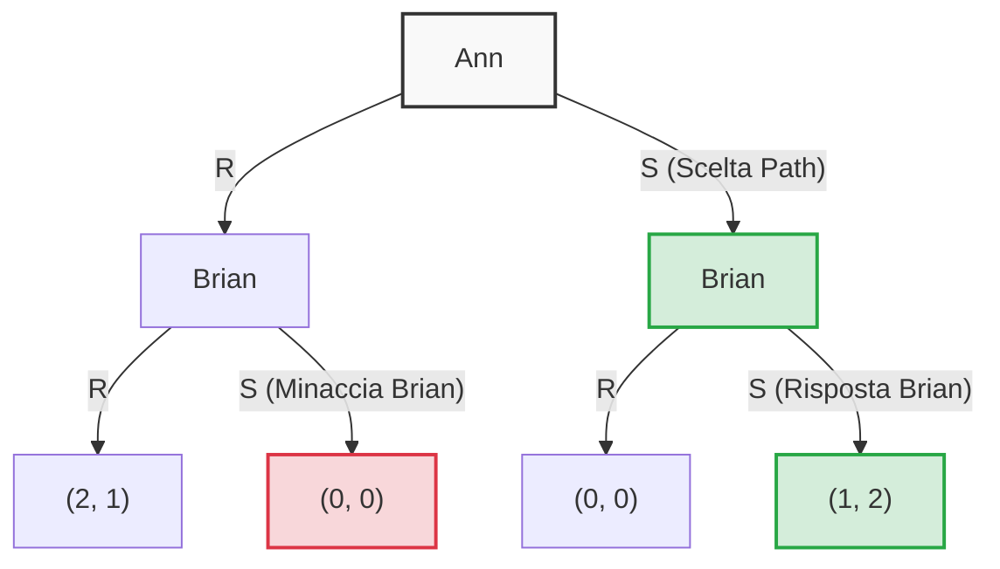
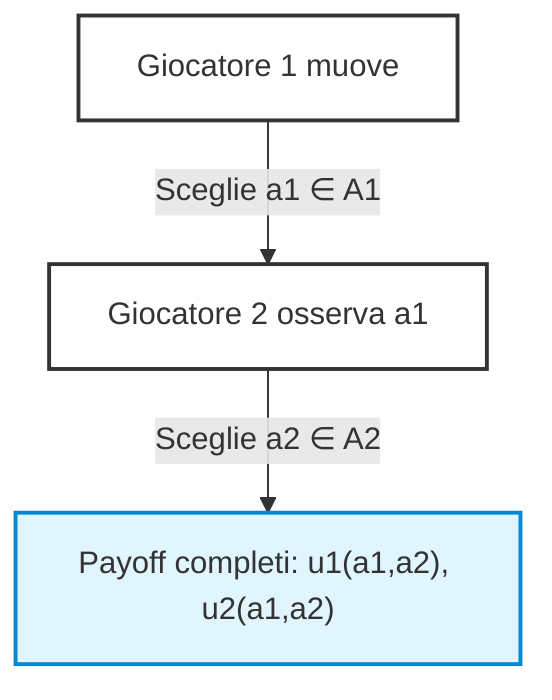
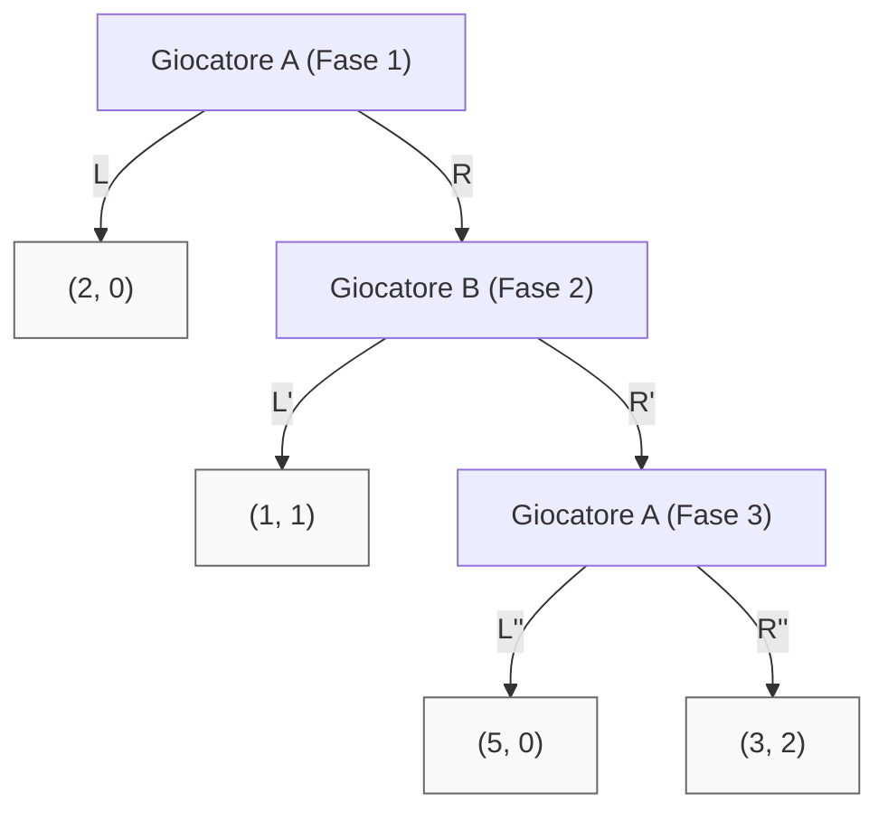
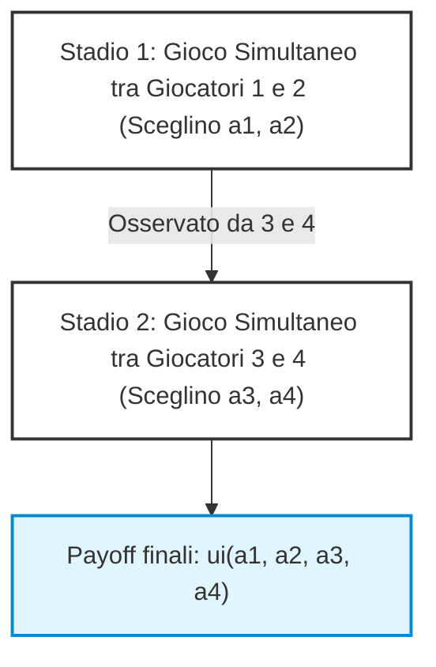
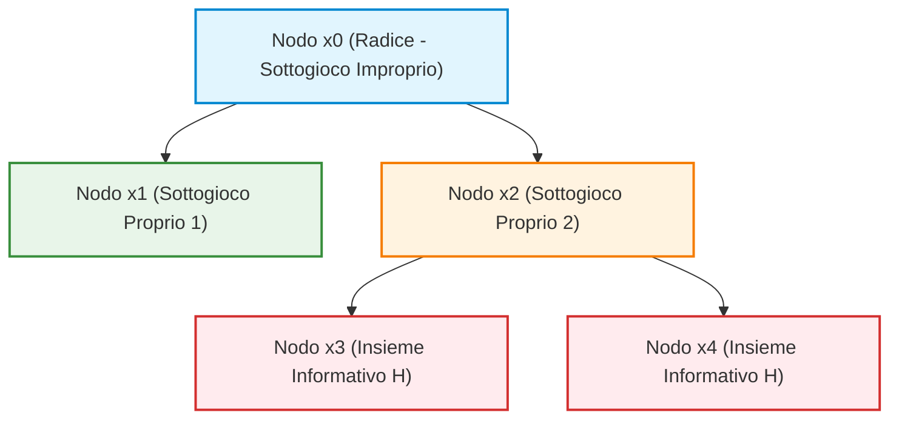
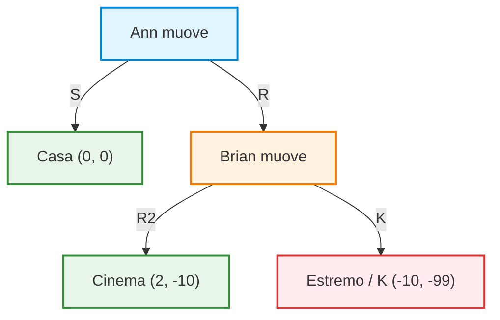

# Equilibrio di Nash nei Giochi Dinamici e Rappresentazione in Forma Normale

## Overview Didattica

In questa lezione viene affrontata l'estensione del concetto statico di **Equilibrio di Nash** (*Nash Equilibrium*) ai contesti dinamici o sequenziali. Sebbene i concetti fondamentali di strategia e dominanza si traducano in modo quasi diretto nella **Forma Estesa** (*Extensive Form*) di un gioco, l'applicazione diretta dell'equilibrio di Nash mostra limiti concettuali significativi che richiedono una raffinazione formale.

I punti chiave trattati includono:
* **Traduzione dei Giochi Sequenziali in Forma Normale (*Normal Form*):** Come modellare le scelte sequenziali trasformandole in piani d'azione completi e preventivi stilati dai giocatori prima dell'inizio del gioco.
* **Espansione dello Spazio delle Strategie:** Analisi della formulazione delle strategie contingenti per il giocatore che muove per secondo, illustrata mediante una variante sequenziale della **Battaglia dei Sessi** (*Battle of the Sexes*).
* **Identificazione degli Equilibri di Nash Puri:** Individuazione delle combinazioni di strategie che soddisfano la condizione di assenza di deviazione unilaterale incentrata sulle **Migliori Risposte** (*Best Responses*).
* **Limiti dell'Equilibrio di Nash nei Giochi Dinamici:** Confronto tra equilibri che conducono allo stesso risultato sul cammino effettivo di gioco (*Equilibrium Path*), evidenziando come la semplice forma normale includa equilibri basati su **Risposte Irrazionali** (*Irrational Responses*) o azioni non credibili nei rami dell'albero di gioco mai raggiunti (*Off-Equilibrium Path*).

---

### Estensione dell'Equilibrio di Nash ai Giochi Dinamici

Nei giochi in forma strategica o statica, il concetto di **Equilibrio di Nash** (*Nash Equilibrium* - NE) identifica una combinazione di strategie in cui nessun giocatore ha un incentivo a deviare unilateralmente: la mossa di ciascuno rappresenta la migliore risposta (*best response*) alle decisioni altrui.

Quando si passa a una formulazione dinamica (ovvero a un gioco descritto in forma estesa, dove i giocatori muovono in sequenza temporale), la prima intuizione è quella di «appiattire» la sequenza riconducendola a una forma normale equivalente. Ogni giocatore pianifica in anticipo tutte le proprie mosse per ciascun possibile sviluppo della storia di gioco. Tuttavia, l'applicazione diretta dell'equilibrio di Nash alla matrice risultante rivela un limite intrinseco: il concetto classico ammette equilibri sostenuti da scelte o «minacce» che si rivelerebbero irrazionali nel momento esatto in cui un giocatore fosse effettivamente chiamato a metterle in atto.

---

### La Battaglia dei Sessi Dinamica: Forma Normale e Molteplicità di Equilibri

Per comprendere come emerga questa discrepanza, si consideri la classica **Battaglia dei Sessi** (*Battle of the Sexes*) declinata in versione sequenziale.

* **Struttura del gioco**: Ann ($A$) decide per prima se andare al film romantico ($R$) o al film di fantascienza ($S$). Brian ($B$) osserva la scelta di Ann e prende la propria decisione ($R$ o $S$).
* **Strategie di Ann**: Ann possiede una singola decisione da prendere all'inizio della partita, senza alcuna storia pregressa. Il suo insieme di strategie pure è semplicemente:
  $$S_A = \{R, S\}$$
* **Strategie di Brian**: Brian muove dopo aver visto la decisione di Ann. Deve quindi pianificare un'azione per ogni possibile mossa iniziale di Ann. Una strategia pura di Brian è una funzione che mappa la storia di gioco $\{R, S\}$ in un'azione $\{R, S\}$. Brian dispone di $2 \times 2 = 4$ strategie pure:
  * $RR$: Gioca $R$ se Ann sceglie $R$, gioca $R$ se Ann sceglie $S$ (*"Vado sempre a vedere R"*).
  * $RS$: Gioca $R$ se Ann sceglie $R$, gioca $S$ se Ann sceglie $S$ (*"Imito la scelta di Ann"*).
  * $SR$: Gioca $S$ se Ann sceglie $R$, gioca $R$ se Ann sceglie $S$ (*"Faccio l'opposto di Ann"*).
  * $SS$: Gioca $S$ se Ann sceglie $R$, gioca $S$ se Ann sceglie $S$ (*"Vado sempre a vedere S"*).

I payoff convenzionali assegnano utilità più alta al vedersi insieme, con preferenza soggettiva per il film:
* Se entrambi scelgono $R$: payoff $(2, 1)$ (preferito da Ann).
* Se entrambi scelgono $S$: payoff $(1, 2)$ (preferito da Brian).
* Se scelgono film diversi: payoff $(0, 0)$.

Rappresentando il gioco in forma normale strategica $2 \times 4$:

| Ann \ Brian | $RR$ | $RS$ | $SR$ | $SS$ |
| :---: | :---: | :---: | :---: | :---: |
| **$R$** | $(2, 1)$ | $(2, 1)$ | $(0, 0)$ | $(0, 0)$ |
| **$S$** | $(0, 0)$ | $(1, 2)$ | $(0, 0)$ | $(1, 2)$ |

Analizzando le risposte ottime, emergono **tre equilibri di Nash in strategie pure**:
1. $(R, RR)$ con esito $(2, 1)$
2. $(R, RS)$ con esito $(2, 1)$
3. $(S, SS)$ con esito $(1, 2)$

#### Confronto tra $(R, RR)$ e $(R, RS)$
Entrambi i profili portano allo stesso risultato effettivo: Ann sceglie $R$, Brian sceglie $R$, e il payoff finale è $(2, 1)$. La differenza tra le due strategie di Brian risiede in un ramo dell'albero che **non viene mai raggiunto**:
* In $RS$, Brian pianifica che se Ann giocasse $S$, lui risponderebbe con $S$ (scelta razionale: meglio 2 che 0).
* In $RR$, Brian pianifica che se Ann giocasse $S$, lui risponderebbe comunque con $R$ (scelta irrazionale: otterrebbe 0 anziché 2).

Poiché Ann gioca effettivamente $R$, la risposta di Brian a una deviazione verso $S$ non viene testata nel gioco reale, rendendo $RR$ indistinguibile da $RS$ sul cammino intrapreso.

---

### Cammino di Equilibrio (*Equilibrium Path*) e Azioni Fuori Cammino (*Off-Path*)

> **Concetto Chiave: Definizione di Cammino di Equilibrio**
> In un gioco in forma estesa, dato un profilo strategico di equilibrio (puro o misto), l'**Equilibrium Path** (cammino di equilibrio) è l'insieme dei nodi dell'albero decisionale che vengono raggiunti con **probabilità strettamente maggiore di zero** ($P > 0$).
> Tutti i nodi dell'albero che non vengono visitati (probabilità nulla, $P = 0$) costituiscono i nodi **fuori dal cammino di equilibrio** (*off-equilibrium path*).

Perché è obbligatorio specificare cosa fa un giocatore anche sui nodi *off-path*, se questi non si verificheranno mai? 

La ragione sta nella verifica stessa dell'Equilibrio di Nash. Per verificare che un giocatore non voglia deviare unilateralmente, è necessario determinare il payoff che otterrebbe deviando. Quel payoff dipende interamente da come l'avversario ha pianificato di reagire sui nodi fuori cammino.

Nel terzo equilibrio, $(S, SS)$:
* L'equilibrium path è unicamente il ramo $S \to S$, che frutta ad Ann un payoff pari a $1$ e a Brian pari a $2$.
* Per verificare che Ann non voglia deviare su $R$, dobbiamo osservare la prima componente della strategia di Brian ($SS$). Tale componente dichiara che se Ann gioca $R$, Brian giocherà $S$.
* Se Ann devia su $R$, si scontra con la risposta programmata $S$, finendo nel payoff $(0, 0)$. Poiché $0 < 1$, Ann non ha incentivo a deviare.

Tuttavia, l'equilibrio $(S, SS)$ si regge su una **minaccia non credibile** (*incredible threat*): Brian afferma che, se Ann scegliesse $R$, lui sceglierebbe $S$ (ottenendo 0) invece di $R$ (che gli darebbe 1). Se Ann fosse fermamente convinta di questa minaccia, si piegherebbe a scegliere $S$. Ma se il gioco si gioca sequenzialmente e Ann muove per prima scegliendo $R$, Brian al proprio turno non avrebbe alcun incentivo razionale ad auto-punirsi scegliendo $S$. 

L'equilibrio di Nash statico non è in grado di cogliere l'irrazionalità di questa minaccia dinamica, poiché valuta le strategie solo come scelte pianificate a priori (*ex-ante*).

---

### Il Gioco dell'Ultimatum (*Ultimatum Game*)

Un esempio ancora più lampante della sovrabbondanza di equilibri di Nash irrazionali nei contesti dinamici è il **Gioco dell'Ultimatum**.

#### Descrizione del Modello Semplificato
Due giocatori devono spartirsi un totale di 10 risorse (es. caramelle):
* Il **Proponente** ($P$, *Proposer*) muove per primo e avanza un'offerta di spartizione. Per rendere il modello discretizzato e trattabile, consideriamo 3 sole azioni per $P$:
  * **$D$ (*Dastard* / Sleale)**: $P$ tiene $9$ caramelle per sé e ne offre $1$ al risponditore $\to (9, 1)$.
  * **$F$ (*Fair* / Equo)**: $P$ divide a metà $\to (5, 5)$.
  * **$G$ (*Generous* / Generoso)**: $P$ tiene $2$ caramelle per sé e ne offre $8$ $\to (2, 8)$.
* Il **Risponditore** ($R$, *Responder*) osserva la proposta avanzata da $P$ e decide se accettare (**$Y$**, *Yes*) o rifiutare (**$N$**, *No*).
  * Se $R$ accetta ($Y$), la divisione proposta viene applicata.
  * Se $R$ rifiuta ($N$), interviene una terza parte (es. un genitore) che confisca tutto: entrambi i giocatori ottengono un payoff di $(0, 0)$.

#### Spazio delle Strategie
* Il Proponente $P$ compie una scelta iniziale priva di storia pregressa:
  $$S_P = \{D, F, G\} \implies 3 \text{ strategie pure}$$
* Il Risponditore $R$ osserva l'azione scelta da $P$. Poiché gli insiemi informativi di $R$ sono dei singoletti (sa esattamente quale offerta è stata fatta), la sua strategia deve associare una risposta $Y$ o $N$ a ciascuna delle 3 offerte possibili ($D, F, G$).
  
  Una generica strategia di $R$ è descritta da una terna:
  $$s_R = (a_D, a_F, a_G) \quad \text{con } a_i \in \{Y, N\}$$
  Il numero totale di strategie pure a disposizione di $R$ è:
  $$|S_R| = 2^3 = 8 \text{ strategie pure}$$

#### Equilibri di Nash nel Gioco dell'Ultimatum
Se si calcolano gli equilibri di Nash considerando la matrice $3 \times 8$, emergono molti profili che rispettano formalmente la condizione di non deviazione unilaterale.

##### Esempio 1: Equilibri con Proposta Equa ($P$ gioca $F$)
Si consideri il profilo in cui il Proponente sceglie $F$ e il Risponditore pianifica la strategia $(N, Y, Y)$ (rifiuta $D$, accetta $F$, accetta $G$):
* **Cammino di gioco**: $P$ propone $F$, $R$ risponde $Y$. Il payoff finale è $(5, 5)$.
* **Verifica incentivi alla deviazione per $P$**:
  * Se $P$ devia su $D$, incontra la risposta $N$ programmata da $R \implies$ payoff $0 < 5$.
  * Se $P$ devia su $G$, incontra la risposta $Y \implies$ payoff $2 < 5$.
  * $P$ non ha incentivo a deviare.
* **Verifica incentivi alla deviazione per $R$**:
  * Dato che $P$ propone $F$, le componenti di $R$ relative a $D$ e a $G$ cadono fuori dal cammino di equilibrio (*off-path*). Cambiarle non altera il payoff corrente.
  * Cambiare la risposta a $F$ da $Y$ a $N$ porterebbe il suo payoff da $5$ a $0$ (peggiorativo).
  * $R$ non ha incentivo a deviare.

Di conseguenza, sia $(F, (N, Y, Y))$ sia $(F, (N, Y, N))$ sono **Equilibri di Nash**.

##### Esempio 2: Altri Equilibri Formali
Seguendo la medesima logica di verifica sui nodi *off-path*, risultano essere equilibri di Nash:
* Il profilo in cui $P$ propone $G$ ed $R$ adotta la strategia $(N, N, Y)$ (rifiuta tutto tranne l'offerta generosa).
* I profili in cui $P$ propone $D$ ed $R$ gioca strategie che prevedono l'accettazione di $D$, come $(Y, Y, Y)$ oppure $(Y, N, N)$.

#### Il Limite dell'Equilibrio di Nash nei Giochi Sequenziali
Questi equilibri presentano una debolezza intrinseca: strategie come $(N, Y, Y)$ o $(N, N, Y)$ poggiano sull'idea che il Risponditore sia disposto a dire "No" a un'offerta asimmetrica pur di forzare il Proponente a essere più generoso. 

Tuttavia, all'atto pratico, se il Proponente deviasse e scegliesse $D$ (offrendo $1$ caramella), il Risponditore si troverebbe a dover scegliere tra:
* Accettare ($Y$): payoff pari a $1$.
* Rifiutare ($N$): payoff pari a $0$.

Un agente strettamente razionale, interessato a massimizzare il proprio payoff al momento della decisione, sceglierà sempre $1 > 0$. La minaccia di rispondere $N$ alla proposta $D$ è dunque **incredibile**: esiste sulla carta nella pianificazione *ex-ante* della forma normale, ma non verrebbe implementata al momento opportuno lungo l'albero decisionale. 

Per risolvere questa incongruenza ed eliminare gli equilibri fondati su minacce non credibili, nei giochi dinamici si renderà necessario un raffinamento dell'equilibrio di Nash: il concetto di **Equilibrio di Nash Perfetto nei Sottogiochi** (*Subgame Perfect Nash Equilibrium* - SPNE).

---

Usa queste note didattiche strutturate per approfondire l'analisi dei giochi sequenziali, dell'induzione a ritroso e del problema della credibilità delle strategie nei giochi dinamici.

---

### Giochi Sequenziali e Induzione a Ritroso (Backward Induction)

Negli episodi precedenti abbiamo visto che l'**Equilibrio di Nash (Nash Equilibrium)** può essere esteso ai giochi dinamici. Tuttavia, applicare ciecamente la definizione standard di Equilibrio di Nash a un gioco dinamico presenta un limite concettuale fondamentale: **non tutte le minacce o le promesse implicite in una strategia di Nash sono credibili**. 

Un Equilibrio di Nash serve come strumento di previsione basato sulla razionalità dei giocatori. Ma affinché una soluzione sia un'effettiva previsione del comportamento reale, occorre che i giocatori desiderino realmente eseguire le mosse pianificate anche nei nodi di decisione futuri. Da qui nasce la necessità della **Razionalità Sequenziale (Sequential Rationality)**.

Per analizzare questo problema, ci concentriamo su una classe specifica di giochi dinamici: i **Giochi Sequenziali (Sequential Games)**.

> **Concetto Chiave: Gioco Sequenziale**  
> Un gioco sequenziale è un gioco dinamico a **Informazione Perfetta (Perfect Information)**. In ogni momento in cui un giocatore deve muovere:
> 1. Conosce esattamente l'intera storia passata del gioco.
> 2. Tutti gli **Insiemi di Informazione (Information Sets)** sono **singoli (singletons)**, ossia contengono un solo nodo di decisione.
> 3. La struttura del gioco e l'informazione perfetta sono **conoscenza comune (common knowledge)**: chi muove sa che gli altri vedranno la sua mossa e regoleranno di conseguenza le proprie decisioni future.

Un classico esempio concettuale è il gioco degli scacchi: ogni mossa è visibile a entrambi i giocatori e chi muove sa che l'avversario risponderà osservando esattamente la mossa appena eseguita.

---

#### Formalizzazione Matematica per Due Giocatori

Consideriamo un gioco sequenziale a due giocatori:
1. Il **Giocatore 1** sceglie un'azione $a_1$ da un insieme di azioni disponibili $A_1$.
2. Il **Giocatore 2** osserva l'azione $a_1$ e successivamente sceglie un'azione $a_2$ dall'insieme $A_2$ (eventualmente dipendente da $a_1$).
3. Al termine, i giocatori ricevono i rispettivi payoff definiti dalle funzioni di utilità $u_1(a_1, a_2)$ e $u_2(a_1, a_2)$.

Essendo il Giocatore 2 razionale e trovandosi al nodo finale di scelta, risolve un problema di ottimizzazione puntuale per qualsiasi azione $a_1$ precedentemente giocata dal Giocatore 1:

$$R_2(a_1) = \arg\max_{a_2 \in A_2} u_2(a_1, a_2)$$

Poiché la razionalità e la struttura del gioco sono *common knowledge*:
* Il Giocatore 2 è in grado di calcolare la propria risposta ottimale $R_2(a_1)$.
* Il Giocatore 1 **può anticipare perfettamente** la risposta $R_2(a_1)$ del Giocatore 2 per ogni possibile azione $a_1$.

Di conseguenza, il Giocatore 1 sceglierà l'azione $a_1^*$ che massimizza la propria utilità finale tenendo già conto della reazione del Giocatore 2:

$$a_1^* = \arg\max_{a_1 \in A_1} u_1\left(a_1, R_2(a_1)\right)$$

L'esito del gioco sarà la coppia di azioni $(a_1^*, R_2(a_1^*))$, che costituisce un Equilibrio di Nash in strategie pure **sequenzialmente razionale**.

---

#### Il Teorema di Zermelo

La formalizzazione precedente trova fondamento in un risultato teorico fondamentale dei giochi ad informazione perfetta.

> **Teorema di Zermelo**  
> Ogni gioco dinamico finito ad informazione perfetta ammette una soluzione ottenibile tramite **Induzione a Ritroso (Backward Induction)** che è sequenzialmente razionale.  
> Inoltre, se tutti i payoff dei nodi terminali sono distinti per ciascun giocatore, la soluzione ottenuta per induzione a ritroso è **unica**.

*Principio dell'Induzione a Ritroso:*  
Si parte dai nodi decisionali di livello più basso (quelli immediatamente precedenti i nodi terminali). In ciascuno di essi, il giocatore di turno sceglie la mossa che massimizza il proprio payoff. Tali nodi vengono quindi "sostituiti" con il payoff corrispondente alla mossa ottimale. Risalendo l'albero di decisione nodo per nodo fino alla radice, si ottiene il profilo di strategie ottimale.

---

### Il Gioco della Fiducia (Trust Game)

Per comprendere come l'induzione a ritroso elimini gli equilibri di Nash basati su minacce non credibili, analizziamo il **Gioco della Fiducia (Trust Game)**.

#### Struttura del Gioco
Il gioco si sviluppa su tre fasi sequenziali tra due giocatori, il **Giocatore A** e il **Giocatore B**:

* **Fase 1 (Nodo A1):** Il Giocatore A sceglie se terminare subito il gioco con la mossa $L$ oppure passare la mano al Giocatore B con la mossa $R$.
  * Se sceglie $L$, il gioco termina con payoff $(2, 0)$ (2 per A, 0 per B).
  * Se sceglie $R$, la mano passa a B (Nodo 2).
* **Fase 2 (Nodo B1):** Il Giocatore B sceglie se terminare il gioco con $L'$ oppure passare la mano ad A con $R'$.
  * Se sceglie $L'$, il gioco termina con payoff $(1, 1)$.
  * Se sceglie $R'$, la mano torna ad A (Nodo 3).
* **Fase 3 (Nodo A2):** Il Giocatore A sceglie tra $L''$ e $R''$. Entrambe le mosse chiudono il gioco:
  * $L''$ fornisce un payoff di $(5, 0)$.
  * $R''$ fornisce un payoff di $(3, 2)$.

#### Risoluzione tramite Induzione a Ritroso

Risolviamo il gioco risalendo dalla fine:

1. **Passo 1 (Analisi della Fase 3 - Nodo A2):**  
   Il Giocatore A si trova a scegliere tra $L''$ (payoff 5) e $R''$ (payoff 3). Poiché A è razionale ed egoista, confronta solo la propria utilità:
   $$5 > 3 \implies \text{A sceglie } L''$$
   La mossa $R''$ viene eliminata. Il valore effettivo del nodo A2 diventa il payoff associato a $L''$, ovvero $(5, 0)$.

2. **Passo 2 (Analisi della Fase 2 - Nodo B1):**  
   Il Giocatore B sa che, se scegliesse $R'$, il gioco passerebbe al nodo A2 dove A giocherà sicuramente $L''$, offrendo a B un payoff pari a $0$.  
   Quindi B confronta le sue due opzioni reali:
   * Scegliere $L'$: payoff per B pari a $1$.
   * Scegliere $R'$: porta all'esito $(5, 0)$, quindi payoff per B pari a $0$.
   
   $$1 > 0 \implies \text{B sceglie } L'$$
   La mossa $R'$ viene eliminata. Il valore del nodo B1 diventa il payoff associato a $L'$, cioè $(1, 1)$.

3. **Passo 3 (Analisi della Fase 1 - Nodo A1):**  
   Il Giocatore A all'inizio sa che se gioca $R$, B risponderà con $L'$ ottenendo $(1, 1)$.  
   Di conseguenza A confronta:
   * Scegliere $L$: payoff per A pari a $2$.
   * Scegliere $R$: porta all'esito $(1, 1)$, quindi payoff per A pari a $1$.
   
   $$2 > 1 \implies \text{A sceglie } L$$

**Esito Finale dell'Induzione a Ritroso:**  
Il Giocatore A gioca subito $L$. Il gioco termina immediatamente al primo nodo con payoff **$(2, 0)$**.

---

#### Analisi Critica: Mancanza di Fiducia ed Inefficienza Pareto

L'esito $(2, 0)$ evidenzia la dinamica profonda di questo gioco:

* **Assenza di Credibilità:** A vorrebbe convincere B a giocare $R'$, promettendo di scegliere poi $R''$ al nodo 3 per far ottenere a entrambi un payoff elevato pari a $(3, 2)$. Tuttavia, tale promessa **non è credibile**: giunti al nodo 3, A preferirà sempre $5$ a $3$ (giocando $L''$). B lo sa e quindi non accorda la sua fiducia (giocando $L'$).
* **Inefficienza di Pareto (Pareto Inefficiency):** L'esito finale dell'equilibrio razionale $(2, 0)$ è **Pareto-inefficiente**. Esistono infatti altri esiti dell'albero, come $(3, 2)$, in cui *entrambi* i giocatori starebbero strettamente meglio rispetto a $(2, 0)$.

> **Concetto Chiave: Il Dilemma della Fiducia**  
> L'ipotesi di razionalità pura e l'assenza di meccanismi di vincolo contrattuale (o di comunicazione vincolante) costringono i giocatori verso un esito sub-ottimale. La sfiducia reciproca razionale impedisce di raggiungere il risultato socialmente desiderabile $(3, 2)$.

---

### Estensione a Giochi con Informazione Imperfetta

Cosa succede se il gioco dinamico contiene nodi con **informazione imperfetta** (ad esempio, sotto-giochi in cui alcuni giocatori muovono contemporaneamente)? In questi casi non possiamo applicare l'induzione a ritroso pura sui singoli nodi, ma è possibile estendere la stessa logica per sotto-giochi.

#### Struttura Generale a Due Stadi

Consideriamo una struttura in cui:
1. **Stadio 1:** I Giocatori 1 e 2 giocano un gioco statico simultaneo scegliendo le azioni $a_1 \in A_1$ e $a_2 \in A_2$.
2. **Stadio 2:** I Giocatori 3 e 4 osservano la coppia di azioni $(a_1, a_2)$ e successivamente giocano un secondo gioco statico simultaneo scegliendo $a_3 \in A_3$ e $a_4 \in A_4$.

I payoff finali dipendono dall'intera sequenza: $u_i(a_1, a_2, a_3, a_4)$ per $i = 1, \dots, 4$.

#### Procedimento di Risoluzione Generalizzato

1. **Risoluzione dello Stadio 2:**  
   Per ogni possibile coppia $(a_1, a_2)$ giocata al primo stadio, i Giocatori 3 e 4 affrontano un gioco statico a informazione completa. Si calcola l'Equilibrio di Nash di questo sotto-gioco:
   $$\left(a_3^*(a_1, a_2),\, a_4^*(a_1, a_2)\right)$$

2. **Risoluzione dello Stadio 1:**  
   I Giocatori 1 e 2 anticipano che qualunque scelta $(a_1, a_2)$ compiano, lo Stadio 2 evolverà verso l'Equilibrio di Nash $\left(a_3^*(a_1, a_2), a_4^*(a_1, a_2)\right)$.  
   Di conseguenza, i Giocatori 1 e 2 risolvono il proprio gioco simultaneo al primo stadio considerando come payoff attesi le utilità riflesse dallo secondo stadio:
   $$\tilde{u}_i(a_1, a_2) = u_i\left(a_1, a_2, a_3^*(a_1, a_2), a_4^*(a_1, a_2)\right) \quad \text{per } i=1,2$$
   Trovando l'equilibrio $(a_1^*, a_2^*)$ di questo gioco ridotto, si ottiene la soluzione globale dell'intero gioco dinamico.

> **Nota di Attenzione sulla Non-Unicità:**  
> A differenza dei giochi sequenziali ad informazione perfetta con payoff distinti (dove il Teorema di Zermelo garantisce l'unicità), quando lo stadio finale presenta mosse simultanee possono esistere **più Equilibri di Nash** per lo stesso sotto-gioco. In tal caso, l'unicità della soluzione globale viene a mancare e occorre specificare quale equilibrio i giocatori stiano anticipando.

---

### Definizione di Sottogioco (Subgame)

Per estendere il concetto di Equilibrio di Nash ai giochi dinamici in forma estesa, occorre formalizzare la struttura algebrica e topologica dell'albero di gioco, introducendo la nozione di **Sottogioco (Subgame)**.

Un gioco in forma estesa si sviluppa come un albero decisionale. Tuttavia, un sottogioco non coincide semplicemente con un qualsiasi sotto-albero casuale.

#### Requisiti Formali di un Sottogioco Proprio
Un **Sottogioco Proprio (Proper Subgame)** $G'$ di un gioco $G$ è un sotto-albero che soddisfa le seguenti condizioni:
1. **Nodo Radice Singolo**: Inizia da un unico nodo decisionale $x_j$ dell'albero originario.
2. **Chiusura Ereditaria**: Include il nodo $x_j$ e tutti i suoi nodi successori (figli, nipoti, fino ai nodi terminali).
3. **Rispetto degli Insiemi Informativi (No-Splitting Rule)**: Se un nodo $x_j$ appartiene a $G'$, allora **tutti** i nodi $x_k$ appartenenti allo stesso insieme informativo $H_i(x_j)$ di $x_j$ devono appartenere obbligatoriamente a $G'$. 

In altre parole, **non è consentito "spezzare" gli insiemi informativi** (*information sets*). Se un nodo appartiene a un insieme informativo non singolare (ovvero una "bolla" che rappresenta un gioco simultaneo o una mancanza di informazione), l'intero insieme informativo deve essere contenuto all'interno del sottogioco. Se si tagliasse un insieme informativo a metà, non si starebbe definendo un sotto-gioco autonomo e ben definito, ma si uscirebbe dalle regole del gioco stesso.

L'intero gioco $G$ è sempre considerato un **sottogioco improprio** di se stesso.

*Spiegazione dello schema:* Il sotto-albero che parte da $x_1$ forma un sottogioco valido. Il sotto-albero che parte da $x_2$ include interamente l'insieme informativo composto da $x_3$ e $x_4$. Isolare il solo nodo $x_3$ senza includere $x_4$ non costituisce un sottogioco valido.

---

### Equilibrio di Nash Perfetto nei Sottogiochi (SPNE)

L'**Equilibrio di Nash Perfetto nei Sottogiochi (Subgame Perfect Nash Equilibrium - SPNE)**, introdotto da Reinhard Selten (premio Nobel per l'Economia insieme a John Nash e John Harsanyi), rappresenta un raffinamento (*refinement*) del concetto di Equilibrio di Nash per i giochi dinamici.

#### Definizione Formale
Un profilo di strategie $s^* = (s_1^*, s_2^*, \dots, s_n^*)$ è un **Equilibrio di Nash Perfetto nei Sottogiochi (SPNE)** se e solo se la restrizione di $s^*$ a ciascun sottogioco $G'$ di $G$ costituisce un Equilibrio di Nash per $G'$.

Poiché il gioco $G$ è sottogioco di se stesso, ogni SPNE è *necessariamente* un Equilibrio di Nash del gioco globale, ma vale il contrario: esistono Equilibri di Nash che **non** sono SPNE.

#### Teoremi Fondamentali di Esistenza e Unicità
* **Teorema di Esistenza di Selten**: Ogni gioco finito in forma estesa con informazione completa ammette almeno un Equilibrio di Nash Perfetto nei Sottogiochi.
* **Estensione ai giochi reali**: Questo risultato garantisce l'esistenza di una strategia ottimale risolutiva per giochi complessi ad informazione perfetta come gli scacchi, il Go o il tris (*tic-tac-toe*). Sebbene il teorema dimostri la certezza dell'esistenza di una strategia vincente o di patta per il primo o secondo giocatore, esso non fornisce un algoritmo a complessità computazionale ridotta per ricavarla in giochi ad alta complessità combinatoria.
* **Unicità via Induzione a Ritroso**: Nei giochi dinamici a informazione perfetta con orizzonte temporale finito, l'SPNE si ricava in modo unico e costruttivo applicando l'algoritmo di **Induzione a Ritroso (Backward Induction)**.

---

### Specifica Completa delle Strategie e Notazione

> **Concetto Chiave**: Negli esami e nelle trattazioni formali di Teoria dei Giochi, una **strategia** per un giocatore non è semplicemente la sequenza di mosse effettivamente giocate lungo il percorso di equilibrio (*on-equilibrium path*). Una strategia è un **piano d'azione completo** che deve specificare la decisione del giocatore in **ogni singolo nodo decisionale** in cui egli è chiamato a muovere, compresi i nodi che non verranno mai raggiunti nella partita reale (*off-equilibrium path*).

#### Esempio Applicato (Trust Game esteso)
Consideriamo un gioco in cui il Giocatore A muove al nodo 1 e al nodo 3, mentre il Giocatore B muove al nodo 2:

* Giocatore A ha due nodi decisionali: al nodo 1 può scegliere tra $L$ e $R$; al nodo 3 può scegliere tra $L''$ e $R''$.
* Giocatore B ha un nodo decisionale (nodo 2) dove sceglie tra $L'$ e $R'$.

Se l'esito dell'equilibrio prevede che A scelga $L$ al nodo 1 e il gioco termini immediatamente, definire l'equilibrio semplicemente come "$A$ gioca $L$" è **errato**.

La formalizzazione corretta del profilo di strategie di equilibrio richiede la specificazione completa dei vettori d'azione:
$$s^* = \Big( (L, L''), L' \Big)$$

Dove:
* $s_A = (L, L'')$ indica che il Giocatore A sceglie $L$ al primo nodo e $L''$ al terzo nodo.
* $s_B = L'$ indica la scelta del Giocatore B al secondo nodo.

Senza specificare la mossa $L''$ al nodo 3, è impossibile verificare matematicamente se il profilo costituisce un SPNE, in quanto non si potrebbe valutare la razionalità dell'azione di A nel sottogioco che ha origine dal nodo 3.

---

### Eliminazione delle Minacce Non Credibili (Non-Credible Threats)

Il motivo principale per cui l'Equilibrio di Nash standard non è sufficiente nei giochi dinamici risiede nella presenza di **minacce non credibili (non-credible threats)**. L'SPNE elimina tutte le strategie di equilibrio basate su minacce irrazionali nei nodi fuori equilibrio.

#### Esempio 1: Battaglia dei Sessi Dinamica
Nel gioco della Battaglia dei Sessi in forma dinamica con Ann che muove per prima:
1. Ann sceglie tra *Romance* ($R$) e *Sci-Fi* ($S$).
2. Brian osserva la scelta di Ann e decide se andare a $R$ o $S$.

La risposta migliore (*Best Response*) di Brian al generico nodo $A_1$ è copiare la mossa di Ann: 
$$R_2(A_1) = A_1$$

Tuttavia, esiste un Equilibrio di Nash statico in cui Brian dichiara la strategia rigida: "Giocherò sempre $S$, indipendentemente da cosa sceglie Ann". Ann, anticipando irrazionalmente questa risposta, sceglie $S$ per evitare il payoff $(0,0)$. 

Questo profilo $(S, S)$ è un Equilibrio di Nash, ma **non è un SPNE**. Se Ann deviasse scegliendo $R$, la risposta di Brian di scegliere $S$ (ottenendo payoff 0 anziché 2) non rappresenterebbe una risposta ottimale nel sottogioco originato da $R$. La minaccia di Brian di andare a vedere il film Sci-Fi a fronte di un'uscita Romantica è una *minaccia non credibile*.

#### Esempio 2: Gioco Estremo del Film Romantico (Minaccia del Suicidio)
Per comprendere l'assurdità logica delle minacce non credibili negli Equilibri di Nash tradizionali, si consideri la seguente variazione estrema:

* Ann muove per prima e sceglie se andare al cinema a vedere un Film Romantico ($R$) o Stare a Casa ($S$).
* Brian odia i film romantici (Payoff $= -10$). Se restano a casa, il payoff è $(0,0)$.
* Se Ann sceglie $R$, Brian ha due azioni possibili: 
  * Accettare e andare al cinema ($R_2$, Payoff Ann $= 2$, Payoff Brian $= -10$).
  * Lanciarsi dalla finestra / Suicidarsi ($K$, Payoff Ann $= -10$, Payoff Brian $= -99$).

Analizzando le strategie:
* Brian formula la minaccia: *"Se scegli $R$, io risponderò con $K$ (mi uccido)"*.
* Il profilo $(S, K)$ rappresenta un Equilibrio di Nash. Per Ann, scegliere $S$ dà $0$, mentre deviare su $R$ (data la minaccia $K$ di Brian) darebbe $-10$. Per Brian, dato che Ann gioca $S$, la sua scelta al nodo non raggiunto non impatta sul payoff immediato.

Tuttavia, $(S, K)$ **non è un SPNE**. Se Ann sceglie $R$, nel sottogioco risultante Brian deve confrontare un payoff di $-10$ (andare al film) con un payoff di $-99$ (morire). Poiché $-10 > -99$, un agente razionale sceglierà sempre $R_2$. Ann, sapendo che Brian è razionale, non crede alla minaccia $K$, sceglie $R$ e l'unico equilibrio perfetto nei sottogiochi è:
$$s_{SPNE}^* = (R, R_2)$$

*Nota di contesto*: Analoghe dinamiche si riscontrano nei giochi di Falco-Colomba dinamici (es. deterrenza e ritorsione nucleare totale) o nelle minacce estorsive con ostaggi: un giocatore razionale non esegue mai un'azione autodistruttiva se questa gli garantisce un payoff strettamente inferiore rispetto alla sottomissione.

---

### Ultimatum Game e Risultati Empirico-Comportamentali

Applichiamo la perfezione nei sottogiochi all'**Ultimatum Game**:
1. Il Propositore $P$ propone la divisione di una somma di denaro (es. $10$ unità) offrendo una quota $x \in [0, 10]$ al Rispondente $R$.
2. Il Rispondente $R$ osserva $x$ e sceglie se Accettare ($Y$) o Rifiutare ($N$). Se rifiuta, entrambi ottengono $0$.

#### Soluzione Teorica SPNE
In un orizzonte discreto con ammontare minimo pari a $\epsilon > 0$ (es. $1$ euro):
* Per ogni $x > 0$, il Rispondente riceve $x$ se accetta ($Y$) e $0$ se rifiuta ($N$). Poiché $x > 0$, la scelta razionale stretta per $R$ è $Y$.
* Per $x = 0$, $R$ è indifferente tra $Y$ e $N$ (riceve $0$ in entrambi i casi).
* Anticipando la razionalità di $R$ tramite induzione a ritroso, il Propositore $P$ offre la quantità minima non nulla $x^* = \epsilon$ e il Rispondente accetta.

$$s_{SPNE}^* = \left( P \text{ offre } \epsilon, R \text{ accetta qualsiasi offerta } x \ge \epsilon \right)$$

Tutte le minacce del tipo *"Rifiuterò se mi offri meno del 50%"* costituiscono minacce non credibili fuori dall'equilibrio.

#### Deviazioni Sperimentali ed Economia Comportamentale
Nonostante la soluzione SPNE sia matematicamente univoca, i test empirici condotti su soggetti umani mostrano deviazioni sistematiche dalla Teoria dei Giochi pura:

* **Soglia di Equità (*Fairness Threshold*)**: Mediamente, i rispondenti umani rifiutano offerte inferiori al $25\% - 30\%$ della somma totale, preferendo distruggere valore (ottenere $0$) pur di punire l'iniquità del Propositore.
* **Comportamento Reale**: L'offerta media avanzata dai propositori nella realtà si attesta attorno al $40\% - 50\%$.

#### Applicazione Pratica: Trasferimenti nei Contratti di Mercato (es. FantaCalcio)
Questo comportamento si osserva frequentemente nei mercati di scambio o in scenari ludici reali (ad esempio, le negoziazioni per lo svincolo o la vendita di giocatori nel FantaCalcio):

* *Scenario*: Il Giocatore A possiede una risorsa a valore marginale nullo che altrimenti andrebbe persa/svincolata a costo 0. Il Giocatore B offre la cifra minima consentita (1 credito).
* *Esito Razionale (SPNE)*: Il Giocatore A dovrebbe accettare 1 credito, in quanto $1 > 0$.
* *Esito Reale Comportamentale*: Il Giocatore A spesso rifiuta l'offerta dicendo *"No, a questo prezzo basso preferisco perderlo a zero piuttosto che darlo a te"*.

Studi psicologici e neuro-economici collegano questa irrazionalità decisionale alla percezione dell'orgoglio, al rifiuto dell'offesa percepita e a fattori biologici (come i livelli di aggressività e testosterone), dimostrando che i soggetti umani deviano dalla pura razionalità algoritmica a favore di dinamiche di dominanza sociale e di punizione altruistica.

---

> [!NOTE]
> ### Note per l'Esame e Avvisi del Docente
> - **Definizione completa delle strategie negli equilibri (di Nash e SPE):** All'esame è fondamentale evitare un errore molto comune commesso dagli studenti, ossia definire l'equilibrio indicando unicamente la mossa effettivamente giocata lungo il percorso (es. "A gioca L"). È obbligatorio specificare le strategie complete di tutti i giocatori, indicando le azioni previste in ciascun nodo della struttura di gioco, compresi i nodi "off-path" che non vengono raggiunti nella pratica.