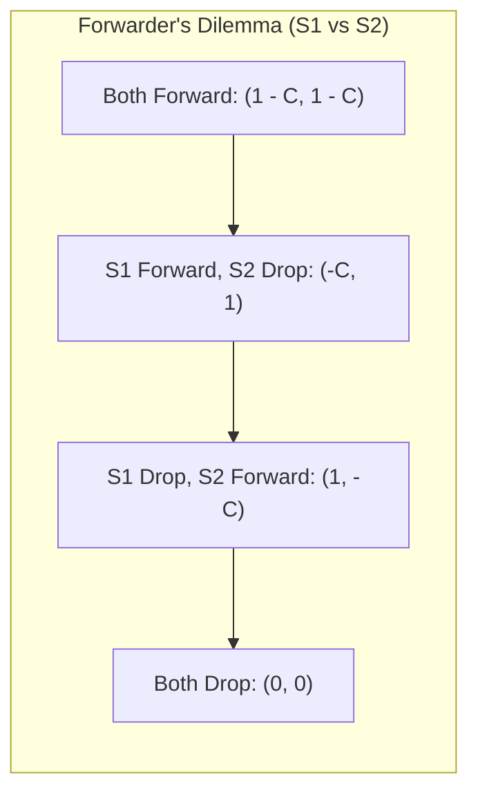
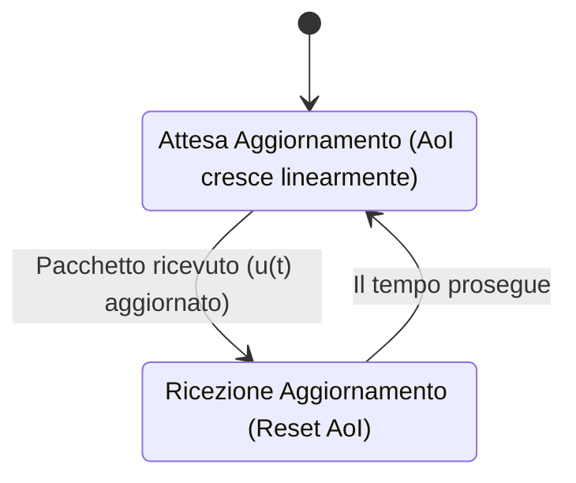
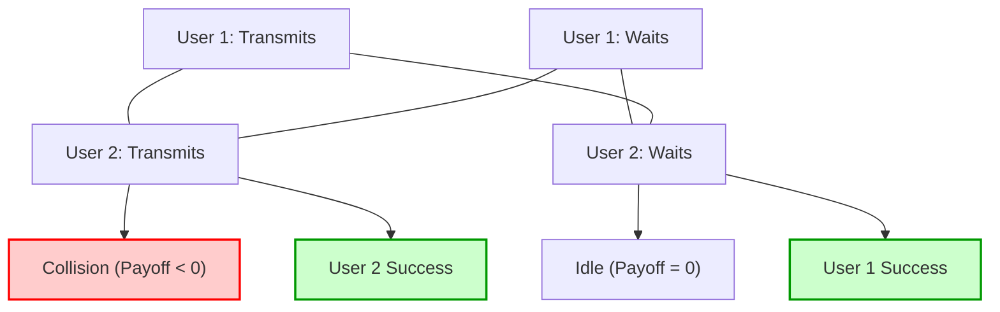
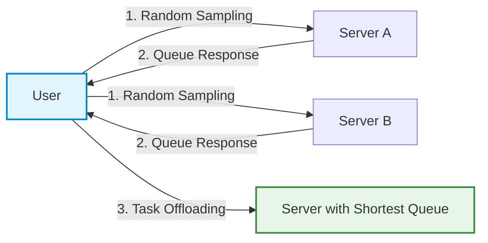
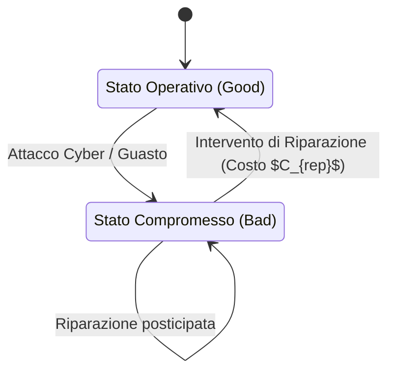
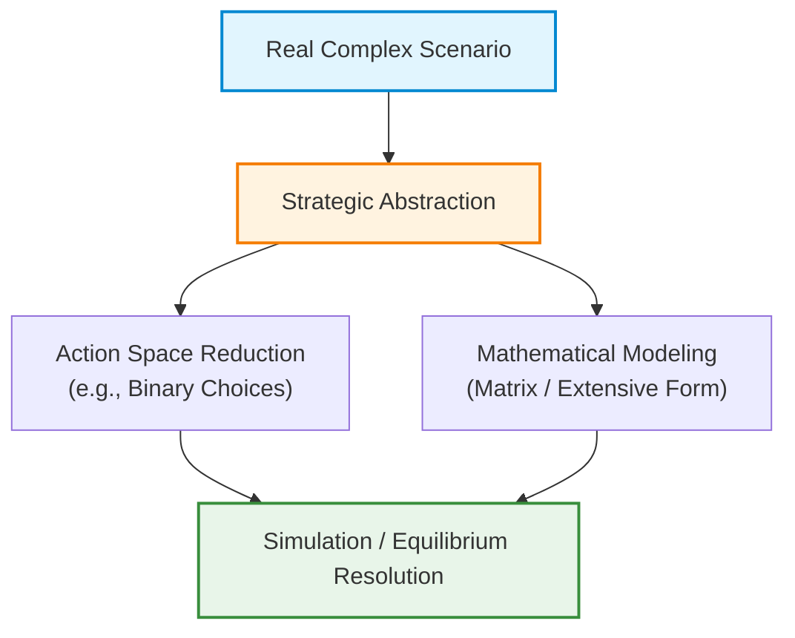

# Educational Project Guidelines and Modeling Principles in Game Theory

## Teaching Overview

In this lecture, structural guidelines for the development of educational projects for the Game Theory course are presented. The main goal is to guide students in formulating effective project ideas, oriented towards real-world engineering applications and connected to advanced research activities.

Fundamental requirements that a problem must satisfy to be analyzed through Game Theory are defined, with particular emphasis on:

* **Strategic Interaction**: the need for multi-agent models where outcomes depend on the joint actions of individual, reactive players.
* **Analytical Tractability**: the importance of adopting transparent or closed-form mathematical formulations — such as models based on Queuing Theory, Shannon's Capacity, or energy/economic balances — to facilitate sensitivity analysis.
* **Qualitative Evaluation**: focusing on identifying behavioral trends and system trade-offs, favoring a qualitative understanding of dynamics over excessive numerical precision.

Finally, organizational details regarding the choice of topics, the use of teaching platforms, and the support provided by the course tutor are illustrated.

---

### Course Introduction and Project Guidelines

The objective of this introductory part is to stimulate concrete ideas for the development of end-of-course projects. We will not analyze formal details — for those, refer to the official documents published on Moodle, where you will find a smart table with proposals, background material, and instructions on booking procedures.

It is possible (and encouraged) to propose original or wild ideas, provided they are framed within a Master's Level Engineering context. The topics we will present are based on real applications, connected to research activities and publications from our department. Regarding group management and assistance, an official tutor is assigned: support should be limited to a maximum number of interactions (for example, an initial kick-off meeting and a final check), as project development must remain the work of the students.

---

### Fundamental Principles for Successful Modeling

When applying Game Theory to an engineering, security, or machine learning problem, one must avoid the common mistake of confusing a simple interaction among multiple entities with a true strategic game.

The essential **Key Concepts** for a successful project are:
* **Multi-agent Interaction:** There must be multiple individual players.
* **Individual Actions and Outcomes:** Each player takes autonomous actions. These actions converge into a common outcome, but the outcome is evaluated *individually* by each player through their own utility or cost function. If this mutual strategic reactivity is missing (for example, a data classifier where the data does not react strategically to classification), we are **not** dealing with Game Theory.
* **Analytical Tractability:** It is recommended to use simple and tractable closed-form approximations. One can rely on queuing theory, probability theory, or basic economic/energy formulas.
* **Qualitative Description of Trends:** Engineers often tend to be excessively meticulous about decimals. This is not necessary: the important thing is to correctly capture the underlying trend (e.g., "more activity corresponds to higher energy consumption and greater success, but leads to battery depletion").

---

### Main Categories of Modeling Setups

Successful projects usually fall into three main categories:

#### 1. Adversarial Setups
Typical in cybersecurity. They involve two players with diametrically opposed interests, often modeled as zero-sum games. One player (e.g., the network or the user) tries to maximize a performance metric (Shannon capacity, energy consumption, network uptime), while the adversary (e.g., a jammer, an eavesdropper) tries to minimize it (maximizing downtime or stealing information).

#### 2. Common Goal / Tragedy of the Commons Setups
Multiple agents act in a distributed and uncoordinated manner towards a similar goal, yet incur anarchy phenomena (price of anarchy) due to selfishness or lack of communication.

#### 3. Asymmetric Setups
A very effective and *fast* research strategy consists of taking an existing paper based on the simplifying assumption of node symmetry and asking: *what happens if the players are not symmetric?* Asymmetry radically changes the number and nature of Nash Equilibria.

---

### Practical Modeling Examples

#### The Forwarder's Dilemma
Consider a multi-hop scenario where two sources $S_1$ and $S_2$ want to send packets to their respective destinations $D_1$ and $D_2$, but are not in direct coverage and must help each other by acting as relays.

* The utility of successfully delivering one's packet is equal to $1$.
* The act of forwarding someone else's packet incurs an energy cost $C$.

The possible strategies for a node are: **Drop** ($D$) or **Forward** ($F$). The payoff matrix exactly reflects the famous **Prisoner's Dilemma**:


*Graphical style:*
```mermaid
style A fill:#e1f5fe,stroke:#01579b,stroke-width:2px;
style B fill:#fff9c4,stroke:#fbc02d,stroke-width:2px;
style C fill:#fff9c4,stroke:#fbc02d,stroke-width:2px;
style D fill:#ffebee,stroke:#c62828,stroke-width:2px;
```

**Conclusion:** The strategy $F$ (Forward) is strictly dominated by $D$ (Drop). In a static game, the unique Nash Equilibrium is $(D, D)$, explaining why pure multi-hop wireless networks struggle to sustain themselves without repeated cooperation mechanisms or external incentives (quid pro quo).

---

#### Jamming Setup (Disagreement and Mixed Strategies)
Consider a communication channel in which a source sends data by choosing between two routes or channels ($A$ or $B$), while a jammer tries to block transmission by choosing to attack $A$ or $B$. 
Assuming a gain/penalty $P$, the model reduces to an **odds and evens** game:
* The source wants to choose a different channel from the one attacked.
* The jammer wants to intercept the source's choice.

This type of game **does not admit Nash equilibria in pure strategies**, but only in **mixed strategies** (e.g., flipping a coin to decide the route). A security engineer cannot expect a system in which the adversary loses with a probability of $100\%$; interaction inevitably leads to a probabilistic equilibrium tied to the physical parameters of the system.

---

### Additional Ingredients to Enrich a Project

If one wishes to make a research project more structured or differentiate it from those of other colleagues, advanced components can be introduced:

* **Energy:** Modeling energy consumption as directly proportional to activity ($E_{att}$) but introducing a trade-off with efficiency. Energy is often linked to Bayesian Games, where the "type" of the node is its residual battery level (e.g., solar-powered nodes versus depleted-battery nodes).
* **Mobility and Physical Location:** Many studies assume static nodes. Introducing mobility or geometric location as a Bayesian type modifies attack effectiveness (e.g., a nearby jammer requires very little power to jam, while a far-away one must consume a lot).
* **Reputation and Peer-to-Peer:** Networks like BitTorrent use reciprocity mechanisms (tit-for-tat). However, issues emerge related to:
  * *Whitewashing:* Banned users creating a new digital identity to re-enter the system (countered by enforcing a probation period for new accounts).
  * *Sybil Attacks:* Creation of multiple fictitious identities to manipulate reputation.

---

### Research Proposals (Part I): AoI, Resource Sharing, Critical Infrastructures, and Federated Learning

---

### Age of Information (AoI)

The **Age of Information (AoI)** is a recent performance metric (developed over the last 15 years) studied for real-time communication systems. In sensor monitoring contexts, the system's priority is not to maximize throughput (i.e., the total amount of data sent per unit of time), but rather to ensure that the received information is as "fresh" as possible.

#### Mathematical Definition and Modeling

The AoI at current time $t$ is defined as the time elapsed since the generation of the last valid update received by the destination:

$$\Delta(t) = t - u(t)$$

where $u(t)$ represents the timestamp when the last update message successfully delivered to the receiver was generated.



The AoI grows linearly with a slope of 1 until a new packet arrives, at which point it undergoes a downward discontinuity (reset), taking on a value equal to that packet's channel transit time.

Being a purely analytical problem, AoI estimation lends itself to the application of **Queuing Theory**. It is possible to model the data generation and transmission process using classical stochastic queues, such as an $M/M/1$ (Poisson arrivals and exponential service times).

> **Key Concept: Research Extensions in AoI**
>
> 1. **Adversarial Scenarios and Security:** Analysis of smart jammers that do not continuously block the channel, but perform the jamming attack only at the exact instant they estimate the source is about to send a critical update, maximizing AoI with minimal energy effort.
> 2. **Multi-Agent Systems:** In single-user scenarios (one transmitter and one receiver) the problem is pure optimization. When multiple nodes compete for the channel to keep their information fresh, the problem becomes interactive and can be modeled with **Game Theory**.
> 3. **Unconventional Propagation Media:** Study of AoI in quantum, molecular, or underwater channels.

---

### Resource Sharing and Network Access

This application area analyzes how multiple users or agents compete for access to shared network resources while avoiding inefficiencies, interference, or collisions.

#### 1. Channel Access Models and Anti-Coordination Game
The shared random access problem (e.g., Aloha-type network) between two transmitters can be schematized as follows:
* If both transmit simultaneously $\rightarrow$ **Collision** (Zero or negative payoff for both).
* If both wait $\rightarrow$ **Idle** (Payoff equal to $0$).
* If one transmits and the other waits $\rightarrow$ The transmitter receives a positive payoff, while the one waiting avoids the collision.

This model constitutes an **Anti-Coordination Game**, completely analogous to the classic *Chicken Game*, and possesses multiple pure Nash Equilibria.



To avoid collisions, modern technologies introduce dynamic variability: for instance, nodes can slow down transmission by increasing the **Spreading Factor**. Transmitting more slowly avoids collision at the expense of a longer packet duration.

#### 2. Reconfigurable Intelligent Surfaces (RIS)
To overcome physical obstacles or direct jamming attacks, the network can leverage reflective panels equipped with active elements (diodes) capable of steering the electromagnetic signal towards the receiver.

* **Game Theory Problem:** The RIS is a shared resource. What happens if multiple nodes attempt to direct the reflection of the RIS towards different destinations simultaneously? Alternatively, how do we ensure that the RIS itself is not malicious and does not alter the phase of signals to cause destructive interference?

#### 3. Integrated Sensing and Communication (ISAC)
**ISAC** technology combines both data transmission and radar tracking of objects in the environment into a single radio frequency signal (for example, detecting the presence of people by analyzing Wi-Fi signal distortion).

In the single-user case, the problem is a multi-objective optimization (trade-off between tracking accuracy and data rate).

> **Key Concept: Research Opportunities in Multi-Agent ISAC**
>
> When multiple autonomous transmitters attempt to track the same object and simultaneously perform communications on the same frequency band, two inefficiencies arise:
> 1. **Redundancy:** Tracking data fruitlessly replicated by multiple nodes.
> 2. **Interference/Collision:** Degradation of shared communication capacity.
> 
> Currently, there are no consolidated Game Theory models to study strategic equilibrium among competing nodes in multi-agent ISAC contexts.

#### 4. Server Selection and Selfish Routing
If a user device needs to offload a heavy computation to an external server, it must choose which node to send the request to. The total delay experienced by the user is given by:

$$\text{Ritardo Totale} = \text{Ritardo di Propagazione} + \text{Ritardo di Coda (Congestione)}$$

If a server is particularly high-performing, it will attract a large number of users, eventually becoming congested. This scenario perfectly mirrors the **Selfish Routing** problem and Pigou's example, leading to a systemic inefficiency quantifiable via the **Price of Anarchy (PoA)**.

In networks with hundreds of servers, pinging every single node carries excessive computational and energy costs and triggers a herding phenomenon. An efficient solution consists of applying the **Power of Two Choices** strategy.



*Mechanism:* The user randomly selects only $2$ servers among the $N$ available, checks their congestion, and sends the task to the less loaded one. This heuristic drastically reduces signaling overhead and prevents the entire user population from deterministically converging on the same "best" server.

---

### Critical Infrastructures

**Critical Infrastructures** (power grids, water networks, telecommunication networks) are subject to cyberattacks with real-world physical impacts.

#### Markov Chain Modeling
The health state of an infrastructure can be modeled using a **Markov Chain** composed of:
* **Operational States ($S_{\text{good}}$):** The infrastructure functions correctly.
* **Fault/Degraded States ($S_{\text{bad}}$):** The infrastructure is compromised or blocked.

Repair interventions allow the system to return to operational states, but entail a financial and operational cost borne by a finite budget.



#### Network Interdependence and Multi-Agent Scenarios
If multiple infrastructures are interconnected, the failure of a node in one network increases the degradation rate of other networks. For example, the collapse of the **telecommunication network** reduces the capacity to monitor the **power grid**, facilitating the failure of the latter.

In the case of multiple uncoordinated maintenance agents or independent networks, strategic decisions arise regarding which nodes to prioritize for repair:

* **Perceived Importance (Utility Weight) vs. Topological Centrality:** A node may have low weight in the operator's direct utility function, yet be structurally fundamental in the network topology to prevent cascading failures.

> **Key Concept: Repair Strategy and Deception**
>
> In the presence of a persistent attacker who monitors the system to launch attacks as soon as infrastructure restoration is detected, immediate and deterministic repair reveals state information about the system.
> 
> An advanced defense strategy involves a **strategic repair delay** (or simulation of persistent failure) to disorient the attacker and prevent them from obtaining accurate state information through eavesdropping techniques.

---

### Federated Learning (FL)

**Federated Learning (FL)** is a distributed Machine Learning technique in which $N$ agents cooperate to train a global model while keeping their local data private. A central server sends the model parameters to the agents, each performs local training, and returns only weight updates.

```mermaid
flowchart TD
    accTitle: Training cycle in Federated Learning
    accDescr: Diagram of weight distribution, local training, and aggregation phases.
    
    Server["Central Server (Aggregator)"]
    A1["Agent 1 (Dataset D1)"]
    A2["Agent 2 (Dataset D2)"]
    A3["Agent 3 (Dataset D3)"]
    
    Server -->|1. Global Model Broadcast| A1 & A2 & A3
    A1 -->|2. Local Training| A1
    A2 -->|2. Local Training| A2
    A3 -->|2. Local Training| A3
    A1 & A2 & A3 -->|3. Weight Updates Upload| Server
    Server -->|4. Aggregation (FedAvg)| Server
```

#### Game-Theoretic Dilemmas and Inefficiencies in FL

1. **Free-Riding:** 
   Local training consumes energy and computational resources. Agents might act selfishly by pretending to train the model or refusing to send updates, while benefiting from the final model optimized by other users.
2. **Redundancy and Privacy:** 
   Assigning the same data subset to multiple nodes guarantees fault tolerance but destroys information privacy. Furthermore, if an agent knows another node possesses the exact same data, it will be incentivized to refrain from computation (free-riding).
3. **False Data Injection / Poisoning:** 
   Adversarial or lazy agents could send random or altered parameters (corrupted data) to the aggregator server, corrupting global model accuracy.
4. **Client Heterogeneity:** 
   Nodes differ in computational capability and radio channel quality (Signal-to-Noise Ratio - SNR). Data transmitted over high-noise channels may be lost, unbalancing algorithm convergence.

*Note: Section integrated for pedagogical clarity.*  
The goal in Federated Learning is the design of appropriate incentive mechanisms (Incentive Design) capable of encouraging clients to participate in computation phases and faithfully declare their channel metrics and data quality.

---

### Agentic AI and Multi-Agent Systems

**Agentic AI** describes all contexts in which intelligent, autonomous, or semi-autonomous agents operate, controlled by artificial intelligence algorithms. In these scenarios, individual agent decisions interact directly with those of others, making Game Theory analysis essential.



#### Industrial Field and Robotics
A classic application involves industrial robotics on assembly lines:
* **Robot coordination:** Consider a system with two robots dedicated to production. If Robot 1 performs an in-depth scan of a part, Robot 2 may decide to skip it to optimize time and avoid inefficient redundancy.
* **Coordination risk:** If both assume that the other performs the inspection, there is a risk that the part passes without any scanning. The problem becomes more complex in the presence of **asymmetry** in tasks or machinery sensors.

#### Autonomous Vehicles and Drones (Action Space Reduction)
In drone fleets or autonomous driving vehicles patrolling a city, agents must coordinate to avoid collisions and maximize territorial coverage.

> **Key Concept: Action Space Reduction**
> 
> A common mistake in strategic movement modeling is attempting to include every continuous physical parameter (position, velocity, steering). If a vehicle has 25 degrees of freedom and $25$ discretization levels for each, the strategy space explodes combinatorially ($25^{25}$ possible strategies), making the problem intractable.
> 
> Correct modeling requires reducing the problem to discrete strategic decisions (e.g., binary choices):
> * Keep current lane vs. Change lane: $S_i \in \{\text{Corsia A}, \text{Corsia B}\}$
> * Stay behind preceding vehicle vs. Overtaking attempt: $S_i \in \{\text{Incolla}, \text{Sorpassa}\}$

In drone missions, the presence of jamming signals may require dynamically switching from disjoint coverage strategies (maximum area) to overlapping strategies (redundancy against signal losses).

#### Software Generation and Ethical Issues
The intersection of multiple generative AI models (e.g., different Large Language Models or LLMs) creates software coordination problems:
* When different code components are generated by different LLMs, integration and compatibility become a strategic multi-agent coordination problem.
* **Ethical and Transparency Aspects:** The use of agentic AI introduces dilemmas regarding what is considered lawful or fraudulent (e.g., automated CV generation) and the obligation to disclose AI usage in decision-making processes.

#### Mathematical Abstraction in Projects
Whether simulating a fleet of real vehicles or using a **Digital Twin**, the underlying game structure does not change.

> **Key Concept: Primacy of the Mathematical Model**
> 
> The central element of a Game Theory analysis is not the graphic layout or the application scenario itself, but its **mathematical formulation**. Seemingly different applications (e.g., drones avoiding interception vs. coordination in code generation) can share the same formal structure and the exact same payoff matrix.

---

### Special Applications and Real Research Case Studies

Beyond standard categories, advanced application scenarios derived directly from industrial research exist.

#### Authentication Based on Acoustic Signals (Short Sound Signatures)
An authentication system alternative to QR codes relies on transmitting short acoustic signatures:
* **The Security Game:** An interaction between a legitimate transmitter and an attacker (eavesdropper or jammer) is modeled.
* **Attacker Strategies:** Signal replay or frequency jamming.
* **Analytical Goal:** Compute optimal modulation and defense strategies to ensure authentication robustness in noisy or adversarial environments.

#### Game Theory Applied to Tabletop Games
Tabletop games (e.g., strategy games like *Risk* or *Monopoly*) offer an ideal testbed for game design balance analysis and evaluation of agentic strategies.

Two complementary approaches can be adopted:

$$\begin{array}{rcc}
\hline
\textbf{Caratteristica} & \textbf{Approccio 1: Simulazione Monte Carlo} & \textbf{Approccio 2: Agentic AI Benchmark} \\
\hline
\text{Implementazione} & \text{Script deterministici / euristiche fisse} & \text{Integrazione LLM (es. ChatGPT vs Gemini)} \\
\text{Conoscenza Regole} & \text{Cablata nel codice di gioco} & \text{Fornita via Prompting nel contesto} \\
\text{Obiettivo} & \text{Valutare bilanciamento regole/strategie} & \text{Testare la razionalità e il bias del modello} \\
\text{Metriche} & \text{Percentuale di vittoria su $N$ partite} & \text{Vantaggio del primo giocatore (*First-mover*)} \\
\hline
\end{array}$$

##### Approach 1: Strategy Evaluation and Balancing (Game Design)
Through rule formalization or computer simulation:
1. Behavior profiles are defined (e.g., *Aggressive* Player vs. *Conservative* Player).
2. High-volume simulations are run (e.g., $100$ matches).
3. If the *Conservative* profile wins with a frequency of$80\%$, an imbalance in game mechanics is analytically demonstrated.

---

##### Approach 2: Agentic AI Benchmarking (LLM vs LLM)
Instead of programming rigid heuristics, two different language models are set to compete on the same game:
1. Game rules (not present in primary training data) are provided in the context.
2. For instance, ChatGPT is made to play against Gemini.
3. Theoretical analysis serves to determine whether victory is due to superior strategic reasoning capability of the model or to the **first-mover advantage** inherent in the game structure.

---

### Project Selection and Development Procedures

For defining individual or group projects, three operational paths are outlined:

1. **Catalog Selection (Recommended):** Choosing one of the proposed topics framed within a specific domain (e.g., Adversarial scenario on autonomous vehicles).
2. **Guided Choice:** Direct consultation with the instructor to guide the selection based on the student's specific skills.
3. **Autonomous Proposal:** Definition of an original problem by the student.

> **Key Concept: Assessment Risk for Autonomous Proposals**
> 
> Autonomous project formulation is allowed, but requires caution: excessive deviations from the course's established models make objective evaluation more complex and carry a higher risk of grade reduction during examination if mathematical modeling turns out to be incomplete.