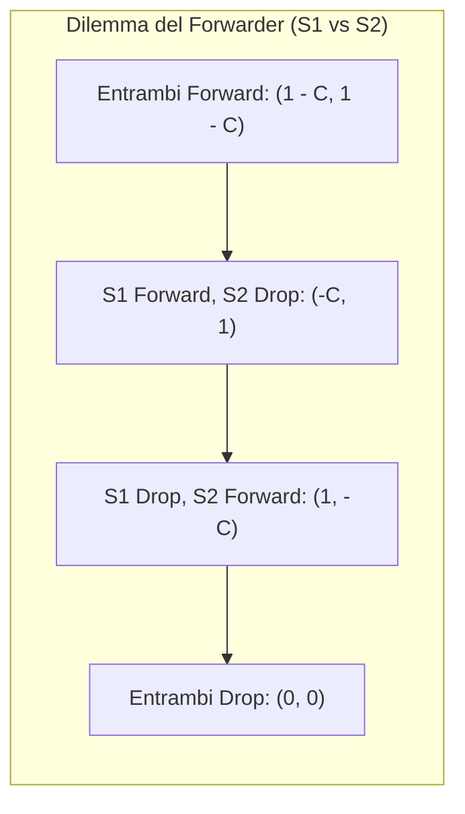
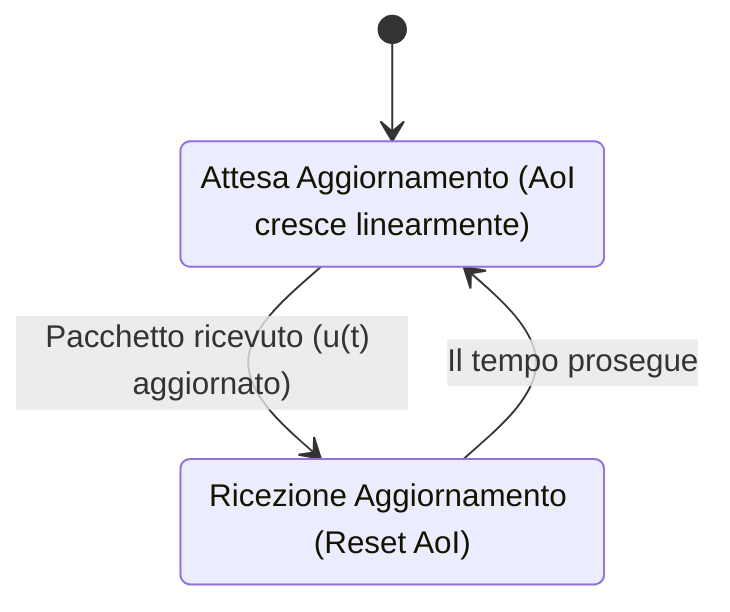
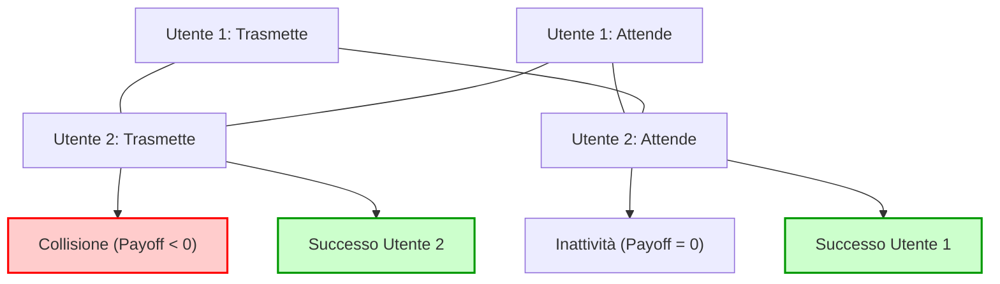
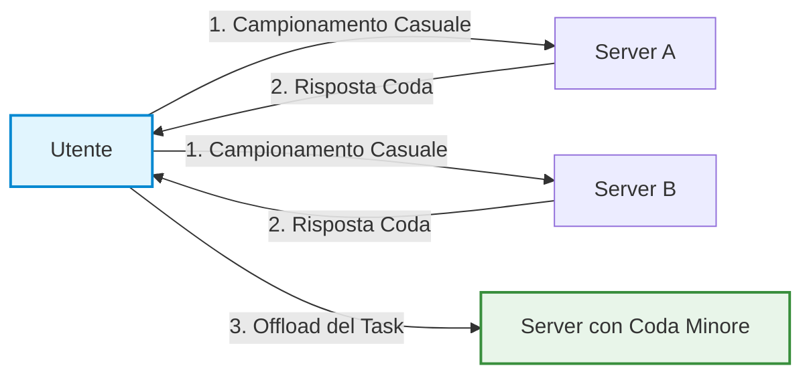
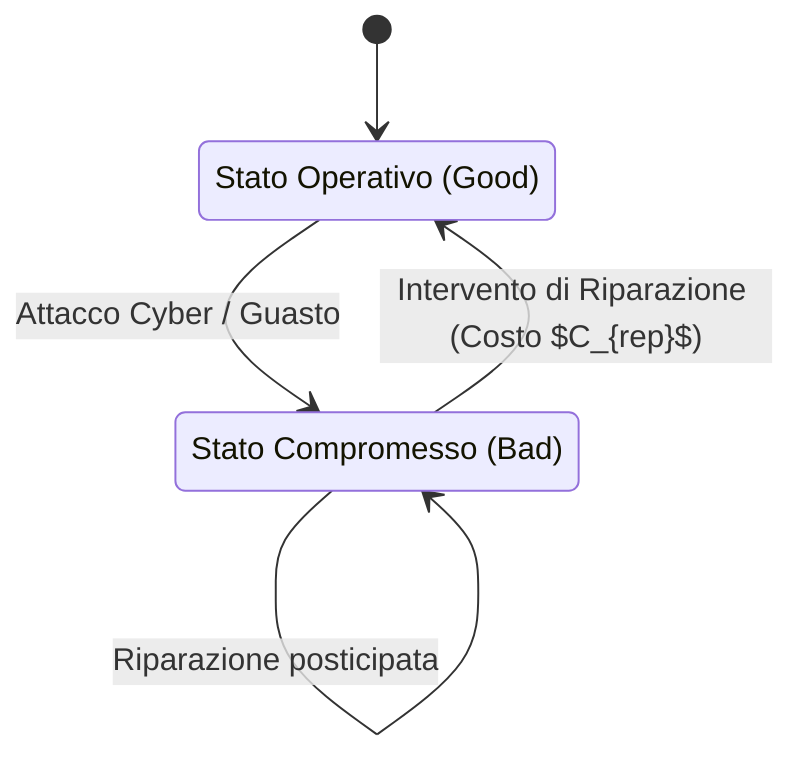
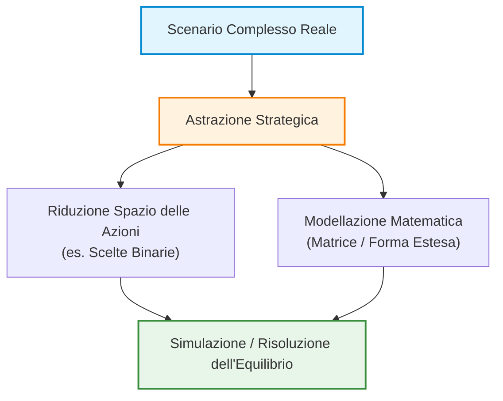

# Linee Guida per i Progetti Didattici e Principi di Modellazione nella Teoria dei Giochi

## Overview Didattica

In questa lezione vengono presentate le linee guida strutturali per lo sviluppo dei progetti didattici del corso di Teoria dei Giochi (*Game Theory*). L'obiettivo principale è guidare gli studenti nella formulazione di idee progettuali efficaci, orientate ad applicazioni reali in ambito ingegneristico e connesse ad attività di ricerca avanzata.

Vengono definiti i requisiti fondamentali che un problema deve soddisfare per poter essere analizzato mediante la Teoria dei Giochi, con particolare enfasi su:

* **Interazione Strategica (*Strategic Interaction*)**: la necessità di modelli multi-agente (*multi-agent*) in cui gli esiti dipendano dalle azioni congiunte di giocatori individuali e reattivi.
* **Trattabilità Analitica (*Analytical Tractability*)**: l'importanza di adottare formulazioni matematiche trasparenti o in forma chiusa (*closed-form expressions*) — come modelli basati sulla Teoria delle Code (*Queuing Theory*), la capacità di Shannon (*Shannon's Capacity*) o bilanci energetici/economici — per facilitare l'analisi di sensibilità (*sensitivity analysis*).
* **Valutazione Qualitativa**: l'orientamento all'individuazione dei trend comportamentali e dei compromessi (*trade-off*) del sistema, privilegiando la comprensione qualitativa delle dinamiche rispetto a un'eccessiva precisione numerica.

Infine, vengono illustrate le modalità organizzative per la scelta dei temi, l'uso delle piattaforme didattiche e il supporto fornito dal tutor del corso.

---

### Introduzione al Corso e Linee Guida per i Progetti

L'obiettivo di questa parte introduttiva è stimolare idee concrete per lo sviluppo dei progetti di fine corso. Non analizzeremo i dettagli formali — per quelli fare riferimento ai documenti ufficiali pubblicati su Moodle, dove troverete una tabella smart con proposte, materiale di background e indicazioni sulle modalità di prenotazione.

È possibile (e incoraggiato) proporre idee originali o wild, purché inserite in un contesto di Ingegneria Magistrale. I temi che presenteremo sono basati su applicazioni reali, connesse ad attività di ricerca e pubblicazioni del nostro dipartimento. Per quanto riguarda la gestione dei gruppi e l'assistenza, è previsto un tutor ufficiale: il supporto va limitato a un massimo di interazioni (ad esempio, un primo incontro di *kick-off* e un controllo finale), poiché lo sviluppo del progetto deve rimanere opera degli studenti.

---

### Principi Fondamentali per una Modellazione di Successo

Quando si applica la Teoria dei Giochi (Game Theory) a un problema di ingegneria, sicurezza o machine learning, bisogna evitare l'errore comune di confondere una semplice interazione tra più entità con un vero gioco strategico. 

I **Concetti Chiave** imprescindibili per un progetto di successo sono:
* **Interazione Multi-agente (Multi-agent):** Devono esistere più giocatori individuali.
* **Azioni e Risultati Individuali:** Ciascun giocatore compie azioni autonome. Queste azioni convergono in un esito (*outcome*) comune, ma l'esito viene valutato *individualmente* da ogni giocatore tramite una propria funzione di utilità o costo. Se manca questa reattività strategica reciproca (ad esempio, un classificatore di dati in cui i dati non reagiscono strategicamente alla classificazione), **non** siamo di fronte alla Teoria dei Giochi.
* **Trattabilità Analitica:** Si raccomanda di utilizzare formule in forma chiusa (*closed-form approximations*) semplici e trattabili. È possibile ricorrere alla teoria delle code (*queuing theory*), alla teoria della probabilità, o a formule economiche/energetiche di base.
* **Descrizione Qualitativa dei Trend:** Gli ingegneri tendono spesso a essere eccessivamente meticolosi sui decimali. Non è necessario: l'importante è catturare correttamente il trend di fondo (es. "più attività corrisponde a più consumo energetico e maggiore successo, ma porta all'esaurimento della batteria").

---

### Categorie Principali di Setup Modellistico

I progetti di successo si collocano solitamente in tre grandi categorie:

#### 1. Setup Avversariali (*Adversarial Setups*)
Tipici della cybersicurezza. Coinvolgono due giocatori con interessi diametralmente opposti, spesso modellati come giochi a somma zero (*zero-sum games*). Un giocatore (es. la rete o l'utente) cerca di massimizzare una metrica di performance (capacità di Shannon, consumo energetico, *uptime* della rete), mentre l'avversario (es. un *jammer*, un eavesdropper) cerca di minimizzarla (massimizzando il *downtime* o trafugando informazioni).

#### 2. Setup a Obiettivo Comune (*Common Goal / Tragedy of the Commons*)
Molteplici agenti agiscono in modo distribuito e non coordinato per un obiettivo simile, incorrendo tuttavia in fenomeni di anarchia (*price of anarchy*) dovuti all'egoismo o alla mancanza di comunicazione.

#### 3. Setup Asimmetrici
Una strategia di ricerca molto efficace e *rapida* consiste nel prendere un paper esistente basato sull'ipotesi semplificativa di simmetria tra i nodi e chiedersi: *cosa succede se i giocatori non sono simmetrici?* L'asimmetria cambia radicalmente il numero e la natura degli equilibri di Nash (Nash Equilibrium).

---

### Esempi Pratici di Modellazione

#### Il Dilemma del Forwarder (*Forwarder's Dilemma*)
Consideriamo uno scenario multi-salto (*multi-hop*) in cui due sorgenti $S_1$ ed $S_2$ vogliono inviare pacchetti ai rispettivi destinatari $D_1$ ed $D_2$, ma non sono in copertura diretta e devono aiutarsi a vicenda facendo da *relay*.

* L'utilità di consegnare con successo il proprio pacchetto è pari a $1$.
* L'atto di rilanciare il pacchetto altrui comporta un costo energetico $C$.

Le strategie possibili per un nodo sono: **Drop** ($D$) o **Forward** ($F$). La matrice dei payoff riflette esattamente il celebre **Dilemma del Prigioniero** (*Prisoner's Dilemma*):


*Stile grafico:*
```mermaid
style A fill:#e1f5fe,stroke:#01579b,stroke-width:2px;
style B fill:#fff9c4,stroke:#fbc02d,stroke-width:2px;
style C fill:#fff9c4,stroke:#fbc02d,stroke-width:2px;
style D fill:#ffebee,stroke:#c62828,stroke-width:2px;
```

**Conclusione:** La strategia $F$ (Forward) è dominata strettamente da $D$ (Drop). In un gioco statico, l'unico equilibrio di Nash è $(D, D)$, spiegando perché le reti wireless multi-hop pure faticano a sostenersi senza meccanismi di cooperazione ripetuta o incentivi esterni (*quid pro quo*).

#### Setup di Jamming (Disaccordo e Strategie Miste)
Consideriamo un canale di comunicazione in cui una sorgente invia dati scegliendo tra due rotte o canali ($A$ o $B$), mentre un jammer cerca di bloccare la trasmissione scegliendo di attaccare $A$ o $B$. 
Assumendo un guadagno/penalità $P$, il modello si riconduce a un gioco di **pari e dispari** (*odds and evens*):
* La sorgente vuole scegliere un canale diverso da quello attaccato.
* Il jammer vuole intercettare la scelta della sorgente.

Questo tipo di giochi **non ammette equilibri di Nash in strategie pure**, ma solo in **strategie miste** (es. lanciare una monetina per decidere la rotta). Un ingegnere della sicurezza non può pretendere un sistema in cui l'avversario perda con probabilità del $100\%$; l'interazione porta inevitabilmente a un equilibrio probabilistico legato ai parametri fisici del sistema.

---

### Ulteriori Ingredienti per Arricchire un Progetto

Se si desidera rendere un progetto di ricerca più strutturato o differenziarlo da quello di altri colleghi, è possibile introdurre componenti avanzate:

* **Energia:** Modellare il consumo energetico come direttamente proporzionale all'attività ($E_{att}$) ma introducendo un trade-off con l'efficienza. Spesso l'energia viene legata a giochi bayesiani (*Bayesian Games*), dove il "tipo" (*type*) del nodo è il suo livello residuo di batteria (es. nodi alimentati da energia solare contro nodi a batteria scarica).
* **Mobilità e Posizione Fisica:** Molti studi assumono nodi statici. Introdurre la mobilità o la posizione geometrica come tipo bayesiano modifica l'efficacia degli attacchi (es. un jammer vicino necessita di pochissima potenza per disturbare, mentre uno lontano deve consumare molto).
* **Reputazione e Peer-to-Peer:** Reti come *BitTorrent* usano meccanismi di reciprocità (*tit-for-tat*). Tuttavia, emergono problemi legati a:
  * *Whitewashing:* Utenti bannati che creano una nuova identità digitale per rientrare nel sistema (contrastato imponendo un periodo di prova o *probation period* per i nuovi account).
  * *Sybil Attacks:* Creazione di identità multiple fittizie per alterare la reputazione.

---

### Proposte di Ricerca (Parte I): AoI, Condivisione Risorse, Infrastrutture Critiche e Federated Learning

---

### Età dell'Informazione (Age of Information - AoI)

L'**Età dell’Informazione (Age of Information - AoI)** è una metrica di prestazione recente (sviluppatasi negli ultimi 15 anni) studiata per i sistemi di comunicazione in tempo reale (*real-time communication*). In contesti di monitoraggio sensoriale, la priorità del sistema non è massimizzare il throughput (ovvero la quantità totale di dati inviata nell'unità di tempo), bensì garantire che l'informazione ricevuta sia il più "fresca" possibile.

#### Definizione Matematica e Modellistica

L'AoI al tempo corrente $t$ è definita come il tempo trascorso dalla generazione dell'ultimo aggiornamento valido ricevuto dal destinatario:

$$\Delta(t) = t - u(t)$$

dove $u(t)$ rappresenta l'istante di tempo in cui è stato generato l'ultimo messaggio di aggiornamento pervenuto con successo al ricevitore.



L'AoI cresce linearmente con pendenza pari a 1 fino a quando non giunge un nuovo pacchetto, momento in cui subisce una discontinuità verso il basso (reset) assumendo un valore pari al tempo di attraversamento del canale da parte di quel pacchetto.

Trattandosi di un problema puramente analitico, la stima dell'AoI si presta all'applicazione della **Teoria delle Code (Queuing Theory)**. È possibile modellare il processo di generazione e trasmissione dei dati attraverso code stocastiche classiche, ad esempio una coda $M/M/1$ (arrivi poissoniani e tempi di servizio esponenziali).

> **Concetto Chiave: Estensioni di Ricerca nell'AoI**
>
> 1. **Scenari Avversariali e Sicurezza:** Analisi di disturbatori intelligenti (*smart jammers*) che non accecano il canale in modo continuativo, ma effettuano l'attacco di disturbo (*jamming*) solo nell'istante in cui stimano che la sorgente stia per inviare un aggiornamento critico, massimizzando l'AoI con il minimo sforzo energetico.
> 2. **Sistemi Multi-Agente:** Negli scenari monoutente (un trasmettitore e un ricevitore) il problema è di pura ottimizzazione. Quando si hanno più nodi che competono per il canale per mantenere fresca la propria informazione, il problema diventa interattivo ed è modellabile con la **Teoria dei Giochi (Game Theory)**.
> 3. **Mezzi di Propagazione Non Convenzionali:** Studio dell'AoI in canali quantistici, molecolari o sottomarini.

---

### Condivisione delle Risorse e Accesso alla Rete

Questa area applicativa analizza come più utenti o agenti competano per l'accesso a risorse di rete condivise, evitando inefficienze, interferenze o collisioni.

#### 1. Modelli di Accesso al Canale e Gioco di Anti-Coordinamento
Il problema dell'accesso casuale condiviso (es. rete tipo *Aloha*) tra due trasmettitori può essere schematizzato come segue:
* Se entrambi trasmettono contemporaneamente $\rightarrow$ **Collisione** (Payoff nullo o negativo per entrambi).
* Se entrambi attendono $\rightarrow$ **Inattività** (Payoff pari a $0$).
* Se uno trasmette e l'altro attende $\rightarrow$ Chi trasmette ottiene un payoff positivo, chi attende evita la collisione.

Questo modello costituisce un **Gioco di Anti-Coordinamento (Anti-Coordination Game)**, del tutto analogo al classico *Gioco del Pollo (Chicken Game)*, e presenta molteplici Equilibri di Nash puri.



Per evitare collisioni, le tecnologie moderne introducono variabilità dinamiche: ad esempio, i nodi possono rallentare la trasmissione aumentando il **Fattore di Spostamento (Spreading Factor)**. Trasmettere più lentamente consente di evitare la collisione a spese di una durata temporale maggiore del pacchetto.

#### 2. Superfici Intelligenti Riconfigurabili (Reconfigurable Intelligent Surfaces - RIS)
Per superare ostacoli fisici o attacchi di disturbo (*jamming*) diretti, la rete può avvalersi di pannelli riflettenti dotati di elementi attivi (diodi) in grado di orientare il segnale elettromagnetico verso il ricevitore.

* **Problematica di Teoria dei Giochi:** La RIS è una risorsa condivisa. Che cosa succede se più nodi cercano di orientare la riflessione della RIS verso destinazioni differenti contemporaneamente? Oppure, come si garantisce che la RIS stessa non sia maliziosa (*malicious RIS*) e non alteri la fase dei segnali per causare interferenza distruttiva?

#### 3. Detezione e Comunicazione Integrate (Integrated Sensing and Communication - ISAC)
L'tecnologia **ISAC** combina in un unico segnale a radiofrequenza sia la trasmissione dati sia il tracciamento radar degli oggetti nell'ambiente (ad esempio, rilevando la presenza di persone analizzando la distorsione del segnale Wi-Fi).

Nel caso di utente singolo, il problema è un'ottimizzazione multi-obiettivo (trade-off tra accuratezza di tracciamento e *data rate*). 

> **Concetto Chiave: Opportunità di Ricerca in ISAC Multi-Agente**
>
> Quando più trasmettitori autonomi cercano di tracciare lo stesso oggetto ed effettuare contemporaneamente comunicazioni sulla stessa banda di frequenza, nascono due inefficienze:
> 1. **Ridondanza:** Dati di tracciamento replicati infruttuosamente da più nodi.
> 2. **Interferenza/Collisione:** Degrado della capacità di comunicazione condivisa.
> 
> Attualmente non esistono modelli consolidati in Teoria dei Giochi per studiare l'equilibrio strategico tra nodi competenti in contesti ISAC multi-agente.

#### 4. Selezione del Server e Routing Egoista (Server Selection & Selfish Routing)
Se un dispositivo utente deve delegare un calcolo gravoso a un server esterno, deve scegliere a quale nodo inviare la richiesta. Il ritardo totale sofferto dall'utente è dato da:

$$\text{Ritardo Totale} = \text{Ritardo di Propagazione} + \text{Ritardo di Coda (Congestione)}$$

Se un server è particolarmente prestazionale, attrarrà un elevato numero di utenti, finendo per congestionarsi. Questo scenario ricalca perfettamente il problema del **Routing Egoista (Selfish Routing)** e l'esempio di Pigou, portando a un’inefficienza sistemica quantificabile tramite il **Prezzo dell'Anarchia (Price of Anarchy - PoA)**.

In reti con centinaia di server, interrogare (*ping*) ogni singolo nodo ha un costo computazionale ed energetico eccessivo e provoca un fenomeno di gregge (*herding*). Una soluzione efficiente consiste nell'applicare la strategia della **Potenza di Due Scelte (Power of Two Choices)**.



*Meccanismo:* L'utente seleziona a caso soltanto $2$ server tra gli $N$ disponibili, controlla la loro congestione e invia il task a quello meno carico. Questa euristica riduce drasticamente l'overhead di segnalazione ed evita che l'intera popolazione utenti converga deterministicamente sullo stesso server "migliore".

---

### Infrastrutture Critiche

Le **Infrastrutture Critiche** (reti elettriche, acquedotti, reti di telecomunicazione) sono soggette ad attacchi informatici con impatti sul mondo fisico.

#### Modellizzazione a Catena di Markov
Lo stato di salute di un'infrastruttura può essere modellato mediante una **Catena di Markov (Markov Chain)** composta da:
* **Stati Operativi ($S_{\text{good}}$):** L'infrastruttura funziona correttamente.
* **Stati di Guasto/Degrado ($S_{\text{bad}}$):** L'infrastruttura è compromessa o bloccata.

Gli interventi di riparazione consentono di far rientrare il sistema negli stati operativi, ma comportano un costo finanziario e operativo sostenuto da un budget finito.



#### Interdipendenza tra Reti e Multi-Agente
Se più infrastrutture sono interconnesse, il guasto di un nodo in una rete incrementa il tasso di degrado delle altre reti. Ad esempio, il crollo della **rete di telecomunicazione** riduce la capacità di monitorare la **rete elettrica**, facilitando il guasto di quest'ultima.

Nel caso di più agenti manutentori non coordinati o di reti indipendenti, si determinano decisioni strategiche su quali nodi riparare prioritariamente:

* **Importanza Percepita (Utility Weight) vs Centralità Topologica:** Un nodo può avere un peso basso nella funzione di utilità diretta dell'operatore, ma risultare strutturalmente fondamentale nella topologia di rete per prevenire guasti a cascata.

> **Concetto Chiave: Strategia di Riparazione e Decezione (Deception)**
>
> In presenza di un attaccante persistente che monitora il sistema per sferrare attacchi non appena rileva il ripristino dell'infrastruttura, la riparazione immediata e deterministica rivela informazioni sullo stato del sistema. 
> 
> Una strategia di difesa avanzata prevede un **ritardo strategico nella riparazione** (o simulazione di guasto persistente) per disorientare l'attaccante ed evitare che questi ottenga informazioni di stato accurate tramite tecniche di intercettazione (*eavesdropping*).

---

### Apprendimento Federato (Federated Learning - FL)

L'**Apprendimento Federato (Federated Learning - FL)** è una tecnica di Machine Learning distribuita in cui $N$ agenti cooperano per addestrare un modello globale mantenendo i propri dati locali privati. Un server centrale invia i parametri del modello agli agenti, ciascuno effettua l'addestramento locale e restituisce solo gli aggiornamenti dei pesi.

```mermaid
flowchart TD
    accTitle: Ciclo di addestramento nell'Apprendimento Federato
    accDescr: Schema delle fasi di distribuzione dei pesi, addestramento locale e aggregazione.
    
    Server["Server Centrale (Aggregatore)"]
    A1["Agente 1 (Dataset D1)"]
    A2["Agente 2 (Dataset D2)"]
    A3["Agente 3 (Dataset D3)"]
    
    Server -->|1. Invio Modello Globale| A1 & A2 & A3
    A1 -->|2. Addestramento Locale| A1
    A2 -->|2. Addestramento Locale| A2
    A3 -->|2. Addestramento Locale| A3
    A1 & A2 & A3 -->|3. Invio Aggiornamenti Pesi| Server
    Server -->|4. Aggregazione (FedAvg)| Server
```

#### Dilemmi Teoretico-Giochi e Inefficienze nel FL

1. **Partecipazione Pigra (*Free-Riding*):** 
   L'addestramento locale consuma energia e risorse computazionali. Gli agenti potrebbero agire egoisticamente fingendo di addestrare il modello o rifiutandosi di inviare gli aggiornamenti, beneficiando al contempo del modello finale ottimizzato dagli altri utenti.
2. **Ridondanza e Privacy:** 
   Assegnare lo stesso sottoinsieme di dati a più nodi garantisce tolleranza ai guasti ma distrugge la riservatezza delle informazioni. Inoltre, se un agente sa che un altro nodo possiede i suoi stessi dati, sarà incentivato ad astenersi dal calcolo (*free-riding*).
3. **Iniezione di Dati Falsi (False Data Injection / Poisoning):** 
   Agenti avversariali o pigri potrebbero inviare al server aggregatore parametri casuali o alterati (dati contraffatti), corrompendo l'accuratezza del modello globale.
4. **Eterogeneità dei Client:** 
   I nodi differiscono per capacità di calcolo e qualità del canale radio (Rapporto Segnale-Rumore, *Signal-to-Noise Ratio - SNR*). Dati trasmessi su canali soggetti ad alto rumore possono andare persi, sbilanciando la convergenza dell'algoritmo.

*Nota: Passaggio integrato con chiarezza didattica.*  
L'obiettivo nell'Apprendimento Federato è la progettazione di opportuni meccanismi di incentivo (*Incentive Design*) capaci di spingere i client a partecipare alle fasi di calcolo e a dichiarare fedelmente le metriche del proprio canale e la bontà dei propri dati.

---

### Intelligenza Artificiale Agente (Agentic AI) e Sistemi Multi-Agente

L'**IA Agente** (*Agentic AI*) descrive tutti quei contesti in cui operano agenti intelligenti, autonomi o semi-autonomi, controllati da algoritmi di intelligenza artificiale. In questi scenari, le decisioni del singolo agente interagiscono direttamente con quelle degli altri, rendendo l'analisi di Teoria dei Giochi fondamentale.



#### Ambito Industriale e Robotica
Un'applicazione classica riguarda la robotica industriale in catene di montaggio:
* **Coordinamento tra robot:** Si consideri un sistema con due robot dedicati alla produzione. Se il Robot 1 esegue una scansione approfondita di un pezzo, il Robot 2 può decidere di saltarla per ottimizzare i tempi ed evitare ridondanze inefficienti.
* **Rischio di coordinamento:** Se entrambi ipotizzano che l'altro esegua il controllo, si rischia che il pezzo passi senza alcuna scansione. Il problema si complica in presenza di **asimmetria** nei compiti o nei sensori dei macchinari.

#### Veicoli Autonomi e Droni (Riduzione dello Spazio Strategico)
Nelle flotte di droni o nei veicoli a guida autonoma che pattugliano una città, gli agenti devono coordinarsi per evitare collisioni e massimizzare la copertura del territorio.

> **Concetto Chiave: La Riduzione dello Spazio delle Azioni**
> 
> Un errore comune nella modellazione strategica del movimento consiste nel voler includere ogni parametro fisico continuo (posizione, velocità, sterzo). Se un veicolo ha 25 gradi di libertà (*degrees of freedom*) e $25$ livelli di discretizzazione per ciascuno, lo spazio delle strategie esplode combinatoriamente ($25^{25}$ possibili strategie), rendendo il problema intrattabile.
> 
> La modellazione corretta richiede di ricondurre il problema a decisioni strategiche discrete (es. scelte binarie):
> * Mantieni la corsia attuale vs. Cambia corsia: $S_i \in \{\text{Corsia A}, \text{Corsia B}\}$
> * Rimani dietro al veicolo precedente vs. Tentativo di sorpasso: $S_i \in \{\text{Incolla}, \text{Sorpassa}\}$

Nelle missioni con droni, la presenza di segnali di disturbo (*jamming*) può richiedere il passaggio dinamico da strategie di copertura disgiunte (area massima) a strategie sovrapposte (ridondanza contro le perdite di segnale).

#### Generazione Software e Problematiche Etiche
L'intersezione tra più modelli di IA generativa (es. diversi *Large Language Models* o LLM) genera problemi di coordinamento software:
* Quando diversi componenti di codice vengono generati da LLM differenti, l'integrazione e la compatibilità diventano un problema strategico di coordinamento multi-agente.
* **Aspetti etici e di trasparenza:** L'uso dell'IA agente introduce dilemmi su ciò che è considerato lecito o fraudolento (es. generazione automatizzata di CV) e sull'obbligo di dichiarare l'uso dell'IA nei processi decisionali.

#### Astrazione Matematica nei Progetti
Sia che si simuli una flotta di veicoli reali, sia che si utilizzi un **Gemello Digitale** (*Digital Twin*), la struttura del gioco sottostante non cambia. 

> **Concetto Chiave: Primato del Modello Matematico**
> 
> L'elemento centrale di un'analisi di Teoria dei Giochi non è la veste grafica o lo scenario applicativo in sé, ma la sua **formulazione matematica**. Applicazioni apparentemente diverse (es. droni che evitano intercettazioni vs. coordinamento nella generazione di codice) possono condividere la medesima struttura formale e la stessa matrice di payoff.

---

### Applicazioni Speciali e Casistiche Reali di Ricerca

Al di fuori delle categorie standard, esistono scenari applicativi avanzati derivati direttamente dalla ricerca industriale.

#### Autenticazione basata su Segnali Acustici (*Short Sound Signatures*)
Un sistema d'autenticazione alternativo ai codici QR si basa sulla trasmissione di brevi impronte acustiche (*acoustic signatures*):
* **Il Gioco di Sicurezza:** Si modella un'interazione tra un trasmettitore legittimo e un attaccante (*eavesdropper* o *jammer*).
* **Strategie dell'attaccante:** Replica del segnale o disturbo della frequenza.
* **Obiettivo analitico:** Calcolare le strategie ottime di modulazione e difesa per garantire la robustezza dell'autenticazione in ambiente rumoroso o avversario.

#### Teoria dei Giochi applicata ai Giochi da Tavolo (*Tabletop Games*)
I giochi da tavolo (es. giochi di strategia stile *RisiKo!* o *Monopoly*) offrono un banco di prova ideale per l'analisi di bilanciamento (*game design*) e la valutazione di strategie agentiche.

 Si possono adottare due approcci complementari:

$$\begin{array}{rcc}
\hline
\textbf{Caratteristica} & \textbf{Approccio 1: Simulazione Monte Carlo} & \textbf{Approccio 2: Agentic AI Benchmark} \\
\hline
\text{Implementazione} & \text{Script deterministici / euristiche fisse} & \text{Integrazione LLM (es. ChatGPT vs Gemini)} \\
\text{Conoscenza Regole} & \text{Cablata nel codice di gioco} & \text{Fornita via Prompting nel contesto} \\
\text{Obiettivo} & \text{Valutare bilanciamento regole/strategie} & \text{Testare la razionalità e il bias del modello} \\
\text{Metriche} & \text{Percentuale di vittoria su $N$ partite} & \text{Vantaggio del primo giocatore (*First-mover*)} \\
\hline
\end{array}$$

##### Approccio 1: Valutazione di Strategie e Bilanciamento (Game Design)
Attraverso la formalizzazione delle regole o la simulazione al calcolatore:
1. Si definiscono profili di comportamento (es. Giocatore *Aggressivo* vs. Giocatore *Conservativo*).
2. Si eseguono simulazioni ad alto volume (es. $100$ partite).
3. Se il profilo *Conservativo* vince con una frequenza dell'$80\%$, si dimostra analiticamente un sbilanciamento nelle dinamiche di gioco (*game mechanics*).

##### Approccio 2: Benchmarking di IA Agenti (*LLM vs LLM*)
Invece di programmare euristiche rigide, si pongono due modelli di linguaggio differenti a competere sullo stesso gioco:
1. Le regole del gioco (non presenti nei dati di addestramento primari) vengono fornite nel contesto.
2. Si fa giocare, ad esempio, ChatGPT contro Gemini.
3. L'analisi teorica serve a discriminare se la vittoria sia dovuta a una maggiore capacità di ragionamento strategico del modello o al **vantaggio della prima mossa** (*first-mover advantage*) insito nella struttura del gioco.

---

### Modalità di Scelta e Sviluppo dei Progetti

Per la definizione dei progetti individuali o di gruppo, si delineano tre percorsi operativi:

1. **Selezione da Catalogo (Consigliata):** Scelta di uno dei temi proposti declinato secondo uno specifico ambito (es. Scenario avversariale su veicoli autonomi).
2. **Scelta Guidata:** Consultazione diretta con il docente per indirizzare la scelta in base alle competenze specifiche dello studente.
3. **Proposta Autonoma:** Definizione di un problema originale da parte dello studente. 

> **Concetto Chiave: Rischio di Valutazione sulle Proposte Autonome**
> 
> La formulazione autonoma di un progetto è ammessa, ma richiede cautela: deviazioni eccessive dai modelli consolidati del corso rendono più complessa la valutazione oggettiva e comportano un rischio maggiore di penalizzazione in sede d'esame se la modellazione matematica risulterà lacunosa.