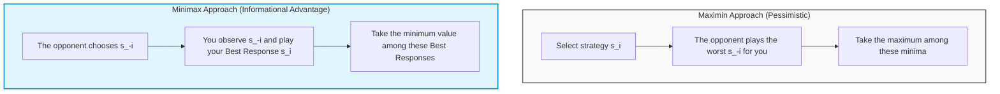
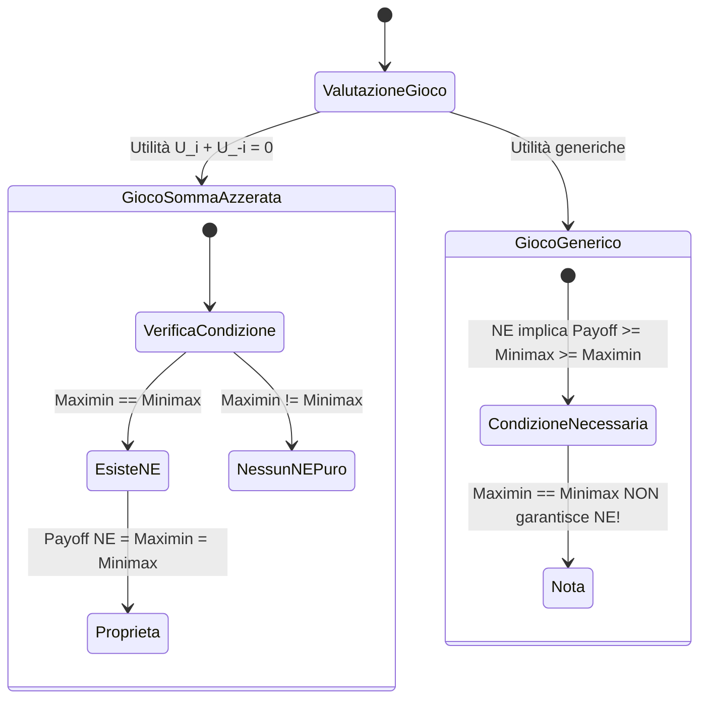
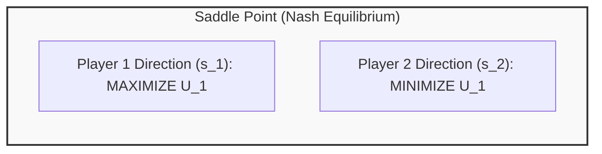
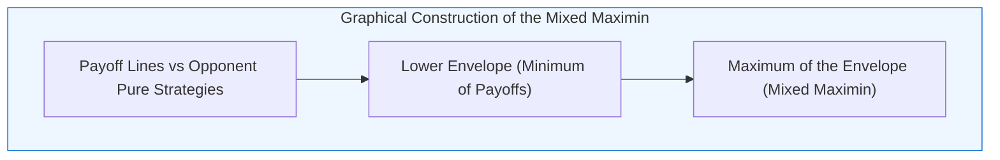
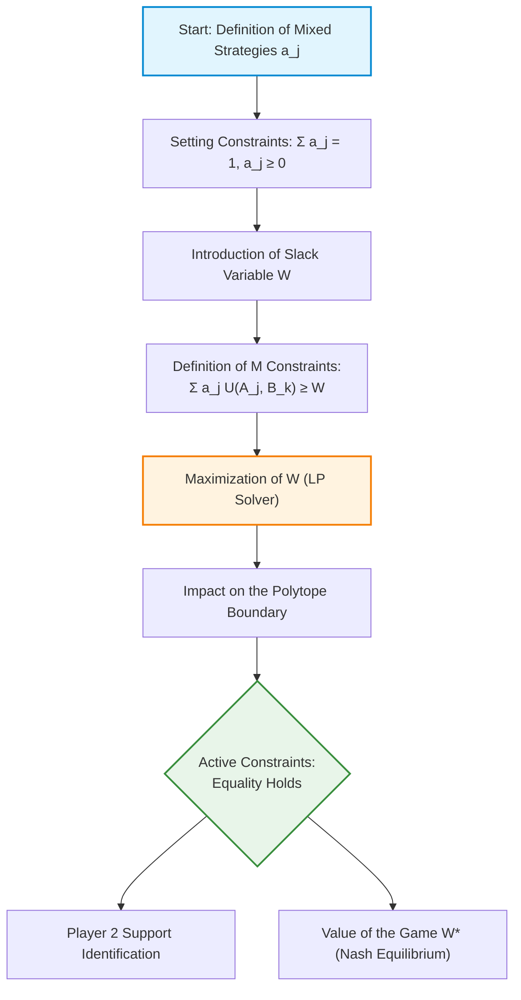
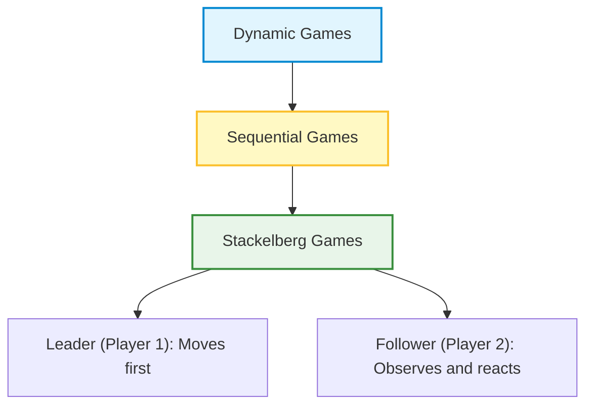
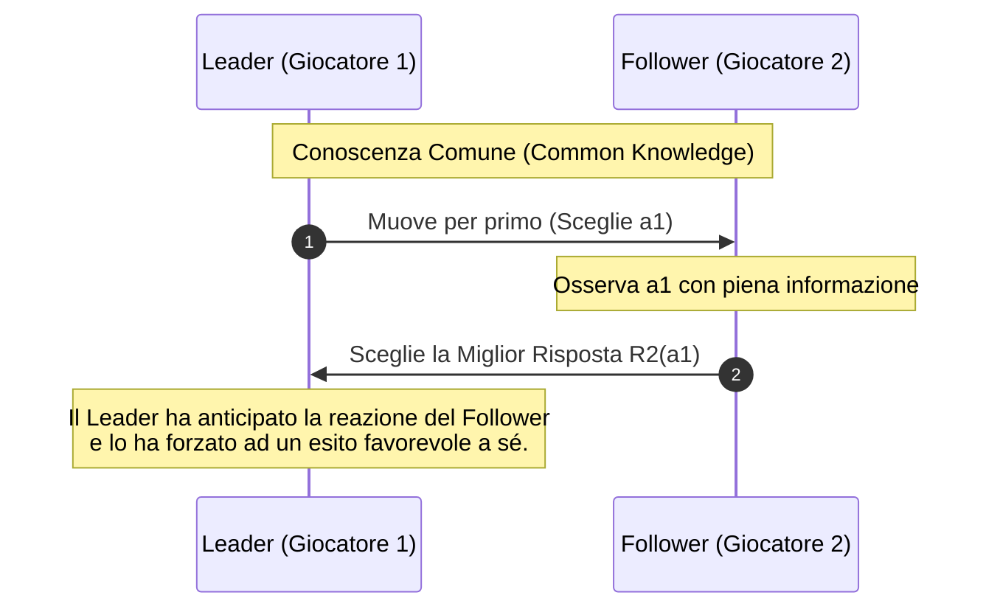

# Game Theory: Maximin, Minimax Approaches and Security Strategies

## Teaching Overview

In this lesson, a fundamental approach to solving decision and optimization problems in games is introduced: the concepts of **Maximin** and **Minimax**. Although these tools are often omitted in traditional economics-oriented Game Theory textbooks, they constitute a historical and conceptual pillar for Information Engineering, Optimization, and Artificial Intelligence (*AI*) / Machine Learning (*ML*) — famously finding application in decision algorithms for complex games such as chess.

The main objectives of the lesson include:
* **Two-player abstraction**: Extension of the formalization to generic games by treating all opponents of player $i$ as a single meta-player $-i$.
* **Conservative Approach and Maximin**: Study of the optimal choice based on minimizing the damage in the worst-case scenario. The **Security Strategy** and the corresponding **Security Payoff** are formally defined.
* **Minimax Concept**: Analysis of the dual scenario in which a player can observe the opponent's move before selecting their Best Response, determining the minimum guaranteed payoff under ideal information conditions regarding the behavior of others.

---

### Introduction to Maximin, Minimax, and the Engineering Approach

In classical game theory — developed predominantly for economic purposes — attention is often focused on a purely theoretical approach to identify game equilibria. However, an alternative approach called **Minimax** exists, which is widely used in optimization, engineering, and Artificial Intelligence (*AI*). 

Historically, the concept of Minimax precedes formalized game theory and underpins the first decision-making algorithms in AI, such as those used by chess software that defeated world champions in the 1980s and 1990s (e.g., Deep Blue). 

The usefulness of this approach for an engineer lies in its applicability to practical problems where it is not always possible to assume cooperation or where information about the opponent's payoffs is incomplete or entirely absent.

---

### The Maximin Concept (Conservative Approach)

Consider a game with $N$ players. From the perspective of the generic player $i$, we can abstract the set of all other players by denoting it with $-i$. The interaction thus reduces to a binary view: player $i$ against the "rest of the world" $-i$.

We define $S_i$ as the set of pure strategies available to player $i$, and $S_{-i}$ as the set of strategy profiles of the other players.

#### The Worst-Case Scenario Function
Player $i$ calculates a function $F_i: S_i \to \mathbb{R}$ defined as:

$$F_i(s_i) = \min_{s_{-i} \in S_{-i}} U_i(s_i, s_{-i})$$

where $U_i(s_i, s_{-i})$ represents the utility (or payoff) of player $i$. 

> **Interpretation:** $F_i(s_i)$ represents the "worst-case scenario" for player $i$ should they choose to adopt strategy $s_i$. It is the analytical answer to the question: *"If I play $s_i$, what is the maximum damage others can cause me?"*

#### The Maximin Value and Security Strategy
By adopting an extremely pessimistic or prudent attitude, player $i$ will select the strategy $s_i^*$ that maximizes the payoff obtained in the worst-case scenario. This maximum value of the minimum is called the **Maximin Value** or **Security Payoff**:

$$v_i^{\text{maximin}} = \max_{s_i \in S_i} F_i(s_i) = \max_{s_i \in S_i} \min_{s_{-i} \in S_{-i}} U_i(s_i, s_{-i})$$

The strategy $s_i^*$ that guarantees this payoff is defined as the **Security Strategy**:

$$s_i^* = \arg\max_{s_i \in S_i} \min_{s_{-i} \in S_{-i}} U_i(s_i, s_{-i})$$

> **Key Concept: Rational Pessimism.** 
> Maximin represents a conservative choice. It does not assume that the opponent is foolish or generous, but that, regardless of their motivation, player $i$ wants to guarantee a "minimum protection threshold" below which their payoff can never fall. This is the core principle used by chess software: always assume that the opponent will make the best possible move to put us in difficulty.

---

### The Minimax Concept (Best Response Guarantee)

The concept of **Minimax** adopts a completely different informational perspective compared to Maximin, although the mathematical formalism is mirrored.

#### The Best Response Function
Imagine a function $F_i: S_{-i} \to \mathbb{R}$ defined as:

$$F_i(s_{-i}) = \max_{s_i \in S_i} U_i(s_i, s_{-i})$$

This function associates with every strategy profile of the opponents $s_{-i}$ the maximum payoff that player $i$ can obtain by playing their **Best Response**.

#### The Minimax Value
The **Minimax Value** is defined by taking the minimum possible value of these best responses as the opponent's decisions vary:

$$v_i^{\text{minimax}} = \min_{s_{-i} \in S_{-i}} F_i(s_{-i}) = \min_{s_{-i} \in S_{-i}} \max_{s_i \in S_i} U_i(s_i, s_{-i})$$

#### Operational Meaning
Minimax represents the minimum payoff that player $i$ guarantees for themselves **if they have the informational advantage of observing the opponent's move $s_{-i}$ before choosing their own move $s_i$**. 

Imagine playing cards or rock-paper-scissors, but with a mirror positioned behind the opponent: we do not know in advance which card they will play, but we know with certainty that when they choose their move, we will be able to see it and react accordingly with our best response. Minimax represents the worst payoff among all possible favorable outcomes guaranteed by this best reaction.

---

### Relationship Between Maximin, Minimax, and Nash Equilibrium

In generic games, the analysis of Maximin and Minimax reveals important structural properties linked to Nash Equilibrium (*NE*).

#### Fundamental Property: Minimax Inequality
For any player $i$ in any game, the following inequality always holds:

$$v_i^{\text{maximin}} \le v_i^{\text{minimax}}$$

*Intuitive proof:* The case where one must choose a move blindly under the worst-case scenario (Maximin) can never offer a higher guarantee than the case where one can choose the best response after observing the opponent's move (Minimax).

#### Relationship with Nash Equilibrium Payoffs
Let $s^* = (s_i^*, s_{-i}^*)$ be a Nash Equilibrium in pure strategies, and let $U_i(s^*)$ be the payoff achieved by player $i$ at equilibrium. The following theorem holds:

$$U_i(s^*) \ge v_i^{\text{minimax}} \ge v_i^{\text{maximin}}$$

*Proof:* By definition of Nash Equilibrium, $s_i^*$ is the best response to $s_{-i}^*$, hence $U_i(s_i^*, s_{-i}^*) = \max_{s_i} U_i(s_i, s_{-i}^*)$. Since the Minimax value $v_i^{\text{minimax}}$ represents the *minimum* possible value among all possible best responses as $s_{-i}$ varies, the specific best response of the Nash equilibrium $U_i(s^*)$ can never be lower than this minimum value.

> **Independence Property:**
> To calculate the Maximin and Minimax of player $i$, **only and exclusively** the utility function of player $i$ ($U_i$) is required. The utilities of the other players ($U_{-i}$) need not be known. By contrast, Nash Equilibrium requires simultaneous knowledge of the utilities of all players.

---

#### Analysis Through Practical Examples

*Note: Steps integrated with educational clarity to reconstruct the evaluation of payoff matrices.*

##### Example 1: Strict Inequality ($v_i^{\text{maximin}} < v_i^{\text{minimax}} < U_i(s^*)$)

Consider the following matrix where for Player $A$ (rows: $T, D$) the payoffs are specified, while the payoffs of Player $B$ (columns: $L, C, R$) are initially not relevant for calculating Maximin and Minimax:

| Player A / B | L | C | R |
| :--- | :---: | :---: | :---: |
| **T** | $3, \cdot$ | $3, \cdot$ | $4, \cdot$ |
| **D** | $5, \cdot$ | $1, \cdot$ | $2, \cdot$ |

1. **Maximin Calculation for A:**
   * If A plays $T$: the worst payoff is $\min(3, 3, 4) = 3$.
   * If A plays $D$: the worst payoff is $\min(5, 1, 2) = 1$.
   * $v_A^{\text{maximin}} = \max(3, 1) = 3$ (the security strategy is $T$).

2. **Minimax Calculation for A:**
   * If B plays $L$: A's best response is $\max(3, 5) = 5$ (playing $D$).
   * If B plays $C$: A's best response is $\max(3, 1) = 3$ (playing $T$).
   * If B plays $R$: A's best response is $\max(4, 2) = 4$ (playing $T$).
   * $v_A^{\text{minimax}} = \min(5, 3, 4) = 3$.

If we now complete the payoff matrix by assigning the values for Player B:

| Player A / B | L | C | R |
| :--- | :---: | :---: | :---: |
| **T** | $3, 5$ | $3, 1$ | $4, 2$ |
| **D** | $5, 4$ | $1, 6$ | $2, 0$ |

By analyzing the best response for both players, two pure strategy Nash Equilibria are identified: $(T, L)$ with payoff $(3, 5)$ and $(D, C)$ with payoff $(1, 6)$. Note that in this specific case the equilibrium payoffs satisfy the general inequality.

##### Example 2: Coincidence of Values ($v_i^{\text{maximin}} = v_i^{\text{minimax}} = U_i(s^*)$)

Consider another game with the following payoff matrix:

| Player A / B | L | C | R |
| :--- | :---: | :---: | :---: |
| **T** | $3, 1$ | $3, 2$ | $4, 1$ |
| **D** | $5, 4$ | $6, 0$ | $7, 3$ |

* **Maximin of A:** $\max(\min(3,3,4), \min(5,6,7)) = \max(3, 5) = 5$ (obtained with $D$).
* **Minimax of A:** $\min(\max(3,5), \max(3,6), \max(4,7)) = \min(5, 6, 7) = 5$.
* Since $v_A^{\text{maximin}} = 5$ and $v_A^{\text{minimax}} = 5$, by the Squeeze Theorem (Theorem of the Two Officers), any Nash Equilibrium payoff for A must be exactly 5.
* The only pure strategy Nash Equilibrium is the pair $(D, L)$, which offers the payoff $(5, 4)$. The payoff for A is exactly 5.

##### Example 3: Counterexample (False Myth of Equilibrium Existence)

> **Key Concept: Pay Attention to the Direction of Implication!**
> The fact that $v_i^{\text{maximin}} = v_i^{\text{minimax}}$ for all players does **NOT** guarantee the existence of a pure strategy Nash Equilibrium for a generic (non-zero-sum) game.

Consider the following matrix:

| Player A / B | L | C | R |
| :--- | :---: | :---: | :---: |
| **T** | $3, 2$ | $0, 4$ | $3, 0$ |
| **M** | $0, 3$ | $2, 1$ | $0, 0$ |
| **D** | $4, 0$ | $4, 3$ | $3, 2$ |

Calculating Maximin and Minimax for player A and player B yields:
* $v_A^{\text{maximin}} = 3$, $v_A^{\text{minimax}} = 3$
* $v_B^{\text{maximin}} = 2$, $v_B^{\text{minimax}} = 2$

However, checking the 9 matrix cells one by one, **no strategy profile is a pure strategy Nash Equilibrium** (there is always at least one player who has an incentive to unilaterally deviate).

---

### Zero-Sum Games and Adversarial Models

A special and fundamental class of games is represented by **Zero-Sum Games**.

#### Mathematical Definition
A two-player game is zero-sum if for every strategy profile $s = (s_i, s_{-i})$ the following identity for utility functions holds:

$$U_i(s_i, s_{-i}) + U_{-i}(s_i, s_{-i}) = 0 \iff U_{-i}(s_i, s_{-i}) = -U_i(s_i, s_{-i})$$

This means that one player's gain corresponds exactly to the other's loss.

#### Adversarial Games and Engineering Modeling
A broader concept is that of an **Adversarial Game**, in which players have diametrically opposed interests: any strategic modification that increases Player 1's utility reduces Player 2's utility.

* **Typical Examples:** Chess, Checkers, Rock-Paper-Scissors, Heads or Tails.
* **False Adversaries (Non-Zero-Sum Games):** 
  * *Prisoner's Dilemma:* The prisoners are not adversaries to each other; both would benefit from mutual cooperation.
  * *Battle of the Sexes:* The partners have different preferences on where to spend the evening, but their primary goal is to be together (cooperation), not to hurt each other.

#### Rescaling of Utilities in Real Tournaments
Many games and sports tournaments (e.g., Serie A soccer or chess tournaments) assign points such as $3$ points for a win, $1$ for a draw, $0$ for a defeat. Although the sum of points in a single match is not strictly zero (it can be 3 in case of a win or 2 in case of a draw), such games remain intrinsically adversarial. 

Through a linear affine transformation (translation and rescaling by a constant), these games can be mathematically converted into zero-sum games without altering the rational preferences of the players.

---

### Minimax Theorem in Zero-Sum Games

In zero-sum games, the complex relationship between Maximin, Minimax, and Nash Equilibrium finds a perfect and elegant synthesis.

#### Von Neumann's Theorem for Pure Strategies
Let $G$ be a two-player zero-sum game with a finite number of pure strategies.

There exists a pure strategy Nash Equilibrium $s^* = (s_i^*, s_{-i}^*)$ **if and only if** the Maximin value is equal to the Minimax value for each player:

$$v_i^{\text{maximin}} = v_i^{\text{minimax}}$$

#### Corollaries and Properties of Zero-Sum Equilibria
If the game admits one or more pure strategy Nash equilibria:

1. **Unique Value of the Game:** Player $i$ 's equilibrium payoff is uniquely determined and corresponds to their Maximin (and Minimax) value:
   $$U_i(s^*) = v_i^{\text{maximin}} = v_i^{\text{minimax}}$$
2. **Equivalence of Multiple Equilibria:** If multiple Nash Equilibria exist, they all provide **the exact same payoff** to each player. There are no equilibria "preferable" to others in terms of final yield.
3. **Coincidence with Security Strategies:** The pure strategy component $s_i^*$ of any Nash Equilibrium coincides with a **security strategy** for player $i$.

In summary, in zero-sum games extreme prudence (Maximin) and informed optimal reaction (Minimax) converge onto the exact same stationary point represented by the Nash Equilibrium.

---

### Geometric Interpretation and Saddle Point Concept

In the context of zero-sum games, there is a deep link between the concept of Nash equilibrium and the principles of Maximin and Minimax. In a zero-sum game, a player's interest is purely antagonistic compared to that of the opponent: **any increase in Player 1's utility results in an equal reduction in Player 2's utility**.

Mathematically, for two players the relationship holds: $U_1(s_1, s_2) + U_2(s_1, s_2) = 0$, that is:
$$U_2(s_1, s_2) = -U_1(s_1, s_2)$$

Consequently, for Player 1, minimizing the opponent's payoff is exactly equivalent to maximizing their own, and vice versa.

#### The Fundamental Relationship Between Maximin and Minimax
For any player $i$, the worst possible situation (worst-case) corresponds to the best situation for the opponent $-i$. Therefore, the following relationship holds:
$$\text{Maximin}_i = -\text{Minimax}_{-i}$$

If in a pure strategy game the condition $\text{Maximin}_1 = \text{Minimax}_1$ holds, the joint security strategy chosen by the players constitutes a **Nash Equilibrium**.

#### Analogy with Mathematical Analysis: The Saddle Point
To intuitively understand this result, it is useful to recall the concept of **Saddle Point** from multivariable calculus (Calculus 2). 

If we consider the utility function $U_1(s_1, s_2)$:
* In the direction of Player 1's choices ($s_1$), Player 1 seeks a **maximum**.
* In the direction of Player 2's choices ($s_2$), Player 2 seeks to **minimize** $U_1$ (to maximize their own payoff $-U_1$).

A Nash equilibrium in a zero-sum game is therefore the equivalent of a saddle point for the utility surface: a point that is simultaneously a maximum with respect to unilateral variations by Player 1 and a minimum with respect to unilateral variations by Player 2.

---

#### The Value of the Game
When $\text{Maximin}_1 = \text{Minimax}_1$, this common value is conventionally defined as the **Value of the Game**, denoted by $V$:
$$V = \text{Maximin}_1 = \text{Minimax}_1 = U_1(s_1^*, s_2^*)$$

* **Convention:** The value $V$ always refers to the payoff of **Player 1**. 
* For Player 2, the guaranteed value will be exactly $-V$.

> **Representation note:** In zero-sum games, using the bi-matrix payoff representation is redundant. Since $U_2 = -U_1$, it is sufficient to represent the game using a simple matrix containing only Player 1's payoffs.

---

### Historical Contextualization and Applications: Chess

The Minimax principle for zero-sum games was originally formulated by **John von Neumann** using constrained optimization and linear programming techniques. This result anticipates Nash's general Game Theory formulation and forms the basis of modern Artificial Intelligence algorithms applied to complex zero-sum games such as **Chess**.

* **Application in Chess:** A computer playing chess adopts a security strategy: it assumes the opponent is perfectly rational and will always choose the move capable of inflicting the greatest possible damage. Consequently, the algorithm examines the move tree and chooses the decision that maximizes the minimum guaranteed benefit.
* **Bounded Rationality:** The computational complexity of chess is enormous (approximately $20^{100}$ possible strategies). Unable to explore the entire dynamic tree, both human grandmasters and software make "cuts" (pruning) to the decision tree. In chess software, difficulty levels (e.g., from 1 to 5) correspond to a limitation of search depth (e.g., exploring only the next $N$ moves instead of the full game).

---

### Extension of Minimax to Mixed Strategies

In pure strategy games, the condition $\text{Maximin} = \text{Minimax}$ is not always satisfied. However, by extending the action domain from the discrete set of pure strategies $S_i$ to the Probability Simplex of **Mixed Strategies**, denoted by $\Delta S_i$, the picture changes radically.

#### Mathematical Formalization in Mixed Strategies
We define the security function $f_i(m_i)$ for a mixed strategy $m_i \in \Delta S_i$:

$$f_i(m_i) = \min_{m_{-i} \in \Delta S_{-i}} U_i(m_i, m_{-i})$$

The **Mixed Security Strategy** is the probability combination $m_i^*$ that maximizes the function $f_i(m_i)$. 

The corresponding security payoff in mixed strategies, or **Mixed Maximin** ($\text{Maximin}_m$), is formalized as:
$$\text{Maximin}_m = \max_{m_i \in \Delta S_i} \min_{m_{-i} \in \Delta S_{-i}} U_i(m_i, m_{-i})$$

Analogously, the **Mixed Minimax** ($\text{Minimax}_m$) represents the minimum value that opponents can impose on Player $i$, assuming that Player $i$ manages to play their best response:
$$\text{Minimax}_m = \min_{m_{-i} \in \Delta S_{-i}} \max_{m_i \in \Delta S_i} U_i(m_i, m_{-i})$$

#### Fundamental Computational Simplification
In calculating the $\text{Maximin}_m$ and $\text{Minimax}_m$, optimization with respect to the opponents' profile or one's own response can be restricted to the set of **pure strategies** alone:

1. **For opponent minimization:** Since the expected payoff in mixed strategies is a linear combination (and thus a continuous and linear function of probabilities), the minimum possible value for $U_i(m_i, m_{-i})$ is always achieved at at least one pure strategy of the opponent $s_{-i} \in S_{-i}$.
2. **For player maximization:** The set of best responses always contains at least one pure strategy.

The definitions thus simplify to:
$$\text{Maximin}_m = \max_{m_i \in \Delta S_i} \min_{s_{-i} \in S_{-i}} U_i(m_i, s_{-i})$$
$$\text{Minimax}_m = \min_{m_{-i} \in \Delta S_{-i}} \max_{s_i \in S_i} U_i(s_i, m_{-i})$$

#### Existence of Mixed Maximin and Minimax
While in pure strategies the existence of an equilibrium point requires the finiteness of the strategy set, in the mixed strategy space the set $\Delta S_i$ is a **compact set** (closed and bounded) and the expected utility function $U_i$ is **continuous**.

By **Weierstrass's Theorem**, a continuous function defined on a compact set always admits absolute maximum and minimum. Therefore, **the Mixed Maximin and Mixed Minimax always exist**.

---

### Graphical Analysis and Intuitive Examples

Through the use of mixed strategies, a player can increase their Maximin and the opponent can reduce the Minimax, until they coincide.

#### Geometric Example: Construction of the Lower Envelope
Consider a player with only two pure strategies available ($U$ and $D$), whose mixed strategy is parametrized by the probability $q \in [0, 1]$ of playing $U$.

If we plot the expected utility functions against the opponent's pure responses as a function of $q$:
* The worst payoff for each $q$ is represented by the **lower envelope** of the utility lines.
* The $\text{Maximin}_m$ corresponds to the maximum point of this lower envelope (the apex of the piecewise linear curve).

Topologically, in $2 \times 2$ games, the operation of maximizing the minimum (Maximin) and that of minimizing the maximum (Minimax) lead to crossing the utility lines at the same indifference point.

---

> ### KEY CONCEPT: COMMON MISTAKE TO AVOID IN THE EXAM
> 
> **Warning:** The equality $\text{Maximin}_m = \text{Minimax}_m = U_i(\text{Equilibrio di Nash})$ holds **EXCLUSIVELY FOR ZERO-SUM GAMES**.
>
> Students often attempt to apply the Minimax/Maximin principle to find Nash equilibria in games that are **NOT** zero-sum (such as *Battle of the Sexes* or *Prisoner's Dilemma*). 
> 
> In a non-zero-sum game, the graphical coincidence between Maximin and Minimax in mixed strategies may happen for purely geometric/symmetric reasons, but **it DOES NOT correspond to the Nash Equilibrium payoff**. Applying these properties to generic games constitutes a serious conceptual error.

---

### Von Neumann's Minimax Theorem

We can now formally state **Von Neumann's Minimax Theorem** extended to mixed strategies, which represents one of the fundamental pillars of game theory.

> **Minimax Theorem (Von Neumann, 1928):**
> Let $G$ be a finite two-player zero-sum game. Then:
> 1. There is always an equality condition between the mixed Maximin and mixed Minimax for both players:
>    $$\text{Maximin}_m = \text{Minimax}_m = V$$
> 2. The game admits **at least one mixed strategy Nash Equilibrium** $m^* = (m_1^*, m_2^*)$.
> 3. All Nash equilibria provide Player 1 with the same expected payoff, equal to $V$ (the Value of the Game), and Player 2 with a payoff equal to $-V$.
> 4. The Nash equilibrium strategies will always coincide with the **mixed security strategies** of the players.

#### Practical Resolution via Linear Programming
The practical relevance of the Minimax Theorem lies in the ability to compute Nash Equilibria in zero-sum games in a computationally efficient manner. 

Rather than searching for the intersections of best responses, the equilibrium search is formulated as a **Linear Programming** (LP) problem:

For Player 1, with pure strategies $A_1, A_2, \dots, A_L$, the mixed strategy $\mathbf{p} = (p_1, p_2, \dots, p_L)$ is found by solving:

$$\max V$$
$$\text{sotto i vincoli:}$$
$$\begin{cases} 
\sum_{i=1}^{L} p_i \cdot U_1(A_i, B_j) \ge V & \forall j \in \{1, \dots, K\} \\
\sum_{i=1}^{L} p_i = 1 & \\
p_i \ge 0 & \forall i \in \{1, \dots, L\}
\end{cases}$$

Where $B_1, \dots, B_K$ are the pure strategies of Player 2. This constrained optimization problem guarantees the exact calculation of the Value of the Game and the optimal equilibrium strategies via standard algorithms (e.g., Simplex Algorithm).

---

### Solving Zero-Sum Games via Linear Programming (LP)

Solving Zero-Sum Games in mixed strategies benefits enormously from their mathematical structure: it is possible to formulate the search for a Nash Equilibrium as a **Linear Programming** (LP) problem. 

Unlike generic non-zero-sum games, where individual utility maximization does not guarantee reaching an equilibrium, in zero-sum games a player's interest is exactly opposite to that of the other. Consequently, the optimal local point found via LP coincides with a Saddle Point, i.e., a Nash Equilibrium.

---

#### Formulation of the Primal Problem (Player 1 Side - Maximin)

Consider two players:
*   **Player 1**: possesses $L$ pure strategies $A_1, A_2, \dots, A_L$. We assign to each strategy a probabilistic weight $a_j$, composing the mixed strategy vector $\mathbf{a} = (a_1, a_2, \dots, a_L)^T$.
*   **Player 2**: possesses $M$ pure strategies $B_1, B_2, \dots, B_M$.

Since the game is zero-sum, Player 2's utility is the negative of Player 1's utility: $U_2 = -U_1 = -U$.

To find the optimal defense (or security) strategy of Player 1, we introduce a **slack variable** $W$. The variable $W$ represents the minimum expected payoff that Player 1 intends to guarantee for themselves, regardless of Player 2's choice.

The LP problem formulation for Player 1 is as follows:

$$\begin{aligned}
\max_{\mathbf{a}, W} \quad & W \\
\text{s.t.} \quad & \sum_{j=1}^{L} a_j \cdot U(A_j, B_k) \ge W, \quad \forall k \in \{1, 2, \dots, M\} \\
& \sum_{j=1}^{L} a_j = 1 \\
& a_j \ge 0, \quad \forall j \in \{1, 2, \dots, L\}
\end{aligned}$$

**System explanation:**
1.  **Normalization Condition**: The probabilities $a_j$ must be non-negative and sum to $1$.
2.  **Constraints on Pure Strategies**: It is sufficient to verify the performance of the mixed strategy $\mathbf{a}$ against the *pure strategies* $B_k$ of Player 2. If the expected utility is at least $W$ against all pure strategies of Player 2, it will also be so against any of their mixed strategies.
3.  **Objective**: Maximizing $W$ means pushing the lower bound of one's gain as high as possible.

> **KEY CONCEPT: Why direct optimization works in zero-sum games**
>
> If we were to apply this approach to a non-zero-sum game (such as the *Prisoner's Dilemma*), simply maximizing individual utility would fail: maximizing one's utility leads to choosing to confess, without considering that the rival will react by unilaterally deviating. 
> 
> In zero-sum games, however, the rival wants **exactly** to minimize our utility. Since our maximum equals the rival's minimum, knowing with certainty how the rival will respond to our maximization, the optimum guaranteed by the LP corresponds exactly to a **Nash Equilibrium**.

---

#### Geometric Interpretation and Support Identification

Numerically, the solution algorithm starts from a very low value of $W$ and progressively increases it while keeping the inequalities valid. 

From the perspective of optimization geometry (Operations Research):
1.  Increasing $W$, the solution moves the point in the solution space toward the boundary of the **polytope** defined by the constraints.
2.  When $W$ reaches its maximum feasible value $W^*$, we touch the boundary and some of the inequality constraints become **active constraints**, that is, they hold with strict equality:

$$\sum_{j=1}^{L} a_j \cdot U(A_j, B_k) = W^*$$

 The pure strategies $B_k$ of Player 2 corresponding to the constraints that become **active** form the **support** of Player 2's equilibrium mixed strategy. 

The pure strategies of $B$ associated with non-active constraints (where the utility is strictly greater than $W^*$) provide a worse utility for Player 2 (remembering that $U_2 = -U_1$), therefore Player 2 will assign zero probability to them in equilibrium.

---

#### Duality and Minimax Formulation (Player 2 Side)

By the Minimax Theorem, the maximum value Player 1 can guarantee for themselves ($W^*$) is equal to the minimum value to which Player 2 can restrict Player 1. There is therefore a **dual formulation** of the LP problem, set up from the perspective of Player 2's strategies ($\mathbf{b} = (b_1, b_2, \dots, b_M)^T$):

$$\begin{aligned}
\min_{\mathbf{b}, V} \quad & V \\
\text{s.t.} \quad & \sum_{k=1}^{M} b_k \cdot U(A_j, B_k) \le V, \quad \forall j \in \{1, 2, \dots, L\} \\
& \sum_{k=1}^{M} b_k = 1 \\
& b_k \ge 0, \quad \forall k \in \{1, 2, \dots, M\}
\end{aligned}$$

##### Choice of Spatial Formulation
*   **Primal Problem**: $L$ variables and $M$ constraints.
*   **Dual Problem**: $M$ variables and $L$ constraints.

In engineering, it is convenient to choose the formulation that minimizes problem dimension. For example, if a player has only two pure strategies ($L = 2$), the probability of the first strategy will be $p$ and of the second $(1-p)$. In this case, the problem reduces to an extremely simple one-dimensional optimization, which can even be solved analytically by hand.

---

#### Computational Complexity and Practical Implications

From the perspective of Computational Complexity:

1.  **Polynomial-Time Solvability**: Unlike generic non-zero-sum games (whose search for equilibria falls into the complexity class `PPAD-complete`), zero-sum games are solvable in **polynomial time** thanks to their reducibility to LP problems.
2.  **Simplex Method**: Although the Simplex algorithm has a theoretical worst-case exponential complexity, in engineering and applied practice (e.g., via *MATLAB* `linprog` or *CPLEX*) it is extremely fast and efficient.
3.  **Metaheuristic Approaches**: For huge-scale problems, metaheuristics such as **Genetic Algorithms** or **Tabu Search** are used. They do not guarantee absolute analytical excellence, but find equilibrium approximations in reduced time.

> **KEY CONCEPT: Design Modeling**
>
> In engineering modeling, if a complex problem or strategic interaction can be formulated in the form of a **zero-sum game**, numerical computation of the Nash Equilibrium becomes computationally trivial and tractable even on a large scale.

---

### Stackelberg Games and Sequential Competition

**Stackelberg Games** represent a fundamental class of dynamic and sequential games with complete information. Proposed in the 1930s by German economist Heinrich von Stackelberg — before the development of classical game theory by Nash and von Neumann — they originally arose to model duopoly economic competition between a dominant firm (*incumbent*) and a new market entrant (*outsider*).

A Stackelberg game is essentially a sequential variant of a static game, characterized by the presence of two well-defined roles:
1. **Leader (Player 1):** Chooses and declares their action first.
2. **Follower (Player 2):** Observes the move made by the Leader and subsequently chooses their response action.

#### Applications in Engineering and Telecommunications
Although originating in economics, Stackelberg games are widely employed in modern engineering, particularly in **Cognitive Networks** and **Dynamic Spectrum Allocation**:
* **Primary User (Leader):** Is the licensed owner of the frequency spectrum (*incumbent*). First defines how to occupy resources or establishes conditions of use.
* **Secondary User (Follower):** Is an opportunistic user (*outsider*) that observes spectrum occupancy status and adapts its transmission to access free resources without interfering with the Leader.

---

### Mathematical Formulation and Resolution via Backward Induction

Since Stackelberg games are sequential games with perfect information (in which all information sets are singletons), the standard methodology to determine the **Stackelberg Equilibrium** consists of applying **Backward Induction**. The formal outcome corresponds to a **Subgame Perfect Nash Equilibrium (SPNE)**.

> **KEY CONCEPT: Elimination of Ambiguities**  
> Very often in engineering, a static game with multiple Nash Equilibria is converted into a sequential Stackelberg game. By subjecting the game to backward induction, as long as terminal payoffs are distinct, the game outcome is **unique**. This makes it possible to remove ambiguities associated with the presence of multiple equilibria.

#### Problem Formalization

Let $A_1$ and $A_2$ be the sets of actions available to the Leader (Player 1) and Follower (Player 2), respectively. The utility functions are given by $u_1(a_1, a_2)$ and $u_2(a_1, a_2)$.

1. **Follower Analysis (Stage 2):**  
   The Follower observes the action $a_1 \in A_1$ taken by the Leader and selects their **Best Response** $R_2(a_1)$:
   $$R_2(a_1) = \arg\max_{a_2 \in A_2} u_2(a_1, a_2)$$

2. **Leader Optimization (Stage 1):**  
   The Leader, knowing the Follower's rationality, anticipates the response function $R_2(a_1)$ and chooses the move $a_1^*$ that maximizes their overall payoff:
   $$a_1^* = \arg\max_{a_1 \in A_1} u_1\Big(a_1, R_2(a_1)\Big)$$

The final Stackelberg equilibrium is the pair of effective executive actions $(a_1^*, R_2(a_1^*))$, while the complete strategy profile in the subgame requires specifying the response function $R_2(a_1)$ for every possible $a_1$.

#### Minimax Guarantee for the Follower
Since the Follower chooses their move after observing the Leader's decision, they are always in a position to guarantee for themselves at least their own **Minimax** value ($\text{v}_2$), that is, the worst maximum result they can obtain knowing the opponent's action:
$$u_2(a_1^*, R_2(a_1^*)) \ge \max_{a_2 \in A_2} \min_{a_1 \in A_1} u_2(a_1, a_2)$$

---

### Analysis of Practical Examples and Tie-Breaking Rules

#### Example 1: Competition Between Carl (Leader) and Joe (Follower)

Consider a base game described by the following bi-matrix of static payoffs, where Carl chooses the row ($R, S, T$) and Joe chooses the column ($F, G, H$):

| Carl \ Joe | F | G | H |
| :--- | :---: | :---: | :---: |
| **R** | $(2, 2)$ | $(1, 0)$ | $(0, 1)$ |
| **S** | $(1, 6)$ | $(0, 2)$ | $(6, 4)$ |
| **T** | $(0, 1)$ | $(4, 3)$ | $(6, 3)$ |

*Note: Step integrated with educational clarity to show the difference between static Nash equilibrium and Stackelberg equilibrium.*

1. **Static Analysis (Nash):**  
   If the game were played simultaneously, the only pure strategy Nash Equilibrium would be the pair $(R, F)$ with payoff $(2, 2)$.

2. **Sequential Stackelberg Analysis (Carl moves first):**  
   Carl preliminarily computes Joe's best response $R_2(a_1)$ for each of his three possible actions:
   * If Carl plays **R**: Joe compares payoffs $u_2(R, \cdot) \to \{2, 0, 1\}$. Joe's best response is **F** ($u_2 = 2$). Payoff for Carl: $u_1(R, F) = 2$.
   * If Carl plays **S**: Joe compares payoffs $u_2(S, \cdot) \to \{6, 2, 4\}$. Joe's best response is **F** ($u_2 = 6$). Payoff for Carl: $u_1(S, F) = 1$.
   * If Carl plays **T**: Joe compares payoffs $u_2(T, \cdot) \to \{1, 3, 3\}$. Here Joe has a tie between **G** and **H** ($u_2 = 3$). Assuming he responds with **G**, Carl's payoff is $u_1(T, G) = 4$.

   Carl compares the payoffs achievable from Joe's deliberate responses:
   $$\max \Big( u_1(R, F), u_1(S, F), u_1(T, G) \Big) = \max (2, 1, 4) = 4$$

   * **Stackelberg Outcome:** Carl plays **T**, Joe responds with **G**. Final outcome $(T, G)$ with payoff $(4, 3)$.
   * **Subgame Perfect Equilibrium Profile (SPNE):** Carl chooses $T$; Joe's response strategy is the tuple $(F, F, G)$.

> **Observation:** Both players benefit from the Stackelberg structure compared to the static Nash Equilibrium $(2, 2)$: Carl goes from $2$ to $4$ and Joe goes from $2$ to $3$. This simultaneous increase (**Pareto improvement**) is possible because the game is **not zero-sum**.

---

#### Tie-Breaking Rules

If during the backward induction computation identical payoffs are encountered among the Follower's or Leader's options, the decision tree presents an ambiguity requiring the adoption of an explicit **tie-breaking rule**:

* **Generous Follower:** When facing multiple responses that equally maximize their utility, the Follower chooses the action that guarantees the highest payoff to the Leader.
* **Generous Leader:** If the Leader is indifferent among multiple moves because they lead to the same maximum payoff for themselves, they select the action that most benefits the Follower.

*Example assuming Joe is the Leader:*  
If Joe plays $H$, Carl obtains a payoff equal to $6$ both by playing $S$ and by playing $T$. If Carl is a *Generous Follower*, he will choose $S$, since it guarantees Joe a payoff of $4$ (instead of $3$, which he would obtain if Carl chose $T$).

---

### First-Mover Advantage and the Information Paradox

#### First-Mover Advantage

In a dynamic sequential game, whoever moves first enjoys an intrinsic advantage. Formally, the payoff obtained by the Leader in the Stackelberg Equilibrium is always **greater than or equal to** the payoff they would obtain in a static simultaneous Nash Equilibrium:

$$u_1(a_1^*, R_2(a_1^*)) \ge u_1(a_1^{\text{Nash}}, a_2^{\text{Nash}})$$

This occurs because the Leader can always choose to reproduce the static equilibrium move, but additionally has the freedom to strategically commit the Follower toward an outcome more favorable to themselves.

#### The Impact on the Follower
The effect of sequentiality on the Follower depends strictly on the nature of the game:
1. **Competitive / Adversarial Games (Zero-Sum):** The Leader's advantage translates directly into a disadvantage for the Follower. The Follower obtains exactly their Minimax and is penalized by having to move second.
2. **Non-Zero-Sum Games (Cooperation or Coordination):** Both players can obtain a higher payoff compared to the static equilibrium (as demonstrated in the Carl-Joe example or in the sequential *Battle of the Sexes*).

#### The Information Paradox

In classical optimization theory and individual decision theory, possessing more information can never worsen a decision maker's outcome.

In Game Theory, however, a counterintuitive dynamic known as the **Information Paradox** holds: *having more information (or moving second knowing the other's move) can hurt the player*.

**Why can ignorance be an advantage?**  
The reason lies in **Common Knowledge**:
* The Follower has more information at the moment of choice (knows $a_1$).
* However, the Leader **knows** that the Follower possesses this information and will act strictly rationally (via the function $R_2(a_1)$).
* Consequently, the Leader exploits this predictability to their advantage to "forcibly" narrow the Follower's field of reaction, directing them toward the outcome preferred by the Leader.

If the Follower could deliberately "not look" or refuse the information regarding the Leader's move, the Leader could no longer rely on the Follower's deterministic reaction, undermining the strategic force of the Stackelberg equilibrium.

---

> [!NOTE]
> ### Exam Notes and Instructor Warnings
> - **Serious mistake to avoid in the exam**: Applying the equality between minimax and maximin to find Nash equilibria in games that are **not** zero-sum is a serious theoretical error (resulting in zero points on the exam question). The instructor emphasizes that such equality and the associated guarantee of Nash equilibrium existence hold and make sense **exclusively for zero-sum games**.