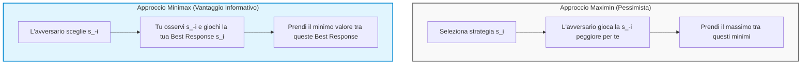
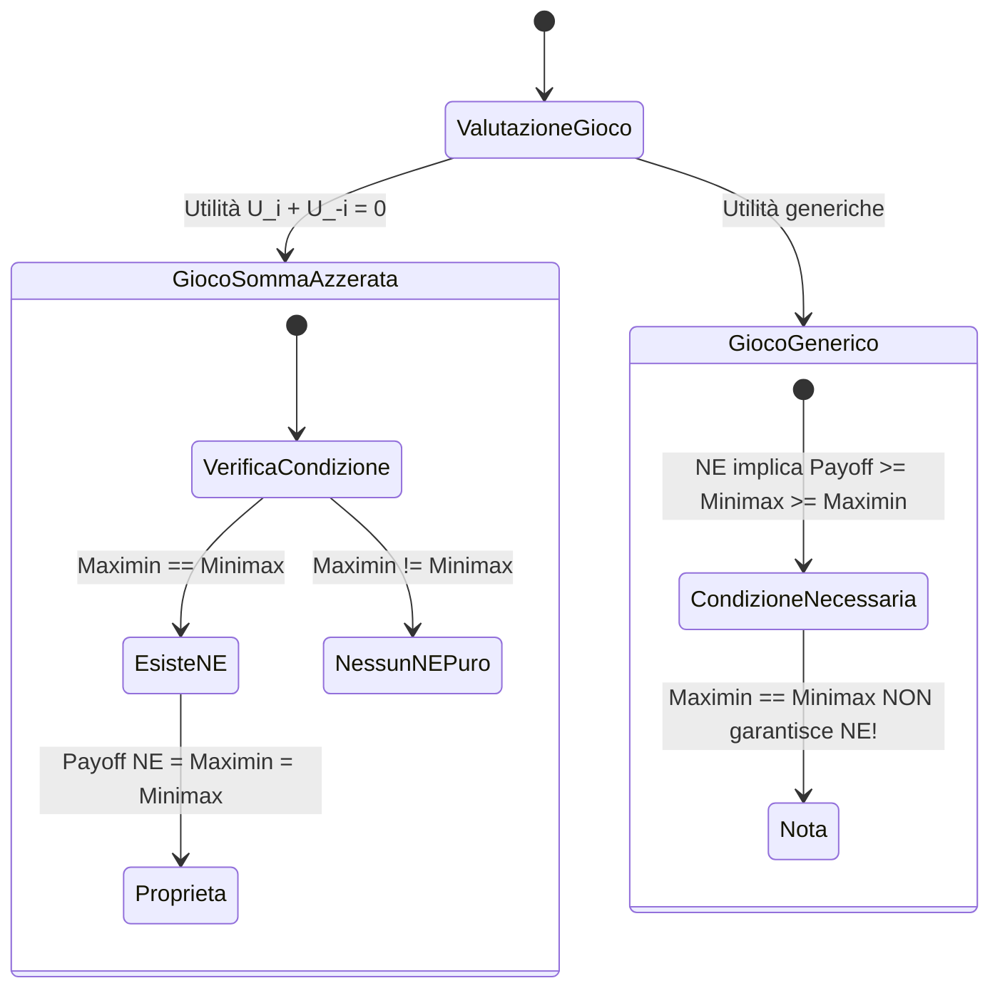
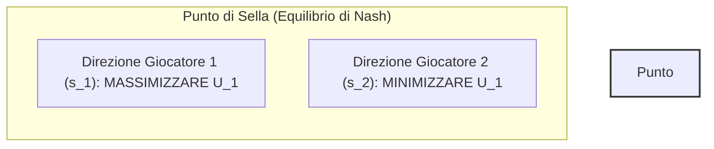
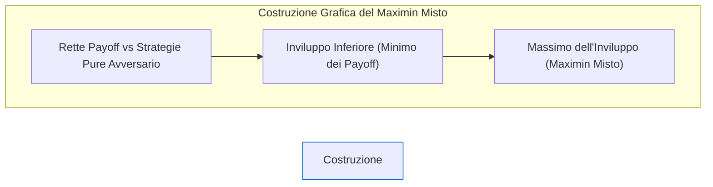
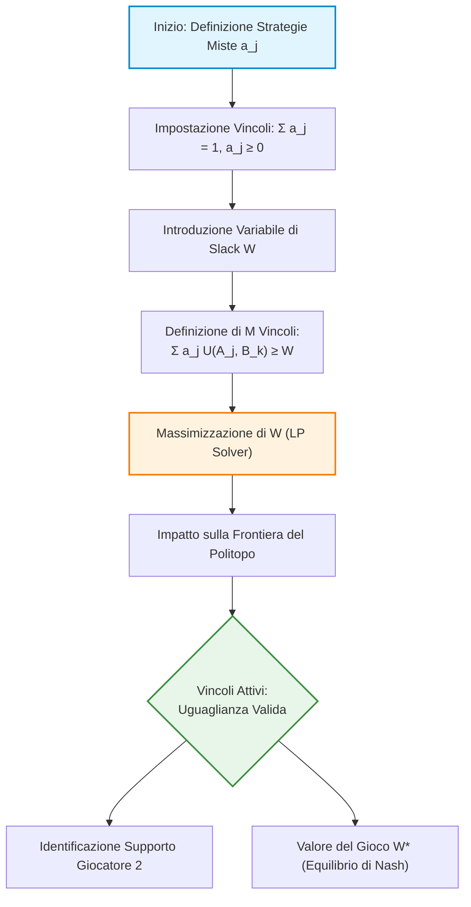
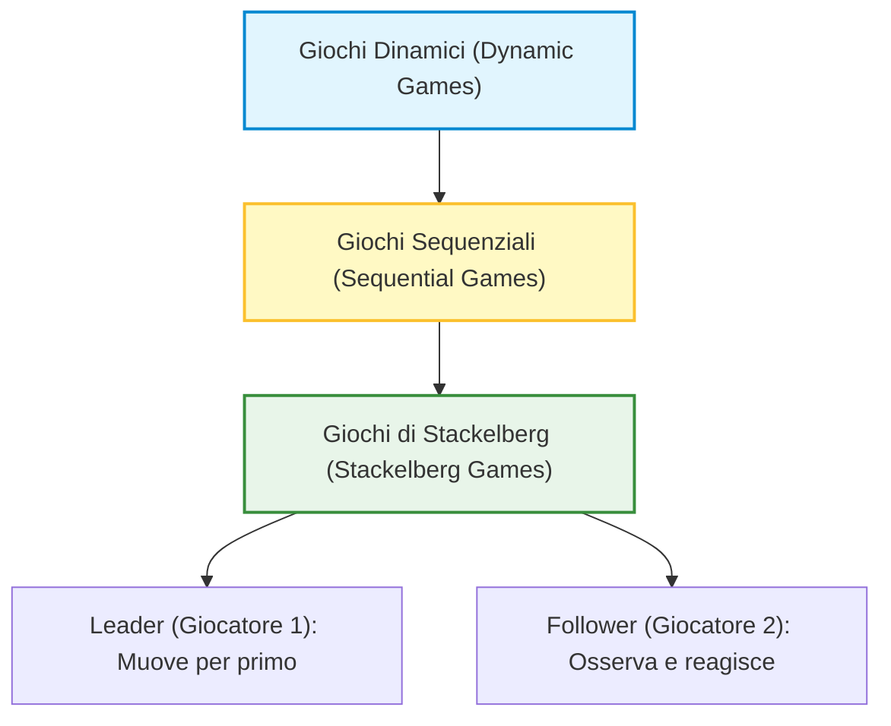
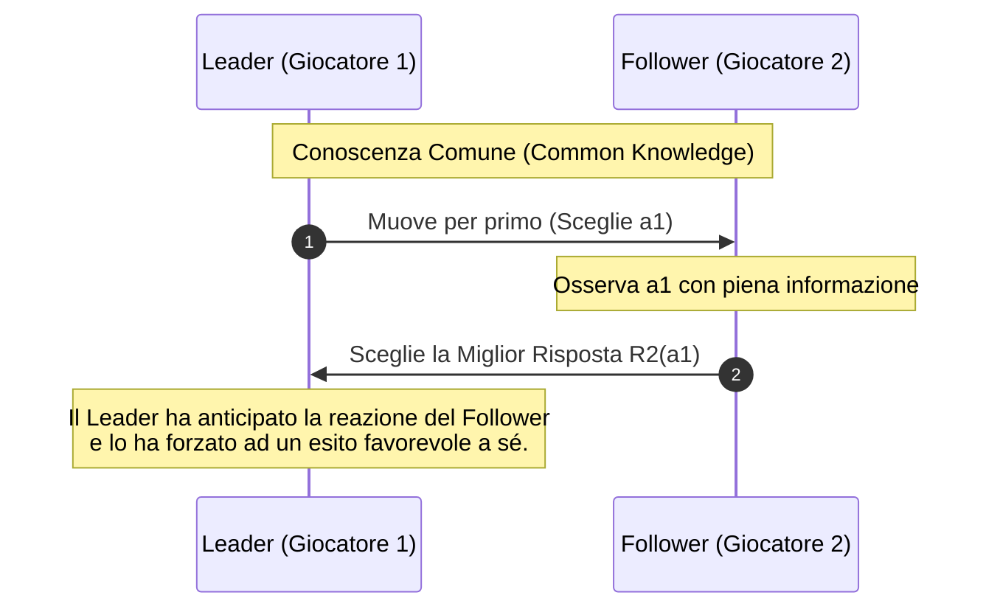

# Teoria dei Giochi: Approcci Maximin, Minimax e Strategie di Sicurezza

## Overview Didattica

In questa lezione viene introdotto un approccio fondamentale alla risoluzione dei problemi di decisione e ottimizzazione nei giochi: i concetti di **Maximin** e **Minimax**. Sebbene questi strumenti vengano spesso tralasciati nei manuali tradizionali di Teoria dei Giochi (*Game Theory*) orientati all'economia, essi costituiscono un pilastro storico e concettuale per l'Ingegneria dell'Informazione, l'Ottimizzazione e l'Intelligenza Artificiale (*Artificial Intelligence - AI*) / Apprendimento Automatico (*Machine Learning - ML*) — trovando applicazione celebre negli algoritmi decisionali per giochi complessi come gli scacchi.

Gli obiettivi principali della lezione includono:
* **Astrattizzazione a due giocatori**: Estensione della formalizzazione a giochi generici trattando tutti gli avversari del giocatore $i$ come un unico meta-giocatore $-i$.
* **Approccio Conservativo e Maximin**: Studio della scelta ottima basata sulla minimizzazione del danno nel caso peggiore (*worst-case scenario*). Vengono definiti formalmente la **Strategia di Sicurezza** (*Security Strategy*) e il relativo **Payoff di Sicurezza** (*Security Payoff*).
* **Concetto di Minimax**: Analisi dello scenario duale in cui un giocatore può osservare la mossa dell'avversario prima di selezionare la propria Ottima Risposta (*Best Response*), determinando il payoff minimo garantito in condizioni di informazione ideale sul comportamento altrui.

---

### Introduzione a Maximin, Minimax e l'Approccio Ingegneristico

Nella teoria dei giochi classica — sviluppata prevalentemente per scopi economici — l'attenzione è spesso focalizzata su un approccio puramente teorico per identificare gli equilibri di gioco. Esiste tuttavia un approccio alternativo chiamato **Minimax**, ampiamente utilizzato nell'ottimizzazione, nell'ingegneria e nell'Intelligenza Artificiale (*Artificial Intelligence - AI*). 

Storicamente, il concetto di Minimax precede la teoria dei giochi formalizzata ed è alla base dei primi algoritmi decisionali dell'IA, come quelli impiegati dai software di scacchi che hanno sconfitto i campioni del mondo negli anni '80 e '90 (es. Deep Blue). 

L'utilità di questo approccio per un ingegnere risiede nella sua applicabilità a problemi pratici in cui non è sempre possibile assumere una cooperazione o in cui le informazioni sui payoff (*payoff*) dell'avversario sono incomplete o totalmente assenti.

---

### Il Concetto di Maximin (Approccio Conservativo)

Consideriamo un gioco a $N$ giocatori. Dal punto di vista del generico giocatore $i$, possiamo astrarre l'insieme di tutti gli altri giocatori denotandolo con $-i$. L'interazione si riduce quindi a una visione binaria: il giocatore $i$ contro il "resto del mondo" $-i$.

Definiamo $S_i$ come l'insieme delle strategie pure a disposizione del giocatore $i$, e $S_{-i}$ come l'insieme dei profili strategici degli altri giocatori. 

#### La Funzione di Peggior Scenario
Il giocatore $i$ calcola una funzione $F_i: S_i \to \mathbb{R}$ definita come:

$$F_i(s_i) = \min_{s_{-i} \in S_{-i}} U_i(s_i, s_{-i})$$

dove $U_i(s_i, s_{-i})$ rappresenta l'utilità (o payoff) del giocatore $i$. 

> **Interpretazione:** $F_i(s_i)$ rappresenta il "peggior scenario possibile" (*worst-case scenario*) per il giocatore $i$ qualora scelga di adottare la strategia $s_i$. È la risposta analitica alla domanda: *"Se io gioco $s_i$, qual è il danno massimo che gli altri possono causarmi?"*

#### Il Valore di Maximin e la Strategia di Sicurezza
Adottando un atteggiamento estremamente pessimista o prudente, il giocatore $i$ selezionerà la strategia $s_i^*$ che massimizza il payoff ottenuto nel peggiore dei casi. Tale valore massimo del minimo è detto **Valore di Maximin** o **Payoff di Sicurezza** (*Security Payoff*):

$$v_i^{\text{maximin}} = \max_{s_i \in S_i} F_i(s_i) = \max_{s_i \in S_i} \min_{s_{-i} \in S_{-i}} U_i(s_i, s_{-i})$$

La strategia $s_i^*$ che garantisce tale payoff è definita **Strategia di Sicurezza** (*Security Strategy*):

$$s_i^* = \arg\max_{s_i \in S_i} \min_{s_{-i} \in S_{-i}} U_i(s_i, s_{-i})$$

> **Concetto Chiave: Pessimismo Razionale.** 
> Il Maximin rappresenta una scelta conservativa. Non presuppone che l'avversario sia stupido o generoso, ma che, indipendentemente dalla sua motivazione, il giocatore $i$ vuole garantirsi una "soglia minima di protezione" sotto la quale il suo payoff non potrà mai scendere. Questo è il principio cardine utilizzato dai software di scacchi: ipotizzare sempre che l'avversario faccia la mossa migliore possibile per metterci in difficoltà.

---

### Il Concetto di Minimax (Garantita di Risposta Ottima)

Il concetto di **Minimax** adotta una prospettiva informativa completamente diversa rispetto al Maximin, sebbene il formalismo matematico sia speculare.

#### La Funzione di Risposta Ottima
Immaginiamo una funzione $F_i: S_{-i} \to \mathbb{R}$ definita come:

$$F_i(s_{-i}) = \max_{s_i \in S_i} U_i(s_i, s_{-i})$$

Tale funzione associa ad ogni profilo di strategie degli avversari $s_{-i}$ il massimo payoff che il giocatore $i$ può ottenere giocando la sua **Risposta Ottima** (*Best Response*).

#### Il Valore di Minimax
Il **Valore di Minimax** viene definito prendendo il minimo valore possibile di queste risposte ottime al variare delle decisioni dell'avversario:

$$v_i^{\text{minimax}} = \min_{s_{-i} \in S_{-i}} F_i(s_{-i}) = \min_{s_{-i} \in S_{-i}} \max_{s_i \in S_i} U_i(s_i, s_{-i})$$

#### Significato Operativo
Il Minimax rappresenta il payoff minimo che il giocatore $i$ si garantisce **se ha il vantaggio informativo di osservare la mossa dell'avversario $s_{-i}$ prima di scegliere la propria mossa $s_i$**. 

Immaginiamo di giocare a carte o a sasso-carta-forbice, ma con uno specchio posizionato dietro l'avversario: non conosciamo a priori quale carta giocherà, ma sappiamo con certezza che, nel momento in cui sceglierà la sua mossa, saremo in grado di vederla e reagire di conseguenza con la nostra risposta ottima. Il Minimax rappresenta il payoff peggiore tra tutti i possibili esiti favorevoli garantiti da questa reazione ottima.

---

### Relazione tra Maximin, Minimax ed Equilibrio di Nash

Nei giochi generici, l'analisi di Maximin e Minimax rivela importanti proprietà strutturali legate all'Equilibrio di Nash (*Nash Equilibrium - NE*).

#### Propria Proprietà Fondamentale: Disuguaglianza del Minimax
Per un qualsiasi giocatore $i$ in un qualsiasi gioco, vale sempre la seguente disuguaglianza:

$$v_i^{\text{maximin}} \le v_i^{\text{minimax}}$$

*Dimostrazione intuitiva:* Il caso in cui si deve scegliere una mossa al buio sotto l'ipotesi peggiore (Maximin) non può mai offrire una garanzia superiore rispetto al caso in cui si possa scegliere la risposta ottima dopo aver osservato la mossa dell'avversario (Minimax).

#### Relazione con i Payoff dell'Equilibrio di Nash
Sia $s^* = (s_i^*, s_{-i}^*)$ un Equilibrio di Nash in strategie pure, e sia $U_i(s^*)$ il payoff conseguito dal giocatore $i$ all'equilibrio. Vale il seguente teorema:

$$U_i(s^*) \ge v_i^{\text{minimax}} \ge v_i^{\text{maximin}}$$

*Dimostrazione:* Per definizione di Equilibrio di Nash, $s_i^*$ è la risposta ottima a $s_{-i}^*$, quindi $U_i(s_i^*, s_{-i}^*) = \max_{s_i} U_i(s_i, s_{-i}^*)$. Poiché il valore di Minimax $v_i^{\text{minimax}}$ rappresenta il *minimo* valore possibile tra tutte le possibili risposte ottime al variare di $s_{-i}$, la risposta ottima specifica dell'equilibrio di Nash $U_i(s^*)$ non potrà mai essere inferiore a questo valore minimo.

> **Proprietà di Indipendenza:**
> Per calcolare il Maximin e il Minimax del giocatore $i$, è necessaria **solo ed esclusivamente** la funzione di utilità del giocatore $i$ ($U_i$). Non occorre conoscere le utilità degli altri giocatori ($U_{-i}$). Al contrario, l'Equilibrio di Nash richiede la conoscenza simultanea delle utilità di tutti i giocatori.

---

#### Analisi Attraverso Esempi Pratici

*Nota: Passaggi integrati con chiarezza didattica per ricostruire lo svolgimento delle matrici di payoff.*

##### Esempio 1: Disuguaglianza Stretta ($v_i^{\text{maximin}} < v_i^{\text{minimax}} < U_i(s^*)$)

Consideriamo la seguente matrice dove per il Giocatore $A$ (righe: $T, D$) sono specificati i payoff, mentre i payoff del Giocatore $B$ (colonne: $L, C, R$) inizialmente non sono rilevanti per il calcolo di Maximin e Minimax:

| Giocatore A / B | L | C | R |
| :--- | :---: | :---: | :---: |
| **T** | $3, \cdot$ | $3, \cdot$ | $4, \cdot$ |
| **D** | $5, \cdot$ | $1, \cdot$ | $2, \cdot$ |

1. **Calcolo del Maximin per A:**
   * Se A gioca $T$: il peggior payoff è $\min(3, 3, 4) = 3$.
   * Se A gioca $D$: il peggior payoff è $\min(5, 1, 2) = 1$.
   * $v_A^{\text{maximin}} = \max(3, 1) = 3$ (la strategia di sicurezza è $T$).

2. **Calcolo del Minimax per A:**
   * Se B gioca $L$: la risposta ottima di A è $\max(3, 5) = 5$ (giocando $D$).
   * Se B gioca $C$: la risposta ottima di A è $\max(3, 1) = 3$ (giocando $T$).
   * Se B gioca $R$: la risposta ottima di A è $\max(4, 2) = 4$ (giocando $T$).
   * $v_A^{\text{minimax}} = \min(5, 3, 4) = 3$.

Se ora completiamo la matrice dei payoff assegnando i valori per il Giocatore B:

| Giocatore A / B | L | C | R |
| :--- | :---: | :---: | :---: |
| **T** | $3, 5$ | $3, 1$ | $4, 2$ |
| **D** | $5, 4$ | $1, 6$ | $2, 0$ |

Facendo l'analisi della risposta ottima per entrambi i giocatori, si individuano due Equilibri di Nash in strategie pure: $(T, L)$ con payoff $(3, 5)$ e $(D, C)$ con payoff $(1, 6)$. Si nota come in questo caso specifico i payoff all'equilibrio rispettano la disuguaglianza generale.

##### Esempio 2: Coincidenza dei Valori ($v_i^{\text{maximin}} = v_i^{\text{minimax}} = U_i(s^*)$)

Consideriamo un altro gioco con la seguente matrice di payoff:

| Giocatore A / B | L | C | R |
| :--- | :---: | :---: | :---: |
| **T** | $3, 1$ | $3, 2$ | $4, 1$ |
| **D** | $5, 4$ | $6, 0$ | $7, 3$ |

* **Maximin di A:** $\max(\min(3,3,4), \min(5,6,7)) = \max(3, 5) = 5$ (ottenuto con $D$).
* **Minimax di A:** $\min(\max(3,5), \max(3,6), \max(4,7)) = \min(5, 6, 7) = 5$.
* Poiché $v_A^{\text{maximin}} = 5$ e $v_A^{\text{minimax}} = 5$, per il Teorema dei Due Carabinieri, l'eventuale payoff di un Equilibrio di Nash per A deve essere esattamente 5.
* L'unico Equilibrio di Nash in strategie pure è la coppia $(D, L)$, che offre il payoff $(5, 4)$. Il payoff per A è esattamente 5.

##### Esempio 3: Controesempio (Falso Mito dell'Esistenza dell'Equilibrio)

> **Concetto Chiave: Attenzione alla Direzione dell'Implicazione!**
> Il fatto che $v_i^{\text{maximin}} = v_i^{\text{minimax}}$ per tutti i giocatori **NON** garantisce l'esistenza di un Equilibrio di Nash in strategie pure per un gioco generico (non a somma azzerata).

Consideriamo la seguente matrice:

| Giocatore A / B | L | C | R |
| :--- | :---: | :---: | :---: |
| **T** | $3, 2$ | $0, 4$ | $3, 0$ |
| **M** | $0, 3$ | $2, 1$ | $0, 0$ |
| **D** | $4, 0$ | $4, 3$ | $3, 2$ |

Calcolando Maximin e Minimax per il giocatore A e per il giocatore B si ottiene:
* $v_A^{\text{maximin}} = 3$, $v_A^{\text{minimax}} = 3$
* $v_B^{\text{maximin}} = 2$, $v_B^{\text{minimax}} = 2$

Tuttavia, verificando una per una le 9 celle della matrice, **nessuna profilo strategico è un Equilibrio di Nash in strategie pure** (c'è sempre almeno un giocatore che ha un incentivo a deviare unilateralmente).

---

### Giochi a Somma Azzerata (Zero-Sum Games) e Modelli Avversariali

Una classe speciale e fondamentale di giochi è rappresentata dai **Giochi a Somma Azzerata** (*Zero-Sum Games*).

#### Definizione Matematica
Un gioco a due giocatori è a somma azzerata se per ogni profilo di strategie $s = (s_i, s_{-i})$ vale la seguente identità per le funzioni di utilità:

$$U_i(s_i, s_{-i}) + U_{-i}(s_i, s_{-i}) = 0 \iff U_{-i}(s_i, s_{-i}) = -U_i(s_i, s_{-i})$$

Ciò significa che la vincita di un giocatore corrisponde esattamente alla perdita dell'altro.

#### Giochi Avversariali e Modellistica Ingegneristica
Un concetto più ampio è quello di **Gioco Avversariale** (*Adversarial Game*), in cui i giocatori hanno interessi diametralmente opposti: ogni modifica strategica che aumenta l'utilità del Giocatore 1 riduce l'utilità del Giocatore 2.

* **Esempi Tipici:** Scacchi, Dama, Sasso-Carta-Forbice, Testa o Croce.
* **Falsi Avversari (Giochi Non a Somma Azzerata):** 
  * *Il Dilemma del Prigioniero:* I prigionieri non sono avversari tra loro; entrambi trarrebbero beneficio dalla cooperazione mutuale.
  * *La Battaglia dei Sessi:* I partner hanno preferenze diverse su dove trascorrere la serata, ma il loro obiettivo primario è stare insieme (cooperazione), non danneggiarsi a vicenda.

#### Riscalamento delle Utilità nei Tornei Reali
Molti giochi e tornei sportivi (es. la Serie A di calcio o i tornei di scacchi) assegnano punteggi come $3$ punti per la vittoria, $1$ per il pareggio, $0$ per la sconfitta. Sebbene la somma dei punti in un singolo match non sia strettamente zero (può essere 3 in caso di vittoria o 2 in caso di pareggio), tali giochi rimangono intrinsecamente avversariali. 

Attraverso una trasformazione affine lineare (traslazione e riscalamento per una costante), questi giochi possono essere matematicamente convertiti in giochi a somma azzerata privi di alterazioni delle preferenze razionali dei giocatori.

---

### Teorema Minimax nei Giochi a Somma Azzerata

Nei giochi a somma azzerata, la complessa relazione tra Maximin, Minimax ed Equilibrio di Nash trova una sintesi perfetta ed elegante.

#### Il Teorema di Von Neumann per le Strategie Pure
Sia $G$ un gioco a due giocatori a somma azzerata con un numero finito di strategie pure.

Esiste un Equilibrio di Nash in strategie pure $s^* = (s_i^*, s_{-i}^*)$ **se e solo se** il valore Maximin è uguale al valore Minimax per ciascun giocatore:

$$v_i^{\text{maximin}} = v_i^{\text{minimax}}$$

#### Corollari e Proprietà degli Equilibri a Somma Azzerata
Se il gioco ammette uno o più equilibri di Nash in strategie pure:

1. **Valore Unico del Gioco:** Il payoff del Giocatore $i$ all'equilibrio è univocamente determinato e corrisponde al suo valore di Maximin (e Minimax):
   $$U_i(s^*) = v_i^{\text{maximin}} = v_i^{\text{minimax}}$$
2. **Equivalenza degli Equilibri Multipli:** Se esistono più Equilibri di Nash, essi forniscono tutti **lo stesso identico payoff** a ciascun giocatore. Non vi sono equilibri "preferibili" ad altri in termini di resa finale.
3. **Coincidenza con le Strategie di Sicurezza:** La componente di strategia pure $s_i^*$ di qualsiasi Equilibrio di Nash coincide con una **strategia di sicurezza** per il giocatore $i$.

In sintesi, nei giochi a somma azzerata la prudenza estrema (Maximin) e la reazione ottimale informata (Minimax) convergono esattamente sullo stesso punto stazionario rappresentato dall'Equilibrio di Nash.

---

### Interpretazione Geometrica e Concetto di Punto di Sella (*Saddle Point*)

Nel contesto dei giochi a somma zero (*Zero-Sum Games*), esiste un legame profondo tra il concetto di equilibrio di Nash e i principi di Maximin e Minimax. In un gioco a somma zero, l'interesse di un giocatore è puramente antagonistico rispetto a quello dell'avversario: **qualsiasi incremento nell'utilità del Giocatore 1 comporta un'uguale riduzione nell'utilità del Giocatore 2**.

Matematicamente, per due giocatori vale la relazione $U_1(s_1, s_2) + U_2(s_1, s_2) = 0$, ovvero:
$$U_2(s_1, s_2) = -U_1(s_1, s_2)$$

Di conseguenza, per il Giocatore 1 minimizzare il payoff dell'avversario equivale esattamente a massimizzare il proprio, e viceversa.

#### La relazione fondamentale tra Maximin e Minimax
Per qualsiasi giocatore $i$, la peggiore situazione possibile (il caso peggiore) corrisponde alla migliore situazione per l'avversario $-i$. Vale quindi la relazione:
$$\text{Maximin}_i = -\text{Minimax}_{-i}$$

Se in un gioco in strategie pure si verifica la condizione $\text{Maximin}_1 = \text{Minimax}_1$, la strategia congiunta di sicurezza (*Joint Security Strategy*) scelta dai giocatori costituisce un **Equilibrio di Nash**.

#### Analogia con l'Analisi Matematica: Il Punto di Sella
Per comprendere intuitivamente questo risultato, è utile richiamare il concetto di **Punto di Sella** (*Saddle Point*) dalla matematica delle funzioni a più variabili (Analisi 2). 

Se consideriamo la funzione di utilità $U_1(s_1, s_2)$:
* Nella direzione delle scelte del Giocatore 1 ($s_1$), il Giocatore 1 cerca un **massimo**.
* Nella direzione delle scelte del Giocatore 2 ($s_2$), il Giocatore 2 cerca di **minimizzare** $U_1$ (per massimizzare il proprio payoff $-U_1$).

Un equilibrio di Nash in un gioco a somma zero è quindi l'equivalente di un punto di sella per la superficie di utilità: un punto che è contemporaneamente un massimo rispetto alle variazioni unilaterali del Giocatore 1 e un minimo rispetto alle variazioni unilaterali del Giocatore 2.

#### Il Valore del Gioco (*Value of the Game*)
Quando $\text{Maximin}_1 = \text{Minimax}_1$, questo valore comune viene convenzionalmente definito **Valore del Gioco** (*Value of the Game*), indicato con $V$:
$$V = \text{Maximin}_1 = \text{Minimax}_1 = U_1(s_1^*, s_2^*)$$

* **Convenzione:** Il valore $V$ fa sempre riferimento al payoff del **Giocatore 1**. 
* Per il Giocatore 2, il valore garantito sarà esattamente $-V$.

> **Nota di rappresentazione:** Nei giochi a somma zero è ridondante utilizzare la matrice dei payoff doppia (*Bi-matrix*). Poiché $U_2 = -U_1$, è sufficiente rappresentare il gioco tramite una matrice semplice contenente i soli payoff del Giocatore 1.

---

### Contestualizzazione Storica e Applicazioni: Gli Scacchi

Il principio del Minimax per giochi a somma zero è stato originariamente formulato da **John von Neumann** mediante tecniche di ottimizzazione vincolata e programmazione lineare (*Linear Programming*). Questo risultato anticipa la formulazione generale della Teoria dei Giochi di Nash ed è alla base dei moderni algoritmi di Intelligenza Artificiale applicati a giochi complessi a somma zero come gli **Scacchi**.

* **Applicazione negli Scacchi:** Un computer che gioca a scacchi adotta una strategia di sicurezza: presuppone che l'avversario sia perfettamente razionale e che sceglierà sempre la mossa in grado di infliggere il maggior danno possibile. Di conseguenza, l'algoritmo esamina l'albero delle mosse e sceglie la decisione che massimizza il minimo beneficio garantito.
* **Razionalità Limitata (*Bounded Rationality*):** La complessità computazionale degli scacchi è enorme (circa $20^{100}$ possibili strategie). Non potendo esplorare l'intero albero dinamico, sia i grandi maestri umani sia i software operano dei "tagli" all'albero di decisione. Nei software di scacchi, i livelli di difficoltà (es. da 1 a 5) corrispondono a una limitazione della profondità di calcolo (es. esplorare solo le successive $N$ mosse anziché l'intero gioco).

---

### Estensione del Minimax alle Strategie Miste

Nei giochi in strategie pure, la condizione $\text{Maximin} = \text{Minimax}$ non è sempre verificata. Tuttavia, estendendo il dominio d'azione dal set discreto delle strategie pure $S_i$ al Simplesso di Probabilità delle **Strategie Miste** (*Mixed Strategies*), indicato con $\Delta S_i$, il quadro cambia radicalmente.

#### Formalizzazione Matematica in Strategie Miste
Definiamo la funzione di sicurezza $f_i(m_i)$ per una strategia mista $m_i \in \Delta S_i$:

$$f_i(m_i) = \min_{m_{-i} \in \Delta S_{-i}} U_i(m_i, m_{-i})$$

La **Strategia di Sicurezza Mista** (*Mixed Security Strategy*) è la combinazione di probabilità $m_i^*$ che massimizza la funzione $f_i(m_i)$. 

Il relativo payoff di sicurezza in strategie miste, o **Maximin Misto** ($\text{Maximin}_m$), è formalizzato come:
$$\text{Maximin}_m = \max_{m_i \in \Delta S_i} \min_{m_{-i} \in \Delta S_{-i}} U_i(m_i, m_{-i})$$

Analogamente, il **Minimax Misto** ($\text{Minimax}_m$) rappresenta il minimo valore che gli avversari possono imporre al Giocatore $i$, ipotizzando che il Giocatore $i$ riesca a giocare la sua migliore risposta (*Best Response*):
$$\text{Minimax}_m = \min_{m_{-i} \in \Delta S_{-i}} \max_{m_i \in \Delta S_i} U_i(m_i, m_{-i})$$

#### Semplificazione Computazionale Fondamentale
Nel calcolo del $\text{Maximin}_m$ e del $\text{Minimax}_m$, l'ottimizzazione rispetto al profilo degli avversari o alla propria risposta può essere limitata al solo insieme delle **strategie pure**:

1. **Per la minimizzazione dell'avversario:** Poiché il payoff atteso in strategie miste è una combinazione lineare (e quindi una funzione continua e lineare nelle probabilità), il minimo valore possibile per $U_i(m_i, m_{-i})$ viene sempre raggiunto in corrispondenza di almeno una strategia pura dell'avversario $s_{-i} \in S_{-i}$.
2. **Per la massimizzazione del giocatore:** Il set delle migliori risposte contiene sempre almeno una strategia pura.

Le definizioni si semplificano quindi in:
$$\text{Maximin}_m = \max_{m_i \in \Delta S_i} \min_{s_{-i} \in S_{-i}} U_i(m_i, s_{-i})$$
$$\text{Minimax}_m = \min_{m_{-i} \in \Delta S_{-i}} \max_{s_i \in S_i} U_i(s_i, m_{-i})$$

#### Esistenza del Maximin e Minimax Misto
Mentre in strategie pure l'esistenza di un punto d'equilibrio richiede la finitudine dell'insieme delle strategie, nello spazio delle strategie miste il set $\Delta S_i$ è un **insieme compatto** (chiuso e limitato) e la funzione di utilità attesa $U_i$ è **continua**.

Per il **Teorema di Weierstrass**, una funzione continua definita su un insieme compatto ammette sempre massimo e minimo assoluti. Pertanto, **il Maximin Misto e il Minimax Misto esistono sempre**.

---

### Analisi Grafica ed Esempi Intuitivi

Attraverso l'uso delle strategie miste, un giocatore può incrementare il proprio Maximin e l'avversario può ridurre il Minimax, fino a farli coincidere.

#### Esempio Geometrico: Costruzione dell'Inviluppo Inferiore
Consideriamo un giocatore con due sole strategie pure a disposizione ($U$ e $D$), la cui strategia mista è parametrizzata dalla probabilità $q \in [0, 1]$ di giocare $U$.

Se tracciamo le funzioni di utilità attesa rispetto alle risposte pure dell'avversario in funzione di $q$:
* Il payoff peggiore per ogni $q$ è rappresentato dall'**inviluppo inferiore** delle rette di utilità.
* Il $\text{Maximin}_m$ corrisponde al punto di massimo di questo inviluppo inferiore (l'apice della spezzata).

Topologicamente, nei giochi $2 \times 2$, l'operazione di massimizzare il minimo (Maximin) e quella di minimizzare il massimo (Minimax) portano ad incrociare le linee di utilità nello stesso punto di indifferenza.

---

> ### CONCETTO CHIAVE: ERRORE COMUNE DA EVITARE ALL'ESAME
> 
> **Attenzione:** L'uguaglianza $\text{Maximin}_m = \text{Minimax}_m = U_i(\text{Equilibrio di Nash})$ vale **ESCLUSIVAMENTE PER I GIOCHI A SOMMA ZERO**.
>
> Spesso gli studenti tentano di applicare il principio del Minimax/Maximin per trovare gli equilibri di Nash in giochi che **NON** sono a somma zero (come la *Battaglia dei Sessi* o il *Dilemma del Prigioniero*). 
> 
> In un gioco non a somma zero, la coincidence grafica tra Maximin e Minimax in strategie miste può capitare per motivi puramente geometrici/simmetrici, ma **NON corrisponde al payoff dell'Equilibrio di Nash**. Applicare queste proprietà a giochi generici costituisce un errore concettuale grave.

---

### Il Teorema del Minimax di Von Neumann

Possiamo ora enunciare formalmente il **Teorema del Minimax di Von Neumann** esteso alle strategie miste, che rappresenta uno dei pilastri fondamentali della teoria dei giochi.

> **Teorema del Minimax (Von Neumann, 1928):**
> Sia $G$ un gioco a due giocatori a somma zero finito. Allora:
> 1. Esiste sempre una condizione di uguaglianza tra il Maximin misto e il Minimax misto per entrambi i giocatori:
>    $$\text{Maximin}_m = \text{Minimax}_m = V$$
> 2. Il gioco ammette **almeno un Equilibrio di Nash in strategie miste** $m^* = (m_1^*, m_2^*)$.
> 3. Tutti gli equilibri di Nash forniscono al Giocatore 1 lo stesso payoff atteso, pari a $V$ (il Valore del Gioco), e al Giocatore 2 un payoff pari a $-V$.
> 4. Le strategie d'equilibrio di Nash coincideranno sempre con le **strategie di sicurezza miste** dei giocatori.

#### Risoluzione Pratica tramite Programmazione Lineare (*Linear Programming*)
La rilevanza applicativa del Teorema del Minimax risiede nella possibilità di calcolare gli Equilibri di Nash nei giochi a somma zero in modo computazionalmente efficiente. 

Anziché cercare le intersezioni delle migliori risposte, la ricerca dell'equilibrio viene formulata come un problema di **Programmazione Lineare** (*Linear Programming*, LP):

Per il Giocatore 1, con strategie pure $A_1, A_2, \dots, A_L$, la strategia mista $\mathbf{p} = (p_1, p_2, \dots, p_L)$ viene trovata risolvendo:

$$\max V$$
$$\text{sotto i vincoli:}$$
$$\begin{cases} 
\sum_{i=1}^{L} p_i \cdot U_1(A_i, B_j) \ge V & \forall j \in \{1, \dots, K\} \\
\sum_{i=1}^{L} p_i = 1 & \\
p_i \ge 0 & \forall i \in \{1, \dots, L\}
\end{cases}$$

Dove $B_1, \dots, B_K$ sono le strategie pure del Giocatore 2. Questo problema di ottimizzazione vincolata garantisce il calcolo esatto del Valore del Gioco e delle strategie ottimali di equilibrio tramite algoritmi standard (es. Algoritmo del Simplesso).

---

### Risoluzione dei Giochi a Somma Zero tramite Programmazione Lineare (LP)

La risoluzione dei Giochi a Somma Zero (Zero-Sum Games) in strategie miste trae un enorme vantaggio dalla loro struttura matematica: è possibile formulare la ricerca dell'Equilibrio di Nash (Nash Equilibrium) come un problema di **Programmazione Lineare** (Linear Programming - LP). 

A differenza dei giochi generici a somma non-zero, dove la massimizzazione individuale dell'utilità non garantisce il raggiungimento di un equilibrio, nei giochi a somma zero l'interesse di un giocatore è esattamente opposto a quello dell'altro. Di conseguenza, il punto di ottimo locale trovato tramite LP coincide con un punto di sella (Saddle Point), ossia con un Equilibrio di Nash.

---

#### Formulazione del Problema Primal (Lato Giocatore 1 - Maximin)

Consideriamo due giocatori:
*   **Giocatore 1**: possiede $L$ strategie pure $A_1, A_2, \dots, A_L$. Assegniamo a ciascuna strategia un peso probabilistico $a_j$, componendo il vettore delle strategie miste $\mathbf{a} = (a_1, a_2, \dots, a_L)^T$.
*   **Giocatore 2**: possiede $M$ strategie pure $B_1, B_2, \dots, B_M$.

Poiché il gioco è a somma zero, l'utilità del Giocatore 2 è il negativo dell'utilità del Giocatore 1: $U_2 = -U_1 = -U$.

Per trovare la strategia di difesa (o di sicurezza) ottimale del Giocatore 1, introduciamo una **variabile di slack** (Slack variable) $W$. La variabile $W$ rappresenta il payoff minimo atteso che il Giocatore 1 intende garantire a se stesso, indipendentemente dalla scelta del Giocatore 2.

La formulazione del problema LP per il Giocatore 1 è la seguente:

$$\begin{aligned}
\max_{\mathbf{a}, W} \quad & W \\
\text{s.t.} \quad & \sum_{j=1}^{L} a_j \cdot U(A_j, B_k) \ge W, \quad \forall k \in \{1, 2, \dots, M\} \\
& \sum_{j=1}^{L} a_j = 1 \\
& a_j \ge 0, \quad \forall j \in \{1, 2, \dots, L\}
\end{aligned}$$

**Spiegazione del sistema:**
1.  **Condizione di Normalizzazione**: Le probabilità $a_j$ devono essere non-negative e sommare ad $1$.
2.  **Vincoli sulle Strategie Pure**: È sufficiente verificare la prestazione della strategia mista $\mathbf{a}$ contro le *strategie pure* $B_k$ del Giocatore 2. Se l'utilità attesa è almeno $W$ contro tutte le strategie pure di 2, lo sarà anche contro qualsiasi sua strategia mista.
3.  **Obiettivo**: Massimizzare $W$ significa spingere al massimo il limite inferiore del proprio guadagno.

> **CONCETTO CHIAVE: Perché l'ottimizzazione diretta funziona nei giochi a somma zero**
>
> Se applicassimo questo approccio a un gioco a somma non-zero (come il *Dilemma del Prigioniero* / Prisoner's Dilemma), la semplice massimizzazione dell'utilità individuale fallirebbe: massimizzare la propria utilità porta a scegliere di confessare, senza considerare che il rivale reagirà deviando unilateralmente. 
> 
> Nei giochi a somma zero, tuttavia, il rivale vuole **esattamente** minimizzare la nostra utilità. Poiché il nostro massimo equivale al minimo del rivale, sapendo con certezza come il rivale risponderà alla nostra massimizzazione, l'ottimo garantito dall'LP corrisponde esattamente a un **Equilibrio di Nash**.

---

#### Interpretazione Geometrica e Identificazione del Supporto

Numericamente, l'algoritmo di risoluzione parte da un valore di $W$ molto basso e lo incrementa progressivamente mantenendo valide le disuguaglianze. 

Dal punto di vista della geometria dell'ottimizzazione (Ricerca Operativa):
1.  Aumentando $W$, la soluzione muove il punto nello spazio delle soluzioni verso la frontiera del **politopo** (polytope) definito dai vincoli.
2.  Quando $W$ raggiunge il suo valore massimo ammissibile $W^*$, tocciamo la frontiera e alcuni dei vincoli di disuguaglianza diventano **vincoli attivi** (Active constraints), cioè valgono con l'uguaglianza stretta:

$$\sum_{j=1}^{L} a_j \cdot U(A_j, B_k) = W^*$$

 Le strategie pure $B_k$ del Giocatore 2 corrispondenti ai vincoli che diventano **attivi** formano il **supporto** (Support) della strategia mista di equilibrio del Giocatore 2. 

Le strategie pure di $B$ associate a vincoli non attivi (dove l'utilità è strettamente maggiore di $W^*$) forniscono un'utilità peggiore per il Giocatore 2 (ricordando che $U_2 = -U_1$), pertanto il Giocatore 2 assegnerà loro probabilità nulla nell'equilibrio.

---

#### Dualità e Formulazione Minimax (Lato Giocatore 2)

Per il Teorema del Minimax, il valore massimo che il Giocatore 1 può garantirsi ($W^*$) è uguale al valore minimo a cui il Giocatore 2 può limitare il Giocatore 1. Esiste quindi una formulazione **duale** (Dual formulation) del problema LP, impostata dal punto di vista delle strategie del Giocatore 2 ($\mathbf{b} = (b_1, b_2, \dots, b_M)^T$):

$$\begin{aligned}
\min_{\mathbf{b}, V} \quad & V \\
\text{s.t.} \quad & \sum_{k=1}^{M} b_k \cdot U(A_j, B_k) \le V, \quad \forall j \in \{1, 2, \dots, L\} \\
& \sum_{k=1}^{M} b_k = 1 \\
& b_k \ge 0, \quad \forall k \in \{1, 2, \dots, M\}
\end{aligned}$$

##### Scelta della Formulazione Spaziale
*   **Problema Primal**: $L$ variabili e $M$ vincoli.
*   **Problema Duale**: $M$ variabili e $L$ vincoli.

In ingegneria, conviene scegliere la formulazione che minimizza la dimensione del problema. Per esempio, se un giocatore ha solo due strategie pure ($L = 2$), la probabilità della prima strategia sarà $p$ e della seconda $(1-p)$. In questo caso, il problema si riduce a un'ottimizzazione monodimensionale estremamente semplice, risolvibile anche analiticamente a mano.

---

#### Complessità Computazionale e Implicazioni Pratiche

Dal punto di vista della complessità computazionale (Computational Complexity):

1.  **Risolvibilità in Tempo Polinomiale**: A differenza dei giochi generici a somma non-zero (la cui ricerca degli equilibri rientra nella classe di complessità `PPAD-complete`), i giochi a somma zero sono risolvibili in **tempo polinomiale** (Polynomial time) grazie alla loro riducibilità a problemi LP.
2.  **Algoritmo del Simplesso (Simplex Method)**: Sebbene l'algoritmo del Simplesso abbia una complessità teorica nel caso peggiore di tipo esponenziale, nella pratica ingegneristica e applicativa (es. tramite *MATLAB* `linprog` o *CPLEX*) è estremamente veloce ed efficiente.
3.  **Approcci Metaeuristici**: Per problemi di dimensioni enormi, si usano metaeuristiche come gli **Algoritmi Genetici** (Genetic Algorithms) o la **Tabu Search**. Esse non garantiscono l'eccellenza analitica assoluta, ma trovano approssimazioni di equilibrio in tempi ridotti.

> **CONCETTO CHIAVE: Modellazione di Progetto**
>
> In sede di modellazione ingegneristica, se si riesce a formulare un problema complesso o un'interazione strategica nella forma di un **gioco a somma zero**, la ricerca numerica dell'Equilibrio di Nash diventa computazionalmente banale e trattabile anche su larga scala.

---

### Giochi di Stackelberg e Competizione Sequenziale

I **Giochi di Stackelberg** (*Stackelberg games*) rappresentano una classe fondamentale di giochi dinamici e sequenziali ad informazione completa. Proposti negli anni '30 dall'economista tedesco Heinrich von Stackelberg — prima dello sviluppo della teoria dei giochi classica di Nash e von Neumann — nascono originariamente per modellare la competizione economica di duopolio tra un'impresa dominante (*incumbent*) e una nuova entrante nel mercato (*outsider*).

Un gioco di Stackelberg è essenzialmente una variante sequenziale di un gioco statico, caratterizzata dalla presenza di due ruoli ben definiti:
1. **Leader (Giocatore 1):** Sceglie e dichiara la propria azione per primo.
2. **Follower (Giocatore 2):** Osserva la mossa compiuta dal Leader e successivamente sceglie la propria azione di risposta.

#### Applicazioni in Ingegneria e Telecomunicazioni
Sebbene nascano in ambito economico, i giochi di Stackelberg sono ampiamente impiegati nell'ingegneria moderna, in particolare nell'ambito delle **Reti Cognitive** (*Cognitive Networks*) e dell'**Assegnazione Dinamica dello Spettro** (*Dynamic Spectrum Allocation*):
* **Utente Primario (Leader):** È il proprietario licenziatario dello spettro di frequenza (*incumbent*). Definisce per primo come occupare le risorse o stabilisce le condizioni d'uso.
* **Utente Secondario (Follower):** È un utente opportunistico (*outsider*) che osserva lo stato di occupazione dello spettro e adatta la propria trasmissione per accedere alle risorse libere senza interferire con il Leader.

---

### Formulazione Matematica e Risoluzione tramite Induzione all'Indietro

Poiché i giochi di Stackelberg sono giochi sequenziali ad informazione perfetta (in cui tutti gli insiemi di informazione sono singoletti), la metodologia standard per determinare l'**Equilibrio di Stackelberg** (*Stackelberg Equilibrium*) consiste nell'applicazione dell'**Induzione all'Indietro** (*Backward Induction*). Il risultato formale corrisponde a un **Equilibrio Perfetto nei Sottogiochi** (*Subgame Perfect Nash Equilibrium - SPNE*).

> **CONCETTO CHIAVE: Eliminazione delle Ambiguità**  
> Molto spesso in ingegneria si converte un gioco statico con molteplici Equilibri di Nash in un gioco di Stackelberg sequenziale. Sottoponendo il gioco all'induzione all'indietro, finché i payoff terminali sono distinti, l'esito del gioco risulta **unico**. Questo permette di rimuovere le ambiguità legate alla presenza di equilibri multipli.

#### Formalizzazione del Problema

Siano $A_1$ e $A_2$ gli insiemi delle azioni disponibili rispettivamente per il Leader (Giocatore 1) e per il Follower (Giocatore 2). Le funzioni di utilità sono date da $u_1(a_1, a_2)$ e $u_2(a_1, a_2)$.

1. **Analisi del Follower (Fase 2):**  
   Il Follower osserva l'azione $a_1 \in A_1$ intrapresa dal Leader e seleziona la propria **Migliore Risposta** (*Best Response*) $R_2(a_1)$:
   $$R_2(a_1) = \arg\max_{a_2 \in A_2} u_2(a_1, a_2)$$

2. **Ottimizzazione del Leader (Fase 1):**  
   Il Leader, conoscendo la razionalità del Follower, anticipa la funzione di risposta $R_2(a_1)$ e sceglie la mossa $a_1^*$ che massimizza il proprio payoff complessivo:
   $$a_1^* = \arg\max_{a_1 \in A_1} u_1\Big(a_1, R_2(a_1)\Big)$$

L'equilibrio di Stackelberg finale è la coppia di azioni esecutive effettive $(a_1^*, R_2(a_1^*))$, mentre il profilo strategico completo nel sottogioco richiede la specifica della funzione di risposta $R_2(a_1)$ per ogni possibile $a_1$.

#### Garanzia di Minimax per il Follower
Poiché il Follower sceglie la propria mossa dopo aver osservato la decisione del Leader, egli si trova sempre nella condizione di poter garantire a se stesso almeno il proprio valore di **Minimax** ($\text{v}_2$), ovvero il peggior risultato massimo che può ottenere conoscendo l'azione dell'avversario:
$$u_2(a_1^*, R_2(a_1^*)) \ge \max_{a_2 \in A_2} \min_{a_1 \in A_1} u_2(a_1, a_2)$$

---

### Analisi di Esempi Pratici e Regole di Risoluzione dei Pareggi

#### Esempio 1: Competizione tra Carl (Leader) e Joe (Follower)

Consideriamo un gioco base descritto dalla seguente bi-matrice dei payoff statici, dove Carl sceglie la riga ($R, S, T$) e Joe sceglie la colonna ($F, G, H$):

| Carl \ Joe | F | G | H |
| :--- | :---: | :---: | :---: |
| **R** | $(2, 2)$ | $(1, 0)$ | $(0, 1)$ |
| **S** | $(1, 6)$ | $(0, 2)$ | $(6, 4)$ |
| **T** | $(0, 1)$ | $(4, 3)$ | $(6, 3)$ |

*Nota: Passaggio integrato con chiarezza didattica per mostrare la differenza tra l'equilibrio di Nash statico e quello di Stackelberg.*

1. **Analisi Statica (Nash):**  
   Se il gioco fosse giocato simultaneamente, l'unico Equilibrio di Nash in strategie pure sarebbe la coppia $(R, F)$ con payoff $(2, 2)$.

2. **Analisi Sequenziale di Stackelberg (Carl muove per primo):**  
   Carl calcola preliminarmente la migliore risposta di Joe $R_2(a_1)$ per ciascuna delle sue tre possibili azioni:
   * Se Carl gioca **R**: Joe confronta i payoff $u_2(R, \cdot) \to \{2, 0, 1\}$. La risposta migliore di Joe è **F** ($u_2 = 2$). Payoff per Carl: $u_1(R, F) = 2$.
   * Se Carl gioca **S**: Joe confronta i payoff $u_2(S, \cdot) \to \{6, 2, 4\}$. La risposta migliore di Joe è **F** ($u_2 = 6$). Payoff per Carl: $u_1(S, F) = 1$.
   * Se Carl gioca **T**: Joe confronta i payoff $u_2(T, \cdot) \to \{1, 3, 3\}$. Qui Joe ha un pareggio tra **G** e **H** ($u_2 = 3$). Supponendo che risponda **G**, il payoff per Carl è $u_1(T, G) = 4$.

   Carl confronta i payoff ottenibili dalle risposte deliberate di Joe:
   $$\max \Big( u_1(R, F), u_1(S, F), u_1(T, G) \Big) = \max (2, 1, 4) = 4$$

   * **Esito di Stackelberg:** Carl gioca **T**, Joe risponde con **G**. Esito finale $(T, G)$ con payoff $(4, 3)$.
   * **Profilo di Equilibrio Perfetto nei Sottogiochi (SPNE):** Carl sceglie $T$; la strategia di risposta di Joe è la combinazione $(F, F, G)$.

> **Osservazione:** Entrambi i giocatori beneficiano della struttura di Stackelberg rispetto all'Equilibrio di Nash statico $(2, 2)$: Carl passa da $2$ a $4$ e Joe passa da $2$ a $3$. Questo incremento simultaneo (**miglioramento paretiano**) è possibile perché il gioco **non è a somma zero**.

#### Regole di Risoluzione dei Pareggi (*Tie-Breaking Rules*)

Se durante il calcolo dell'induzione all'indietro si riscontrano payoff identici nelle opzioni del Follower o del Leader, l'albero di decisione presenta un'ambiguità che richiede l'adozione di una regola esplicita di risoluzione dei pareggi (*Tie-breaking rule*):

* **Follower Generoso (*Generous Follower*):** In presenza di più risposte che massimizzano ugualmente la propria utilità, il Follower sceglie l'azione che garantisce il payoff più alto al Leader.
* **Leader Generoso (*Generous Leader*):** Se il Leader è indifferente tra più mosse poiché conducono allo stesso suo payoff massimo, egli seleziona l'azione che avvantaggia maggiormente il Follower.

*Esempio nell'ipotesi che Joe sia il Leader:*  
Se Joe gioca $H$, Carl ottiene un payoff pari a $6$ sia giocando $S$ che giocando $T$. Se Carl è un *Follower Generoso*, sceglierà $S$, poiché garantisce a Joe un payoff di $4$ (anziché $3$, che otterrebbe se Carl scegliesse $T$).

---

### Il Vantaggio della Prima Mossa e il Paradosso dell'Informazione

#### Vantaggio del Primo Mossa (*First-Mover Advantage*)

In un gioco dinamico sequenziale, chi muove per primo gode di un vantaggio intrinseco. Formamente, il payoff ottenuto dal Leader nell'Equilibrio di Stackelberg è sempre **maggiore o uguale** al payoff che otterrebbe in un Equilibrio di Nash statico simultaneo:

$$u_1(a_1^*, R_2(a_1^*)) \ge u_1(a_1^{\text{Nash}}, a_2^{\text{Nash}})$$

Ciò avviene perché il Leader può sempre scegliere di riprodurre la mossa dell'equilibrio statico, ma ha in più la libertà di vincolare strategicamente il Follower verso un esito a sé più favorevole.

#### L'Impatto sul Follower
L'effetto della sequenzialità sul Follower dipende strettamente dalla natura del gioco:
1. **Giochi Competitivi / Avversariali (a Somma Zero):** Il vantaggio del Leader si traduce direttamente in uno svantaggio per il Follower. Il Follower ottiene esattamente il proprio Minimax ed è penalizzato dal dover muovere per secondo.
2. **Giochi Non a Somma Zero (di Cooperazione o Coordinamento):** Entrambi i giocatori possono ottenere un payoff superiore rispetto all'equilibrio statico (come dimostrato nell'esempio Carl-Joe o nella *Battaglia dei Sessi* sequenziale).

#### Il Paradosso dell'Informazione (*Information Paradox*)

Nella teoria dell'ottimizzazione classica e nella teoria delle decisioni individuali, possedere più informazioni non può mai peggiorare il risultato di un decisore.

In Teoria dei Giochi, tuttavia, vale una dinamica controintuitiva nota come **Paradosso dell'Informazione**: *avere più informazione (o muovere per secondi conoscendo la mossa altrui) può danneggiare il giocatore*.

**Perché l'ignoranza può essere un vantaggio?**  
La ragione risiede nella **Conoscenza Comune** (*Common Knowledge*):
* Il Follower dispone di maggiore informazione al momento della scelta (conosce $a_1$).
* Tuttavia, il Leader **sa** che il Follower possiede questa informazione e che agirà in modo strettamente razionale (tramite la funzione $R_2(a_1)$).
* Di conseguenza, il Leader sfrutta questa prevedibilità a proprio vantaggio per restringere "forzatamente" il campo di reazione del Follower, indirizzandolo verso il risultato preferito dal Leader stesso. 

Se il Follower potesse deliberatamente "non guardare" o rifiutare l'informazione sulla mossa del Leader, il Leader non potrebbe più fare affidamento sulla reazione deterministica del Follower, vanificando la forza strategica dell'equilibrio di Stackelberg.

---

> [!NOTE]
> ### Note per l'Esame e Avvisi del Docente
> - **Errore grave da evitare all'esame**: Applicare l'uguaglianza tra minimax e maximin per cercare gli equilibri di Nash in giochi che **non** sono a somma zero è un grave errore teorico (che fa prendere zero punti al quesito dell'esame). Il docente sottolinea che tale uguaglianza e la relativa garanzia di esistenza dell'equilibrio di Nash valgono ed hanno senso **esclusivamente per i giochi a somma zero**.