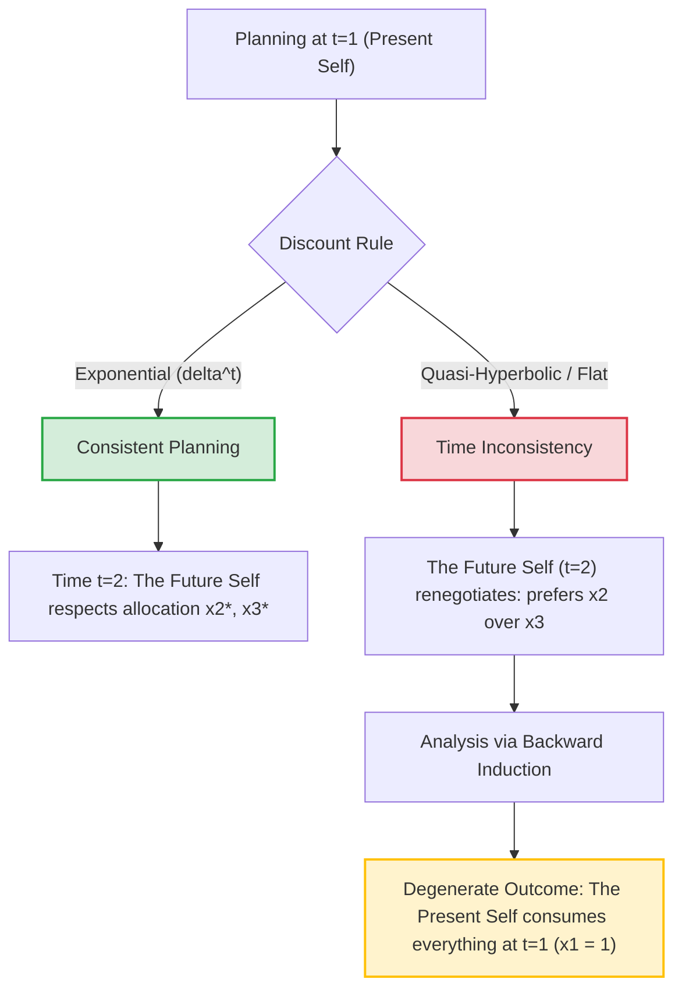
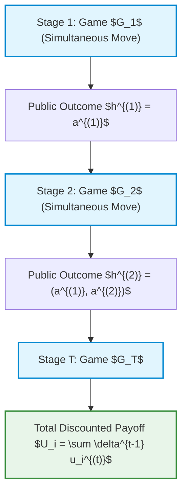
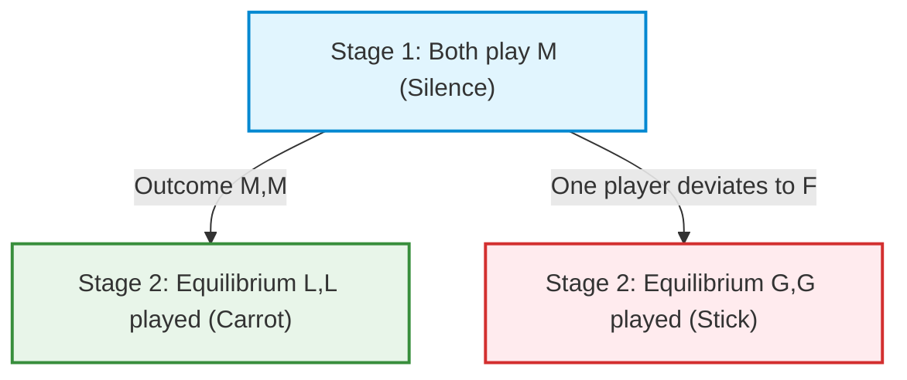

# Game Theory: Time Consistency and Dynamic Resource Allocation

## Educational Overview

In this lesson, the problem of **time evolution** in decision-making contexts and Game Theory is analyzed, paying special attention to the concept of **time consistency** (*Time Consistency*) between present and future decisions.

The lesson opens with a digression on the rational interpretation of **non-credible threats** (*Non-Credible Threats*) and their modeling via **Subgame Perfect Nash Equilibrium** (*Subgame Perfect Nash Equilibrium*), highlighting the importance of rationality compared to impulsive reactions in strategic dynamics.

Subsequently, the discussion formally shifts to **dynamic resource allocation** (*Dynamic Resource Allocation*) problems over a finite time horizon ($N$ periods), analyzing how individual preferences change as the perception of the future varies.

The key concepts introduced include:
* **Modeling Time Consistency**: Assessment of the consistency of mathematical formulations when introducing the dimension of time.
* **Discount Factor** (*Discount Factor*, $\delta$): Parameter describing the devaluation of future utility compared to present utility.
* **Weighted Utility Maximization** (*Weighted Utility Maximization*): Formulation of the constrained optimization problem for allocating a fixed budget, observing the shift of consumption toward the present as $\delta$ decreases and analyzing boundary conditions to avoid degenerate solutions.

---

### Rational Introduction: Non-Credible Threats and Decisions over Time

Before delving into the mathematical models of the time evolution of games, it is appropriate to reflect on the concept of **rationality** guided by structural problem analysis.

Often, in real-life interactions, one faces **non-credible threats**. A classic example is given by emotional blackmail dynamics:

> **Key Concept: Non-Credible Threat and SPNE**  
> If a player declares a strategy of the type *"If you leave me, I will take my life"*, the analysis of **Subgame Perfect Nash Equilibrium (SPNE)** reveals the non-credibility of the threat. For the threatening player, the extreme act represents the outcome with the worst absolute payoff. Consequently, in the subgame responding to separation, the threatening player's rational action will be to survive. Mathematically recognizing a threat as non-credible allows one to ignore it and make the optimal decision without giving in to irrational behaviors induced by fear.

Being engineers and game theory analysts primarily means **rationalizing emotions** and not letting oneself be influenced by events or threats lacking strategic credibility.

---

### Dynamic Resource Allocation over Time

We now consider a dynamic resource allocation problem over a discrete time horizon composed of $N$ steps. For analytical simplicity, we assume $N = 3$ (e.g., a study budget to be divided into 3 weeks, or a food reserve to be consumed in 3 days).

A single agent has a total budget fixed at $1$ to be divided into quantities $(x_1, x_2, x_3)$ across the three periods:

$$x_1 + x_2 + x_3 = 1 \quad \text{con } x_i \ge 0, \; \forall i \in \{1, 2, 3\}$$

The agent derives instantaneous utility from each consumption through a utility function $u(x)$, which is strictly concave and increasing. However, the evaluation of future consumption depends on the time discount rate or **discounting** expressed by the factor $\delta \in (0, 1]$.

---

### Exponential Discounting and Time Consistency

The classic model of discounting is **exponential (or homogeneous/multiplicative)**, in which the discount factor at time $t$ is given by $\delta^{t-1}$.

#### Problem Formulation at Time $t = 1$
At time $t = 1$, the agent solves the following constrained optimization problem:

$$\max_{x_1, x_2, x_3} \left[ u(x_1) + \delta \, u(x_2) + \delta^2 \, u(x_3) \right]$$

$$\text{s.t.} \quad x_1 + x_2 + x_3 = 1$$

*Note: Step integrated for didactic clarity.*
Using the method of Lagrange multipliers, we define the Lagrangian:

$$\mathcal{L}(x_1, x_2, x_3, \lambda) = u(x_1) + \delta u(x_2) + \delta^2 u(x_3) - \lambda (x_1 + x_2 + x_3 - 1)$$

The first-order conditions (FOCs) require:

$$\begin{cases} 
u'(x_1) = \lambda \\ 
\delta u'(x_2) = \lambda \\ 
\delta^2 u'(x_3) = \lambda 
\end{cases} 
\implies u'(x_1) = \delta u'(x_2) = \delta^2 u'(x_3)$$

* **If $\delta = 1$ (no future discounting):** The FOCs become $u'(x_1) = u'(x_2) = u'(x_3)$, leading to the uniform solution $x_1^* = x_2^* = x_3^* = \frac{1}{3}$.
* **If $\delta < 1$:** Priority is given to the present: $x_1^* > x_2^* > x_3^*$. 

For example, with $\delta = 0.8$ and a specific utility function, the agent will allocate the largest share to $x_1$ and progressively smaller shares to $x_2$ and $x_3$ (for $x_3^* \ge 0$, $\delta$ must satisfy certain lower bounds to avoid degenerate solutions).

#### Verification of Time Consistency at $t = 2$
The fundamental question is: **Is the initial planning time-consistent?**

Suppose that the agent consumed $x_1^*$ at time $t=1$. Arriving at time $t=2$, a residual reserve equal to $(1 - x_1^*)$ remains to be split between $x_2$ and $x_3$. 

Now time $t=2$ represents the "present", so their optimization problem becomes:

$$\max_{x_2, x_3} \left[ u(x_2) + \delta \, u(x_3) \right] \quad \text{s.t.} \quad x_2 + x_3 = 1 - x_1^*$$

From the FOCs at $t=2$ we obtain:

$$u'(x_2) = \delta u'(x_3)$$

Comparing this condition with the FOCs calculated at $t=1$:

$$\delta u'(x_2^*) = \delta^2 u'(x_3^*) \implies u'(x_2^*) = \delta u'(x_3^*)$$

The marginal rate of substitution between $x_2$ and $x_3$ **is identical**. 

> **Key Concept: Time Consistency**  
> Exponential discounting guarantees **time consistency**: the decision planned at the beginning for future periods remains the exact local optimum when those periods become the present. The agent has no incentive to renegotiate the original plan.

---

### Non-Exponential Discounting and Time Inconsistency

Let us see what happens if we adopt a non-exponential discounting rule. Consider a "flat" discount model for the future, in which the present has weight $1$ and **any** future period is discounted simply by a factor $\delta$, regardless of how far in time it is.

#### Formulation at Time $t = 1$

$$\max_{x_1, x_2, x_3} \left[ u(x_1) + \delta \, u(x_2) + \delta \, u(x_3) \right] \quad \text{s.t.} \quad x_1 + x_2 + x_3 = 1$$

The FOCs at $t=1$ are:

$$u'(x_1) = \lambda, \quad \delta u'(x_2) = \lambda, \quad \delta u'(x_3) = \lambda \implies u'(x_2) = u'(x_3) \implies x_2^* = x_3^*$$

In the original plan expressed at $t=1$, the agent prioritizes $x_1$, but decides to divide the remaining reserve into exactly equal parts between $x_2$ and $x_3$.

#### The Problem of Renegotiation at Time $t = 2$
Having reached time $t=2$, the agent has consumed $x_1^*$ and disposes of $1 - x_1^*$. Now, however, time $t=2$ has become the present (weight $1$), while time $t=3$ is the future (discounted by $\delta$).

The new optimization problem at $t=2$ is:

$$\max_{x_2, x_3} \left[ u(x_2) + \delta \, u(x_3) \right] \quad \text{s.t.} \quad x_2 + x_3 = 1 - x_1^*$$

The FOCs at time $t=2$ mandate:

$$u'(x_2) = \delta u'(x_3) \implies \text{poiché } \delta < 1, \quad x_2^{**} > x_3^{**}$$

**Result:** Having reached time $t=2$, the agent **renegotiates** the choice! Instead of maintaining the equal split $x_2^* = x_3^*$ promised at $t=1$, they choose to consume more in $t=2$ compared to $t=3$.

This phenomenon is called **Time Inconsistency** and is the formal explanation of the psychological phenomenon of *procrastination*: at each period one promises that the future work/resource will be distributed equally, but when the future becomes present, the burden is continuously shifted to the next period.

---

### Game Theory Perspective: The "Present Self" versus the "Future Self"

Time inconsistency can be rigorously formulated and analyzed as a dynamic game of perfect information played by multiple "virtual agents" representing the same person at different points in time:

* **Player 1 (Present Self - $t=1$):** Stackelberg Leader.
* **Player 2 (Future Self - $t=2$):** Stackelberg Follower.

#### Analysis via Backward Induction

If the **Present Self ($t=1$)** is rational and knows its own structure of time-inconsistent preferences:

1. It knows with certainty that at time $t=2$ the **Future Self ($t=2$)** will not respect the agreement and will renegotiate the resources $1 - x_1$ by allocating almost everything to $x_2$ and penalizing $x_3$.
2. Consequently, the Present Self anticipates this irrational/selfish behavior of the Future Self.
3. To prevent the Future Self from mismanaging the residual resources, the Present Self reacts by reducing the budget it will leave at time $t=2$.
4. Pushing the chain of **backward induction** to its equilibrium limit, the unique Subgame Perfect Nash Equilibrium (SPNE) of the intertemporal virtual game becomes the degenerate solution:

$$x_1^* = 1, \quad x_2^* = 0, \quad x_3^* = 0$$

> **Key Concept: The Time Inconsistency Paradox**  
> In the presence of non-exponential discounting, the strategic interaction between the Present Self and the Future Self prevents the maintenance of an action plan distributed over time. The only equilibrium robust to backward induction entails total and immediate consumption of resources at time $t=1$. This mathematically demonstrates why Game Theory requires the use of exponential discounting to model time-consistent decisions.

---

### Introduction to Multi-Stage Games

In previous lessons, we saw how to describe dynamic games using the extensive form (game trees). However, the classical extensive form presents a conceptual limitation: payoffs (*payoffs*) are assigned exclusively to the leaves of the tree, that is, at the conclusion of all interactions.

In many real and engineering contexts, players receive feedback and partial utility during the evolution of the process. Consider a soccer championship or a student's university career: the evaluation or points accumulated halfway through provide an intermediate measure of performance.

To model these systems efficiently and intuitively, we define **Multi-Stage Games**.

#### Definition and Formal Structure

A multi-stage game is a finite sequence of $T$ independent normal-form games, called **stage games** $G_1, G_2, \dots, G_T$, played in time sequence by the same set of players $N = \{1, 2, \dots, n\}$.

The fundamental assumptions of the model are:
1. **Complete but Imperfect Information in the Stage**: In each stage $t \in \{1, \dots, T\}$, the players choose their action simultaneously.
2. **Observability of Partial Outcomes**: At the end of each stage $t$, all players observe the outcome of the stage (that is, the played action profile $a^{(t)} = (a_1^{(t)}, \dots, a_n^{(t)})$). This outcome becomes the **history** $h^{(t)}$ available for the subsequent stage.
3. **Aggregation of Payoffs**: The total payoff of a player $i$ is defined as the weighted or discounted sum of the partial payoffs obtained in the individual stages:

$$U_i = \sum_{t=1}^{T} \delta^{t-1} u_i^{(t)}(a^{(t)})$$

where $\delta \in (0, 1)$ represents the **discount factor**, assumed uniform for all players and common knowledge (*common knowledge*). As previously analyzed, exponential discounting is the only one that guarantees the dynamic consistency of decisions over time.

---

### Modeling a Multi-Stage Game: The "Prisoner's Revenge Game"

To understand the strategy space and decision complexity, let us consider a two-stage example ($T = 2$) integrated with the classic *Prisoner's Dilemma*.

#### Definition of the Two Stages

* **Stage 1 (Prisoner's Dilemma - $G_1$)**:
  Two prisoners, Alice ($A$) and Bob ($B$), simultaneously choose whether to remain silent (*Mum* - $M$) or confess/incriminate (*Fink* - $F$).
  
  | $A \setminus B$ | $M$ | $F$ |
  | :--- | :---: | :---: |
  | **$M$** | $(1, 1)$ | $(-2, 3)$ |
  | **$F$** | $(3, -2)$ | $(0, 0)$ |

* **Stage 2 (Revenge Game - $G_2$)**:
  Upon release from prison, the two players decide whether to join a criminal gang (*Gang* - $G$) or live as loners (*Loner* - $L$).
  * If both choose $L$, they do not interact: payoff $(0, 0)$.
  * If both choose $G$, they clash as enemies: payoff $(-3, -3)$.
  * If one chooses $G$ and the other $L$, the individual alone is beaten by the other's gang: payoff $-4$ for $L$ and $-1$ for $G$.

  | $A \setminus B$ | $L$ | $G$ |
  | :--- | :---: | :---: |
  | **$L$** | $(0, 0)$ | $(-4, -1)$ |
  | **$G$** | $(-1, -4)$ | $(-3, -3)$ |

#### Strategy Space and Tree Dimension

A **strategy** in a multi-stage game must specify an action for every possible decision node, i.e., for every possible history of the game.

1. **In Stage 1**: There is no prior history. Each player has $1$ binary choice ($M$ or $F$).
2. **In Stage 2**: There are 4 possible histories resulting from the first stage: $H = \{(M,M), (M,F), (F,M), (F,F)\}$. For each history, the player must plan an action ($L$ or $G$).

The total number of binary choices to specify for each player is $1 + 4 = 5$.
The pure strategy space for each player has a cardinality of:

$$2^5 = 32 \text{ strategie pure}$$

> **Key Concept: Off-Path Rationality**
> 
> A complete strategy for Stage 2 requires specifying the action for *all* 4 possible histories, not just for the one imagined to occur. 
> 
> Saying *"I will play $F$ in the first stage and then $L$ in the second stage"* is not a valid formal description of a strategy. The correct specification must define the second-stage move contingent on every hypothetical outcome of the first stage, for example: $s_A = (F; L_{(M,M)}, L_{(M,F)}, L_{(F,M)}, L_{(F,F)})$, commonly abbreviated as $(F; L, L, L, L)$.
> 
> This principle is fundamental to assessing the credibility of threats and defining a **Subgame Perfect Equilibrium (SPE)**: a player must behave optimally/rationally in *any* eventuality, including subgames that will never be reached along the equilibrium path.

---

### Fundamental Theorems on Equilibria in Multi-Stage Games

We now analyze the presence and structure of Subgame Perfect Equilibria (SPE) in multi-stage games consisting of independent stages.

#### Theorem 1: Combination of Stage Nash Equilibria

> **Theorem 1**
> If for every stage $j \in \{1, \dots, T\}$, the action profile $s_j^*$ is a Nash Equilibrium (NE) of the stage game $G_j$, then the sequence prescribing to play $s_j^*$ in every stage $j$ (regardless of the previous history) constitutes a **Subgame Perfect Equilibrium (SPE)** of the multi-stage game.

*Proof (Logical Idea)*:
In any subgame starting at stage $k$, the strategy prescribes playing a single-stage Nash Equilibrium for all remaining stages $k, k+1, \dots, T$. Since the stage payoffs are additive and the actions in one stage do not alter the rules or options of future stages, no player has an incentive to unilaterally deviate in any single stage. Consequently, the profile is a Nash Equilibrium in every subgame, satisfying the definition of SPE.

##### Application to the Prisoner's Revenge Game:
1. **Stage 1 Analysis ($G_1$)**: The unique Nash Equilibrium in pure strategies is $(F, F)$ with payoff $(0, 0)$.
2. **Stage 2 Analysis ($G_2$)**: We find the best responses to identify the Nash equilibria:
   * If $B$ plays $L$, the best response of $A$ is $L$ ($0 > -1$).
   * If $B$ plays $G$, the best response of $A$ is $G$ ($-3 > -4$).
   * $G_2$ has **two** Nash Equilibria in pure strategies: $(L, L)$ with payoff $(0, 0)$ and $(G, G)$ with payoff $(-3, -3)$.

Applying Theorem 1, we can immediately construct two distinct SPEs for the overall game:
* **SPE 1**: Play $F$ in the 1st stage, and always play $L$ in the 2nd stage for any history:
  $$s_A^* = (F; L, L, L, L), \quad s_B^* = (F; L, L, L, L)$$
* **SPE 2**: Play $F$ in the 1st stage, and always play $G$ in the 2nd stage for any history:
  $$s_A^{**} = (F; G, G, G, G), \quad s_B^{**} = (F; G, G, G, G)$$

---

#### Theorem 2: Equilibrium Constraint in the Final Stage

While Theorem 1 offers a trivial way to construct an SPE by uncoupling the stages, we ask what necessary conditions *any* Nash equilibrium of the global game must satisfy.

> **Theorem 2**
> Let $S^* = (s_1^*, s_2^*, \dots, s_n^*)$ be any (pure) Nash Equilibrium of the entire multi-stage game. Then $S^*$ must necessarily prescribe that in the last stage $G_T$, regardless of the history $h^{(T-1)}$ reached, the actions played constitute a **Nash Equilibrium of the stage game $G_T$**.

*Proof (Logical Explanation)*:
In the last stage $T$, there is no future. There are no subsequent stages $T+1$ in which present actions could influence others' decisions or generate retaliation/rewards. Consequently, having reached the final stage, every player faces a payoff maximization problem restricted solely to stage $G_T$. If the actions planned for stage $T$ did not form a Nash Equilibrium for $G_T$, at least one player would find it convenient to deviate to increase their final payoff, contradicting the hypothesis that $S^*$ is an equilibrium of the global game.

---

#### Theorem 3: Uniqueness of Subgame Perfect Equilibrium

What happens if the individual stage games possess a unique Nash Equilibrium?

> **Theorem 3**
> If each stage game $G_j$ (for $j = 1, \dots, T$) possesses **a unique Nash Equilibrium** in pure strategies, then the entire multi-stage game possesses **a unique Subgame Perfect Equilibrium (SPE)**. Such SPE corresponds to the sequential repetition of the unique Nash Equilibrium of each stage.

*Proof (by Backward Induction across Stages)*:
1. **Last Stage ($G_T$)**: According to Theorem 2, in any SPE a Nash Equilibrium of $G_T$ must be played. Since $G_T$ admits only one NE, the outcome of stage $T$ is uniquely determined for every possible history $h^{(T-1)}$.
2. **Penultimate Stage ($G_{T-1}$)**: Since the future in stage $T$ is completely determined and non-variable as a function of the choices made in stage $T-1$, decisions in stage $T-1$ cannot alter future payoffs except for their discounted additive constant. Therefore, players must choose a Nash Equilibrium for stage $G_{T-1}$. Since the latter is unique by assumption, the action at stage $T-1$ is in turn uniquely determined.
3. **Inductive Step**: Proceeding backward up to stage $t = 1$, the entire game path and the relevant strategies remain uniquely bound to the unique sequence of Nash Equilibria of the individual stages.

---

### Multiple Equilibria in the Last Stage and Interconnection Strategies

Up to this point, the analysis of stage games with a unique final Nash Equilibrium (*Nash Equilibrium*) has yielded rather trivial results: if the last stage has only one equilibrium, backward induction (*backward induction*) dictates playing it, progressively reducing the game without any real strategic interconnection between the phases.

The situation changes radically when the last stage (or a future stage) features **multiple Nash Equilibria**.

The presence of multiple equilibria in the last stage guarantees strategic degrees of freedom. The Backward Induction Theorem requires playing a Nash Equilibrium in the last stage, but does not specify *which one*. It is possible to exploit this choice to sustain actions in intermediate stages that **are not Nash Equilibria** in the single stage.

> **Key Concept**
> If the last stage possesses two or more Nash Equilibria, it is possible to use the outcome of the final stage as a **reward** or **punishment** to condition the behavior of users in previous stages, making cooperation rational in intermediate phases.

---

### The "Prisoner's Revenge" Game

To understand this dynamic, consider a two-stage game based on a variation of the Prisoner's Dilemma (*Prisoner's Dilemma*).

1. **First Stage:** A classic Prisoner's Dilemma in which the outcome of mutual cooperation $(M, M)$ (from English *Mouth shut*, i.e., keeping silent) provides a high payoff ($4$), but is not a static Nash Equilibrium, since deviating towards $F$ (*Flee/Confess*) guarantees a greater immediate gain ($5$).
2. **Second Stage:** A game possessing **two pure Nash Equilibria**:
   - **"Friendly" Equilibrium (Friendly, $LL$):** Both players go their separate ways. Payoff equal to $0$ for each.
   - **"Clash" Equilibrium (Gun, $GG$):** The prisoners clash. Negative payoff equal to $-3$ for each.

The equilibrium $LL$ represents a preferable outcome compared to the punitive equilibrium $GG$.

#### The "Stick and Carrot" Strategy (Stick and Carrot Strategy)

We define the following joint strategy $S_1 = S_2 = S$ for both players:
- **Stage 1:** Play $M$.
- **Stage 2:** Play $L$ if the outcome of the First Stage was $(M, M)$. Otherwise, play $G$.

This strategy implements an incentive mechanism: the promise of the favorable equilibrium $LL$ acts as a *carrot* (reward), while the threat of the unfavorable equilibrium $GG$ acts as a *stick* (punishment).

---

### Mathematical Analysis of Stability and Equilibrium

Let us verify whether the strategy pair $(S, S)$ constitutes a **Subgame Perfect Nash Equilibrium** (*Subgame Perfect Nash Equilibrium - SPNE*) for the entire game.

1. **Second Stage Analysis:**
   In the second stage, regardless of past history, the players will find themselves playing equilibrium $LL$ or equilibrium $GG$. Since both are Nash Equilibria of the second-stage game, no player has an incentive to deviate unilaterally in the final stage.

2. **First Stage Analysis:**
   Let us verify the optimality condition of the Best Response in the first stage, taking into account the **Discount Factor** (*Discount Factor*) $\delta \in [0, 1]$, which measures how much players value future payoffs relative to current ones.

* **Case A: The player ADHERES to the strategy ($M$)**
  - Stage 1 Payoff: $4$
  - Stage 2 Payoff: $0$ (playing $LL$)
  - Total Discounted Payoff:
    $$U_{\text{coop}} = 4 + \delta \cdot 0 = 4$$

* **Case B: The player DEVIATES from the strategy ($F$)**
  - Stage 1 Payoff: $5$ (you gain maximum short-term advantage by deviating)
  - Stage 2 Payoff: $-3$ (punishment $GG$ is triggered due to deviation)
  - Total Discounted Payoff:
    $$U_{\text{dev}} = 5 + \delta \cdot (-3) = 5 - 3\delta$$

*Note: Step integrated with pedagogical clarity to formalize the equilibrium condition.*

For cooperation $(M, M)$ to be sustainable as an equilibrium, the non-deviating strategy must ensure a payoff greater than or equal to deviation ($U_{\text{coop}} \ge U_{\text{dev}}$):

$$4 \ge 5 - 3\delta$$

Solving with respect to the discount factor $\delta$:

$$3\delta \ge 5 - 4 \implies 3\delta \ge 1 \implies \delta \ge \frac{1}{3}$$

#### Physical Interpretation of the Result
1. **Severity of the Punishment:** The difference between the reward ($0$) and the punishment ($-3$) must be sufficiently large. If the punishment were minimal (e.g., $-0.1$), the threat would not be an effective deterrent.
2. **Player Patience ($\delta$):** The discount factor $\delta$ also represents the probability that the game continues or the importance attached to future consequences. If $\delta \to 0$ ("impatient" players or players with a short-term horizon), the future punishment loses value and the only rational choice becomes deviation again.

---

### Sustaining Asymmetric or Unfavorable Outcomes

The power of the *stick and carrot* strategy lies in its flexibility: it is possible to construct a Subgame Perfect Equilibrium to sustain any combination of actions in the first stage, even highly unbalanced outcomes such as $(F, M)$, where a player accepts an immediate unfavorable outcome in order to avoid future punishment.

In such a case, the punishment required to deter the disadvantaged player from deviating will have to be even more severe, imposing a more stringent threshold on the discount factor $\delta$ (closer to $1$).

---

### The One-Stage Deviation Principle (One-Stage Deviation Principle)

One might ask whether games with more than two stages require infinitely more complex analyses, evaluating multiple deviations at different points in time. The answer is negative thanks to the **One-Stage Deviation Principle** (*One-Stage Deviation Principle*), equivalent to the famous **Bellman's Optimality Principle** (*Bellman's Optimality Principle*) used in dynamic programming.

> **Key Concept**
> A strategy is a **Subgame Perfect Equilibrium** if and only if there is no deviation in a **single stage** (keeping the strategy unchanged in all other stages) that can increase the expected payoff of the player in any information set (*information set*).

#### Intuitive Proof (by Contradiction)
Suppose for the sake of contradiction that a strategy is not optimal due to a sequence of multiple deviations distributed over time. 

Considering the **last deviation** in the time sequence:
- If the last deviation leads to an improvement in the overall payoff moving back up the decision chain, then that single deviation alone would have represented an improvement over the previous state.
- This contradicts the hypothesis that the strategy was *flawless with respect to single-stage deviations*.

Consequently, **a two-stage game is conceptually sufficient to analyze the dynamics of any temporal sanction or incentive**: if a strategy withstands single-stage deviations, it is globally optimal for any time horizon.

---

> [!NOTE]
> ### Exam Notes and Instructor Notices
> - **Common exam error (Definition of strategies in multi-stage games):** The instructor highlights that on exams, students often make the mistake of specifying the strategy for multi-stage games improperly or incompletely (for example, simply writing that the equilibrium is "F in the first stage and L in the second"). To correctly formulate the strategy on the exam, it is necessary to specify the action chosen for *every possible history/outcome* of the first stage (for example, indicating "F" for the first stage and "L L L L" for the second).