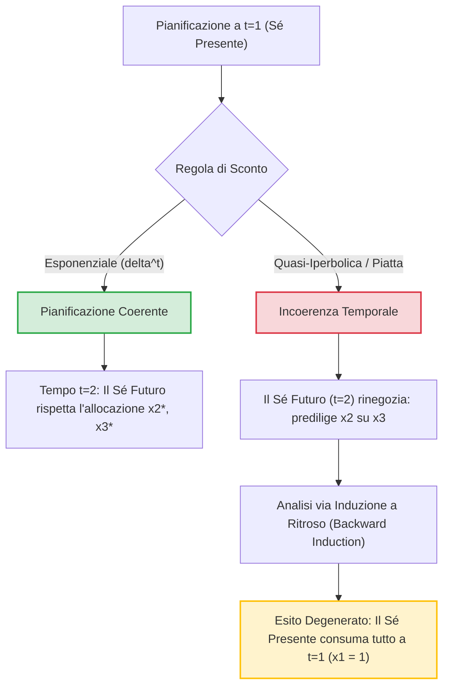
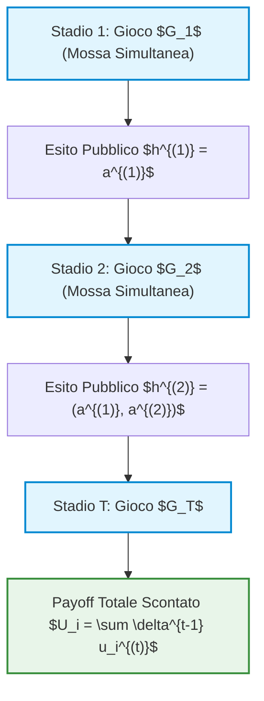
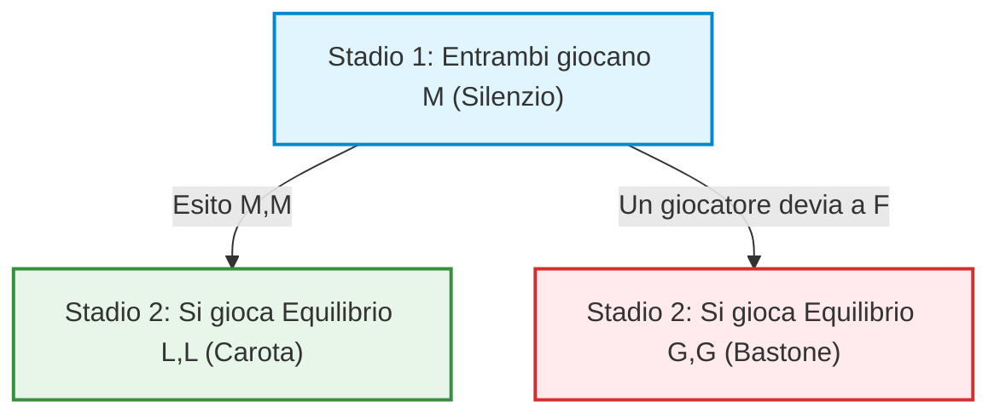

# Teoria dei Giochi: Coerenza Temporale e Allocazione Dinamica delle Risorse

## Overview Didattica

In questa lezione viene analizzato il problema dell'**evoluzione temporale** nei contesti decisionali e nella Teoria dei Giochi, ponendo un'attenzione particolare al concetto di **coerenza temporale** (*Time Consistency*) tra decisioni presenti e future.

La lezione si apre con una digressione sull'interpretazione razionale delle **minacce non credibili** (*Non-Credible Threats*) e sulla loro modellizzazione tramite l'**Equilibrio di Nash Perfetto nei Sottogiochi** (*Subgame Perfect Nash Equilibrium*), evidenziando l'importanza della razionalità rispetto alle reazioni impulsive nelle dinamiche strategiche.

Successivamente, la trattazione si sposta formalmente sui problemi di **allocazione dinamica delle risorse** (*Dynamic Resource Allocation*) in un orizzonte temporale finito ($N$ periodi), analizzando come le preferenze individuali cambino al variare della percezione del futuro.

I concetti chiave introdotti comprendono:
* **Modellizzazione della Coerenza Temporale**: Valutazione della consistenza delle formulazioni matematiche quando si introduce la dimensione del tempo.
* **Fattore di Sconto** (*Discount Factor*, $\delta$): Parametro che descrive la svalutazione dell'utilità futura rispetto a quella presente.
* **Massimizzazione dell'Utilità Ponderata** (*Weighted Utility Maximization*): Formulazione del problema di ottimo vincolato per la ripartizione di un budget fisso, osservando lo spostamento dei consumi verso il presente al decrescere di $\delta$ e analizzando le condizioni al contorno per evitare soluzioni degenerate.

---

### Introduzione Razionale: Minacce Non Credibili e Decisioni nel Tempo

Prima di addentrarci nei modelli matematici dell'evoluzione temporale dei giochi, è opportuno fare una riflessione sul concetto di **razionalità (rationality)** guidata dall'analisi strutturale dei problemi. 

Spesso, nelle interazioni reali, ci si trova di fronte a delle **minacce non credibili (non-credible threats)**. Un esempio classico è dato dalle dinamiche di ricatto emotivo: 

> **Concetto Chiave: Minaccia Non Credibile e SPNE**  
> Se un giocatore dichiara una strategia del tipo *"Se mi lasci, mi tolgo la vita"*, l'analisi dell'**Equilibrio di Nash Perfetto nei Sottogiochi (Subgame Perfect Nash Equilibrium - SPNE)** rivela la non-credibilità della minaccia. Per il giocatore che minaccia, l'atto estremo rappresenta l'esito con il *payoff* peggiore in assoluto. Di conseguenza, nel sottogioco di risposta alla separazione, l'azione razionale del minacciante sarà quella di sopravvivere. Riconoscere una minaccia come non credibile matematicamente permette di ignorarla e prendere la decisione ottimale senza cedere a comportamenti irrazionali indotti dalla paura.

Essere ingegneri ed analisti di teoria dei giochi significa prioritariamente **razionalizzare le emozioni** e non farsi condizionare da eventi o minacce prive di credibilità strategica.

---

### Allocazione Dinamica di Risorse nel Tempo

Consideriamo ora un problema di allocazione dinamica delle risorse su un orizzonte temporale discreto composto da $N$ passi. Per semplicità analitica, assumiamo $N = 3$ (es. un budget di studio da dividere in 3 settimane, o una riserva di cibo da consumare in 3 giorni).

Un singolo agente dispone di un budget totale fissato a $1$ da ripartire nelle quantità $(x_1, x_2, x_3)$ nei tre periodi:

$$x_1 + x_2 + x_3 = 1 \quad \text{con } x_i \ge 0, \; \forall i \in \{1, 2, 3\}$$

L'agente trae utilità istantanea da ogni consumo tramite una funzione di utilità $u(x)$, strettamente concava e crescente. Tuttavia, la valutazione del consumo futuro dipende dal tasso di sconto temporale o **attualizzazione (discounting)** espresso dal fattore $\delta \in (0, 1]$.

---

### Attualizzazione Esponenziale e Coerenza Temporale

Il modello classico di attualizzazione è quello **esponenziale ( od omogeneo/moltiplicativo)**, in cui il fattore di sconto al tempo $t$ è dato da $\delta^{t-1}$.

#### Formulazione del Problema al Tempo $t = 1$
Al tempo $t = 1$, l'agente risolve il seguente problema di ottimizzazione vincolata:

$$\max_{x_1, x_2, x_3} \left[ u(x_1) + \delta \, u(x_2) + \delta^2 \, u(x_3) \right]$$

$$\text{s.t.} \quad x_1 + x_2 + x_3 = 1$$

*Nota: Passaggio integrato con chiarezza didattica.*  
Utilizzando il metodo dei moltiplicatori di Lagrange, definiamo il lagrangiano:

$$\mathcal{L}(x_1, x_2, x_3, \lambda) = u(x_1) + \delta u(x_2) + \delta^2 u(x_3) - \lambda (x_1 + x_2 + x_3 - 1)$$

Le condizioni del primo ordine (FOCs) impongono:

$$\begin{cases} 
u'(x_1) = \lambda \\ 
\delta u'(x_2) = \lambda \\ 
\delta^2 u'(x_3) = \lambda 
\end{cases} 
\implies u'(x_1) = \delta u'(x_2) = \delta^2 u'(x_3)$$

* **Se $\delta = 1$ (nessun futuro scontato):** Le FOCs diventano $u'(x_1) = u'(x_2) = u'(x_3)$, conducendo alla soluzione uniforme $x_1^* = x_2^* = x_3^* = \frac{1}{3}$.
* **Se $\delta < 1$:** La priorità viene data al presente: $x_1^* > x_2^* > x_3^*$. 

Per esempio, con $\delta = 0.8$ e una specifica funzione di utilità, l'agente allocherà la quota maggiore a $x_1$ e quote via via minori a $x_2$ e $x_3$ (affinché $x_3^* \ge 0$, occorre che $\delta$ rispetti determinati vincoli inferiori per evitare soluzioni degenerate).

#### Verifica della Coerenza Temporale a $t = 2$
La domanda fondamentale è: **La pianificazione iniziale è coerente nel tempo (time-consistent)?**

Supponiamo che l'agente abbia consumato $x_1^*$ al tempo $t=1$. Arrivato al tempo $t=2$, gli rimane una riserva residua pari a $(1 - x_1^*)$ da dividere tra $x_2$ e $x_3$. 

Ora il tempo $t=2$ rappresenta il "presente", per cui il suo problema di ottimizzazione diventa:

$$\max_{x_2, x_3} \left[ u(x_2) + \delta \, u(x_3) \right] \quad \text{s.t.} \quad x_2 + x_3 = 1 - x_1^*$$

Dalle FOCs a $t=2$ otteniamo:

$$u'(x_2) = \delta u'(x_3)$$

Confrontando questa condizione con le FOCs calcolate a $t=1$:

$$\delta u'(x_2^*) = \delta^2 u'(x_3^*) \implies u'(x_2^*) = \delta u'(x_3^*)$$

Il rapporto marginale di sostituzione tra $x_2$ e $x_3$ **è identico**. 

> **Concetto Chiave: Coerenza Temporale (Time Consistency)**  
> L'attualizzazione esponenziale garantisce la **coerenza temporale**: la decisione pianificata all'inizio per i periodi futuri rimane l'esatto ottimo locale quando quei periodi diventano il presente. L'agente non ha alcun incentivo a rinegoziare il piano originale.

---

### Attualizzazione Non Esponenziale e Incoerenza Temporale

Vediamo cosa accade se adottiamo una regola di attualizzazione non esponenziale. Consideriamo un modello di sconto "piatto" per il futuro, in cui il presente ha peso $1$ e **qualsiasi** periodo futuro è scontato semplicemente di un fattore $\delta$, indipendentemente da quanto sia lontano nel tempo.

#### Formulazione al Tempo $t = 1$

$$\max_{x_1, x_2, x_3} \left[ u(x_1) + \delta \, u(x_2) + \delta \, u(x_3) \right] \quad \text{s.t.} \quad x_1 + x_2 + x_3 = 1$$

Le FOCs a $t=1$ sono:

$$u'(x_1) = \lambda, \quad \delta u'(x_2) = \lambda, \quad \delta u'(x_3) = \lambda \implies u'(x_2) = u'(x_3) \implies x_2^* = x_3^*$$

Nel piano originale espresso a $t=1$, l'agente privilegia $x_1$, ma decide di dividere in parti esattamente uguali la riserva rimanente tra $x_2$ e $x_3$.

#### Il Problema della Rinegoziazione al Tempo $t = 2$
Giunti al tempo $t=2$, l'agente ha consumato $x_1^*$ e dispone di $1 - x_1^*$. Ora, però, il tempo $t=2$ è diventato il presente (peso $1$), mentre il tempo $t=3$ è il futuro (scontato di $\delta$).

Il nuovo problema di ottimizzazione a $t=2$ è:

$$\max_{x_2, x_3} \left[ u(x_2) + \delta \, u(x_3) \right] \quad \text{s.t.} \quad x_2 + x_3 = 1 - x_1^*$$

Le FOCs al tempo $t=2$ impongono:

$$u'(x_2) = \delta u'(x_3) \implies \text{poiché } \delta < 1, \quad x_2^{**} > x_3^{**}$$

**Risultato:** Giunto al tempo $t=2$, l'agente **rinegozia** la scelta! Invece di mantenere la divisione equa $x_2^* = x_3^*$ promessa a $t=1$, sceglie di consumare di più in $t=2$ rispetto a $t=3$.

Questo fenomeno prende il nome di **Incoerenza Temporale (Time Inconsistency)** ed è la spiegazione formale del fenomeno psicologico della *procrastinazione*: ad ogni periodo si promette che il lavoro/risorsa futuro sarà distribuito equamente, ma quando il futuro diventa presente, si sposta continuamente l'onere sul periodo successivo.

---

### Prospettiva di Teoria dei Giochi: Il "Sé Presente" contro il "Sé Futuro"

L'incoerenza temporale può essere formulata ed analizzata rigorosamente come un gioco dinamico a informazioni perfette giocato da più "agenti virtuali" che rappresentano la stessa persona in momenti temporali differenti:

* **Giocatore 1 (Sé Presente - $t=1$):** Leader di Stackelberg.
* **Giocatore 2 (Sé Futuro - $t=2$):** Follower di Stackelberg.

#### Analisi mediante Induzione a Ritroso (Backward Induction)

Se il **Sé Presente ($t=1$)** è razionale e conosce la propria struttura di preferenze temporali incoerenti:

1. Sa con certezza che al tempo $t=2$ il **Sé Futuro ($t=2$)** non rispetterà l'accordo e rinegozierà le risorse $1 - x_1$ allocando quasi tutto a $x_2$ e penalizzando $x_3$.
2. Di conseguenza, il Sé Presente anticipa questo comportamento irrazionale/egoista del Sé Futuro.
3. Per evitare che il Sé Futuro gestisca male le risorse residue, il Sé Presente reagisce riducendo il budget che lascerà al tempo $t=2$.
4. Spingendo la catena dell'**induzione a ritroso (backward induction)** al suo limite di equilibrio, l'unico Equilibrio Perfetto nei Sottogiochi (SPNE) del gioco virtuale intertemporale diventa la soluzione degenerata:

$$x_1^* = 1, \quad x_2^* = 0, \quad x_3^* = 0$$

> **Concetto Chiave: Il Paradosso dell'Incoerenza Temporale**  
> In presenza di un'attualizzazione non esponenziale, l'interazione strategica tra il Sé Presente e il Sé Futuro impedisce il mantenimento di un piano d'azione distribuito nel tempo. L'unico equilibrio robusto all'induzione a ritroso prevede il consumo totale e immediato delle risorse al tempo $t=1$. Ciò dimostra matematicamente perché la Teoria dei Giochi richieda l'uso dell'attualizzazione esponenziale per modellare decisioni temporali consistenti.

---

### Introduzione ai Giochi Multistadio (Multi-Stage Games)

Nelle lezioni precedenti abbiamo visto come descrivere i giochi dinamici mediante la forma estesa (alberi di gioco). La forma estesa classica presenta tuttavia un limite concettuale: i payoff (*payoff*) vengono assegnati esclusivamente alle foglie dell'albero, ossia alla conclusione di tutte le interazioni.

In molti contesti reali ed ingegneristici, i giocatori ricevono feedback ed utilità parziali durante l'evoluzione del processo. Si pensi ad un campionato di calcio o alla carriera universitaria di uno studente: la valutazione o il punteggio accumulato a metà percorso forniscono una misura intermedia delle prestazioni.

Per modellare in modo efficiente ed intuitivo questi sistemi, definitizziamo i **Giochi Multistadio (Multi-Stage Games)**.

#### Definizione e Struttura Formale

Un gioco multistadio è una sequenza finita di $T$ giochi in forma normale indipendenti, detti **giochi di stadio (stage games)** $G_1, G_2, \dots, G_T$, giocate in successione temporale dallo stesso insieme di giocatori $N = \{1, 2, \dots, n\}$.

Le ipotetiche fondamentali del modello sono:
1. **Informazione Completa ma Imperfetta nello Stadio**: In ogni stadio $t \in \{1, \dots, T\}$, i giocatori scelgono la propria azione simultaneamente.
2. **Osservabilità degli Esiti Parziali**: Al termine di ogni stadio $t$, tutti i giocatori osservano l'esito dello stadio (ossia il profilo di azioni giocato $a^{(t)} = (a_1^{(t)}, \dots, a_n^{(t)})$). Tale esito diviene la **storia (history)** $h^{(t)}$ disponibile per lo stadio successivo.
3. **Aggregazione dei Payoff**: Il payoff totale di un giocatore $i$ è definito come la somma ponderata o scontata dei payoff parziali ottenuti nei singoli stadi:

$$U_i = \sum_{t=1}^{T} \delta^{t-1} u_i^{(t)}(a^{(t)})$$

dove $\delta \in (0, 1)$ rappresenta il **fattore di sconto (discount factor)**, assunto uniforme per tutti i giocatori e di pubblico dominio (*common knowledge*). Come analizzato precedentemente, lo sconto esponenziale è l'unico che garantisce la consistenza dinamica delle decisioni nel tempo.

---

### Modellizzazione di un Gioco Multistadio: Il "Prisoner's Revenge Game"

Per comprendere lo spazio delle strategie e la complessità decisionale, consideriamo un esempio a due stadi ($T = 2$) integrato dal classico *Dilemma del Prigioniero*.

#### Definizione dei due stadi

* **Stadio 1 (Dilemma del Prigioniero - $G_1$)**:
  Due prigionieri, Alice ($A$) e Bob ($B$), scelgono simultaneamente se rimanere in silenzio (*Mum* - $M$) o confessare/incolpare (*Fink* - $F$).
  
  | $A \setminus B$ | $M$ | $F$ |
  | :--- | :---: | :---: |
  | **$M$** | $(1, 1)$ | $(-2, 3)$ |
  | **$F$** | $(3, -2)$ | $(0, 0)$ |

* **Stadio 2 (Gioco della Vendetta - $G_2$)**:
  Usciti di prigione, i due giocatori decidono se entrare in una banda criminale (*Gang* - $G$) o vivere da isolati (*Loner* - $L$).
  * Se entrambi scelgono $L$, non interagiscono: payoff $(0, 0)$.
  * Se entrambi scelgono $G$, si scontrano da nemici: payoff $(-3, -3)$.
  * Se uno sceglie $G$ e l'altro $L$, il singolo da solo viene picchiato dalla banda dell'altro: payoff $-4$ per $L$ e $-1$ per $G$.

  | $A \setminus B$ | $L$ | $G$ |
  | :--- | :---: | :---: |
  | **$L$** | $(0, 0)$ | $(-4, -1)$ |
  | **$G$** | $(-1, -4)$ | $(-3, -3)$ |

#### Spazio delle Strategie e Dimensione dell'Albero

Una **strategia (strategy)** in un gioco multistadio deve specificare un'azione per ogni possibile nodo decisionale, ossia per ogni possibile storia del gioco.

1. **Nello Stadio 1**: Non esiste una storia pregressa. Ogni giocatore ha $1$ scelta binaria ($M$ oppure $F$).
2. **Nello Stadio 2**: Esistono 4 possibili storie derivanti dal primo stadio: $H = \{(M,M), (M,F), (F,M), (F,F)\}$. Per ciascuna storia, il giocatore deve pianificare un'azione ($L$ oppure $G$).

Il numero totale di scelte binarie da specificare per ciascun giocatore è $1 + 4 = 5$.
Lo spazio delle strategie pure per ciascun giocatore ha una cardinalità di:

$$2^5 = 32 \text{ strategie pure}$$

> **Concetto Chiave: Razionalità Fuori dal Sentiero di Equilibrio (*Off-Path Rationality*)**
> 
> Una strategia completa per lo Stadio 2 richiede di specificare l'azione per *tutte* le 4 storie possibili, non solo per quella che si immagina si verificherà. 
> 
> Dire *"giocherò $F$ al primo stadio e poi $L$ al secondo stadio"* non è una descrizione formale valida di una strategia. La specifica corretta deve definire la mossa al secondo stadio vincolata ad ogni esito ipotetico del primo stadio, ad esempio: $s_A = (F; L_{(M,M)}, L_{(M,F)}, L_{(F,M)}, L_{(F,F)})$, comunemente abbreviato come $(F; L, L, L, L)$.
> 
> Questo principio è fondamentale per valutare la credibilità delle minacce e definire un **Equilibrio Perfetto nei Sottogiochi (Subgame Perfect Equilibrium - SPE)**: un giocatore deve comportarsi in modo ottimale/razionale in *qualsiasi* eventualità, compresi i sottogiochi che non verranno mai raggiunti lungo il sentiero di equilibrio.

---

### Teoremi Fondamentali sugli Equilibri nei Giochi Multistadio

Analizziamo ora la presenza e la struttura degli Equilibri Perfetti nei Sottogiochi (SPE) in giochi multistadio costituiti da stadi indipendenti.

#### Teorema 1: Combinazione di Equilibri di Nash degli Stadi

> **Teorema 1**
> Se per ogni stadio $j \in \{1, \dots, T\}$, il profilo d'azione $s_j^*$ è un Equilibrio di Nash (NE) del gioco di stadio $G_j$, allora la sequenza che prescrive di giocare $s_j^*$ in ogni stadio $j$ (indipendentemente dalla storia precedente) costituisce un **Equilibrio Perfetto nei Sottogiochi (SPE)** del gioco multistadio.

*Dimostrazione (Idea Logica)*:
In qualsiasi sottogruppo o sottogioco che ha inizio allo stadio $k$, la strategia prescrive di giocare un Equilibrio di Nash del singolo stadio per tutti gli stadi rimanenti $k, k+1, \dots, T$. Poiché i payoff degli stadi sono additivi e le azioni di uno stadio non modificano le regole o le opzioni degli stadi futuri, nessun giocatore ha un incentivo a deviare unilateralmente in alcun singolo stadio. Di conseguenza, il profilo è un Equilibrio di Nash in ogni sottogioco, soddisfando la definizione di SPE.

##### Applicazione al Prisoner's Revenge Game:
1. **Analisi Stadio 1 ($G_1$)**: L'unico Equilibrio di Nash in strategie pure è $(F, F)$ con payoff $(0, 0)$.
2. **Analisi Stadio 2 ($G_2$)**: Troviamo le risposte ottime per individuare gli equilibri di Nash:
   * Se $B$ gioca $L$, la risposta ottima di $A$ è $L$ ($0 > -1$).
   * Se $B$ gioca $G$, la risposta ottima di $A$ è $G$ ($-3 > -4$).
   * $G_2$ possiede **due** Equilibri di Nash in strategie pure: $(L, L)$ con payoff $(0, 0)$ e $(G, G)$ con payoff $(-3, -3)$.

Applicando il Teorema 1, possiamo costruire immediatamente due SPE distinti per il gioco complessivo:
* **SPE 1**: Giocare $F$ al 1° stadio, e giocare sempre $L$ al 2° stadio per qualsiasi storia:
  $$s_A^* = (F; L, L, L, L), \quad s_B^* = (F; L, L, L, L)$$
* **SPE 2**: Giocare $F$ al 1° stadio, e giocare sempre $G$ al 2° stadio per qualsiasi storia:
  $$s_A^{**} = (F; G, G, G, G), \quad s_B^{**} = (F; G, G, G, G)$$

---

#### Teorema 2: Vincolo di Equilibrio nell'Ultimo Stadio

Mentre il Teorema 1 offre un modo banale di costruire un SPE slegando gli stadi, ci chiediamo quali siano le condizioni necessarie che *qualsiasi* equilibrio di Nash del gioco globale deve soddisfare.

> **Teorema 2**
> Sia $S^* = (s_1^*, s_2^*, \dots, s_n^*)$ un qualsiasi Equilibrio di Nash (puro) dell'intero gioco multistadio. Allora $S^*$ deve necessariamente prescrivere che nell'ultimo stadio $G_T$, indipendentemente dalla storia $h^{(T-1)}$ raggiunta, le azioni giocate costituiscano un **Equilibrio di Nash del gioco di stadio $G_T$**.

*Dimostrazione (Spiegazione Logica)*:
Nell'ultimo stadio $T$, non esiste un futuro. Non ci sono stadi successivi $T+1$ in cui le azioni presenti possano influenzare le decisioni altrui o generare ritorsioni/ricompense. Di conseguenza, giunti all'ultimo stadio, ogni giocatore affronta un problema di massimizzazione del payoff ristretto al solo stadio $G_T$. Se le azioni pianificate per lo stadio $T$ non formassero un Equilibrio di Nash per $G_T$, almeno un giocatore troverebbe conveniente deviare per aumentare il proprio payoff finale, contraddicendo l'ipotesi che $S^*$ sia un equilibrio del gioco globale.

---

#### Teorema 3: Unicità dell'Equilibrio nei Sottogiochi

Cosa accade se i singoli giochi di stadio possiedono un unico Equilibrio di Nash?

> **Teorema 3**
> Se ciascun gioco di stadio $G_j$ (per $j = 1, \dots, T$) possiede **un unico Equilibrio di Nash** in strategie pure, allora l'intero gioco multistadio possiede **un unico Equilibrio Perfetto nei Sottogiochi (SPE)**. Tale SPE corrisponde alla ripetizione sequenziale dell'unico Equilibrio di Nash di ciascuno stadio.

*Dimostrazione (per Induzione all'Indietro tra Stadi)*:
1. **Ultimo Stadio ($G_T$)**: In base al Teorema 2, in qualsiasi SPE si deve giocare un Equilibrio di Nash di $G_T$. Poiché $G_T$ ammette un solo NE, l'esito dello stadio $T$ è univocamente determinato per ogni possibile storia $h^{(T-1)}$.
2. **Penultimo Stadio ($G_{T-1}$)**: Poiché il futuro nello stadio $T$ è completamente determinato e non variabile in funzione delle scelte fatte nello stadio $T-1$, le decisioni nello stadio $T-1$ non possono alterare i payoff futuri se non per la loro costante additiva scontata. Pertanto, i giocatori devono scegliere un Equilibrio di Nash per lo stadio $G_{T-1}$. Essendo quest'ultimo unico per ipotesi, l'azione allo stadio $T-1$ è a sua volta univocamente determinata.
3. **Punto Induttivo**: Procedendo a ritroso fino allo stadio $t = 1$, l'intero sentiero di gioco e le relative strategie rimangono univocamente vincolati all'unica sequenza di Equilibri di Nash dei singoli stadi.

---

### Equilibri Multipli nell'Ultimo Stadio e Strategie di Interconnessione

Fino a questo punto, l'analisi dei giochi a stadi con un unico Equilibrio di Nash (*Nash Equilibrium*) finale ha prodotto risultati piuttosto banali: se l'ultimo stadio ha un solo equilibrio, l'induzione a ritroso (*backward induction*) impone di giocarlo, riducendo progressivamente il gioco senza alcuna reale interconnessione strategica tra le fasi.

La situazione cambia radicalmente quando l'ultimo stadio (o uno stadio futuro) presenta **molteplici Equilibri di Nash**.

La presenza di equilibri multipli nell'ultimo stadio garantisce dei gradi di libertà strategici. Il Teorema di Induzione a Ritroso impone di giocare un Equilibrio di Nash nell'ultimo stadio, ma non specifica *quale*. È possibile sfruttare questa scelta per sostenere negli stadi intermedi azioni che **non sono Equilibri di Nash** nel singolo stadio.

> **Concetto Chiave**
> Se l'ultimo stadio possiede due o più Equilibri di Nash, è possibile utilizzare l'esito dello stadio finale come **premio** o **punizione** per condizionare il comportamento degli utenti negli stadi precedenti, rendendo razionale la collaborazione in fasi intermedie.

---

### Il Gioco della "Vendetta del Prigioniero" (Prisoner's Revenge)

Per comprendere questa dinamica, si consideri un gioco a due stadi basato su una variante del Dilemma del Prigioniero (*Prisoner's Dilemma*).

1. **Primo Stadio:** Un classico Dilemma del Prigioniero in cui l'esito di cooperazione mutua $(M, M)$ (dall'inglese *Mouth shut*, ovvero mantenere il silenzio) fornisce un payoff alto ($4$), ma non è un Equilibrio di Nash statico, poiché la deviazione verso $F$ (*Flee/Confess*) garantisce un guadagno immediato maggiore ($5$).
2. **Secondo Stadio:** Un gioco che possiede **due Equilibri di Nash puri**:
   - **Equilibrio "Amichevole" (Friendly, $LL$):** Entrambi i giocatori prendono strade separate. Payoff pari a $0$ per ciascuno.
   - **Equilibrio "Scontro" (Gun, $GG$):** I prigionieri si scontrano. Payoff negativo pari a $-3$ per ciascuno.

L'equilibrio $LL$ rappresenta un esito preferibile rispetto all'equilibrio punitivo $GG$.

#### La Strategia del "Bastone e della Carota" (Stick and Carrot Strategy)

Definiamo per entrambi i giocatori la seguente strategia congiunta $S_1 = S_2 = S$:
- **Stadio 1:** Gioca $M$.
- **Stadio 2:** Gioca $L$ se l'esito del Primo Stadio è stato $(M, M)$. Altrimenti, gioca $G$.

Questa strategia implementa un meccanismo di incentivo: la promessa dell'equilibrio favorevole $LL$ agisce come *carota* (premio), mentre la minaccia dell'equilibrio sfavorevole $GG$ agisce come *bastone* (punizione).

---

### Analisi Matematica di Stabilità ed Equilibrio

Verifichiamo se la coppia di strategie $(S, S)$ costituisce un **Equilibrio di Nash Perfetto nei Sottogiochi** (*Subgame Perfect Nash Equilibrium - SPNE*) per l'intero gioco.

1. **Analisi del Secondo Stadio:**
   Nel secondo stadio, indipendentemente dalla storia passata, i giocatori si troveranno a giocare l'equilibrio $LL$ o l'equilibrio $GG$. Poiché entrambi sono Equilibri di Nash del gioco al secondo stadio, nessun giocatore ha interesse a deviare unilateralmente nello stadio finale.

2. **Analisi del Primo Stadio:**
   Verifichiamo la condizione di ottimalità della Risposta Ottima (*Best Response*) nel primo stadio, tenendo conto del **Fattore di Sconto** (*Discount Factor*) $\delta \in [0, 1]$, che misura quanto i giocatori valutano i payoff futuri rispetto a quelli attuali.

* **Caso A: Il giocatore ADERISCE alla strategia ($M$)**
  - Payoff Stadio 1: $4$
  - Payoff Stadio 2: $0$ (si gioca $LL$)
  - Payoff Totale Scontato:
    $$U_{\text{coop}} = 4 + \delta \cdot 0 = 4$$

* **Caso B: Il giocatore DEVIA dalla strategia ($F$)**
  - Payoff Stadio 1: $5$ (ottieni il massimo vantaggio di breve termine deviando)
  - Payoff Stadio 2: $-3$ (scatta la punizione $GG$ a causa della deviazione)
  - Payoff Totale Scontato:
    $$U_{\text{dev}} = 5 + \delta \cdot (-3) = 5 - 3\delta$$

*Nota: Passaggio integrato con chiarezza didattica per formalizzare la condizione di equilibrio.*

Affinché la cooperazione $(M, M)$ sia sostenibile come equilibrio, la strategia non deviazionista deve garantire un payoff maggiore o uguale alla deviazione ($U_{\text{coop}} \ge U_{\text{dev}}$):

$$4 \ge 5 - 3\delta$$

Risolvendo rispetto al fattore di sconto $\delta$:

$$3\delta \ge 5 - 4 \implies 3\delta \ge 1 \implies \delta \ge \frac{1}{3}$$

#### Interpretazione Fisica del Risultato
1. **Severità della Punizione:** La differenza tra il premio ($0$) e la punizione ($-3$) deve essere sufficientemente ampia. Se la punizione fosse minima (es. $-0.1$), la minaccia non sarebbe un deterrente efficace.
2. **Pazienza dei Giocatori ($\delta$):** Il fattore di sconto $\delta$ rappresenta anche la probabilità che il gioco continui o l'importanza attribuita alle conseguenze future. Se $\delta \to 0$ (giocatori "impazienti" o con orizzonte a breve termine), la punizione futura perde di valore e l'unica scelta razionale torna ad essere la deviazione.

---

### Sostenere Esiti Asimmetrici o Sfavorevoli

La potenza della strategia *bastone e carota* risiede nella sua flessibilità: è possibile costruire un Equilibrio Perfetto nei Sottogiochi per sostenere nel primo stadio qualsiasi combinazione di azioni, persino esiti fortemente sbilanciati come $(F, M)$, dove un giocatore accetta un esito sfavorevole immediato pur di evitare la punizione futura.

In tal caso, la punizione richiesta per scoraggiare la deviazione del giocatore svantaggiato dovrà essere ancora più severa, imponendo una soglia sul fattore di sconto $\delta$ più stringente (più vicina a $1$).

---

### Il Principio di Deviazione a Singolo Stadio (One-Stage Deviation Principle)

Ci si potrebbe chiedere se giochi con più di due stadi richiedano analisi infinitamente più complesse, valutando deviazioni multiple in momenti diversi del tempo. La risposta è negativa grazie al **Principio di Deviazione a Singolo Stadio** (*One-Stage Deviation Principle*), equivalente al celebre **Principio di Ottimalità di Bellman** (*Bellman's Optimality Principle*) utilizzato nella programmazione dinamica.

> **Concetto Chiave**
> Una strategia è un **Equilibrio Perfetto nei Sottogiochi** se e solo se non esiste alcuna deviazione in un **singolo stadio** (mantenendo inalterata la strategia in tutti gli altri stadi) che possa aumentare il payoff atteso del giocatore in qualsiasi insieme informativo (*information set*).

#### Dimostrazione Intuitiva (per Assurdo)
Supponiamo per assurdo che una strategia non sia ottimale a causa di una sequenza di deviazioni multiple distribuite nel tempo. 

Considerando l'**ultima deviazione** della sequenza temporale:
- Se l'ultima deviazione porta a un miglioramento del payoff complessivo risalendo la catena decisionale, allora quella singola deviazione da sola avrebbe rappresentato un miglioramento rispetto allo stato precedente.
- Ciò contraddice l'ipotesi che la strategia fosse *impeccabile rispetto a deviazioni a singolo stadio*.

Di conseguenza, **un gioco a due stadi è concettualmente sufficiente per analizzare la dinamica di qualsiasi sanzione o incentivo temporale**: se una strategia resiste a deviazioni su un singolo stadio, è globalmente ottimale per qualsiasi orizzonte temporale.

---

> [!NOTE]
> ### Note per l'Esame e Avvisi del Docente
> - **Errore comune negli esami (Definizione delle strategie nei giochi a più stadi):** Il docente evidenzia che agli esami gli studenti commettono spesso l'errore di indicare in modo improprio o incompleto la strategia per i giochi a più stadi (ad esempio scrivendo semplicemente che l'equilibrio è "F al primo stadio e L al secondo"). Per formulare correttamente la strategia all'esame, è necessario specificare l'azione scelta per *ogni possibile storia/esito* del primo stadio (ad esempio indicando "F" per il primo stadio e "L L L L" per il secondo).