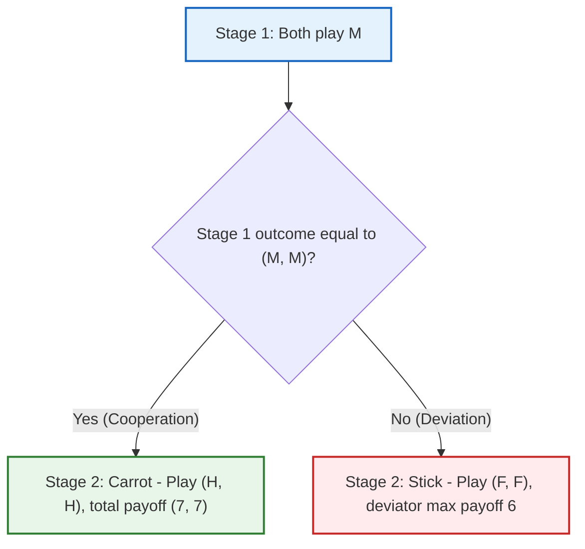
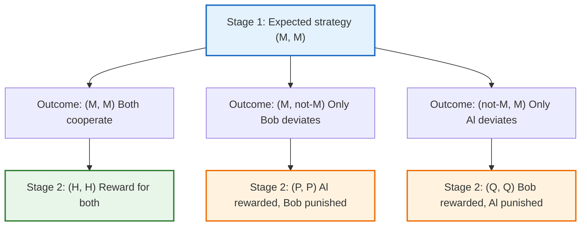
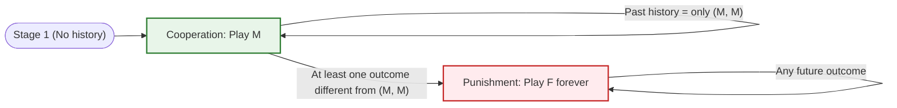
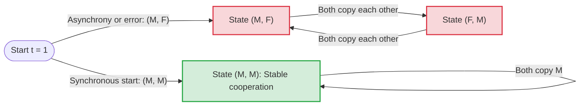
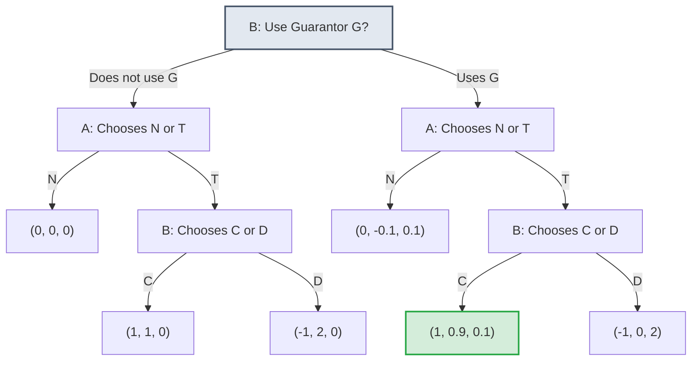

# Repeated Games: Formalization and Equilibria in Finite-Horizon Games

## Didactic Overview

This lecture introduces the topic of **Repeated Games**, a fundamental class of models in Game Theory that generalizes the **Multi-stage Dynamic Games** covered previously. The underlying idea consists in analyzing the strategic interaction that emerges when the same basic **Static Game**, called the **Stage Game** $G$, is repeated multiple times over time by the same players.

> **Key Concept:** Repeating a static game $G$ for $T$ stages, in which the **payoffs** of each phase are aggregated through a **Discounted Sum** with **Discount Factor** $\delta$, defines a new dynamic game. Unlike generic multi-stage games, repeated games allow us to extend the analysis beyond the **Finite Horizon** (finite $T$), introducing **Infinitely Repeated Games** with an **Infinite Horizon**, for which it is necessary to impose the condition $\delta < 1$.

In detail, the first part of the lecture lays the formal foundations and explores the case of **Finitely Repeated Games** through the following key points:

* **Model formalization:** defining the structure of the repeated game starting from the stage game $G$, the number of repetitions $T$, and the discount factor $\delta$.
* **Analysis of the base case (two-stage Prisoner's Dilemma):** studying a finite repetition without discounting of the **Prisoner's Dilemma**. Applying **Backward Induction** from the last stage toward the first, we observe how players anticipate the final outcome and simply repeat the same equilibrium action in every phase.
* **Strategic limits of equilibrium uniqueness:** proving two structural results for the finite horizon. First, the outcome of the last stage must always correspond to a **Nash Equilibrium** of the stage game. Second, if $G$ possesses a **unique** Nash Equilibrium, then the repeated game admits a unique **Subgame Perfect Equilibrium**, which consists in playing that equilibrium in every single stage.

> **Key Concept:** The finite repetition of a game with a unique Nash Equilibrium does not generate any relevant "carrot and stick" strategic interaction, since players cannot make credible promises or threats for the last stage. To obtain richer cooperative or punitive dynamics even under a finite horizon, it becomes necessary to study stage games that possess **multiple Nash Equilibria**.

---

### Introduction to Repeated Games and Formal Definition

A **Repeated Game** is, in simple terms, the same game played multiple times over time. It is a direct generalization of **Multi-Stage Games**, with the particularity that in every stage the players face the exact same strategic interaction. An example already encountered is the *Two Nights Battle of the Sexes* variant: if Anna and Brian go to the cinema for two nights in a row and the movie schedule is identical on both nights, we are looking at a repeated game.

To formalize this concept, we denote a repeated game with the notation $G(T, \delta)$:

* **$G$** represents the **Stage Game**, that is, the starting static game that is presented identically at each turn.
* **$T$** is the number of repetitions (the **Time Horizon**):
  * If $T$ is a finite number ($T = 2, 3, \dots$), we speak of **Finitely Repeated Games** or **Finite Horizon** games.
  * If the game is repeated infinitely ($T = \infty$), we speak of **Infinitely Repeated Games**. This is an important novelty: in generic multi-stage games it would not be possible to define infinitely many stages all different from one another, whereas here, since the base game $G$ is always the same, extending to infinity becomes perfectly natural.
* **$\delta$** is the **Discount Factor** used to aggregate the payoffs of the individual stages through the usual discounted sum rule.

> **Key Concept — Constraint on the Discount Factor:** Pay attention to a fundamental aspect: if the time horizon is infinite ($T = \infty$), the discount factor must necessarily satisfy the condition $\delta < 1$ (the mathematical reason will be clarified later in the discussion).

---

### Finite-Horizon Repeated Games with a Unique Equilibrium

To understand how players behave in a finite repeated game, let us start from the simplest possible case: $T = 2$ repetitions and no discounting ($\delta = 1$). Consider the classic **Prisoner's Dilemma** played by Al and Bob, caught twice at the scene of a robbery with the option to stay silent ($M$) or confess ($F$) in both stages.

Applying **Backward Induction**, we reason starting from the end of the game:

1. **Analysis of the second stage (last stage):** Whatever happened in the first stage, in the second stage Al and Bob face the static Prisoner's Dilemma. The unique **Nash Equilibrium** is $(F, F)$, which gives both a payoff of $(1, 1)$.
2. **Analysis of the first stage:** Al and Bob are rational and forward-looking players, so they anticipate with certainty that in the second round the outcome will be $(F, F)$. Consequently, from the perspective of the first stage, they perceive the game as a simple static game in which every first-round payoff is increased by the constant amount $(1, 1)$ resulting from the second round.
3. **Result:** Rescaling all payoffs of a matrix by adding the same constant does not change the players' best responses in any way. Therefore, the unique Nash Equilibrium remains $(F, F)$ in the first stage as well.

The same reasoning immediately extends to any finite horizon $T$ (for example $T = 10$): in the tenth stage $(F, F)$ is played, which forces $(F, F)$ to be played in the ninth, then in the eighth, and so on backward down to the first.

#### General Results on Finite Repeated Games

Since finite repeated games are a special case of multi-stage games, two fundamental results hold:

* **Last-stage outcome:** In any finite-horizon repeated game, the outcome played in the last stage must be a Nash Equilibrium of the stage game $G$.
* **Uniqueness of the equilibrium:** If the stage game $G$ admits a *unique* Nash Equilibrium $a^*$, then there exists a unique outcome associated with the **Subgame Perfect Equilibrium (SPE)**, which simply consists in playing $a^*$ in every single stage. Indeed, when backward induction yields a unique result, this coincides with the unique SPE of the game.

> **Key Concept — Absence of Strategic Interaction:** The finite repetition of a game with a unique Nash Equilibrium produces neither surprising results nor cooperation. Players have no room to implement reward or punishment mechanisms ("carrot and stick"), because they already know from the outset that the last stage will inevitably collapse onto the unique existing equilibrium.

---

### Multiple Equilibria and the "Carrot and Stick" Mechanism

The situation changes radically if the stage game $G$ possesses **multiple Nash Equilibria**. Let us modify the Prisoner's Dilemma by introducing a third action available to both players, denoted by $H$:

* If both players choose $H$, they obtain a good payoff equal to $(3, 3)$.
* If $H$ is played in combination with any other action ($M$ or $F$), the payoff for both is $(0, 0)$.
* Actions $M$ and $F$ retain the structure of the Prisoner's Dilemma: cooperation $(M, M)$ yields $(4, 4)$, unilateral deviation from $M$ to $F$ takes the deviator from $4$ to $5$, while $(F, F)$ yields $(1, 1)$.

*Note: Passage supplemented for didactic clarity — in the following table, the payoff of the player who chooses $M$ while the opponent deviates to $F$ (not explicitly stated aloud) is set equal to the classic value $0$ of the Prisoner's Dilemma so that $(F, F)$ actually turns out to be a Nash equilibrium:*

| Player 1 \ Player 2 | $M$ | $F$ | $H$ |
| :--- | :---: | :---: | :---: |
| **$M$** | $(4, 4)$ | $(0, 5)$ | $(0, 0)$ |
| **$F$** | $(5, 0)$ | $(1, 1)$ | $(0, 0)$ |
| **$H$** | $(0, 0)$ | $(0, 0)$ | $(3, 3)$ |

In this new stage game there are now **two Nash Equilibria**:
* A **"good"** equilibrium (the *carrot*): $(H, H)$, with payoff $(3, 3)$.
* A **"bad"** equilibrium (the *stick*): $(F, F)$, with payoff $(1, 1)$.

The pair $(M, M)$ still is *not* a Nash Equilibrium of the stage game, because each player is tempted to deviate unilaterally toward $F$ to earn $5$ instead of $4$ (an immediate incentive of $+1$). However, by playing the game twice ($T = 2$, without discounting), the players can sustain cooperation $(M, M)$ in the first stage by exploiting the choice of which equilibrium to play in the second stage.

#### Strategy Construction and Equilibrium Verification

The intuitive idea is as follows: if Al and Bob cooperate by playing $(M, M)$ in the first stage, in the second stage they will reward each other by playing the good equilibrium $(H, H)$, obtaining an overall payoff of $4 + 3 = 7$. If instead one of the two betrays and the first-round outcome is not $(M, M)$, in the second stage the punishment will be triggered by playing the bad equilibrium $(F, F)$. In the event of a deviation to $F$ in the first round, the betrayer would obtain $5 + 1 = 6$, which is lower than the cooperative payoff $7$. The immediate loss of $1$ in the first round is therefore more than compensated by the future gain of $+2$ (receiving $3$ instead of $1$).

> **Key Concept — Complete Strategy Specification (SPE):**
> 1. **Absence of explicit agreements:** In the model there is no communication between Al and Bob (modeling a verbal proposal would require an additional preliminary bargaining stage). The players arrive at this strategy exclusively through rational and "paranoid" speculation about each other's intentions.
> 2. **Typical error in the definition:** Simply writing *"the equilibrium is to play $(M, M)$ in the first round and $(H, H)$ in the second"* is **wrong**. Doing so does not define a complete strategy and one cannot speak of a Subgame Perfect Equilibrium, because it does not specify what happens in subgames not reached along the equilibrium path.

To correctly define this **Subgame Perfect Equilibrium**, each player's strategy must specify the action for *every possible history* of the first round (which counts $3 \times 3 = 9$ possible outcomes):
* **Stage 1:** Play $M$.
* **Stage 2:** If the outcome of the first stage was $(M, M)$, play $H$; in all other $8$ possible outcomes, play $F$.

*(Note on the size of the strategy space: with $3$ choices in the first round and $9$ possible outcomes in the second round each with $3$ options, each player has $3 \cdot 3^9 = 3^{10}$ possible strategies, which is why they are never listed in full).*

Looking at the game in its entirety from the perspective of the first stage, the total payoff matrix is obtained by adding $(3, 3)$ only to the cell $(M, M)$ and $(1, 1)$ to all other $8$ cells:

| Player 1 \\ Player 2 | $M$ | $F$ | $H$ |
| :--- | :---: | :---: | :---: |
| **$M$** | **$(7, 7)$** | $(1, 6)$ | $(1, 1)$ |
| **$F$** | $(6, 1)$ | $(2, 2)$ | $(1, 1)$ |
| **$H$** | $(1, 1)$ | $(1, 1)$ | $(4, 4)$ |

It is crucial that *all* outcomes other than $(M, M)$ are incremented by exactly $(1, 1)$ (the punishment) and not by $(3, 3)$ or other values: only in this way does the cell $(M, M)$ become a Nash Equilibrium in the overall economy of the entire game, despite not being a local equilibrium of the single stage game.

#### The Role of the Engineer in the Face of Multiple Equilibria

The "carrot and stick" strategy just found is not the only Subgame Perfect Equilibrium. Always playing $F$ in every stage and in every possible subgame also remains a mathematically legitimate SPE, but leads to a miserable total payoff of $(2, 2)$ instead of $(7, 7)$.

From a purely mathematical point of view, Game Theory cannot decree which Nash Equilibrium is "preferable": just as in the *Battle of the Sexes*, all equilibria are equally valid on a formal level. Here, however, the practical task of the **engineer** emerges: identifying the most efficient equilibrium, designing the system so as to make it available, and "advertising" it so that players are induced to coordinate on it rather than on the inefficient equilibrium.

---

### Philosophical and Sociological Implications of Cooperation

The result obtained so far — namely the possibility of inducing cooperation among purely rational and selfish players through **Repeated Games** — has strong repercussions in the philosophical, sociological, and epistemological fields, being frequently cited to explain why human beings collaborate with one another.

#### Rational Selfishness and the "Engineering" of Cooperation
At the beginning of the course, we assumed that human beings, modeled as rational players, are selfish and do not care about the well-being of others. To justify apparently altruistic behaviors (such as a father bringing food to his children), a first approach consists in directly including the well-being of others in the player's utility function. 

However, repeated games offer an even more powerful explanation: **a player can be intrinsically selfish without having to act selfishly in every single turn**. In a repeated setting, one cooperates out of "fear of future punishment" or to secure a better outcome in the long run.

From a strictly engineering point of view, what matters is the observable outcome, not the inner motivation in the players' minds. In philosophical debate, people often wonder whether human cooperation stems from an innate moral drive (or from a divine command) or from pure selfish calculation:
* From a mathematical point of view, the two cases are **indistinguishable** in their practical effects on cooperative behavior.
* Religious norms themselves or civic duty (e.g., "love thy neighbor", the promise of a future reward in heaven) can be interpreted as a **societal engineering mechanism to select one equilibrium over another**.

Returning to the example of the game between Al and Bob, the choice $F$ represents the selfish action (shifting the cost onto the other), while $M$ represents cooperation (both paying a reduced share). Although $(M, M)$ is socially preferable to $(F, F)$, in the single one-turn game selfish rationality inevitably leads to the Prisoner's Dilemma $(F, F)$. When multiple possible equilibria exist in the repeated game — for example, cooperating in the first turn with $(M, M)$ and then coordinating on $(H, H)$ in the second, or always playing selfishly $(F, F)$ — both constitute a perfectly valid **Nash Equilibrium**. An external social or normative mechanism is therefore necessary to steer individuals toward the cooperative equilibrium.

#### The Technical Limits of Cooperation
This philosophical reading rests on a very specific mathematical constraint concerning the finite horizon of the game:

> **Key Concept:** In a finite repeated game, in the **last stage** players always act selfishly by playing a Nash Equilibrium. Consequently, it is possible to establish cooperation in earlier turns **only if multiple Nash Equilibria exist** in the final stage, such as to allow a reward or punishment mechanism.

If there is no future reward (or differentiation among final outcomes) that rewards prior good conduct, there is no incentive to collaborate:
* If an individual is convinced that "there is no tomorrow" (for example, if they know they will die tomorrow and do not believe in any subsequent reward or retribution), their **Discount Factor** with respect to the future becomes negligible. In the absence of possible future retaliation, the only rational choice is to act in a purely selfish manner right away.
* Conversely, if it is perceived that the game will continue for a long time and that present actions will determine a future reward or punishment, selfishness itself drives cooperation.

---

### The Renegotiation Problem

Although the solution found (playing $(M, M)$ in the first stage and $(H, H)$ in the second, threatening $(F, F)$ in case of deviation) is mathematically valid, it exhibits a fragility if players are not time-consistent and attempt to call into question the agreements made.

#### Time Consistency and "Hostile" Players
The previous model assumes that players stick to the plan anticipated mentally. However, truly unscrupulous players (such as two thieves like Al and Bob) — or individuals with a discount factor different from $1$, highly focused on immediate gain — can breach trust and attempt a **renegotiation** while the game is underway.

Let us analyze what happens if Al decides to "get clever" in the first turn:
1. The implicit agreement calls for playing $(M, M)$ in the first stage and $(H, H)$ in the second.
2. Al knows that Bob expects cooperation and will play $M$. Al then decides to deviate by playing $F$ in the first stage (obtaining an immediate advantage: for example, a total of $8$ instead of $7$ if he manages to avoid punishment).
3. According to the punitive strategy, in the second turn Bob should punish Al by playing $(F, F)$, which yields a payoff of $(1, 1)$ for both.
4. **The limit of the threat:** Al can turn to Bob and propose renegotiating: *"It's true, in the first turn I played $F$, but playing $(F, F)$ now punishes me as much as it punishes you (we get $1$ each). Why don't we play $(H, H)$ anyway in the second turn? That way you get $3$ instead of $1$, it's in your interest!"*.

> **Key Concept:** The threat to play $(F, F)$ in the second stage to punish a deviation is a **non-credible threat** with respect to renegotiation, because carrying out the punishment also harms the one who inflicts it.

This mechanism is analogous to that of a parent who promises their children cartoons only if they behave well: if the children disobey and then cry desperately to get the cartoons anyway, they are trying to force a renegotiation by leveraging the fact that the punishment also weighs on the parent.

---

### Extending the Game with Targeted and Credible Punishments

To protect against the renegotiation problem, the engineer (or interaction designer) can — wherever it is possible to modify the rules of the context — expand the game by introducing additional strategies that make punishments **targeted**.

#### Introducing Strategies $P$ and $Q$
Suppose we enrich the base game (with strategies $M, F, H$) by adding two new options, $P$ and $Q$, constructed in such a way that $(P, P)$ and $(Q, Q)$ are also Nash Equilibria of the single stage. The equilibrium structure of the base game thus becomes the following:
* $(F, F)$ is a Nash Equilibrium, but it is **Pareto-dominated** by $(H, H)$.
* $(H, H)$, $(P, P)$, and $(Q, Q)$ are all **Pareto-efficient** Nash Equilibria: none of the three dominates the other two.
* $(M, M)$ continues to dominate all of these equilibria in terms of overall utility, but it is not a Nash Equilibrium in the single stage (so it cannot be sustained in the final turn).

Overall, this structure combines a **Coordination Game** with a Prisoner's Dilemma in the corner of strategies $M$ and $F$.

#### The New Conditional Strategy
Relying on **Common Knowledge** among rational players (both know game theory and know that the other knows it), the two can anticipate a much more robust strategy for the two stages:

Analyzing the three main cases in the second turn:
* **Mutual cooperation $(M, M)$:** In the second stage, $(H, H)$ is played, rewarding both players.
* **Unilateral deviation by Bob $(M, \neg M)$:** Al kept faith with the agreement by playing $M$, while Bob deviated. In the second stage, $(P, P)$ is played, which punishes exclusively Bob while still rewarding Al (for example, by assigning him a payoff of $4$).
* **Unilateral deviation by Al $(\neg M, M)$:** Bob cooperated while Al deviated. In the second stage, $(Q, Q)$ is played, which punishes Al and rewards Bob.

#### Why the Punishment Becomes Credible and Modeling Trade-offs
With this extension, the pair $((M, M), (H, H))$ remains a **Subgame Perfect Equilibrium**, but with a decisive advantage: **it is no longer vulnerable to renegotiation** in the event of a unilateral deviation.

If Al deviates and tries to propose playing $(H, H)$ anyway in the second turn, Bob has no interest in accepting: by executing the punishment $(Q, Q)$, in fact, Bob punishes Al and at the same time obtains his own full reward, without harming himself. Every deviation thus receives a credible and asymmetric punitive response.

On the other hand, artificially expanding a game by adding strategies entails an **engineering trade-off**:
* The payoff matrix becomes larger and the analysis becomes significantly more complex.
* In reality, it is not always permissible or possible to modify the actions available to the actors. The choice of whether or not to extend the model therefore depends on the designer's judgment regarding the scenario under analysis.

In summary, the presence of multiple Nash Equilibria makes it possible to establish cooperation in the turns preceding the final one; furthermore, having multiple targeted punishments available makes it possible to establish an even stronger and more convincing cooperation.

---

### Infinitely Repeated Games and Discount Factor

When we move from finitely repeated games to games repeated an infinite number of times, our model changes substantially. We denote this game by the notation $G^\infty(\delta)$, where $G$ is the base game (also called the stage game) and $\delta$ represents the **Discount Factor**.

#### The Problem of Comparing Infinite Payoffs

In finite-horizon games, evaluating which strategy is better is straightforward because we simply sum the payoffs of the individual stages: for example, in two repetitions, obtaining $(3, 3)$ gives a total of $6$, which is clearly better than $(4, 1)$ whose total is $5$.

In an infinite horizon, however, a first major mathematical problem arises. Suppose we have to compare two infinite sequences of payoffs:
* Sequence A: $(1, 1, 1, 1, \dots)$
* Sequence B: $(3, 3, 3, 3, \dots)$

Intuitively, we all know that receiving $3$ forever is much better than receiving $1$ forever. However, if we simply summed the payoffs without taking precautions, both sums would diverge to infinity ($\infty$), making it impossible to compare them rigorously.

To overcome this obstacle, the standard approach in economics is adopted by introducing a **discount factor** $\delta$ strictly less than $1$ ($0 \le \delta < 1$). In this way, future payoffs are "discounted" (weighted less the further away they are from the present):
* The sequence of $1$ becomes the geometric series:
  $$1 + \delta + \delta^2 + \delta^3 + \dots = \sum_{t=0}^{\infty} \delta^t = \frac{1}{1 - \delta}$$
* The sequence of $3$ becomes:
  $$3 + 3\delta + 3\delta^2 + 3\delta^3 + \dots = \sum_{t=0}^{\infty} 3\delta^t = \frac{3}{1 - \delta}$$

Since $\delta < 1$, both series converge to finite numbers and we can unambiguously state that $\frac{3}{1 - \delta} > \frac{1}{1 - \delta}$. This is why it is essential to impose the condition $\delta < 1$: without it, we would end up having to compare infinite quantities.

#### The Absence of a Final Stage and the Failure of Backward Induction

The second major change compared to finite games concerns the method of analysis. In finitely repeated games we used **Backward Induction**: we started from the last stage — knowing that there the players would necessarily play a **Nash Equilibrium** of the base game — and worked our way back to the beginning.

In an infinite-horizon game, **there is no last stage**. Since there is no end, we cannot apply backward induction. Although at first glance this may seem like a complication, in reality this absence opens the door to a much more powerful result than in the finite case.

> **Key Concept:** In an infinite-horizon repeated game $G^\infty(\delta)$, it is possible to obtain a **Subgame Perfect Equilibrium (SPE)** in which **no single-stage outcome** is a Nash Equilibrium of the base game $G$.
>
> This seems paradoxical, because an SPE requires a Nash Equilibrium to be played in every possible subgame. The trick lies in the fact that **every subgame of an infinite game is itself an infinite game**: this makes it possible to sustain cooperation among players without having to introduce external punishments or modify the rules of the game.

---

### The Repeated Prisoner's Dilemma and the Grim Trigger Strategy

To demonstrate this surprising result, we use the quintessential classic example: the **Prisoner's Dilemma**. In a "one-shot" game (played only once), two rational and selfish players (let us call them Al and Bob) have two possible actions: cooperate ($M$) or not cooperate / defect ($F$). Since there is no tomorrow, neither collaborates and they end up in the unique Nash Equilibrium $(F, F)$, even though $(M, M)$ would guarantee both a better payoff.

What happens if Al and Bob know they will have to interact infinitely?

*Note: Passage supplemented for pedagogical clarity. From the numerical values mentioned verbally by the instructor while performing the calculations ($4$ for mutual cooperation, $5$ for the one who defects unilaterally, $0$ for the one who is betrayed, and $1$ for mutual non-cooperation), the payoff matrix of the stage game $G$ used in the example is the following:*

| Al \ Bob | Cooperate ($M$) | Defect ($F$) |
| :--- | :---: | :---: |
| **Cooperate ($M$)** | $(4, 4)$ | $(0, 5)$ |
| **Defect ($F$)** | $(5, 0)$ | $(1, 1)$ |

#### Definition of the Grim Trigger Strategy ($GRT$)

A strategy in a repeated game must specify which action to play ($M$ or $F$) at every possible decision node, taking into account the past history of outcomes. We define the **Grim Trigger ($GRT$)** strategy (literally "ruthless trigger") as follows:
1. **At stage $1$** (when there is no past history yet): play $M$.
2. **At every subsequent stage ($t > 1$)**:
   * If **all** previous outcomes have been $(M, M)$, continue to play $M$.
   * Otherwise (that is, if someone has deviated at least once in the past), play $F$ **forever**.

The name "Grim Trigger" perfectly captures the ruthlessness of this rule: as long as we cooperate everything is fine, but if you betray my trust even once, I "pull the trigger" and will never cooperate with you again for eternity.

If both Al and Bob adopt the strategy $GRT$, the **Equilibrium Path** will be $(M, M)$ forever: at the first stage both play $M$, at the second stage they see that the previous outcome was $(M, M)$ and continue to play $M$, and so on indefinitely.

---

### Proof: $(GRT, GRT)$ is a Subgame Perfect Equilibrium (SPE)

Let us state the fundamental proposition we want to prove:

> **Key Concept (Proposition):** If the discount factor $\delta$ is sufficiently close to $1$, the joint strategy in which both players adopt **Grim Trigger** $(GRT, GRT)$ is a **Subgame Perfect Equilibrium (SPE)** of the repeated game $G^\infty(\delta)$.

This means that, solely through infinite repetition, stable cooperation $(M, M)$ emerges as an equilibrium, without having changed the payoffs of the stage game. To prove this, we must verify that $(GRT, GRT)$ is a Nash Equilibrium **in every possible subgame** (that is, for any past history that has occurred).

Let us put ourselves in Bob's shoes, assuming that Al is playing $GRT$, and ask what Bob's **Best Response** is in the two possible types of subgames.

#### Case 1: Subgames in which someone has already deviated (trigger already pulled)

Suppose we are in a subgame in which the past history contains at least one outcome different from $(M, M)$.
* Since the trigger has been pulled, the strategy $GRT$ dictates that Al play $F$ in this stage and in all future stages, regardless of what Bob does from now on.
* Knowing that Al will always play $F$, what is Bob's best response? If Bob plays $M$ he gets $0$, whereas if he plays $F$ he gets $1$; moreover, playing $M$ will not make Al change his mind.
* Consequently, Bob's best choice is to play $F$ in this stage and in all future stages.

This coincides exactly with what the strategy $GRT$ prescribes after a deviation. Therefore, in all "post-deviation" subgames, $(GRT, GRT)$ degenerates into the perpetual sequence $(F, F)$ and is a Nash Equilibrium. (Note: it is not the single isolated $(F, F)$ that makes the game, but the pair of strategies "always play $F$" that constitutes an equilibrium of the subgame).

#### Case 2: Subgames in which no one has ever deviated (stage 1 or history of only $(M, M)$)

Let us now consider stage $1$, or any subsequent stage in which all past outcomes have been $(M, M)$. Since no one has ever pulled the trigger, the strategic structure of the subgame is identical to that of the initial stage: Al will play $M$ in the current stage.

Bob faces a crossroads: is it better for him to follow $GRT$ (play $M$) or to deviate (play $F$)?
At first glance, it would seem advantageous to deviate in order to collect $5$ right away instead of $4$. However, Bob is forward-looking and knows that by deviating today, the outcome will become $(M, F)$: this will pull Al's trigger, who from the next round onward will play $F$ forever. Consequently, from the next round onward, it will also be optimal for Bob to play $F$ forever (as shown in Case 1), settling for $1$ instead of $4$.

Let us compare the discounted present values (at the current time) of Bob's two choices:

1. **Value of cooperation ($V_{GRT}$):** if Bob stays faithful to $GRT$ (plays $M$ today and continues doing so), he obtains $4$ in this stage and in all future stages:
   $$V_{GRT} = 4 + 4\delta + 4\delta^2 + 4\delta^3 + \dots = \frac{4}{1 - \delta}$$

2. **Value of deviation ($V_{\text{dev}}$):** if Bob deviates today by playing $F$, he immediately obtains $5$ (undiscounted, because it is the present gain), but from the next round onward both will play $F$ forever, yielding him discounted $1$ in every future stage:
   $$V_{\text{dev}} = 5 + \delta + \delta^2 + \delta^3 + \dots = 5 + \sum_{t=1}^{\infty} \delta^t = 5 + \frac{\delta}{1 - \delta}$$

For Bob to have no incentive to deviate, the value of cooperation must be at least equal to (or strictly greater than) that of deviation:
$$V_{GRT} \ge V_{\text{dev}} \implies \frac{4}{1 - \delta} \ge 5 + \frac{\delta}{1 - \delta}$$

*Note: Step added for pedagogical clarity to explicitly show how the inequality is solved.*
Multiplying both sides by $(1 - \delta)$ (which is a strictly positive quantity since $\delta < 1$):
$$4 \ge 5(1 - \delta) + \delta$$
$$4 \ge 5 - 5\delta + \delta$$
$$4\delta \ge 1 \implies \delta \ge \frac{1}{4}$$

Therefore, for cooperation to be strictly preferable to deviation, it is sufficient that $\delta > \frac{1}{4}$ (with $\delta \ge \frac{1}{4}$ for the weak equilibrium).

#### Conclusion of the proof and meaning of $\delta$

We have shown that for $\delta > \frac{1}{4}$:
* In the subgames where no one has deviated, neither player wants to deviate from playing $M$ (the same logic as Bob's applies to Al by symmetry). We are not saying that $(M, M)$ is a Nash Equilibrium of the one-shot game, but rather that **playing $(M, M)$ forever supported by the Grim Trigger threat** is a Nash Equilibrium of these subgames.
* In the subgames where someone has deviated, playing $(F, F)$ forever is a Nash Equilibrium.

Since $(GRT, GRT)$ induces a Nash Equilibrium in **every possible subgame**, the strategy is in full right a **Subgame Perfect Equilibrium (SPE)**.

> **Key Concept (Interpretation and generalization):**
> * **If $\delta$ is close to $0$** ("impatient" players, who give no weight to the future): the immediate reward from deviating ($5$ today instead of $4$) dominates the future loss. No cooperative SPE exists.
> * **If $\delta$ is close to $1$** ("patient" players, who give great weight to the future): the short-term gain pales in comparison to the long-term harm of perpetual punishment ($1$ instead of $4$ forever). The punishment acts as a **Credible Threat**.
> * Somewhat cynically, Al and Bob do not collaborate out of friendship or altruism: they collaborate out of fear of the future consequences of punishment.
> * Finally, the numerical threshold $\frac{1}{4}$ depends on the specific numbers in this payoff matrix; however, changing the payoffs of the Prisoner's Dilemma will change the exact threshold, while the general principle will always remain true: **there exists a threshold less than $1$ above which (for $\delta$ sufficiently close to $1$) cooperation via Grim Trigger is a Subgame Perfect Equilibrium**.

---

### Friedman's Theorem (Folk Theorem)

Before going into the formal details, it is worth recalling the curious history of this result, probably the most cited theorem in all of Game Theory. Despite its fame, it is not known for certain who invented it: in the slides it is called **Friedman's Theorem**, but in reality James Friedman cited it in one of his papers simply presenting it as a "well-known result," without claiming authorship or including bibliographic references. For this reason, in the literature it is also known as the **Folk Theorem** (*folk* is not the name of a researcher, but rather denotes a theorem so "popular" and widespread in the scientific community that it is taken for granted by everyone).

To avoid excessively heavy mathematical notation, the theorem is proved and analyzed by referring to the classic infinitely repeated **Prisoner's Dilemma**; the generalization to arbitrary games then follows naturally from the same reasoning.

#### Definition of Feasible Payoff

To understand the theorem, we need to introduce the concept of a **Feasible Payoff**:

* A feasible payoff is any **convex combination** of the payoff vectors obtainable through the **Pure Strategies** of the base static game.

Considering the numerical example of the Prisoner's Dilemma seen in class, the vertices of the diamond in the payoff space—corresponding to the four combinations of pure strategies—are $(1,1)$, $(5,0)$, $(4,4)$, and $(0,4)$. The entire interior area bounded by these vertices represents the set of feasible long-run average payoffs.

For example, the point $(2,2)$ cannot be obtained in a single round, but it lies inside the feasible region. It can be obtained as an average payoff by cyclically playing the sequence $(F,F), (F,F), (M,M)$ infinitely:
* In round 1, $(F,F) \implies (1,1)$ is played
* In round 2, $(F,F) \implies (1,1)$ is played
* In round 3, $(M,M) \implies (4,4)$ is played

Repeating this pattern infinitely, the arithmetic mean of the payoffs over each cycle is exactly:
$$\left(\frac{1+1+4}{3}, \frac{1+1+4}{3}\right) = (2,2)$$
*(Note: Passage supplemented for didactic clarity.)*

**Difference from Mixed Strategies:**
In a static game, a convex combination of payoffs represents an *expected value* tied to the probability of playing each move. In an infinitely repeated game, however, it is not a probabilistic expected value, but an **actual arithmetic average**, obtained by concretely executing a deterministic sequence of pure strategies (the two views converge asymptotically by the Law of Large Numbers, but here the sequence is actually constructed and played over time).

#### Statement and Proof Logic of the Theorem

> **Key Concept — Friedman's Theorem (Folk Theorem):**
> Let $G$ be a finite static game of complete information, repeated infinitely many times. Suppose there exists an $n$-tuple of values corresponding to a **Nash Equilibrium** of $G$, and an $n$-tuple of feasible payoffs $x = (x_1, \dots, x_n)$ in which each player's payoff is strictly greater than (or in the limit equal to) their payoff in the Nash Equilibrium:
> $$x_i > u_i^{NE} \quad \forall i$$
> Then, if the **Discount Factor** $\delta$ is sufficiently close to $1$, there exists a **Subgame Perfect Equilibrium (SPE)** of the repeated game that achieves the vector $x$ as its average payoff.

The proof is constructed by defining an appropriate **Grim Trigger Strategy**:
1. The players agree on the sequence of moves that generates the desired payoff $x$ (e.g., always playing $M$ to obtain $(4,4)$, or the cycle $M, F, F$ to obtain $(2,2)$).
2. As long as no one deviates from the established path, they continue following the sequence.
3. As soon as one player deviates, the punishment (*trigger*) activates: from that moment on, the Nash Equilibrium of the static game is played forever (in the example, $(F,F)$ giving $(1,1)$).

**Which points in the feasible region are sustainable?**
Not all feasible payoffs are sustainable as an equilibrium, but only those that guarantee *all* players an outcome better than (or at least equal to) the Nash Equilibrium:
* In the example, both $(4,4)$ and $(2,2)$ are valid because both players prefer $2$ (or $4$) to $1$ forever.
* Conversely, a point where Player 1 gets less than $1$ is not sustainable: Player 1 would prefer to deviate immediately and accept the eternal punishment $(F,F)$, since $1$ is still greater than what they would get by respecting the agreement. For the same reason, $(M,F)$ cannot be sustained exactly, though one can get arbitrarily close to it while remaining in the region where both improve upon $(1,1)$.

**Note on delayed deviations:**
In cyclic sequences such as $M, F, F$, a player might decide from the very beginning to deviate by playing $M, F, M$. In the first two rounds, the deviation is not visible to the opponent (it looks as though they are following the plan) and manifests only in the third round. However, this does not invalidate the theorem: any deviation yields an advantage limited to a finite time, whereas the punishment (the return to the Nash Equilibrium) lasts for an infinite time. If $\delta$ is sufficiently close to $1$, the temporary gain never compensates for the eternal loss.

#### Choice of Punishments: Nash Equilibrium vs Maximin and the Role of $\delta$

The Prisoner's Dilemma is a special case in which there is a single Nash Equilibrium $(1,1)$ that also coincides with the **Security Payoff / Maximin** equal to $1$. In more complex games, however, the Maximin is in general less than or equal to the Nash Equilibrium in pure strategies. This raises two important practical considerations when applying Grim Trigger:
* **Harsher punishments:** If there exists a strategy in the game that harms the opponent more than the Nash Equilibrium (down to their Maximin level), it can be used as a threat ("stick") to make the incentive to cooperate ("carrot") even stronger. However, one must verify that the threat is *credible* and does not unsustainably harm the player who carries it out.
* **Realistic values of $\delta$:** The theorem requires $\delta$ to be very close to $1$ (for example $\delta = 0.99$), a condition that may not be satisfied in real-world applications. If $\delta$ is not high enough, one must check whether harsher punishments than the simple Nash Equilibrium exist, or else accept that the sustainable level of cooperation will be lower.

---

### From Grim Trigger to Tit-for-Tat (TFT)

#### Implementation Limitations of Grim Trigger

From a strictly engineering perspective, the Grim Trigger strategy presents a serious issue of implementation complexity. Its formal definition indeed requires checking that *every single previous round* has been cooperative before continuing to cooperate:
* A human easily remembers having been betrayed, whereas an **automaton** (or an algorithm) would have to store the entire past history of interactions in memory.
* Upon reaching round $t = 1000$, the automaton would have to run a check loop over all $1000$ past iterations (with computational and memory costs growing linearly with time) to decide whether anyone has ever betrayed.

#### The Tit-for-Tat (TFT) Strategy: How It Works and Comparison

To overcome this computational problem, a much lighter and more elegant version called **Tit-for-Tat (TFT)** ("blow for blow" / "an eye for an eye") is introduced:
* In round $t = 1$, the player cooperates (plays $M$).
* In every subsequent round $t > 1$, player $i$ copies exactly the move played by the opponent ($-i$) in the previous round $t - 1$.

Along the **Equilibrium Path**, Grim Trigger and Tit-for-Tat produce the exact same outcome: both players start with $M$ and continue playing $(M,M)$ forever. The radical difference emerges in the event of a deviation:

* **Grim Trigger (*non-forgiving* strategy):** a single betrayal is enough to trigger an eternal punishment.
* **Tit-for-Tat (*forgiving* strategy):** having a memory of just **one step**, if the opponent betrays in round $t-1$, the TFT player punishes them in round $t$ by playing $F$; however, if the opponent "repents" and returns to cooperating by playing $M$, in round $t+1$ the TFT player forgives and immediately returns to cooperating.

This logic recalls two classic interpretations: on the one hand, the biblical law of "an eye for an eye" understood as a *limit to revenge* (punishing in the same measure as the harm suffered rather than destroying the opponent forever); on the other hand, the principle of **reciprocal altruism**, also observed in nature (for example, in wolf packs or bats), where individuals who do not cooperate are temporarily isolated until they return to contributing to the group.

#### The Death Spiral and the Subgame Perfect Equilibrium Issue

Despite the practical effectiveness of Tit-for-Tat, this strategy hides two fundamental theoretical issues when moving off the equilibrium path.

**1. Lack of Synchronization and Death Spiral:**
Suppose that in the first round, due to an error or a lack of synchronization, Player 1 cooperates ($M$) while Player 2 defects ($F$).
* Round 1: $(M, F)$ occurs.
* Round 2: both apply TFT by copying each other's previous move $\implies$ Player 1 plays $F$ and Player 2 plays $M$, resulting in $(F, M)$.
* Round 3: copying each other again, they return to $(M, F)$, then back to $(F, M)$, and so on.

The players remain trapped in a **Death Spiral**, continuously alternating between $(M,F)$ and $(F,M)$ without ever being able to restore mutual cooperation $(M,M)$. If the alternating payoffs are $5$ and $0$, the resulting average is $2.5$, significantly worse than the constant $4$ of cooperation: in this situation, both players would want to deviate to break the cycle, which shows that a Nash Equilibrium is not being played along that subgame.

> **Key Concept — Nash vs Subgame Perfect Equilibrium in Tit-for-Tat:**
> In its classic version, the Tit-for-Tat strategy guarantees a **Nash Equilibrium** on the equilibrium path (both always play $M$ and neither has an incentive to deviate). However, it **does NOT constitute a Subgame Perfect Equilibrium**.
> Off the equilibrium path, in fact, the strategy can dictate irrational behavior: both because it can trap players in the Death Spiral (with a worse average payoff), and because it forces a player to mechanically "forgive" even an opponent who systematically continues to defect.

#### Intermediate Variants and Engineering Trade-offs

Between the two extremes—the eternal grudge of Grim Trigger and the single-round memory of Tit-for-Tat—there exist several intermediate variants also studied in the field of computational intelligence. One example is **Tit-for-Two-Tats**, in which a first defection is tolerated, but the player reacts (or maintains punishment) on the second.

From an **engineering** perspective, theoretical anomalies off the equilibrium path carry less weight than operational effectiveness along the equilibrium path itself. Therefore, implementing a Grim Trigger-type cooperative mechanism by operationally resorting to **Tit-for-Tat** is a very valid and computationally efficient practical choice, provided one is aware that the resulting equilibrium does not satisfy the subgame perfection property.

---

### Applications of Repeated Games: Reputation

In this concluding part, we focus on a highly relevant practical application of the theoretical concepts seen so far: the role of **reputation** in strategic interactions.

From an applied standpoint, reputation is fundamental, especially in digital environments and networks: deciding whether to trust an online agent, for instance, strictly depends on our assessment of whether it is a cooperative user or an attacker (*hacker*). As we have seen in repeated game theory, repetition over time builds cooperation: if a game is repeated long enough, it is possible to establish stable cooperative patterns.

This mechanism reflects exactly what happens in society:
* When we enter an already established community, we tend to cooperate right away because the society itself has existed for a long time and has built norms of trust.
* In academia, working with a very famous professor is considered prestigious because their long career guarantees a solid reputation; without this prior information, we could only assess their worth after interacting with them directly.
* The same applies to institutions, such as choosing to study at the University of Padua based on its historical reputation.

We can formalize this exact mechanism through a sequential game model.

---

### The Trust Game

To formally analyze the problem of trust and reputation, let us start with a simplified version of the **Trust Game** between two players, $A$ and $B$:

1. **Move of $A$**: they can decide **not to trust** ($N$, *Not trust*), immediately ending the game with payoff $(0, 0)$, or to **trust** ($T$, *Trust*).
2. **Move of $B$** (only if $A$ chooses $T$): they can choose to **cooperate** ($C$, *Cooperate*), generating the best outcome for both $(1, 1)$, or to **defect/betray** ($D$, *Defect*), obtaining a higher personal gain at the expense of $A$, with payoff $(-1, 2)$.

#### Analysis of the One-Shot Game
Applying **Backward Induction** to the game played only once:
* At their decision node, $B$ compares the payoff of cooperation ($1$) with that of defection ($2$). Being a rational and selfish agent, $B$ will choose $D$.
* Anticipating the choice of $B$, player $A$ compares the payoff from not trusting ($0$) with what they would obtain by trusting ($-1$). Consequently, $A$ chooses $N$.

The equilibrium of the one-shot game therefore leads to the suboptimal outcome $(0, 0)$: the lack of trust blocks all cooperation.

#### The Repeated Trust Game
Although it is a dynamic (sequential) game, nothing prevents us from transforming the base game (*stage game* $G$) into its normal (bimatrix) form and repeating it over time.

In an infinitely repeated scenario, player $A$ can adopt a **Grim Trigger Strategy**:
* In the first period, $A$ decides to trust ($T$).
* In subsequent periods, $A$ continues to play $T$ as long as the past history shows exclusively $(T, C)$ outcomes.
* If $B$ deviates even once by playing $D$, $A$ punishes $B$ by playing $N$ forever (effectively preventing $B$ from playing again).

Let us analyze the best response of $B$ given this strategy of $A$. The meaningful strategies for $B$ reduce to two choices (since any strategy that starts with or includes a defection $D$ causes $A$ to play $N$ forever, eliminating any future opportunity for $B$):
1. **Always cooperate** (always play $C$): $B$ obtains a payoff of $1$ in every round. Given the **Discount Factor** $\delta \in (0, 1)$, the total present value for $B$ is:
   $$U_B(\text{sempre } C) = 1 + 1\delta + 1\delta^2 + \dots = \sum_{t=0}^{\infty} \delta^t = \frac{1}{1-\delta}$$
2. **Defect immediately** (play $D$ in the first round): $B$ collects $2$ immediately, but triggers the eternal punishment of $A$ ($N$ forever), obtaining $0$ in all future rounds:
   $$U_B(\text{deviare a } D) = 2 + 0\delta + 0\delta^2 + \dots = 2$$

For it to be worthwhile for $B$ to always cooperate, the long-term gain must exceed the immediate gain from defection:

$$\frac{1}{1-\delta} > 2$$

*Note: Step expanded for didactic clarity.* Multiplying both sides by $(1-\delta) > 0$:
$$1 > 2 - 2\delta \implies 2\delta > 1 \implies \delta > \frac{1}{2}$$

> **Key Concept — Cooperation threshold in the repeated Trust Game**
> * If $\delta > \frac{1}{2}$: $B$ gives sufficient weight to the future, so it is in their interest to cooperate by always playing $C$.
> * If $\delta < \frac{1}{2}$: the present gain ($2$) is more tempting than the discounted future reward, so $B$ will choose to defect immediately.

---

### The Alternative to Repetition: Introducing a Guarantor ($G$)

So far, we have not introduced a true formal reputation mechanism in the one-shot game. Suppose now that we change the rules of the *one-shot* game by introducing a third player, called the **Guarantor** $G$.

In reality, the guarantor $G$ represents a certifying body, a university ranking, or the prestige of a scientific conference: they do not actively participate in the transaction, but certify the good reputation of $B$, incentivizing $A$ to trust. However, $G$ is also a rational and selfish actor, so they offer this service in exchange for a share of the gain.

#### Security Deposit Mechanism
The contract with the guarantor works as follows:
* Before the game begins, $B$ can choose whether to turn to $G$ or not.
* If $B$ uses $G$, they deposit with $G$ a **security deposit/insurance** equal to $2$ (initially reducing their payoff by $2$).
* If $A$ trusts ($T$) and $B$ defects ($D$), $G$ **keeps the entire deposit** ($2$).
* In all other cases (if $B$ cooperates, or if $A$ does not trust and therefore it is not possible to prove the dishonesty of $B$), $G$ **returns the deposit** to $B$, keeping only a small service fee equal to $0.1$ ($\frac{1}{10}$ of utility).

In this 3-player model, the payoffs are expressed as the triple $(u_A, u_B, u_G)$:
* **"Does not use $G$" branch**: the game remains identical to before, with $u_G = 0$ in all outcomes:
  * $A$ plays $N \implies (0, 0, 0)$
  * $A$ plays $T$, $B$ plays $C \implies (1, 1, 0)$
  * $A$ plays $T$, $B$ plays $D \implies (-1, 2, 0)$
* **"Uses $G$" branch**:
  * $A$ plays $N \implies (0, -0.1, 0.1)$ (the deposit is returned, but $B$ pays the fee of $0.1$).
  * $A$ plays $T$, $B$ plays $C \implies (1, 0.9, 0.1)$ (out of the gain of $1$, $B$ pays $0.1$ to $G$).
  * $A$ plays $T$, $B$ plays $D \implies (-1, 0, 2)$ ($B$ gains $2$ from defecting, but loses the deposit of $2$, which goes to $G$).

#### Subgame Perfect Equilibrium (SPE) Analysis
Applying backward induction again to find the **Subgame Perfect Equilibrium (SPE)**:
1. **In the "Does not use $G$" subgame**:
   * $B$ chooses $D$ ($2 > 1$).
   * $A$ anticipates $D$ and chooses $N$ ($0 > -1$).
   * Subgame outcome: $(0, 0, 0)$.
2. **In the "Uses $G$" subgame**:
   * $B$ compares $C$ ($0.9$) with $D$ ($0$) and chooses to cooperate ($C$).
   * $A$ anticipates that $B$ is incentivized to cooperate and chooses $T$ ($1 > 0$).
   * Subgame outcome: $(1, 0.9, 0.1)$.
3. **Initial choice of $B$**:
   * Comparing their payoff in the two branches, $B$ prefers $0.9$ (using $G$) over $0$ (not using $G$).

The **equilibrium path** is therefore: $B$ uses $G \to A$ plays $T \to B$ plays $C$, with payoff $(1, 0.9, 0.1)$.

> **Key Concept — Complete specification of an SPE**
> Caution: to properly define a Subgame Perfect Equilibrium, it is not enough to state only the equilibrium path (for example, saying only "$B$ uses $G$, $A$ plays $T$, $B$ plays $C$"). It is mandatory to specify the prescribed actions at **all** decision nodes, including those off the equilibrium path:
> * Complete strategy of $B$: *(Uses $G$; plays $C$ if they used $G$ and $A$ trusts; plays $D$ if they did not use $G$ and $A$ trusts)*.
> * Complete strategy of $A$: *(Plays $T$ if $B$ uses $G$; plays $N$ if $B$ does not use $G$)*.

> **Key Concept — Equivalence between repetition and a guarantor**
> This result reveals a deep theoretical equivalence:
> * In **infinitely repeated games**, cooperation is sustained by the threat of an **eternal punishment** (an infinite horizon known to the players).
> * In the **one-shot game with a guarantor**, cooperation is sustained by an **immediate punishment** (loss of the deposit).
>
> Having the possibility of infinite repetitions therefore produces the same effect as having a certifying guarantor available.

---

### Who Guarantees the Guarantor? The Reputation of $G$

A very legitimate objection to this model is: *how can we be sure that the guarantor $G$ does its job honestly?* In reality, there are financial intermediaries (*brokers*) who run away with clients' money or certification bodies that turn out to be scams.

In the previous model, we assumed that $G$ automatically returned the deposit to $B$, keeping only $0.1$. Instead, let us try modeling $G$ as an active player with a final move at the node where it must return the deposit:
* $G$ can choose whether to be honest (return the deposit and collect $0.1$) or betray $B$ (pocket the entire deposit of $2$).

#### $G$'s Dilemma: One-Shot Game vs. Repeated Game
* **If the game is played only once (*one-shot*)**: being the last to move, $G$ has a dominant strategy, namely to betray and keep the entire deposit ($2 > 0.1$). Anticipating that $G$ will steal the deposit, $B$ will not trust $G$ and the entire cooperation system will collapse.
* **If the game is repeated over time**: it is now $G$'s turn to build its own reputation as a reliable guarantor in order to stay on the market and not lose future clients.

Let us compare $G$'s payoffs in the repeated game:
1. **Myopic (dishonest) guarantor**: keeps the entire deposit today, collecting $2$, but loses its reputation and will never have clients again ($0$ in future rounds):
   $$U_G(\text{disonesto}) = 2$$
2. **Cooperative (honest) guarantor**: returns the deposit and collects the small fee of $0.1$ in every period forever:
   $$U_G(\text{onesto}) = 0.1 + 0.1\delta + 0.1\delta^2 + \dots = \frac{0.1}{1-\delta}$$

For it to be worthwhile for the guarantor to behave honestly in the long run, the following must hold:

$$\frac{0.1}{1-\delta} > 2$$

*Note: Step added for pedagogical clarity.* Multiplying by $(1-\delta) > 0$:
$$0.1 > 2 - 2\delta \implies 2\delta > 1.9 \implies \delta > 0.95$$

> **Key Concept — Meaning of the threshold $\delta > 0.95$**
> The threshold value $\delta > 0.95$ is very high (very close to $1$). This teaches us a fundamental general rule for building a solid reputation: **even if the per-unit gain from honesty is small ($0.1$), it pays to remain honest if the time horizon and the probability of remaining in business in the next round ($\delta$) are very high.**

#### Practical Implications and Limitations
This mathematical analysis explains why we trust historical and well-established organizations more than newcomers:
* **Companies and Universities**: an institution that has been operating in the market for a long time (such as the University of Padua, active for nearly 800 years, compared to a newly founded university that might issue worthless degrees) implicitly signals that it has a factor $\delta$ very close to $1$. Because it has a long and established operational horizon, it has no incentive to ruin its reputation for an immediate short-term gain.
* **Network Operations**: in communication networks where users continuously join and leave, a node's reputation grows proportionally to the length of time it is expected to remain active in the network.

Naturally, a long operational history does not constitute an absolute mathematical guarantee (just as a fifty-year marriage or a historic company can still collapse due to a sudden defection), but it represents a strong rational indicator that the guarantor has a high $\delta$ and therefore a real economic interest in remaining honest.

---

> [!NOTE]
> ### Exam Notes and Instructor Announcements
> - The instructor explicitly specified that the philosophical reflections and influences added during the lecture (regarding the motivations behind human cooperation and connections with religion or society) will not be part of either the exam or the project.