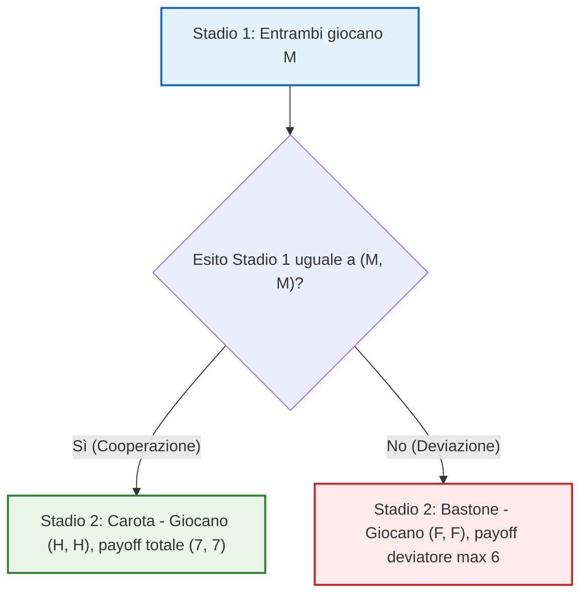
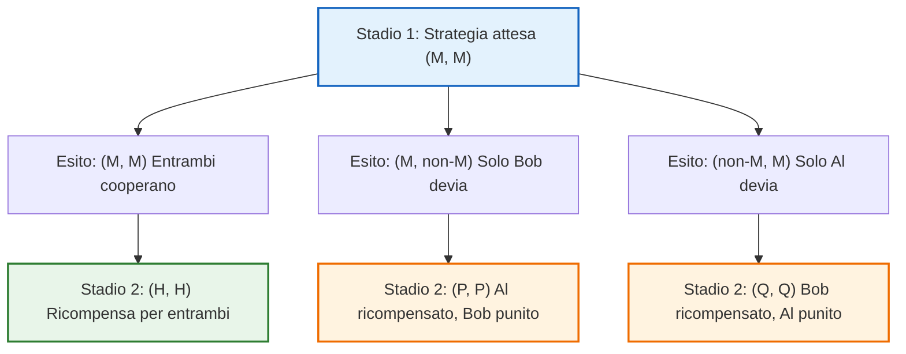
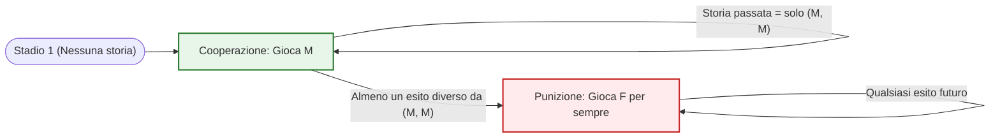
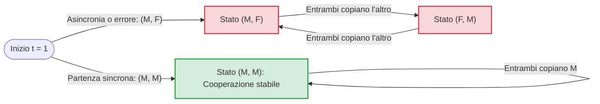
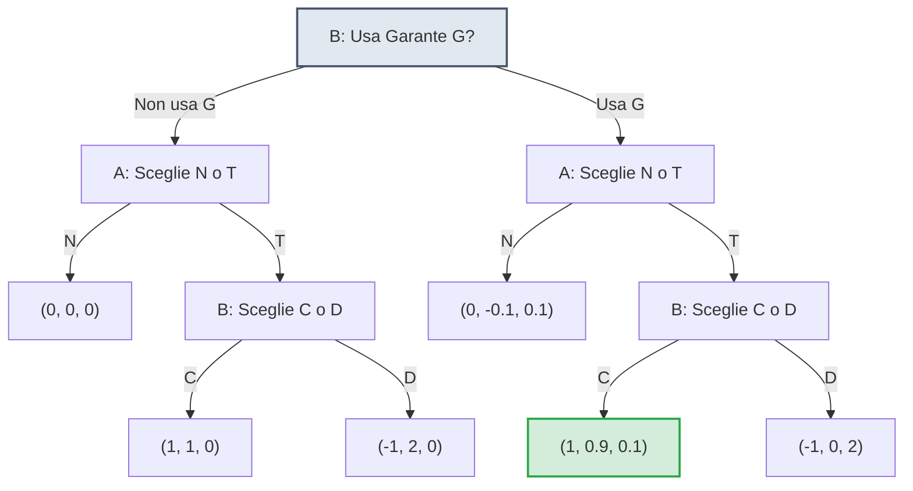

# Giochi Ripetuti: Formalizzazione ed Equilibri nei Giochi ad Orizzonte Finito

## Overview Didattica

Questa lezione introduce il tema dei **Giochi Ripetuti (Repeated Games)**, una classe fondamentale di modelli nella Teoria dei Giochi che generalizza i **Giochi Dinamici Multi-Stadio (Multi-stage Dynamic Games)** affrontati in precedenza. L'idea alla base consiste nell'analizzare l'interazione strategica che emerge quando uno stesso **Gioco Statico (Static Game)** di base, detto **Gioco di Stadio (Stage Game)** $G$, viene ripetuto più volte nel tempo dagli stessi giocatori.

> **Concetto Chiave:** La ripetizione di un gioco statico $G$ per $T$ stadi, in cui i **guadagni (payoff)** di ciascuna fase vengono aggregati tramite una **Somma Scontata (Discounted Sum)** con **Fattore di Sconto (Discount Factor)** $\delta$, definisce un nuovo gioco dinamico. A differenza dei giochi multi-stadio generici, i giochi ripetuti permettono di estendere l'analisi oltre l'**Orizzonte Finito (Finite Horizon)** ($T$ finito), introducendo i **Giochi Ripetuti Infinitamente (Infinitely Repeated Games)** ad **Orizzonte Infinito (Infinite Horizon)**, per i quali è necessario imporre la condizione $\delta < 1$.

Nel dettaglio, la prima parte della lezione getta le basi formali ed esplora il caso dei **Giochi Ripetuti Finitamente (Finitely Repeated Games)** attraverso i seguenti punti fondamentali:

* **Formalizzazione del modello:** definizione della struttura del gioco ripetuto a partire dal gioco di stadio $G$, dal numero di ripetizioni $T$ e dal fattore di sconto $\delta$.
* **Analisi del caso base (Dilemma del Prigioniero a due stadi):** studio di una ripetizione finita senza sconto del **Dilemma del Prigioniero (Prisoner's Dilemma)**. Applicando l'**Induzione a Retroso (Backward Induction)** dall'ultimo stadio verso il primo, si osserva come i giocatori anticipino l'esito finale e si limitino a ripetere la stessa azione di equilibrio in ogni fase.
* **Limiti strategici dell'unicità dell'equilibrio:** dimostrazione di due risultati strutturali per l'orizzonte finito. In primo luogo, l'esito dell'ultimo stadio deve sempre corrispondere a un **Equilibrio di Nash (Nash Equilibrium)** del gioco di stadio. In secondo luogo, se $G$ possiede un **unico** Equilibrio di Nash, allora il gioco ripetuto ammette un unico **Equilibrio Perfetto nei Sottogiochi (Subgame Perfect Equilibrium)**, che consiste nel giocare tale equilibrio in ogni singolo stadio.

> **Concetto Chiave:** La ripetizione finita di un gioco con un unico Equilibrio di Nash non genera alcuna interazione strategica rilevante di tipo "bastone e carota" (*carrot and stick*), poiché i giocatori non possono fare promesse o minacce credibili per l'ultimo stadio. Per ottenere dinamiche cooperative o punitive più ricche anche ad orizzonte finito, diventa necessario studiare giochi di stadio che possiedono **molteplici Equilibri di Nash**.

---

### Introduzione ai Giochi Ripetuti e Definizione Formale

Un **Gioco Ripetuto (Repeated Game)** è, in parole semplici, lo stesso gioco giocato più volte nel tempo. Si tratta di una generalizzazione diretta dei **Giochi Multi-Stadio (Multi-Stage Games)**, con la particolarità che in ogni stadio i giocatori affrontano esattamente la medesima interazione strategica. Un esempio già incontrato è la variante su due serate della *Battaglia dei Sessi (Two Nights Battle of the Sexes)*: se Anna e Brian vanno al cinema per due sere di fila e la programmazione dei film è identica in entrambe le serate, ci troviamo esattamente davanti a un gioco ripetuto.

Per formalizzare questo concetto, indichiamo un gioco ripetuto con la notazione $G(T, \delta)$:

* **$G$** rappresenta il **Gioco a Stadi (Stage Game)**, ovvero il gioco statico di partenza che viene riproposto identico a ogni turno.
* **$T$** è il numero di ripetizioni (l'**Orizzonte Temporale**):
  * Se $T$ è un numero finito ($T = 2, 3, \dots$), parliamo di **Giochi Ripetuti Finitamente (Finitely Repeated Games)** o a **Orizzonte Finito (Finite Horizon)**.
  * Se il gioco viene ripetuto all'infinito ($T = \infty$), parliamo di **Giochi Ripetuti Infinitamente (Infinitely Repeated Games)**. Questa è una novità importante: nei giochi multi-stadio generici non sarebbe possibile definire infiniti stadi tutti diversi tra loro, ma poiché qui il gioco base $G$ è sempre lo stesso, l'estensione all'infinito diventa perfettamente naturale.
* **$\delta$** è il **Fattore di Sconto (Discount Factor)** utilizzato per aggregare i payoff dei singoli stadi tramite la consueta regola della somma scontata.

> **Concetto Chiave — Vincolo sul Fattore di Sconto:** Attenzione a un aspetto fondamentale: se l'orizzonte temporale è infinito ($T = \infty$), il fattore di sconto deve necessariamente soddisfare la condizione $\delta < 1$ (la motivazione matematica verrà chiarita nel seguito della trattazione).

---

### Giochi Ripetuti a Orizzonte Finito con Equilibrio Unico

Per capire come si comportano i giocatori in un gioco ripetuto finito, partiamo dal caso più semplice possibile: $T = 2$ ripetizioni e assenza di sconto ($\delta = 1$). Prendiamo il classico **Dilemma del Prigioniero (Prisoner's Dilemma)** giocato da Al e Bob, sorpresi per due volte sul luogo di una rapina con la possibilità di restare in silenzio ($M$) o confessare ($F$) in entrambi gli stadi.

Applicando l'**Induzione a Ritroso (Backward Induction)**, ragioniamo partendo dalla fine del gioco:

1. **Analisi del secondo stadio (ultimo stadio):** Qualunque cosa sia successa nel primo stadio, nel secondo stadio Al e Bob si trovano davanti al Dilemma del Prigioniero statico. L'unico **Equilibrio di Nash (Nash Equilibrium)** è $(F, F)$, che fornisce a entrambi un payoff di $(1, 1)$.
2. **Analisi del primo stadio:** Al e Bob sono giocatori razionali e lungimiranti, quindi anticipano con certezza che al secondo turno l'esito sarà $(F, F)$. Di conseguenza, dal punto di vista del primo stadio, percepiscono il gioco come un semplice gioco statico in cui ogni payoff del primo turno è aumentato della quantità costante $(1, 1)$ derivante dal secondo turno.
3. **Risultato:** Riscalare tutti i payoff di una matrice aggiungendo la stessa costante non modifica in alcun modo le migliori risposte dei giocatori. Pertanto, l'unico Equilibrio di Nash resta $(F, F)$ anche al primo stadio.

Lo stesso ragionamento si estende immediatamente a qualsiasi orizzonte finito $T$ (ad esempio $T = 10$): al decimo stadio si gioca $(F, F)$, il che forza a giocare $(F, F)$ al nono, poi all'ottavo e così via a ritroso fino al primo.

#### Risultati Generali sui Giochi Ripetuti Finiti

Poiché i giochi ripetuti finiti sono un caso particolare dei giochi multi-stadio, valgono due risultati fondamentali:

* **Esito dell'ultimo stadio:** In ogni gioco ripetuto a orizzonte finito, l'esito giocato nell'ultimo stadio deve essere un Equilibrio di Nash del gioco a stadi $G$.
* **Unicità dell'equilibrio:** Se il gioco a stadi $G$ ammette un *unico* Equilibrio di Nash $a^*$, allora esiste un unico esito associato all'**Equilibrio Perfetto nei Sottogiochi (Subgame Perfect Equilibrium, SPE)**, che consiste semplicemente nel giocare $a^*$ in ogni singolo stadio. Infatti, quando l'induzione a ritroso restituisce un risultato unico, questo coincide con l'unico SPE del gioco.

> **Concetto Chiave — Assenza di Interazione Strategica:** La ripetizione finita di un gioco con un unico Equilibrio di Nash non produce risultati sorprendenti né cooperazione. I giocatori non hanno alcun margine per attuare meccanismi di ricompensa o punizione ("carota e bastone"), perché sanno già in partenza che l'ultimo stadio collasserà inevitabilmente sull'unico equilibrio esistente.

---

### Equilibri Multipli e Meccanismo "Carota e Bastone"

La situazione cambia radicalmente se il gioco a stadi $G$ possiede **più Equilibri di Nash**. Modifichiamo il Dilemma del Prigioniero introducendo una terza azione disponibile per entrambi i giocatori, indicata con $H$:

* Se entrambi i giocatori scelgono $H$, ottengono un buon payoff pari a $(3, 3)$.
* Se $H$ viene giocata in combinazione con qualsiasi altra azione ($M$ o $F$), il payoff per entrambi è $(0, 0)$.
* Le azioni $M$ e $F$ mantengono la struttura del Dilemma del Prigioniero: la cooperazione $(M, M)$ rende $(4, 4)$, la deviazione unilaterale da $M$ a $F$ porta il deviatore da $4$ a $5$, mentre $(F, F)$ rende $(1, 1)$.

*Nota: Passaggio integrato con chiarezza didattica — nella tabella seguente il payoff del giocatore che sceglie $M$ mentre l'avversario devia a $F$ (non esplicitato a voce) è posto pari al valore classico $0$ del Dilemma del Prigioniero affinché $(F, F)$ risulti effettivamente un equilibrio di Nash:*

| Giocatore 1 \ Giocatore 2 | $M$ | $F$ | $H$ |
| :--- | :---: | :---: | :---: |
| **$M$** | $(4, 4)$ | $(0, 5)$ | $(0, 0)$ |
| **$F$** | $(5, 0)$ | $(1, 1)$ | $(0, 0)$ |
| **$H$** | $(0, 0)$ | $(0, 0)$ | $(3, 3)$ |

In questo nuovo gioco a stadi esistono ora **due Equilibri di Nash**:
* Un equilibrio **"buono"** (la *carota*): $(H, H)$, con payoff $(3, 3)$.
* Un equilibrio **"cattivo"** (il *bastone*): $(F, F)$, con payoff $(1, 1)$.

La coppia $(M, M)$ continua a *non* essere un Equilibrio di Nash del gioco a stadi, perché ciascun giocatore è tentato di deviare unilateralmente verso $F$ per guadagnare $5$ anziché $4$ (un incentivo immediato di $+1$). Tuttavia, giocando il gioco due volte ($T = 2$, senza sconto), i giocatori possono sostenere la cooperazione $(M, M)$ al primo stadio sfruttando la scelta dell'equilibrio da giocare al secondo stadio.

#### Costruzione della Strategia e Verifica dell'Equilibrio

L'idea intuitiva è la seguente: se Al e Bob cooperano giocando $(M, M)$ al primo stadio, al secondo stadio si premieranno giocando l'equilibrio buono $(H, H)$, ottenendo un payoff complessivo di $4 + 3 = 7$. Se invece uno dei due tradisce e l'esito del primo turno non è $(M, M)$, al secondo stadio scatterà la punizione giocando l'equilibrio cattivo $(F, F)$. In caso di deviazione a $F$ al primo turno, il traditore otterrebbe $5 + 1 = 6$, che è inferiore al payoff cooperativo $7$. La perdita immediata di $1$ al primo turno è quindi più che compensata dal guadagno futuro di $+2$ (ricevere $3$ anziché $1$).

> **Concetto Chiave — Specificazione Completa delle Strategie (SPE):**
> 1. **Assenza di accordi espliciti:** Nel modello non c'è comunicazione tra Al e Bob (modellare una proposta verbale richiederebbe un ulteriore stadio di contrattazione preliminare). I giocatori arrivano a questa strategia esclusivamente tramite speculazione razionale e "paranoica" sulle intenzioni reciproche.
> 2. **Errore tipico nella definizione:** Scrivere semplicemente *"l'equilibrio è giocare $(M, M)$ al primo turno e $(H, H)$ al secondo"* è **sbagliato**. Così facendo non si definisce una strategia completa e non si può parlare di Equilibrio Perfetto nei Sottogiochi, perché non si specifica cosa accade nei sottogiochi non raggiunti lungo il percorso d'equilibrio.

Per definire correttamente questo **Equilibrio Perfetto nei Sottogiochi**, la strategia di ciascun giocatore deve specificare l'azione per *ogni possibile storia* del primo turno (che conta $3 \times 3 = 9$ possibili esiti):
* **Stadio 1:** Gioca $M$.
* **Stadio 2:** Se l'esito del primo stadio è stato $(M, M)$, gioca $H$; in tutti gli altri $8$ possibili esiti, gioca $F$.

*(Nota sulla dimensione dello spazio strategico: con $3$ scelte al primo turno e $9$ possibili esiti al secondo turno ciascuno con $3$ opzioni, ogni giocatore dispone di $3 \cdot 3^9 = 3^{10}$ strategie possibili, motivo per cui non le si elenca mai per esteso).*

Guardando il gioco nella sua interezza dalla prospettiva del primo stadio, la matrice dei payoff totali si ottiene sommando $(3, 3)$ alla sola casella $(M, M)$ e $(1, 1)$ a tutte le altre $8$ caselle:

| Giocatore 1 \ Giocatore 2 | $M$ | $F$ | $H$ |
| :--- | :---: | :---: | :---: |
| **$M$** | **$(7, 7)$** | $(1, 6)$ | $(1, 1)$ |
| **$F$** | $(6, 1)$ | $(2, 2)$ | $(1, 1)$ |
| **$H$** | $(1, 1)$ | $(1, 1)$ | $(4, 4)$ |

È fondamentale che *tutti* gli esiti diversi da $(M, M)$ vengano incrementati esattamente di $(1, 1)$ (la punizione) e non di $(3, 3)$ o altri valori: solo così la casella $(M, M)$ diventa un Equilibrio di Nash nell'economia complessiva dell'intero gioco, pur non essendo un equilibrio locale del singolo gioco a stadi.

#### Il Ruolo dell'Ingegnere di Fronte a Equilibri Multipli

La strategia "carota e bastone" appena trovata non è l'unico Equilibrio Perfetto nei Sottogiochi. Anche giocare sempre $F$ in ogni stadio e in ogni possibile sottogioco resta un SPE matematicamente legittimo, ma conduce a un misero payoff totale di $(2, 2)$ anziché $(7, 7)$.

Dal punto di vista puramente matematico, la Teoria dei Giochi non può decretare quale Equilibrio di Nash sia "preferibile": esattamente come nella *Battaglia dei Sessi*, tutti gli equilibri sono ugualmente validi sul piano formale. Qui emerge però il compito pratico dell'**ingegnere**: individuare l'equilibrio più efficiente, progettare il sistema in modo da renderlo disponibile e "pubblicizzarlo" affinché i giocatori siano indotti a coordinarsi su quello anziché sull'equilibrio inefficiente.

---

### Implicazioni filosofiche e sociologiche della cooperazione

Il risultato ottenuto finora — ovvero la possibilità di indurre la cooperazione tra giocatori puramente razionali ed egoisti attraverso i **Giochi Ripetuti (Repeated Games)** — ha forti ripercussioni in ambito filosofico, sociologico ed epistemologico, venendo spesso citato per spiegare perché gli esseri umani collaborino tra loro.

#### Egoismo razionale e "ingegneria" della cooperazione
All'inizio del corso avevamo assunto che gli esseri umani, modellati come giocatori razionali, siano egoisti e non si curino del benessere altrui. Per giustificare comportamenti apparentemente altruistici (come un padre che porta il cibo ai figli), un primo approccio consiste nell'includere direttamente il benessere altrui nella funzione di utilità del giocatore. 

I giochi ripetuti offrono tuttavia una spiegazione ancora più potente: **un giocatore può essere intrinsecamente egoista senza dover agire in modo egoista in ogni singolo turno**. In un contesto ripetuto, si coopera per "paura della punizione" futura o per assicurarsi un risultato migliore nel lungo periodo.

Da un punto di vista strettamente ingegneristico, ciò che conta è il risultato osservabile, non la motivazione interiore nella mente dei giocatori. Nel dibattito filosofico ci si chiede spesso se la cooperazione umana derivi da una spinta morale innata (o da un'imposizione divina) oppure dal puro calcolo egoistico:
* Dal punto di vista matematico, i due casi sono **indistinguibili** nei loro effetti pratici sul comportamento cooperativo.
* Le stesse norme religiose o il senso civico (es. "ama il prossimo tuo", promessa di una ricompensa futura in paradiso) possono essere interpretati come un **meccanismo ingegneristico della società per selezionare un equilibrio rispetto a un altro**.

Riprendendo l'esempio del gioco tra Al e Bob, la scelta $F$ rappresenta l'azione egoista (scaricare il costo sull'altro), mentre $M$ rappresenta la cooperazione (pagare entrambi una quota ridotta). Sebbene $(M, M)$ sia socialmente preferibile a $(F, F)$, nel singolo gioco a turno unico la razionalità egoistica porta inevitabilmente al Dilemma del Prigioniero $(F, F)$. Quando esistono più equilibri possibili nel gioco ripetuto — ad esempio cooperare al primo turno con $(M, M)$ per poi coordinarsi su $(H, H)$ al secondo, oppure giocare sempre in modo egoista $(F, F)$ — entrambi costituiscono un **Equilibrio di Nash (Nash Equilibrium)** perfettamente valido. È quindi necessario un meccanismo sociale o normativo esterno che orienti gli individui verso l'equilibrio cooperativo.

#### I limiti tecnici della cooperazione
Questa lettura filosofica poggia su un vincolo matematico ben preciso riguardante l'orizzonte finito del gioco:

> **Concetto Chiave:** In un gioco ripetuto finito, nell'**ultimo stadio** i giocatori agiscono sempre in modo egoistico giocando un Equilibrio di Nash. Di conseguenza, è possibile stabilire una cooperazione nei turni precedenti **solo se esistono molteplici Equilibri di Nash** nello stadio finale, tali da permettere un meccanismo di ricompensa o punizione.

Se non c'è una ricompensa futura (o una differenziazione tra gli esiti finali) che premi la buona condotta precedente, non esiste alcun incentivo a collaborare:
* Se un individuo è convinto che "non ci sia un domani" (ad esempio, se sa di morire domani e non crede in alcuna ricompensa o retribuzione successiva), il suo **fattore di sconto (Discount Factor)** rispetto al futuro diventa trascurabile. In assenza di possibili ritorsioni future, l'unica scelta razionale è agire in modo puramente egoistico fin da subito.
* Al contrario, se si percepisce che il gioco continuerà a lungo e che le azioni presenti determineranno una ricompensa o una punizione futura, l'egoismo stesso spinge alla cooperazione.

---

### Il problema della rinegoziazione

Sebbene la soluzione trovata (giocare $(M, M)$ al primo stadio e $(H, H)$ al secondo, minacciando $(F, F)$ in caso di deviazione) sia matematicamente valida, presenta una fragilità se i giocatori non sono coerenti nel tempo e tentano di rimettere in discussione gli accordi presi.

#### Consistenza temporale e giocatori "ostili"
Il modello precedente assume che i giocatori rispettino il piano anticipato mentalmente. Tuttavia, giocatori davvero spregiudicati (come due ladri quali Al e Bob) — o individui con un fattore di sconto diverso da $1$, molto concentrati sul guadagno immediato — possono violare la fiducia e tentare una **rinegoziazione (Renegotiation)** a gioco in corso.

Analizziamo cosa accade se Al decide di "fare il furbo" al primo turno:
1. L'accordo implicito prevede di giocare $(M, M)$ al primo stadio e $(H, H)$ al secondo.
2. Al sa che Bob si aspetta la cooperazione e giocherà $M$. Al decide allora di deviare giocando $F$ al primo stadio (ottenendo un vantaggio immediato: ad esempio un totale di $8$ anziché $7$ qualora riuscisse a evitare la punizione).
3. Secondo la strategia punitiva, al secondo turno Bob dovrebbe punire Al giocando $(F, F)$, che produce un payoff di $(1, 1)$ per entrambi.
4. **Il limite della minaccia:** Al può rivolgersi a Bob e proporgli di rinegoziare: *"È vero, al primo turno ho giocato $F$, ma giocare $(F, F)$ adesso punisce me quanto te (prendiamo $1$ a testa). Perché non giochiamo comunque $(H, H)$ al secondo turno? Così prendi $3$ invece di $1$, ti conviene!"*.

> **Concetto Chiave:** La minaccia di giocare $(F, F)$ al secondo stadio per punire una deviazione è una **minaccia non credibile (Non-credible threat)** rispetto alla rinegoziazione, perché l'esecuzione della punizione danneggia anche chi la infligge.

Questo meccanismo è analogo a quello di un genitore che promette ai figli i cartoni animati solo se si comportano bene: se i figli disobbediscono e poi piangono disperatamente per ottenere comunque i cartoni, stanno cercando di forzare una rinegoziazione facendo leva sul fatto che la punizione pesa anche sul genitore.

---

### Estensione del gioco con punizioni mirate e credibili

Per proteggersi dal problema della rinegoziazione, l'ingegnere (o il progettista dell'interazione) può — laddove sia possibile modificare le regole del contesto — espandere il gioco introducendo strategie aggiuntive che rendano le punizioni **mirate**.

#### Introduzione delle strategie $P$ e $Q$
Supponiamo di arricchire il gioco base (con strategie $M, F, H$) aggiungendo due nuove opzioni, $P$ e $Q$, costruite in modo tale che anche $(P, P)$ e $(Q, Q)$ siano Equilibri di Nash dello stadio singolo. La struttura degli equilibri del gioco base diventa quindi la seguente:
* $(F, F)$ è un Equilibrio di Nash, ma è **dominato secondo Pareto (Pareto-dominated)** da $(H, H)$.
* $(H, H)$, $(P, P)$ e $(Q, Q)$ sono tutti Equilibri di Nash **Pareto-efficienti (Pareto-efficient)**: nessuno dei tre domina gli altri due.
* $(M, M)$ continua a dominare tutti questi equilibri in termini di utilità complessiva, ma non è un Equilibrio di Nash nello stadio singolo (quindi non può essere sostenuto nell'ultimo turno).

Nel complesso, questa struttura combina un **gioco di coordinazione (Coordination Game)** con un Dilemma del Prigioniero nell'angolo delle strategie $M$ e $F$.

#### La nuova strategia condizionata
Facendo affidamento sulla **Conoscenza Comune (Common Knowledge)** tra giocatori razionali (entrambi conoscono la teoria dei giochi e sanno che l'altro la conosce), i due possono anticipare una strategia molto più robusta per i due stadi:

Analizzando i tre casi principali al secondo turno:
* **Cooperazione reciproca $(M, M)$:** Al secondo stadio si gioca $(H, H)$, ricompensando entrambi i giocatori.
* **Deviazione unilaterale di Bob $(M, \neg M)$:** Al ha mantenuto fede all'accordo giocando $M$, mentre Bob ha deviato. Al secondo stadio si gioca $(P, P)$, che punisce esclusivamente Bob mentre premia comunque Al (ad esempio assegnandogli un payoff di $4$).
* **Deviazione unilaterale di Al $(\neg M, M)$:** Bob ha cooperato mentre Al ha deviato. Al secondo stadio si gioca $(Q, Q)$, che punisce Al e premia Bob.

#### Perché la punizione diventa credibile e compromessi di modellazione
Con questa estensione, la coppia $((M, M), (H, H))$ rimane un **Equilibrio Perfetto nei Sottogiochi (Subgame Perfect Equilibrium)**, ma con un vantaggio decisivo: **non è più vulnerabile alla rinegoziazione** in caso di deviazione unilaterale.

Se Al devia e prova a proporre di giocare comunque $(H, H)$ al secondo turno, Bob non ha alcun interesse ad accettare: eseguendo la punizione $(Q, Q)$, infatti, Bob punisce Al e al tempo stesso ottiene la propria ricompensa piena, senza danneggiare sé stesso. Ogni deviazione riceve così una risposta punitiva credibile e asimmetrica.

D'altro canto, ampliare artificialmente un gioco aggiungendo strategie comporta un **compromesso ingegneristico**:
* La matrice dei payoff diventa più grande e l'analisi risulta sensibilmente più complessa.
* Non sempre nella realtà è lecito o possibile modificare le azioni disponibili agli attori. La scelta di estendere o meno il modello dipende quindi dalla sensibilità del progettista rispetto allo scenario analizzato.

In sintesi, la presenza di molteplici Equilibri di Nash permette di instaurare la cooperazione nei turni precedenti a quello finale; disporre inoltre di molteplici punizioni mirate permette di stabilire una cooperazione ancora più solida e convincente.

---

### Giochi ripetuti a orizzonte infinito e fattore di sconto

Quando passiamo dai giochi ripetuti a orizzonte finito a quelli ripetuti un numero infinito di volte, il nostro modello cambia in modo sostanziale. Indichiamo questo gioco con la notazione $G^\infty(\delta)$, dove $G$ è il gioco base (detto anche gioco di stadio) e $\delta$ rappresenta il **Fattore di sconto (Discount Factor)**.

#### Il problema del confronto tra payoff infiniti

Nei giochi a orizzonte finito, valutare quale strategia sia migliore è immediato perché ci basta sommare i payoff dei singoli stadi: ad esempio, in due ripetizioni, ottenere $(3, 3)$ dà un totale di $6$, che è chiaramente migliore di $(4, 1)$ il cui totale è $5$.

In un orizzonte infinito, però, sorge un primo grande problema matematico. Supponiamo di dover confrontare due sequenze infinite di payoff:
* Sequenza A: $(1, 1, 1, 1, \dots)$
* Sequenza B: $(3, 3, 3, 3, \dots)$

Intuitivamente sappiamo tutti che ricevere $3$ per sempre è molto meglio che ricevere $1$ per sempre. Tuttavia, se ci limitassimo a sommare i payoff senza accorgimenti, entrambe le somme divergerebbero all'infinito ($\infty$), rendendo impossibile confrontarle rigorosamente.

Per risolvere questo ostacolo, si adotta l'approccio standard dell'economia introducendo un **fattore di sconto** $\delta$ strettamente minore di $1$ ($0 \le \delta < 1$). In questo modo, i payoff futuri vengono "scontati" (pesati di meno man mano che ci si allontana dal presente):
* La sequenza di $1$ diventa la serie geometrica:
  $$1 + \delta + \delta^2 + \delta^3 + \dots = \sum_{t=0}^{\infty} \delta^t = \frac{1}{1 - \delta}$$
* La sequenza di $3$ diventa:
  $$3 + 3\delta + 3\delta^2 + 3\delta^3 + \dots = \sum_{t=0}^{\infty} 3\delta^t = \frac{3}{1 - \delta}$$

Poiché $\delta < 1$, entrambe le serie convergono a numeri finiti e possiamo affermare senza ambiguità che $\frac{3}{1 - \delta} > \frac{1}{1 - \delta}$. Ecco perché è indispensabile imporre la condizione $\delta < 1$: senza di essa ci ritroveremmo a dover confrontare quantità infinite.

#### L'assenza di uno stadio finale e il fallimento dell'induzione a ritroso

Il secondo grande cambiamento rispetto ai giochi finiti riguarda il metodo di analisi. Nei giochi ripetuti finitamente usavamo l'**Induzione a ritroso (Backward Induction)**: partivamo dall'ultimo stadio — sapendo che lì i giocatori avrebbero giocato per forza un **Equilibrio di Nash (Nash Equilibrium)** del gioco base — e risalivamo fino all'inizio.

In un gioco a orizzonte infinito **non esiste un ultimo stadio**. Non essendoci una fine, non possiamo applicare l'induzione a ritroso. Sebbene a prima vista possa sembrare una complicazione, in realtà questa assenza apre la porta a un risultato molto più potente rispetto al caso finito.

> **Concetto Chiave:** In un gioco ripetuto a orizzonte infinito $G^\infty(\delta)$, è possibile ottenere un **Equilibrio Perfetto nei Sottogiochi (Subgame Perfect Equilibrium, SPE)** in cui **nessun esito di singolo stadio** è un Equilibrio di Nash del gioco base $G$.
>
> Questo sembra paradossale, perché uno SPE richiede che venga giocato un Equilibrio di Nash in ogni possibile sottogioco. Il trucco risiede nel fatto che **ogni sottogioco di un gioco infinito è a sua volta un gioco infinito**: ciò permette di sostenere la cooperazione tra i giocatori senza dover introdurre punizioni esterne o modificare le regole del gioco.

---

### Il Dilemma del Prigioniero ripetuto e la strategia Grim Trigger

Per dimostrare questo risultato sorprendente utilizziamo l'esempio classico per eccellenza: il **Dilemma del Prigioniero (Prisoner's Dilemma)**. In un gioco "one-shot" (giocato una sola volta), due giocatori razionali ed egoisti (chiamiamoli Al e Bob) hanno due azioni possibili: cooperare ($M$) o non cooperare / tradire ($F$). Poiché non c'è un domani, nessuno dei due collabora e si finisce nell'unico Equilibrio di Nash $(F, F)$, anche se $(M, M)$ garantirebbe a entrambi un payoff migliore.

Cosa succede se Al e Bob sanno di dover interagire all'infinito? 

*Nota: Passaggio integrato con chiarezza didattica. Dai valori numerici citati a voce dal docente durante lo svolgimento dei calcoli ($4$ per la cooperazione reciproca, $5$ per chi tradisce unilateralmente, $0$ per chi viene tradito e $1$ per la non cooperazione reciproca), la matrice dei payoff del gioco di stadio $G$ utilizzata nell'esempio è la seguente:*

| Al \ Bob | Cooperare ($M$) | Tradire ($F$) |
| :--- | :---: | :---: |
| **Cooperare ($M$)** | $(4, 4)$ | $(0, 5)$ |
| **Tradire ($F$)** | $(5, 0)$ | $(1, 1)$ |

#### Definizione della strategia Grim Trigger ($GRT$)

Una strategia in un gioco ripetuto deve specificare quale azione giocare ($M$ oppure $F$) in ogni possibile nodo decisionale, tenendo conto della storia passata degli esiti. Definiamo la strategia **Grim Trigger ($GRT$)** (letteralmente "grilletto spietato") nel modo seguente:
1. **Allo stadio $1$** (quando non c'è ancora una storia passata): gioca $M$.
2. **In ogni stadio successivo ($t > 1$)**:
   * Se **tutti** gli esiti precedenti sono stati $(M, M)$, continua a giocare $M$.
   * Altrimenti (ovvero se qualcuno ha deviato almeno una volta in passato), gioca $F$ **per sempre**.

Il nome "Grim Trigger" cattura perfettamente la spietatezza di questa regola: finché collaboriamo va tutto bene, ma se tradisci la mia fiducia anche una sola volta, "tiro il grilletto" e non collaborerò mai più con te per l'eternità.

Se sia Al sia Bob adottano la strategia $GRT$, il **percorso di equilibrio (Equilibrium Path)** sarà $(M, M)$ in eterno: al primo stadio entrambi giocano $M$, al secondo stadio vedono che l'esito precedente è stato $(M, M)$ e continuano a giocare $M$, e così via all'infinito.

---

### Dimostrazione: $(GRT, GRT)$ è un Equilibrio Perfetto nei Sottogiochi (SPE)

Enunciamo la proposizione fondamentale che vogliamo dimostrare:

> **Concetto Chiave (Proposizione):** Se il fattore di sconto $\delta$ è sufficientemente vicino a $1$, la strategia congiunta in cui entrambi i giocatori adottano la **Grim Trigger** $(GRT, GRT)$ è un **Equilibrio Perfetto nei Sottogiochi (SPE)** del gioco ripetuto $G^\infty(\delta)$.

Questo significa che, grazie alla sola ripetizione infinita, emerge la cooperazione stabile $(M, M)$ come equilibrio, senza aver cambiato i payoff del gioco base. Per dimostrarlo, dobbiamo verificare che $(GRT, GRT)$ sia un Equilibrio di Nash **in ogni possibile sottogioco** (cioè per qualsiasi storia passata si sia verificata).

Mettiamoci nei panni di Bob, assumendo che Al stia giocando $GRT$, e chiediamoci qual è la **Risposta Ottima (Best Response)** di Bob nei due possibili tipi di sottogiochi.

#### Caso 1: Sottogiochi in cui qualcuno ha già deviato (grilletto già premuto)

Supponiamo di trovarci in un sottogioco in cui la storia passata contiene almeno un esito diverso da $(M, M)$.
* Poiché il grilletto è stato tirato, la strategia $GRT$ impone ad Al di giocare $F$ in questo stadio e in tutti gli stadi futuri, indipendentemente da ciò che farà Bob da ora in poi.
* Sapendo che Al giocherà sempre $F$, qual è la risposta ottima di Bob? Se Bob gioca $M$ ottiene $0$, mentre se gioca $F$ ottiene $1$; inoltre, giocare $M$ non farà cambiare idea ad Al.
* Di conseguenza, per Bob la scelta migliore è giocare $F$ in questo stadio e in tutti gli stadi futuri.

Questo coincide esattamente con ciò che prescrive la strategia $GRT$ dopo una deviazione. Dunque, in tutti i sottogiochi "post-deviazione", $(GRT, GRT)$ degenera nella sequenza perpetua $(F, F)$ ed è un Equilibrio di Nash. (Nota: non è il singolo $(F, F)$ isolato a fare il gioco, ma la coppia di strategie "gioca sempre $F$" che costituisce un equilibrio del sottogioco).

#### Caso 2: Sottogiochi in cui nessuno ha mai deviato (stadio 1 o storia di soli $(M, M)$)

Consideriamo ora lo stadio $1$, oppure un qualsiasi stadio successivo in cui tutti gli esiti passati sono stati $(M, M)$. Poiché nessuno ha mai tirato il grilletto, la struttura strategica del sottogioco è identica a quella dello stadio iniziale: Al giocherà $M$ nello stadio corrente.

Bob si trova davanti a un bivio: gli conviene seguire $GRT$ (giocare $M$) oppure deviare (giocare $F$)?
A prima vista sembrerebbe conveniente deviare per incassare $5$ subito anziché $4$. Tuttavia, Bob è lungimirante e sa che, deviando oggi, l'esito diventerà $(M, F)$: ciò farà scattare il grilletto di Al, che dal turno successivo giocherà $F$ per sempre. Di conseguenza, dal turno successivo in poi, anche a Bob converrà giocare $F$ per sempre (come dimostrato nel Caso 1), accontentandosi di $1$ invece di $4$.

Confrontiamo i valori attuali scontati (al tempo corrente) delle due scelte di Bob:

1. **Valore della cooperazione ($V_{GRT}$):** se Bob rimane fedele a $GRT$ (gioca $M$ oggi e continua così), ottiene $4$ in questo stadio e in tutti i futuri stadi:
   $$V_{GRT} = 4 + 4\delta + 4\delta^2 + 4\delta^3 + \dots = \frac{4}{1 - \delta}$$

2. **Valore della deviazione ($V_{\text{dev}}$):** se Bob devia oggi giocando $F$, ottiene immediatamente $5$ (non scontato, perché è il guadagno presente), ma dal turno successivo in poi entrambi giocheranno $F$ per sempre, fruttandogli $1$ scontato in ogni stadio futuro:
   $$V_{\text{dev}} = 5 + \delta + \delta^2 + \delta^3 + \dots = 5 + \sum_{t=1}^{\infty} \delta^t = 5 + \frac{\delta}{1 - \delta}$$

Affinché Bob non abbia incentivo a deviare, il valore della cooperazione deve essere almeno pari (o strettamente superiore) a quello della deviazione:
$$V_{GRT} \ge V_{\text{dev}} \implies \frac{4}{1 - \delta} \ge 5 + \frac{\delta}{1 - \delta}$$

*Nota: Passaggio integrato con chiarezza didattica per esplicitare la risoluzione della disequazione.*
Moltiplicando entrambi i membri per $(1 - \delta)$ (che è una quantità strettamente positiva poiché $\delta < 1$):
$$4 \ge 5(1 - \delta) + \delta$$
$$4 \ge 5 - 5\delta + \delta$$
$$4\delta \ge 1 \implies \delta \ge \frac{1}{4}$$

Quindi, affinché la cooperazione sia strettamente preferibile alla deviazione, è sufficiente che $\delta > \frac{1}{4}$ (con $\delta \ge \frac{1}{4}$ per l'equilibrio debole). 

#### Conclusione della dimostrazione e significato di $\delta$

Abbiamo dimostrato che per $\delta > \frac{1}{4}$:
* Nei sottogiochi in cui nessuno ha deviato, nessun giocatore vuole deviare dal giocare $M$ (la stessa logica di Bob vale per Al per simmetria). Non stiamo dicendo che $(M, M)$ sia un Equilibrio di Nash del gioco singolo, ma che **giocare $(M, M)$ per sempre supportato dalla minaccia del Grim Trigger** è un Equilibrio di Nash di questi sottogiochi.
* Nei sottogiochi in cui qualcuno ha deviato, giocare $(F, F)$ per sempre è un Equilibrio di Nash.

Poiché $(GRT, GRT)$ induce un Equilibrio di Nash in **ogni possibile sottogioco**, la strategia è a pieno titolo un **Equilibrio Perfetto nei Sottogiochi (SPE)**.

> **Concetto Chiave (Interpretazione e generalizzazione):**
> * **Se $\delta$ è vicino a $0$** (giocatori "impazienti", che non danno peso al futuro): la ricompensa immediata della deviazione ($5$ oggi invece di $4$) domina sulla perdita futura. Non esiste uno SPE cooperativo.
> * **Se $\delta$ è vicino a $1$** (giocatori "pazienti", che danno grande peso al futuro): il guadagno di breve periodo impallidisce rispetto al danno a lungo termine della punizione perpetua ($1$ invece di $4$ per sempre). La punizione agisce come una **Minaccia Credibile (Credible Threat)**.
> * In modo piuttosto cinico, Al e Bob non collaborano per amicizia o altruismo: collaborano per paura delle conseguenze future della punizione.
> * Infine, la soglia numerica $\frac{1}{4}$ dipende dai numeri specifici di questa matrice dei payoff; tuttavia, cambiando i payoff del Dilemma del Prigioniero, cambierà la soglia esatta, ma resterà sempre vero il principio generale: **esiste una soglia minore di $1$ oltre la quale (per $\delta$ abbastanza vicino a $1$) la cooperazione tramite Grim Trigger è un Equilibrio Perfetto nei Sottogiochi**.

---

### Il Teorema di Friedman (Folk Theorem)

Prima di entrare nei dettagli formali, vale la pena ricordare la curiosa storia di questo risultato, probabilmente il teorema più citato dell'intera Teoria dei Giochi. Nonostante la sua fama, non si sa con certezza chi lo abbia inventato: nelle slide viene chiamato **Teorema di Friedman**, ma in realtà James Friedman lo citò in un suo articolo presentandolo semplicemente come un "risultato già noto", senza rivendicarne la paternità né inserire riferimenti bibliografici. Per questo motivo, in letteratura è conosciuto anche come **Folk Theorem** (*folk* non è il nome di un ricercatore, ma indica un teorema talmente "popolare" e diffuso nella comunità scientifica da essere dato per scontato da tutti).

Per evitare una notazione matematica eccessivamente pesante, il teorema viene dimostrato e analizzato facendo riferimento al classico **Dilemma del Prigioniero (Prisoner's Dilemma)** ripetuto infinite volte; la generalizzazione a giochi qualsiasi segue poi in modo naturale dallo stesso ragionamento.

#### Definizione di Payoff Ammissibile (Feasible Payoff)

Per comprendere il teorema occorre introdurre il concetto di **Payoff Ammissibile (Feasible Payoff)**:

* Un payoff ammissibile è qualsiasi **combinazione convessa** dei vettori di payoff ottenibili mediante le **Strategie Pure (Pure Strategies)** del gioco statico di base.

Considerando l'esempio numerico del Dilemma del Prigioniero visto a lezione, i vertici della losanga nello spazio dei payoff — corrispondenti alle quattro combinazioni di strategie pure — sono $(1,1)$, $(5,0)$, $(4,4)$ e $(0,4)$. L'intera area interna delimitata da questi vertici rappresenta l'insieme dei payoff medi ammissibili nel lungo periodo.

Ad esempio, il punto $(2,2)$ non può essere ottenuto in un singolo round, ma si trova all'interno dell'area ammissibile. È possibile ottenerlo come payoff medio giocando ciclicamente all'infinito la sequenza $(F,F), (F,F), (M,M)$:
* Al round 1 si gioca $(F,F) \implies (1,1)$
* Al round 2 si gioca $(F,F) \implies (1,1)$
* Al round 3 si gioca $(M,M) \implies (4,4)$

Ripetendo questo schema all'infinito, la media aritmetica dei payoff su ogni ciclo è esattamente:
$$\left(\frac{1+1+4}{3}, \frac{1+1+4}{3}\right) = (2,2)$$
*(Nota: Passaggio integrato con chiarezza didattica).*

**Differenza rispetto alle Strategie Miste (Mixed Strategies):**
In un gioco statico, una combinazione convessa dei payoff rappresenta un *valore atteso* legato alla probabilità di giocare ciascuna mossa. In un gioco ripetuto infinite volte, invece, non si tratta di un valore atteso probabilistico, ma di una **media aritmetica reale**, ottenuta eseguendo concretamente una sequenza deterministica di strategie pure (le due visioni convergono asintoticamente per la Legge dei Grandi Numeri, ma qui la sequenza è effettivamente costruita e giocata nel tempo).

#### Enunciato e logica dimostrativa del Teorema

> **Concetto Chiave — Teorema di Friedman (Folk Theorem):**
> Sia $G$ un gioco statico finito a informazione completa, ripetuto infinite volte. Supponiamo che esista una $n$-upla di valori corrispondente a un **Equilibrio di Nash (Nash Equilibrium)** di $G$, e una $n$-upla di payoff ammissibili $x = (x_1, \dots, x_n)$ in cui il payoff di ciascun giocatore è strettamente maggiore (o al limite uguale) rispetto al proprio payoff nell'Equilibrio di Nash:
> $$x_i > u_i^{NE} \quad \forall i$$
> Allora, se il **Fattore di Sconto (Discount Factor)** $\delta$ è sufficientemente vicino a $1$, esiste un **Equilibrio Perfetto nei Sottogiochi (Subgame Perfect Equilibrium, SPE)** del gioco ripetuto che realizza come payoff medio proprio il vettore $x$.

La dimostrazione si costruisce definendo un'opportuna **Strategia Grim Trigger (Grim Trigger Strategy)**:
1. I giocatori concordano la sequenza di mosse che genera il payoff desiderato $x$ (es. giocare sempre $M$ per ottenere $(4,4)$, oppure il ciclo $M, F, F$ per ottenere $(2,2)$).
2. Finché nessuno devia dal percorso stabilito, si continua a seguire la sequenza.
3. Appena un giocatore devia, scatta la punizione (*trigger*): da quel momento in poi si gioca per sempre l'Equilibrio di Nash del gioco statico (nell'esempio, $(F,F)$ che dà $(1,1)$).

**Quali punti dell'area ammissibile sono sostenibili?**
Non tutti i payoff ammissibili sono sostenibili come equilibrio, ma solo quelli che garantiscono a *tutti* i giocatori un risultato migliore (o almeno pari) rispetto all'Equilibrio di Nash:
* Nell'esempio, sia $(4,4)$ sia $(2,2)$ sono validi perché entrambi i giocatori preferiscono $2$ (o $4$) a $1$ per sempre.
* Al contrario, un punto in cui il Giocatore 1 ottiene meno di $1$ non è sostenibile: il Giocatore 1 preferirebbe deviare subito e accettare la punizione eterna $(F,F)$, poiché $1$ è comunque maggiore di quanto otterrebbe rispettando l'accordo. Per lo stesso motivo non si può sostenere esattamente $(M,F)$, ma ci si può avvicinare arbitrariamente restando nella regione in cui entrambi migliorano rispetto a $(1,1)$.

**Nota sulle deviazioni ritardate:**
In sequenze cicliche come $M, F, F$, un giocatore potrebbe decidere fin dall'inizio di deviare giocando $M, F, M$. Nei primi due turni la deviazione non è visibile all'avversario (sembra stia rispettando il piano) e si manifesta solo al terzo turno. Questo però non invalida il teorema: qualsiasi deviazione produce un vantaggio limitato a un tempo finito, mentre la punizione (il ritorno all'Equilibrio di Nash) dura per un tempo infinito. Se $\delta$ è sufficientemente vicino a $1$, il guadagno temporaneo non compensa mai la perdita eterna.

#### Scelta delle punizioni: Equilibrio di Nash vs Maximin e ruolo di $\delta$

Il Dilemma del Prigioniero è un caso particolare in cui esiste un solo Equilibrio di Nash $(1,1)$ che coincide anche con il **Payoff di Sicurezza (Security Payoff / Maximin)** pari a $1$. In giochi più complessi, però, il Maximin è in generale minore o uguale all'Equilibrio di Nash in strategie pure. Questo apre due considerazioni pratiche importanti nell'applicare il Grim Trigger:
* **Punizioni più severe:** Se nel gioco esiste una strategia che danneggia l'avversario più dell'Equilibrio di Nash (fino al suo livello di Maximin), la si può usare come minaccia ("bastone") per rendere ancora più forte l'incentivo a cooperare ("carota"). Bisogna comunque verificare che la minaccia sia *credibile* e non danneggi in modo insostenibile chi la applica.
* **Valori realistici di $\delta$:** Il teorema richiede $\delta$ molto vicino a $1$ (ad esempio $\delta = 0.99$), condizione che in applicazioni reali potrebbe non essere soddisfatta. Se $\delta$ non è abbastanza alto, occorre verificare se esistano punizioni più severe del semplice Equilibrio di Nash oppure accettare che il livello di cooperazione sostenibile sia inferiore.

---

### Dal Grim Trigger al Tit-for-Tat (TFT)

#### Limiti implementativi del Grim Trigger

Dal punto di vista strettamente ingegneristico, la strategia Grim Trigger presenta un serio problema di complessità implementativa. La sua definizione formale richiede infatti di verificare che *ogni singolo turno precedente* sia stato cooperativo prima di continuare a cooperare:
* Un essere umano ricorda facilmente di essere stato tradito, ma un **automa** (o un algoritmo) dovrebbe conservare in memoria l'intera storia passata delle interazioni.
* Arrivati al turno $t = 1000$, l'automa dovrebbe eseguire un ciclo di controllo su tutte le $1000$ iterazioni passate (con costo computazionale e di memoria crescenti linearmente con il tempo) per decidere se qualcuno abbia mai tradito.

#### La strategia Tit-for-Tat (TFT): funzionamento e confronto

Per ovviare a questo problema computazionale si introduce una versione molto più leggera ed elegante chiamata **Tit-for-Tat (TFT)** ("colpo su colpo" / "occhio per occhio"):
* Al turno $t = 1$, il giocatore coopera (gioca $M$).
* A ogni turno successivo $t > 1$, il giocatore $i$ copia esattamente la mossa giocata dall'avversario ($-i$) al turno precedente $t - 1$.

Lungo il **Sentiero di Equilibrio (Equilibrium Path)**, Grim Trigger e Tit-for-Tat producono esattamente lo stesso risultato: entrambi i giocatori partono con $M$ e continuano a giocare $(M,M)$ all'infinito. La differenza radicale emerge in caso di deviazione:

* **Grim Trigger (strategia che non perdona / *non-forgiving*):** basta un solo tradimento per far scattare una punizione eterna.
* **Tit-for-Tat (strategia indulgente / *forgiving*):** avendo memoria lunga appena **un passo**, se l'avversario tradisce al turno $t-1$, il giocatore TFT lo punisce al turno $t$ giocando $F$; tuttavia, se l'avversario si "pente" e torna a cooperare giocando $M$, al turno $t+1$ il giocatore TFT perdona e torna subito a cooperare.

Questa logica richiama due interpretazioni classiche: da un lato la legge biblica dell'"occhio per occhio" intesa come *limite alla vendetta* (punire nella stessa misura del danno subito anziché distruggere per sempre l'avversario); dall'altro il principio dell'**altruismo reciproco**, osservato anche in natura (ad esempio nei branchi di lupi o nei pipistrelli), dove gli individui che non cooperano vengono temporaneamente isolati finché non tornano a contribuire al gruppo.

#### La Spirale della Morte (Death Spiral) e la questione dell'Equilibrio Perfetto nei Sottogiochi

Nonostante l'efficacia pratica del Tit-for-Tat, questa strategia nasconde due criticità teoriche fondamentali quando si esce dal sentiero di equilibrio.

**1. Mancanza di sincronizzazione e Spirale della Morte (Death Spiral):**
Supponiamo che al primo turno, per un errore o per mancanza di sincronizzazione, il Giocatore 1 cooperi ($M$) ma il Giocatore 2 defezioni ($F$).
* Turno 1: si verifica $(M, F)$.
* Turno 2: entrambi applicano il TFT copiando la mossa precedente dell'altro $\implies$ il Giocatore 1 gioca $F$ e il Giocatore 2 gioca $M$, ottenendo $(F, M)$.
* Turno 3: copiandosi ancora, si torna a $(M, F)$, poi di nuovo $(F, M)$ e così via.

I giocatori restano intrappolati in una **Spirale della Morte (Death Spiral)**, alternando continuamente $(M,F)$ e $(F,M)$ senza riuscire più a ristabilire la mutua cooperazione $(M,M)$. Se i payoff alternati sono $5$ e $0$, la media ottenuta è $2.5$, nettamente peggiore del $4$ costante della cooperazione: in questa situazione entrambi i giocatori vorrebbero deviare per rompere il ciclo, il che dimostra che lungo quel sottogioco non si sta giocando un Equilibrio di Nash.

> **Concetto Chiave — Nash vs Subgame Perfect Equilibrium nel Tit-for-Tat:**
> Nella sua versione classica, la strategia Tit-for-Tat garantisce un **Equilibrio di Nash** sul sentiero di equilibrio (entrambi giocano sempre $M$ e nessuno ha incentivo a deviare). Tuttavia, **NON costituisce un Equilibrio Perfetto nei Sottogiochi (Subgame Perfect Equilibrium)**.
> Fuori dal sentiero di equilibrio, infatti, la strategia può imporre comportamenti irrazionali: sia perché può intrappolare i giocatori nella Spirale della Morte (con payoff medio peggiore), sia perché costringe a "perdonare" meccanicamente anche un avversario che continuasse sistematicamente a tradire.

#### Varianti intermedie e bilancio ingegneristico

Tra i due estremi — il rancore eterno del Grim Trigger e la memoria di un solo turno del Tit-for-Tat — esistono diverse varianti intermedie studiate anche nell'ambito dell'intelligenza computazionale. Un esempio è il **Tit-for-Two-Tats**, in cui si tollera una prima defezione ma si reagisce (o si mantiene la punizione) alla seconda.

Dal punto di vista **ingegneristico**, le anomalie teoriche fuori dal sentiero di equilibrio hanno un peso minore rispetto all'efficacia operativa lungo il sentiero di equilibrio stesso. Pertanto, implementare un meccanismo cooperativo di tipo Grim Trigger ricorrendo operativamente al **Tit-for-Tat** è una scelta pratica validissima e computazionalmente efficiente, a patto di essere consapevoli che l'equilibrio così ottenuto non gode della proprietà di perfezione nei sottogiochi.

---

### Applicazioni dei Giochi Ripetuti: La Reputazione

In questa parte conclusiva ci concentriamo su un'applicazione pratica molto rilevante dei concetti teorici visti finora: il ruolo della **reputazione (reputation)** nelle interazioni strategiche.

Dal punto di vista applicativo, la reputazione è fondamentale, specialmente negli ambienti digitali e nelle reti: decidere se fidarsi di un agente online, ad esempio, dipende strettamente dalla nostra stima che si tratti di un utente collaborativo oppure di un attaccante (*hacker*). Come abbiamo visto nella teoria dei giochi ripetuti, la ripetizione nel tempo costruisce la cooperazione: se un gioco viene ripetuto abbastanza a lungo, è possibile stabilire schemi cooperativi stabili.

Questo meccanismo riflette esattamente ciò che accade nella società:
* Quando entriamo in una comunità già consolidata, tendiamo a collaborare fin da subito perché la società stessa esiste da molto tempo e ha costruito norme di fiducia.
* Nel mondo accademico, lavorare con un professore molto famoso è considerato prestigioso perché la sua lunga carriera garantisce una solida reputazione; senza questa informazione a priori, potremmo valutarne il valore solo dopo averci interagito direttamente.
* Lo stesso vale per le istituzioni, come la scelta di studiare presso l'Università di Padova basata sulla sua reputazione storica.

Possiamo formalizzare esattamente questo meccanismo attraverso un modello di gioco sequenziale.

---

### Il Gioco della Fiducia (Trust Game)

Per analizzare formalmente il problema della fiducia e della reputazione, partiamo da una versione semplificata del **Gioco della Fiducia (Trust Game)** tra due giocatori, $A$ e $B$:

1. **Mossa di $A$**: può decidere di **non fidarsi** ($N$, *Not trust*), terminando immediatamente il gioco con payoff $(0, 0)$, oppure di **fidarsi** ($T$, *Trust*).
2. **Mossa di $B$** (solo se $A$ sceglie $T$): può scegliere di **cooperare** ($C$, *Cooperate*), generando il risultato migliore per entrambi $(1, 1)$, oppure di **defezionare/tradire** ($D$, *Defect*), ottenendo un guadagno personale più alto a spese di $A$, con payoff $(-1, 2)$.

#### Analisi del gioco singolo (One-Shot)
Applicando l'**Induzione a Retroso (Backward Induction)** al gioco giocato una sola volta:
* Nel proprio nodo decisionale, $B$ confronta il payoff della cooperazione ($1$) con quello della defezione ($2$). Essendo un agente razionale ed egoista, $B$ sceglierà $D$.
* Anticipando la scelta di $B$, il giocatore $A$ confronta il payoff derivante dal non fidarsi ($0$) con quello che otterrebbe fidandosi ($-1$). Di conseguenza, $A$ sceglie $N$.

L'equilibrio del gioco singolo porta quindi al risultato sub-ottimale $(0, 0)$: la mancanza di fiducia blocca ogni cooperazione.

#### Il Gioco della Fiducia ripetuto
Nonostante si tratti di un gioco dinamico (sequenziale), nulla ci vieta di trasformare il gioco di base (*stage game* $G$) nella sua forma normale (bimatrice) e di ripeterlo nel tempo.

In uno scenario ripetuto all'infinito, il giocatore $A$ può adottare una **Strategia Grilletto Implacabile (Grim Trigger Strategy)**:
* Nel primo periodo, $A$ decide di fidarsi ($T$).
* Nei periodi successivi, $A$ continua a giocare $T$ finché la storia passata mostra esclusivamente esiti $(T, C)$.
* Se $B$ devia anche una sola volta giocando $D$, $A$ punisce $B$ giocando $N$ per sempre (impedendo di fatto a $B$ di giocare ancora).

Analizziamo la risposta ottima di $B$ di fronte a questa strategia di $A$. Le strategie significative per $B$ si riducono a due scelte (poiché qualsiasi strategia che inizi o includa una defezione $D$ fa sì che $A$ giochi $N$ per sempre, azzerando ogni opportunità futura per $B$):
1. **Cooperare sempre** (giocare sempre $C$): $B$ ottiene un payoff di $1$ in ogni round. Dato il **Fattore di Sconto (Discount Factor)** $\delta \in (0, 1)$, il valore attuale totale per $B$ è:
   $$U_B(\text{sempre } C) = 1 + 1\delta + 1\delta^2 + \dots = \sum_{t=0}^{\infty} \delta^t = \frac{1}{1-\delta}$$
2. **Defezionare subito** (giocare $D$ al primo turno): $B$ incassa $2$ immediatamente, ma attiva la punizione eterna di $A$ ($N$ per sempre), ottenendo $0$ in tutti i turni futuri:
   $$U_B(\text{deviare a } D) = 2 + 0\delta + 0\delta^2 + \dots = 2$$

Affinché a $B$ convenga cooperare sempre, il guadagno di lungo periodo deve superare il guadagno immediato della defezione:

$$\frac{1}{1-\delta} > 2$$

*Nota: Passaggio integrato con chiarezza didattica.* Moltiplicando entrambi i membri per $(1-\delta) > 0$:
$$1 > 2 - 2\delta \implies 2\delta > 1 \implies \delta > \frac{1}{2}$$

> **Concetto Chiave — Soglia di cooperazione nel Trust Game ripetuto**
> * Se $\delta > \frac{1}{2}$: $B$ dà sufficiente peso al futuro, quindi gli conviene cooperare giocando sempre $C$.
> * Se $\delta < \frac{1}{2}$: il guadagno presente ($2$) è più allettante della ricompensa futura scontata, quindi $B$ sceglierà di defezionare subito.

---

### L'Alternativa alla Ripetizione: Introduzione di un Garante ($G$)

Finora non abbiamo introdotto un vero meccanismo formale di reputazione nel gioco singolo. Supponiamo ora di cambiare le regole del gioco *one-shot* introducendo un terzo giocatore, chiamato **Garante (Guarantor)** $G$.

Il garante $G$ rappresenta nella realtà un ente certificatore, una classifica universitaria (*ranking*) o il prestigio di una conferenza scientifica: non partecipa operativamente alla transazione, ma certifica la buona reputazione di $B$ incentivando $A$ a fidarsi. Tuttavia, anche $G$ è un attore razionale ed egoista, quindi offre questo servizio in cambio di una quota del guadagno.

#### Meccanismo della cauzione
Il funzionamento del contratto con il garante è il seguente:
* Prima dell'inizio del gioco, $B$ può scegliere se rivolgersi a $G$ oppure no.
* Se $B$ usa $G$, deposita presso $G$ una **cauzione/assicurazione (insurance)** pari a $2$ (riducendo inizialmente il proprio payoff di $2$).
* Se $A$ si fida ($T$) e $B$ defeziona ($D$), $G$ **trattiene l'intera cauzione** ($2$).
* In tutti gli altri casi (se $B$ coopera, oppure se $A$ non si fida e quindi non è possibile dimostrare la disonestà di $B$), $G$ **restituisce la cauzione** a $B$, trattenendo solo una piccola commissione di servizio pari a $0.1$ ($\frac{1}{10}$ di utilità).

In questo modello a 3 giocatori, i payoff sono espressi nella terna $(u_A, u_B, u_G)$:
* **Ramo "Non usa $G$"**: il gioco rimane identico a prima, con $u_G = 0$ in tutti gli esiti:
  * $A$ gioca $N \implies (0, 0, 0)$
  * $A$ gioca $T$, $B$ gioca $C \implies (1, 1, 0)$
  * $A$ gioca $T$, $B$ gioca $D \implies (-1, 2, 0)$
* **Ramo "Usa $G$"**:
  * $A$ gioca $N \implies (0, -0.1, 0.1)$ (la cauzione viene restituita ma $B$ paga la commissione di $0.1$).
  * $A$ gioca $T$, $B$ gioca $C \implies (1, 0.9, 0.1)$ (dal guadagno di $1$, $B$ paga $0.1$ a $G$).
  * $A$ gioca $T$, $B$ gioca $D \implies (-1, 0, 2)$ ($B$ guadagna $2$ dal tradimento ma perde la cauzione di $2$, che va a $G$).

#### Analisi tramite Equilibrio Perfetto nei Sottogiochi (SPE)
Applicando nuovamente l'induzione a retroso per trovare l'**Equilibrio Perfetto nei Sottogiochi (Subgame Perfect Equilibrium, SPE)**:
1. **Nel sottogioco "Non usa $G$"**:
   * $B$ sceglie $D$ ($2 > 1$).
   * $A$ anticipa $D$ e sceglie $N$ ($0 > -1$).
   * Esito del sottogioco: $(0, 0, 0)$.
2. **Nel sottogioco "Usa $G$"**:
   * $B$ confronta $C$ ($0.9$) con $D$ ($0$) e sceglie di cooperare ($C$).
   * $A$ anticipa che $B$ è incentivato a cooperare e sceglie $T$ ($1 > 0$).
   * Esito del sottogioco: $(1, 0.9, 0.1)$.
3. **Scelta iniziale di $B$**:
   * Confrontando il proprio payoff nei due rami, $B$ preferisce $0.9$ (usando $G$) rispetto a $0$ (non usando $G$).

Il **percorso di equilibrio (equilibrium path)** è quindi: $B$ usa $G \to A$ gioca $T \to B$ gioca $C$, con payoff $(1, 0.9, 0.1)$.

> **Concetto Chiave — Specificazione completa di un SPE**
> Attenzione: per definire correttamente un Equilibrio Perfetto nei Sottogiochi non basta indicare il solo percorso di equilibrio (ad esempio dire soltanto "$B$ usa $G$, $A$ gioca $T$, $B$ gioca $C$"). È obbligatorio specificare le azioni previste in **tutti** i nodi decisionali, inclusi quelli fuori dal percorso di equilibrio:
> * Strategia completa di $B$: *(Usa $G$; gioca $C$ se ha usato $G$ e $A$ si fida; gioca $D$ se non ha usato $G$ e $A$ si fida)*.
> * Strategia completa di $A$: *(Gioca $T$ se $B$ usa $G$; gioca $N$ se $B$ non usa $G$)*.

> **Concetto Chiave — Equivalenza tra ripetizione e garante**
> Questo risultato mostra una profonda equivalenza teorica:
> * Nei **giochi ripetuti all'infinito**, la cooperazione è sostenuta dalla minaccia di una **punizione eterna** (orizzonte infinito noto ai giocatori).
> * Nel **gioco singolo con garante**, la cooperazione è sostenuta da una **punizione immediata** (perdita della cauzione).
>
> Disporre della possibilità di ripetizioni infinite produce quindi lo stesso effetto dell'avere a disposizione un garante certificatore.

---

### Chi garantisce il Garante? La Reputazione di $G$

Un'obiezione molto legittima a questo modello è: *come possiamo essere sicuri che il garante $G$ faccia il suo lavoro onestamente?* Nella realtà esistono intermediari finanziari (*broker*) che scappano con i soldi dei clienti o enti di certificazione che risultano essere delle truffe.

Nel modello precedente abbiamo assunto che $G$ restituisse automaticamente la cauzione a $B$ trattenendo solo $0.1$. Proviamo invece a modellare $G$ come un giocatore attivo con una mossa finale nel nodo in cui deve restituire la cauzione:
* $G$ può scegliere se essere onesto (restituire la cauzione e incassare $0.1$) oppure tradire $B$ (intascare l'intera cauzione di $2$).

#### Il dilemma di $G$: gioco singolo vs gioco ripetuto
* **Se il gioco è giocato una sola volta (*one-shot*)**: essendo l'ultimo a muovere, $G$ ha una strategia dominante, ovvero tradire e tenersi tutta la cauzione ($2 > 0.1$). Anticipando che $G$ ruberà la cauzione, $B$ non si fiderà di $G$ e l'intero sistema di cooperazione crollerà.
* **Se il gioco è ripetuto nel tempo**: ora è il turno di $G$ di dover costruire una propria reputazione come garante affidabile per restare sul mercato e non perdere i clienti futuri.

Confrontiamo i payoff di $G$ nel gioco ripetuto:
1. **Garante miope (disonesto)**: trattiene l'intera cauzione oggi incassando $2$, ma perde la reputazione e non avrà mai più clienti ($0$ nei turni futuri):
   $$U_G(\text{disonesto}) = 2$$
2. **Garante cooperativo (onesto)**: restituisce la cauzione e incassa la piccola commissione di $0.1$ in ogni periodo per sempre:
   $$U_G(\text{onesto}) = 0.1 + 0.1\delta + 0.1\delta^2 + \dots = \frac{0.1}{1-\delta}$$

Affinché al garante convenga comportarsi onestamente nel lungo periodo, deve valere:

$$\frac{0.1}{1-\delta} > 2$$

*Nota: Passaggio integrato con chiarezza didattica.* Moltiplicando per $(1-\delta) > 0$:
$$0.1 > 2 - 2\delta \implies 2\delta > 1.9 \implies \delta > 0.95$$

> **Concetto Chiave — Significato della soglia $\delta > 0.95$**
> Il valore soglia $\delta > 0.95$ è molto elevato (vicinissimo a $1$). Questo ci insegna una regola generale fondamentale per costruire una solida reputazione: **anche se il guadagno unitario dell'onestà è piccolo ($0.1$), conviene restare onesti se l'orizzonte temporale e la probabilità di rimanere in attività nel turno successivo ($\delta$) sono molto alti.**

#### Implicazioni pratiche e limiti
Questa analisi matematica spiega perché ci fidiamo maggiormente di organizzazioni storiche e consolidate rispetto ai nuovi arrivati:
* **Aziende e Università**: un'istituzione che opera da molto tempo sul mercato (come l'Università di Padova, attiva da quasi 800 anni, rispetto a un ateneo appena fondato che potrebbe rilasciare titoli privi di valore) segnala implicitamente di avere un fattore $\delta$ molto vicino a $1$. Poiché ha un orizzonte operativo lungo e consolidato, non ha convenienza a rovinare la propria reputazione con un guadagno immediato di breve periodo.
* **Operazioni di rete**: nelle reti di comunicazione in cui gli utenti entrano ed escono continuamente, la reputazione di un nodo cresce proporzionalmente al tempo per cui ci si aspetta che rimanga attivo nella rete.

Naturalmente, una lunga storia operativa non costituisce una garanzia matematica assoluta (così come un matrimonio di cinquant'anni o un'azienda storica possono comunque crollare per una defezione improvvisa), ma rappresenta un forte indicatore razionale del fatto che il garante abbia un $\delta$ elevato e quindi un reale interesse economico a rimanere onesto.

---

> [!NOTE]
> ### Note per l'Esame e Avvisi del Docente
> - Il docente ha espressamente precisato che le riflessioni e le influenze filosofiche aggiunte durante la lezione (riguardanti le motivazioni alla base della cooperazione umana e i collegamenti con la religione o la società) non saranno oggetto né dell'esame né del progetto.