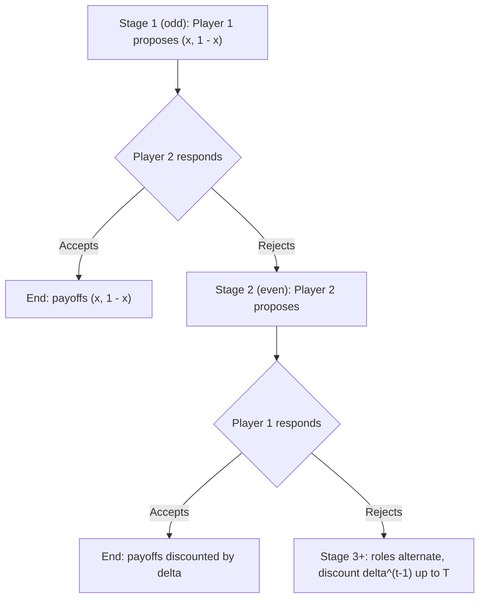
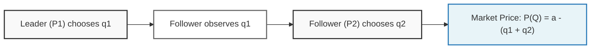
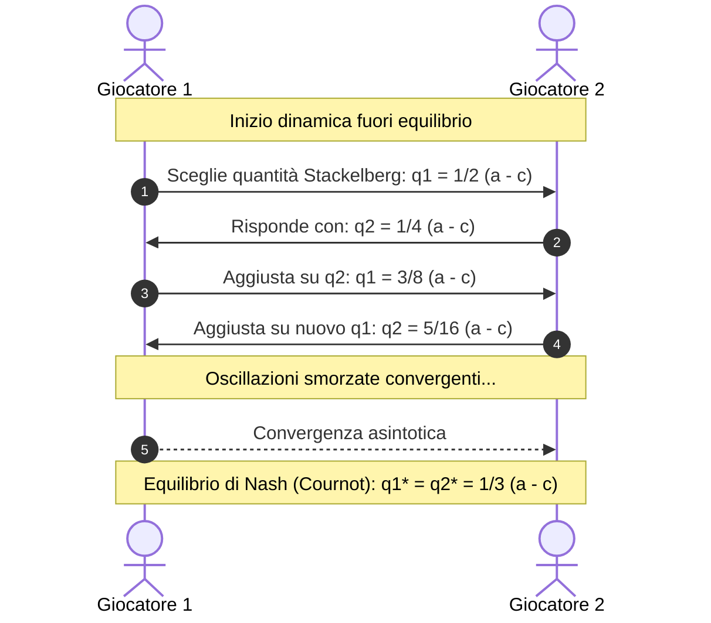
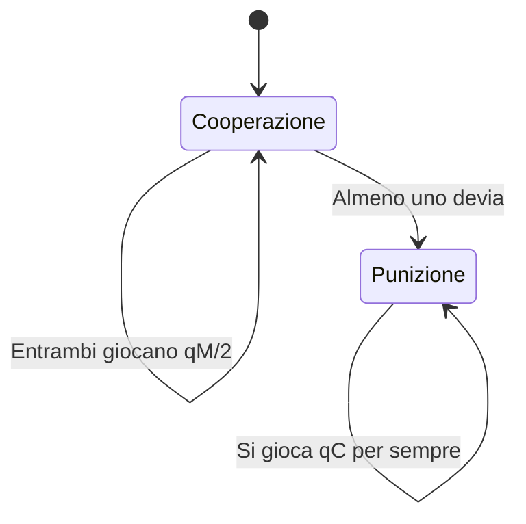

# Dynamic Games: Sequential Bargaining and Alternating-Offers Negotiation Models

## Didactic Overview

This lecture concludes the discussion of **dynamic games**, introducing the study of sequential bargaining (*Dynamic Bargaining*) for the strategic division of a shared resource (a problem commonly known as *pie-splitting*).

The key concepts introduced include:
* **Axiomatic vs. Strategic Approach**: Critical analysis of Nash's axiomatic bargaining (*Nash Bargaining Solution*). Although historically significant, Nash's approach is not strictly non-cooperative/game-theoretic (*non-game-theoretic*), as it derives the optimal division by imposing a set of normative axioms a priori rather than deriving it from the strategic and self-interested choices of individual agents.
* **Dynamic Extension of the Ultimatum Game**: Formulation of negotiation as a multi-stage turn-taking process. At each stage, one player proposes a partition $(x, 1-x)$ of the unit resource and the other can accept or reject; in case of rejection, the roles reverse in the next stage (*alternating offers*).
* **Discount Factor and Time Horizon**: Modeling time constraints through a finite horizon with a deadline and introducing the discount factor ($\delta$). The temporal decay of the negotiated value formalizes the principle of "time as a cost" (perishability of the good or loss of utility), strategically incentivizing reaching an agreement in the early stages of the game.

---

### Organizational Announcements

Before starting the theoretical explanation, a few practical points regarding the course schedule are set out:

* **Syllabus progress:** This is the last theoretical lecture on *Dynamic Games*. Starting next Monday, the final chapter on *Bayesian Games* will begin.
* **Exercises:** The exercises on dynamic games are already available online; solutions will be published by Wednesday, the day when the exercises will be solved in class (to leave time to try them independently).
* **December lecture schedule:**
  * During the week of December 8, the lecturer will be abroad: Monday, December 7 (a public holiday, though the university is open) and Wednesday, December 9 will be held online (Wednesday's lecture will probably be asynchronous via uploaded videos, depending on time zone compatibility).
  * Monday, December 14 will also be online as scheduled: there will therefore be three consecutive online lectures.
  * After the in-person lecture on December 2 (or in any case after December 3), there will be no more physical classes in the classroom; December 16 might be replaced by a final seminar.
* **Project and pre-examination:** On December 23, the pre-examination will take place. To take the exam, it is mandatory to also submit the project: the deadline is set for the end of January for those intending to take the exam in the January/February session, while it can be postponed for those taking it in June.

---

### Dynamic Bargaining

**Dynamic Bargaining** extends the concepts of continuity and time consistency to one of the most classic problems: negotiating the division of a resource between two parties. For simplicity, we normalize the total value of the resource (a "pie") to $1$: if one player gets a fraction $x \in [0,1]$, the other will receive the remaining part $1 - x$.

#### Axiomatic Approach vs. Strategic Approach

A very well-known way to solve this problem is **Nash Bargaining**. However, surprisingly, *Nash Bargaining* **does not belong to game theory**:

* **Axiomatic approach (*Nash Bargaining*):** One establishes certain mathematical axioms deemed "reasonable" regarding what makes a division fair and, from these, logically deduces the unique valid division rule. There is no strategic conflict: it is assumed a priori that a good rule exists and one follows it.
* **Game-theoretic approach:** There is a real strategic tension, in which each player wants to maximize their own personal utility.

To model a real negotiation—just as happens in Eastern markets, where the seller starts from a very high price, the buyer counters with a very low figure, and they continue making counter-offers until an agreement is reached—it is necessary to transform the division into a **dynamic game**.

#### Formulation of the Alternating-Offers Game

The reference model is an iterated version of the **Ultimatum Game** with a role reversal between **Proposer** and **Responder**:

* **Stage 1 (and all odd stages):** Player 1 proposes a division $(x, 1-x)$. Player 2 can accept or reject.
* **If Player 2 accepts:** The game ends immediately with the respective payoffs.
* **If Player 2 rejects:** The game does not end, but moves to **Stage 2 (and in general to even stages)** with reversed roles: now Player 2 proposes a split and Player 1 decides whether to accept or reject.



Two fundamental economic assumptions are added to this structure:

1. **Finite deadline $T$:** As in a fish market, if an agreement is not reached by stage $T$, the goods rot and no one gets anything (payoff $(0, 0)$).
2. **Discount factor $\delta \in (0, 1)$:** Time is costly (prices rise, goods deteriorate). Reaching an agreement at a later stage $t$ reduces the effective value of the resource by a factor $\delta^{t-1}$. If the agreement occurs at stage $1$, the utilities are $(x, 1-x)$; if it occurs at stage $t$, the discounted utilities are multiplied by $\delta^{t-1}$.

#### Base Case ($T = 1$): The Ultimatum Game

If we set the deadline to $T = 1$, we obtain exactly the Ultimatum Game: if Player 2 rejects Player 1's only offer, both obtain $0$.

> **Key Concept — Nash Equilibrium vs Subgame Perfect Equilibrium:**
> In the Ultimatum Game there exist **infinitely many Nash Equilibria**: any pair in which Player 1 proposes $x$ and Player 2 adopts the strategy of accepting $1-x$ (or more) is a Nash equilibrium, because neither player has an incentive to deviate unilaterally.
> However, there exists **only one Subgame Perfect Equilibrium (SPE)**: knowing that the responder moves afterward, Player 1 proposes $(1, 0)$ keeping everything for themselves, and Player 2 accepts $0$. This solution relies on the convention that, in case of indifference (by rejecting, Player 2 would still obtain $0$, and thus would not improve their payoff), the player does not make a profitless deviation.

#### Resolution with Finite Horizon (odd $T$)

Strictly speaking, this is not a classic game for pure **Backward Induction**, because we do not know whether we will actually reach stage $T$ (the game can end earlier). However, we can apply **Sequential Rationality** starting from the last possible phase.

Suppose the deadline $T$ is an **odd** number:

1. **At the last stage $T$:** It is Player 1's turn to propose. As in the Ultimatum Game, Player 1 will propose keeping everything for themselves, $(1, 0)$, and Player 2 will accept. Since we are at stage $T$, the discounted utility at stage 1 for Player 1 will be $\delta^{T-1}$, while for Player 2 it will be $0$.
2. **At the penultimate stage $T - 1$:** It is Player 2's turn to propose. Player 2 knows that, if the game reached $T$, they would get $0$; on the other hand, Player 1 knows that by rejecting at $T-1$ they can secure $\delta^{T-1}$ at the next stage.
   * Player 2 can therefore make a smart offer at stage $T-1$: if they offer Player 1 a fraction $\delta$ of the pie available at $T-1$, the discounted value received by Player 1 will be $\delta \cdot \delta^{T-2} = \delta^{T-1}$.
   * Since this is exactly equal to what Player 1 would get by waiting for stage $T$, Player 1 accepts, and Player 2 manages to keep the remaining part $(1 - \delta)\delta^{T-2} > 0$ for themselves (they will not give any "gift," offering only the bare minimum necessary).
3. **Iterating the reasoning back to stage 1:** Each player anticipates future moves and immediately offers the opponent the discounted equivalent of what the opponent would obtain at the next stage. Consequently, at **stage 1**, Player 1 proposes for themselves:
   $$x_1 = \frac{1 + \delta^T}{1 + \delta}$$
   leaving Player 2 with the complementary share:
   $$1 - x_1 = \frac{\delta - \delta^T}{1 + \delta}$$

*(Note: Step included for didactic clarity — To quickly verify the formula in the case $T=3$: at stage $3$ Player 1 gets $1$ (present value $\delta^2$); at stage $2$ Player 2 offers them $\delta$ (present value $\delta^2$) and keeps $1-\delta$ (present value $\delta - \delta^2$); at stage $1$ Player 1 offers exactly $\delta - \delta^2$ to Player 2 and keeps $1 - \delta + \delta^2$. Multiplying numerator and denominator by $1+\delta$, we obtain $\frac{(1-\delta+\delta^2)(1+\delta)}{1+\delta} = \frac{1+\delta^3}{1+\delta}$ for Player 1 and $\frac{(\delta-\delta^2)(1+\delta)}{1+\delta} = \frac{\delta-\delta^3}{1+\delta}$ for Player 2.)*

* **Proposition (Immediate agreement):** In the unique SPE of the game, the players reach an agreement already at the **first stage**.
* **Comparison with the Centipede Game:** In the *Centipede Game*, players exited immediately due to the alternation between self-interest and harming the other player; here, instead, immediate agreement benefits **both** players. After two rounds of rejections, the players find themselves in the exact same initial strategic situation, but with a smaller pie due to the discount $\delta$. There is therefore no point in delaying.

#### Extension to Infinite Horizon (No Deadline $T$)

What happens if we remove the deadline $T$, allowing negotiations to continue potentially forever?

* **The formal problem:** Since there is no last stage, we cannot mechanically apply *Backward Induction* starting from the end ("today is the last day, I know what to do").
* **The solution via Sequential Rationality:** We can still note that, if there exists an optimal strategy to be played from stage 3 onward, Player 1 can play it directly at stage 1, avoiding the discount $\delta^2$. Similarly, due to the perfect symmetry of the roles, the game starting at stage 2 is identical to the initial game with the players swapped.
* Letting $T \to \infty$ (since $\delta < 1$, we have $\delta^T \to 0$), the equilibrium payoffs converge to:
  $$\text{Payoff Giocatore 1} = \frac{1}{1 + \delta}, \qquad \text{Payoff Giocatore 2} = \frac{\delta}{1 + \delta}$$
* **Economic interpretation of $\delta$:**
  * If $\delta \to 1$ (no impatience or deterioration of the good), the split tends to $50/50$: $\left(\frac{1}{2}, \frac{1}{2}\right)$.
  * The lower $\delta$ is (the greater the impatience/devaluation), the larger Player 1's share becomes, as Player 1 benefits from the **first-mover advantage**.

#### Formal Proof of Equilibrium Uniqueness

> **Key Concept — Uniqueness is not guaranteed in infinite games:**
> In finite games, *Backward Induction* automatically guarantees both the existence and uniqueness of the SPE. In infinite-horizon games, constructing an SPE by intuition is relatively straightforward, but **formally proving that the equilibrium is unique** is much more subtle and non-trivial (a crucial aspect also when writing exam projects).

Since we cannot use backward induction, we prove uniqueness **by contradiction (*proof by contradiction*)**:

1. **Hypothesis for contradiction:** Suppose that *multiple* SPEs exist in the infinite version of the game. If at least two exist, we can define:
   * $B_1$ and $W_1$: respectively the best (*Best*) and worst (*Worst*) payoff obtainable by Player 1 in an SPE at stage 1.
   * $B_2$ and $W_2$: respectively the best and worst payoff obtainable by Player 2.
2. **Complementary relations at stage 1:** Since in equilibrium the agreement is reached at the first stage without discounting and Player 2 receives what remains of the pie, the best outcome for Player 1 coincides with the worst outcome for Player 2, and vice versa:
   $$W_2 = 1 - B_1, \qquad B_2 = 1 - W_1$$
3. **Discounting relations with respect to stage 2:** If the game proceeded to stage 2, the roles would reverse and Player 2 would become the proposer, finding themselves in the exact same position Player 1 was in at stage 1, but with all payoffs discounted by $\delta$. Therefore, the best and worst payoffs that Player 2 can guarantee by moving to stage 2 are the discounted version of $B_1$ and $W_1$:
   $$B_2 = \delta B_1, \qquad W_2 = \delta W_1$$
4. **Derivation of the contradiction:** Combining the relations found into a system (namely $1 - B_1 = \delta W_1$ and $1 - W_1 = \delta B_1$) and substituting, we obtain that, since $\delta < 1$, the two quantities collapse to the exact same value:
   $$B_1 = W_1 = (1 + \delta)^{-1} = \frac{1}{1 + \delta}$$

*(Note: Step integrated for pedagogical clarity — Substituting $W_1 = 1 - \delta B_1$ into the equation $B_1 = 1 - \delta W_1$ yields $B_1 = 1 - \delta(1 - \delta B_1) = 1 - \delta + \delta^2 B_1$, from which $B_1(1 - \delta^2) = 1 - \delta$. Since $1 - \delta^2 = (1 - \delta)(1 + \delta)$ and $\delta < 1$ implies $1 - \delta \neq 0$, we can simplify by dividing by $(1 - \delta)$, obtaining $B_1 = \frac{1}{1 + \delta}$ and, consequently, $W_1 = 1 - \frac{\delta}{1 + \delta} = \frac{1}{1 + \delta}$).*

Having assumed that $B_1$ and $W_1$ could be different leads us to prove that they are necessarily equal: the Subgame Perfect Equilibrium is therefore **unique**.

---

### The Stackelberg Duopoly

In the context of dynamic games applied to industrial organization, the Stackelberg duopoly model represents the sequential extension of the classic Cournot model. While in Cournot the two firms simultaneously decide the quantity to produce, in the Stackelberg scenario there is a natural temporal asymmetry:
1. **Player 1 (Leader):** chooses their production quantity $q_1$ first.
2. **Player 2 (Follower):** observes the decision made by the leader and subsequently chooses their own quantity $q_2$.

This setup faithfully models markets in which a dominant or historically established firm (incumbent) and a new entering competitor (newcomer) are present.



#### Market Model and Payoffs
Maintaining the same assumptions as in the Cournot duopoly:
- The inverse market demand function determines the selling price:
  $$P(Q) = a - Q = a - (q_1 + q_2)$$
  with reservation parameter $a > 0$.
- The production cost is linear and identical for both firms, with constant marginal cost $c$ (where $a > c$):
  $$C(q_i) = c \cdot q_i \quad \text{per } i \in \{1, 2\}$$
- The profit (utility function) of each player corresponds to:
  $$U_i(q_1, q_2) = (P(Q) - c)q_i = (a - q_1 - q_2 - c)q_i$$

---

### Backward Induction

The game is solved via backward induction (*backward induction*), first computing the follower's optimal move at the second stage and then substituting it into the leader's maximization problem at the first stage.

#### 1. Follower Optimization (Player 2)
At the second stage, the quantity produced by the leader $q_1$ is already known and represents an exogenous parameter. The follower's problem reduces to a single-variable maximization:
$$\max_{q_2} U_2(q_1, q_2) = \max_{q_2} (a - q_1 - q_2 - c)q_2$$

Computing the first derivative with respect to $q_2$ and setting it equal to zero:
$$\frac{\partial U_2}{\partial q_2} = a - q_1 - 2q_2 - c = 0$$

From which we obtain the follower's best response function (*best response*):
$$R_2(q_1) = q_2^*(q_1) = \frac{a - q_1 - c}{2}$$

> **Pedagogical Note:** This function coincides with the best response computed in Cournot. If the leader decided to produce nothing ($q_1 = 0$), the follower would be in a pure monopoly condition, producing the standard monopoly quantity $q_M = \frac{a - c}{2}$.

#### 2. Leader Optimization (Player 1)
Since the leader is a rational agent and knows that the follower will also act rationally, they can perfectly anticipate the follower's response. Instead of treating $q_2$ as an unknown independent variable, the leader directly substitutes the deterministic expression of $R_2(q_1)$ into their own profit function:

$$U_1(q_1, R_2(q_1)) = \left( a - q_1 - \left(\frac{a - q_1 - c}{2}\right) - c \right) q_1$$

Simplifying the terms inside the parentheses:
$$a - q_1 - \frac{a - q_1 - c}{2} - c = \frac{2a - 2q_1 - a + q_1 + c - 2c}{2} = \frac{a - q_1 - c}{2}$$

The profit maximization problem for the leader becomes:
$$\max_{q_1} U_1(q_1) = \max_{q_1} \frac{(a - c - q_1)q_1}{2} = \max_{q_1} \frac{1}{2}\left((a - c)q_1 - q_1^2\right)$$

Computing the first derivative with respect to $q_1$ and setting it to zero:
$$\frac{dU_1}{dq_1} = \frac{1}{2}(a - c - 2q_1) = 0 \implies q_1^* = \frac{a - c}{2}$$

#### 3. Equilibrium Calculation
Substituting the leader's optimal quantity $q_1^*$ into the follower's reaction function:
$$q_2^* = R_2(q_1^*) = \frac{a - \left(\frac{a - c}{2}\right) - c}{2} = \frac{\frac{a - c}{2}}{2} = \frac{a - c}{4}$$

Summary of equilibrium quantities:
$$q_1^* = \frac{a - c}{2}, \qquad q_2^* = \frac{a - c}{4}$$
The aggregate market output is equal to:
$$Q^* = q_1^* + q_2^* = \frac{a - c}{2} + \frac{a - c}{4} = \frac{3(a - c)}{4}$$

Comparison with the simultaneous symmetric Cournot equilibrium (where $q_1^C = q_2^C = \frac{a - c}{3}$ and $Q^C = \frac{2(a - c)}{3}$):
- The leader produces more than in Cournot: $\frac{a - c}{2} > \frac{a - c}{3}$.
- The follower produces less than in Cournot: $\frac{a - c}{4} < \frac{a - c}{3}$.
- Total market quantity is higher ($Q^* > Q^C$), leading to a lower market price and a higher consumer surplus.

---

### Non-Credible Threats

The follower sees their profit reduced compared to the Cournot equilibrium. They might therefore want to threaten the leader:
> *"If you produce the Stackelberg quantity $q_1 = \frac{a-c}{2}$, I will produce an enormous quantity to flood the market, wiping out your profits. You are better off producing the Cournot share $q_1 = \frac{a-c}{3}$."*

However, within the model:
1. **Absence of binding communication:** This interaction is not based on contracts or binding agreements.
2. **Non-credible threat:** If the leader nevertheless chooses $q_1 = \frac{a-c}{2}$, carrying out the promised punishment would require the follower to deviate from their own best response $R_2(q_1) = \frac{a-c}{4}$. Unilaterally increasing production would heavily harm the follower themselves.
3. Since the leader knows that the follower is a strictly rational agent focused on maximizing their own profit, they will ignore any threat that does not constitute a *best response* in the second stage.

---

### The Information Paradox and the First-Mover Advantage

In classical decision-making or single-agent optimization problems (e.g., machine learning or statistical estimation), a larger information set always guarantees equal or better choices. In game theory, this principle can break down drastically.

> **Key Concept: Information Paradox**
> Having more information can worsen a player's payoff **when the other players are aware that they possess that information**.

In the sequential duopoly:
- The follower has an informational advantage: they act knowing the leader's move.
- However, the leader strategically exploits this awareness: knowing that the follower will observe their choice and respond rationally along their reaction curve, the leader forces the follower to scale back.
- In this competitive context, the advantage of information flips in favor of the first player: the so-called **First-Mover Advantage** is realized.

An intuitive analogy is offered by the three-way duel paradox (*Mexican Standoff*): the most skilled shooter is often targeted and taken down first by the other contenders precisely because their superiority is known to everyone, reducing their overall survival probabilities compared to less accurate shooters.

#### Application to Distributed and Telecommunication Systems
This paradox has strong implications in engineering design (e.g., wireless networks, distributed resource allocation). 
Distributed systems are often formalized as static complete-information games, in which the lack of cooperation leads to suboptimal outcomes (the *Tragedy of the Commons*).

Transforming the protocol into a Stackelberg dynamic can improve overall performance compared to a simultaneous Nash equilibrium. However, to implement a Stackelberg dynamic:
- The leader must reliably communicate their decision;
- The other nodes must wait for and process that information.

If the communication channel requires high *signaling* overhead to synchronize the sequence of moves, the gain obtained from the sequential setup can be completely offset by the bandwidth cost required to implement it.

---

### Lack of Information and *Fictitious Play* Dynamics

What happens if the follower refuses to observe the leader's move (applying the principle according to which *"ignorance is an advantage"*)?

If the follower does not listen and continues to produce blindly $q_2 = \frac{a - c}{4}$, the leader discovers that producing $q_1 = \frac{a - c}{2}$ is not the best response to $q_2$:
- The best response to $q_2 = \frac{a - c}{4}$ for Player 1 is calculated using its reaction function:
  $$R_1(q_2) = \frac{a - q_2 - c}{2} = \frac{a - \left(\frac{a - c}{4}\right) - c}{2} = \frac{3}{8}(a - c)$$
- Note that $\frac{3}{8}(a - c) = 0.375(a - c)$, a value lower than the leader's initial quantity $\frac{1}{2}(a - c) = 0.5(a - c)$, but higher than the Cournot quantity $\frac{1}{3}(a - c) \approx 0.333(a - c)$.

If both players recursively adjust their output choices by picking at each step the best response to the opponent's previous move, a dynamic process known as ***Fictitious Play*** (or iterated best response dynamics) is triggered.



1. Player 1 starts from $q_1^{(0)} = \frac{1}{2}(a-c)$.
2. Player 2 responds with $q_2^{(1)} = R_2(q_1^{(0)}) = \frac{1}{4}(a-c)$.
3. Player 1 recalculates $q_1^{(1)} = R_1(q_2^{(1)}) = \frac{3}{8}(a-c)$.
4. Player 2 updates $q_2^{(2)} = R_2(q_1^{(1)}) = \frac{1}{2}\left(a - c - \frac{3}{8}(a-c)\right) = \frac{5}{16}(a-c) \approx 0.3125(a-c)$.

The quantities oscillate progressively with decreasing amplitude around the symmetric Cournot value. Since the best-response mapping is a contraction for this market game with strictly concave utilities, the process converges to the unique mutually consistent fixed point: the **simultaneous symmetric Cournot Nash Equilibrium**:
$$q_1^\infty = q_2^\infty = \frac{a - c}{3}$$

In conclusion, denying access to information or ignoring the sequential announcement effectively transforms the dynamic game into the original static simultaneous game.

---

### Collusion in the Repeated Cournot Duopoly

In the classic static **Cournot Duopoly** model, two firms compete by simultaneously choosing the quantities to produce. Assuming a linear inverse demand function $P(Q) = a - bQ$ (with $b=1$ for simplicity) and constant marginal costs $c$, the Cournot equilibrium quantity for each firm is:

$$q_C = \frac{a - c}{3}$$

Total market production is equal to:

$$Q_C = 2 q_C = \frac{2}{3}(a - c)$$

If the two firms formed a cartel behaving like a shared monopolist, the overall optimal quantity would be the monopoly quantity $q_M$:

$$q_M = \frac{a - c}{2}$$

In this case, dividing production equally, each firm would produce:

$$\frac{q_M}{2} = \frac{a - c}{4}$$

Note that $\frac{a-c}{2} < \frac{2}{3}(a-c)$: by reducing total production, the market price increases to the point of guaranteeing both firms a joint profit strictly higher than in the Cournot equilibrium.

```
       Produzione Totale:  Monopolio (Collusione)  <  Duopolio di Cournot
                               (a - c) / 2         <       2/3 (a - c)
       Profitti Totali:    Monopolio (Collusione)  >  Duopolio di Cournot
```

#### The Dilemma in the Static Game

Although the collusive outcome $\left(\frac{q_M}{2}, \frac{q_M}{2}\right)$ is Pareto-superior, it is **not sustainable** in the *one-shot* (single-stage) game. 
The quantity $\frac{q_M}{2}$ does not represent a best response to the opponent's choice $\frac{q_M}{2}$. Each firm faces a strong incentive for unilateral deviation: betraying the agreement and producing a larger quantity instantly increases its own profit at the expense of the other competitor. 

The unique static Nash Equilibrium is the pair $(q_C, q_C)$, exactly like mutual defection in the Prisoner's Dilemma.

---

### Sustainability of Collusion with an Infinite Horizon

If the game is repeated for an infinite number of stages (or with a constant probability of continuation), **Friedman's Theorem** (or Folk Theorem for repeated games) shows that cooperation can spontaneously emerge as a subgame perfect equilibrium (**SPNE** - *Subgame Perfect Nash Equilibrium*), provided that the discount factor $\delta \in (0, 1)$ is sufficiently close to $1$.

#### Grim Trigger Strategy

To sustain collusive production $\frac{q_M}{2}$, the *Grim Trigger* strategy is defined:

1. **Stage 1**: Produce $\frac{q_M}{2}$.
2. **Stage $t$**: If in all previous stages both players produced $\frac{q_M}{2}$, produce $\frac{q_M}{2}$. Otherwise, if even a single deviation occurred, produce the Cournot quantity $q_C$ forever (*eternal punishment*).



Since the punishment phase involves repeating the static Nash equilibrium $(q_C, q_C)$ ad infinitum, the threat is intrinsically credible in every subgame off the equilibrium path.

---

### Non-Deviation Condition: Calculation of the Threshold $\delta$

Let us analyze the incentive to carry out a myopic deviation at time $t = 0$.

1. **Myopic deviation**: Knowing that the competitor produces $q_1 = \frac{q_M}{2} = \frac{a-c}{4}$, player 2's best response is calculated by maximizing their own profit:
   $$\max_{q_2} \pi_2\left(\frac{a-c}{4}, q_2\right) = \left[a - \left(\frac{a-c}{4} + q_2\right) - c\right] q_2$$
   Differentiating with respect to $q_2$ and setting equal to zero:
   $$q_{\text{dev}} = \frac{3}{8}(a - c)$$
   
   This yields an immediate deviation profit equal to $U_D = \frac{9}{64}(a-c)^2$.

2. **Comparison between intertemporal payoffs**:
   * **If they cooperate forever**: They obtain half of the monopoly profit $U_M = \frac{1}{8}(a-c)^2$ in every period:
     $$V_{\text{coop}} = \sum_{t=0}^{\infty} \delta^t U_M = \frac{U_M}{1 - \delta}$$
   * **If they deviate**: They obtain $U_D$ immediately, but from the next period onward they suffer relentless punishment, obtaining the Cournot profit $U_C = \frac{1}{9}(a-c)^2$:
     $$V_{\text{dev}} = U_D + \sum_{t=1}^{\infty} \delta^t U_C = U_D + \frac{\delta}{1 - \delta} U_C$$

For cooperation to be sustainable, the non-deviation condition $V_{\text{coop}} \ge V_{\text{dev}}$ must hold:

$$\frac{U_M}{1 - \delta} \ge U_D + \frac{\delta}{1 - \delta} U_C$$

Substituting the payoffs:

$$\frac{1}{8(1 - \delta)} \ge \frac{9}{64} + \frac{\delta}{9(1 - \delta)}$$

Solving the inequality with respect to $\delta$:

$$\delta \ge \frac{9}{17} \approx 0.529$$

> **Key Concept**: If firms value the future sufficiently ($\delta \ge \frac{9}{17}$), the immediate gain obtained from betrayal does not compensate for the future losses resulting from the price war (return to the Cournot equilibrium). Monopoly collusion is fully sustainable.

---

### Partial Collusion and More Severe Punishments

What happens if firms are more impatient, that is, if $\delta < \frac{9}{17}$?

#### 1. Partial Collusion ($q^*$)
Unlike the Prisoner's Dilemma (where actions are discrete: cooperate or defect), in Cournot the action space is continuous ($q \in \mathbb{R}^+$).
If $\delta < \frac{9}{17}$, it is not possible to sustain the monopoly quantity $q_M/2$, but firms can agree on a less ambitious intermediate target $q^* \in \left(\frac{q_M}{2}, q_C\right)$.
* If $\delta \ge \frac{9}{17}$, $q^* = \frac{q_M}{2}$ is sustained.
* If $\delta \to 0$, the only sustainable quantity converges to the Cournot quantity $q^* \to q_C$.

#### 2. More Severe Punishments: "Carrot and Stick"
To make optimal collusion sustainable even with $\delta < \frac{9}{17}$, it is possible to design a punishment mechanism that is more severe than simply returning to $q_C$.
* A threat such as *"if you cheat I will produce an infinite quantity"* is not credible (it would irrationally punish the one executing it).
* However, it is possible to establish a transitory phase of punitive overproduction, for example by temporarily producing:
  $$q_P = \frac{2}{5}(a - c) = 0.4(a - c) > q_C \approx 0.333(a - c)$$
  By increasing the severity of the "stick" without violating the subgame credibility constraints, the sustainability range of the agreement is widened, supporting collusion even for lower values such as $\delta = \frac{1}{2} = 0.5$.

---

### Antitrust Implications: Tacit Collusion

This theoretical result has significant legal and economic consequences for regulatory and competition authorities (Antitrust):

* **Tacit Collusion**: Companies do not need to meet physically in secret or sign formal contracts to create a cartel.
* **Rational Coordination**: Operating repeatedly in the same market, rational actors autonomously recognize the long-term incentive structure. Price stability or output limitation emerges spontaneously as an effect of the extended time horizon.
* **Antitrust Intervention**: Competition authorities can sanction coordinated parallel behaviors and concerted practices even in the absence of documentary evidence of explicit meetings or agreements, since the economic harm borne by consumers is identical to that of a formal cartel.

---

> [!NOTE]
> ### Exam Notes and Instructor Announcements
> - The preliminary exam (pre-examination) is scheduled for December 23.
> - To take the exam it is mandatory to submit a project: the ideal deadline is the end of January for those intending to take the exam in January or February, while it can be postponed in the case of a June exam.