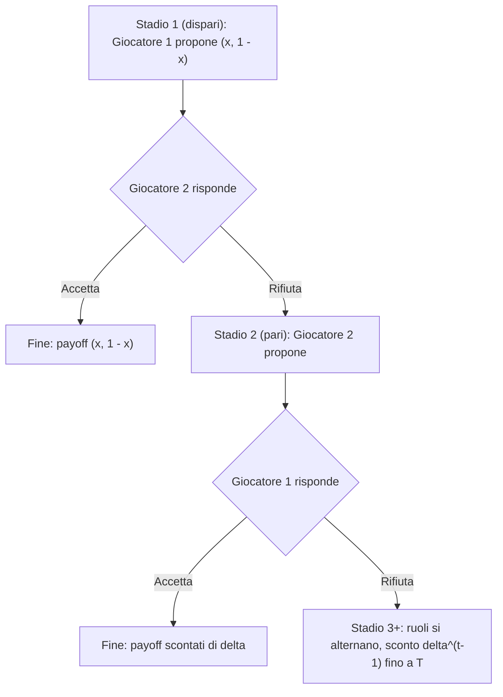
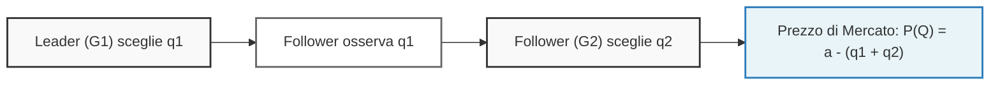
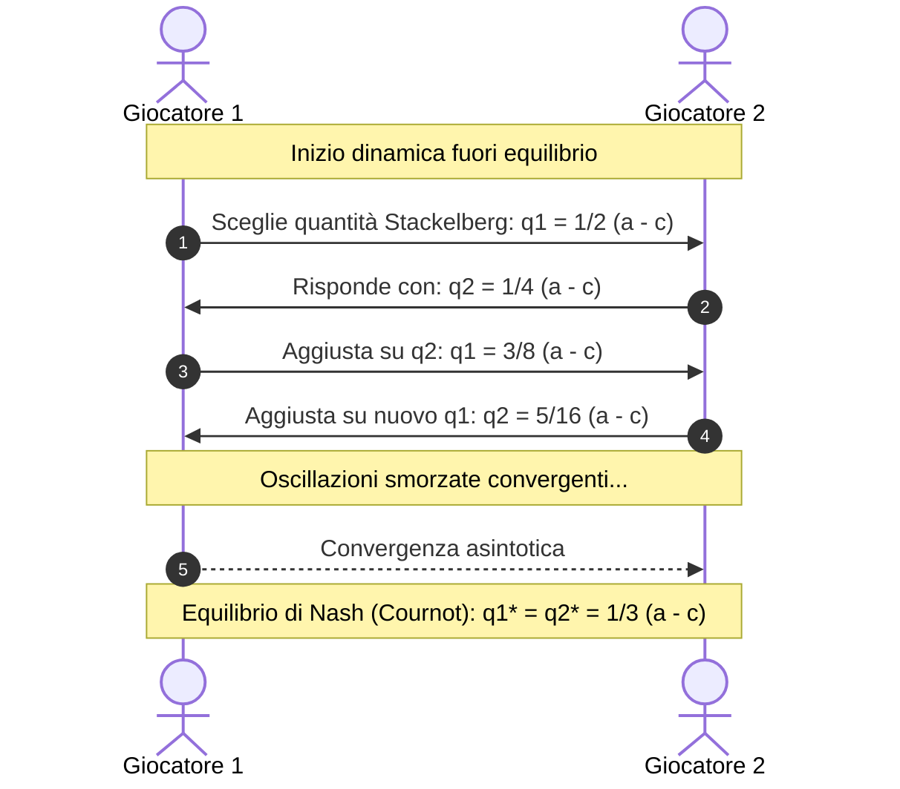
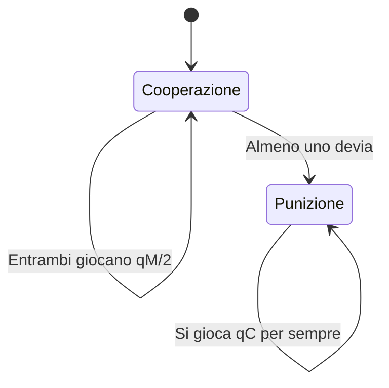

# Giochi Dinamici: Contrattazione Sequenziale e Modelli di Negoziazione ad Offerte Alternate

## Overview Didattica

La lezione conclude la trattazione dei **giochi dinamici** (*Dynamic Games*), introducendo lo studio della contrattazione sequenziale (*Dynamic Bargaining*) per la ripartizione strategica di una risorsa condivisa (problema comunemente noto come *pie-splitting*). 

I concetti chiave introdotti includono:
* **Approccio Assiomatico vs. Approccio Strategico**: Analisi critica della contrattazione assiomatica di Nash (*Nash Bargaining Solution*). Sebbene storicamente rilevante, l'approccio di Nash non è strettamente non-cooperativo/teorico dei giochi (*non-game theoretic*), poiché deduce la divisione ottimale imponendo a priori un insieme di assiomi normativi anziché derivarla dalle scelte strategiche ed egoistiche dei singoli agenti.
* **Estensione Dinamica dell'Ultimatum Game**: Formulazione della negoziazione come un processo a turni alterni su più stadi. A ogni stadio, un giocatore propone una partizione $(x, 1-x)$ della risorsa unitaria e l'altro può accettare o rifiutare; in caso di rifiuto, i ruoli si invertono nello stadio successivo (*alternating offers*).
* **Fattore di Sconto e Orizzonte Temporale**: Modellazione dei vincoli temporali tramite orizzonte finito con scadenza (*deadline*) e introduzione del fattore di sconto (*Discount Factor* $\delta$). Il decadimento temporale del valore negoziato formalizza il principio del "tempo come costo" (deperibilità del bene o perdita di utilità), incentivando strategicamente il raggiungimento di un accordo nei primi stadi del gioco.

---

### Annunci Organizzativi

Prima di iniziare la spiegazione teorica, vengono fissati alcuni punti pratici sull'andamento del corso:

* **Avanzamento del programma:** Questa è l'ultima lezione teorica sui *Giochi Dinamici (Dynamic Games)*. A partire dal lunedì successivo inizierà il capitolo finale sui *Giochi Bayesiani (Bayesian Games)*.
* **Esercitazioni:** Gli esercizi sui giochi dinamici sono già disponibili online; le soluzioni verranno pubblicate entro mercoledì, giorno in cui gli esercizi saranno risolti in aula (in modo da lasciare tempo per provarci autonomamente).
* **Calendario delle lezioni di dicembre:**
  * Nella settimana dell'8 dicembre il docente sarà all'estero: lunedì 7 dicembre (festivo, ma ateneo aperto) e mercoledì 9 dicembre si terranno online (quella di mercoledì probabilmente in modalità asincrona tramite video caricati, salvo compatibilità con il fuso orario).
  * Anche lunedì 14 dicembre sarà online come da programma: ci saranno quindi tre lezioni online consecutive.
  * Dopo la lezione in presenza del 2 dicembre (o comunque dopo il 3 dicembre), non ci saranno più lezioni fisiche in aula; il 16 dicembre potrebbe essere sostituito da un seminario finale.
* **Progetto e pre-appello:** Il 23 dicembre si terrà il pre-appello (*pre-examination*). Per sostenere l'esame è obbligatorio consegnare anche il progetto: la scadenza è fissata a fine gennaio per chi intende sostenere l'esame nella sessione di gennaio/febbraio, mentre può essere posticipata per chi si presenterà a giugno.

---

### Contrattazione Dinamica (*Dynamic Bargaining*)

La **Contrattazione Dinamica (*Dynamic Bargaining*)** estende i concetti di continuità e coerenza temporale (*time consistency*) a uno dei problemi più classici: negoziare la spartizione di una risorsa tra due soggetti. Per semplicità, normalizziamo il valore totale della risorsa (una "torta") a $1$: se un giocatore ottiene una frazione $x \in [0,1]$, l'altro riceverà la parte restante $1 - x$.

#### Approccio Assiomatico vs Approccio Strategico

Un modo molto noto per risolvere questo problema è la **Contrattazione di Nash (*Nash Bargaining*)**. Tuttavia, sorprendentemente, la *Nash Bargaining* **non appartiene alla teoria dei giochi**:

* **Approccio assiomatico (*Nash Bargaining*):** Si fissano alcuni assiomi matematici ritenuti "ragionevoli" su cosa renda giusta una spartizione e, da questi, si deduce logicamente l'unica regola di divisione valida. Non c'è conflitto strategico: si assume a priori che esista una buona regola e la si segue.
* **Approccio di teoria dei giochi:** Esiste una tensione strategica reale, in cui ciascun giocatore vuole massimizzare la propria utilità personale.

Per modellare una vera trattativa — esattamente come accade nei mercati orientali, dove il venditore parte da un prezzo altissimo, il compratore rilancia con una cifra bassissima e si continua a contro-proporre fino all'accordo — occorre trasformare la spartizione in un **gioco dinamico**.

#### Formulazione del Gioco a Offerte Alternate

Il modello di riferimento è una versione iterata del **Gioco dell'Ultimatum (*Ultimatum Game*)** con scambio dei ruoli tra **Proponente (*Proposer*)** e **Rispondente (*Responder*)**:

* **Stadio 1 (e tutti gli stadi dispari):** Il Giocatore 1 propone una divisione $(x, 1-x)$. Il Giocatore 2 può accettare o rifiutare.
* **Se il Giocatore 2 accetta:** Il gioco termina immediatamente con i rispettivi payoff.
* **Se il Giocatore 2 rifiuta:** Il gioco non finisce, ma passa allo **Stadio 2 (e in generale agli stadi pari)** a ruoli invertiti: ora è il Giocatore 2 a proporre una spartizione e il Giocatore 1 a decidere se accettare o rifiutare.



A questa struttura si aggiungono due ipotesi economiche fondamentali:

1. **Scadenza finita (*Deadline*) $T$:** Come in un mercato del pesce, se non si raggiunge un accordo entro lo stadio $T$, la merce marcisce e nessuno ottiene nulla (payoff $(0, 0)$).
2. **Fattore di sconto (*Discount Factor*) $\delta \in (0, 1)$:** Il tempo costa (i prezzi salgono, la merce si deteriora). Raggiungere un accordo in uno stadio successivo $t$ riduce il valore effettivo della risorsa di un fattore $\delta^{t-1}$. Se l'accordo avviene allo stadio $1$, le utilità sono $(x, 1-x)$; se avviene allo stadio $t$, le utilità attualizzate sono moltiplicate per $\delta^{t-1}$.

#### Caso Base ($T = 1$): Il Gioco dell'Ultimatum

Se poniamo la scadenza a $T = 1$, otteniamo esattamente il Gioco dell'Ultimatum: se il Giocatore 2 rifiuta l'unica offerta del Giocatore 1, entrambi ottengono $0$.

> **Concetto Chiave — Equilibrio di Nash vs Equilibrio Perfetto nei Sottogiochi:**
> Nel Gioco dell'Ultimatum esistono **infiniti Equilibri di Nash (*Nash Equilibria*)**: qualunque coppia in cui il Giocatore 1 propone $x$ e il Giocatore 2 adotta la strategia di accettare $1-x$ (o più) è un equilibrio di Nash, perché nessuno dei due ha incentivo a deviare unilateralmente.
> Tuttavia, esiste **un solo Equilibrio Perfetto nei Sottogiochi (*Subgame Perfect Equilibrium*, SPE)**: sapendo che il rispondente muove dopo, il Giocatore 1 propone $(1, 0)$ tenendo tutto per sé, e il Giocatore 2 accetta $0$. Questa soluzione si regge sulla convenzione per cui, in caso di indifferenza (rifiutando il Giocatore 2 otterrebbe comunque $0$, quindi non migliorerebbe il proprio payoff), il giocatore non effettua una deviazione priva di guadagno.

#### Risoluzione con Orizzonte Finito ($T$ dispari)

A rigore, questo non è un gioco classico per l'**Induzione a Retroso (*Backward Induction*)** pura, perché non sappiamo se arriveremo davvero allo stadio $T$ (il gioco può terminare prima). Tuttavia, possiamo applicare la **Razionalità Sequenziale (*Sequential Rationality*)** partendo dall'ultima fase possibile.

Supponiamo che la scadenza $T$ sia un numero **dispari**:

1. **All'ultimo stadio $T$:** Tocca al Giocatore 1 proporre. Come nell'Ultimatum Game, proporrà di tenere tutto per sé, $(1, 0)$, e il Giocatore 2 accetterà. Poiché siamo allo stadio $T$, l'utilità attualizzata allo stadio 1 per il Giocatore 1 sarà $\delta^{T-1}$, mentre per il Giocatore 2 sarà $0$.
2. **Al penultimo stadio $T - 1$:** Tocca al Giocatore 2 proporre. Il Giocatore 2 sa che, se si arrivasse a $T$, prenderebbe $0$; d'altro canto, il Giocatore 1 sa che rifiutando a $T-1$ può garantirsi $\delta^{T-1}$ allo stadio successivo.
   * Il Giocatore 2 può quindi fare un'offerta intelligente allo stadio $T-1$: se offre al Giocatore 1 una frazione $\delta$ della torta disponibile in $T-1$, il valore attualizzato ricevuto dal Giocatore 1 sarà $\delta \cdot \delta^{T-2} = \delta^{T-1}$.
   * Essendo esattamente uguale a quanto otterrebbe aspettando lo stadio $T$, il Giocatore 1 accetta, e il Giocatore 2 riesce a trattenere per sé la parte restante $(1 - \delta)\delta^{T-2} > 0$ (non farà alcun "regalo", offrendo esattamente il minimo indispensabile).
3. **Iterando il ragionamento fino allo stadio 1:** Ogni giocatore anticipa le mosse future e offre subito all'avversario l'equivalente attualizzato di ciò che quest'ultimo otterrebbe nello stadio successivo. Di conseguenza, allo **stadio 1**, il Giocatore 1 propone per sé:
   $$x_1 = \frac{1 + \delta^T}{1 + \delta}$$
   lasciando al Giocatore 2 la quota complementare:
   $$1 - x_1 = \frac{\delta - \delta^T}{1 + \delta}$$

*(Nota: Passaggio integrato con chiarezza didattica — Per verificare rapidamente la formula nel caso $T=3$: allo stadio $3$ il Giocatore 1 ottiene $1$ (valore attuale $\delta^2$); allo stadio $2$ il Giocatore 2 gli offre $\delta$ (valore attuale $\delta^2$) e tiene $1-\delta$ (valore attuale $\delta - \delta^2$); allo stadio $1$ il Giocatore 1 offre esattamente $\delta - \delta^2$ al Giocatore 2 e tiene $1 - \delta + \delta^2$. Moltiplicando numeratore e denominatore per $1+\delta$, otteniamo $\frac{(1-\delta+\delta^2)(1+\delta)}{1+\delta} = \frac{1+\delta^3}{1+\delta}$ per il Giocatore 1 e $\frac{(\delta-\delta^2)(1+\delta)}{1+\delta} = \frac{\delta-\delta^3}{1+\delta}$ per il Giocatore 2).*

* **Proposizione (Accordo immediato):** Nell'unico SPE del gioco, i giocatori raggiungono l'accordo già al **primo stadio**.
* **Confronto con il Gioco del Centipede (*Centipede Game*):** Nel *Centipede Game* i giocatori uscivano subito per l'alternanza tra convenienza propria e danno altrui; qui invece l'accordo immediato conviene a **entrambi** i giocatori. Dopo due turni di rifiuti ci si ritrova esattamente nella stessa situazione strategica iniziale, ma con una torta più piccola a causa dello sconto $\delta$. Non ha quindi senso ritardare.

#### Estensione a Orizzonte Infinito (Nessuna Scadenza $T$)

Cosa succede se eliminiamo la scadenza $T$, permettendo alle trattative di continuare potenzialmente all'infinito?

* **Il problema formale:** Non essendoci un ultimo stadio, non possiamo applicare meccanicamente la *Backward Induction* partendo dalla fine ("oggi è l'ultimo giorno, so cosa fare").
* **La soluzione tramite Razionalità Sequenziale:** Possiamo comunque notare che, se esiste una strategia ottima da giocare dallo stadio 3 in poi, il Giocatore 1 può giocarla direttamente allo stadio 1 evitando lo sconto $\delta^2$. Allo stesso modo, grazie alla perfetta simmetria dei ruoli, il gioco che inizia allo stadio 2 è identico al gioco iniziale con i giocatori scambiati.
* Mandando $T \to \infty$ (poiché $\delta < 1$, si ha $\delta^T \to 0$), i payoff di equilibrio convergono a:
  $$\text{Payoff Giocatore 1} = \frac{1}{1 + \delta}, \qquad \text{Payoff Giocatore 2} = \frac{\delta}{1 + \delta}$$
* **Interpretazione economica di $\delta$:**
  * Se $\delta \to 1$ (nessuna impazienza o decadimento della merce), la divisione tende al $50/50$: $\left(\frac{1}{2}, \frac{1}{2}\right)$.
  * Più $\delta$ è basso (maggiore è la fretta/svalutazione), più aumenta la quota del Giocatore 1, che beneficia del **vantaggio della prima mossa (*first-mover advantage*)**.

#### Dimostrazione Formale di Unicità dell'Equilibrio

> **Concetto Chiave — L'unicità non è scontata nei giochi infiniti:**
> Nei giochi finiti, la *Backward Induction* garantisce automaticamente sia l'esistenza sia l'unicità dello SPE. Nei giochi a orizzonte infinito, costruire uno SPE per intuizione è relativamente semplice, ma **dimostrare formalmente che quell'equilibrio è unico** è molto più sottile e non banale (un aspetto cruciale anche nella stesura dei progetti d'esame).

Poiché non possiamo usare l'induzione a retroso, dimostriamo l'unicità **per assurdo (*proof by contradiction*)**:

1. **Ipotesi per assurdo:** Supponiamo che nella versione infinita del gioco esistano *molteplici* SPE. Se ne esistono almeno due, possiamo definire:
   * $B_1$ e $W_1$: rispettivamente il migliore (*Best*) e il peggiore (*Worst*) payoff ottenibile dal Giocatore 1 in uno SPE allo stadio 1.
   * $B_2$ e $W_2$: rispettivamente il migliore e il peggiore payoff ottenibile dal Giocatore 2.
2. **Relazioni complementari allo stadio 1:** Poiché in equilibrio l'accordo si raggiunge al primo stadio senza sconti e il Giocatore 2 riceve ciò che resta della torta, il risultato migliore per il Giocatore 1 coincide con il risultato peggiore per il Giocatore 2, e viceversa:
   $$W_2 = 1 - B_1, \qquad B_2 = 1 - W_1$$
3. **Relazioni di sconto rispetto allo stadio 2:** Se il gioco passasse allo stadio 2, i ruoli si invertirebbero e il Giocatore 2 diventerebbe il proponente, trovandosi nella stessa identica posizione in cui era il Giocatore 1 allo stadio 1, ma con tutti i payoff scontati di $\delta$. Pertanto, il migliore e il peggiore payoff che il Giocatore 2 può garantirsi passando allo stadio 2 sono la versione scontata di $B_1$ e $W_1$:
   $$B_2 = \delta B_1, \qquad W_2 = \delta W_1$$
4. **Derivazione della contraddizione:** Mettendo a sistema le relazioni trovate (ovvero $1 - B_1 = \delta W_1$ e $1 - W_1 = \delta B_1$) e sostituendo, otteniamo che, poiché $\delta < 1$, le due quantità collassano esattamente sullo stesso valore:
   $$B_1 = W_1 = (1 + \delta)^{-1} = \frac{1}{1 + \delta}$$

*(Nota: Passaggio integrato con chiarezza didattica — Sostituendo $W_1 = 1 - \delta B_1$ dentro l'equazione $B_1 = 1 - \delta W_1$, si ottiene $B_1 = 1 - \delta(1 - \delta B_1) = 1 - \delta + \delta^2 B_1$, da cui $B_1(1 - \delta^2) = 1 - \delta$. Poiché $1 - \delta^2 = (1 - \delta)(1 + \delta)$ e $\delta < 1$ implica $1 - \delta \neq 0$, possiamo semplificare dividendo per $(1 - \delta)$, ottenendo $B_1 = \frac{1}{1 + \delta}$ e, di conseguenza, $W_1 = 1 - \frac{\delta}{1 + \delta} = \frac{1}{1 + \delta}$).*

Aver assunto che $B_1$ e $W_1$ potessero essere diversi ci porta a dimostrare che sono necessariamente uguali: l'Equilibrio Perfetto nei Sottogiochi è quindi **unico**.

---

### Il Duopolio di Stackelberg

Nel contesto dei giochi dinamici applicati all'economia industriale, il modello del duopolio di Stackelberg rappresenta l'estensione sequenziale del modello classico di Cournot. Mentre in Cournot le due imprese decidono simultaneamente la quantità da produrre, nello scenario di Stackelberg esiste una naturale asimmetria temporale:
1. **Giocatore 1 (Leader):** sceglie per primo la propria quantità da produrre $q_1$.
2. **Giocatore 2 (Follower):** osserva la decisione presa dal leader e sceglie successivamente la propria quantità $q_2$.

Questo assetto modella fedelmente i mercati in cui è presente un'impresa dominante o storicamente radicata (incumbent) e un nuovo concorrente entrante (newcomer).



#### Modello di Mercato e Payoff
Mantenendo le stesse ipotesi del duopolio di Cournot:
- La funzione di domanda inversa di mercato determina il prezzo di vendita:
  $$P(Q) = a - Q = a - (q_1 + q_2)$$
  con parametro di riserva $a > 0$.
- Il costo di produzione è lineare e identico per entrambe le imprese, con costo marginale costante $c$ (dove $a > c$):
  $$C(q_i) = c \cdot q_i \quad \text{per } i \in \{1, 2\}$$
- Il profitto (funzione di utilità) di ciascun giocatore corrisponde a:
  $$U_i(q_1, q_2) = (P(Q) - c)q_i = (a - q_1 - q_2 - c)q_i$$

---

### Risoluzione all'Indietro (Backward Induction)

Il gioco viene risolto tramite induzione a ritroso (*backward induction*), calcolando prima la mossa ottimale del follower al secondo stadio e poi inserendola nel problema di massimizzazione del leader al primo stadio.

#### 1. Ottimizzazione del Follower (Giocatore 2)
Al secondo stadio, la quantità prodotta dal leader $q_1$ è già nota e rappresenta un parametro esogeno. Il problema del follower si riduce a una massimizzazione a variabile singola:
$$\max_{q_2} U_2(q_1, q_2) = \max_{q_2} (a - q_1 - q_2 - c)q_2$$

Calcolando la derivata prima rispetto a $q_2$ e ponendola uguale a zero:
$$\frac{\partial U_2}{\partial q_2} = a - q_1 - 2q_2 - c = 0$$

Da cui si ricava la funzione di migliore risposta (*best response*) del follower:
$$R_2(q_1) = q_2^*(q_1) = \frac{a - q_1 - c}{2}$$

> **Nota di richiamo didattico:** Questa funzione coincide con la migliore risposta calcolata in Cournot. Se il leader decidesse di non produrre nulla ($q_1 = 0$), il follower si troverebbe in una condizione di monopolio puro, producendo la quantità standard di monopolio $q_M = \frac{a - c}{2}$.

#### 2. Ottimizzazione del Leader (Giocatore 1)
Poiché il leader è un agente razionale e sa che anche il follower agirà razionalmente, può anticipare perfettamente la risposta del follower. Invece di considerare $q_2$ come una variabile indipendente ignota, il leader sostituisce direttamente l'espressione deterministica di $R_2(q_1)$ all'interno della propria funzione di profitto:

$$U_1(q_1, R_2(q_1)) = \left( a - q_1 - \left(\frac{a - q_1 - c}{2}\right) - c \right) q_1$$

Semplificando i termini all'interno della parentesi:
$$a - q_1 - \frac{a - q_1 - c}{2} - c = \frac{2a - 2q_1 - a + q_1 + c - 2c}{2} = \frac{a - q_1 - c}{2}$$

Il problema di massimizzazione del profitto per il leader diventa:
$$\max_{q_1} U_1(q_1) = \max_{q_1} \frac{(a - c - q_1)q_1}{2} = \max_{q_1} \frac{1}{2}\left((a - c)q_1 - q_1^2\right)$$

Calcolando la derivata prima rispetto a $q_1$ e annullandola:
$$\frac{dU_1}{dq_1} = \frac{1}{2}(a - c - 2q_1) = 0 \implies q_1^* = \frac{a - c}{2}$$

#### 3. Calcolo dell'Equilibrio
Sostituendo la quantità ottimale del leader $q_1^*$ nella funzione di reazione del follower:
$$q_2^* = R_2(q_1^*) = \frac{a - \left(\frac{a - c}{2}\right) - c}{2} = \frac{\frac{a - c}{2}}{2} = \frac{a - c}{4}$$

Riepilogo delle quantità di equilibrio:
$$q_1^* = \frac{a - c}{2}, \qquad q_2^* = \frac{a - c}{4}$$
La produzione aggregata di mercato è pari a:
$$Q^* = q_1^* + q_2^* = \frac{a - c}{2} + \frac{a - c}{4} = \frac{3(a - c)}{4}$$

Confronto con l'equilibrio simmetrico simultaneo di Cournot (dove $q_1^C = q_2^C = \frac{a - c}{3}$ e $Q^C = \frac{2(a - c)}{3}$):
- Il leader produce di più rispetto a Cournot: $\frac{a - c}{2} > \frac{a - c}{3}$.
- Il follower produce di meno rispetto a Cournot: $\frac{a - c}{4} < \frac{a - c}{3}$.
- La quantità complessiva nel mercato è maggiore ($Q^* > Q^C$), portando a un prezzo di mercato più basso e a un surplus del consumatore più elevato.

---

### Minacce Non Credibili (*Non-Credible Threats*)

Il follower vede il proprio profitto ridotto rispetto all'equilibrio di Cournot. Potrebbe quindi voler minacciare il leader:
> *"Se produci la quantità di Stackelberg $q_1 = \frac{a-c}{2}$, io produrrò una quantità enorme per inondare il mercato, azzerando i tuoi profitti. Ti conviene produrre la quota di Cournot $q_1 = \frac{a-c}{3}$."*

Tuttavia, all'interno del modello:
1. **Assenza di comunicazione vincolante:** Questa interazione non si basa su contratti o accordi vincolanti (*binding agreements*).
2. **Minaccia non credibile:** Se il leader sceglie comunque $q_1 = \frac{a-c}{2}$, per il follower attuare la punizione promessa comporterebbe una deviazione dalla propria migliore risposta $R_2(q_1) = \frac{a-c}{4}$. Aumentare unilateralmente la produzione danneggerebbe pesantemente il follower stesso.
3. Poiché il leader sa che il follower è un agente strettamente razionale orientato a massimizzare il proprio profitto, ignorerà qualunque minaccia che non costituisca una *best response* al secondo stadio.

---

### Il Paradosso dell'Informazione e il Vantaggio della Prima Mossa

Nel processo decisionale classico o nei problemi di ottimizzazione a singolo agente (es. machine learning o stima statistica), un insieme informativo più ampio garantisce sempre scelte pari o migliori. Nella teoria dei giochi, questo principio può decadere drasticamente.

> **Concetto Chiave: Paradosso dell'Informazione**
> Avere più informazioni può peggiorare il payoff di un giocatore **quando gli altri giocatori sono consapevoli che egli dispone di tale informazione**.

Nel duopolio sequenziale:
- Il follower ha un vantaggio informativo: agisce conoscendo la mossa del leader.
- Tuttavia, il leader sfrutta strategicamente questa consapevolezza: sapendo che il follower osserverà la sua scelta e risponderà razionalmente lungo la propria curva di reazione, il leader forza il follower a ridimensionarsi.
- In questo contesto competitivo, il vantaggio dell'informazione si ribalta a favore del primo giocatore: si realizza il cosiddetto **Vantaggio della Prima Mossa (*First-Mover Advantage*)**.

Un'analogia intuitiva è offerta dal paradosso del duello a tre (*Mexican Standoff*): il tiratore più abile viene spesso preso di mira e abbattuto per primo dagli altri contendenti proprio perché la sua superiorità è nota a tutti, riducendo le sue probabilità complessive di sopravvivenza rispetto a tiratori meno precisi.

#### Applicazione ai Sistemi Distribuiti e di Telecomunicazione
Questo paradosso ha forti implicazioni nella progettazione ingegneristica (es. reti wireless, allocazione di risorse distribuita). 
Spesso i sistemi distribuiti vengono formalizzati come giochi statici a informazione completa, nei quali l'assenza di cooperazione conduce a esiti sub-ottimali (tragedia dei beni comuni, *Tragedy of the Commons*).

Trasformare il protocollo in una dinamica di Stackelberg può migliorare le prestazioni complessive rispetto a un equilibrio di Nash simultaneo. Tuttavia, per implementare una dinamica di Stackelberg:
- Il leader deve comunicare in modo affidabile la propria decisione;
- Gli altri nodi devono attendere e processare tale informazione.

Se il canale di comunicazione richiede un overhead di segnalazione (*signaling*) elevato per sincronizzare la sequenza delle mosse, il guadagno ottenuto dall'assetto sequenziale può essere del tutto annullato dal costo di banda necessario per attuarlo.

---

### Mancanza di Informazione e Dinamica di *Fictitious Play*

Cosa accade se il follower rifiuta di osservare la mossa del leader (applicando il principio secondo cui *"l'ignoranza è un vantaggio"*)?

Se il follower non ascolta e continua a produrre ciecamente $q_2 = \frac{a - c}{4}$, il leader scopre che produrre $q_1 = \frac{a - c}{2}$ non è la risposta ottima a $q_2$:
- La migliore risposta a $q_2 = \frac{a - c}{4}$ per il Giocatore 1 è calcolata tramite la sua funzione di reazione:
  $$R_1(q_2) = \frac{a - q_2 - c}{2} = \frac{a - \left(\frac{a - c}{4}\right) - c}{2} = \frac{3}{8}(a - c)$$
- Notiamo che $\frac{3}{8}(a - c) = 0.375(a - c)$, valore inferiore rispetto alla quantità iniziale di leader $\frac{1}{2}(a - c) = 0.5(a - c)$, ma superiore alla quantità di Cournot $\frac{1}{3}(a - c) \approx 0.333(a - c)$.

Se entrambi i giocatori aggiustano ricorsivamente le proprie produzioni scegliendo a ogni passo la migliore risposta alla mossa precedente dell'avversario, si innesca un processo dinamico noto come ***Fictitious Play*** (o dinamica di migliore risposta iterata).



1. Il Giocatore 1 parte da $q_1^{(0)} = \frac{1}{2}(a-c)$.
2. Il Giocatore 2 risponde con $q_2^{(1)} = R_2(q_1^{(0)}) = \frac{1}{4}(a-c)$.
3. Il Giocatore 1 ricalcola $q_1^{(1)} = R_1(q_2^{(1)}) = \frac{3}{8}(a-c)$.
4. Il Giocatore 2 aggiorna $q_2^{(2)} = R_2(q_1^{(1)}) = \frac{1}{2}\left(a - c - \frac{3}{8}(a-c)\right) = \frac{5}{16}(a-c) \approx 0.3125(a-c)$.

Le quantità oscillano progressivamente con ampiezza decrescente attorno al valore simmetrico di Cournot. Essendo la mappa delle migliori risposte una contrazione per questo gioco di mercato con utilità strettamente concave, il processo converge all'unico punto fisso mutualmente coerente: l'**Equilibrio di Nash simmetrico simultaneo di Cournot**:
$$q_1^\infty = q_2^\infty = \frac{a - c}{3}$$

In conclusione, negare l'accesso all'informazione o ignorare l'annuncio sequenziale trasforma a tutti gli effetti il gioco dinamico nel gioco statico simultaneo originario.

---

### Collusione nel Duopolio di Cournot Ripetuto

Nel modello classico del **Duopolio di Cournot** (Cournot duopoly) statico, due imprese competono scegliendo simultaneamente le quantità da produrre. Ipotizzando una funzione di domanda inversa lineare $P(Q) = a - bQ$ (con $b=1$ per semplicità) e costi marginali costanti $c$, la quantità di equilibrio di Cournot per ciascuna impresa è:

$$q_C = \frac{a - c}{3}$$

La produzione totale del mercato risulta pari a:

$$Q_C = 2 q_C = \frac{2}{3}(a - c)$$

Se le due imprese formassero un cartello comportandosi come un monopolista condiviso, la quantità complessiva ottimale sarebbe la quantità di monopolio $q_M$:

$$q_M = \frac{a - c}{2}$$

In tal caso, dividendo equamente la produzione, ciascuna impresa produrrebbe:

$$\frac{q_M}{2} = \frac{a - c}{4}$$

Notiamo che $\frac{a-c}{2} < \frac{2}{3}(a-c)$: riducendo la produzione complessiva, il prezzo di mercato aumenta a tal punto da garantire a entrambe le imprese un profitto congiunto strettamente superiore rispetto all'equilibrio di Cournot.

```
       Produzione Totale:  Monopolio (Collusione)  <  Duopolio di Cournot
                               (a - c) / 2         <       2/3 (a - c)
       Profitti Totali:    Monopolio (Collusione)  >  Duopolio di Cournot
```

#### Il Dilemma nel Gioco Statico

Nonostante l'esito collusivo $\left(\frac{q_M}{2}, \frac{q_M}{2}\right)$ sia Pareto-superiore, esso **non è sostenibile** nel gioco *one-shot* (a singolo stadio). 
La quantità $\frac{q_M}{2}$ non rappresenta una risposta ottima (*best response*) alla scelta $\frac{q_M}{2}$ dell'avversario. Ciascuna impresa affronta un forte incentivo alla deviazione unilaterale: tradire l'accordo e produrre una quantità maggiore aumenta istantaneamente il proprio profitto a scapito dell'altro concorrente. 

L'unico Equilibrio di Nash (Nash Equilibrium) statico è la coppia $(q_C, q_C)$, esattamente come la defezione reciproca nel Dilemma del Prigioniero (*Prisoner's Dilemma*).

---

### Sostenibilità della Collusione con Orizzonte Infinito

Se il gioco viene ripetuto per un numero infinito di stadi (o con una probabilità costante di prosecuzione), il **Teorema di Friedman** (o Teorema Folk per giochi ripetuti) dimostra che la cooperazione può emergere spontaneamente come equilibrio perfetto nei sottogiochi (**SPNE** - *Subgame Perfect Nash Equilibrium*), a patto che il fattore di attualizzazione (*discount factor*) $\delta \in (0, 1)$ sia sufficientemente vicino a $1$.

#### Strategia del Grilletto Cupo (Grim Trigger Strategy)

Per sostenere la produzione collusiva $\frac{q_M}{2}$, si definisce la strategia *Grim Trigger*:

1. **Stadio 1**: Produci $\frac{q_M}{2}$.
2. **Stadio $t$**: Se in tutti gli stadi precedenti entrambi i giocatori hanno prodotto $\frac{q_M}{2}$, produci $\frac{q_M}{2}$. Altrimenti, se si è verificata anche una sola deviazione, produci la quantità di Cournot $q_C$ per sempre (*punizione eterna*).



Poiché la fase di punizione prevede la ripetizione all'infinito dell'equilibrio di Nash statico $(q_C, q_C)$, la minaccia è intrinsecamente credibile in ogni sottogioco fuori dal sentiero di equilibrio.

---

### Condizione di Non-Deviazione: Calcolo della Soglia $\delta$

Analizziamo la convenienza ad attuare una deviazione miopica al tempo $t = 0$.

1. **Deviazione miopica**: Sapendo che il concorrente produce $q_1 = \frac{q_M}{2} = \frac{a-c}{4}$, la miglior risposta del giocatore 2 si calcola massimizzando il proprio profitto:
   $$\max_{q_2} \pi_2\left(\frac{a-c}{4}, q_2\right) = \left[a - \left(\frac{a-c}{4} + q_2\right) - c\right] q_2$$
   Derivando rispetto a $q_2$ e ponendo a zero:
   $$q_{\text{dev}} = \frac{3}{8}(a - c)$$
   
   Questo produce un profitto immediato di deviazione pari a $U_D = \frac{9}{64}(a-c)^2$.

2. **Confronto tra i payoff intertemporali**:
   * **Se coopera per sempre**: Ottiene la metà del profitto di monopolio $U_M = \frac{1}{8}(a-c)^2$ ad ogni periodo:
     $$V_{\text{coop}} = \sum_{t=0}^{\infty} \delta^t U_M = \frac{U_M}{1 - \delta}$$
   * **Se devia**: Ottiene $U_D$ immediatamente, ma dal periodo successivo subisce la punizione ad oltranza, ottenendo il profitto di Cournot $U_C = \frac{1}{9}(a-c)^2$:
     $$V_{\text{dev}} = U_D + \sum_{t=1}^{\infty} \delta^t U_C = U_D + \frac{\delta}{1 - \delta} U_C$$

Affinché la cooperazione sia sostenibile, deve valere la condizione di non deviazione $V_{\text{coop}} \ge V_{\text{dev}}$:

$$\frac{U_M}{1 - \delta} \ge U_D + \frac{\delta}{1 - \delta} U_C$$

Sostituendo i payoff:

$$\frac{1}{8(1 - \delta)} \ge \frac{9}{64} + \frac{\delta}{9(1 - \delta)}$$

Risolvendo la disequazione rispetto a $\delta$:

$$\delta \ge \frac{9}{17} \approx 0.529$$

> **Concetto Chiave**: Se le imprese danno sufficiente valore al futuro ($\delta \ge \frac{9}{17}$), il guadagno immediato ottenuto dal tradimento non compensa le perdite future derivanti dalla guerra dei prezzi (ritorno all'equilibrio di Cournot). La collusione sul monopolio è pienamente sostenibile.

---

### Collusione Parziale e Punizioni Più Severe

Cosa accade se le imprese sono più impazienti, ovvero se $\delta < \frac{9}{17}$?

#### 1. Collusione Parziale ($q^*$)
A differenza del Dilemma del Prigioniero (dove le azioni sono discrete: cooperare o defezionare), a Cournot lo spazio delle azioni è continuo ($q \in \mathbb{R}^+$).
Se $\delta < \frac{9}{17}$, non è possibile sostenere la quantità di monopolio $q_M/2$, ma le imprese possono accordarsi su un obiettivo intermedio meno ambizioso $q^* \in \left(\frac{q_M}{2}, q_C\right)$.
* Se $\delta \ge \frac{9}{17}$, si sostiene $q^* = \frac{q_M}{2}$.
* Se $\delta \to 0$, l'unica quantità sostenibile converge alla quantità di Cournot $q^* \to q_C$.

#### 2. Punizioni più severe: "Bastone e Carota" (Carrot and Stick)
Per rendere sostenibile la collusione ottimale anche con $\delta < \frac{9}{17}$, è possibile progettare un meccanismo di punizione più severo rispetto al semplice ritorno a $q_C$.
* Una minaccia del tipo *"se sgarri produrrò una quantità infinita"* non è credibile (punirebbe irrazionalmente chi la esegue).
* Tuttavia, è possibile stabilire una fase transitoria di sovrapproduzione punitiva, ad esempio producendo temporaneamente:
  $$q_P = \frac{2}{5}(a - c) = 0.4(a - c) > q_C \approx 0.333(a - c)$$
  Aumentando la severità del "bastone" senza violare i vincoli di credibilità del sottogioco, si amplia l'intervallo di sostenibilità dell'accordo, supportando la collusione anche per valori inferiori come $\delta = \frac{1}{2} = 0.5$.

---

### Implicazioni Antitrust: La Collusione Tacita

Questo risultato teorico ha conseguenze giuridiche ed economiche rilevanti per le autorità di regolamentazione e concorrenza (Antitrust):

* **Collusione Tacita (Tacit Collusion)**: Le aziende non hanno bisogno di incontrarsi fisicamente in segreto o stipulare contratti formali per creare un cartello.
* **Coordinamento Razionale**: Operando ripetutamente nello stesso mercato, attori razionali riconoscono autonomamente la struttura degli incentivi a lungo termine. La stabilità dei prezzi o la limitazione della produzione emergono spontaneamente come effetto dell'orizzonte temporale esteso.
* **Intervento dell'Antitrust**: Le autorità garanti della concorrenza possono sanzionare comportamenti paralleli coordinati e pratiche concordate anche in assenza di prove documentali di incontri o accordi espliciti, poiché il danno economico a carico dei consumatori è identico a quello di un cartello formale.

---

> [!NOTE]
> ### Note per l'Esame e Avvisi del Docente
> - L'esame preliminare (pre-examination) è fissato per il 23 dicembre.
> - Per sostenere l'esame è necessario consegnare un progetto: la scadenza ideale è la fine di gennaio per chi intende sostenere l'esame a gennaio o febbraio, mentre può essere posticipata in caso di esame a giugno.