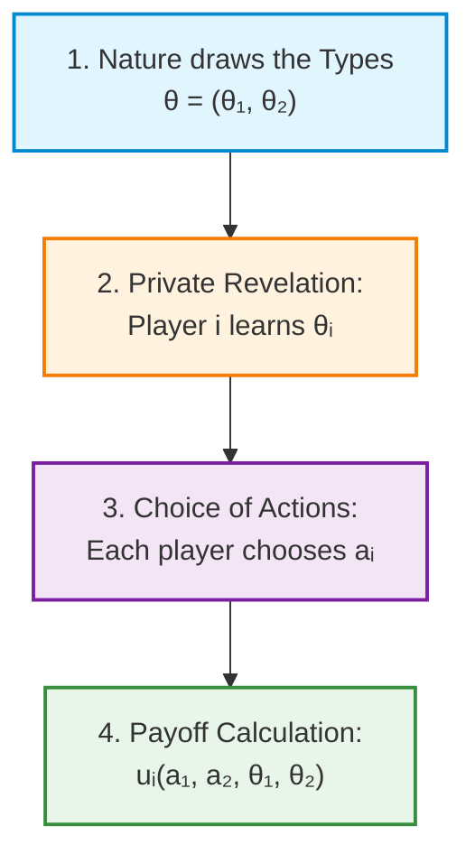
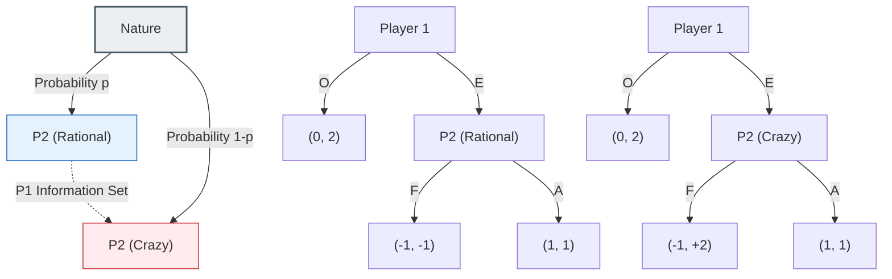
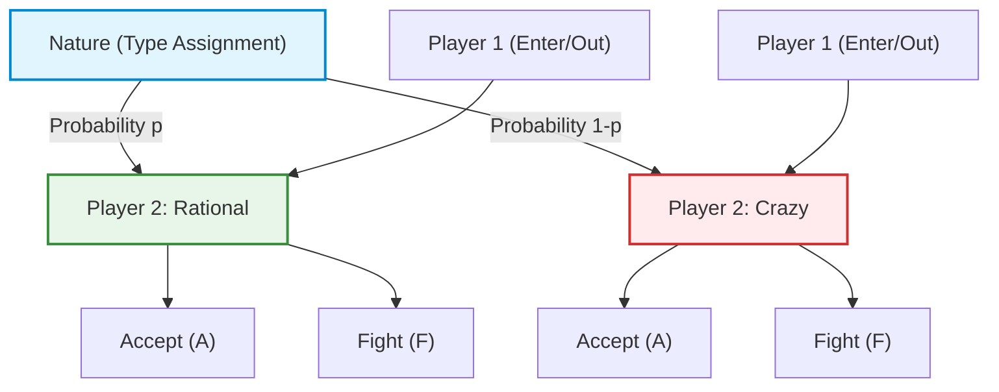
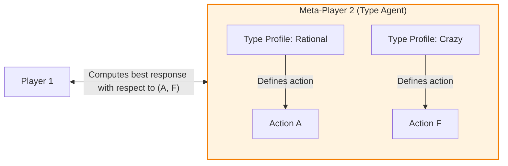
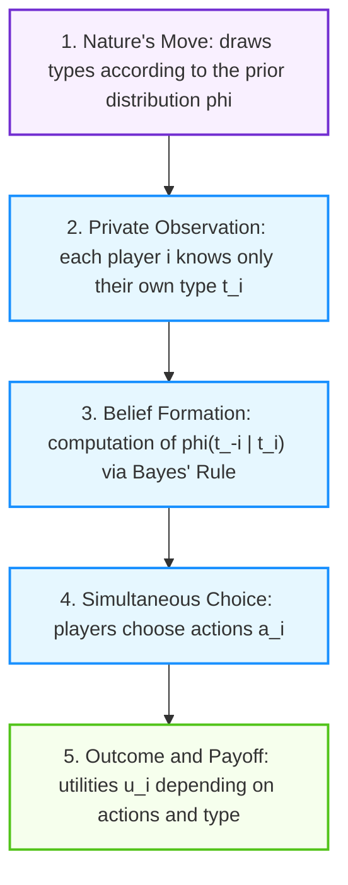

# Introduction to Bayesian Games: Incomplete Information and Type Modeling

## Educational Overview

This lecture opens the third and final part of the course, dedicated to the analysis of **Bayesian Games**. Until now, the analysis of static and dynamic games has been based on the assumption of **Complete Information**: each agent, even while potentially unaware of the opponent's specific move (imperfect information), possessed full **Common Knowledge** of the rules of the game, the set of players, and the structure of the **Payoffs**. 

In Bayesian Games, this assumption is relaxed to model situations of **Incomplete Information**, in which there is intrinsic uncertainty regarding the characteristics, preferences, or real motivations of the other agents.

The lecture introduces the fundamental conceptual framework proposed by John Harsanyi in the 1960s to solve the problem of incomplete information:
* **Concept of Player Type:** Uncertainty about a player's characteristics is formalized by discretizing their possible behaviors or preferences into distinct "types". The same payoff of a given action therefore depends on the actual type of the player receiving it.
* **Beliefs and Conjectures:** Players formulate probabilistic estimates (beliefs) not only about the opponent's moves, but also about the type to which the opponent belongs.
* **Nature's Move:** A preliminary and external mechanism that probabilistically assigns types to players before interactions begin.
* **Extension of the Equilibrium Concept:** It is shown how the classical definition of equilibrium (based on formulating consistent beliefs and choosing the **Best Response**) remains conceptually valid, subject to a re-definition of the concept of strategy itself in the presence of incomplete information.

---

### Introduction to Incomplete Information and Bayesian Games

In the previous parts of the course, we analyzed static and dynamic games under conditions of **Complete Information**. In such contexts, although uncertainty about opponents' moves could exist (imperfect information), the fundamental structure of the game was always **Common Knowledge**: every player knew perfectly the rules, the available actions, the identities of the other participants, and the corresponding utility functions (the *payoffs*).

In the applied reality of engineering and economics, this assumption of perfect knowledge about others' *payoffs* often breaks down. This gives rise to **Bayesian Games**, used to model situations characterized by **Incomplete Information**.

```
   INFORMAZIONE IMPERFETTA                     INFORMAZIONE INCOMPLETA
(Non so cosa hai GIOCATO)                   (Non so chi SEI / cosa VUOI)
  - Regole e payoff noti                      - Payoff altrui incerti
  - Incertezza sulle mosse                    - Incertezza sulle caratteristiche
```

#### Equilibrium and Formation of Beliefs
The central objective remains the search for an equilibrium concept analogous to the Nash Equilibrium. An equilibrium occurs when players develop **consistent and correct beliefs**:
1. Each agent hypothesizes the opponent's behavior.
2. Responds optimally to that hypothesis via a **Best Response**.
3. If the opponent, hypothesizing the same reaction, finds it advantageous to confirm the initial move, we are in a *self-enforcing prophecy* from which no one has an incentive to deviate.

In games with incomplete information, in order to close this "logical loop", it is not sufficient to hypothesize the opponent's moves: it is necessary to formulate beliefs about their very **structural characteristics** and preferences.

---

### Harsanyi's Concept of "Type"

To solve the problem of incomplete information without overly complicating the mathematical-analytical theory, John Harsanyi (1967) introduced a fundamental insight: transforming a game of incomplete information into a game of **imperfect** information by introducing a fictitious player called **Nature**.

> **KEY CONCEPT: A Player's Type**
> 
> A player's private characteristics (their payoffs, tastes, and private information) are summarized in a synthetic variable called **Type** ($\theta_i \in \Theta_i$). 
> 
> Nature chooses each player's type by drawing it from a *prior distribution* known to everyone. Each player knows their own type with certainty, but observes only a probability distribution over the opponents' types.

To keep the analysis tractable, a **Discretization** of the type space is often used: rather than considering a continuous spectrum of behaviors, the opponent is modeled by assuming 2 or 3 representative discrete types (e.g., aggressive vs. cautious player).

#### Temporal Mechanism of a Bayesian Game

1. **Nature's Move**: Nature draws the type vector $\boldsymbol{\theta} = (\theta_1, \theta_2, \dots, \theta_N)$ with probability $P(\boldsymbol{\theta})$.
2. **Private Revelation**: Nature reveals to each player $i$ exclusively their own type $\theta_i$. Player $i$ does not know the types of the others $\theta_{-i}$.
3. **Choice of Actions**: Players simultaneously or sequentially choose their own actions $a_i \in A_i$.
4. **Payoff Calculation**: The final payoff $u_i(a_1, \dots, a_N, \theta_1, \dots, \theta_N)$ depends both on the action profile played by everyone and on the drawn type profile.



*Didactic note*: In the general case, the "type" could also model meta-characteristics (e.g., the player's level of knowledge or strategic sophistication). However, in the classical approach (and in most textbooks), the type simply varies the **utility function** (the payoffs associated with the outcome of the game).

---

### Introductory Example: The Entry Game (*Entry Game*)

To understand the impact of incomplete information, let us first analyze the classical complete-information version and subsequently its Bayesian extension.

#### Case 1: Complete Information (Standard Sequential Version)

Consider a market with two agents:
- **Player 1 (Newcomer)**: chooses whether to Enter ($E$, *Enter*) or Stay Out ($O$, *Stay Out*).
- **Player 2 (Incumbent)**: if Player 1 enters, chooses whether to Fight ($F$, *Fight*) or Accept the entry ($A$, *Accept*).

The structure of the game tree is as follows:
- If Player 1 chooses $O$, the game ends immediately with payoff $(0, 2)$ (Player 1 gets $0$, Player 2 retains the entire monopoly equal to $2$).
- If Player 1 chooses $E$, the decision passes to Player 2:
  - If Player 2 chooses $F$ (price war), the payoff is $(-1, -1)$.
  - If Player 2 chooses $A$ (market sharing), the payoff is $(1, 1)$.

##### Solution of the Standard Case
Applying backward induction (*Backward Induction*):
- In Player 2's subgame, comparing $u_2(E, A) = 1$ and $u_2(E, F) = -1$, the rational move for Player 2 is to accept ($A$).
- Anticipating this choice, Player 1 at the first node compares $u_1(E, A) = 1$ with $u_1(O) = 0$. Player 1 chooses to enter ($E$).

The unique **Subgame Perfect Nash Equilibrium** (*Subgame Perfect Nash Equilibrium - SPNE*) is the strategy pair $(E, A)$ with payoff outcome $(1, 1)$.

However, there exists another Nash Equilibrium (in extensive/normal form) given by the pair $(O, F)$:
- If Player 1 believes that 2 will fight ($F$), they choose $O$ (since $0 > -1$).
- If Player 1 plays $O$, for Player 2 the choice between $F$ and $A$ is irrelevant for the actual payoff (the node is not reached).
- *However*, $(O, F)$ is based on a **non-credible threat** (*Non-credible threat*): if Player 1 were actually to enter, Player 2 would have no interest in punishing them by harming themselves as well.

---

#### Case 2: Bayesian Version (Incomplete Information)

Now suppose that Player 1 is unsure of the nature of the Incumbent (Player 2). Player 2 can belong to two **Types**:

1. **Rational Type (*Rational*)** (with probability $p$): hates fighting. The payoffs are the standard ones: $u_2(E, F) = -1$ and $u_2(E, A) = 1$.
2. **"Crazy" / Aggressive Type (*Crazy*)** (with probability $1-p$): derives enjoyment or strategic advantage from fighting. The payoff in case of a clash becomes $u_2(E, F) = +2$, whereas if they accept they obtain $u_2(E, A) = 1$.

##### Structure of the Bayesian Game

Nature initially determines Player 2's type:
- With probability $p$, Player 2 is **Rational**.
- With probability $1-p$, Player 2 is **Crazy**.

Player 2 knows their own type. Player 1 only holds a prior belief equal to $p$. Consequently, Player 1's two decision roots belong to the **same information set**, indicating uncertainty about which type of opponent they are facing.



##### Analysis of Optimal Choices

1. **Player 2's Choice**:
   - If Player 2 is of the **Rational** type, the strictly dominant move after entry ($E$) is to Accept ($A$), since $1 > -1$.
   - If Player 2 is of the **Crazy** type, the strictly dominant move after entry ($E$) is to Fight ($F$), since $2 > 1$.

2. **Player 1's Choice**:
   Anticipating the dominant behavior of the two types of Player 2, Player 1 computes the **expected payoff** resulting from choosing to enter ($E$):

   $$E[u_1(E)] = p \cdot \underbrace{u_1(E, A \mid \text{Razionale})}_{= 1} + (1-p) \cdot \underbrace{u_1(E, F \mid \text{Crazy})}_{= -1}$$

   $$E[u_1(E)] = p \cdot (1) + (1-p) \cdot (-1) = p - 1 + p = 2p - 1$$

   If Player 1 chooses to stay out ($O$), they obtain with certainty:
   
   $$E[u_1(O)] = 0$$

3. **Entry Condition**:
   Player 1 will decide to Enter ($E$) if and only if the expected payoff of entering is strictly greater than the payoff of staying out:

   $$2p - 1 > 0 \implies 2p > 1 \implies p > \frac{1}{2}$$

> **Outcome of the Analysis**:
> - If $p > \frac{1}{2}$ (it is very likely that the Incumbent is rational), the threat of conflict loses strategic weight and Player 1 decides to **Enter ($E$)**.
> - If $p < \frac{1}{2}$ (it is sufficiently likely that the Incumbent is "crazy"), the threat becomes effective enough to discourage entry, and Player 1 decides to **Stay Out ($O$)**.

Bayesian modeling transforms the non-credible threat of the standard game into a concrete decision factor, weighted by the probabilistic belief $p$ associated with the opponent's possible types.

---

### Structure of Bayesian Games as an Extension of Dynamic Games

**Bayesian Games** can be interpreted mathematically as a special case of games in dynamic or extensive form.

In a dynamic game with incomplete information, the tree structure is initiated by a preliminary move of **Nature**, a fictitious player that probabilistically assigns a "type" to one or more players.



Reconsidering the example in which Player 2 ($P_2$) can be of two different types:
* **Rational:** Prefers to accept ($A$, *Accept*) rather than fight ($F$, *Fight*). The threat to fight, for Player 1 ($P_1$), is a *non-credible threat*.
* **Crazy:** Loves to fight and prefers conflict ($F$) over yielding the resource ($A$). In this branch of the tree, the threat of conflict is **credible**.

Player 1's optimal decision will depend entirely on the probability of being in one or the other branch of the dynamic game generated by Nature.

---

#### The Common Prior Assumption (*Common Prior Assumption*)

In order to calculate a **Best Response** (*Best Response*), each player must formulate beliefs (*beliefs*). In games with incomplete information, a belief does not solely concern the opponent's move, but also the **type** that the opponent possesses.

> **KEY CONCEPT: Common Prior Assumption (*Common Prior Assumption*)**
> A common error is to think that "not knowing with certainty" coincides with "knowing absolutely nothing". In engineering, one always operates under a margin of error: we do not know the exact value of a random variable, but we know its **probability distribution**.
> 
> In Bayesian Games we assume the **Common Prior Assumption**: the exact type of the opponent is unknown, but the probability distribution of types (the *prior*) is **Common Knowledge** (*Common Knowledge*). Each player knows that the other knows the distribution, knows that the other knows that he knows it, and so on ad infinitum.

---

### Normal Form Formulation and Expected Utility Calculation

As in traditional dynamic games, it is possible to reduce the Bayesian Game in extensive form to an equivalent representation in **Normal Form** (*Normal Form Matrix*).

#### Strategy Definitions
* **Player 1 ($P_1$):** Possesses only one type. Not distinguishing which node of the tree he is at (Nature's assignment is unknown to $P_1$), he possesses only 2 pure strategies: stay out ($O$, *Out*) or enter ($E$, *Enter*).
* **Player 2 ($P_2$):** Possesses 2 types (Rational or Crazy) and 2 distinctive information sets. A pure strategy for $P_2$ must specify an action for each possible type. It is expressed as an ordered pair $(X, Y)$:
  * $X \in \{A, F\}$: Action taken if the type is *Rational*.
  * $Y \in \{A, F\}$: Action taken if the type is *Crazy*.

As a result, Player 2 has $2 \times 2 = 4$ pure strategies: $\{AA, AF, FA, FF\}$.

#### Construction of the Expected Utility Matrix

The values entered in the normal form matrix are not deterministic payoffs, but rather **expected values** (*expected values*) calculated by weighting the payoffs of the various branches with the probability $p$ (probability that $P_2$ is Rational) and $1-p$ (probability that $P_2$ is Crazy).

```
                 Giocatore 2 (Tipo Razionale, Tipo Folle)
                    AA         AF         FA         FF
Giocatore 1  O    (0, 2)     (0, 2)     (0, 2)     (0, 2)
             E   (U1, U2)   (U1, U2)   (U1, U2)   (U1, U2)
```

##### Worked Example: Calculation of Expected Payoffs for the Combination $(E, AF)$
*Note: Step integrated with pedagogical clarity.*

Assume the following base payoffs for the game tree:
* If $P_1$ plays $O$: Payoff $(0, 2)$ regardless of the type of $P_2$.
* If $P_1$ plays $E$ and $P_2$ is Rational: if he chooses $A \rightarrow (1, 1)$, if he chooses $F \rightarrow (-1, 0)$.
* If $P_1$ plays $E$ and $P_2$ is Crazy: if he chooses $A \rightarrow (1, 0)$, if he chooses $F \rightarrow (-1, 2)$.

Consider the combined strategy where $P_1$ chooses $E$ and $P_2$ chooses $AF$ ($A$ if rational with probability $p$, $F$ if crazy with probability $1-p$):

1. **Expected utility for Player 1 ($U_1$):**
   $$U_1(E, AF) = p \cdot (1) + (1 - p) \cdot (-1) = p - 1 + p = 2p - 1$$

2. **Expected utility for Player 2 ($U_2$):**
   $$U_2(E, AF) = p \cdot (1) + (1 - p) \cdot (2) = p + 2 - 2p = 2 - p$$

Substituting the values, the cell corresponding to $(E, AF)$ will contain the expected utilities:
$$(2p - 1, \; 2 - p)$$

#### Dependence of Nash Equilibria on the Prior $p$

By completing the matrix for all pure strategies, one notices a fundamental property of Bayesian Games: **Nash Equilibria change as $p$ varies**.

For example, if $p = \frac{2}{3}$:
$$U_1(E, AF) = 2\left(\frac{2}{3}\right) - 1 = \frac{1}{3} > 0 \implies \text{La risposta ottima per } P_1 \text{ è la mossa } E$$

If $p = \frac{1}{3}$:
$$U_1(E, AF) = 2\left(\frac{1}{3}\right) - 1 = -\frac{1}{3} < 0 \implies \text{La risposta ottima per } P_1 \text{ diventa la mossa } O$$

---

### Extension to Mixed Strategies and Properties of Expectations

The model extends directly to **Mixed Strategies** (*Mixed Strategies*) as well. When operating in the presence of uncertainty about both actions and types, Von Neumann-Morgenstern expected utility theory guarantees system consistency.

In the calculation of the final payoff, two distinct uncertainties overlap:
1. The uncertainty linked to the **mixed strategy** of the player (distribution over actions).
2. The uncertainty linked to the **type** of the opponent (distribution over types).

Since the expectation of an expectation (the compound expectation) algebraically reduces to a single linear expectation, the calculation of the best response follows the same usual algebraic rules. The crucial aspect is the extension of the philosophical meaning: the average of utilities formally includes the set of all possible types.

---

### Philosophical Interpretation and Type Agent Representation (*Type Agent Representation*)

From a conceptual perspective, normal form analysis raises an interpretative paradox.

#### The Multi-Type Player Paradox
Player 2, in the practical execution of the game, **knows his type perfectly** (he knows whether he is rational or crazy). For what reason, when defining the normal form, does Player 2 also calculate an expected value by averaging over his own possible types?

#### The Solution: The Meta-Player
To resolve the mathematical equivalence between the extensive form and the normal form, the distinct types of Player 2 are replaced by a single **Meta-Player** (*Type Agent Representation*).

This Meta-Player acts as an agent with a "split personality" that must define an **Action Manual** (*Action Manual* or *Strategy Handbook*) a priori:

$$\text{Strategia } AF \longrightarrow \text{"Se sono Sano di mente, gioca } A\text{; Se sono Folle, gioca } F\text{"}$$



Although in actual reality each player lives in only one of the possible worlds determined by their true type (and therefore does not have to "choose" their personality at the moment of moving), game theory proves the formal equivalence:

$$\text{Equilibri di Nash (Forma Estesa ad Info Incompleta)} \equiv \text{Equilibri di Nash (Forma Normale con Type Agent)}$$

The computation of the expectation over its own types by the Meta-Player is the only mathematical tool that allows Player 1 to evaluate its best response under conditions of incomplete information.

---

### The Philosophical Perspective and the Role of the Prior Distribution

Before moving on to the actual mathematical formalism, it is essential to clarify the conceptual perspective on which the entire theory of Bayesian games rests. When a player (for example, Player 1) faces an opponent whose nature is unknown, they behave as if facing a strange composite individual, called a **Meta-player** or **Type Agent**.

From a mathematical standpoint, the two representations (the game with uncertain types and the game against the type agent) are equivalent thanks to the linearity of the expected value we use to compute utilities. However, the philosophical distinction is crucial:
* **You do not perform probabilistic calculations about yourself**: it makes no sense to compute an expected value over your own possible types by asking yourself "who knows who I am", because you already know your own nature (unless you want to engage in existential reflections, which however fall outside Game Theory).
* **The other players are the ones who do it**: since opponents do not know your type, they must treat you as if you could take on different identities with certain probabilities, computing their expectations accordingly.

> **Key Concept — The Prior Distribution Assumption**
> A fundamental requirement of the model is that all players know the prior probability distribution over types. This is a rather strong assumption—and in certain real-world contexts even unrealistic—but without it, it would not be possible to perform any expected utility calculation or determine best responses.

---

### Formal Definition of a Static Bayesian Game

To formalize a **Bayesian Game**, let us start by comparing it with a classic static game in **Normal Form**. In a standard static game, we have three elements:
1. A set of players.
2. A strategy space for each player.
3. The utility (payoff) functions.

The basic mechanism of a static game is analogous to people coming from different parts of the world, meeting at a common point, combining their actions to generate a single global outcome for everyone, and then returning home taking their own individual payoff with them.

When we move to a **Static Bayesian Game**, the definition itself hides a slight paradox: strictly speaking, *no Bayesian game is truly static*. In fact, there is always an initial move made by **Nature** that assigns types, followed by the players' moves. However, if all real players then act simultaneously by choosing a single action, we can still treat the game as static (extending it to dynamic Bayesian games is straightforward by combining the rules of dynamic games with those we are about to see).



Compared to the standard normal form, a static Bayesian game introduces **three new ingredients**:

#### 1. Type Space and Prior Distribution
For each player $i$, Nature draws a **type** $t_i$ from a set called the **type space** $T_i$. The draw occurs according to a joint prior probability distribution $\phi(t_1, \dots, t_n)$, where the $t_i$ are viewed as random variables.
* The joint distribution $\phi$ is **common knowledge** among all players.

#### 2. Type-Dependent Utilities (Private Values)
Utility functions $u_i$ always depend on the actions of all players ($a_i$ and $a_{-i}$), but now they also depend on the type. In the most common and simplest model, the **Private Values** assumption is adopted: your utility depends solely on everyone's actions and on *your* type $t_i$:
$$u_i = u_i(a_i, a_{-i}; t_i)$$
*(Note: **Common Values** models also exist, in which others' types directly influence your utility, but they are more complex to handle and can often be reduced to this framework.)*

For example, if player $i$ can belong to two types $T_i = \{t_A, t_B\}$ — such as a "rational" player versus a "crazy" one — they will have two different payoff functions $u_{i,A}(a_i, a_{-i})$ and $u_{i,B}(a_i, a_{-i})$ reflecting their different preferences.

**The trick for modeling prohibited actions through types:**
Types can also be used to represent the fact that certain players have different actions available (for instance, in a football match, not knowing whether the opponent is an outfield player or a goalkeeper, who can use their hands). To keep the action space $A_i$ uniform across all types, a very effective mathematical trick is used: the action is left available for all types, but for the type that cannot perform it, that action is assigned a payoff equal to $-\infty$ (or an extremely negative value). In this way, the action is not formally forbidden, yet no rational player of that type will ever want to choose it.

#### 3. Beliefs About Others' Types
Each player knows their own type $t_i$, but does not know the opponents' types $t_{-i}$. They must therefore form **beliefs** about what the other players' types are conditional on their own type, that is, compute the conditional distribution $\phi(t_{-i} \mid t_i)$.

---

### Computing Beliefs, Independence, and Bayes' Rule

The computation of beliefs deserves a rigorous clarification, as it is often subject to inaccuracies in the economic literature.

> **Key Concept — Watch Out for Type Independence**
> Many textbooks hastily write that the belief $\phi(t_{-i} \mid t_i)$ is obtained simply by taking the joint distribution $\phi(t_1, \dots, t_n)$ and "removing" $t_i$ from the list. **In general, this is false!** It is true *only* if the players' types are statistically independent of one another.

In general, knowing the joint distribution $\phi(t_1, \dots, t_n)$ and having observed their own type $t_i$, player $i$ must apply **Bayes' Rule** (and it is precisely the use of this rule that justifies the name *Bayesian Games*). One marginalizes over all other types via the law of total probability and computes the conditional probability:

$$\phi(t_{-i} \mid t_i) = \frac{\phi(t_i, t_{-i})}{\sum_{t'_{-i} \in T_{-i}} \phi(t_i, t'_{-i})}$$

If and only if the types are **independent**, the joint distribution factorizes into the product of the marginals; in that case, the term $\phi_i(t_i)$ cancels out between the numerator and the denominator, and the formula reduces to the product of the other players' distributions:

$$\phi(t_1, \dots, t_n) = \prod_{k=1}^n \phi_k(t_k) \implies \phi(t_{-i} \mid t_i) = \frac{\prod_{k=1}^n \phi_k(t_k)}{\phi_i(t_i)} = \prod_{k \neq i} \phi_k(t_k) = \phi(t_{-i})$$

In other words, if the types are independent, knowing your own type gives you no additional information about others' types.

#### A Practical Counterexample: The Deck of Cards
Imagine a role-playing game in a room with $40$ players and a deck of $40$ cards: $1$ card is the Murderer, $1$ is the Inspector, and $38$ are Citizens. A priori, the probability of drawing the Murderer is $\frac{1}{40}$. However, the types are not independent at all! If you draw the Murderer card, you immediately know with certainty that the probability that someone else in the room is the Murderer has dropped to $0$. In situations like this, ignoring conditional dependence leads to serious errors: when modeling a problem with multiple types, one must always explicitly state and justify whether the types are independent or not.

*(Note: in even more general settings, a player might know not only their own type $t_1$, but also $t_2$, thus having to condition beliefs about $t_3$ and $t_4$ on both known values; moreover, in some models a distinction is made between prior and posterior probabilities.)*

#### Informational Classification
Under these assumptions (where the *prior* $\phi$ is perfectly known to everyone), the static Bayesian game is a game of **incomplete but perfect information**:
* It is *incomplete* because players do not know the actual types (and therefore the true payoff functions) of their opponents.
* It is *perfect* with respect to the incompleteness, because everything that can be known or postulated — including the exact probability structure $\phi$ — is perfectly known and shared. Cases of incomplete and *imperfect* information exist (in which even the beliefs $\phi$ can be wrong), but they are vastly more complex to analyze.

---

### Strategies in Bayesian Games and Link with Mixed Strategies

How is a strategy defined in a static Bayesian game?

* **Pure Strategy**: even though the game is static, a pure strategy $s_i$ is no longer the choice of a single action in $A_i$, but a **mapping** from the type space to the action space:
  $$s_i : T_i \to A_i$$
  In practice, the player must specify an action for *each* of their possible types.
* **Mixed Strategy**: it is a probability distribution over pure strategies.

*(If the game is both Bayesian and dynamic, the two levels overlap: the strategy becomes a complete dynamic "instruction manual" specified for each possible type of the player).*

#### The Bayesian Entry Game Example and Equilibrium
Returning to the Bayesian Entry Game example, we had identified three Nash equilibria: $(E, AF)$, $(O, FA)$, and $(O, FF)$. Let us focus on $(E, AF)$:
* Player 1 chooses $E$ (Enter) and has no incentive to switch to $O$.
* Player 2 chooses $AF$, where the first letter indicates what they do if *rational* ($A$, Accept) and the second what they do if *crazy* ($F$, Fight).

At first glance, a legitimate doubt arises: if Player 2 discovers they are rational, why should they bother specifying in their strategy what they would do if they were crazy?

> **Key Concept — Why plan for types that do not materialize?**
> You do not plan a type-dependent strategy for yourself, but **for your opponents**.
> 1. **The Meta-player's perspective**: from the point of view of the other players ($-i$), you are a "multi-headed beast" and they do not know which head they are facing. They need to know your entire type-contingent strategy in order to form their beliefs, compute their expected payoff, and determine their best response (and so that mutual best responses are consistent in a Bayesian Nash Equilibrium, which we will explore in depth in the next lecture).
> 2. **The parallel with Dynamic Games**: just as in dynamic games a complete plan of action is defined even for subgames that will never be reached in practice, in Bayesian games an action is also defined for types that have not occurred in reality.

#### Intuitive Convergence with Mixed Strategies
Finally, this mechanism offers a very elegant philosophical justification for why **Mixed Strategies** exist in non-Bayesian games.
Consider Player 2's strategy $AF$: formally, it is a *pure strategy* of the Bayesian game. However, in the eyes of Player 1, who does not know whether the opponent is rational or crazy but knows the prior probabilities, Player 2 behaves probabilistically: sometimes they play $A$, and sometimes they play $F$.

Player 1 does not even care about the psychological reason behind this choice: for them, facing an opponent who uses a type-dependent pure strategy is completely indistinguishable from facing an opponent who plays a mixed strategy. Bayesian game theory therefore provides a natural interpretation of strategic uncertainty as uncertainty about the opponent's true characteristics (their type).