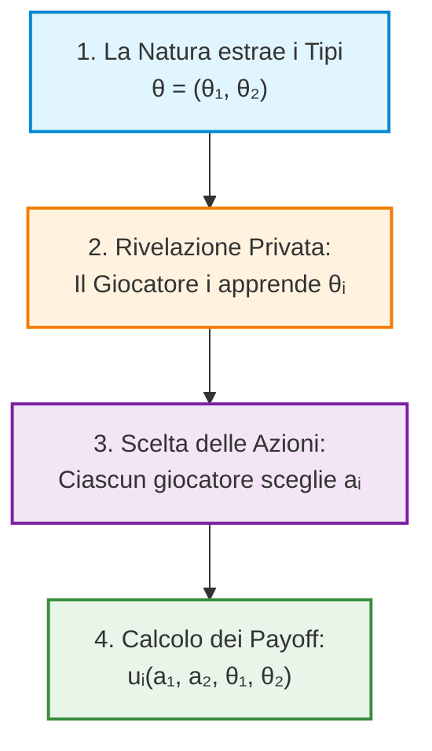
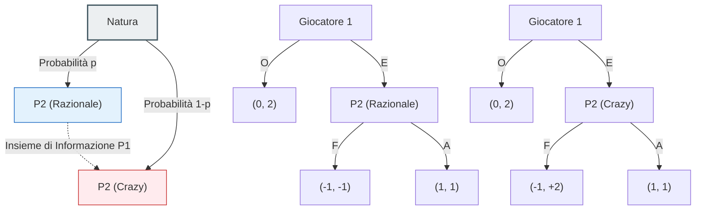
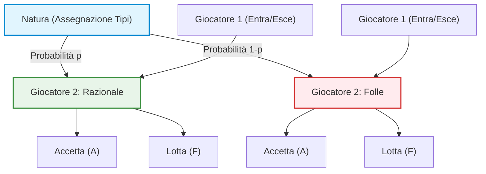
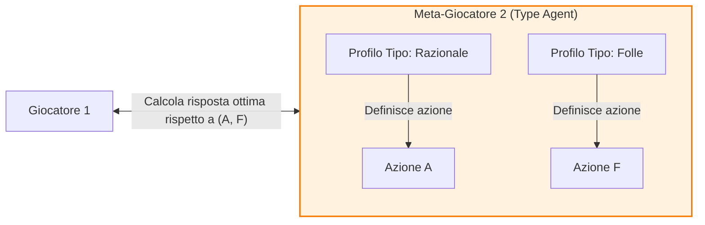
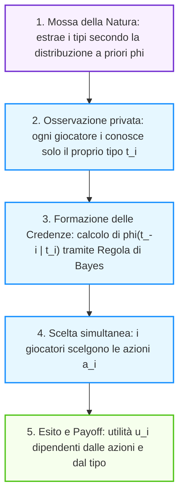

# Introduzione ai Giochi Bayesiani: Informazione Incompleta e Modellazione dei Tipi

## Overview Didattica

Con questa lezione si apre la terza e ultima parte del corso, dedicata all'analisi dei **Giochi Bayesiani** (*Bayesian Games*). Fino ad ora, l'analisi dei giochi statici e dinamici si è basata sull'ipotesi di **Informazione Completa** (*Complete Information*): ciascun agente, pur potendo ignorare la mossa specifica dell'avversario (informazione imperfetta), possedeva una **Conoscenza Comune** (*Common Knowledge*) completa delle regole del gioco, dell'insieme dei giocatori e della struttura dei payoff (*Payoffs*). 

Nei Giochi Bayesiani si supera questa ipotesi per modellare situazioni di **Informazione Incompleta** (*Incomplete Information*), in cui sussiste un'incertezza intrinseca sulle caratteristiche, sulle preferenze o sulle motivazioni reali degli altri agenti.

La lezione introduce il quadro concettuale fondamentale proposto da John Harsanyi negli anni '60 per risolvere il problema dell'informazione incompleta:
* **Concetto di Tipo (*Player Type*):** L'incertezza sulle caratteristiche di un giocatore viene formalizzata discretizzando i suoi possibili comportamenti o preferenze in "tipi" distinti. Il medesimo payoff di una determinata azione dipende quindi dal tipo effettivo del giocatore che la riceve.
* **Credenze e Congietture (*Beliefs*):** I giocatori formulano stime probabilistiche (credenze) non solo sulle mosse dell'avversario, ma anche sul suo tipo di appartenenza.
* **Mossa della Natura (*Nature's Move*):** Meccanismo preliminare ed esterno che assegna in modo probabilistico i tipi ai giocatori prima dell'inizio delle interazioni.
* **Estensione del Concetto di Equilibrio:** Si mostra come la definizione classica di equilibrio (basata sulla formulazione di credenze coerenti e sulla scelta della **Migliore Risposta**, *Best Response*) rimanga concettualmente valida, previa una ri-definizione del concetto stesso di strategia in presenza di informazione incompleta.

---

### Introduzione all'Informazione Incompleta e ai Giochi Bayesiani

Nelle parti precedenti del corso abbiamo analizzato giochi statici e dinamici in condizione di **Informazione Completa** (*Complete Information*). In tali contesti, pur potendo sussistere incertezza sulle mosse degli avversari (informazione imperfetta), la struttura fondamentale del gioco era sempre di **Conoscenza Comune** (*Common Knowledge*): ogni giocatore conosceva perfettamente le regole, le azioni disponibili, le identità degli altri partecipanti e le relative funzioni di utilità (i *payoff*).

Nella realtà applicativa dell'ingegneria e dell'economia, questa ipotesi di conoscenza perfetta sui *payoff* altrui viene spesso meno. Nascono così i **Giochi Bayesiani** (*Bayesian Games*), impiegati per modellare situazioni caratterizzate da **Informazione Incompleta** (*Incomplete Information*).

```
   INFORMAZIONE IMPERFETTA                     INFORMAZIONE INCOMPLETA
(Non so cosa hai GIOCATO)                   (Non so chi SEI / cosa VUOI)
  - Regole e payoff noti                      - Payoff altrui incerti
  - Incertezza sulle mosse                    - Incertezza sulle caratteristiche
```

#### Equilibrio e Creazione delle Convinzioni (*Beliefs*)
L'obiettivo centrale rimane la ricerca di un concetto di equilibrio analogo all'Equilibrio di Nash. Un equilibrio si verifica quando i giocatori sviluppano **convinzioni coerenti e corrette** (*consistent and correct beliefs*):
1. Ciascun agente ipotizza il comportamento dell'avversario.
2. Risponde in modo ottimale a tale ipotesi tramite una **Ottima Risposta** (*Best Response*).
3. Se l'avversario, ipotizzando la medesima reazione, trova conveniente confermare la mossa iniziale, ci si trova in una profezia che si auto-avvera (*self-enforcing prophecy*) da cui nessuno ha interesse a deviare.

Nei giochi a informazione incompleta, per poter chiudere questo "ciclo logico", non è sufficiente ipotizzare le mosse dell'avversario: occorre formulare delle convinzioni sulle sue stesse **caratteristiche strutturali** e sulle sue preferenze.

---

### Il Concetto di "Tipo" secondo Harsanyi

Per risolvere il problema dell'informazione incompleta senza complicare eccessivamente la teoria matematico-analitica, John Harsanyi (1967) ha introdotto un'intuizione fondamentale: trasformare un gioco a informazione incompleta in un gioco a informazione **imperfetta**, introducendo un giocatore fittizio chiamato **Natura** (*Nature*).

> **CONCETTO CHIAVE: Il Tipo di un Giocatore (*Player's Type*)**
> 
> Le caratteristiche private di un giocatore (i suoi payoff, i suoi gusti, le sue informazioni riservate) vengono riassunte in una variabile sintetica detta **Tipo** ($\theta_i \in \Theta_i$). 
> 
> La Natura sceglie il tipo di ciascun giocatore estraendolo da una distribuzione di probabilità a priori (*prior distribution*) nota a tutti. Ogni giocatore conosce con certezza il proprio tipo, ma osserva solo una distribuzione di probabilità sui tipi degli avversari.

Per mantenere l'analisi trattabile, si utilizza spesso una **discretizzazione** (*Discretization*) dello spazio dei tipi: anziché considerare uno spettro continuo di comportamenti, si modella l'avversario ipotizzando 2 o 3 tipi discreti rappresentativi (es. giocatore aggressivo vs. prudente).

#### Meccanismo Temporale di un Gioco Bayesiano

1. **Mossa della Natura**: La Natura estrae il vettore dei tipi $\boldsymbol{\theta} = (\theta_1, \theta_2, \dots, \theta_N)$ con probabilità $P(\boldsymbol{\theta})$.
2. **Rivelazione Privata**: La Natura rivela a ciascun giocatore $i$ esclusivamente il suo tipo $\theta_i$. Il giocatore $i$ non conosce i tipi degli altri $\theta_{-i}$.
3. **Scelta delle Azioni**: I giocatori scelgono contestualmente o sequenzialmente le proprie azioni $a_i \in A_i$.
4. **Calcolo dei Payoff**: Il payoff finale $u_i(a_1, \dots, a_N, \theta_1, \dots, \theta_N)$ dipende sia dal profilo di azioni giocate da tutti, sia dal profilo dei tipi estratti.



*Nota didattica*: Nel caso generale, il "tipo" potrebbe modellare anche meta-caratteristiche (es. il livello di conoscenza o sofisticazione strategica del giocatore). Tuttavia, nell'approccio classico (e nella maggior parte dei testi), il tipo varia semplicemente la **funzione di utilità** (i payoff associati all'esito del gioco).

---

### Esempio Introduttivo: Il Gioco di Ingresso (*Entry Game*)

Per comprendere l'impatto dell'informazione incompleta, analizziamo prima la versione classica a informazione completa e successivamente la sua estensione Bayesiana.

#### Caso 1: Informazione Completa (Versione Sequenziale Standard)

Consideriamo un mercato con due agenti:
- **Giocatore 1 (Newcomer / Nuovo Entrante)**: sceglie se Entrare ($E$, *Enter*) o Rimanere Fuori ($O$, *Stay Out*).
- **Giocatore 2 (Incumbent / Impresa Incumbente)**: se il Giocatore 1 entra, sceglie se Lottare ($F$, *Fight*) o Accettare l'ingresso ($A$, *Accept*).

La struttura dell'albero di gioco è la seguente:
- Se il Giocatore 1 sceglie $O$, il gioco termina subito con payoff $(0, 2)$ (il Giocatore 1 ottiene $0$, il Giocatore 2 conserva l'intero monopolio pari a $2$).
- Se il Giocatore 1 sceglie $E$, la decisione passa al Giocatore 2:
  - Se il Giocatore 2 sceglie $F$ (guerra dei prezzi), il payoff è $(-1, -1)$.
  - Se il Giocatore 2 sceglie $A$ (spartizione del mercato), il payoff è $(1, 1)$.

##### Risoluzione del Caso Standard
Applicando l'induzione a ritroso (*Backward Induction*):
- Nel sottogioco del Giocatore 2, confrontando $u_2(E, A) = 1$ e $u_2(E, F) = -1$, la mossa razionale per il Giocatore 2 è accettare ($A$).
- Anticipando questa scelta, il Giocatore 1 al primo nodo confronta $u_1(E, A) = 1$ con $u_1(O) = 0$. Il Giocatore 1 sceglie di entrare ($E$).

L'unico **Equilibrio Perfetto nei Sottogiochi** (*Subgame Perfect Nash Equilibrium - SPNE*) è la coppia di strategie $(E, A)$ con esito di payoff $(1, 1)$.

Esiste tuttavia un altro Equilibrio di Nash (in forma estesa/normale) dato dalla coppia $(O, F)$:
- Se il Giocatore 1 crede che 2 lotterà ($F$), sceglie $O$ (poiché $0 > -1$).
- Se il Giocatore 1 gioca $O$, per il Giocatore 2 la scelta tra $F$ ed $A$ è irrilevante ai fini del payoff effettivo (il nodo non viene raggiunto).
- *Tuttavia*, $(O, F)$ si basa su una **minaccia non credibile** (*Non-credible threat*): se il Giocatore 1 dovesse davvero entrare, il Giocatore 2 non avrebbe alcun interesse a punirlo danneggiando anche se stesso.

---

#### Caso 2: Versione Bayesiana (Informazione Incompleta)

Ipotizziamo ora che il Giocatore 1 non sia sicuro della natura dell'Incumbente (Giocatore 2). Il Giocatore 2 può appartenere a due **Tipi**:

1. **Tipo Razionale (*Rational*)** (con probabilità $p$): odia lottare. I payoff sono quelli standard: $u_2(E, F) = -1$ e $u_2(E, A) = 1$.
2. **Tipo "Crazy" / Aggressivo (*Crazy*)** (con probabilità $1-p$): trae diletto o vantaggio strategico dalla lotta. Il payoff in caso di scontro diventa $u_2(E, F) = +2$, mentre se accetta ottiene $u_2(E, A) = 1$.

##### Struttura del Gioco Bayesiano

La Natura determina inizialmente il tipo del Giocatore 2:
- Con probabilità $p$, il Giocatore 2 è **Razionale**.
- Con probabilità $1-p$, il Giocatore 2 è **Crazy**.

Il Giocatore 2 conosce il proprio tipo. Il Giocatore 1 possiede soltanto una convinzione a priori (*Prior Belief*) pari a $p$. Di conseguenza, le due radici decisionali del Giocatore 1 appartengono allo **stesso insieme di informazione** (*Information Set*), indicando l'incertezza su quale tipologia di avversario stia affrontando.



##### Analisi delle Scelte Ottime

1. **Scelta del Giocatore 2**:
   - Se il Giocatore 2 è di tipo **Razionale**, la mossa strettamente dominante dopo l'ingresso ($E$) è Accettare ($A$), poiché $1 > -1$.
   - Se il Giocatore 2 è di tipo **Crazy**, la mossa strettamente dominante dopo l'ingresso ($E$) è Lottare ($F$), poiché $2 > 1$.

2. **Scelta del Giocatore 1**:
   Anticipando il comportamento dominante dei due tipi di Giocatore 2, il Giocatore 1 calcola il **payoff atteso** (*Expected Payoff*) derivante dalla scelta di entrare ($E$):

   $$E[u_1(E)] = p \cdot \underbrace{u_1(E, A \mid \text{Razionale})}_{= 1} + (1-p) \cdot \underbrace{u_1(E, F \mid \text{Crazy})}_{= -1}$$

   $$E[u_1(E)] = p \cdot (1) + (1-p) \cdot (-1) = p - 1 + p = 2p - 1$$

   Se il Giocatore 1 sceglie di rimanere fuori ($O$), ottiene con certezza:
   
   $$E[u_1(O)] = 0$$

3. **Condizione di Ingresso**:
   Il Giocatore 1 deciderà di Entrare ($E$) se e solo se il payoff atteso dell'ingresso è strettamente superiore al payoff di rimanere fuori:

   $$2p - 1 > 0 \implies 2p > 1 \implies p > \frac{1}{2}$$

> **Esito dell'Analisi**:
> - Se $p > \frac{1}{2}$ (è molto probabile che l'Incumbente sia razionale), la minaccia di scontro perde di peso strategico e il Giocatore 1 decide di **Entrare ($E$)**.
> - Se $p < \frac{1}{2}$ (è sufficientemente probabile che l'Incumbente sia "crazy"), la minaccia diventa efficace al punto da sconsigliare l'ingresso, e il Giocatore 1 decide di **Rimanere Fuori ($O$)**.

La modellizzazione bayesiana trasforma la minaccia non credibile del gioco standard in un fattore decisionale concreto, pesato dalla convinzione probabilistica $p$ associata ai possibili tipi dell'avversario.

---

### Struttura dei Giochi Bayesiani come Estensione dei Giochi Dinamici

I **Giochi Bayesiani** (*Bayesian Games*) possono essere interpretati matematicamente come un caso particolare dei giochi in forma dinamica o estesa. 

In un gioco dinamico ad informazione incompleta, la struttura dell'albero viene avviata da una mossa preliminare della **Natura** (*Nature*), un giocatore fittizio che assegna in modo probabilistico un "tipo" a uno o più giocatori.



Riconsiderando l'esempio in cui il Giocatore 2 ($P_2$) può essere di due tipi differenti:
* **Razionale (*Rational*):** Preferisce accettare ($A$, *Accept*) piuttosto che combattere ($F$, *Fight*). La minaccia di lottare, per il Giocatore 1 ($P_1$), è una *minaccia non credibile*.
* **Folle (*Crazy*):** Ama lottare e preferisce la scontro ($F$) rispetto al cedere la risorsa ($A$). In questo ramo dell'albero, la minaccia di scontro è **credibile**.

La decisione ottima del Giocatore 1 dipenderà interamente dalla probabilità di trovarsi nell'uno o nell'altro ramo del gioco dinamico generato dalla Natura.

---

#### L'Assunzione del Prior Comune (*Common Prior Assumption*)

Per poter calcolare una **Risposta Ottima** (*Best Response*), ciascun giocatore deve formulare delle credenze (*beliefs*). Nei giochi ad informazione incompleta, una credenza non riguarda unicamente la mossa dell'avversario, ma anche il **tipo** che l'avversario possiede.

> **CONCETTO CHIAVE: Assunzione del Prior Comune (Common Prior Assumption)**
> Un errore comune è pensare che "non conoscere con certezza" coincida con "non sapere assolutamente nulla". In ambito ingegneristico si opera sempre sotto margine di errore: non conosciamo il valore esatto di una variabile aleatoria, ma ne conosciamo la sua **distribuzione di probabilità**.
> 
> Nei Giochi Bayesiani ipotizziamo l'**Assunzione del Prior Comune**: l'esatto tipo dell'avversario è ignoto, ma la distribuzione di probabilità dei tipi (il *prior*) è **Conoscenza Comune** (*Common Knowledge*). Ciascun giocatore sa che l'altro conosce la distribuzione, sa che l'altro sa che lui la conosce, e così via all'infinito.

---

### Formulazione in Forma Normale e Calcolo delle Utilità Attese

Come nei giochi dinamici tradizionali, è possibile ridurre il Gioco Bayesiano in forma estesa a una rappresentazione equivalente in **Forma Normale** (*Normal Form Matrix*).

#### Definizioni di Strategia
* **Giocatore 1 ($P_1$):** Possiede un solo tipo. Non distinguendo in quale nodo dell'albero si trova (l'assegnazione della Natura è ignota a $P_1$), possiede 2 sole strategie pure: uscire ($O$, *Out*) o entrare ($E$, *Enter*).
* **Giocatore 2 ($P_2$):** Possiede 2 tipi (Razionale o Folle) e 2 informazioni distintive. Una strategia pura per $P_2$ deve specificare un'azione per ogni possibile tipo. È espressa come una coppia ordita $(X, Y)$:
  * $X \in \{A, F\}$: Azione intrapresa se il tipo è *Razionale*.
  * $Y \in \{A, F\}$: Azione intrapresa se il tipo è *Folle*.

Di conseguenza, il Giocatore 2 dispone di $2 \times 2 = 4$ strategie pure: $\{AA, AF, FA, FF\}$.

#### Costruzione della Matrice delle Utilità Attese

I valori inseriti nella matrice in forma normale non sono payoff deterministici, bensì **valori attesi** (*expected values*) calcolati ponderando i payoff delle varie ramificazioni con la probabilità $p$ (probabilità che $P_2$ sia Razionale) e $1-p$ (probabilità che $P_2$ sia Folle).

```
                 Giocatore 2 (Tipo Razionale, Tipo Folle)
                    AA         AF         FA         FF
Giocatore 1  O    (0, 2)     (0, 2)     (0, 2)     (0, 2)
             E   (U1, U2)   (U1, U2)   (U1, U2)   (U1, U2)
```

##### Esempio Svolto: Calcolo dei Payoff Attesi per la combinazione $(E, AF)$
*Nota: Passaggio integrato con chiarezza didattica.*

Si assumano i seguenti payoff di base per l'albero di gioco:
* Se $P_1$ gioca $O$: Payoff $(0, 2)$ indipendentemente dal tipo di $P_2$.
* Se $P_1$ gioca $E$ e $P_2$ è Razionale: se sceglie $A \rightarrow (1, 1)$, se sceglie $F \rightarrow (-1, 0)$.
* Se $P_1$ gioca $E$ e $P_2$ è Folle: se sceglie $A \rightarrow (1, 0)$, se sceglie $F \rightarrow (-1, 2)$.

Consideriamo la strategia combinata dove $P_1$ sceglie $E$ e $P_2$ sceglie $AF$ ($A$ se razionale con probabilità $p$, $F$ se folle con probabilità $1-p$):

1. **Utilità attesa per il Giocatore 1 ($U_1$):**
   $$U_1(E, AF) = p \cdot (1) + (1 - p) \cdot (-1) = p - 1 + p = 2p - 1$$

2. **Utilità attesa per il Giocatore 2 ($U_2$):**
   $$U_2(E, AF) = p \cdot (1) + (1 - p) \cdot (2) = p + 2 - 2p = 2 - p$$

Sostituendo i valori, la cella corrispondente a $(E, AF)$ con terrà le utilità attese:
$$(2p - 1, \; 2 - p)$$

#### Dipendenza degli Equilibri di Nash dal Prior $p$

Completando la matrice per tutte le strategie pure, si nota una proprietà fondamentale dei Giochi Bayesiani: **gli Equilibri di Nash cambiano al variare di $p$**.

Ad esempio, se $p = \frac{2}{3}$:
$$U_1(E, AF) = 2\left(\frac{2}{3}\right) - 1 = \frac{1}{3} > 0 \implies \text{La risposta ottima per } P_1 \text{ è la mossa } E$$

Se $p = \frac{1}{3}$:
$$U_1(E, AF) = 2\left(\frac{1}{3}\right) - 1 = -\frac{1}{3} < 0 \implies \text{La risposta ottima per } P_1 \text{ diventa la mossa } O$$

---

### Estensione alle Strategie Miste e Proprietà delle Aspettative

Il modello si estende in modo diretto anche alle **Strategie Miste** (*Mixed Strategies*). Quando si opera in presenza di incertezza sia sulle azioni che sui tipi, la teoria del valore atteso di Von Neumann-Morgenstern garantisce la coerenza del sistema.

Nel calcolo del payoff finale si sovrappongono due incertezze distinte:
1. L'incertezza legata alla **strategia mista** del giocatore (distribuzione sulle azioni).
2. L'incertezza legata al **tipo** dell'avversario (distribuzione sui tipi).

Poiché l'aspettativa di un'aspettativa (l'aspettativa composta) si riduce algebricamente a un'unica aspettativa linerare, il calcolo della risposta ottima segue le medesime regole algebriche consuete. L'aspetto cruciale è l'estensione del significato filosofico: la media delle utilità include formalmente l'insieme di tutti i tipi possibili.

---

### Interpretazione Filosofica e Rappresentazione dell'Agente per Tipi (*Type Agent Representation*)

Dal punto di vista concettuale, l'analisi in forma normale solleva un paradosso interpretativo.

#### Il Paradosso del Giocatore Multi-Tipo
Il Giocatore 2, all'atto pratico del gioco, **conosce perfettamente il proprio tipo** (sa se è razionale o folle). Per quale motivo, nel definire la forma normale, anche il Giocatore 2 calcola un valore atteso mediando sui propri possibili tipi?

#### La Soluzione: Il Meta-Giocatore (*Meta-Player*)
Per risolvere l'equivalenza matematica tra la forma estesa e quella normale, si sostituiscono i tipi distinti del Giocatore 2 con un singolo **Meta-Giocatore** (Rappresentazione dell'Agente per Tipi, *Type Agent Representation*). 

Questo Meta-Giocatore agisce come un agente con "personalità scissa" che deve definire a priori un **Manuale delle Azioni** (*Action Manual* o *Strategy Handbook*):

$$\text{Strategia } AF \longrightarrow \text{"Se sono Sano di mente, gioca } A\text{; Se sono Folle, gioca } F\text{"}$$



Nonostante nella realtà reale ogni giocatore viva in uno solo dei possibili mondi determinati dal proprio tipo reale (e quindi non debba "scegliere" la propria personalità al momento di muovere), la teoria dei giochi dimostra l'equivalenza formale:

$$\text{Equilibri di Nash (Forma Estesa ad Info Incompleta)} \equiv \text{Equilibri di Nash (Forma Normale con Type Agent)}$$

Il calcolo dell'aspettativa sui propri tipi da parte del Meta-Giocatore è l'unico strumento matematico che permette al Giocatore 1 di valutare la propria risposta ottima in condizioni di informazione incompleta.

---

### La prospettiva filosofica e il ruolo della distribuzione a priori

Prima di passare al formalismo matematico vero e proprio, è fondamentale chiarire la prospettiva concettuale su cui si regge l'intera teoria dei giochi bayesiani. Quando un giocatore (ad esempio il Giocatore 1) affronta un avversario di cui non conosce la natura, si comporta come se avesse di fronte uno strano individuo composto, chiamato **Meta-giocatore (Meta-player)** o **Agente Tipo (Type Agent)**.

Dal punto di vista matematico, le due rappresentazioni (il gioco con tipi incerti e il gioco contro l'agente tipo) sono equivalenti grazie alla linearità del valore atteso che usiamo per calcolare le utilità. Tuttavia, la distinzione filosofica è cruciale:
* **Tu non fai calcoli probabilistici su te stesso**: non ha senso calcolare un valore atteso sui tuoi possibili tipi domandandoti "chissà chi sono", perché tu conosci già la tua natura (a meno di non voler fare riflessioni esistenziali, che però esulano dalla Teoria dei Giochi).
* **Sono gli altri giocatori a farlo**: poiché gli avversari non conoscono il tuo tipo, devono trattarti come se potessi assumere identità diverse con certe probabilità, calcolando di conseguenza le loro aspettative.

> **Concetto Chiave — L'assunzione della Distribuzione a Priori (Prior Distribution)**
> Un requisito fondamentale del modello è che tutti i giocatori conoscano la distribuzione di probabilità a priori sui tipi. Si tratta di un'assunzione piuttosto forte — e in certi contesti reali persino irrealistica — ma senza di essa non sarebbe possibile eseguire alcun calcolo di utilità attesa né determinare le risposte ottime.

---

### Definizione formale di Gioco Bayesiano Statico

Per formalizzare un **Gioco Bayesiano (Bayesian Game)**, partiamo dal confronto con un classico gioco statico in **Forma Normale (Normal Form)**. In un gioco statico standard abbiamo tre elementi:
1. Un insieme di giocatori.
2. Uno spazio delle strategie per ciascun giocatore.
3. Le funzioni di utilità (payoff).

Il meccanismo di base di un gioco statico è analogo a quello di persone che provengono da parti diverse del mondo, si incontrano in un punto comune, combinano le proprie azioni generando un esito globale unico per tutti, e poi tornano a casa portando con sé il proprio payoff individuale.

Quando passiamo a un **Gioco Bayesiano Statico (Static Bayesian Game)**, la definizione stessa nasconde un leggero paradosso: a rigor di logica, *nessun gioco bayesiano è davvero statico*. Infatti, c'è sempre una mossa iniziale compiuta dalla **Natura (Nature)** che assegna i tipi, seguita dalle mosse dei giocatori. Tuttavia, se tutti i giocatori reali agiscono poi simultaneamente scegliendo una sola azione, possiamo comunque trattare il gioco come statico (estenderlo a giochi bayesiani dinamici è immediato combinando le regole dei giochi dinamici con quelle che stiamo per vedere).



Rispetto alla forma normale standard, un gioco bayesiano statico introduce **tre nuovi ingredienti**:

#### 1. Spazio dei tipi e distribuzione a priori
Per ogni giocatore $i$, la Natura estrae un **tipo (type)** $t_i$ da un insieme chiamato **spazio dei tipi (type space)** $T_i$. L'estrazione avviene secondo una distribuzione di probabilità congiunta a priori $\phi(t_1, \dots, t_n)$, dove le $t_i$ sono viste come variabili aleatorie.
* La distribuzione congiunta $\phi$ è **conoscenza comune (common knowledge)** tra tutti i giocatori.

#### 2. Utilità dipendenti dal tipo (Valori Privati)
Le funzioni di utilità $u_i$ dipendono sempre dalle azioni di tutti i giocatori ($a_i$ e $a_{-i}$), ma ora dipendono anche dal tipo. Nel modello più comune e semplice si adotta l'ipotesi di **Valori Privati (Private Values)**: la tua utilità dipende esclusivamente dalle azioni di tutti e dal *tuo* tipo $t_i$:
$$u_i = u_i(a_i, a_{-i}; t_i)$$
*(Nota: esistono anche modelli a **Valori Comuni (Common Values)** in cui i tipi altrui influenzano direttamente la tua utilità, ma sono più complessi da trattare e spesso riconducibili a questo schema).*

Ad esempio, se il giocatore $i$ può appartenere a due tipi $T_i = \{t_A, t_B\}$ — come un giocatore "razionale" contro uno "folle" — avrà due diverse funzioni di payoff $u_{i,A}(a_i, a_{-i})$ e $u_{i,B}(a_i, a_{-i})$ che riflettono le sue diverse preferenze.

**Il trucco per modellare azioni proibite tramite i tipi:**
I tipi possono essere usati anche per rappresentare il fatto che certi giocatori hanno a disposizione azioni diverse (ad esempio, in una partita di calcio, non sapere se l'avversario è un giocatore di movimento o un portiere, che può usare le mani). Per mantenere uniforme lo spazio delle azioni $A_i$ tra tutti i tipi, si usa un trucco matematico molto efficace: si lascia l'azione disponibile per tutti i tipi, ma per il tipo che non può eseguirla si assegna a quell'azione un payoff pari a $-\infty$ (o un valore estremamente negativo). In questo modo, l'azione non è formalmente vietata, ma nessun giocatore razionale di quel tipo vorrà mai sceglierla.

#### 3. Credenze (Beliefs) sui tipi altrui
Ogni giocatore conosce il proprio tipo $t_i$, ma non conosce i tipi degli avversari $t_{-i}$. Deve quindi formare delle **credenze (beliefs)** su quali siano i tipi degli altri giocatori condizionatamente al proprio tipo, ovvero calcolare la distribuzione condizionata $\phi(t_{-i} \mid t_i)$.

---

### Calcolo delle credenze, indipendenza e regola di Bayes

Il calcolo delle credenze merita una precisazione rigorosa, perché è spesso oggetto di imprecisioni nella letteratura economica.

> **Concetto Chiave — Attenzione all'indipendenza dei tipi**
> Molti libri di testo scrivono frettolosamente che la credenza $\phi(t_{-i} \mid t_i)$ si ottiene semplicemente prendendo la distribuzione congiunta $\phi(t_1, \dots, t_n)$ e "togliendo" $t_i$ dalla lista. **Questo in generale è falso!** È vero *soltanto* se i tipi dei giocatori sono statisticamente indipendenti tra loro.

In generale, conoscendo la distribuzione congiunta $\phi(t_1, \dots, t_n)$ e avendo osservato il proprio tipo $t_i$, il giocatore $i$ deve applicare il **Teorema di Bayes (Bayes' Rule)** (ed è proprio l'uso di questa regola a giustificare il nome di *Giochi Bayesiani*). Si marginalizza su tutti gli altri tipi tramite il teorema della probabilità totale e si calcola la probabilità condizionata:

$$\phi(t_{-i} \mid t_i) = \frac{\phi(t_i, t_{-i})}{\sum_{t'_{-i} \in T_{-i}} \phi(t_i, t'_{-i})}$$

Se e solo se i tipi sono **indipendenti**, la distribuzione congiunta si fattorizza nel prodotto delle marginali; in quel caso, il termine $\phi_i(t_i)$ si semplifica tra numeratore e denominatore e la formula si riduce al prodotto delle distribuzioni degli altri giocatori:

$$\phi(t_1, \dots, t_n) = \prod_{k=1}^n \phi_k(t_k) \implies \phi(t_{-i} \mid t_i) = \frac{\prod_{k=1}^n \phi_k(t_k)}{\phi_i(t_i)} = \prod_{k \neq i} \phi_k(t_k) = \phi(t_{-i})$$

In altre parole, se i tipi sono indipendenti, conoscere il tuo tipo non ti dà alcuna informazione aggiuntiva sui tipi altrui.

#### Un controesempio pratico: il mazzo di carte
Immaginiamo un gioco di ruolo in una stanza con $40$ giocatori e un mazzo di $40$ carte: $1$ carta è l'Assassino, $1$ è l'Ispettore e $38$ sono Cittadini. A priori, la probabilità di pescare l'Assassino è $\frac{1}{40}$. Tuttavia, i tipi non sono affatto indipendenti! Se tu peschi la carta dell'Assassino, sai immediatamente con certezza che la probabilità che qualcun altro nella stanza sia l'Assassino è crollata a $0$. In situazioni del genere, ignorare la dipendenza condizionata porta a errori gravi: quando si modella un problema con più tipi, bisogna sempre dichiarare esplicitamente e giustificare se i tipi siano indipendenti o meno.

*(Nota: in contesti ancora più generali, un giocatore potrebbe conoscere non solo il proprio tipo $t_1$, ma anche $t_2$, dovendo quindi condizionare le credenze su $t_3$ e $t_4$ rispetto a entrambi i valori noti; inoltre, in alcuni modelli si distingue tra probabilità a priori e a posteriori).*

#### Classificazione informativa
Sotto queste ipotesi (in cui il *prior* $\phi$ è perfettamente noto a tutti), il gioco bayesiano statico è un gioco a **informazione incompleta ma perfetta (incomplete but perfect information)**:
* È *incompleta* perché i giocatori non conoscono i tipi effettivi (e quindi le vere funzioni di payoff) degli avversari.
* È *perfetta* rispetto all'incompletezza, perché tutto ciò che è possibile sapere o postulare — inclusa l'esatta struttura probabilistica $\phi$ — è perfettamente noto e condiviso. Esistono casi di informazione incompleta e *imperfetta* (in cui persino le credenze $\phi$ possono essere errate), ma sono enormemente più complessi da analizzare.

---

### Strategie nei Giochi Bayesiani e legame con le Strategie Miste

Come si definisce una strategia in un gioco bayesiano statico?

* **Strategia Pura (Pure Strategy)**: anche se il gioco è statico, una strategia pura $s_i$ non è più la scelta di una singola azione in $A_i$, ma una **mappa** dallo spazio dei tipi allo spazio delle azioni:
  $$s_i : T_i \to A_i$$
  In pratica, il giocatore deve specificare un'azione per *ciascuno* dei suoi possibili tipi.
* **Strategia Mista (Mixed Strategy)**: è una distribuzione di probabilità sulle strategie pure.

*(Se il gioco è sia bayesiano che dinamico, i due livelli si sovrappongono: la strategia diventa un intero "manuale d'istruzioni" dinamico specificato per ogni possibile tipo del giocatore).*

#### L'esempio del Gioco d'Ingresso Bayesiano e l'Equilibrio
Riprendendo l'esempio del Gioco d'Ingresso Bayesiano (Bayesian Entry Game), avevamo individuato tre equilibri di Nash: $(E, AF)$, $(O, FA)$ e $(O, FF)$. Concentriamoci su $(E, AF)$:
* Il Giocatore 1 sceglie $E$ (Entrare) e non ha incentivo a cambiare verso $O$.
* Il Giocatore 2 sceglie $AF$, dove la prima lettera indica cosa fa se è *razionale* ($A$, Accetta) e la seconda cosa fa se è *folle* ($F$, Combatti).

A prima vista sorge un dubbio legittimo: se il Giocatore 2 scopre di essere razionale, perché dovrebbe preoccuparsi di specificare nella sua strategia cosa farebbe se fosse folle?

> **Concetto Chiave — Perché pianificare per tipi che non si realizzano?**
> Non pianifichi una strategia dipendente dal tipo per te stesso, ma **per i tuoi avversari**.
> 1. **La prospettiva del Meta-giocatore**: dal punto di vista degli altri giocatori ($-i$), tu sei una "bestia a più teste" e loro non sanno quale testa abbiano di fronte. Devono conoscere l'intera tua strategia condizionata al tipo per formare le loro credenze, calcolare il proprio payoff atteso e determinare la propria risposta ottima (e affinché le risposte ottime reciproche risultino consistenti in un Equilibrio di Nash Bayesiano, che approfondiremo nella prossima lezione).
> 2. **Il parallelismo con i Giochi Dinamici**: esattamente come nei giochi dinamici si definisce un piano d'azione completo anche per i sottogiochi che nella pratica non verranno mai raggiunti, nei giochi bayesiani si definisce un'azione anche per i tipi che nella realtà non si sono verificati.

#### Convergenza intuitiva con le Strategie Miste
Questo meccanismo offre infine una giustificazione filosofica molto elegante del perché esistano le **Strategie Miste** nei giochi non bayesiani.
Consideriamo la strategia $AF$ del Giocatore 2: formalmente è una *strategia pura* del gioco bayesiano. Tuttavia, agli occhi del Giocatore 1, che non sa se l'avversario sia razionale o folle ma conosce le probabilità a priori, il Giocatore 2 si comporta in modo probabilistico: a volte gioca $A$, a volte gioca $F$.

Al Giocatore 1 non importa nemmeno la ragione psicologica dietro questa scelta: per lui, affrontare un avversario che usa una strategia pura dipendente dal tipo è del tutto indistinguibile dall'affrontare un avversario che gioca una strategia mista. La teoria dei giochi bayesiani fornisce quindi un'interpretazione naturale dell'incertezza strategica come incertezza sulle reali caratteristiche (il tipo) dell'avversario.