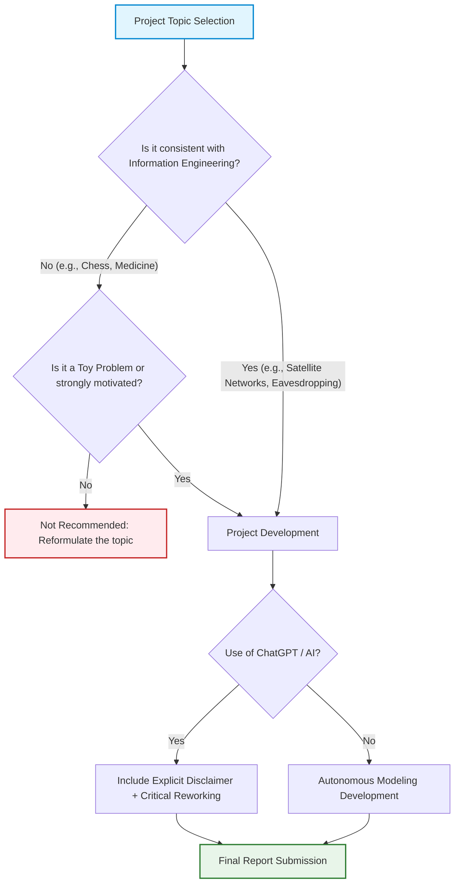
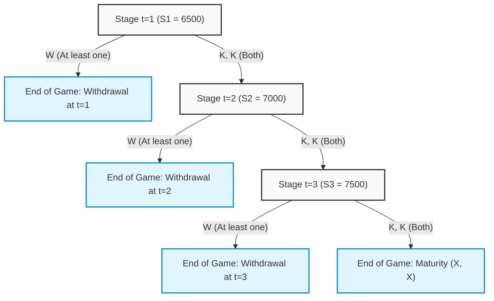
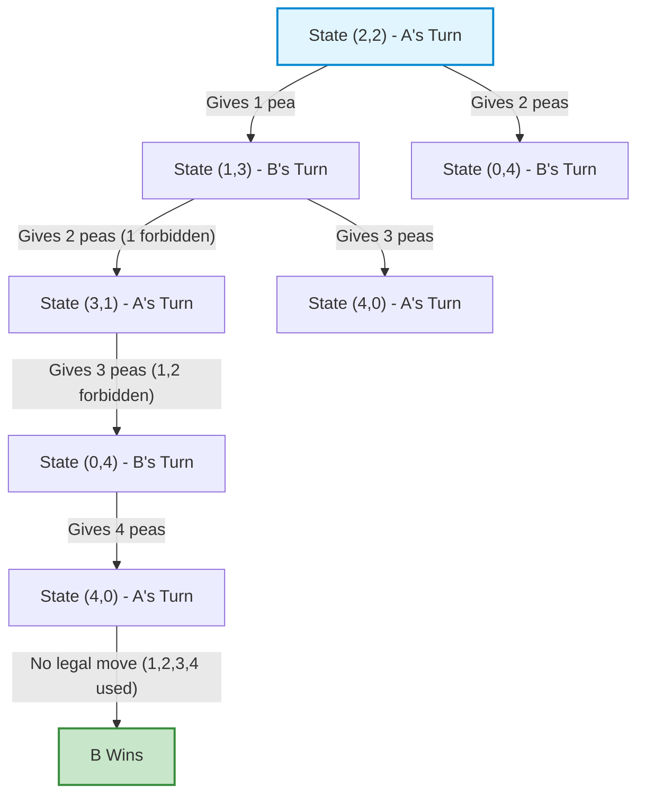
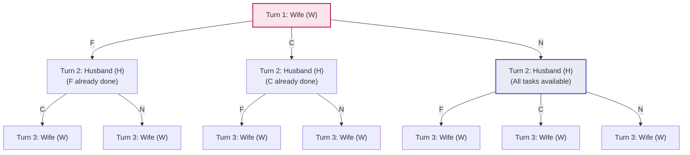
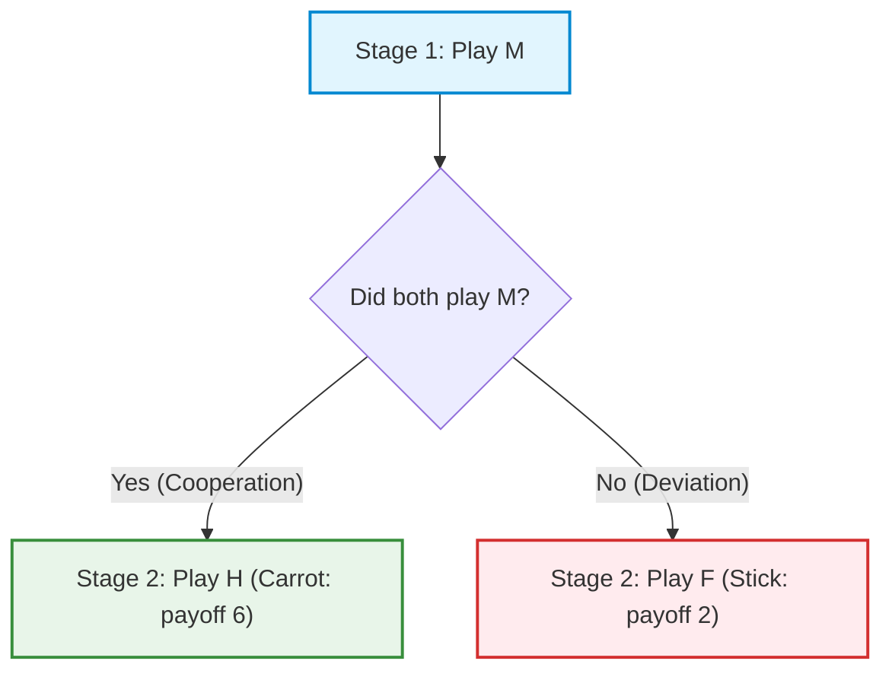
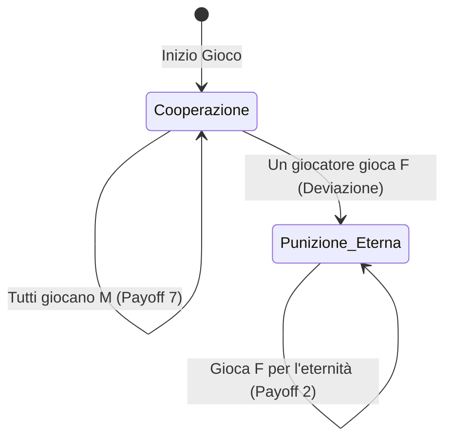

# Course Organization, Project Guidelines, and Practical Exercises

## Educational Overview

In this lecture, important organizational aspects regarding the completion of the Game Theory course are introduced, with a specific focus on the guidelines for carrying out the final project and the start of the practical exercise session.

The key concepts covered include:

* **Guidelines for the Mandatory Project:** Definition of the criteria for choosing research topics, with a strong recommendation toward open problems in Information Engineering (*IT Engineering*). Clarification on the permitted use of Generative Artificial Intelligence tools (*Generative AI*, e.g., ChatGPT), with the obligation of transparency, critical reworking, and personal validation of the results.
* **Teaching Schedule and Seminars:** Overview of the rescheduling of the final lectures and presentation of the in-depth seminar on *Multi-Agent Reinforcement Learning* (MARL), aimed at showing the interconnections between game theory and advanced machine learning.
* **Methodology for the Exercises:** Introduction to the guided resolution of practical problems (*toy problems*) to apply the mathematical models analyzed during the course.

---

### Administrative Information, Project Guidelines, and Lecture Schedule

#### Management and Rules of the Course Project

Completing the course project is **mandatory** for completing the course and passing the exam. The project represents an opportunity to apply the theoretical concepts of Game Theory to concrete modeling problems.

##### 1. Use of Generative Artificial Intelligence (*Generative AI*)
There is no methodological prejudice against using tools such as ChatGPT to support calculations or code development. However, the following operational rules apply:

> **Key Concept: Transparency and Added Value of the Analysis**
> - **Declaration Requirement (*Disclaimer*):** Any contribution generated by AI tools must be explicitly explained and declared within the project document.
> - **Inadequacy of Passive Use:** Submitting a project generated entirely by AI without any personal reworking is pedagogically equivalent to a blank submission (*blank project*). 
> - **Correct Approach:** AI must serve as a starting point (*hook*). The student must critically verify the mathematical derivations, validate the results, and propose personalized extensions or improvements.

##### 2. Topic Selection
* **Relevance to the Degree Program:** Proposed topics must be of general interest to Information Engineering (*IT Engineering*). Proposals outside the field (e.g., applications in medicine or social sciences) are admissible only if rigorously justified within the individual student's study plan.
* **Research Problems vs. Classic Games:** Developing projects on traditional games such as chess or online poker is strongly discouraged. These areas are already extensively covered in the scientific literature, and it is highly unlikely to produce an innovative contribution using standard Game Theory tools.
* **Recommended Approach (Crossover):** The best strategy consists in formulating a simplified problem (*toy problem*) by combining open research areas present in the instructor's material. For example, it is possible to combine *eavesdropping* techniques with *satellite networks*.

---

#### Lecture Schedule and Integrative Seminar

Due to the instructor's participation in a scientific conference abroad, the final phase of the course will undergo a reorganization of its delivery modes:

* **December 7 and 9:** Lectures delivered in online and asynchronous mode.
* **December 14:** Lecture delivered in online mode (synchronous/compatible with the time zone).
* **December 18 (Friday): In-Depth Scientific Seminar**
  * **Topic:** *Multi-Agent Reinforcement Learning* (MARL).
  * **Speaker:** Professor and active researcher at a French research institute.
  * **Relevance:** The topic is directly connected to Game Theory and represents an active research frontier. The seminar content is intended as a methodological starting point for potential degree theses or doctoral paths.
  * *Note on the syllabus:* The seminar is purely integrative and informative; **the topics covered in the seminar will not be subject to evaluation during the exam**.
* **December 23:** Preliminary assessment test (*preliminary test*).

---

#### Exercise Resolution Methodology

When tackling the exercises collected in the teaching material, the numerical or algebraic solution represents only a part of the process. 

The proper use of the exercises requires developing two fundamental skills:
1. **Understanding the Logical Structure:** Fully reconstructing and understanding every single mathematical step of the provided solution.
2. **Problem Framing:** Translating a descriptive or real-world problem into a formal Game Theory model, correctly identifying the set of players $N = \{1, 2, \dots, n\}$, the strategy space $S_i$ for each player $i$, and the corresponding utility or payoff functions $u_i(s_1, \dots, s_n)$.

---

### Exercise 1: Dynamic Game of the Joint Bank Account

#### 1. Problem Framing and Game Rules

Two partners, Anna ($A$) and Franz ($B$), open a joint bank account by depositing $5.000 \, €$ each at time $t = 0$ (total initial capital: $10.000 \, €$). 

The investment is designed to last 4 years, with natural maturity at $t = 4$. However, the two players have the option to make an early withdrawal at times $t = 1, 2, 3$.

The distribution rules and payoffs are defined as follows:

1. **Early withdrawal ($t \in \{1, 2, 3\}$):**
   If one or both players decide to withdraw (action **Withdraw**, $W$), the game ends immediately (*early termination*). The total sum redeemable from the account at time $t$ is penalized by the bank and equals:
   $$S(t) = 6000 + 500t$$
   - If **only one** withdraws ($W$) and the other keeps the funds (**Keep**, $K$), the player who withdrew obtains the entire total amount $S(t)$, while the other receives $0$.
   - If **both** withdraw ($W, W$), the sum is split equally: $\left(\frac{S(t)}{2}, \frac{S(t)}{2}\right)$.
   - If **both** keep ($K, K$), the game proceeds to the next stage $t+1$.

2. **Natural maturity ($t = 4$):**
   If both keep the funds across all three stages ($K, K, K$), each player receives a final sum equal to $X \, €$, with $X > 5000$.

The values of the early withdrawal sum in the various years are:
* $t = 1 \implies S(1) = 6.500 \, € \quad \implies \text{split } (3.250, 3.250)$
* $t = 2 \implies S(2) = 7.000 \, € \quad \implies \text{split } (3.500, 3.500)$
* $t = 3 \implies S(3) = 7.500 \, € \quad \implies \text{split } (3.750, 3.750)$

---

#### 2. Extensive Form Representation

The game is a **dynamic game with imperfect information** within each period: at each stage $t$, the moves of $A$ and $B$ are simultaneous. 

To model simultaneous moves in the game tree in extensive form, the decision node of $B$ is depicted enclosed in an **information set** covering the nodes generated by $A$'s action. This indicates that $B$ does not know which action $A$ chose in the same stage.

Generic payoff matrix for **Stage $t$** ($t \in \{1, 2, 3\}$):

| $A \setminus B$ | $W$ | $K$ |
| :--- | :---: | :---: |
| **$W$** | $\left(\frac{S(t)}{2}, \frac{S(t)}{2}\right)$ | $(S(t), 0)$ |
| **$K$** | $(0, S(t))$ | *Proceed to stage $t+1$* |

---

#### 3. Formalization of Strategies

> **KEY CONCEPT: Formal Definition of Strategies**
> 
> An extremely common mistake during exams is confusing strategies with *equilibrium paths*, counting only 4 options ($W$, $KW$, $KKW$, $KKK$).
> 
> **The strict rule is:** A strategy must specify the action to take at **EVERY decision node of a player**, regardless of whether that node is actually reached during the game.

* Each player ($A$ and $B$) has **3 decision nodes** (one for year $t=1$, one for year $t=2$, one for year $t=3$).
* At each node, the available alternatives are $2$ ($W$ or $K$).
* The total number of strategies for each player is therefore:
  $$2^3 = 8 \text{ strategie}$$

A generic strategy $s_i$ of player $i \in \{A, B\}$ is a triplet:
$$s_i = (a_1, a_2, a_3) \quad \text{con } a_t \in \{W, K\}$$

The 8 possible strategies for each player are:
$$S_i = \{ WWW, WWK, WKW, WKK, KWW, KWK, KKW, KKK \}$$

##### Why is $WWW$ formally different from $WWK$?
Although choosing $W$ at the first stage immediately ends the game, making node $t=3$ unreachable, planning the action at time $t=3$ is essential for assessing **rationality off the equilibrium path** (*off-equilibrium path*). Knowing what a player would do at a future stage determines the credibility of their threats or promises.

---

#### 4. Solution and Equilibria (Backward Induction)

To solve this dynamic game with imperfect information within stages, we apply **Backward Induction** by analyzing the *subgames* starting from the final stage ($t = 3$).

There are 3 subgames: the stage 3 subgame, the subgame consisting of stages 2 and 3, and the entire game.

---

##### Case A: $X = 7.200 \, €$

1. **Stage 3 Analysis ($t = 3$):**
   The amount available for early withdrawal is $S(3) = 7.500 \, €$. If both keep their funds ($K, K$), they receive $X = 7.200 \, €$ each.

   The normal form of the stage 3 subgame is:

   | $A \setminus B$ | $W$ | $K$ |
   | :--- | :---: | :---: |
   | **$W$** | $(3750, 3750)$ | $(7500, 0)$ |
   | **$K$** | $(0, 7500)$ | $(7200, 7200)$ |

   * Let us compare Player A's payoffs:
     * If $B$ plays $W$: $A$ receives $3750$ with $W$ versus $0$ with $K$ ($3750 > 0$).
     * If $B$ plays $K$: $A$ receives $7500$ with $W$ versus $7200$ with $K$ ($7500 > 7200$).
   * Consequently, action **$W$ is a strictly dominant strategy** for both players in the third stage.
   * The unique Nash Equilibrium (NE) of stage 3 is the action pair **$(W, W)$**, with payoffs $(3750, 3750)$.

2. **Backward Propagation to Stage 2 ($t = 2$):**
   We substitute the value of the unique stage 3 equilibrium, namely $(3750, 3750)$, into the $(K, K)$ outcome of stage 2, where $S(2) = 7.000 \, €$:

   | $A \setminus B$ | $W$ | $K$ |
   | :--- | :---: | :---: |
   | **$W$** | $(3500, 3500)$ | $(7000, 0)$ |
   | **$K$** | $(0, 7000)$ | $(3750, 3750)$ |

   * $W$ again dominates $K$ for both players ($3500 > 0$ and $7000 > 3750$).
   * The unique stage 2 equilibrium is **$(W, W)$**, guaranteeing payoffs $(3500, 3500)$.

3. **Backward Propagation to Stage 1 ($t = 1$):**
   Substituting the stage 2 payoffs into the $(K, K)$ outcome of stage 1 ($S(1) = 6.500 \, €$):

   | $A \setminus B$ | $W$ | $K$ |
   | :--- | :---: | :---: |
   | **$W$** | $(3250, 3250)$ | $(6500, 0)$ |
   | **$K$** | $(0, 6500)$ | $(3500, 3500)$ |

   * $W$ remains strictly dominant ($3250 > 0$ and $6500 > 3500$).

> **Case A Result ($X = 7200$):**
> * **Unique Subgame Perfect Nash Equilibrium (SPE - Subgame Perfect Equilibrium):**
>   $$(WWW, WWW)$$
> * **Equilibrium Path:** Both players withdraw immediately in the first year ($t = 1$).
> * **Note on General Nash Equilibria:** Other Nash equilibria exist in extensive form (for example, profiles of the form $(W**, W**)$, such as $(WWK, WKK)$), because the action at time $t=1$ ends the game. However, only $(WWW, WWW)$ relies on credible threats in every subgame and is therefore the unique SPE.

---

##### Case B: $X = 8.000 \, €$

1. **Stage 3 Analysis ($t = 3$):**
   With $X = 8.000 \, €$, the payoff from final cooperation exceeds the maximum amount obtainable by withdrawing alone ($7.500 \, €$).

   | $A \setminus B$ | $W$ | $K$ |
   | :--- | :---: | :---: |
   | **$W$** | $(3750, 3750)$ | $(7500, 0)$ |
   | **$K$** | $(0, 7500)$ | $\mathbf{(8000, 8000)}$ |

   * Action $W$ **is no longer strictly dominant**, because if the other player plays $K$, it is preferable to play $K$ ($8000 > 7500$).
   * Stage 3 has **two pure-strategy Nash Equilibria**:
     1. $NE_1 = (W, W)$ with payoffs $(3750, 3750)$
     2. $NE_2 = (K, K)$ with payoffs $(8000, 8000)$
   *(Note: there is also a third, mixed-strategy equilibrium $NE_3$, in which $W$ is played with probability $p = 2/13$, producing an expected payoff of approximately $6769.23 \, €$).*

2. **Backward Propagation and Multiple SPEs:**
   Since stage 3 has several Nash equilibria, the choice of which equilibrium to propagate backward produces different incentive structures in the preceding subgames:

   * **Propagating the "unfavorable" equilibrium $NE_1 = (3750, 3750)$:**
     This leads to exactly the dynamics of Case A. The strategy profile $$(WWW, WWW)$$ remains a **Subgame Perfect Equilibrium**.

   * **Propagating the "favorable" equilibrium $NE_2 = (8000, 8000)$:**
     Substituting $(8000, 8000)$ into the $(K,K)$ node of stage 2 ($S(2) = 7000$):
     * If the other player plays $K$, playing $K$ guarantees $8000$ versus the $7000$ obtained from $W$.
     * Consequently, $(K, K)$ becomes the preferred Nash equilibrium at stage 2 as well.
     * Propagating backward further to stage 1 shows that, at time $t=1$ as well, the $(K, K)$ outcome can be sustained as an equilibrium.

> **Case B Result ($X = 8000$):**
> In this case, there are **multiple subgame perfect equilibria (SPEs)**:
> 1. $(WWW, WWW)$: leads to immediate withdrawal at time $t=1$, with payoffs $(3250, 3250)$.
> 2. $(KKK, KKK)$: leads to keeping the funds until maturity $t=4$, with payoffs $(8000, 8000)$.
> 3. **Hybrid Combinations (e.g., $WWK, WWK$):** Profiles that play $W$ initially but prescribe $K$ in a possible third stage are also valid SPEs, precisely because the prescribed third-stage action ($K,K$) is an actual Nash Equilibrium of that subgame.

---

### Exercise 2: The Pea Game (*Pea Game*)

#### Problem Formulation and Rules

Consider a sequential game between two players, Player A and Player B, with perfect information (*sequential game with perfect information*).

The game begins with an initial endowment of peas for each player. Specifically, the starting condition is represented by state $(2, 2)$, where both A and B have 2 peas.

The rules of the game are as follows:
1. **Turn order:** Player A moves first.
2. **Legal move:** A move consists of giving the opponent a positive integer number of peas ($1, 2, 3, \dots$).
3. **No repetition:** A move (that is, giving away a particular number of peas) that either player has previously made during the game cannot be repeated.
4. **Winning/termination condition:** The game ends when the player whose turn it is has no legal moves available. The player who cannot make a move loses, while the opponent wins.

> **Key Concept: Formal Modeling of End-of-Game States**
>
> When modeling a sequential game, one might be tempted to stop the decision tree early upon "seeing" that a player is inevitably going to win (somewhat like chess software evaluating a winning position).
>
> Formally and ethically speaking, **the game does not end while legal moves still exist**. A terminal node is reached *only* when a player's set of legal moves is empty. The analytical result is unchanged, but a rigorous representation requires extending the tree until moving is actually impossible.

The game's payoffs are binary: a victory for B gives B a higher utility than A (e.g., payoffs $(0, 100)$ or $(-100, +100)$), while a victory for A gives the opposite utility. All terminal nodes where "B Wins" are equivalent in terms of payoffs.

---

#### Solution by Backward Induction and Number of Equilibria

Applying the *backward induction* algorithm from the leaf nodes:

1. At the final decision nodes, players choose the action that guarantees their victory.
2. Moving back up the game tree, Player B can always select branches that lead to victory, regardless of Player A's initial move.
3. On the first turn, Player A must choose between two branches: both inevitably lead to B's victory. Player A is completely indifferent between the two initial moves (both lead to a loss).

**Game result:** Player B always wins, assuming rational behavior by the players.

#### Theoretical Question: Uniqueness of Equilibrium in Sequential Games

One might ask: *how many Subgame Perfect Nash Equilibria (Subgame Perfect Equilibria - SPEs) does this game have?*

Since this is a finite sequential game with perfect information, one might expect the equilibrium to be unique. In this case, however, there are **two Subgame Perfect Nash Equilibria**.

> **Key Concept: Condition for Uniqueness of the SPE**
>
> A sufficient condition for a sequential game with perfect information to have **one and only one** SPE is that **all payoffs at terminal nodes (leaves) are strictly distinct** for each player.
>
> This condition is **not** satisfied in this exercise: the various leaf nodes where "B Wins" assign B (and A) exactly the same payoff value. Since A is indifferent between the initial moves (both give the same losing payoff), two distinct equilibrium paths arise.

---

### Exercise 3: Household Management (*Household Management*)

#### Problem Formulation and Rules

Consider a sequential game between two spouses (Wife - $W$, from the English *Wife*, and Husband - $H$, from the English *Husband*) to organize the day's household tasks.

The day consists of 3 decision turns:
1. **Morning (Turn 1):** The Wife ($W$) moves.
2. **Afternoon (Turn 2):** The Husband ($H$) moves, observing the move his wife made in the morning.
3. **Evening (Turn 3):** The Wife ($W$) moves again.

The possible actions at each turn are chosen from three alternatives:
* $F$: Prepare food (*Fix food*)
* $C$: Clean the house (*Clean house*)
* $N$: Do nothing (*Do nothing*)

**Action and payoff rules:**
* **Tasks cannot be repeated:** The task actions ($F$ and $C$) can be performed only once during the day. If an action has already been performed, it cannot be chosen again (or provides no additional payoff).
* **Idleness can be repeated:** Action $N$ (*do nothing*) can be freely repeated by either player at any turn (e.g., the sequence $N-N-N$ is possible).
* **Costs and Benefits:**
  * The **cost** of an action is borne exclusively by the person performing it.
  * The **benefit** of an action is enjoyed by **both** players (a household public good).
* **Early bird rule (*Early bird*):** Performing an action in the morning provides a benefit bonus (e.g., $+10\%$ utility), but also requires greater effort (cost).

---

#### Information Structure of the Game Tree

The game has **perfect information** (*complete and perfect information*). When the Husband chooses at Turn 2, he knows exactly which move the Wife made at Turn 1.

> **Key Concept: Information Sets and Game Tree Diagrams**
>
> A very common exam mistake is forgetting to draw the dashed lines or bubbles representing **information sets** (*information sets*).
> * If the Husband's nodes were joined by a dashed line, this would mean that he **does not know** what his wife did (a game with imperfect information), and the set of available actions at those nodes would have to be identical.
> * In this exercise, the nodes are **not** connected: the Husband can distinguish exactly which node he is at, so the available subsets of actions differ according to the preceding history.

---

#### Formal Counting of Strategies

A **strategy** in extensive form is a complete plan of action specifying which move to choose at *every* decision node where the player must choose, including nodes that will never be reached along the equilibrium path.

##### The Husband's Strategies ($H$):
The Husband has 3 decision nodes at Turn 2:
1. The node after $W$ chooses $F$: $H$ can choose from $\{C, N\}$ (2 alternatives).
2. The node after $W$ chooses $C$: $H$ can choose from $\{F, N\}$ (2 alternatives).
3. The node after $W$ chooses $N$: $H$ can choose from $\{F, C, N\}$ (3 alternatives).

$$\text{Numero strategie } H = 2 \times 2 \times 3 = 12 \text{ strategie}$$

##### The Wife's Strategies ($W$):
The Wife chooses at Turn 1 (1 node with 3 options: $\{F, C, N\}$), and then at Turn 3 at every possible history-dependent node created by the preceding choices.
Counting the combination of all possible choices for each history:

$$\text{Numero strategie } W = 3 \times (2^4 \times 3) = 144 \text{ strategie}$$

---

#### Solution by Backward Induction

Performing backward induction from Turn 3 (the Wife's choice upon returning home) and working back to Turn 1:

1. **Turn 3 (Wife):** The Wife chooses the remaining task with the highest payoff (if any task remains), or $N$.
2. **Turn 2 (Husband):** Anticipating the Wife's best responses at Turn 3, the Husband selects the best action at Turn 2.
3. **Turn 1 (Wife):** The Wife anticipates the Husband's reactions and chooses the ideal initial move.

##### Outcome of the Subgame Perfect Equilibrium (SPE):
* **Turn 1 ($W$):** Chooses $N$ (Does nothing in the morning).
* **Turn 2 ($H$):** Chooses $F$ (Cooks in the middle of the day).
* **Turn 3 ($W$):** Chooses $C$ (Cleans the house in the evening).

**Final payoffs obtained:** $(70, 70)$

*(Note: Explanatory step added for teaching clarity: The exact values follow from the cost/benefit functions provided in the problem, where balanced performance of the tasks leads to perfectly equal final payoffs).*

---

#### Critical Analysis: Pareto Efficiency and Strategic Dynamics

Two important theoretical reflections emerge from the solution analysis:

1. **Uniqueness of the SPE:**
   Since all payoffs associated with the leaves of the game tree are numerically distinct, the resulting Subgame Perfect Equilibrium $(N, F, C)$ is **unique**.

2. **Pareto Inefficiency (*Pareto Inefficiency*):**
   The equilibrium outcome $(70, 70)$ **is not Pareto-efficient**. Other terminal nodes in the game would have guaranteed strictly better payoffs for both players (for example, outcomes such as $(73, 75)$).
   This confirms that individual rationality in Nash/SPE equilibria does not guarantee maximum overall social welfare.

3. **Strategic Dynamics of "Commitment":**
   Why does the Wife begin the game by doing nothing ($N$), even though she knows that performing an action in the morning yields a greater benefit?
   * If the Wife worked at Turn 1 (e.g., cooking $F$), the Husband would respond at Turn 2 by playing $N$ (*free-riding*), knowing that the Wife would be compelled to clean $C$ at Turn 3 to avoid leaving the house dirty.
   * The Wife strategically plays $N$ at Turn 1 as a form of **strategic commitment / constraint** (*strategic commitment*): she forces the Husband to take action at Turn 2, because if he also played $N$, the house would remain in a condition highly unfavorable to both.

---

### Complete Exercise on Repeated Games: Finite vs Infinite Horizon

Let us analyze players' behavior in a **Repeated Game** (*Repeated Game*), comparing a finite time horizon ($T = 2$) with an infinite time horizon ($T = \infty$). The underlying normal-form game (*Stage Game*) extends the classic **Prisoner's Dilemma** (*Prisoner's Dilemma*) by adding another strategic option.

---

#### Structure of the Base Game and Nash Equilibria (*Stage Game*)

In the one-shot game, each player has three pure strategies:
* $M$ (*Mutual cooperation / Medium*): guarantees the socially optimal payoff when played by both ($(7,7)$).
* $F$ (*Defection / Fight*): the classic prisoner's dilemma strategy.
* $H$ (*Enhanced cooperation / High*): a risky alternative that serves as a potential reward.

Analyzing the single-stage payoff matrix reveals the following properties:
1. **Pure-Strategy Nash Equilibria**:
   * $(F,F)$ with payoffs $(2,2)$: represents the "harsh" punishment equilibrium, or **Stick** (*Stick*).
   * $(H,H)$ with payoffs $(6,6)$: represents an equilibrium with a favorable outcome, or **Carrot** (*Carrot*).
2. **Mixed-Strategy Equilibrium**: A third equilibrium mixes strategies $F$ and $H$.
3. **Non-Equilibrium Outcome**: The action profile $(M,M)$, despite offering the highest overall payoff $(7,7)$, **is not a Nash Equilibrium** of the one-shot game. A deviating player has a short-sighted incentive to play $F$ against $M$, obtaining a payoff of $9$ instead of $7$.

---

#### Finite-Horizon Repetition ($T = 2$): Stick and Carrot Strategy

Now consider repeating the game for two consecutive stages ($T = 2$), with a **Discount Factor** (*Discount Factor*) $\delta \in (0, 1]$.

> **Key Concept: Backward Induction at the Second Stage**
> In a two-stage game, at the **second stage (the final stage)** players necessarily *must* play a Nash Equilibrium of the base game. Since this is the last turn, players' rationality rules out any form of non-binding cooperation: there is no future in which a present sacrifice can be compensated or a defection punished.

At the **first stage**, however, an action profile that is *not* a Nash Equilibrium of the base game (such as $(M,M)$) can be sustained by making second-stage behavior contingent on the first-stage outcome through a **Stick and Carrot** strategy (*Stick and Carrot Strategy*).

##### Definition of the Strategy
* **Stage 1**: Play $M$.
* **Stage 2**:
  * If $(M,M)$ was played in the First Stage, play the "Carrot" equilibrium $(H,H)$ (payoff 6).
  * If anyone deviated in the First Stage, trigger the two-sided "Stick" punishment $(F,F)$ (payoff 2).

##### Condition for Sustaining the Equilibrium (SPNE)

To verify whether this structure constitutes a **Subgame Perfect Nash Equilibrium** (*Subgame Perfect Nash Equilibrium - SPNE*), we compare the discounted payoffs of the two First-Stage choices:

1. **Payoff from Continued Cooperation ($V_{coop}$)**:
   $$V_{coop} = 7 + 6\delta$$

2. **Payoff from Short-Sighted Deviation ($V_{dev}$)**:
   If Player 1 deviates unilaterally at Stage 1 (playing $F$ while the other player plays $M$), they immediately obtain 9. At Stage 2 they will be punished, and both will play $(F,F)$:
   $$V_{dev} = 9 + 2\delta$$

For first-stage cooperation to be sustainable, the inequality $V_{coop} \ge V_{dev}$ must hold:

$$7 + 6\delta \ge 9 + 2\delta$$

*Note: Explanatory step added for teaching clarity.*
Let us solve the inequality for $\delta$:
$$6\delta - 2\delta \ge 9 - 7 \implies 4\delta \ge 2 \implies \delta \ge \frac{1}{2}$$

**Result**: First-stage cooperation is sustainable over a horizon of just two stages if and only if the discount factor is sufficiently high ($\delta \ge 0.5$).

---

#### Infinite-Horizon Repetition ($T = \infty$): Trigger Strategy (*Grim Trigger*)

What happens if the game is repeated infinitely? With an infinite time horizon, we no longer need a formal "reward" such as equilibrium $H$ at the second stage. Simply continuing mutual cooperation forever is sufficient to incentivize the players.

We use the classic **Grim Trigger Strategy** (*Grim Trigger Strategy*):
* Play $M$ initially and keep playing $M$ at every stage $t$ as long as everyone plays $M$.
* If a player deviates even once, switch to playing the punishment $F$ forever (from stage $t+1$ to $\infty$).

##### Payoff Calculation and Discount Threshold

1. **Payoff from Continued Cooperation ($V_{coop}$)**:
   $$V_{coop} = 7 + 7\delta + 7\delta^2 + 7\delta^3 + \dots = \sum_{t=0}^{\infty} 7\delta^t = \frac{7}{1 - \delta}$$

2. **Payoff from Short-Sighted Deviation ($V_{dev}$)**:
   Deviating at the first stage yields 9, followed by eternal punishment with payoff 2:
   $$V_{dev} = 9 + 2\delta + 2\delta^2 + 2\delta^3 + \dots = 9 + \sum_{t=1}^{\infty} 2\delta^t = 9 + \frac{2\delta}{1 - \delta}$$

We impose the condition for cooperation to be preferable to deviation ($V_{coop} \ge V_{dev}$):

$$\frac{7}{1 - \delta} \ge 9 + \frac{2\delta}{1 - \delta}$$

*Note: Explanatory step added for teaching clarity.*
Multiply both sides by $(1 - \delta)$, since $(1 - \delta) > 0$:

$$7 \ge 9(1 - \delta) + 2\delta$$
$$7 \ge 9 - 9\delta + 2\delta$$
$$7 \ge 9 - 7\delta$$
$$7\delta \ge 2 \implies \delta \ge \frac{2}{7}$$

---

#### Critical Comparison of the Results

> **Key Concept: The Power of Infinity**
> Comparing the two conditions on the discount factor $\delta$:
> * Finite Horizon ($T = 2$ with Carrot): $\delta \ge \frac{1}{2} = 0.50$
> * Infinite Horizon ($T = \infty$ with Grim Trigger): $\delta \ge \frac{2}{7} \approx 0.286$
>
> This comparison shows that **infinite repetition facilitates cooperation** (it requires less patience/valuation of the future, $\approx 0.286$ versus $0.50$), even without resorting to a complex reward structure such as the "carrot" $H$. Extending the time horizon indefinitely makes the mere threat of eternal punishment sufficiently daunting to discourage opportunistic deviation.

---

> [!NOTE]
> ### Exam Notes and Instructor Announcements
> - **Mandatory project**: The instructor reminded students that this year's project is mandatory in order for the exam grade to be officially recorded and finalized.
> - **Preliminary test date**: The preliminary assessment/test (which counts toward passing the preliminary exam if the result is sufficient) will take place on **December 23**.
> - **Topic NOT required for the exam**: The *multi-agent reinforcement learning* seminar (held by the visiting professor on December 18) is outside the syllabus and will **not** be the subject of exam questions.
> - **Formal solution and common exam mistakes**:
>   - The exam requires both solving the game and precisely formalizing its methodology (extensive-form representation and formalization of strategies).
>   - **Representation of strategies**: The instructor notes that this is an exam question on which many students lose marks. Strategies must be defined mechanically (counting all nodes assigned to the player and their available alternatives at each node, regardless of whether some nodes are not reached in the final outcome).
>   - **Information sets (*Information sets*)**: The most common mistake by far in exams on extensive-form games is forgetting to draw dashed lines (or "blobs") around nodes to indicate simultaneous moves/imperfect information.
