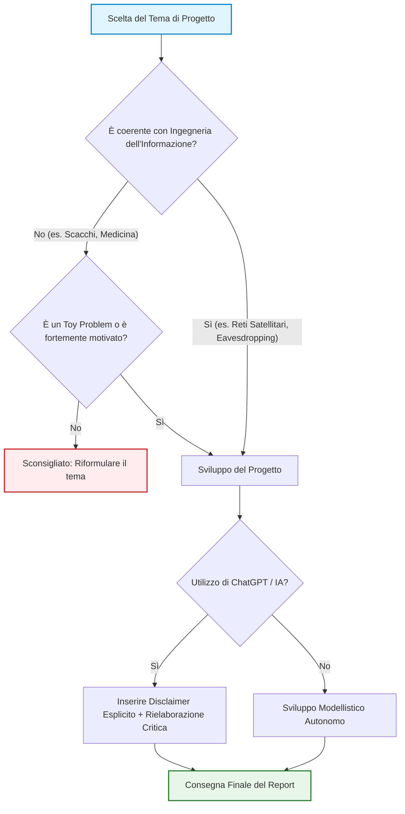
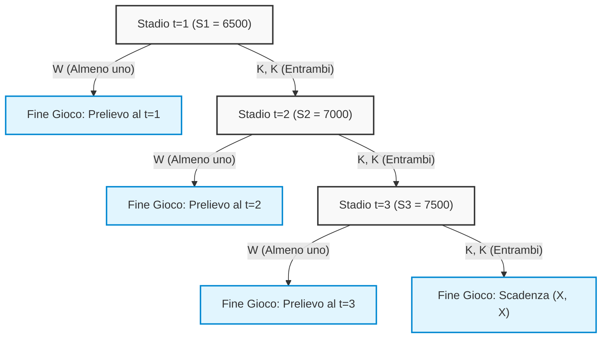
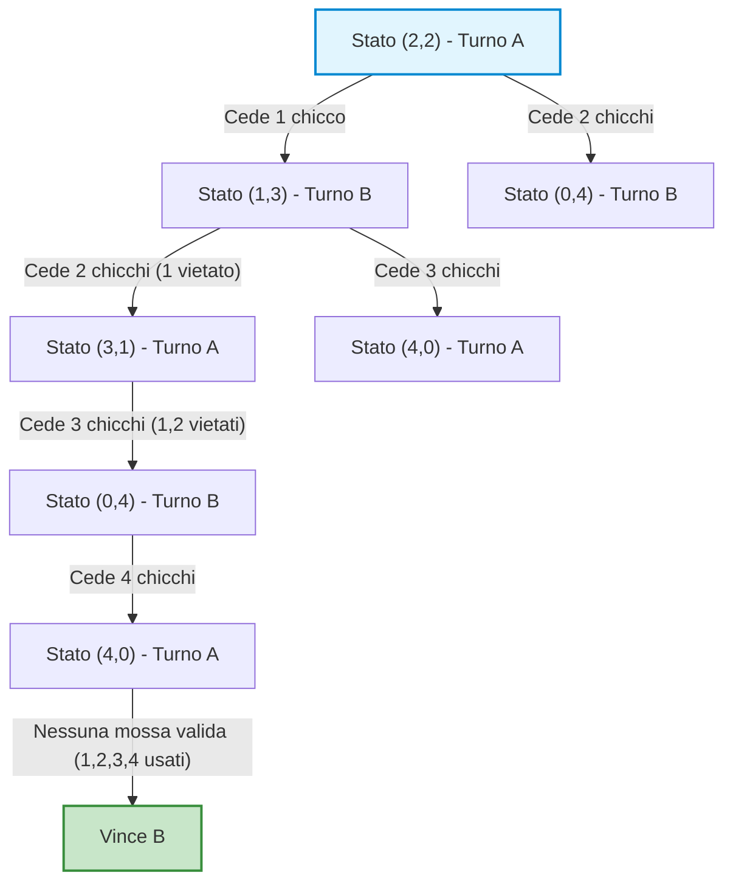
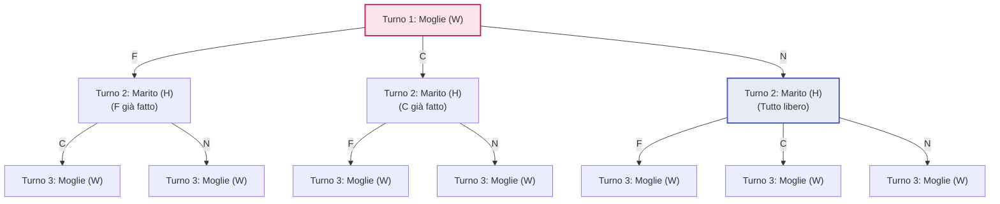
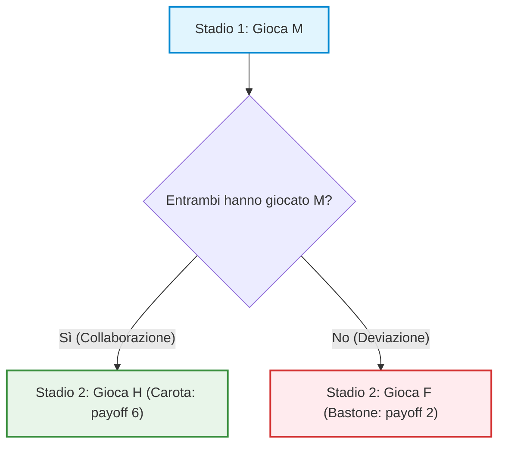
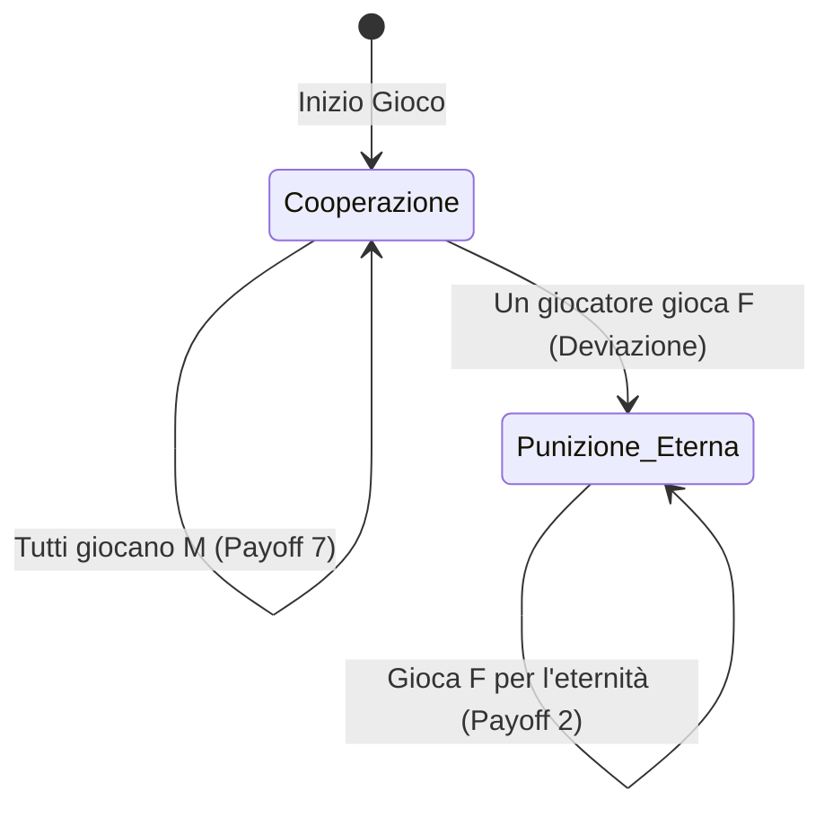

# Organizzazione del Corso, Linee Guida per i Progetti ed Esercitazione Pratica

## Overview Didattica

In questa lezione vengono introdotti importanti aspetti organizzativi inerenti al completamento del corso di Teoria dei Giochi (*Game Theory*), con un focus specifico sulle linee guida per lo svolgimento del progetto finale e l'avvio della sessione di esercitazione pratica.

I concetti chiave trattati includono:

* **Linee Guida per il Progetto Obbligatorio (*Mandatory Project*):** Definizione dei criteri di scelta dei temi di ricerca, con forte raccomandazione verso problemi aperti dell'ingegneria dell'informazione (*IT Engineering*). Chiarimento sull'uso consentito degli strumenti di Intelligenza Artificiale Generativa (*Generative AI*, es. ChatGPT), con l'obbligo di trasparenza, rielaborazione critica e validazione personale dei risultati.
* **Pianificazione Didattica e Seminari:** Panoramica sulla rimodulazione delle ultime lezioni e presentazione del seminario di approfondimento sul *Multi-Agent Reinforcement Learning* (MARL), volto a mostrare le interconnessioni tra la teoria dei giochi e l'apprendimento automatico avanzato.
* **Metodologia per le Esercitazioni:** Introduzione alla risoluzione guidata di problemi pratici (*toy problems*) per applicare i modelli matematici analizzati durante il corso.

---

### Informazioni Gestionali, Linee Guida per i Progetti e Calendario delle Lezioni

#### Gestione e Regole del Progetto Didattico

La realizzazione del progetto didattico è **obbligatoria** ai fini del completamento del corso e del superamento dell'esame. Il progetto rappresenta l'opportunità per applicare i concetti teorici della Teoria dei Giochi (*Game Theory*) a problemi modellistici concreti.

##### 1. Utilizzo dell'Intelligenza Artificiale Generativa (*Generative AI*)
Non vi è alcun pregiudizio metodologico verso l'uso di strumenti quali ChatGPT per supportare i calcoli o lo sviluppo del codice. Tuttavia, valgono le seguenti regole operative:

> **Concetto Chiave: Trasparenza e Valore Aggiunto dell'Analisi**
> - **Obbligo di Dichiarazione (*Disclaimer*):** Qualsiasi contributo generato da strumenti di IA deve essere esplicitamente spiegato e dichiarato all'interno del documento di progetto.
> - **Inadeguatezza dell'Uso Passivo:** Inviare un progetto generato interamente dall'IA senza alcuna rielaborazione personale è considerato didatticamente equivalente a una consegna in bianco (*blank project*). 
> - **Approccio Corretto:** L'IA deve servire da punto di partenza (*hook*). Lo studente deve verificare критиicamente le derivazioni matematiche, validare i risultati e proporre estensioni o miglioramenti personalizzati.

##### 2. Selezione del Tema (*Topic Selection*)
* **Pertinenza con il Corso di Laurea:** I temi proposti devono essere di interesse generale per l'Ingegneria dell'Informazione (*IT Engineering*). Proposte esterne al settore (es. applicazioni in ambito medico o scienze sociali) sono ammissibili solo se rigorosamente motivate all'interno del piano di studi del singolo studente.
* **Problemi di Ricerca vs. Giochi Classici:** È fortemente sconsigliato sviluppare progetti su giochi tradizionali quali scacchi o poker online. Questi ambiti sono già ampiamente coperti dalla letteratura scientifica ed è altamente improbabile produrre un contributo innovativo con gli strumenti della Teoria dei Giochi standard.
* **Approccio Consigliato (Crossover):** La strategia migliore consiste nel formulare un problema semplificato (*toy problem*) incrociando ambiti di ricerca aperti presenti nel materiale del docente. Ad esempio, è possibile combinare tecniche di intercettazione (*eavesdropping*) con reti di comunicazione satellitari (*satellite networks*).

---

#### Calendario delle Lezioni e Seminario Integrativo

A causa della partecipazione del docente a una conferenza scientifica all'estero, la fase finale del corso subirà una riorganizzazione delle modalità di erogazione:

* **7 e 9 Dicembre:** Lezioni erogate in modalità online ed asincrona.
* **14 Dicembre:** Lezione erogata in modalità online (sincrona/compatibilmente con il fuso orario).
* **18 Dicembre (Venerdì): Seminario di Approfondimento Scientifico**
  * **Tema:** Apprendimento per Rinforzo Multi-Agente (*Multi-Agent Reinforcement Learning - MARL*).
  * **Relatore:** Docente ed esperto di ricerca attivo presso un istituto di ricerca francese.
  * **Rilevanza:** Il tema è direttamente connesso alla Teoria dei Giochi e rappresenta una frontiera di ricerca attiva. Il contenuto del seminario è pensato come spunto metodologico per eventuali tesi di laurea o percorsi di dottorato.
  * *Nota sul programma:* Il seminario è a carattere puramente integrativo e informativo; **gli argomenti trattati nel seminario non saranno oggetto di valutazione in sede d'esame**.
* **23 Dicembre:** Prova di verifica preliminare (*preliminary test*).

---

#### Metodologia di Risoluzione degli Esercizi

Nell'affrontare gli esercizi raccolti nel materiale didattico, la risoluzione numerica o algebrica rappresenta solo una parte del processo. 

La corretta fruizione degli esercizi richiede di sviluppare due capacità fondamentali:
1. **Comprensione della Struttura Logica:** Ricostruire e comprendere appieno ogni singolo passaggio matematico della soluzione fornita.
2. **Inquadramento del Problema (*Problem Framing*):** Tradurre un problema descrittivo o reale in un modello formale di Teoria dei Giochi, identificando correttamente l'insieme dei giocatori $N = \{1, 2, \dots, n\}$, lo spazio delle strategie $S_i$ per ciascun giocatore $i$, e le relative funzioni di utilità o payoff $u_i(s_1, \dots, s_n)$.

---

### Esercizio 1: Gioco Dinamico del Conto Corrente Cointestato

#### 1. Inquadramento del Problema e Regole del Gioco

Due partner, Anna ($A$) e Franz ($B$), aprono un conto corrente cointestato versando $5.000 \, €$ ciascuno al tempo $t = 0$ (capitale iniziale totale: $10.000 \, €$). 

L'investimento è pensato per durare 4 anni, con scadenza naturale a $t = 4$. Tuttavia, i due giocatori hanno la possibilità di effettuare un prelievo anticipato ai tempi $t = 1, 2, 3$.

 Le regole di ripartizione e i payoff sono stabiliti come segue:

1. **Prelievo anticipato ($t \in \{1, 2, 3\}$):**
   Se uno o entrambi i giocatori decidono di prelevare (azione **Withdraw**, $W$), il gioco termina immediatamente (*early termination*). La somma totale riscattabile dal conto al tempo $t$ è penalizzata dalla banca ed è pari a:
   $$S(t) = 6000 + 500t$$
   - Se **uno solo** preleva ($W$) e l'altro mantiene i fondi (**Keep**, $K$), chi ha prelevato ottiene l'intero montepremi $S(t)$, mentre l'altro ottiene $0$.
   - Se **entrambi** prelevano ($W, W$), la somma viene divisa equamente: $\left(\frac{S(t)}{2}, \frac{S(t)}{2}\right)$.
   - Se **entrambi** mantengono ($K, K$), il gioco prosegue allo stadio successivo $t+1$.

2. **Scadenza naturale ($t = 4$):**
   Se entrambi mantengono i fondi per tutti e tre gli stadi ($K, K, K$), ciascun giocatore riceve una somma finale pari a $X \, €$, con $X > 5000$.

I valori della somma di prelievo anticipato nei vari anni sono:
* $t = 1 \implies S(1) = 6.500 \, € \quad \implies \text{split } (3.250, 3.250)$
* $t = 2 \implies S(2) = 7.000 \, € \quad \implies \text{split } (3.500, 3.500)$
* $t = 3 \implies S(3) = 7.500 \, € \quad \implies \text{split } (3.750, 3.750)$

---

#### 2. Rappresentazione in Forma Estesa (Extensive Form)

Il gioco è uno **gioco dinamico ad informazione imperfetta** all'interno di ciascun periodo: ad ogni stadio $t$, le mosse di $A$ e $B$ sono simultanee. 

Per modellare le mosse simultanee nell'albero di gioco in forma estesa (Extensive Form), si rappresenta il nodo di decisione di $B$ racchiuso in un **insieme di informazione** (Information Set) che copre i nodi generati dall'azione di $A$. Questo indica che $B$ non sa quale azione abbia scelto $A$ nello stesso stadio.

Matrice di payoff generica per lo **Stadio $t$** ($t \in \{1, 2, 3\}$):

| $A \setminus B$ | $W$ | $K$ |
| :--- | :---: | :---: |
| **$W$** | $\left(\frac{S(t)}{2}, \frac{S(t)}{2}\right)$ | $(S(t), 0)$ |
| **$K$** | $(0, S(t))$ | *Passa a stadio $t+1$* |

---

#### 3. Formalizzazione delle Strategie

> **CONCETTO CHIAVE: Definizione Formale delle Strategie**
> 
> Un errore estremamente comune durante gli esami consiste nel confondere le strategie con i *percorsi di equilibrio* (*equilibrium paths*), contando solo 4 opzioni ($W$, $KW$, $KKW$, $KKK$).
> 
> **La regola rigorosa è:** Una strategia deve specificare l'azione da intraprendere in **OGNI nodo di decisione di un giocatore**, indipendentemente dal fatto che quel nodo sia effettivamente raggiunto durante la partita.

* Ogni giocatore ($A$ e $B$) possiede **3 nodi di decisione** (uno per l'anno $t=1$, uno per l'anno $t=2$, uno per l'anno $t=3$).
* Ad ogni nodo, le alternative disponibili sono $2$ ($W$ oppure $K$).
* Il numero totale di strategie per ciascun giocatore è dunque:
  $$2^3 = 8 \text{ strategie}$$

Una generica strategia $s_i$ del giocatore $i \in \{A, B\}$ è una tripletta:
$$s_i = (a_1, a_2, a_3) \quad \text{con } a_t \in \{W, K\}$$

Le 8 strategie possibili per ciascun giocatore sono:
$$S_i = \{ WWW, WWK, WKW, WKK, KWW, KWK, KKW, KKK \}$$

##### Perché $WWW$ è formalmente diversa da $WWK$?
Anche se giocata al primo stadio la scelta $W$ interrompe subito il gioco rendendo il nodo $t=3$ irraggiungibile, la pianificazione dell'azione al tempo $t=3$ è fondamentale per valutare la **razionalità fuori dal percorso di equilibrio** (*off-equilibrium path*). Sapere cosa farebbe un giocatore in uno stadio futuro definisce la credibilità delle sue minacce o promesse.

---

#### 4. Risoluzione ed Equilibri (Induzione a Ritroso)

Per risolvere questo gioco dinamico ad informazione imperfetta negli stadi, si applica l'**Induzione a Ritroso** (*Backward Induction*) analizzando i sottogiochi (*subgames*) a partire dall'ultimo stadio ($t = 3$).

Ci sono 3 sottogiochi nel gioco: il sottogiochetto dello stadio 3, il sottogioco composto dagli stadi 2 e 3, e l'intero gioco.

---

##### Caso A: $X = 7.200 \, €$

1. **Analisi dello Stadio 3 ($t = 3$):**
   La somma disponibile per il prelievo anticipato è $S(3) = 7.500 \, €$. Se entrambi mantengono ($K, K$), ottengono $X = 7.200 \, €$ ciascuno.

   La forma normale del sottogioco allo stadio 3 è:

   | $A \setminus B$ | $W$ | $K$ |
   | :--- | :---: | :---: |
   | **$W$** | $(3750, 3750)$ | $(7500, 0)$ |
   | **$K$** | $(0, 7500)$ | $(7200, 7200)$ |

   * Confrontiamo i payoff per il Giocatore A:
     * Se $B$ gioca $W$: $A$ ottiene $3750$ con $W$ rispetto a $0$ con $K$ ($3750 > 0$).
     * Se $B$ gioca $K$: $A$ ottiene $7500$ con $W$ rispetto a $7200$ con $K$ ($7500 > 7200$).
   * Di conseguenza, l'azione **$W$ è una strategia strettamente dominante** per entrambi i giocatori nel terzo stadio.
   * L'unico Equilibrio di Nash (NE) dello stadio 3 è la coppia di azioni **$(W, W)$**, con payoff $(3750, 3750)$.

2. **Retro-propagazione allo Stadio 2 ($t = 2$):**
   Sostituiamo il valore dell'unico equilibrio dello stadio 3, ossia $(3750, 3750)$, nell'esito $(K, K)$ dello stadio 2 dove $S(2) = 7.000 \, €$:

   | $A \setminus B$ | $W$ | $K$ |
   | :--- | :---: | :---: |
   | **$W$** | $(3500, 3500)$ | $(7000, 0)$ |
   | **$K$** | $(0, 7000)$ | $(3750, 3750)$ |

   * $W$ domina nuovamente $K$ per entrambi ($3500 > 0$ e $7000 > 3750$).
   * L'unico equilibrio dello stadio 2 è **$(W, W)$**, che garantisce un payoff di $(3500, 3500)$.

3. **Retro-propagazione allo Stadio 1 ($t = 1$):**
   Sostituendo il payoff dello stadio 2 nell'esito $(K, K)$ dello stadio 1 ($S(1) = 6.500 \, €$):

   | $A \setminus B$ | $W$ | $K$ |
   | :--- | :---: | :---: |
   | **$W$** | $(3250, 3250)$ | $(6500, 0)$ |
   | **$K$** | $(0, 6500)$ | $(3500, 3500)$ |

   * $W$ è ancora strettamente dominante ($3250 > 0$ e $6500 > 3500$).

> **Risultato Caso A ($X = 7200$):**
> * **Unico Equilibrio di Nash Perfetto nei Sottogiochi (SPE - Subgame Perfect Equilibrium):** 
>   $$(WWW, WWW)$$
> * **Percorso di Equilibrio:** Entrambi i giocatori prelevano immediatamente al primo anno ($t = 1$).
> * **Nota sugli Equilibri di Nash Generici:** Esistono altri equilibri di Nash in forma estesa (ad esempio profili del tipo $(W**, W**)$ come $(WWK, WKK)$), poiché l'azione al tempo $t=1$ interrompe il gioco. Tuttavia, soltanto $(WWW, WWW)$ si basa su minacce credibili in ogni sottogioco ed è perciò l'unico SPE.

---

##### Caso B: $X = 8.000 \, €$

1. **Analisi dello Stadio 3 ($t = 3$):**
   Con $X = 8.000 \, €$, il payoff per la cooperazione finale supera il valore massimo ottenibile dal prelievo singolo ($7.500 \, €$).

   | $A \setminus B$ | $W$ | $K$ |
   | :--- | :---: | :---: |
   | **$W$** | $(3750, 3750)$ | $(7500, 0)$ |
   | **$K$** | $(0, 7500)$ | $\mathbf{(8000, 8000)}$ |

   * L'azione $W$ **non è più strettamente dominante**, poiché se l'altro gioca $K$, conviene giocare $K$ ($8000 > 7500$).
   * Nello stadio 3 emergono **due Equilibri di Nash in strategie pure**:
     1. $NE_1 = (W, W)$ con payoff $(3750, 3750)$
     2. $NE_2 = (K, K)$ con payoff $(8000, 8000)$
   *(Nota: esiste anche un terzo equilibrio in strategie miste $NE_3$ in cui si gioca $W$ con probabilità $p = 2/13$, generando un payoff atteso di circa $6769.23 \, €$).*

2. **Retro-propagazione e Molteplicità di SPE:**
   Poiché nello stadio 3 ci sono più equilibri di Nash, la scelta di quale equilibrio propagare all'indietro genera diverse strutture di incentivo nei sottogiochi precedenti:

   * **Propagando l'equilibrio "sfavorevole" $NE_1 = (3750, 3750)$:**
     Si ricade esattamente nella dinamica del Caso A. Il profilo di strategie $$(WWW, WWW)$$ rimane uno **Subgame Perfect Equilibrium**.

   * **Propagando l'equilibrio "favorevole" $NE_2 = (8000, 8000)$:**
     Sostituendo $(8000, 8000)$ nel nodo $(K,K)$ dello stadio 2 ($S(2) = 7000$):
     * Se l'altro gioca $K$, giocare $K$ garantisce $8000$ contro i $7000$ derivanti da $W$.
     * Di conseguenza, $(K, K)$ diventa l'equilibrio di Nash preferito anche allo stadio 2.
     * Retro-propagando ulteriormente allo stadio 1, si ottiene che anche al tempo $t=1$ l'esito $(K, K)$ è sostenibile come equilibrio.

> **Risultato Caso B ($X = 8000$):**
> In questo caso esistono **molteplici equilibri perfetti nei sottogiochi (SPE)**:
> 1. $(WWW, WWW)$: porta al prelievo immediato al tempo $t=1$ con payoff $(3250, 3250)$.
> 2. $(KKK, KKK)$: porta al mantenimento dei fondi fino a scadenza $t=4$ con payoff $(8000, 8000)$.
> 3. **Combinazioni Ibride (es. $WWK, WWK$):** profili che giocano $W$ all'inizio ma prevedono $K$ nell'eventuale terzo stadio costituiscono anch'essi SPE validi, proprio perché la premessa d'azione nel terzo stadio ($K,K$) costituisce un effettivo Equilibrio di Nash per quel sottogioco.

---

### Esercizio 2: Gioco dei Chicchi (*Pea Game*)

#### Formulazione del Problema e Regole

Si considera un gioco sequenziale a due giocatori, Giocatore A e Giocatore B, a informazione perfetta (*sequential game with perfect information*). 

Il gioco inizia con una dotazione iniziale di chicchi per ciascun giocatore. In particolare, la condizione di partenza è rappresentata dallo stato $(2, 2)$, dove sia A che B possiedono 2 chicchi. 

Le regole del gioco sono le seguenti:
1. **Turno di gioco:** Il Giocatore A muove per primo.
2. **Mossa valida:** Una mossa consiste nel consegnare all'avversario un numero intero e positivo di chicchi ($1, 2, 3, \dots$).
3. **Divieto di ripetizione:** Non è consentito effettuare una mossa (ovvero cedere un numero di chicchi) che sia già stata giocata da uno dei due giocatori in precedenza nel corso della partita.
4. **Condizione di vittoria/arresto:** Il gioco termina quando il giocatore di turno non ha più mosse legali a disposizione. Il giocatore che non può effettuare alcuna mossa perde, mentre l'avversario vince.

> **Concetto Chiave: Modellazione Formale degli Stati di Fine Gioco**
> 
> Durante la modellazione di un gioco sequenziale, si potrebbe essere tentati di interrompere l'albero decisionale prima del tempo quando si "vede" che un giocatore è inevitabilmente destinato a vincere (un po' come avviene nei software di scacchi quando valutano una posizione vincente). 
> 
> Formale ed eticamente parlando, **il gioco non termina finché esistono ancora mosse legali**. Un nodo terminale si raggiunge *esclusivamente* quando un giocatore si trova con un insieme di mosse valide vuoto. Dal punto di vista analitico il risultato non cambia, ma la rappresentazione rigorosa richiede di estendere l'albero fino alla reale impossibilità di muovere.

 I payoff del gioco sono binari: la vittoria di B dà un utilità maggiore a B rispetto ad A (es. payoff $(0, 100)$ o $(-100, +100)$), mentre la vittoria di A dà l'utilità opposta. Tutti i nodi terminali in cui "Vince B" sono tra loro equivalenti in termini di payoff.

---

#### Risoluzione tramite Backward Induction e Numero di Equilibri

Applicando l'algoritmo di induzione a ritroso (*backward induction*) a partire dai nodi foglia:

1. Nei nodi decisionali finali, i giocatori scelgono l'azione che garantisce loro la vittoria.
2. Risalendo l'albero di gioco, il Giocatore B è sempre in grado di selezionare rami che lo portano alla vittoria, indipendentemente dalla mossa iniziale scelta dal Giocatore A.
3. Al primo turno, il Giocatore A deve scegliere tra due rami: entrambi conducono inevitabilmente alla vittoria di B. Per il Giocatore A le due mosse iniziali sono del tutto indifferenti (entrambe portano a una sconfitta).

**Risultato del gioco:** Il Giocatore B vince sempre la partita, assumendo una condotta razionale dei giocatori.

#### Domanda Teorica: Unicità dell'Equilibrio nei Gioghi Sequenziali

Ci si potrebbe chiedere: *quanti Equilibri di Nash Perfetti nei Sottogiochi (Subgame Perfect Equilibria - SPE) possiede questo gioco?*

Trattandosi di un gioco sequenziale finito ad informazione perfetta, si tende a pensare che l'equilibrio debba essere unico. In questo caso, invece, esistono **due Equilibri di Nash Perfetti nei Sottogiochi**.

> **Concetto Chiave: Condizione di Unicità dello SPE**
> 
> La condizione sufficiente affinché un gioco sequenziale ad informazione perfetta ammetta **un solo ed unico** SPE è che **tutti i payoff sui nodi terminali (foglie) siano strettamente distinti** per ciascun giocatore.
> 
> In questo esercizio la condizione **non** è soddisfatta: i vari nodi foglia in cui "Vince B" assegnano a B (e ad A) lo stesso identico valore di payoff. Poiché A è indifferente al primo turno tra le sue mosse (entrambe gli arrecano lo stesso payoff di sconfitta), si generano due cammini di equilibrio distinti.

---

### Esercizio 3: Gestione Domestica (*Household Management*)

#### Formulazione del Problema e Regole

Si considera un gioco sequenziale tra due coniugi (Moglie - $W$, dall'inglese *Wife*, e Marito - $H$, dall'inglese *Husband*) per l'organizzazione delle mansioni domestiche della giornata.

La giornata si articola in 3 turni di decisione temporali:
1. **Mattina (Turno 1):** Muove la Moglie ($W$).
2. **Pomeriggio (Turno 2):** Muove il Marito ($H$), il quale osserva la mossa fatta dalla moglie la mattina.
3. **Sera (Turno 3):** Muove nuovamente la Moglie ($W$).

Le azioni possibili per ciascun turno sono scelte da un insieme di tre alternative:
* $F$: Preparare il cibo (*Fix food*)
* $C$: Pulire la casa (*Clean house*)
* $N$: Non fare nulla (*Do nothing*)

**Regole sulle azioni e payoff:**
* **Non ripetibilità delle mansioni:** Le azioni esecutive ($F$ e $C$) possono essere svolte una sola volta durante l'arco della giornata. Se un'azione è già stata eseguita, non può essere scelta di nuovo (o non garantisce alcun payoff aggiuntivo).
* **Ripetibilità del'ozio:** L'azione $N$ (*do nothing*) può essere ripetuta liberamente da entrambi i giocatori in qualsiasi turno (es. si può avere la sequenza $N-N-N$).
* **Costi e Benefici:** 
  * Il **costo** di un'azione è sostenuto esclusivamente da chi la esegue.
  * Il **beneficio** di un'azione è goduto da **entrambi** i giocatori (bene pubblico domestico).
* **Regola dell'anticipo (*Early bird*):** Svolgere un'azione al mattino garantisce un premio in termini di beneficio (es. $+10\%$ di utilità) ma comporta anche uno sforzo (costo) maggiore.

---

#### Struttura Informativa dell'Albero di Gioco

Il gioco è ad **informazione perfetta** (*complete and perfect information*). Quando il Marito deve scegliere al Turno 2, sa esattamente quale mossa ha effettuato la Moglie al Turno 1.

> **Concetto Chiave: Insiemi Informativi e Grafica degli Alberi**
> 
> Un errore molto comune negli esami è dimenticare di tracciare i tratteggi o le bolle degli **insiemi informativi** (*information sets*). 
> * Se i nodi del Marito fossero uniti da una linea tratteggiata, significherebbe che il Marito **non sa** cosa ha fatto la moglie (gioco a informazione imperfetta) e il set di azioni disponibili in quei nodi dovrebbe essere identico.
> * In questo esercizio i nodi **non** sono collegati: il Marito distingue perfettamente il nodo in cui si trova, per cui i sotto-insiemi di azioni disponibili differiscono a seconda della storia passata.

---

#### Conteggio Formale delle Strategie

Una **strategia** in forma estesa è un piano completo di azione che specifica quale mossa scegliere in *ogni* nodo decisionale in cui il giocatore è chiamato a scegliere, compresi i nodi che non verranno mai raggiunti sul cammino di equilibrio.

##### Strategie del Marito ($H$):
Il Marito ha 3 nodi decisionali al Turno 2:
1. Nodo dopo $W$ sceglie $F$: $H$ può scegliere tra $\{C, N\}$ (2 alternative).
2. Nodo dopo $W$ sceglie $C$: $H$ può scegliere tra $\{F, N\}$ (2 alternative).
3. Nodo dopo $W$ sceglie $N$: $H$ può scegliere tra $\{F, C, N\}$ (3 alternative).

$$\text{Numero strategie } H = 2 \times 2 \times 3 = 12 \text{ strategie}$$

##### Strategie della Moglie ($W$):
La Moglie sceglie al Turno 1 (1 nodo con 3 opzioni: $\{F, C, N\}$) e poi al Turno 3 in tutti i possibili nodi storici creati dalle scelte precedenti. 
Contando la combinazione di tutte le scelte possibili per ogni storia:

$$\text{Numero strategie } W = 3 \times (2^4 \times 3) = 144 \text{ strategie}$$

---

#### Risoluzione tramite Backward Induction

Eseguendo l'induzione a ritroso a partire dal Turno 3 (scelta della Moglie al rientro a casa) e risalendo fino al Turno 1:

1. **Turno 3 (Moglie):** La Moglie sceglie la mansione rimasta con il payoff più alto (se rimasta) oppure $N$.
2. **Turno 2 (Marito):** Anticipando le risposte ottime della Moglie al Turno 3, il Marito seleziona l'azione migliore al Turno 2.
3. **Turno 1 (Moglie):** La Moglie prevede le reazioni del Marito e sceglie la mossa iniziale ideale.

##### Esito dell'Equilibrio Perfetto nei Sottogiochi (SPE):
* **Turno 1 ($W$):** Sceglie $N$ (Non fa nulla al mattino).
* **Turno 2 ($H$):** Sceglie $F$ (Cucina a metà giornata).
* **Turno 3 ($W$):** Sceglie $C$ (Pulisce la casa la sera).

**Payoff finale ottenuto:** $(70, 70)$

*(Nota: Passaggio integrato con chiarezza didattica: I valori esatti derivano dalle funzioni costo/beneficio fornite dal testo, dove l'esecuzione bilanciata delle mansioni porta a una perfetta parità di payoff finali).*

---

#### Analisi Critica: Efficienza Pareto e Dinamiche Strategiche

Dall'analisi della soluzione emergono due importanti riflessioni teoriche:

1. **Unicità dello SPE:**
   Poiché tutti i payoff associati alle foglie dell'albero di gioco sono numericamente distinti, l'Equilibrio Perfetto nei Sottogiochi ottenuto $(N, F, C)$ è **unico**.

2. **Inefficienza di Pareto (*Pareto Inefficiency*):**
   L'esito di equilibrio $(70, 70)$ **non è Pareto-efficiente**. Nel gioco esistono altri nodi terminali che avrebbero garantito un payoff strettamente migliore a entrambi (ad esempio esiti di tipo $(73, 75)$).
   Questo conferma che la razionalità individuale negli equilibri di Nash/SPE non garantisce il massimo benessere sociale globale.

3. **Dinamica Strategica di "Commitment":**
   Perché la Moglie inizia il gioco non facendo nulla ($N$), pur sapendo che svolgere un'azione al mattino ha un rendimento di beneficio più alto?
   * Se la Moglie lavorasse al Turno 1 (es. cucinando $F$), il Marito al Turno 2 risponderebbe giocando $N$ (*free-riding*), sapendo che la Moglie al Turno 3 sarebbe costretta a pulire $C$ pur di non lasciare la casa sporca.
   * La Moglie gioca strategicamente $N$ al Turno 1 come forma di **impegno strategico / vincolo** (*strategic commitment*): costringe il Marito ad attivarsi al Turno 2, poiché se anche il Marito giocasse $N$, la casa rimarrebbe in una condizione fortemente svantaggiosa per entrambi.

---

### Esercizio Completo sui Giochi Ripetuti: Orizzonte Finito vs Infinito

Analizziamo il comportamento dei giocatori in un **Gioco Ripetuto** (*Repeated Game*), confrontando un orizzonte temporale finito ($T = 2$) con un orizzonte temporale infinito ($T = \infty$). Il gioco base in forma normale (*Stage Game*) rappresenta un'estensione del classico **Dilemma del Prigioniero** (*Prisoner's Dilemma*), arricchito da un'ulteriore opzione strategica.

---

#### Struttura del Gioco Base e Equilibri di Nash (*Stage Game*)

Nel gioco singolo, ogni giocatore dispone di tre strategie pure:
* $M$ (*Mutua cooperazione / Medium*): garantisce il payoff socialmente ottimale se giocata da entrambi ($(7,7)$).
* $F$ (*Defezione / Fight*): la strategia classica del dilemma del prigioniero.
* $H$ (*Cooperazione rafforzata / High*): un'alternativa rischiosa che funge da potenziale premio.

Analizzando la matrice dei payoff del singolo stadio, emergono le seguenti proprietà:
1. **Equilibri di Nash in Strategie Pure**:
   * $(F,F)$ con payoff $(2,2)$: rappresenta l'equilibrio "severo" di punizione o **Bastone** (*Stick*).
   * $(H,H)$ con payoff $(6,6)$: rappresenta un equilibrio di esito favorevole o **Carota** (*Carrot*).
2. **Equilibrio in Strategie Miste**: Esiste un terzo equilibrio mixato tra le strategie $F$ ed $H$.
3. **Stato di Non-Equilibrio**: Il profilo di azioni $(M,M)$, pur offrendo il payoff più alto in assoluto $(7,7)$, **non è un Equilibrio di Nash** nel gioco singolo. Un giocatore deviatore ha un incentivo miope a giocare $F$ contro $M$, ottenendo un payoff di $9$ anziché $7$.

---

#### Ripetizione a Orizzonte Finito ($T = 2$): Strategia Bastone e Carota

Consideriamo ora la ripetizione del gioco per due stadi consecutivi ($T = 2$) con un **Fattore di Sconto** (*Discount Factor*) $\delta \in (0, 1]$.

> **Concetto Chiave: Induzione a Ritroso nel Secondo Stadio**  
> In un gioco a due stadi, al **secondo stadio (ultimo stadio)** i giocatori *devono* necessariamente giocare un Equilibrio di Nash del gioco base. Essendo l'ultimo turno, la razionalità dei giocatori impedisce qualsiasi forma di cooperazione non vincolante: non esiste infatti un futuro in cui poter compensare una rinuncia presente o punire una defezione.

Tuttavia, al **primo stadio** è possibile sostenere un profilo di azioni che *non* sia un Equilibrio di Nash del gioco base (come $(M,M)$), vincolando il comportamento del secondo stadio all'esito del primo mediante una strategia di **Bastone e Carota** (*Stick and Carrot Strategy*).

##### Definizione della Strategia
* **Stadio 1**: Gioca $M$.
* **Stadio 2**: 
  * Se nel Primo Stadio si è giocato $(M,M)$, gioca l'equilibrio "Carota" $(H,H)$ (payoff 6).
  * Se qualcuno ha deviato nel Primo Stadio, innesca la punizione bidirezionale "Bastone" $(F,F)$ (payoff 2).

##### Condizione di Sostenibilità dell'Equilibrio (SPNE)

Per verificare se questa struttura costituisce un **Equilibrio di Nash Perfetto nei Sottogiochi** (*Subgame Perfect Nash Equilibrium - SPNE*), confrontiamo i payoff attualizzati delle due scelte al Primo Stadio:

1. **Payoff di Cooperazione Continuativa ($V_{coop}$)**:
   $$V_{coop} = 7 + 6\delta$$

2. **Payoff di Deviazione Miope ($V_{dev}$)**:
   Se il Giocatore 1 devia unilateralmente al Stadio 1 (giocando $F$ mentre l'altro gioca $M$), ottiene immediatamente 9. Al Stadio 2 verrà punito ed entrambi giocheranno $(F,F)$:
   $$V_{dev} = 9 + 2\delta$$

Affinché la cooperazione al primo stadio sia sostenibile, deve valere la disuguaglianza $V_{coop} \ge V_{dev}$:

$$7 + 6\delta \ge 9 + 2\delta$$

*Nota: Passaggio integrato con chiarezza didattica.*  
Risolviamo la disuguaglianza in $\delta$:
$$6\delta - 2\delta \ge 9 - 7 \implies 4\delta \ge 2 \implies \delta \ge \frac{1}{2}$$

**Risultato**: La cooperazione al primo stadio è sostenibile in un orizzonte di due soli stadi se e solo se il fattore di sconto è sufficientemente alto ($\delta \ge 0.5$).

---

#### Ripetizione a Orizzonte Infinito ($T = \infty$): Strategia del Grilletto (*Grim Trigger*)

Cosa accade se il gioco viene ripetuto all'infinito? Con un orizzonte temporale infinito, non abbiamo più bisogno di un "premio" formale come l'equilibrio $H$ al secondo stadio. Il semplice proseguimento della mutua cooperazione per l'eternità è sufficiente a incentivare i giocatori.

 Utilizziamo la classica **Strategia del Grilletto Cupo** (*Grim Trigger Strategy*):
* Gioca $M$ all'inizio e continua a giocare $M$ a ogni stadio $t$ finché tutti giocano $M$.
* Se un giocatore devia anche solo una volta, passa a giocare la punizione $F$ per sempre (dallo stadio $t+1$ a $\infty$).

##### Calcolo dei Payoff e Soglia di Sconto

1. **Payoff di Cooperazione Continuativa ($V_{coop}$)**:
   $$V_{coop} = 7 + 7\delta + 7\delta^2 + 7\delta^3 + \dots = \sum_{t=0}^{\infty} 7\delta^t = \frac{7}{1 - \delta}$$

2. **Payoff di Deviazione Miope ($V_{dev}$)**:
   Deviando al primo stadio si ottiene 9, seguito dalla punizione eterna a payoff 2:
   $$V_{dev} = 9 + 2\delta + 2\delta^2 + 2\delta^3 + \dots = 9 + \sum_{t=1}^{\infty} 2\delta^t = 9 + \frac{2\delta}{1 - \delta}$$

Imponiamo la condizione affinché la cooperazione sia preferibile alla deviazione ($V_{coop} \ge V_{dev}$):

$$\frac{7}{1 - \delta} \ge 9 + \frac{2\delta}{1 - \delta}$$

*Nota: Passaggio integrato con chiarezza didattica.*  
Moltiplichiamo entrambi i membri per $(1 - \delta)$, essendo $(1 - \delta) > 0$:

$$7 \ge 9(1 - \delta) + 2\delta$$
$$7 \ge 9 - 9\delta + 2\delta$$
$$7 \ge 9 - 7\delta$$
$$7\delta \ge 2 \implies \delta \ge \frac{2}{7}$$

---

#### Confronto Critico dei Risultati

> **Concetto Chiave: Il Potere dell'Infinito**  
> Confrontando le due condizioni sul fattore di sconto $\delta$:
> * Orizzonte Finito ($T = 2$ con Carota): $\delta \ge \frac{1}{2} = 0.50$
> * Orizzonte Infinito ($T = \infty$ con Grim Trigger): $\delta \ge \frac{2}{7} \approx 0.286$
>
> Questo confronto dimostra che la **ripetizione all'infinito facilita la cooperazione** (richiede una pazienza/valutazione del futuro inferiore, $\approx 0.286$ contro $0.50$), persino senza dover fare ricorso a una struttura premiante complessa come la "carota" $H$. L'estensione indefinita dell'orizzonte temporale rende la sola minaccia di punizione eterna sufficientemente spaventosa da scoraggiare la deviazione opportunistica.

---

> [!NOTE]
> ### Note per l'Esame e Avvisi del Docente
> - **Obbligatorietà del progetto**: Il docente ha ricordato che quest'anno il progetto è obbligatorio per poter verbalizzare e finalizzare il voto d'esame.
> - **Data del test preliminare**: La prova/test preliminare (utile per superare l'esame preliminare se sufficiente) si terrà il **23 dicembre**.
> - **Argomento NON richiesto all'esame**: Il seminario sul *multi-agent reinforcement learning* (tenuto dal professore ospite il 18 dicembre) è fuori programma e **non** sarà oggetto di domande all'esame.
> - **Risoluzione formale ed errori frequenti all'esame**:
>   - All'esame viene richiesta sia la risoluzione del gioco sia la sua precisa formalizzazione metodologica (rappresentazione in forma estesa e formalizzazione delle strategie).
>   - **Rappresentazione delle strategie**: Il docente segnala che è una domanda d'esame in cui molti studenti perdono punti. La definizione delle strategie deve essere meccanica (contando tutti i nodi assegnati al giocatore e le relative alternative disponibili in ciascun nodo, a prescindere dal fatto che alcuni nodi non vengano raggiunti nell'esito finale).
>   - **Insiemi di informazione (*Information sets*)**: L'errore in assoluto più comune negli esami sui giochi in forma estesa è dimenticare di tracciare le linee tratteggiate (o i "blob") attorno ai nodi per indicare le mosse simultanee/informazione incompleta.