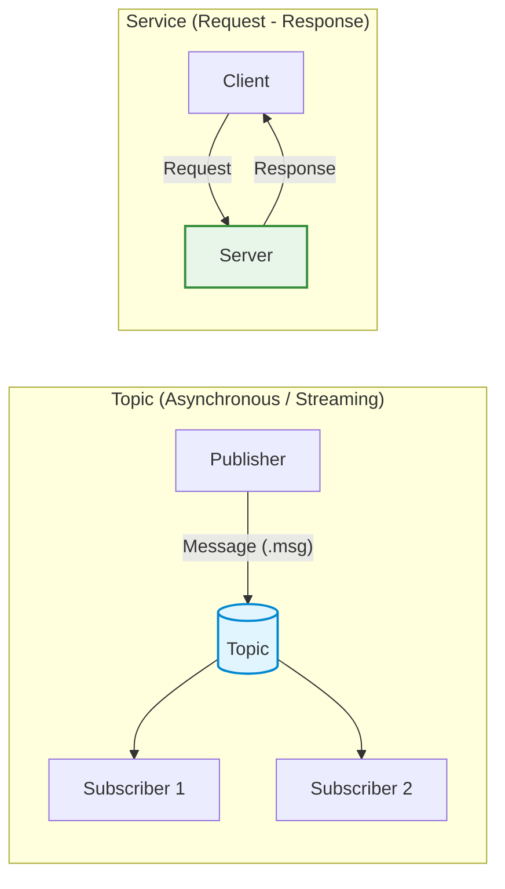
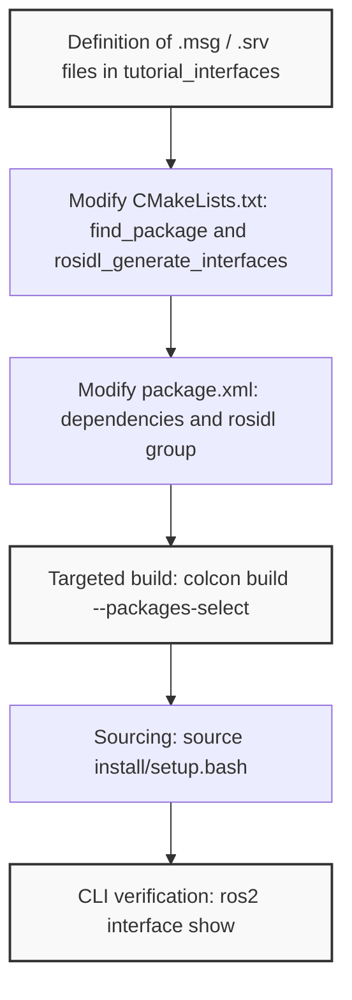
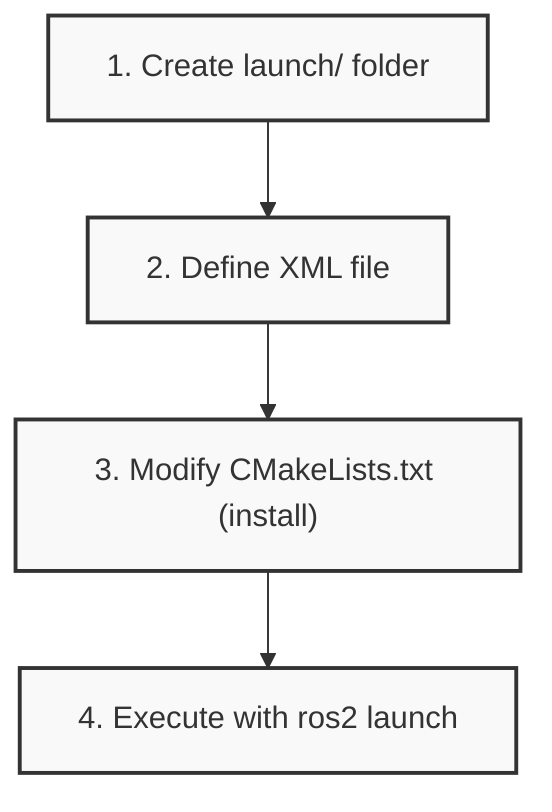
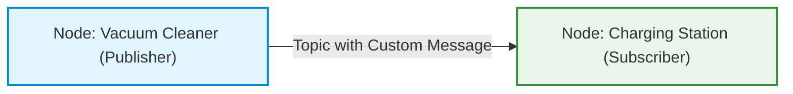

# ROS 2: Definition of Custom Messages and Service Interfaces

## Educational Overview

The lecture delves into the architecture of communication interfaces in ROS 2 (*Robot Operating System 2*), focusing on the transition from standard pre-defined messages (*ready-to-use messages*) to the creation of custom interfaces (*custom interfaces*), both for **Topics** (`.msg` messages) and for **Services** (`.srv` services).

The core conceptual topics covered include:
* **Recap of the Communication Model:** Operational difference between asynchronous and continuous communication based on the Publisher-Subscriber paradigm typical of topics, and synchronous request-response communication based on Client-Server typical of services.
* **Interface Package Architecture:** The architectural practice of isolating interface definitions in a dedicated C++ package (`ament_cmake`), separated from the business logic of computational nodes.
* **Interface Definition Syntax:**
  * Scalar and nested composition of messages (`.msg`), integrating primitive types (e.g., integers, strings, floating point) and existing complex types (e.g., `geometry_msgs/Point`).
  * Structuring service files (`.srv`), characterized by the three-dash separator `---` to separate request fields from response fields.
* **Code Generation Pipeline (Build System):** Configuration of the IDL (*Interface Definition Language*) interface generator using the `rosidl_default_generators` tool in `CMakeLists.txt` and management of related dependencies within the `package.xml` descriptor.

---

### Recap on the Communication Architecture in ROS 2

Before moving on to the definition of new data types, let us briefly review the computational and data exchange model in ROS 2 (Robot Operating System 2).

#### Nodes and Interface Types
In ROS 2, the fundamental processing unit is the **Node**. Each node is an independent process responsible for a specific task (for example motor control, sensor reading, or trajectory planning). To cooperate, nodes exchange information via **Messages**, which act as structured data containers.

The exchange mechanisms are generically called **ROS Interfaces** and are divided into three main paradigms:
1. **Topics**: Channels based on the **Publisher-Subscriber** pattern. Communication is asynchronous and ideal for continuous data streams (e.g., telemetry, video streaming, LIDAR readings, or robot state). The typical cardinality is one-to-one or one-to-many, although the architecture natively supports many-to-one and many-to-many configurations on the same topic as well.
2. **Services**: Based on the **Client-Server** pattern. Communication is of request-response type; the client sends a request and waits for the response processed by the server.
3. **Actions**: Designed for long-term tasks with intermediate feedback and the ability to cancel the request.



#### Predefined Messages vs Custom Messages
ROS 2 includes a rich library of ready-to-use messages:
* `std_msgs`: Encapsulated primitive types (strings, integers, booleans, floats).
* `geometry_msgs`: Primitives for geometry and kinematics (positions `Point`, orientations `Quaternion`, full poses `Pose`, velocities `Twist`).
* `sensor_msgs`: Complex data structures for robotic sensors (e.g., `LaserScan`, `Image`, `PointCloud2`).

In the starting package `cpp_pubsub` seen previously, the publisher node used a message of type `std_msgs/msg/String`, sent at regular intervals of $t = 0.5\text{ s}$ via a software timer, while the subscriber received the string and printed it to the terminal.

However, when application requirements demand aggregating heterogeneous information into a single data packet, it is necessary to define **Custom Messages**. Within a custom message, one can combine both primitive types and other already defined messages (for example by inserting a `geometry_msgs/Point` field inside a new interface).

---

### Creating the Package for Custom Interfaces

> **Key Concept**: In ROS 2 development best practices, custom interfaces (`.msg` messages, `.srv` services, and `.action` actions) must be placed inside a **dedicated C++ package**, separate from the packages containing the nodes with the application logic. This avoids circular dependencies during compilation and makes the interfaces cleanly reusable by nodes written in any language (C++, Python, Rust).

#### Package Initialization
To define new interfaces, the package must use the `ament_cmake` build system. Navigating to the workspace source folder (`dev_ws/src`), run the creation command:

```bash
ros2 pkg create --build-type ament_cmake tutorial_interfaces
```

This command generates the minimal package structure:
```text
tutorial_interfaces/
├── CMakeLists.txt
├── include/
├── package.xml
└── src/
```

---

### Defining Interfaces (`.msg` and `.srv`)

#### Directory Structure
Within the `tutorial_interfaces` package, convention dictates creating dedicated folders depending on the interface type:
* `msg/`: will contain the message definition files (`.msg` extension).
* `srv/`: will contain the service definition files (`.srv` extension).

```bash
cd tutorial_interfaces
mkdir msg srv
```

#### Syntax and Definition of `.msg` Files
A `.msg` file is a simple text file where each line specifies the data type and field name:

$$\text{tipo\_dato}\quad\text{nome\_campo}$$

Within the `msg/` folder, we define two messages:

1. **`Num.msg`**: Represents a single 64-bit integer numerical value:
   ```text
   int64 num
   ```

2. **`Sphere.msg`**: Demonstrates hierarchical composition by including a type from another package (`geometry_msgs`) and a scalar type:
   ```text
   geometry_msgs/Point center
   float64 radius
   ```

#### Introduction to Service Definition (`.srv`)
Service files share a similar syntax, but describe both the request and the response. The two sections are mandatory separated by **three dashes** (`---`):

```text
# Sezione Richiesta (Request)
tipo_dato campo_richiesta
---
# Sezione Risposta (Response)
tipo_dato campo_risposta
```

Inside the `srv/` folder, we create the service **`AddThreeInts.srv`**, whose purpose is to receive three integers, sum them, and return the result:

```text
int64 a
int64 b
int64 c
---
int64 sum
```

In subsequent steps, the ROS 2 interface generator will read these definitions and automatically produce the corresponding C++ and Python code for data serialization and deserialization.

---

### Configuration and Compilation of Custom Messages and Services in ROS 2

When defining custom interfaces in ROS 2, merely creating the `.msg` and `.srv` files is not sufficient: the build system must be instructed on how to translate these abstract definitions into source code (for example C++ or Python) that can be used by nodes.

---

### Summary of Interfaces Defined in the Package

To ensure modularity and architectural order, interface definitions are enclosed in a dedicated package named `tutorial_interfaces`. The structure includes two subfolders:
- `msg/`: containing custom messages:
  - `Num.msg`: contains a single numerical value (e.g., an integer).
  - `Sphere.msg`: defines a sphere in three-dimensional space using a center (`geometry_msgs/Point`) and a radius (`float64 radius`).
- `srv/`: containing services:
  - `AddThreeInts.srv`: defines a request consisting of three integers and a response consisting of a single integer (the sum).

---

### Configuring `CMakeLists.txt`

Changes must be made strictly to the `CMakeLists.txt` file located inside the `tutorial_interfaces` package.

```cmake
find_package(geometry_msgs REQUIRED)
find_package(rosidl_default_generators REQUIRED)

rosidl_generate_interfaces(${PROJECT_NAME}
  "msg/Num.msg"
  "msg/Sphere.msg"
  "srv/AddThreeInts.srv"
  DEPENDENCIES geometry_msgs
)
```

#### Details of CMake Directives

1. **`find_package(geometry_msgs REQUIRED)`**:
   Since `Sphere.msg` reuses the `Point` type belonging to the standard `geometry_msgs` package internally, CMake must locate this dependency to properly resolve compound types.

2. **`find_package(rosidl_default_generators REQUIRED)`**:
   **Key Concept**: The `rosidl_default_generators` package is the ROS 2 tool (Interface Definition Language - IDL) responsible for automatically generating header and source files (such as C++ classes) from textual message definitions.

3. **`rosidl_generate_interfaces(...)`**:
   Macro that declares the list of `.msg` and `.srv` files to process for the current target (`${PROJECT_NAME}`). Through the `DEPENDENCIES` argument, `geometry_msgs` is explicitly specified to enable proper resolution of nested types.

---

### Configuring the `package.xml` File

In parallel with CMake, the metadata file `package.xml` of the `tutorial_interfaces` package must declare dependencies for resolution at compile time and runtime:

- **Dependency on external message packages**:
  ```xml
  <depend>geometry_msgs</depend>
  ```
- **Dependencies and configurations for the interface generator**:
  ```xml
  <buildtool_depend>rosidl_default_generators</buildtool_depend>
  <exec_depend>rosidl_default_runtime</exec_depend>
  <member_of_group>rosidl_interface_packages</member_of_group>
  ```
These tags inform the package manager (`colcon` / `ament`) that this specific package exports IDL interfaces and requires the generators during the build phase and the corresponding runtime at execution.

---

### Building the Workspace with `colcon`

Once descriptor configuration is complete, we proceed to the compilation phase. Navigating to the workspace root directory, run the command:

```bash
colcon build --packages-select tutorial_interfaces
```

The `--packages-select` option restricts compilation to only the specified package, speeding up the operation without having to recompile the entire workspace.

---

### Verification and Inspection with the ROS 2 CLI

Before being able to query the environment, it is necessary to update the system variable paths:

```bash
source install/setup.bash
```

The command-line tool for inspecting registered interfaces is:

```bash
ros2 interface show <nome_package>/<tipo>/<nome_interfaccia>
```

#### 1. Inspecting the `Num` Message
```bash
ros2 interface show tutorial_interfaces/msg/Num
```
Returns the definition of the numeric field (e.g., `int64 num`).

#### 2. Inspecting the `Sphere` Message
```bash
ros2 interface show tutorial_interfaces/msg/Sphere
```
The output shows the hierarchical structure of the sphere:
- `center`: automatically expanded showing the composition of the `geometry_msgs/Point` message, namely the three continuous Cartesian coordinates $(x, y, z) \in \mathbb{R}^3$:
  - `float64 x`
  - `float64 y`
  - `float64 z`
- `radius`: defined as a floating-point value (`float64`).

#### 3. Inspecting the `AddThreeInts` Service
```bash
ros2 interface show tutorial_interfaces/srv/AddThreeInts
```
The output highlights the separation via the standard `---` delimiter:
- Upper section (Request): three integers.
- Lower section (Response): an integer containing the calculated sum.

---

### Workflow for Interface Creation



---

### Modifying the Publisher and Subscriber to Use Custom Messages

Now that we have created our custom messages, we need to update the existing publisher and subscriber (written in the C++ package `cpp_pubsub`) to use them instead of standard strings.

#### Changes to the Publisher

To update the publisher node, we must intervene on three main fronts: the inclusions, the type declaration, and the callback function body.

* **Header inclusion:** We must include the header file automatically generated by our interface package:
  ```cpp
  #include "tutorial_interfaces/msg/num.hpp"
  ```
* **Publisher Declaration and Creation:** The message type is no longer a standard string (`std_msgs::msg::String`), but our custom type `tutorial_interfaces::msg::Num`. This must be updated both when declaring the pointer/object and when instantiating the publisher in the constructor.
* **Modifying the Timer Callback:** Inside the timer callback function, we must:
  1. Instantiate an object of type `tutorial_interfaces::msg::Num`.
  2. Populate the message field (in our case the numeric field `num`).
  3. Print a log message to the console for debugging.
  4. Publish the message to the topic.

#### Changes to the Subscriber

The logic is analogous for the subscriber as well:
* Replace the expected message type in the subscription interfaces (`rclcpp::Subscription`), changing from `std_msgs::msg::String` to `tutorial_interfaces::msg::Num`.
* Update the signature of the topic callback method, ensuring that the incoming parameter receives the new custom message type instead of the string.

```mermaid
flowchart TD
    A["Existing Code (cpp_pubsub)"] --> B["1. Include custom header (num.hpp)"]
    B --> C["2. Replace std_msgs/String with tutorial_interfaces/Num"]
    C --> D["3. Update Publisher Callback (populate and publish num field)"]
    C --> E["4. Update Subscriber Callback (receive the new custom type)"]
    D --> F["Build System Update (CMakeLists.txt & package.xml)"]
    E --> F
    
    style A fill:#2d3748,stroke:#4a5568,stroke-width:2px
    style F fill:#2b6cb0,stroke:#3182ce,stroke-width:2px
```



#### Updating the Build System (`CMakeLists.txt` and `package.xml`)

Since the `cpp_pubsub` package now depends on the package containing the interfaces (`tutorial_interfaces`), we must declare this dependency in the workspace configuration files:

1. **`CMakeLists.txt`**:
   * We must find the package via the dependency search directive.
   * We must link the interface package dependency to our node executables (`talker` and `listener`).
2. **`package.xml`**:
   * Add the build and execution dependency (`<depend>tutorial_interfaces</depend>`).

#### Building and Running

Once all changes are applied, we are ready to recompile the workspace by navigating to the main root and running the build command:

```bash
colcon build --packages-select cpp_pubsub
```

Once done, we can launch the nodes in their respective terminals (remembering to source the environment):

* **Starting the Publisher (Talker):**
  ```bash
  ros2 run cpp_pubsub talker
  ```
* **Starting the Subscriber (Listener):**
  ```bash
  ros2 run cpp_pubsub listener
  ```

At this point, the two nodes will communicate correctly by exchanging custom messages. It is also possible to verify the correctness of the in-transit data types by inspecting the topic directly using ROS 2 command-line tools.

---

### Quick Topic Inspection from Terminal

Before moving to advanced node management, let us recall two essential command-line (CLI) commands for checking the state of communication in the ROS 2 graph:

*   `ros2 topic info <nome_topic>`: returns detailed information about the topic specified in the publisher code, specifically showing the associated message type and the count of active publishers and subscribers.
*   `ros2 topic list`: prints the complete list of all topics currently registered in the system. It is useful for making sure that the topic we are publishing to is actually visible at runtime.

---

### Launch Files

In the development of complex robotic applications, one rarely works with just a single node: a typical real-world system comprises dozens of cooperating nodes (sensors, trajectory planners, controllers, interfaces). 

Starting each individual component by opening a dedicated terminal and manually executing `ros2 run <pkg> <executable>` quickly becomes impractical and error-prone. To overcome this limitation, ROS 2 provides **launch files**.

> **Key Concept**: A *launch file* is an orchestration tool that allows configuring and simultaneously starting a group of nodes and their related resources (parameters, topic remappings) with a single terminal command.

Launch files can be written in three different formats:
1.  **XML**: tag-based declarative syntax, straightforward to read and very widespread.
2.  **YAML**: minimal declarative syntax based on indentation.
3.  **Python**: highly flexible programmatic approach, particularly useful when node startup depends on logical conditions or dynamic runtime parameters.

---

### Operational Workflow: Creating and Running an XML Launch File

Let us analyze the practical steps to integrate a launch file into a C++ package (e.g., `cpp_pubsub`).



#### 1. Directory Structure and XML File
Inside the package root, create a dedicated subfolder named `launch/`. Inside it, save the launch file, for example `pubsub.xml`:

```xml
<launch>
    <node pkg="cpp_pubsub" exec="talker" name="talker_node"/>
    <node pkg="cpp_pubsub" exec="listener" name="listener_node"/>
</launch>
```

In the listing above:
*   The `<launch>` tag acts as the root container.
*   Each `<node>` tag instantiates a process specifying three essential attributes:
    *   `pkg`: the name of the package where the executable resides.
    *   `exec`: the name of the compiled binary file (the actual executable, e.g., `talker` or `listener`).
    *   `name`: the name assigned at runtime to the node instance in the computational graph.

#### 2. Build Configuration in `CMakeLists.txt`
In order for ROS 2 to locate and execute the launch file after compilation, the files in the `launch/` folder must be copied to the shared installation directory (*share directory*).

We add the following installation instruction to the bottom of the `CMakeLists.txt` file:

```cmake
install(DIRECTORY
  launch
  DESTINATION share/${PROJECT_NAME}
)
```

> **Warning (Critical Step)**: If you forget to update `CMakeLists.txt` with the `install` directive, the `ros2 launch` command will return a file not found error, because ROS searches for files within the installed workspace space (`install/`), not directly in the source code.

#### 3. Building and Running
From the workspace root, compile the package, source the environment, and invoke the dedicated command:

```bash
# Esecuzione del launch file
ros2 launch cpp_pubsub pubsub.xml
```

At this point, the on-screen output will show the logs of both `talker` and `listener` aggregated in a single terminal shell.

---

### Practical Exercise: Vacuum Cleaner Robot and Charging Station

To put node management and the use of custom messages into practice, a coordination problem consisting of two entities is proposed:

1.  **Vacuum Cleaner Robot**: mobile node operating within a domestic environment.
2.  **Charging Station**: stationary node monitoring the robot's state.



#### Communication Requirements
The two nodes communicate via a dedicated topic that uses a custom message containing the following fields:
*   **Room name** (`string room_name`): identifies the room where the vacuum cleaner is currently located.
*   **Room numeric identifier** (`int32 room_id`): integer ID associated with the current room.
*   **Battery charge level** (`float32 battery_charge`): percentage or remaining energy level of the robot.

The objective consists of properly defining the `.msg` interface file, configuring the message generation dependencies in the package, implementing the publishing logic on the robot and the subscribing logic on the charging base, and finally orchestrating the startup of the entire scenario through a single *launch file*.

---

### Conclusions and End of Lecture

*Note: In the final portion of the recording (interval 01:22:40 – 01:36:21) there is no detected speech or recorded educational activity. The coverage of the topics planned for this lecture concluded in the previous section.*