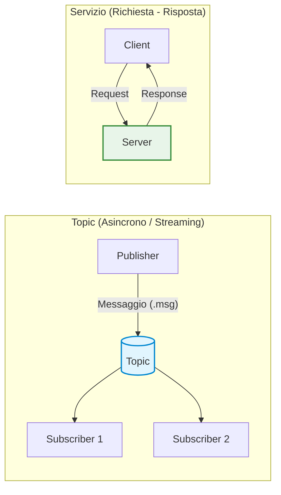
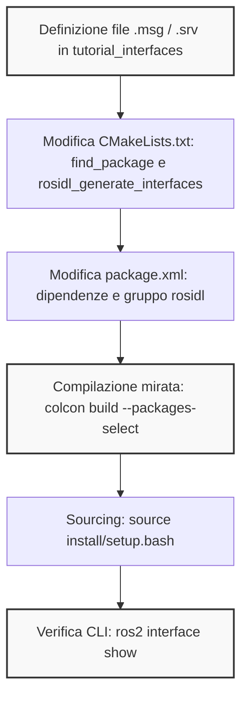
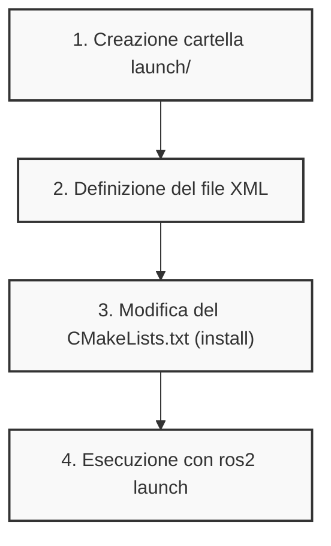
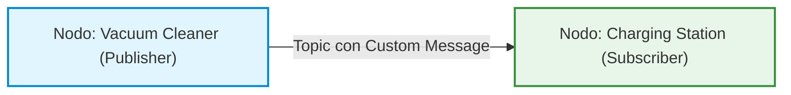

# ROS 2: Definizione di Messaggi Personalizzati (Custom Messages) e Interfacce di Servizio

## Overview Didattica

La lezione approfondisce l'architettura delle interfacce di comunicazione in ROS 2 (*Robot Operating System 2*), focalizzandosi sulla transizione dai messaggi predefiniti standard (*ready-to-use messages*) alla creazione di interfacce personalizzate (*custom interfaces*), sia per **Topic** (messaggi `.msg`) sia per **Servizi** (servizi `.srv`).

I nuclei concettuali affrontati comprendono:
* **Recap del Modello di Comunicazione:** Differenza operativa tra la comunicazione asincrona e continua basata sul paradigma Editore-Sottoscrittore (*Publisher-Subscriber*) tipica dei topic, e la comunicazione sincrona richiesta-risposta basata su Client-Server tipica dei servizi.
* **Architettura dei Package per Interfacce:** La prassi architetturale di isolare la definizione delle interfacce in un package C++ dedicato (`ament_cmake`), separato dalla logica di business dei nodi computazionali.
* **Sintassi di Definizione delle Interfacce:**
  * Composizione scalare e nidificata dei messaggi (`.msg`), integrando tipi primitivi (es. interi, stringhe, virgola mobile) e tipi complessi già esistenti (es. `geometry_msgs/Point`).
  * Strutturazione dei file di servizio (`.srv`), caratterizzati dal separatore a tre trattini `---` per dividere i campi di richiesta (*request*) da quelli di risposta (*response*).
* **Pipeline di Generazione del Codice (Build System):** Configurazione del generatore di interfacce IDL (*Interface Definition Language*) tramite il tool `rosidl_default_generators` in `CMakeLists.txt` e la gestione delle dipendenze correlate all'interno del descrittore `package.xml`.

---

### Recap sull'Architettura di Comunicazione in ROS 2

Prima di passare alla definizione di nuovi tipi di dato, richiamiamo brevemente il modello di calcolo e di scambio dati in ROS 2 (Robot Operating System 2). 

#### Nodi e Tipologie di Interfacce
In ROS 2, l'unità fondamentale di elaborazione è il **Nodo (Node)**. Ogni nodo è un processo indipendente responsabile di un compito specifico (ad esempio il controllo dei motori, la lettura di un sensore o la pianificazione della traiettoria). Per cooperare, i nodi scambiano informazioni tramite **Messaggi (Messages)**, i quali fungono da contenitori strutturati di dati.

I meccanismi di scambio prendono il nome generico di **Interfacce ROS (ROS Interfaces)** e si dividono in tre paradigmi principali:
1. **Topic**: Canali basati sul pattern **Editore-Sottoscrittore (Publisher-Subscriber)**. La comunicazione è asincrona ed è ideale per flussi continui di dati (es. telemetria, streaming video, letture LIDAR o stato del robot). La cardinalità tipica è uno-a-uno o uno-a-molti, sebbene l'architettura supporti nativamente anche configurazioni molti-a-uno e molti-a-molti sullo stesso topic.
2. **Servizi (Services)**: Basati sul pattern **Client-Server**. La comunicazione è di tipo richiesta-risposta (request-response); il client invia una richiesta e attende la risposta elaborata dal server.
3. **Azioni (Actions)**: Pensate per task a lungo termine con feedback intermedio e possibilità di cancellazione della richiesta.



#### Messaggi Predefiniti vs Messaggi Personalizzati
ROS 2 include una ricca libreria di messaggi pronti all'uso (*ready-to-use*):
* `std_msgs`: Tipi primitivi incapsulati (stringhe, interi, booleani, float).
* `geometry_msgs`: Primitive per geometria e cinematica (posizioni `Point`, orientamenti `Quaternion`, pose complete `Pose`, velocità `Twist`).
* `sensor_msgs`: Strutture dati complesse per sensori robotici (ad esempio `LaserScan`, `Image`, `PointCloud2`).

Nel pacchetto di partenza `cpp_pubsub` visto in precedenza, il nodo publisher utilizzava un messaggio di tipo `std_msgs/msg/String`, inviato a intervalli regolari di $t = 0.5\text{ s}$ tramite un timer software, mentre il subscriber riceveva la stringa e la stampava a terminale.

Tuttavia, quando le esigenze dell'applicazione richiedono di aggregare informazioni eterogenee in un singolo pacchetto dati, è necessario definire **Messaggi Personalizzati (Custom Messages)**. All'interno di un messaggio personalizzato è possibile combinare sia tipi primitivi sia altri messaggi già definiti (ad esempio inserendo un campo `geometry_msgs/Point` all'interno di una nuova interfaccia).

---

### Creazione del Pacchetto per Interfacce Personalizzate

> **Concetto Chiave**: Nelle buone pratiche di sviluppo in ROS 2, le interfacce personalizzate (messaggi `.msg`, servizi `.srv` e azioni `.action`) devono essere collocate all'interno di un **pacchetto C++ dedicato**, separato dai pacchetti che contengono i nodi con la logica applicativa. Questo evita dipendenze circolari in fase di compilazione e rende le interfacce riutilizzabili in modo pulito da nodi scritti in qualsiasi linguaggio (C++, Python, Rust).

#### Inizializzazione del Pacchetto
Per definire nuove interfacce, il pacchetto deve utilizzare il sistema di build `ament_cmake`. Posizionandosi all'interno della cartella sorgente del workspace (`dev_ws/src`), si esegue il comando di creazione:

```bash
ros2 pkg create --build-type ament_cmake tutorial_interfaces
```

Questo comando genera la struttura minimale del pacchetto:
```text
tutorial_interfaces/
├── CMakeLists.txt
├── include/
├── package.xml
└── src/
```

---

### Definizione delle Interfacce (`.msg` e `.srv`)

#### Struttura delle Directory
All'interno del pacchetto `tutorial_interfaces`, la convenzione impone di creare cartelle dedicate a seconda della tipologia di interfaccia:
* `msg/`: conterrà i file di definizione dei messaggi (estensione `.msg`).
* `srv/`: conterrà i file di definizione dei servizi (estensione `.srv`).

```bash
cd tutorial_interfaces
mkdir msg srv
```

#### Sintassi e Definizione dei File `.msg`
Un file `.msg` è un semplice file di testo in cui ogni riga specifica il tipo di dato e il nome del campo:

$$\text{tipo\_dato}\quad\text{nome\_campo}$$

All'interno della cartella `msg/`, definiamo due messaggi:

1. **`Num.msg`**: Rappresenta un singolo valore numerico intero a 64 bit:
   ```text
   int64 num
   ```

2. **`Sphere.msg`**: Dimostra la composizione gerarchica includendo un tipo proveniente da un altro pacchetto (`geometry_msgs`) e un tipo scalare:
   ```text
   geometry_msgs/Point center
   float64 radius
   ```

#### Introduzione alla Definizione dei Servizi (`.srv`)
I file di servizio condividono una sintassi analoga, ma descrivono sia la richiesta che la risposta. Le due sezioni sono obbligatoriamente separate da **tre trattini** (`---`):

```text
# Sezione Richiesta (Request)
tipo_dato campo_richiesta
---
# Sezione Risposta (Response)
tipo_dato campo_risposta
```

All'interno della cartella `srv/`, creiamo il servizio **`AddThreeInts.srv`**, il cui scopo è ricevere tre interi, sommarli e restituire il risultato:

```text
int64 a
int64 b
int64 c
---
int64 sum
```

Nei passaggi successivi, il generatore di interfacce di ROS 2 leggerà queste definizioni e produrrà automaticamente il codice C++ e Python corrispondente per la serializzazione e la deserializzazione dei dati.

---

### Configurazione e Compilazione di Messaggi e Servizi Personalizzati in ROS 2

Nella definizione di interfacce custom in ROS 2, la sola creazione dei file `.msg` e `.srv` non è sufficiente: il sistema di compilazione deve essere istruito su come tradurre queste definizioni astratte in codice sorgente (ad esempio C++ o Python) utilizzabile dai nodi.

---

### Riepilogo delle Interfacce Definite nel Package

Per garantire modularità e ordine architetturale, le definizioni delle interfacce sono racchiuse in un package dedicato, denominato `tutorial_interfaces`. La struttura include due sottocartelle:
- `msg/`: contenente i messaggi personalizzati:
  - `Num.msg`: contiene un singolo valore numerico (es. un intero).
  - `Sphere.msg`: definisce una sfera nello spazio tridimensionale mediante un centro (`geometry_msgs/Point`) e un raggio (`float64 radius`).
- `srv/`: contenente i servizi:
  - `AddThreeInts.srv`: definisce una richiesta formata da tre interi e una risposta composta da un singolo intero (la somma).

---

### Configurazione di `CMakeLists.txt`

Le modifiche devono essere apportate rigorosamente al file `CMakeLists.txt` situato all'interno del package `tutorial_interfaces`.

```cmake
find_package(geometry_msgs REQUIRED)
find_package(rosidl_default_generators REQUIRED)

rosidl_generate_interfaces(${PROJECT_NAME}
  "msg/Num.msg"
  "msg/Sphere.msg"
  "srv/AddThreeInts.srv"
  DEPENDENCIES geometry_msgs
)
```

#### Dettaglio delle Direttive CMake

1. **`find_package(geometry_msgs REQUIRED)`**:
   Poiché `Sphere.msg` riutilizza al suo interno il tipo `Point` appartenente al package standard `geometry_msgs`, CMake deve individuare tale dipendenza per risolvere correttamente i tipi composti.

2. **`find_package(rosidl_default_generators REQUIRED)`**:
   **Concetto Chiave**: Il pacchetto `rosidl_default_generators` è lo strumento di ROS 2 (Interface Definition Language - IDL) responsabile della generazione automatica dei file header e sorgente (come le classi C++) a partire dalle definizioni testuali dei messaggi.

3. **`rosidl_generate_interfaces(...)`**:
   Macro che dichiara l'elenco dei file `.msg` e `.srv` da processare per il target corrente (`${PROJECT_NAME}`). Tramite l'argomento `DEPENDENCIES` si specifica esplicitamente `geometry_msgs` per consentire la corretta risoluzione dei tipi annidati.

---

### Configurazione del file `package.xml`

Parallelamente a CMake, il file di metadati `package.xml` del package `tutorial_interfaces` deve dichiarare le dipendenze per la risoluzione a tempo di compilazione e runtime:

- **Dipendenza da pacchetti esterni di messaggi**:
  ```xml
  <depend>geometry_msgs</depend>
  ```
- **Dipendenze e configurazioni per il generatore di interfacce**:
  ```xml
  <buildtool_depend>rosidl_default_generators</buildtool_depend>
  <exec_depend>rosidl_default_runtime</exec_depend>
  <member_of_group>rosidl_interface_packages</member_of_group>
  ```
Questi tag informano il gestore dei pacchetti (`colcon` / `ament`) che questo specifico package esporta interfacce IDL e necessita dei generatori durante la fase di build e del relativo runtime in esecuzione.

---

### Compilazione del Workspace con `colcon`

Completata la configurazione dei file descrittori, si passa alla fase di compilazione. Posizionandosi nella directory radice del workspace, si esegue il comando:

```bash
colcon build --packages-select tutorial_interfaces
```

L'opzione `--packages-select` limita la compilazione al solo package specificato, velocizzando l'operazione senza dover ricompilare l'intero workspace.

---

### Verifica e Ispezione con la CLI di ROS 2

Prima di poter interrogare l'ambiente, è necessario aggiornare i percorsi delle variabili di sistema:

```bash
source install/setup.bash
```

Lo strumento da riga di comando per ispezionare le interfacce registrate è:

```bash
ros2 interface show <nome_package>/<tipo>/<nome_interfaccia>
```

#### 1. Ispezione del messaggio `Num`
```bash
ros2 interface show tutorial_interfaces/msg/Num
```
Restituisce la definizione del campo numerico (es. `int64 num`).

#### 2. Ispezione del messaggio `Sphere`
```bash
ros2 interface show tutorial_interfaces/msg/Sphere
```
L'output mostra la struttura gerarchica della sfera:
- `center`: espanso automaticamente mostrando la composizione del messaggio `geometry_msgs/Point`, ovvero le tre coordinate cartesiane continue $(x, y, z) \in \mathbb{R}^3$:
  - `float64 x`
  - `float64 y`
  - `float64 z`
- `radius`: definito come valore in virgola mobile (`float64`).

#### 3. Ispezione del servizio `AddThreeInts`
```bash
ros2 interface show tutorial_interfaces/srv/AddThreeInts
```
L'output evidenzia la separazione tramite il delimitatore standard `---`:
- Sezione superiore (Richiesta - *Request*): tre interi.
- Sezione inferiore (Risposta - *Response*): un intero contenente la somma calcolata.

---

### Flusso di Lavoro per la Creazione di Interfacce



---

### Modifica del Publisher e del Subscriber per l'uso di messaggi custom

Ora che abbiamo creato i nostri messaggi personalizzati, dobbiamo aggiornare il publisher e il subscriber esistenti (scritti nel pacchetto C++ `cpp_pubsub`) per utilizzarli al posto delle stringhe standard.

#### Modifiche al Publisher

Per aggiornare il nodo publisher, dobbiamo intervenire su tre fronti principali: le inclusioni, la dichiarazione del tipo e il corpo della funzione di callback.

* **Inclusione dell'header:** Dobbiamo includere il file di intestazione (header file) generato automaticamente dal nostro pacchetto di interfacce:
  ```cpp
  #include "tutorial_interfaces/msg/num.hpp"
  ```
* **Dichiarazione e Creazione del Publisher:** Il tipo di messaggio non è più una stringa standard (`std_msgs::msg::String`), ma il nostro tipo custom `tutorial_interfaces::msg::Num`. Questo va aggiornato sia quando dichiariamo il puntatore/oggetto, sia quando istanziamo il publisher nel costruttore.
* **Modifica della Timer Callback:** All'interno della funzione di callback del timer, dobbiamo:
  1. Istanziare un oggetto del tipo `tutorial_interfaces::msg::Num`.
  2. Popolare il campo del messaggio (nel nostro caso il campo numerico `num`).
  3. Stampare un messaggio di log sulla console per il debugging.
  4. Pubblicare il messaggio sul topic.

#### Modifiche al Subscriber

Anche per il subscriber la logica è analoga:
* Sostituire il tipo di messaggio atteso nelle interfacce di sottoscrizione (`rclcpp::Subscription`) passando da `std_msgs::msg::String` a `tutorial_interfaces::msg::Num`.
* Aggiornare la firma del metodo di callback del topic, assicurandosi che il parametro in ingresso riceva il nuovo tipo di messaggio custom anziché la stringa.

```mermaid
flowchart TD
    A["Codice Esistente (cpp_pubsub)"] --> B["1. Includi l'header custom (num.hpp)"]
    B --> C["2. Sostituisci std_msgs/String con tutorial_interfaces/Num"]
    C --> D["3. Aggiorna Publisher Callback (popola e pubblica il campo num)"]
    C --> E["4. Aggiorna Subscriber Callback (ricevi il nuovo tipo custom)"]
    D --> F["Aggiornamento Build System (CMakeLists.txt & package.xml)"]
    E --> F
    
    style A fill:#2d3748,stroke:#4a5568,stroke-width:2px
    style F fill:#2b6cb0,stroke:#3182ce,stroke-width:2px
```



#### Aggiornamento del Sistema di Build (`CMakeLists.txt` e `package.xml`)

Dato che il pacchetto `cpp_pubsub` ora dipende dal pacchetto che contiene le interfacce (`tutorial_interfaces`), dobbiamo dichiarare questa dipendenza nei file di configurazione del workspace:

1. **`CMakeLists.txt`**:
   * Dobbiamo trovare il pacchetto tramite la direttiva di ricerca delle dipendenze.
   * Dobbiamo linkare la dipendenza del pacchetto di interfacce agli eseguibili dei nostri nodi (`talker` e `listener`).
2. **`package.xml`**:
   * Aggiungere la dipendenza di compilazione ed esecuzione (`<depend>tutorial_interfaces</depend>`).

#### Compilazione ed Esecuzione

Una volta applicate tutte le modifiche, siamo pronti a ricompilare il workspace posizionandoci nella root principale ed eseguendo il comando di build:

```bash
colcon build --packages-select cpp_pubsub
```

Fatto ciò, possiamo avviare i nodi nei rispettivi terminali (ricordandoci di effettuare il source dell'ambiente):

* **Avvio del Publisher (Talker):**
  ```bash
  ros2 run cpp_pubsub talker
  ```
* **Avvio del Subscriber (Listener):**
  ```bash
  ros2 run cpp_pubsub listener
  ```

A questo punto i due nodi comunicheranno correttamente scambiandosi i messaggi custom. È possibile anche verificare la correttezza dei tipi di dati in transito ispezionando il topic direttamente tramite gli strumenti da riga di comando di ROS 2.

---

### Ispezione Rapida dei Topic da Terminale

Prima di passare alla gestione avanzata dei nodi, richiamiamo due comandi da riga di comando (CLI) fondamentali per verificare lo stato della comunicazione nel grafo ROS 2:

*   `ros2 topic info <nome_topic>`: restituisce informazioni dettagliate sul topic indicato nel codice del publisher, mostrando in particolare il tipo di messaggio associato e il conteggio di publisher e subscriber attivi.
*   `ros2 topic list`: stampa l'elenco completo di tutti i topic attualmente registrati nel sistema. È utile per accertarsi che il topic su cui stiamo pubblicando sia effettivamente visibile a runtime.

---

### I File di Lancio (Launch Files)

Nello sviluppo di applicazioni robotiche complesse non si lavora quasi mai con un solo nodo: un tipico sistema reale comprende decine di nodi cooperanti (sensori, pianificatori di traiettoria, controllori, interfacce). 

Avviare ogni singolo componente aprendo un terminale dedicato ed eseguendo manualmente `ros2 run <pkg> <executable>` diventa rapidamente impraticabile e fonte di errori. Per risolvere questa limitazione, ROS 2 mette a disposizione i **file di lancio** (*launch files*).

> **Concetto Chiave**: Un *launch file* è uno strumento di orchestrazione che consente di configurare e avviare simultaneamente un gruppo di nodi e le relative risorse (parametri, rimappature di topic) con un unico comando da terminale.

I file di lancio possono essere scritti in tre formati differenti:
1.  **XML**: sintassi dichiarativa basata su tag, immediata da leggere e molto diffusa.
2.  **YAML**: sintassi dichiarativa minimale basata sull'indentazione.
3.  **Python**: approccio programmatico ad alta flessibilità, particolarmente utile quando l'avvio dei nodi dipende da condizioni logiche o parametri dinamici a runtime.

---

### Workflow Operativo: Creazione ed Esecuzione di un Launch File XML

Analizziamo i passaggi pratici per integrare un launch file all'interno di un pacchetto C++ (es. `cpp_pubsub`).



#### 1. Struttura delle Directory e File XML
All'interno della radice del pacchetto si crea una sottocartella dedicata denominata `launch/`. Al suo interno viene salvato il file di lancio, ad esempio `pubsub.xml`:

```xml
<launch>
    <node pkg="cpp_pubsub" exec="talker" name="talker_node"/>
    <node pkg="cpp_pubsub" exec="listener" name="listener_node"/>
</launch>
```

Nel listato sopra:
*   Il tag `<launch>` fa da contenitore radice.
*   Ciascun tag `<node>` istanzia un processo specificando tre attributi essenziali:
    *   `pkg`: il nome del pacchetto in cui risiede l'eseguibile.
    *   `exec`: il nome del file binario compilato (l'eseguibile vero e proprio, es. `talker` o `listener`).
    *   `name`: il nome assegnato a runtime all'istanza del nodo nel grafo computazionale.

#### 2. Configurazione della Build in `CMakeLists.txt`
Affinché ROS 2 possa localizzare ed eseguire il launch file dopo la compilazione, i file della cartella `launch/` devono essere copiati nella directory di installazione condivisa (*share directory*).

Aggiungiamo in fondo al file `CMakeLists.txt` la seguente istruzione di installazione:

```cmake
install(DIRECTORY
  launch
  DESTINATION share/${PROJECT_NAME}
)
```

> **Attenzione (Passaggio Critico)**: Se si dimentica di aggiornare il `CMakeLists.txt` con la direttiva `install`, il comando `ros2 launch` restituirà un errore di file non trovato, poiché ROS cerca i file all'interno dello spazio installato del workspace (`install/`), non direttamente nel codice sorgente.

#### 3. Compilazione ed Esecuzione
Dalla radice del workspace si compila il pacchetto, si importa l'ambiente con il comando di sourcing e si invoca il comando dedicato:

```bash
# Esecuzione del launch file
ros2 launch cpp_pubsub pubsub.xml
```

A questo punto, l'output a video mostrerà i log sia del `talker` che del `listener` aggregati in un'unica shell di terminale.

---

### Esercizio Pratico: Robot Aspirapolvere e Stazione di Ricarica

Per mettere in pratica la gestione dei nodi e l'uso di messaggi personalizzati (*custom messages*), viene proposto un problema di coordinamento composto da due entità:

1.  **Robot Aspirapolvere (*Vacuum Cleaner*)**: nodo mobile che opera all'interno di un ambiente domestico.
2.  **Stazione di Ricarica (*Charging Station*)**: nodo fisso che monitora lo stato del robot.



#### Requisiti della Comunicazione
I due nodi comunicano mediante un topic dedicato che utilizza un messaggio custom contenente i seguenti campi:
*   **Nome della stanza** (`string room_name`): identifica la stanza in cui si trova attualmente l'aspirapolvere.
*   **Identificativo numerico della stanza** (`int32 room_id`): ID intero associato alla stanza corrente.
*   **Livello di carica della batteria** (`float32 battery_charge`): percentuale o livello energetico residuo del robot.

L'obiettivo consiste nel definire correttamente il file di interfaccia `.msg`, configurare le dipendenze di generazione messaggi nel pacchetto, implementare la logica di pubblicazione sul robot e di sottoscrizione sulla base di ricarica, orchestrando infine l'avvio dell'intero scenario tramite un unico *launch file*.

---

### Conclusioni e Chiusura della Lezione

*Nota: Nella porzione finale della registrazione (intervallo 01:22:40 – 01:36:21) non è presente parlato rilevato né attività didattica registrata. La trattazione dei temi previsti per questa lezione si è conclusa nella sezione precedente.*