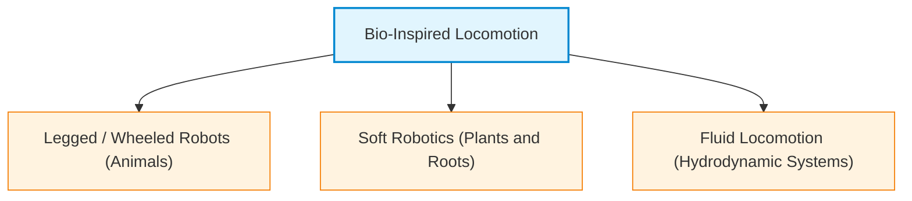
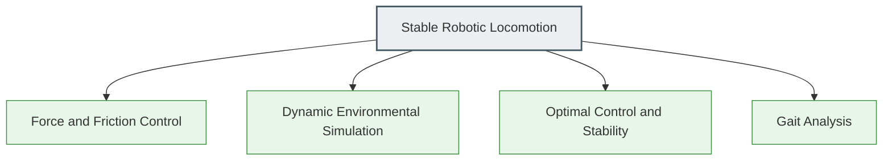
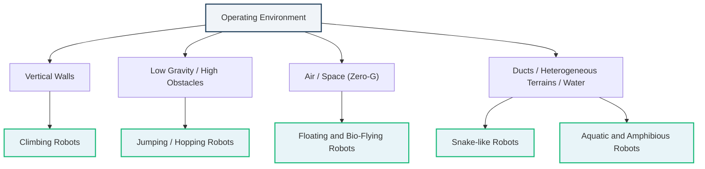
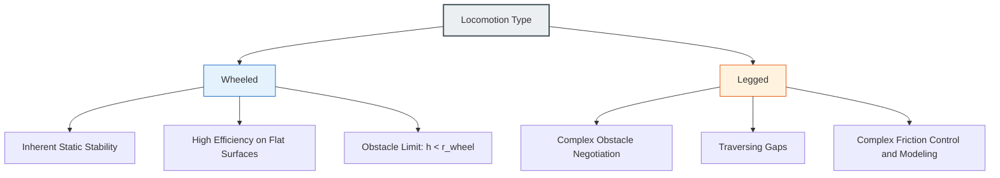
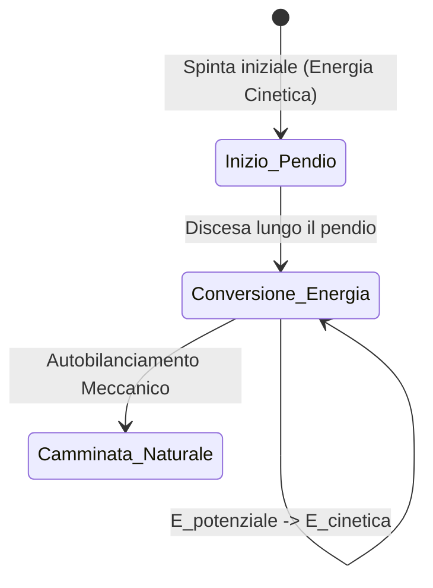
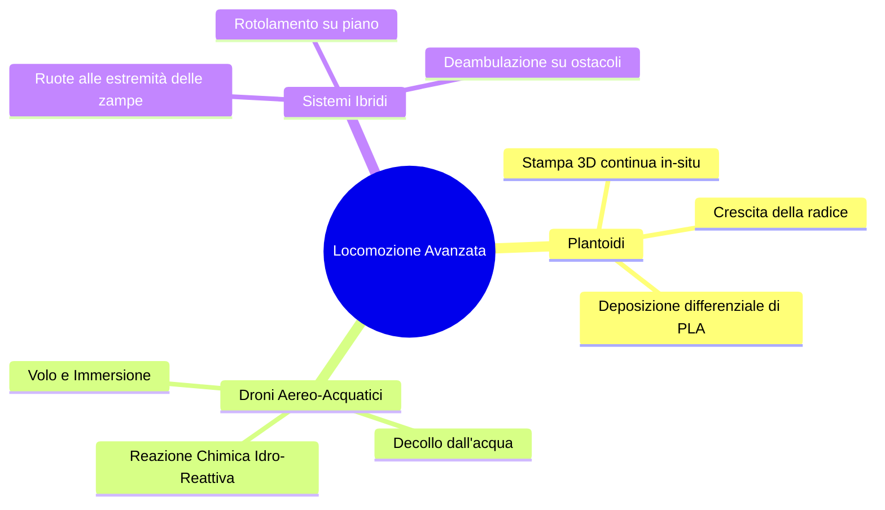

# Introduction to Robotic Locomotion: General Principles and Bio-Inspired Approaches

## Teaching Overview

In this lecture, the fundamental concept of **locomotion** in robotics is introduced, defined as the act of moving from one point to another through direct physical interaction between the robot's structure (*robot body*) and the surrounding medium or environment (*environment/medium*).

An interdisciplinary overview of different mobility modes is provided, highlighting how modern robotics draws heavily from nature (**bio-inspiration**). Beyond classic **wheeled locomotion** and **legged locomotion** systems, the lecture explores advanced frontiers such as **soft robotics** and **plant-inspired locomotion**. In particular, the case of **root-inspired robots** is analyzed, which are capable of moving through soil by means of material growth and extrusion (in-situ 3D printing), exploiting natural morphological adaptability (*compliance*) to overcome obstacles.

The key points covered include:

* **Interdisciplinary Nature of Locomotion:** The need to integrate control software, actuation, force control, friction modeling (*friction control*), and physical simulation of the interaction with the environment.
* **Taxonomy of Locomotion:** Introduction to different mobility paradigms, including wheeled, legged, snake (*snake locomotion*), and swimming (*swimming locomotion*) systems.
* **Structural Growth Paradigm:** Analysis of soft robots and the development of structures capable of elongating and exploring complex environments through stiffness variation and cellular/material addition.

---

### Course Organization and Reference Textbooks

Understanding mobile robotics requires a combination of theoretical and applied concepts. The two fundamental reference textbooks for the course are:

1. **Introduction to AI Robotics** (R. Murphy): Focused on software architecture, perception, and artificial intelligence applied to robots.
2. **Autonomous Mobile Robots** (B. Siciliano et al.): Focused on kinematic, dynamic modeling, and control aspects of articulated bodies (whether wheeled or legged).

> **Key Concept**: Preparing for the course requires the full study of the chapters indicated in the syllabus (Moodle), including topics not explicitly covered in class. Exam questions will test both concepts explained by the instructor as well as the theory and models detailed in the reference textbooks.

---

### Introduction to Robotic Locomotion and Bio-Inspiration

**Locomotion** is defined as the act of moving from one place to another. In robotics, locomotion relies on the **physical reaction force** produced by the interaction between the robot's body and the surrounding medium/environment (ground, water, air).

Roboticists continuously draw inspiration from nature (**bio-inspiration**) to design new propulsion modes, moving beyond the traditional distinction between wheeled robots and legged robots.

#### Plant-Inspired Locomotion and Soft Robotics
An emerging field of **Soft Robotics** is the study of plant movement:
* **Fluidic/chemical actuation**: Small flexible channels in which introduced pressure or solution alters the geometric structure, enabling wrapping or crawling movements.
* **Autonomous growth by extrusion (Root-inspired Robots)**: Modeled on the behavior of plant roots. The robot does not "slide" through the soil, but moves its head (which acts as an integrated 3D printer) by extruding a polymer filament (e.g., PLA).
  * The robot increases its length by depositing material.
  * **Passive Compliance**: The extruded material is hot and deformable; upon encountering a rigid obstacle (e.g., a rock), the variation in friction naturally redirects the direction of extrusion, causing the robotic root to steer toward the path of least resistance without the need for complex planning calculations.

---

### Interdisciplinarity and Challenges in Locomotion Control

Developing an effective locomotion system requires integrating expertise from various scientific and engineering domains.

1. **Force Control**: It is necessary to modulate friction and the normal force applied to the contact surface to prevent slipping.
2. **Dynamic Simulation of Interaction**: Accurate modeling of contacts between the robotic body and the terrain.
3. **Optimal Control**: Management of dynamic stability and minimization of energy consumption.
4. **Gait Analysis**: Study of biological human and animal walking patterns.

#### Current Limitations of Humanoid Robots
Modern humanoid robots show extremely fluid and natural limb movements. However, they exhibit **low repeatability and accuracy** compared to traditional industrial manipulators: simply moving the joints does not guarantee a precise trajectory unless interaction forces and friction with the environment are strictly controlled.

---

### Physical Principles and Modeling of Natural Locomotion

The choice of locomotion mode depends on environmental and physical factors:
* **Environmental structure**: Dimensions, irregularities, and distance to be traveled.
* **Contact parameters**: Number of contact points, contact angle between actuator and surface, friction coefficient ($\mu$).
* **Stability**: Position of the Center of Gravity ($CoG$, *Center of Gravity*).

> **Key Concept**: A distinction is made between **Static Stability** (the $CoG$ always falls within the support polygon bounded by the contact points) and **Dynamic Stability** (the system is inherently unstable at every instant, but is kept in balance through motion and inertia, as occurs in monopod systems or bicycles).

#### Mechanical Analysis of Natural Motion Patterns

The main physical mechanisms employed in nature and replicated in robotics are based on different managements of friction forces and mechanical energy:

$$\begin{array}{l|l|l}
\textbf{Modalità} & \textbf{Meccanismo Fisico Dominante} & \textbf{Caratteristica Cinematica/Dinamica} \\
\hline
\textbf{Strisciamento (Crawling)} & \text{Attrito longitudinale} & \text{Vibrazioni e allungamenti lungo l'asse del movimento} \\
\textbf{Scivolamento (Sliding)} & \text{Attrito trasversale (Ortogonale)} & \text{Reazione trasversale (simile al pattinaggio su ghiaccio)} \\
\textbf{Corsa (Running)} & \text{Trasferimento di energia cinetica} & \text{Sfrutta gli impatti col terreno per la propulsione} \\
\textbf{Salto (Jumping)} & \text{Accumulo di energia potenziale/elastica} & \text{Rilascio impulsivo verticale della forza} \\
\textbf{Camminata (Walking)} & \text{Forza di gravità } (g) & \text{Equivalente al rotolamento di un poligono regolare} \\
\end{array}$$

1. **Crawling**: Uses friction forces directed along the longitudinal direction of movement through the sequential elongation and contraction of body elements.
2. **Sliding (e.g., Snakes)**: Unlike crawling, sliding exploits *transverse* friction. The useful reaction force for forward motion is generated perpendicular to the direction of the body segment, similarly to an ice skate blade.
3. **Running**: Dominated by the management of kinetic energy losses and transfers. Impact with the ground transfers and transforms stored kinetic energy to propel the body forward, modelable using pendulum systems with elastic elements (springs).
4. **Jumping**: Exploits the storage of elastic potential energy in the limbs and then rapidly releases it in a predominantly vertical direction.
5. **Walking**: Walking is not based on the impulsive loss of kinetic energy, but on the action of **gravity**. In physical terms, walking is equivalent to a continuous "controlled fall".

#### The Geometric Model of Walking as a Rolling Polygon

From a kinematic point of view, the walking process can be simplified and modeled as the **rolling of a regular rigid polygon** on the ground.

If we define the step length taken by the agent as $s$ (step length), the movement of the body axis corresponds to the trajectory of the center of a polygon whose sides have length equal to $s$.

At each step, the center of mass describes a circular arc around the current contact point (the vertex of the polygon) and then "falls" forward toward the next contact, converting gravitational potential energy into forward kinetic energy.

---

### Bio-Inspired Robotics and Unconventional Locomotion Modes

In real-world applications, the operating environment does not always provide regular, compact, horizontal surfaces suitable for traditional wheels or tracks. Nature has developed, through millions of years of evolution, highly specialized mobility solutions for climbing, jumping, swimming, or flying. We analyze the main categories of alternative bio-inspired locomotion, the physical principles on which they are based, and their relative engineering advantages.

---

### Climbing Robots

Locomotion on vertical surfaces poses a fundamental challenge: countering gravity while simultaneously ensuring adhesion and forward capability. There are two main approaches to address the problem:

1. **Discrete contact point planning:** Similar to human climbing on equipped walls, the robot identifies artificial holds or natural ledges, calculating kinematic trajectories that maintain static balance prior to each movement.
2. **Bio-inspired distributed adhesion (Gecko and Insects):** Platforms such as those developed by Boston Dynamics (e.g., *RiSE* prototypes) utilize legs equipped with micro-spines or micro-structured adhesives inspired by gecko feet (an effect similar to *Velcro*).
   * **Operating principle:** Micro-spines exploit tiny asperities and porosity present on materials such as concrete, tree bark, or bricks. Mechanical interaction generates a tangential friction force sufficient to support the robot's weight without requiring deep footholds.
   * **Morphological adaptation:** These systems are capable of adapting to the curvature of supports (such as cylindrical poles or tree trunks) and performing complex spatial transitions, such as sharp $90^\circ$ elbow turns between adjacent walls or between horizontal and vertical planes.

---

### Jumping / Hopping Robots

Jumping represents an impulsive locomotion mode with very high efficiency for negotiating obstacles that are dimensionally prohibitive relative to the size of the robot.

#### Mechanics and Control of Jumping
A jumping robot does not perform random bounces, but rather controlled ballistic navigation:
* **Energy storage:** The system compresses a mechanical or pneumatic spring via an actuator (a degree of freedom dedicated to elastic storage). The sudden release discharges the energy into the ground, generating the vertical impulse:
  $$J = \int F(t) \, dt = m \Delta v$$
* **Directional control:** Pitch (*tilt*) and the position of the Center of Mass (*Center of Mass*, CoM) of the upper body are adjusted prior to takeoff. By modifying the inclination of the initial velocity vector $\mathbf{v}_0$, the robot precisely controls range, height, and landing point.

> **Key Concept: Locomotion in microgravity**  
> The usefulness of jumping robots is evident in near-zero gravity environments (e.g., asteroids or comets, as in the Hayabusa mission by the Japanese space agency JAXA). On the surface of an asteroid, the local gravity $g_{ast}$ is minimal:
> $$g_{ast} \ll g_{\oplus}$$
> As a consequence, the normal force $N = m g_{ast}$ exerted on the ground is nearly zero. Since maximum traction for wheels or tracks depends directly on static friction:
> $$F_{attrito} \le \mu_s N \approx 0$$
> Wheeled systems spin out in place without generating propulsion. Controlled low-speed ballistic hopping (*controlled hopping/bouncing*) becomes the only physically viable locomotion mode to explore the surface without escaping the celestial body's gravitational field.

#### Hybrid Wheeled-Jumping Platforms
Some robots (such as Boston Dynamics' *SandFlea*) combine wheels for conventional planar mobility with a high-pressure carbon dioxide piston to perform impressive vertical jumps (up to several meters in height).
* **Operational advantages:** They make it possible to jump over fences, walls, or access building windows in urban reconnaissance, military surveillance, or Search and Rescue scenarios, bypassing the geometric constraint imposed by wheel diameter.

---

### Bio-Inspired Floating and Flying Robots

Moving away from traditional quadcopter rotors or fixed airplane wings, bio-robotics explores alternative forms of fluid propulsion:

* **Positive buoyancy and helium robots (Festo):** Platforms integrating lightweight bodies filled with helium ($He$) to achieve hydrostatic lift (according to Archimedes' principle) that cancels the effect of gravity.
  * Motion is generated by biomimetic flapping fins (inspired by jellyfish or penguins).
  * Attitude and forward direction control is achieved through controlled shifting of internal ballast (center-of-mass shift) combined with small thrust propellers (*thrusters*).
* **Flapping-wing Robots:** Small ornithopter drones (e.g., butterfly robots) that exploit unsteady wing motion to simultaneously generate lift and propulsive thrust. Although they ensure high energy efficiency at the millimeter scale, their precise control along dynamic trajectories is particularly complex due to strongly non-linear aerodynamic phenomena.
* **Zero-gravity robots (Internal micro-propulsion):** Systems such as NASA's SPHERES satellites used aboard the International Space Station (ISS). Floating in apparent weightlessness, they use micro-propellers or compressed gas jets to translate and rotate in three-dimensional space, performing autonomous inspection tasks, video recording, and astronaut support.

---

### Snake-like Robots

Snake-like robots consist of a modular kinematic chain made of identical discrete elements, repeated in series and connected by actuated joints (typically alternating orthogonal revolute joints to enable bending in the horizontal and vertical planes).

#### Passive Roller Locomotion Principle
Biological snake locomotion is based on the friction anisotropy between the animal's scales and the ground. In engineering, this phenomenon is replicated by installing **passive idler rollers** along the periphery of the modules:
* **Longitudinal direction:** The roller rolls freely, providing a very low friction coefficient ($\mu_{\parallel} \approx 0$).
* **Transverse direction:** The roller is locked relative to the lateral direction, generating a high friction coefficient ($\mu_{\perp} \gg \mu_{\parallel}$).

The sinusoidal undulation of the joint chain exerts a lateral push against the ground; the tangential resistance of the roller transforms this lateral force into a net forward thrust along the longitudinal axis of the robot, reproducing the physical principle of ice skating or inline skating (*skating locomotion*).

* **Advantages and Applications:**
  * **Modularity:** Ability to configure robot length by adding or removing modules.
  * **Geometric insensitivity:** They can squeeze into extremely tight spaces, post-earthquake rubble, and pipelines (*pipe inspection*). If hermetically sealed, they operate smoothly inside liquids or mud.

---

### Fish-like and Amphibious Robots

Bio-inspired aquatic locomotion aims to overcome the limitations of conventional rotating propellers (which generate vortices, acoustic noise, and the risk of entanglement with vegetation).

* **Biomimetic Swimming Robots (*Fish-like Robots*):**
  * By replicating the body and caudal undulation of fish (carangiform or sub-carangiform), these robots enable advanced analysis of animal fluid dynamics.
  * In ethology and environmental monitoring, a robot with a natural appearance and hydrodynamic profile can approach marine fauna without alarming it, enabling ecological filming and measurements inaccessible to human divers.
* **Versatile Flapper/Paddle Propulsion (*Paddles/Flippers*):**
  * Developed to operate in amphibious transition environments (shoreline-land interface).
  * A single flexible rotating/oscillating mechanical appendage generates effective hydrodynamic thrust in water (acting like a swimming fin) and direct mechanical traction on soft, unstructured media, such as mud, soft sand, or snow.

---

### Deep Dive on Locomotion: Gait, Energy Efficiency, and Advanced Paradigms

#### Legged Locomotion (Walking) vs. Wheeled Locomotion

Although most mobile robotics applications use wheeled locomotion for simplicity and inherent stability, the study of legged locomotion (*walking*) presents unique advantages in negotiating rough or uneven terrain.

*   **Geometric limits of wheels:** A conventional wheel cannot overcome an obstacle (*step*) whose height $h$ is greater than the radius of the wheel itself ($r_{\text{ruota}}$):
    $$h > r_{\text{ruota}} \implies \text{Impossibilità di superamento}$$
):
    *   **Advantages of legs:** They allow negotiating tall obstacles, crossing cracks or voids in the ground (*gaps*), inclining on steep slopes, and recovering correct posture in case of tipping over (*recovery procedure*).
*   **Disadvantages of legs:** Stability is dynamically complex, the mechatronic system possesses many Degrees of Freedom (*DoF*), and modeling variably distributed friction at every single step represents a significant challenge.

##### Energy Efficiency Analysis
Human walking is extremely energy-efficient compared to running (*running*).
*   **Running vs. Walking:** In running, the Center of Mass (*Center of Mass - CoM*) undergoes marked vertical oscillations (continuous hops), dissipating energy at every impact. In walking, the CoM remains nearly stable horizontally, akin to the rolling of a polygon with a high number of sides.
*   **Comparison of rolling supports:**
    *   Rolling rigid steel wheels on an iron rail (e.g., trains) is by far the most efficient system.
    *   Biological walking is energetically more efficient than rolling on deformable pneumatic tires (*soft tires*), since continuous rubber deformation dissipates energy through high rolling resistance.

> **Key Concept**
> The efficiency of human walking is based on maintaining the elevation of the Center of Mass ($CoM$). Reducing vertical fluctuations of the $CoM$ is the key principle for minimizing energy waste in articulated robotic systems.

---

#### Step Generation and Control Techniques

Trajectory generation for articulated limbs has evolved through three main paradigms:

##### 1. Manual/Kinematic Approach (Frame-by-Frame)
Consists of decomposing movement into a discrete sequence of frames (fixed postures or *stances*) and performing kinematic interpolation between them.
*   *Disadvantages:* Rigid method, specific to a single flat surface, extremely difficult to tune. Does not guarantee dynamic balance during the transition phase between unstable stances.

##### 2. Zero Moment Point (ZMP) and Inverted Pendulum
Walking is modeled as an Inverted Pendulum (*Inverted Pendulum*). The primary control objective is to cancel dynamic moments generated by inertial forces and gravity at the contact point between the foot and the ground (*Contact Patch*).

$$\boldsymbol{M}_{\text{contatto}} = \boldsymbol{0}$$

This condition allows calculating in closed form (*closed-loop formulation*) the torque required at each joint motor to ensure dynamic stability of the humanoid robot.

##### 3. Learning from Demonstration and Deep RL
Modern techniques move away from purely analytical control in favor of:
1.  **Motion Capture (MoCap):** Recording real human motion to obtain reference trajectories.
2.  **Kinematic Retargeting:** Kinematic and dynamic re-projection of human motion onto the mechanical structure of the robot (which features different masses and kinematics).
3.  **Deep Reinforcement Learning (Deep RL):** Training control policies within physics engine simulation environments (*physics engine*). The robot learns to compensate for environmental perturbations before transferring neural networks to the real system (*Sim-to-Real*).
*(Historical prior methods include Central Pattern Generators - CPGs and Genetic Algorithms).*

---

#### Passive Dynamic Walkers and Cost of Transport

To understand the importance of mechanical optimization over pure computing/actuation power, research has developed **Passive Dynamic Walkers** (*Passive Dynamic Walkers*).

*   **Operating Principle:** Robots lacking motors or batteries that are capable of walking down a gentle slope. The sole driving force is the conversion of gravitational potential energy into forward kinetic energy.
*   **Mechanical Advantage:** They demonstrate that joint geometry and elastic interaction can generate a smooth, self-balancing gait. In biological systems, the resting position of legs consumes no energy; in traditional robots, motors continuously draw power to maintain balance even when stationary.

##### The Cost of Transport (COT)
To measure and compare the energy efficiency of heterogeneous systems, the dimensionless parameter **COT** (proposed by Collins) is used:

$$COT = \frac{E_{\text{mecc}}}{W \cdot d}$$

Where:
*   $E_{\text{mecc}}$ is the mechanical energy spent by the system $[\text{J}]$.
*   $W$ is the total weight of the robot ($W = m \cdot g$) $[\text{N}]$.
*   $d$ ) $[\text{m}]$.
* $COT$ highlights the impact of mechanical design:
> *   First-generation humanoid robot (e.g., **ASIMO**): $COT \approx 1.6$ ("squatting walk" with bent knees to maintain balance via software, energetically inefficient).
> *   **Passive Walker**: $COT \approx 0.31$ (nearly an order of magnitude reduction in consumption).

---

#### Static Stability and Multi-Legged Morphologies

The number of limbs determines the type of balance accessible to the robotic system:

*   **Bipeds / Humanoids:** Do not possess permanent static stability during motion. They require continuous dynamic control.
*   **Minimum Static Requirement:** At least **3 contact points** on the ground are necessary to define a support polygon containing the projection of the CoM.
*   **Hexapod Robots ($\ge 6$ legs):** Enable continuous static stability during walking. By lifting 3 legs at a time (alternating tripod gait or *tripod gait*), the robot always keeps 3 legs on the ground, ensuring static balance at every instant.

##### Limb Configuration in Nature
Robotics borrows limb arrangements from three main biological models:
1.  **Mammals:** Limbs positioned under the body (maximum efficiency in vertical load).
2.  **Reptiles:** Limbs articulated laterally to the body (wide support polygon, high intrinsic stability).
3.  **Insects:** Multi-legged structures with high redundancy for extreme terrains.

---

#### Advanced Control Paradigms and New Actuations

##### Closing the Perception-Action Loop (Boston Dynamics Atlas/Spot)
Advanced systems integrate low- and high-frequency control loops:
*   **Low-Level Postural Reflexes:** Immediate response (in closed loop on limb force/torque sensors) to compensate for sudden slips (e.g., on snow or ice).
*   **Perception-Action Loop:** Trajectory re-planning based on computer vision (e.g., recognition of *AprilTags* or 3D elevation maps) for active interaction with objects and the environment.
*   **Recovery Routines:** Capability to stand back up autonomously following a fall caused by external perturbations exceeding stability limits.

##### Actuation via Harmonic Drive
New-generation humanoids employ actuators with harmonic speed reducers (*Harmonic Drive*):
*   **Advantages:** High reduction ratio in compact dimensions, zero backlash (*backlash*), direct-drive-like feel (*direct-drive-like feel*) allowing extremely fast, fluid, and agile movements (e.g., dancing, jumping, parkour).
*   **Disadvantages:** Lower precision controllability and high difficulty in guaranteeing high repeatability positioning stability. It is mechanically easier to make these robots perform a fast dance than a high-precision grasping operation (*grasping*).

---

#### Alternative and Hybrid Locomotion Paradigms

Research explores unconventional locomotion strategies to overcome the limitations of classical mechatronics:

##### 1. Plantoids (Plant-Inspired Robotics)
Systems that move underground not by sliding, but by **growth of their own structure**:
*   The head of the robotic root functions as a miniature fused filament fabrication (*FFF*) 3D printer.
*   Feeding a PLA filament from inside the body, the head melts the material at the tip.
*   **Direction control:** By varying the amount of extruded material on opposite sides of the circumference (differential deposition), the root bends and navigates inside the soil.

##### 2. Reactive Propulsion Aerial-Aquatic Drones
Systems capable of flying and submerging in water like underwater drones. The main technological challenge is **takeoff from water** due to the surface tension barrier and fluid density.
*   *Single-stage solution (Compressed gas):* Opening a high-pressure gas tank provides takeoff thrust, but limits the operation to a single use (*one-shot*).
*   *Multi-Jump solution (Chemical Reaction):* The robot carries a water-free reactive powder charge. Upon submerging, it mixes a small amount of powder with surrounding environmental water, triggering an exothermic reaction / high-thrust gas expansion. This enables multiple takeoffs with a minimized fuel mass carried.

##### 3. Hybrid Wheeled-Legged Robots
Robotic platforms equipped with powered wheels located at the distal ends of articulated limbs:
*   They leverage the speed and energy efficiency of rolling on flat surfaces.
*   They use the degrees of freedom of the legs to absorb impacts, clear high obstacles, or adjust CoM height in real time.

---

> [!NOTE]
> ### Exam Notes and Instructor Notices
> - **Textbook and Moodle Content:** It is mandatory to study the full chapters (or specific sections) indicated on the Moodle page from the textbooks. The exam will contain questions on the entire assigned chapter syllabus, including topics and paragraphs that the instructor did not explicitly cover in class.
> - **Materials NOT required for the exam (Videos):** Videos shown in class are for informational and illustrative purposes only. The instructor has explicitly confirmed that technical details shown in the videos (such as specific hardware or software used by the robots shown) will NOT be asked on the exam.