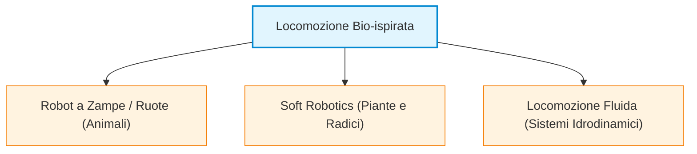
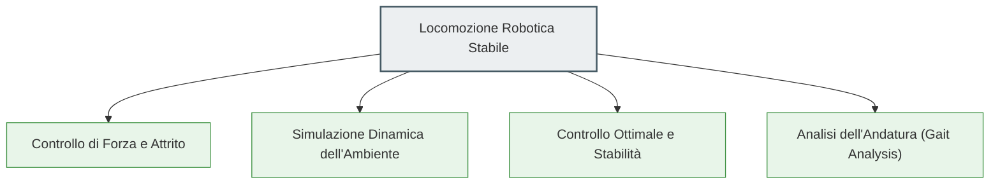
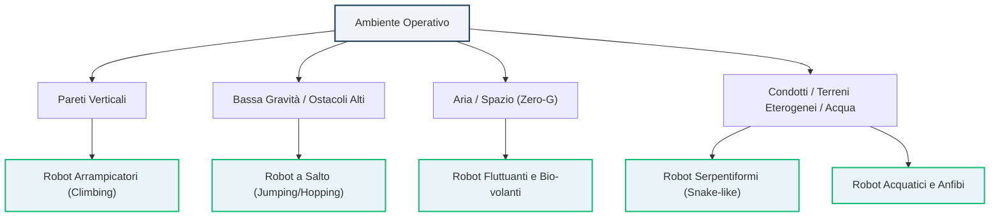
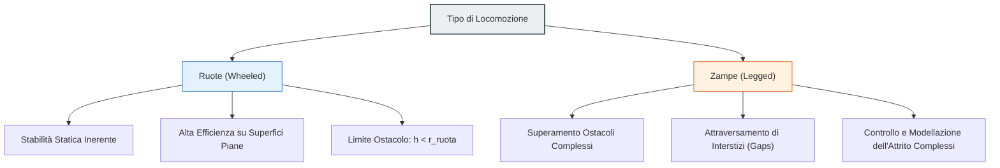
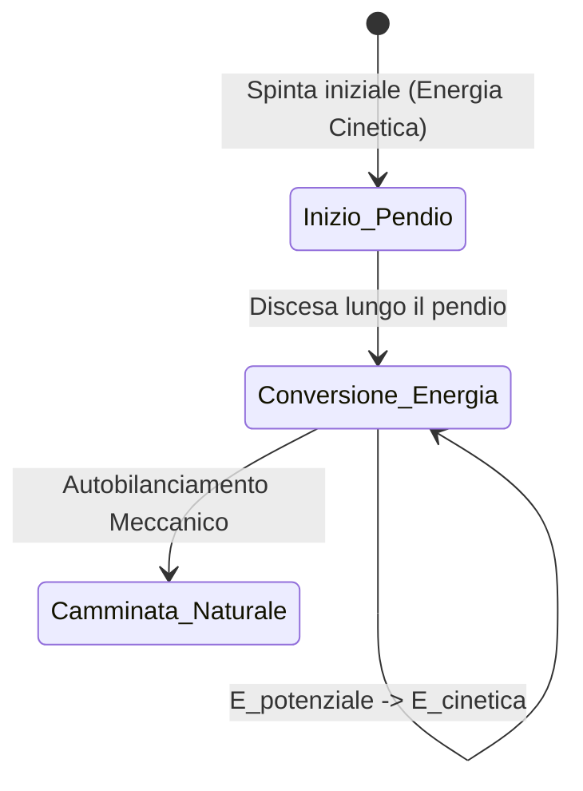
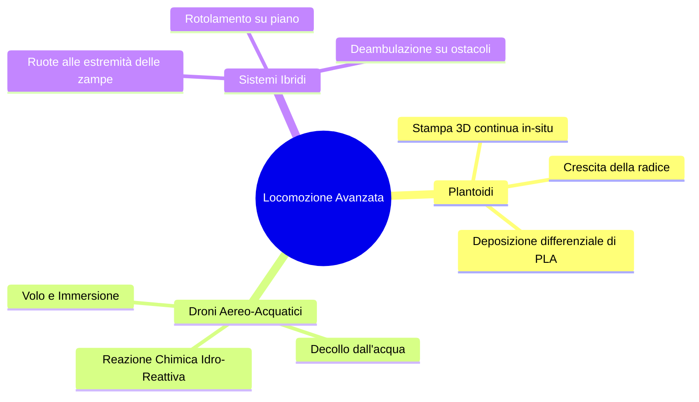

# Introduzione alla Locomozione Robotica: Principi Generali e Approcci Bio-Ispirati

## Overview Didattica

In questa lezione viene introdotto il concetto fondamentale di **locomozione** (*locomotion*) in robotica, definita come l'atto di spostarsi da un punto a un altro attraverso l'interazione fisica diretta tra la struttura del robot (*robot body*) e il mezzo o ambiente circostante (*environment/medium*). 

Viene fornita una panoramica interdisciplinare sulle diverse modalità di movimento, evidenziando come la robotica moderna attinga ampiamente alla natura (**bio-ispirazione** / *bio-inspiration*). Oltre ai classici sistemi di locomozione a ruote (*wheeled locomotion*) e a zampe (*legged locomotion*), la lezione esplora frontiere avanzate come la **robotica morbida** (*soft robotics*) e la locomozione ispirata al regno vegetale (*plant-inspired locomotion*). In particolare, viene analizzato il caso dei robot a radice (*root-inspired robots*), capaci di muoversi nel terreno mediante la crescita e l'estrusione di materiale (stampa 3D in situ), sfruttando la naturale adattabilità morfologica (*compliance*) per superare gli ostacoli.

I punti chiave trattati includono:

* **Natura Interdisciplinare della Locomozione:** La necessità di integrare software di controllo, azionamento (*actuation*), controllo di forza (*force control*), modellazione dell'attrito (*friction control*) e simulazione fisica dell'interazione con l'ambiente.
* **Tassonomia della Locomozione:** Introduzione ai diversi paradigmi di mobilità, inclusi i sistemi su ruote, a zampe, serpentini (*snake locomotion*) e natatori (*swimming locomotion*).
* **Paradigma della Crescita Strutturale:** Analisi dei robot morbidi e dello sviluppo di strutture capaci di allungarsi ed esplorare ambienti complessi mediante variazione di rigidità e addizione cellulare/materiale.

---

### Organizzazione del Corso e Testi di Riferimento

La comprensione della robotica mobile richiede una combinazione di concetti teorici e applicativi. I due testi di riferimento fondamentali per il corso sono:

1. **Introduction to AI Robotics** (R. Murphy): Focalizzato sull'architettura software, la percezione e l'intelligenza artificiale applicata ai robot.
2. **Autonomous Mobile Robots** (B. Siciliano et al.): Focalizzato sugli aspetti di modellistica cinematica, dinamica e controllo dei corpi articolati (siano essi con ruote o a zampe).

> **Concetto Chiave**: La preparazione del corso richiede lo studio integrale dei capitoli indicati nel programma (Moodle), compresi gli argomenti non trattati esplicitamente a lezione. Le domande d'esame verificheranno sia i concetti spiegati dal docente, sia la teoria e i modelli dettagliati nei testi di riferimento.

---

### Introduzione alla Locomozione Robotica e Bio-ispirazione

La **locomozione** (locomotion) è definita come l'atto di muoversi da un luogo a un altro. In ambito robotico, la locomozione si basa sulla **forza di reazione fisica** prodotta dall'interazione tra il corpo del robot e il mezzo/ambiente circostante (terreno, acqua, aria).

I robotici traggono continuamente ispirazione dalla natura (**bio-ispirazione** / *bio-inspiration*) per progettare nuove modalità di propulsione, superando la tradizionale distinzione tra robot a ruote (wheeled robots) e robot a zampe (legged robots).

#### Locomozione Ispirata alle Piante e Soft Robotics
Un ambito emergente della **Soft Robotics** è lo studio del movimento vegetale:
* **Attuazione fluida/chimica**: Piccoli canali flessibili in cui la pressione o la soluzione introdotta modifica la struttura geometrica, consentendo movimenti di avvolgimento o strisciamento.
* **Crescita autonoma per estrusione (Root-inspired Robots)**: Modellata sul comportamento delle radici vegetali. Il robot non "scivola" nel terreno, ma muove la propria testa (che agisce come una stampante 3D integrata) estrudendo un filo in polimero (es. PLA). 
  * Il robot incrementa la propria lunghezza depositando materiale.
  * **Cedevolezza passiva (Passive Compliance)**: Il materiale estruso è caldo e deformabile; incontrando un ostacolo rigido (es. una roccia), la variazione di attrito devia naturalmente la direzione di estrusione, facendo deviare la radice robotica verso il percorso a minor resistenza senza bisogno di complessi calcoli di pianificazione.

---

### Interdisciplinarità e Sfide nel Controllo della Locomozione

Sviluppare un sistema di locomozione efficace richiede l'integrazione di competenze provenienti da diversi domini scientifici e ingegneristici.

1. **Controllo di Forza (Force Control)**: È necessario modulare l'attrito e la forza normale applicata alla superficie di contatto per evitare lo slittamento.
2. **Simulazione Dinamica dell'Interazione**: Modellazione accurata dei contatti tra il corpo robotico e il terreno.
3. **Controllo Ottimale (Optimal Control)**: Gestione della stabilità dinamica e minimizzazione del consumo energetico.
4. **Analisi dell'Andatura (Gait Analysis)**: Studio dei pattern biologici di camminata umani ed animali.

#### Limiti Attuali dei Robot Umanoidi
I moderni robot umanoidi (humanoid robots) mostrano movimenti estremamente fluidi e naturali degli arti. Tuttavia, presentano una **bassa ripetibilità e precisione** rispetto ai manipolatori industriali tradizionali: muovere semplicemente i giunti non garantisce una traiettoria precisa se non si controllano con rigore le forze di interazione e l'attrito con l'ambiente.

---

### Principi Fisici e Modellazione della Locomozione Naturale

La scelta della modalità di locomozione dipende da fattori ambientali e fisici:
* **Struttura dell'ambiente**: Dimensioni, irregolarità e distanza da percorrere.
* **Parametri di contatto**: Numero di punti di contatto, angolo di contatto tra attuatore e superficie, coefficiente d'attrito ($\mu$).
* **Stabilità**: Posizione del Centro di Gravità ($CoG$, *Center of Gravity*).

> **Concetto Chiave**: Si distingue tra **Stabilità Statica** (il $CoG$ ricade sempre all'interno del poligono di supporto delimitato dai punti di contatto) e **Stabilità Dinamica** (il sistema è intrinsecamente instabile ad ogni istante, ma viene mantenuto in equilibrio attraverso il movimento e l'inerzia, come accade nei sistemi monopodo o nei bicicletti).

#### Analisi Meccanica dei Pattern di Movimento Naturale

I principali meccanismi fisici impiegati in natura e replicati in robotica si basano su diverse gestioni delle forze di attrito e dell'energia meccanica:

$$\begin{array}{l|l|l}
\textbf{Modalità} & \textbf{Meccanismo Fisico Dominante} & \textbf{Caratteristica Cinematica/Dinamica} \\
\hline
\textbf{Strisciamento (Crawling)} & \text{Attrito longitudinale} & \text{Vibrazioni e allungamenti lungo l'asse del movimento} \\
\textbf{Scivolamento (Sliding)} & \text{Attrito trasversale (Ortogonale)} & \text{Reazione trasversale (simile al pattinaggio su ghiaccio)} \\
\textbf{Corsa (Running)} & \text{Trasferimento di energia cinetica} & \text{Sfrutta gli impatti col terreno per la propulsione} \\
\textbf{Salto (Jumping)} & \text{Accumulo di energia potenziale/elastica} & \text{Rilascio impulsivo verticale della forza} \\
\textbf{Camminata (Walking)} & \text{Forza di gravità } (g) & \text{Equivalente al rotolamento di un poligono regolare} \\
\end{array}$$

1. **Strisciamento (Crawling)**: Utilizza forze di attrito dirette lungo la direzione longitudinale del movimento attraverso l'allungamento e la contrazione sequenziale degli elementi del corpo.
2. **Scivolamento (Sliding - es. Serpenti)**: A differenza del crawling, lo scivolamento sfrutta l'attrito *trasversale*. La forza di reazione utile al moto avanzato viene generata perpendicolarmente alla direzione del segmento corporeo, in modo analogo alla lama di un pattino da ghiaccio.
3. **Corsa (Running)**: Dominata dalla gestione delle perdite e dei trasferimenti di energia cinetica. L'impatto con il suolo trasferisce e trasforma l'energia cinetica accumulata per proiettare il corpo in avanti, modellabile tramite sistemi a pendolo con elementi elastici (molle).
4. **Salto (Jumping)**: Sfrutta l'accumulo di energia potenziale elastica negli arti per poi rilasciarla rapidamente in direzione prevalentemente verticale.
5. **Camminata (Walking)**: La camminata non si basa sulla perdita impulsiva di energia cinetica, ma sull'azione della **forza di gravità**. In termini fisici, camminare equivale a una "caduta controllata" continua.

#### Il Modello Geometrico della Camminata come Poligono Rotolante

Dal punto di vista cinematico, il processo di camminata può essere semplificato e modellato come il **rotolamento di un poligono regolare** rigido sul terreno.

Se definiamo la lunghezza del passo compiuto dall'agente con $s$ (lunghezza dello step), il movimento dell'asse del corpo corrisponde alla traiettoria del centro di un poligono i cui lati hanno lunghezza pari a $s$. 

Ad ogni passo, il centro di massa compie un arco circolare attorno al punto di contatto corrente (il vertice del poligono) per poi "cadere" in avanti verso il contatto successivo, convertendo energia potenziale gravitazionale in energia cinetica di avanzamento.

---

### Robotica Bio-Ispirata e Modalità di Locomozione Non Convenzionali

Nelle applicazioni reali, l'ambiente operativo non sempre offre superfici regolari, compatte e orizzontali adatte alle tradizionali ruote o ai cingoli. La natura ha sviluppato, attraverso milioni di anni di evoluzione, soluzioni di mobilità estremamente specializzate per arrampicarsi, saltare, nuotare o volare. Analizziamo le principali categorie di locomozione alternativa bio-ispirata, i principi fisici su cui si basano e i relativi vantaggi ingegneristici.

---

### Robot Arrampicatori (Climbing Robots)

La locomozione su superfici verticali pone una sfida fondamentale: contrastare la forza di gravità garantendo al contempo aderenza e capacità di avanzamento. Esistono due approcci principali per affrontare il problema:

1. **Pianificazione discreta dei punti di contatto:** Simile all'arrampicata umana su pareti attrezzate, il robot individua appigli artificiali o sporgenze naturali calcolando traiettorie cinematiche che mantengano l'equilibrio statico prima di ogni spostamento.
2. **Adesione distribuita bio-ispirata (Geco e Insetti):** Piattaforme come quelle sviluppate da Boston Dynamics (es. prototipi *RiSE*) sfruttano zampe dotate di micro-artigli (*micro-spines*) o adesivi micro-strutturati ispirati alle zampe dei gechi (effetto simile al *Velcro*). 
   * **Principio di funzionamento:** I micro-artigli sfruttano le minuscole asperità e porosità presenti su materiali come cemento, corteccia d'albero o mattoni. L'interazione meccanica genera una forza tangenziale di attrito sufficiente a sostenere il peso del robot senza richiedere prese profonde.
   * **Adattamento morfologico:** Questi sistemi sono capaci di adattarsi alla curvatura dei supporti (ad esempio pali cilindrici o tronchi) e compiere transizioni spaziali complesse, come curve a gomito a $90^\circ$ tra pareti adiacenti o tra piano orizzontale e verticale.

---

### Robot a Salto (Jumping / Hopping Robots)

Il salto rappresenta una modalità di locomozione impulsiva ad altissima efficienza per il superamento di ostacoli dimensionalmente proibitivi rispetto alla taglia del robot.

#### Meccanica e Controllo del Salto
Un robot a salto non compie rimbalzi casuali, ma una navigazione balistica controllata:
* **Accumulo di energia:** Il sistema comprime una molla meccanica o pneumatica tramite un attuatore (un grado di libertà dedicato all'accumulo elastico). Il rilascio repentino scarica l'energia a terra generando l'impulso verticale:
  $$J = \int F(t) \, dt = m \Delta v$$
* **Controllo direzionale:** Il beccheggio (*tilt*) e la posizione del Baricentro o Centro di Massa (*Center of Mass*, CoM) della parte superiore del corpo vengono regolati prima del distacco. Modificando l'inclinazione del vettore velocità iniziale $\mathbf{v}_0$, il robot controlla con precisione gittata, altezza e punto di atterraggio.

> **Concetto Chiave: La locomozione in microgravità**  
> L'utilità dei robot a salto è evidente in ambienti a gravità quasi nulla (es. asteroidi o comete, come nella missione Hayabusa dell'agenzia spaziale giapponese JAXA). Sulla superficie di un asteroide, la gravità locale $g_{ast}$ è minima:
> $$g_{ast} \ll g_{\oplus}$$
> Di conseguenza, la forza normale $N = m g_{ast}$ esercitata a terra è pressoché nulla. Poiché la massima forza di trazione per ruote o cingoli dipende direttamente dall'attrito statico:
> $$F_{attrito} \le \mu_s N \approx 0$$
> I sistemi a ruota slittano a vuoto senza riuscire a generare propulsione. Il salto balistico a bassa velocità controllata (*controlled hopping/bouncing*) diventa l'unica modalità di locomozione fisicamente praticabile per esplorare la superficie senza sfuggire al campo gravitazionale del corpo celeste.

#### Piattaforme Ibride Ruota-Salto (Hybrid Wheeled-Jumping)
Alcuni robot (come il *SandFlea* di Boston Dynamics) combinano ruote per la mobilità planare convenzionale con un pistone ad anidride carbonica ad alta pressione per eseguire salti verticali imponenti (fino a diversi metri d'altezza). 
* **Vantaggi operativi:** Permettono di superare recinzioni, muri o accedere a finestre di edifici in scenari di ricognizione urbana, sorveglianza militare o soccorso (*Search and Rescue*), superando il limite geometrico imposto dal diametro delle ruote.

---

### Robot Fluttuanti e Volanti Bio-Ispirati

Abbandonando i tradizionali rotori dei quadricotteri o le ali fisse degli aeroplani, la bio-robotica esplora forme di propulsione alternative nei fluidi:

* **Robot a galleggiamento positivo ed elio (Festo):** Piattaforme che integrano corpi leggeri riempiti di elio ($He$) per ottenere una spinta idrostatica (secondo il principio di Archimede) che annulla l'effetto della gravità. 
  * Il movimento viene generato da pinne oscillanti biomimetiche (ispirate a meduse o pinguini).
  * Il controllo dell'assetto e della direzione di avanzamento si ottiene tramite lo spostamento controllato di zavorre interne (spostamento del baricentro) associato a piccoli propulsori di spinta (*thrusters*).
* **Robot a battito d'ali (*Flapping-wing Robots*):** Piccoli droni ornitotteri (es. robot farfalla) che sfruttano il moto non stazionario delle ali per generare portanza e spinta propulsiva simultaneamente. Sebbene garantiscano un'elevata efficienza energetica su scala millimetrica, il loro controllo preciso in traiettoria dinamica risulta particolarmente complesso a causa dei fenomeni aerodinamici fortemente non lineari.
* **Robot a gravità zero (Micro-propulsione interna):** Sistemi come i satelliti SPHERES della NASA impiegati a bordo della Stazione Spaziale Internazionale (ISS). Fluttuando in assenza di peso apparente, impiegano micro-eliche o getti di gas compresso per traslare e ruotare nello spazio tridimensionale, svolgendo compiti di ispezione autonoma, ripresa video e supporto agli astronauti.

---

### Robot Serpentiformi (Snake-like Robots)

I robot serpentiformi sono composti da una catena cinematica modulare costituita da elementi discreti identici, ripetuti in serie e collegati da giunti attuati (tipicamente giunti rotoidali ortogonali alternati per consentire flessioni nel piano orizzontale e verticale).

#### Principio di Locomozione a Rulli Passivi
La locomozione serpentina biologica si basa sull'anisotropia dell'attrito tra le scaglie dell'animale e il terreno. In ingegneria, questo fenomeno viene replicato installando **rulli folli passivi** lungo la periferia dei moduli:
* **Direzione longitudinale:** Il rullo scorre liberamente, offrendo un coefficiente di attrito molto basso ($\mu_{\parallel} \approx 0$).
* **Direzione trasversale:** Il rullo è bloccato rispetto alla direzione laterale, generando un coefficiente di attrito elevato ($\mu_{\perp} \gg \mu_{\parallel}$).

L'ondulazione sinusoidale della catena di giunti imprime una spinta laterale contro il terreno; la resistenza tangenziale del rullo trasforma questa forza laterale in una spinta netta diretta in avanti lungo l'asse longitudinale del robot, riproducendo il principio fisico della pattinata su ghiaccio o sui pattini in linea (*skating locomotion*).

```mermaid
flowchart LR
    accTitle: Principio di locomozione serpentiforme anisotropa
    accDescr: Schema della conversione di forza laterale in spinta propulsiva tramite attrito anisotropico.

    Ondulazione["Ondulazione Giunti (Attuatori)"] --> ForzaLaterale["Forza di Spinta Laterale"]
    ForzaLaterale --> RulliPassivi["Rulli a Frizione Anisotropa"]
    RulliPassivi --> Attrito["Alto attrito trasversale / Basso attrito assiale"]
    Attrito --> Propulsione["Spinta Risultante in Avanti"]

    style Ondulazione fill:#f9f9f9,stroke:#333,stroke-width:1px
    style RulliPassivi fill:#e8f4f8,stroke:#1e3d59,stroke-width:2px
    style Propulsione fill:#e8f8f5,stroke:#17b978,stroke-width:2px
```

* **Vantaggi e Applicazioni:**
  * **Modularità:** Possibilità di configurare la lunghezza del robot aggiungendo o rimuovendo moduli.
  * **Insensibilità geometrica:** Possono infilarsi in spazi estremamente ristretti, macerie post-terremoto e condotte idrauliche (*pipe inspection*). Se sigillati ermeticamente, operano senza problemi all'interno di liquidi o fango.

---

### Robot Acquatici e Anfibi (Fish-like and Amphibious Robots)

La locomozione acquatica bio-ispirata mira a superare i limiti delle eliche rotanti convenzionali (che generano vortici, rumore acustico e rischio di impigliamento con la vegetazione).

* **Robot a nuoto biomimetico (*Fish-like Robots*):** 
  * Replicando l'ondulazione corporea e caudale dei pesci (carangiforme o sub-carangiforme), questi robot consentono un'analisi avanzata della fluidodinamica animale.
  * In etologia e monitoraggio ambientale, un robot dall'aspetto e dal profilo idrodinamico naturale può avvicinarsi alla fauna marina senza allarmarla, permettendo riprese e misurazioni ecologiche inaccessibili a subacquei umani.
* **Propulsione polivalente ad alette/pale (*Paddles/Flippers*):**
  * Sviluppati per operare in ambienti anfibie di transizione (interfaccia battigia-terraferma).
  * Un'unica appendice meccanica rotante/oscillante flessibile genera spinta idrodinamica efficace in acqua (comportandosi come una pinna da nuoto) e trazione meccanica diretta su mezzi non strutturati ad alta deformabilità, come fango, sabbia soffice o neve.

---

### Deep Dive sulla Locomozione: Deambulazione, Efficienza Energetica e Paradigmi Avanzati

#### Locomozione a Zampe (Walking) vs. Locomozione su Ruote

Sebbene la maggior parte delle applicazioni robotiche mobili utilizzi la locomozione su ruote per motivi di semplicità e stabilità intrinseca, lo studio della deambulazione mediante zampe (*walking*) presenta vantaggi unici nel superamento di terreni sconnessi o irregolari.

*   **Limiti geometrici delle ruote:** Una ruota convenzionale non può superare un ostacolo (*step*) la cui altezza $h$ sia superiore al raggio della ruota stessa ($r_{\text{ruota}}$):
    $$h > r_{\text{ruota}} \implies \text{Impossibilità di superamento}$$
*   **Vantaggi delle zampe:** Permettono di superare ostacoli di altezza elevata, attraversare crepe o vuoti nel terreno (*gaps*), inclinarsi su pendenze scoscese e ripristinare la postura corretta in caso di ribaltamento (*recovery procedure*).
*   **Svantaggi delle zampe:** La stabilità è dinamicamente complessa, il sistema meccatronico possiede molti Gradi di Libertà (*Degrees of Freedom - DoF*) e la modellazione dell'attrito variamente distribuito a ogni singolo passo rappresenta una sfida notevole.

##### Analisi dell'Efficienza Energetica
La deambulazione umana è estremamente efficiente dal punto di vista energetico rispetto alla corsa (*running*). 
*   **Corsa vs. Camminata:** Nella corsa, il Centro di Massa (*Center of Mass - CoM*) compie oscillazioni verticali marcate (salti continui), dissipando energia a ogni impatto. Nella camminata, il CoM rimane quasi stabile horizontalmente, assimilabile al rotolamento di un poligono con un elevato numero di lati.
*   **Confronto dei supporti di rotolamento:** 
    *   Il rotolamento su ruote rigide in acciaio su rotaia di ferro (es. treni) è il sistema in assoluto più efficiente.
    *   La camminata biologica è energeticamente più efficiente del rotolamento su pneumatici deformabili (*soft tires*), in quanto la continua deformazione della gomma dissipa energia per attrito volvente elevato.

> **Concetto Chiave**
> L'efficienza della deambulazione umana si basa sul mantenimento della quota del Centro di Massa ($CoM$). Ridurre le fluttuazioni verticali del $CoM$ è il principio cardine per minimizzare lo spreco energetico nei sistemi robotici articolati.

---

#### Tecniche di Generazione e Controllo del Passo

La generazione di traiettorie per arti articolati si è evoluta attraverso tre paradigmi principali:

##### 1. Approccio Manuale/Cinematico (Frame-by-Frame)
Consiste nella scomposizione del movimento in una sequenza discreta di fotogrammi (posture fisse o *stances*) ed effettuando un'interpolazione cinematica tra di essi.
*   *Svantaggi:* Metodo rigido, specifico per una singola superficie piana, estremamente difficile da tarare. Non garantisce l'equilibrio dinamico durante la fase di transizione tra stance instabili.

##### 2. Zero Moment Point (ZMP) e Pendolo Invertito
La deambulazione viene modellata come un Pendolo Invertito (*Inverted Pendulum*). L'obiettivo primario del controllo è annullare i momenti dinamici generati dalle forze d'inerzia e di gravità nel punto di contatto tra il piede e il suolo (*Contact Patch*).

$$\boldsymbol{M}_{\text{contatto}} = \boldsymbol{0}$$

Questa condizione permette di calcolare in forma chiusa (*closed-loop formulation*) la coppia necessaria a ciascun motore articolare per garantire la stabilità dinamica del robot umanoide.

##### 3. Apprendimento da Dimostrazione e Deep RL
Le tecniche moderne abbandonano il controllo puramente analitico a favore di:
1.  **Motion Capture (MoCap):** Registrazione del movimento umano reale per ottenere traiettorie di riferimento.
2.  **Retargeting Cinematico:** Riproiezione cinematica e dinamica del movimento umano sulla struttura meccanica del robot (che presenta masse e cinematica differenti).
3.  **Deep Reinforcement Learning (Deep RL):** Addestramento delle politiche di controllo all'interno di ambienti di simulazione dotati di motore fisico (*physics engine*). Il robot impara a compensare le perturbazioni ambientali prima di trasferire le reti neurali sul sistema reale (*Sim-to-Real*).
*(Metodi storici precedenti comprendono i Central Pattern Generators - CPG e gli Algoritmi Genetici).*

---

#### Camminatori Dinamici Passivi e Costo del Trasporto

Per comprendere l'importanza dell'ottimizzazione meccanica rispetto alla sola potenza di calcolo/attuazione, la ricerca ha sviluppato i **Camminatori Dinamici Passivi** (*Passive Dynamic Walkers*).

*   **Principio di Funzionamento:** Robot privi di motori o batterie capaci di camminare lungo un leggero pendio. La sola forza motrice è la conversione dell'energia potenziale gravitazionale in energia cinetica di avanzamento.
*   **Vantaggio Meccanico:** Dimostrano che la geometria e l'interazione elastica dei giunti possono generare un'andatura fluida ed autobilanciata. Nei sistemi biologici, la posizione di riposo delle gambe non consuma energia; nei robot tradizionali, i motori assorbono continuamente potenza per mantenere l'equilibrio anche da fermi.

##### Il Costo del Trasporto (Cost of Transport - COT)
Per misurare ed equiparare l'efficienza energetica di sistemi eterogenei si utilizza il parametro adimensionale **COT** (proposto da Collins):

$$COT = \frac{E_{\text{mecc}}}{W \cdot d}$$

Dove:
*   $E_{\text{mecc}}$ è l'energia meccanica spesa dal sistema $[\text{J}]$.
*   $W$ è il peso totale del robot ($W = m \cdot g$) $[\text{N}]$.
*   $d$ è la distanza percorsa $[\text{m}]$.

> **Concetto Chiave**
> Il confronto del $COT$ evidenzia l'impatto della progettazione meccanica:
> *   Robot umanoide di prima generazione (es. **ASIMO**): $COT \approx 1.6$ (camminata "accovacciata" o *squatting walk* con ginocchia piegate per mantenere l'equilibrio via software, energeticamente inefficace).
> *   **Camminatore Passivo**: $COT \approx 0.31$ (riduzione di quasi un ordine di grandezza dei consumi).

---

#### Stabilità Statica e Morfologie Multipede

La quantità di arti determina la tipologia di equilibrio accessibile al sistema robotico:

*   **Bipedi / Umanoidi:** Non possiedono stabilità statica permanente durante il moto. Richiedono un controllo dinamico continuo.
*   **Requisito Minimo Statico:** Sono necessari almeno **3 punti d'appoggio** al suolo per definire un poligono di supporto che contenga la proiezione del CoM.
*   **Robot Esapodi ($\ge 6$ zampe):** Permettono la stabilità statica continua durante la deambulazione. Sollevando 3 zampe alla volta (andatura a tripode alternato o *tripod gait*), il robot mantiene sempre 3 zampe a terra, garantendo l'equilibrio statico in ogni istante.

##### Configurazione degli Arti in Natura
La robotica mutua la disposizione degli arti da tre modelli biologici principali:
1.  **Mammiferi:** Arti disposti al di sotto del corpo (massima efficienza nel carico verticale).
2.  **Rettili:** Arti articolati lateralmente al corpo (ampio poligono di supporto, alta stabilità intrinseca).
3.  **Insetti:** Strutture multipede ad alta ridondanza per terreni estremi.

---

#### Paradigmi di Controllo Avanzato e Nuove Attuazioni

##### Chiusura del Ciclo Percezione-Azione (Boston Dynamics Atlas/Spot)
Sistemi avanzati integrano anelli di controllo a bassa ed alta frequenza:
*   **Riflessi Posturali a Bassa Livello:** Risposta immediata (in anello chiuso sui sensori di forza/coppia degli arti) per compensare scivolamenti improvvisi (es. su neve o ghiaccio).
*   **Anello Percezione-Azione:** Re-pianificazione della traiettoria basata su visione computazionale (es. riconoscimento di *AprilTags* o mappe di elevazione 3D) per l'interazione attiva con oggetti e l'ambiente.
*   **Procedure di Ripristino (*Recovery Routines*):** Capacità di rialzarsi autonomamente a seguito di una caduta causata da perturbazioni esterne superiori ai limiti di stabilità.

##### Attuazione tramite Harmonic Drive
Gli umanoidi di nuova generazione impiegano attuatori con riduttori ad albero armonico (*Harmonic Drive*):
*   **Vantaggi:** Elevato rapporto di riduzione in ingombri contenuti, assenza di gioco (*backlash*), trasmissioni quasi dirette (*direct-drive-like feel*) che consentono movimenti estremamente veloci, fluidi ed agili (es. danza, salti, parkour).
*   **Svantaggi:** Minore controllabilità di precisione ed elevata difficoltà nel garantire una stabilità di posizionamento ad alta ripetibilità. È meccanicamente più semplice far eseguire a questi robot una danza veloce piuttosto che un'operazione di presa (*grasping*) di alta precisione.

---

#### Paradigmi di Locomozione Alternativi e Ibridi

La ricerca esplora strategie di locomozione non convenzionali per superare i limiti della meccatronica classica:

##### 1. Plantoidi (Robotica Ispirata al Mondo Vegetale)
Sistemi che si muovono nel sottosuolo non per scivolamento, ma per **crescita della propria struttura**:
*   La testa della radice robotica funziona come una stampante 3D a fusione di filamento (*FFF*) in miniatura.
*   Alimentando un filo di PLA dall'interno del corpo, la testina fonde il materiale sulla punta.
*   **Controllo di direzione:** Variando la quantità di materiale estruso sui lati opposti della circonferenza (deposizione differenziale), la radice si curva e naviga all'interno del terreno.

##### 2. Droni Aerei-Acquatici ad Propulsione Reattiva
Sistemi in grado di volare e immergersi in acqua come droni subacquei. La principale sfida tecnologica è il **decollo dall'acqua** causa la barriera di tensione superficiale e la densità del fluido.
*   *Soluzione Monostadio (Gas compresso):* L'apertura di un serbatoio gassoso ad alta pressione fornisce la spinta di decollo, ma limita l'operazione a un singolo utilizzo (*one-shot*).
*   *Soluzione Multi-Jump (Reazione Chimica):* Il robot trasporta una carica in polvere reattiva priva di acqua. Immergendosi, miscela una piccola quantità di polvere con l'acqua dell'ambiente circostante, innescando una reazione esotermica/espansione gassosa ad alta spinta. Questo permette decolli multipli con una massa di carburante trasportata ridotta al minimo.

##### 3. Robot Ibridi Ruota-Zampa (Wheeled-Legged Robots)
Piattaforme robotiche dotate di ruote motorizzate poste all'estremità distale di arti articolati:
*   Sfruttano la velocità e l'efficienza energetica del rotolamento su superfici piane.
*   Utilizzano i gradi di libertà delle zampe per assorbire urti, superare ostacoli alti o modificare l'altezza del CoM in tempo reale.

---

> [!NOTE]
> ### Note per l'Esame e Avvisi del Docente
> - **Contenuti dei libri di testo e Moodle:** È obbligatorio studiare integralmente i capitoli (o le sezioni specifiche) indicati sulla pagina Moodle dei libri di testo. All'esame saranno presenti domande su tutto il programma dei capitoli assegnati, inclusi i punti e i paragrafi che il docente non ha spiegato esplicitamente a lezione.
> - **Materiale NON richiesti all'esame (Video):** I video mostrati a lezione hanno solo scopo informativo e illustrativo. Il docente ha confermato esplicitamente che NON chiederà all'esame i dettagli tecnici presenti nei video (come lo specifico hardware o software utilizzato dai robot mostrati).