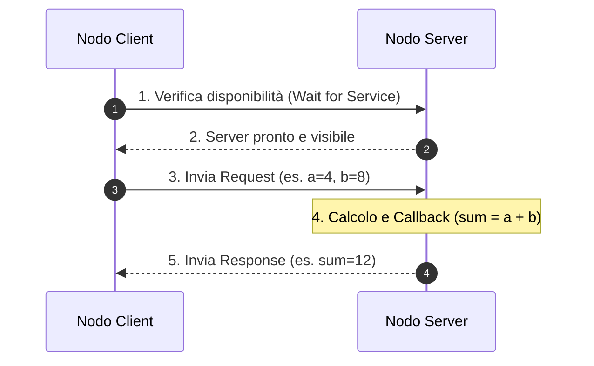
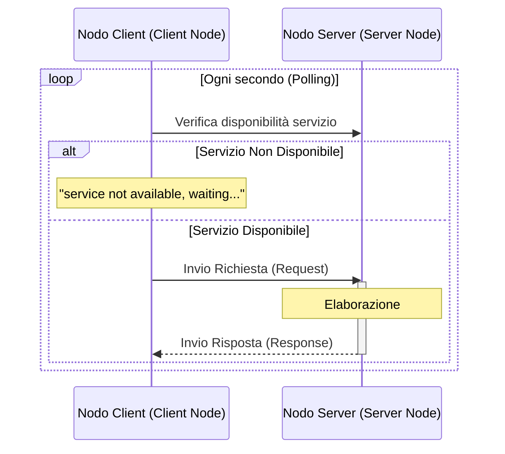
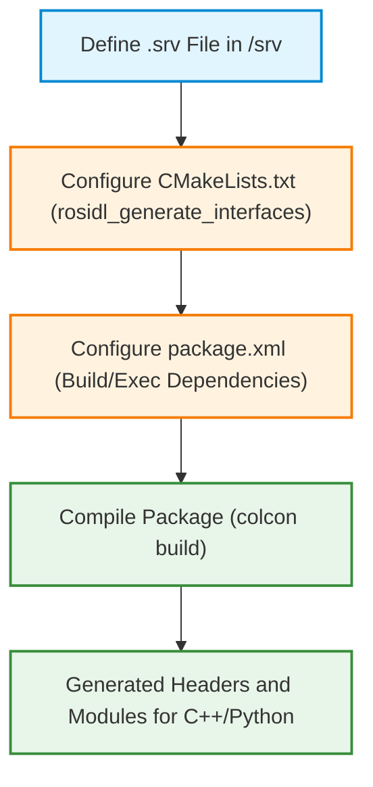
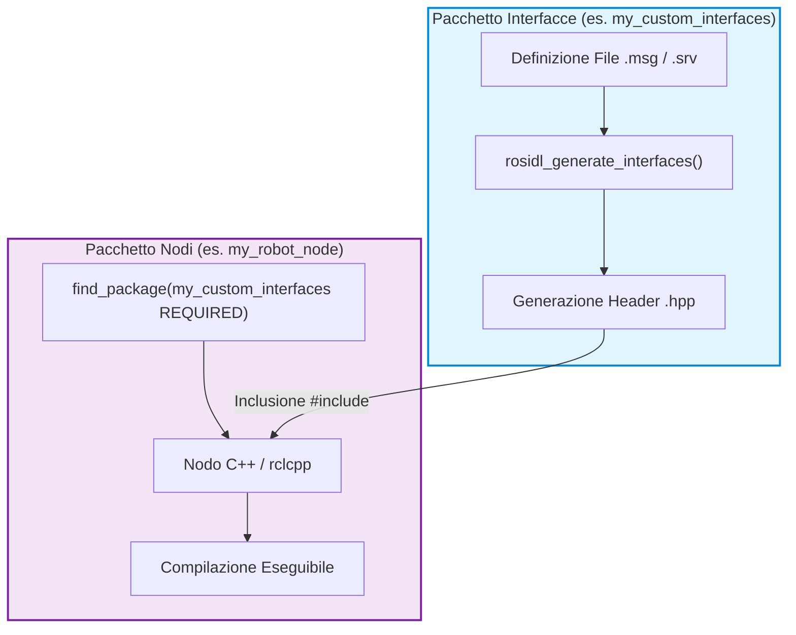

# Service Architecture in ROS 2: Synchronous Client/Server Communication

## Educational Overview

This lesson introduces the architecture of **ROS Services**, defining the second fundamental communication paradigm in ROS 2 (Robot Operating System 2). A comparative overview relative to the **Topic**-based model is presented:

* **Topics (Asynchronous Communication):** Based on the **Publisher/Subscriber Architecture**. Communication is decoupled and non-binding: a node can publish messages regardless of the presence of active subscriber nodes.
* **Services (Synchronous Communication):** Based on the **Client/Server Architecture**. The *Client* node sends a **Request** and waits (blocking or managed via callback) for the *Server* node to process it and return a **Response**.

Finally, the lesson illustrates the internal structure of **Service Interface** files (files with extension `.srv`) and analyzes their practical use through the standard package `example_interfaces` and the interface `AddTwoInts`.

---

### Introduction to ROS Services and Example with Standard Package

---

### Comparison between ROS Topics and ROS Services

In ROS 2 there are different modes of communication between nodes. Up to now we have seen the use of **ROS Topics**, based on the Publisher/Subscriber architecture:

*   **Asynchronous Communication:** In topics, a *Publisher* node constantly sends messages on the topic, while a *Subscriber* node connects to the topic to receive them. The two nodes are totally decoupled: the publisher sends data regardless of the presence or absence of a subscriber, and vice versa. The only fundamental requirement is the use of the **unique topic name** (*Topic Name*) and matching message types.
*   **Synchronous Communication:** **ROS Services** instead introduce a synchronous model based on the **Client/Server** architecture. In this case, one node acts as a **Server** offering a specific service, while another node acts as a **Client** requesting the execution of that service.

> **Key Concept: Architectural Difference**
> Unlike Topics (designed for continuous one-to-many data streams), Services use a **one-to-one Request/Response-based relationship**. The Client pauses or waits for execution until the Server is visible, connected, and processes the requested response.



---

### Structure of a Service Interface

A service file (with extension `.srv`) describes the data exchanged between Client and Server. The structure of a service file is always divided into exactly two parts by three separator dashes `---`:

1.  **Request:** A set of one or more fields sent from the Client to the Server.
2.  **Response:** A set of one or more fields returned from the Server to the Client following processing.

$$\text{File .srv} \implies \begin{cases} \text{Campi della Request} \\ \text{---} \\ \text{Campi della Response} \end{cases}$$

---

### Analysis of the Standard Package `example_interfaces`

ROS 2 already includes several pre-installed packages with standard message and service definitions. One of these is the package `example_interfaces`.

To verify the available packages and services from the terminal, we can use the following commands:

```bash
# Elenca tutti i pacchetti installati nell'ambiente ROS 2
ros2 package list

# Ispeziona l'interfaccia specifica di un servizio
ros2 interface show example_interfaces/srv/AddTwoInts
```

The output of the command `ros2 interface show` for the service `AddTwoInts` shows the following structure:

```text
int64 a
int64 b
---
int64 sum
```

In this specific case study:
*   The **Request** consists of two 64-bit integers: $a \in \mathbb{Z}$ and $b \in \mathbb{Z}$.
*   The **Response** is a single 64-bit integer representing the sum: $sum = a + b$.

---

### Implementation of Server and Client Nodes

To allow two nodes to communicate via this service, we must implement both the Server side and the Client side.

#### 1. Server Node (`add_two_ints_server`)

The task of the Server is to listen, receive parameters $a$ and $b$ from the Request, execute the arithmetic operation, and return the result $sum$ in the Response.

*Fundamental logic of the Server:*
*   Include and declare the service structure `example_interfaces/srv/AddTwoInts`.
*   Define a **Callback Function**: this function handles processing the Request data and packaging the Response.
*   Create the service by associating the service name and the callback with the node instance.
*   Use ROS logging mechanisms to trace incoming requests in the terminal.

*Conceptual processing code in the Server:*
```cpp
// La callback riceve la richiesta e compila la risposta
void add(const std::shared_ptr<example_interfaces::srv::AddTwoInts::Request> request,
         std::shared_ptr<example_interfaces::srv::AddTwoInts::Response> response)
{
    response->sum = request->a + request->b;
    // Log di output a terminale
    RCLCPP_INFO(rclcpp::get_logger("rclcpp"), "Richiesta in arrivo: a = %ld, b = %ld", request->a, request->b);
    RCLCPP_INFO(rclcpp::get_logger("rclcpp"), "Invio risposta: sum = %ld", response->sum);
}
```

> **Note:** *Step integrated with educational clarity.* The use of logging macros (such as `RCLCPP_INFO` in C++ or `get_logger().info()` in Python) is the standard and fundamental method in ROS to monitor node execution in the terminal instead of using standard print statements.

#### 2. Client Node (`add_two_ints_client`)

The Client must request the sum of two numbers provided by the user (for example from the command line via arguments).

> **Key Concept: Service Wait Cycle (*Wait for Service*)**
> Since communication is synchronous, before sending a request the Client **must obligatorily check that the Server is active**. This is achieved through a wait loop (e.g., `client->wait_for_service()`). If the Server is not available, the Client remains waiting and reports the situation in the terminal.

*Fundamental logic of the Client:*
1.  Read the two integers passed from the command line ($a$ and $b$).
2.  Declare and create the Client object specifying the service type (`example_interfaces/srv/AddTwoInts`) and the unique service name.
3.  Execute the wait loop to check for the Server.
4.  Populate the Request with the received values and send the request.
5.  Wait for the return of the Response and print the obtained result.

---

### Package and Build Configuration

> **Key Concept: Dependency Management**
> If you create a custom package that uses services defined in another package (such as `example_interfaces`), it is **essential** to add the explicit dependency in the package configuration files. Without this dependency, the compilation phase will fail because the system will not know where to find the service headers.

To compile and run the nodes correctly, you need to update the following two files in the root of the package (e.g., `intro_lab_2`):

#### 1. Insertion in `package.xml`
You need to add the build and execution dependency on the standard package:

```xml
<depend>example_interfaces</depend>
```

#### 2. Insertion in `CMakeLists.txt`
In C++, it is necessary to find the package and declare the executables for Server and Client, associating their respective dependencies:

```cmake
find_package(example_interfaces REQUIRED)

# Nodo Server
add_executable(server src/add_two_ints_server.cpp)
ament_target_dependencies(server rclcpp example_interfaces)

# Nodo Client
add_executable(client src/add_two_ints_client.cpp)
ament_target_dependencies(client rclcpp example_interfaces)

# Installazione degli eseguibili
install(TARGETS
  server
  client
  DESTINATION lib/${PROJECT_NAME}
)
```

---

### Practical Execution and Communication Test

To test the developed Client/Server architecture, two separate terminals are used, following the environment build and source procedure (*Workspace Overlay*).

#### Step 1: Workspace Compilation
From the main terminal of the workspace folder:

```bash
# Compilazione selettiva del pacchetto di lavoro
colcon build --packages-select intro_lab_2

# Sourcing dell'ambiente globale ROS e del workspace locale
source /opt/ros/humble/setup.bash
source install/setup.bash
```

#### Step 2: Starting the Server Node (Terminal 1)
We start the Server first so it listens for new requests:

```bash
source install/setup.bash
ros2 run intro_lab_2 server
```
*Expected output:* The server starts and signals that it is ready to add the two integers.

#### Step 3: Starting the Client Node (Terminal 2)
In a second terminal, we send the request passing as arguments the two integers to be added (for example $a = 4$ and $b = 8$):

```bash
source install/setup.bash
ros2 run intro_lab_2 client 4 8
```

#### Output and Result
*   **On the Client:** Receives the response and displays the computed result on screen:
    $$\text{Risposta dal Server: } 12$$
*   **On the Server:** Intercepts the request and logs the process:
    $$\text{Incoming request: } a = 4, \; b = 8 \implies \text{Sending back response: } 12$$

If you run the Client again sending a new pair of values, for example $a = 5$ and $b = 13$:

```bash
ros2 run intro_lab_2 client 5 13
```
The Server will instantly calculate and return the new response with the value $sum = 18$.

---

### Client-Server Communication Dynamics in ROS 2

During interaction between a **Client Node** and a **Server Node**, if the client is started before the server, the system does not crash. The client enters an active waiting state through a periodic polling mechanism, checking periodically for the presence of the service.

#### Polling Mechanism and Node Roles
* **Time-triggered polling:** The client attempts to connect to the service at regular intervals (for example every second via `wait_for_service()`). As long as the server is not active, the client returns an informational message such as `"service not available, waiting..."`. As soon as the server is started, the connection is established and the request is processed.
* **Coexistence of roles:** A single ROS 2 node is not limited to being exclusively a client or server. It is perfectly legitimate to instantiate both a client and a server within the same node (in addition to any *Publishers* and *Subscribers*).



---

### Creating and Configuring Custom Services

To define a **Custom Service** inside a ROS 2 package, it is necessary to follow a precise structure for defining the interface and managing build dependencies.

#### Directory Structure and File Definition `.srv`
1. Inside the root of your ROS 2 package, create a directory named `srv/`.
2. Inside `srv/`, define the interface file with extension `.srv` (for example `AddThreeInts.srv`).
3. The file structure is divided into two sections separated by three dashes (`---`):

$$ \text{Sezione Request (Input)} \quad / \quad \text{Sezione Response (Output)} $$

Conceptual example for adding three integers ($a + b + c = \text{sum}$):
```text
int64 a
int64 b
int64 c
---
int64 sum
```

---

#### Dependency Management (`CMakeLists.txt` and `package.xml`)

> **KEY CONCEPT: Importance of Build System Configuration**
> When creating a custom service, simply writing the `.srv` file is not sufficient. If you do not explicitly update the dependencies in the `CMakeLists.txt` and `package.xml`files, the C++/Python code will not generate the necessary headers, and the compilation phase will systematically fail.

##### Changes to `CMakeLists.txt`
You must invoke the interface generation function, specifying both the `.srv` file and any message packages on which the service structure depends:

1. Import the necessary packages using `find_package(...)` (e.g., `rosidl_default_generators`, `geometry_msgs`).
2. Declare the interface generation:
   ```cmake
   rosidl_generate_interfaces(${PROJECT_NAME}
     "srv/AddThreeInts.srv"
     DEPENDENCIES geometry_msgs # Se il servizio usa tipi da geometry_msgs
   )
   ```

##### Changes to `package.xml`
In the package description file, add tags for interface code generation and execution:
* `<build_depend>rosidl_default_generators</build_depend>`
* `<exec_depend>rosidl_default_runtime</exec_depend>`
* `<member_of_group>rosidl_interface_packages</member_of_group>`
* If the service includes external complex types (e.g., vectors, coordinates), add the dependency to the corresponding package (e.g., `<depend>geometry_msgs</depend>`).



---

### Reusing Standard ROS 2 Interfaces and Messages

Before creating a new message or service from scratch, it is good practice to check whether standard structures provided by ROS 2 already exist. Messages defined in standard packages (such as `geometry_msgs`, `sensor_msgs` or `nav_msgs`) can be used directly or integrated as sub-fields within a custom message/service.

#### Commonly Used Messages
* **Primitives:** `int32`, `int64`, `float64`, `string`, `bool`.
* **Standard Header (`std_msgs/Header`):** Contains timestamp and spatial reference frame identifier (`frame_id`).
* **Geometry (`geometry_msgs`):** A key example is `geometry_msgs/msg/Twist`, commonly used to define robot velocity commands in 3D space.

#### Inspecting Interfaces via Terminal
To analyze the internal structure of a message or service provided by the system, use the command-line tool **ROS 2 Interface** (`ros2 interface show`):

```bash
ros2 interface show geometry_msgs/msg/Twist
```

Output of the structure of the message `Twist`:
```text
# Velocità lineare e angolare
Vector3 linear
    float64 x
    float64 y
    float64 z
Vector3 angular
    float64 x
    float64 y
    float64 z
```

> **KEY CONCEPT: Reusing ROS 2 Architecture**
> Do not reinvent existing data structures. If you need to send linear and angular velocity components, you should directly use `geometry_msgs/msg/Twist`. Understanding how to compose and reuse these standard building blocks (Publisher, Subscriber, Client, Server, Interface definitions, and logging macros like `RCLCPP_INFO`) is the fundamental requirement for mastering software development in ROS 2.

---

### Managing Custom Interfaces (Custom Messages and Services) and CMake Configuration in ROS 2

In ROS 2 (Robot Operating System 2) development practice, creating custom messages (`.msg`) and services (`.srv`) is a fundamental procedure to adapt data exchange to specific application needs. However, configuring build files (`CMakeLists.txt` and `package.xml`) often presents critical issues that can lead to complex compilation errors.

---

#### Package Architecture: The Two-Package Rule

During C++ development, one of the most common issues is the failure to generate C++ headers (the `.hpp`files) associated with custom messages before executable nodes attempt to include them.

> **KEY CONCEPT: Separation between Interfaces and Logic**
> To avoid circular dependencies and synchronization issues in generating CMake targets, the recommended best practice in ROS 2 consists of **clearly separating custom interfaces from execution nodes by creating two distinct packages**:
> 1. **Interface Package**: Contains exclusively the `.msg` and `.srv`definitions, and the minimal CMake logic for their generation (`rosidl_generate_interfaces`).
> 2. **Logic Package (Node/Application Package)**: Contains the C++ source code (`rclcpp`) of the nodes, importing the interface package as an external dependency.



---

#### Workflow for Creating and Verifying Custom Interfaces

1. **Interface Definition (Package A)**:
   A package dedicated to interfaces is created. Primary data types in `.msg` or `.srv` definitions must strictly follow the ROS 2 IDL syntax (e.g., lowercase for base types such as `string`, `int32`, `float64`).

   *Note on syntax*: Writing `String` with a capital 'S' in IDL causes a syntax error. If you want to use the primitive type, write `string`. If you want to use the wrapped standard message, explicitly reference `std_msgs/String`.

2. **Compiling the Interface Package**:
   Perform an isolated build of the package containing the interfaces:
   $$ \text{colcon build --packages-select } <\text{nome\_pacchetto\_interfaccie}> $$

3. **Verifying Registration**:
   Before proceeding with writing nodes, verify that the ROS 2 environment has correctly registered the new message/service type via the terminal:
   ```bash
   ros2 interface show <nome_pacchetto_interfaccie>/msg/<NomeMessaggio>
   ```

4. **Integration into the Logic Package (Package B)**:
   In the package containing the node's C++ code:
   * In `package.xml`, add the dependencies:
     ```xml
     <depend>nome_pacchetto_interfaccie</depend>
     ```
   * In `CMakeLists.txt`, declare the external dependency and associate it with the target:
     ```cmake
     find_package(nome_pacchetto_interfaccie REQUIRED)

     add_executable(my_node src/my_node.cpp)
     ament_target_dependencies(my_node rclcpp nome_pacchetto_interfaccie)
     ```

---

#### Troubleshooting Common Build Issues

When attempting to manage custom messages and C++ nodes within a **single package**, CMake can fail compilation returning errors declaring that generated headers cannot be found (e.g., `fatal error: my_package/msg/detail/custom_msg__struct.hpp: No such file or directory`).

##### Main causes and frequent errors:
* **Lack of explicit target dependencies**: The C++ compiler attempts to compile the source `.cpp` before the macro `rosidl_generate_interfaces()` has completed generating the C++ headers.
* **Incorrect syntax in types**: Using incorrect capitalization (e.g., `String` instead of `string`) prevents the IDL generator from interpreting the file `.msg`.
* **C++ Syntax (Forgotten semicolons)**: In the absence of advanced auto-completion in the development environment or build system, trivial C++ syntax omissions (such as missing semicolons `;` at the end of a statement or incorrect includes) cause cascading errors during the compiler's assembly phase.

> **Operational Advice**: If the monolithic configuration of `CMakeLists.txt` generates unusual errors during intermediate file generation, the quickest and most effective solution is to refactor the structure, separating the interface into a dedicated sub-package.

---

#### Integration with Application Components (e.g. Graphical Interfaces or Custom Services)

When a node needs to invoke a custom service (for example triggered by an action on a user interface or a system event), the logical flow follows the **Client-Server** pattern:

1. The client node instantiates the custom service type defined in the interface package:
   $$ \text{auto client} = \text{node->create\_client}<my\_interfaces::srv::MyCustomService>("service_name"); $$
2. When the event occurs (e.g. clicking a GUI button), the request structure ($Request$) is populated and sent asynchronously to the service.
3. The server handles the logic and processes the response ($Response$).

---

> [!NOTE]
> ### Exam Notes and Instructor Notices
> - **Format of the practical exam**: The exam will consist of a programming session where you will be required to complete code ("fill the gaps"). The elements to be inserted will mainly be ROS structures (e.g. creating custom messages, instantiating communication between nodes, structures for client/server or publisher/subscriber, and using the logger such as `RCLCPP_INFO`).
> - **Use of documentation**: It is not necessary to memorize all syntax, as documentation will be made available to consult during the test.
> - **Type of exercise**: The test will contain an exercise similar to or slightly more complex than the examples seen in class, intended to verify understanding of individual components and how to assemble them together.
> - **Exam simulation**: Between late November and early December (after completing all topics on ROS programming), an exam simulation of the practical test will be provided and carried out together.