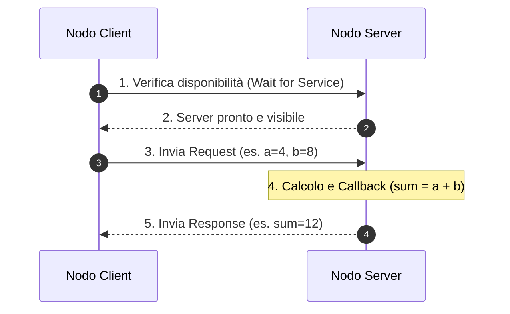
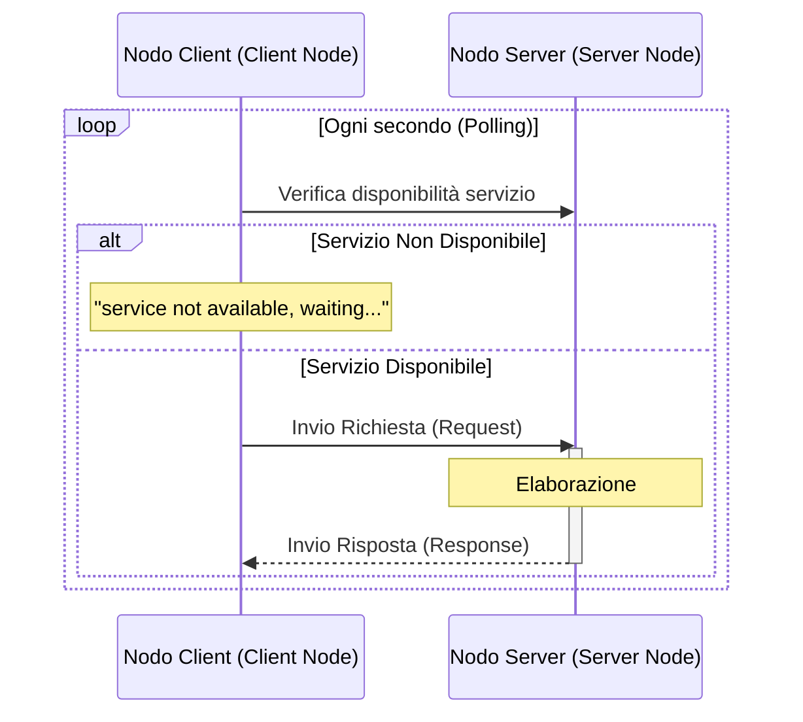
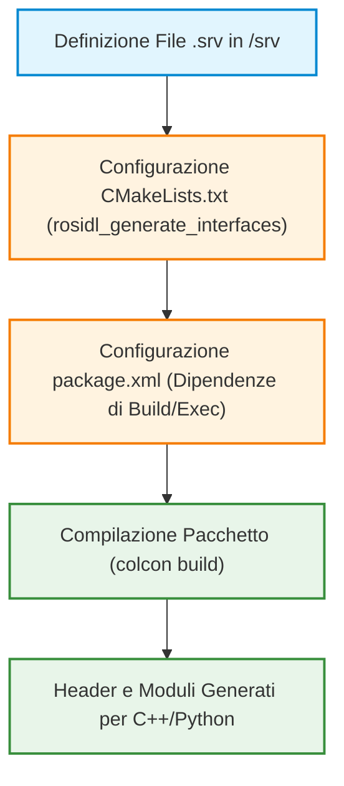
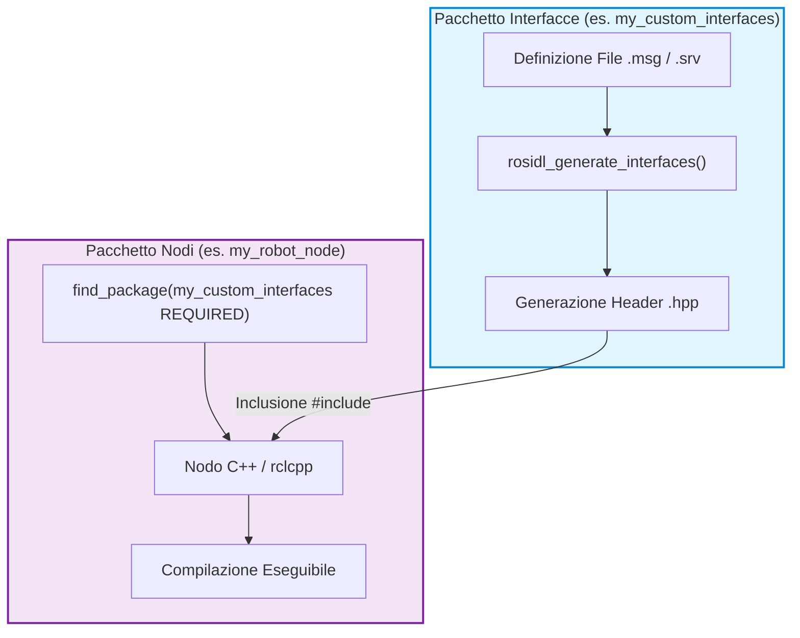

# Architettura dei Servizi in ROS 2: Comunicazione Sincrona Client/Server

## Overview Didattica

Questa lezione introduce l'architettura dei **Servizi ROS** (*ROS Services*), definendo il secondo paradigma di comunicazione fondamentale in ROS 2 (Robot Operating System 2). Viene presentata una panoramica comparativa rispetto al modello basato sui **Topic**:

* **Topic (Comunicazione Asincrona / *Asynchronous Communication*):** Basata sull'architettura **Editore/Sottoscrittore** (*Publisher/Subscriber Architecture*). La comunicazione è disaccoppiata e non vincolante: un nodo può pubblicare messaggi indipendentemente dalla presenza di nodi sottoscrittori attivi.
* **Servizi (Comunicazione Sincrona / *Synchronous Communication*):** Basata sull'architettura **Client/Server** (*Client/Server Architecture*). Il nodo *Client* invia una **Richiesta** (*Request*) e rimase in attesa (bloccante o gestita via callback) che il nodo *Server* la elabori e restituisca una **Risposta** (*Response*).

Infine, la lezione illustra la struttura interna dei file di **Interfaccia di Servizio** (*Service Interface*, file con estensione `.srv`) e ne analizza l'utilizzo pratico mediante il pacchetto standard `example_interfaces` e l'interfaccia `AddTwoInts`.

---

### Introduzione ai ROS Services ed Esempio con Pacchetto Standard

---

### Confronto tra ROS Topics e ROS Services

In ROS 2 esistono diverse modalità di comunicazione tra nodi. Fino ad ora abbiamo visto l'uso dei **ROS Topics**, basati sull'architettura Publisher/Subscriber:

*   **Comunicazione Asincrona (*Asynchronous Communication*):** Nei topic, un nodo *Publisher* invia costantemente messaggi sul topic, mentre un nodo *Subscriber* si connette al topic per riceverli. I due nodi sono totalmente disaccoppiati: il publisher invia i dati indipendentemente dalla presenza o meno di un subscriber, e viceversa. L'unico vincolo fondamentale è l'utilizzo del **nome univoco del topic** (*Topic Name*) e la corrispondenza del tipo di messaggio.
*   **Comunicazione Sincrona (*Synchronous Communication*):** I **ROS Services** introducono invece un modello sincrono basato sull'architettura **Client/Server**. In questo caso, un nodo agisce come **Server** offrendo un servizio specifico, mentre un altro nodo agisce come **Client** richiedendo l'esecuzione di tale servizio.

> **Concetto Chiave: Differenza Architetturale**
> A differenza dei Topic (pensati per flussi continui di dati da uno-a-molti), i Servizi utilizzano una relazione **uno-a-uno basata su Richiesta e Risposta (*Request/Response*)**. Il Client interrompe o attende la sua esecuzione fino a quando il Server non è visibile, connesso ed elabora la risposta richiesta.



---

### Struttura di un'Interfaccia di Servizio (*Service Interface*)

Un file di servizio (con estensione `.srv`) descrive i dati scambiati tra Client e Server. La struttura di un file di servizio è sempre divisa esattamente in due parti tramite tre trattini separatori `---`:

1.  **Request (Richiesta):** Insieme di uno o più campi inviati dal Client al Server.
2.  **Response (Risposta):** Insieme di uno o più campi restituiti dal Server al Client a valle dell'elaborazione.

$$\text{File .srv} \implies \begin{cases} \text{Campi della Request} \\ \text{---} \\ \text{Campi della Response} \end{cases}$$

---

### Analisi del Pacchetto Standard `example_interfaces`

ROS 2 include già diversi pacchetti preinstallati con definizioni standard di messaggi e servizi. Uno di questi è il pacchetto `example_interfaces`.

Per verificare i pacchetti e i servizi disponibili da terminale, possiamo usare i seguenti comandi:

```bash
# Elenca tutti i pacchetti installati nell'ambiente ROS 2
ros2 package list

# Ispeziona l'interfaccia specifica di un servizio
ros2 interface show example_interfaces/srv/AddTwoInts
```

L'output del comando `ros2 interface show` per il servizio `AddTwoInts` mostra la seguente struttura:

```text
int64 a
int64 b
---
int64 sum
```

In questo specifico caso di studio:
*   La **Request** è composta da due numeri interi a 64 bit: $a \in \mathbb{Z}$ e $b \in \mathbb{Z}$.
*   La **Response** è un singolo numero intero a 64 bit rappresentante la somma: $sum = a + b$.

---

### Implementazione dei Nodi Server e Client

Per far comunicare due nodi tramite questo servizio, dobbiamo implementare sia il lato Server che il lato Client.

#### 1. Nodo Server (`add_two_ints_server`)

Il compito del Server è rimanere in ascolto, ricevere i parametri $a$ e $b$ della Request, eseguire l'operazione aritmetica e restituire il risultato $sum$ nella Response.

*Logica fondamentale del Server:*
*   Includere e dichiarare la struttura del servizio `example_interfaces/srv/AddTwoInts`.
*   Definire una **Funzione di Callback (*Callback Function*)**: questa funzione si occupa di elaborare i dati della Request ed impacchettare la Response.
*   Creare il servizio associando il nome del servizio e la callback all'istanza del nodo.
*   Utilizzare i meccanismi di logging di ROS per tracciare a terminale le richieste in ingresso.

*Codice concettuale dell'elaborazione nel Server:*
```cpp
// La callback riceve la richiesta e compila la risposta
void add(const std::shared_ptr<example_interfaces::srv::AddTwoInts::Request> request,
         std::shared_ptr<example_interfaces::srv::AddTwoInts::Response> response)
{
    response->sum = request->a + request->b;
    // Log di output a terminale
    RCLCPP_INFO(rclcpp::get_logger("rclcpp"), "Richiesta in arrivo: a = %ld, b = %ld", request->a, request->b);
    RCLCPP_INFO(rclcpp::get_logger("rclcpp"), "Invio risposta: sum = %ld", response->sum);
}
```

> **Nota:** *Passaggio integrato con chiarezza didattica.* L'uso delle macro di logging (come `RCLCPP_INFO` in C++ o `get_logger().info()` in Python) è il metodo standard e fondamentale in ROS per monitorare l'esecuzione dei nodi a terminale anziché usare i classici comandi di stampa standard.

#### 2. Nodo Client (`add_two_ints_client`)

Il Client deve richiedere la somma di due numeri forniti dall'utente (ad esempio da riga di comando tramite argomenti).

> **Concetto Chiave: Ciclo di Attesa del Servizio (*Wait for Service*)**
> Essendo la comunicazione sincrona, prima di inviare una richiesta il Client **deve obbligatoriamente verificare che il Server sia attivo**. Questo si realizza tramite un ciclo di attesa (es. `client->wait_for_service()`). Se il Server non è disponibile, il Client rimane in attesa e segnala la situazione a terminale.

*Logica fondamentale del Client:*
1.  Leggere i due numeri interi passati da linea di comando ($a$ e $b$).
2.  Dichiarare e creare l'oggetto Client specificando il tipo di servizio (`example_interfaces/srv/AddTwoInts`) e il nome identificativo del servizio.
3.  Eseguire il ciclo di attesa per la verifica del Server.
4.  Compilare la Request con i valori ricevuti ed inviare la richiesta.
5.  Rimanere in attesa del ritorno della Response e stampare il risultato ottenuto.

---

### Configurazione del Package e della Build

> **Concetto Chiave: Gestione delle Dipendenze**
> Se si crea un pacchetto personalizzato che utilizza servizi definiti in un altro pacchetto (come `example_interfaces`), è **fondamentale** aggiungere la dipendenza esplicita nei file di configurazione del pacchetto. Senza questa dipendenza, la fase di compilazione fallirà poiché il sistema non saprà dove reperire le intestazioni del servizio.

Per compilare ed eseguire correttamente i nodi, occorre aggiornare i seguenti due file nella radice del pacchetto (es. `intro_lab_2`):

#### 1. Inserimento in `package.xml`
Occorre aggiungere la dipendenza di esecuzione e compilazione dal pacchetto standard:

```xml
<depend>example_interfaces</depend>
```

#### 2. Inserimento in `CMakeLists.txt`
In C++, è necessario trovare il pacchetto e dichiarare gli eseguibili per Server e Client associandovi le relative dipendenze:

```cmake
find_package(example_interfaces REQUIRED)

# Nodo Server
add_executable(server src/add_two_ints_server.cpp)
ament_target_dependencies(server rclcpp example_interfaces)

# Nodo Client
add_executable(client src/add_two_ints_client.cpp)
ament_target_dependencies(client rclcpp example_interfaces)

# Installazione degli eseguibili
install(TARGETS
  server
  client
  DESTINATION lib/${PROJECT_NAME}
)
```

---

### Esecuzione Pratica e Test di Comunicazione

Per testare l'architettura Client/Server sviluppata, si utilizzano due terminali distinti ripercorrendo la procedura di build e source dell'ambiente (*Workspace Overlay*).

#### Passo 1: Compilazione del Workspace
Dal terminale principale della cartella del workspace:

```bash
# Compilazione selettiva del pacchetto di lavoro
colcon build --packages-select intro_lab_2

# Sourcing dell'ambiente globale ROS e del workspace locale
source /opt/ros/humble/setup.bash
source install/setup.bash
```

#### Passo 2: Avvio del Nodo Server (Terminale 1)
Avviamo prima il Server per metterlo in ascolto di nuove richieste:

```bash
source install/setup.bash
ros2 run intro_lab_2 server
```
*Output atteso:* Il server si avvia e segnala di essere pronto ad aggiungere i due interi.

#### Passo 3: Avvio del Nodo Client (Terminale 2)
In un secondo terminale, inviamo la richiesta passando come argomenti i due numeri interi che si desidera sommare (ad esempio $a = 4$ e $b = 8$):

```bash
source install/setup.bash
ros2 run intro_lab_2 client 4 8
```

#### Output e Risultato
*   **Sul Client:** Riceve la risposta e mostra a schermo il risultato computato:
    $$\text{Risposta dal Server: } 12$$
*   **Sul Server:** Intercetta la richiesta ed effettua il log del processo:
    $$\text{Incoming request: } a = 4, \; b = 8 \implies \text{Sending back response: } 12$$

Se si esegue nuovamente il Client inviando una nuova coppia di valori, ad esempio $a = 5$ e $b = 13$:

```bash
ros2 run intro_lab_2 client 5 13
```
Il Server calcolerà e restituirà istantaneamente la nuova risposta con il valore $sum = 18$.

---

### Dinamica di Comunicazione Client-Server in ROS 2

Durante l'interazione tra un **Nodo Client** (*Client Node*) e un **Nodo Server** (*Server Node*), se il client viene avviato prima del server, il sistema non va in crash. Il client entra in uno stato di attesa attiva attraverso un meccanismo di interrogazione periodica (*polling*), verificando periodicamente la presenza del servizio.

#### Meccanismo di Polling e Ruoli dei Nodi
* **Interrogazione a tempo (Time-triggered polling):** Il client tenta di connettersi al servizio a intervalli regolari (ad esempio ogni secondo tramite `wait_for_service()`). Finché il server non è attivo, il client restituisce un messaggio informativo del tipo `"service not available, waiting..."`. Non appena il server viene avviato, la connessione si stabilisce e la richiesta viene processata.
* **Coesistenza dei ruoli:** Un singolo nodo ROS 2 non è limitato a essere esclusivamente client o server. È perfettamente lecito istanziare all'interno dello stesso nodo sia un client che un server (oltre a eventuali *Publisher* e *Subscriber*).



---

### Creazione e Configurazione di Servizi Personalizzati (Custom Services)

Per definire un **Servizio Personalizzato** (*Custom Service*) all'interno di un pacchetto ROS 2, è necessario seguire una struttura precisa per la definizione dell'interfaccia e la gestione delle dipendenze di compilazione.

#### Struttura della Cartella e Definizione del File `.srv`
1. All'interno della radice del proprio pacchetto ROS 2, si crea una cartella denominata `srv/`.
2. All'interno di `srv/`, si definisce il file di interfaccia con estensione `.srv` (ad esempio `AddThreeInts.srv`).
3. La struttura del file si divide in due sezioni separate da tre trattini (`---`):

$$ \text{Sezione Request (Input)} \quad / \quad \text{Sezione Response (Output)} $$

Esempio concettuale per sommare tre interi ($a + b + c = \text{sum}$):
```text
int64 a
int64 b
int64 c
---
int64 sum
```

---

#### Gestione delle Dipendenze (`CMakeLists.txt` e `package.xml`)

> **CONCETTO CHIAVE: Importanza della Configurazione del Build System**
> Quando si crea un servizio personalizzato, la semplice scrittura del file `.srv` non è sufficiente. Se non si aggiornano esplicitamente le dipendenze nei file `CMakeLists.txt` e `package.xml`, il codice C++/Python non genererà le intestazioni (*header*) necessarie e la fase di compilazione fallirà sistematicamente.

##### Modifiche a `CMakeLists.txt`
È necessario invocare la funzione di generazione delle interfacce, specificando sia il file `.srv` sia gli eventuali pacchetti di messaggi da cui dipende la struttura del servizio:

1. Importare i pacchetti necessari tramite `find_package(...)` (es. `rosidl_default_generators`, `geometry_msgs`).
2. Dichiarare la generazione delle interfacce:
   ```cmake
   rosidl_generate_interfaces(${PROJECT_NAME}
     "srv/AddThreeInts.srv"
     DEPENDENCIES geometry_msgs # Se il servizio usa tipi da geometry_msgs
   )
   ```

##### Modifiche a `package.xml`
Nel file di descrizione del pacchetto vanno aggiunti i tag per la generazione e l'esecuzione del codice delle interfacce:
* `<build_depend>rosidl_default_generators</build_depend>`
* `<exec_depend>rosidl_default_runtime</exec_depend>`
* `<member_of_group>rosidl_interface_packages</member_of_group>`
* Se il servizio include tipi complessi esterni (es. vettori, coordinate), va aggiunta la dipendenza al pacchetto corrispondente (es. `<depend>geometry_msgs</depend>`).



---

### Riutilizzo delle Interfacce e dei Messaggi Standard ROS 2

Prima di creare un nuovo messaggio o servizio da zero, è buona norma verificare se esistono già strutture standard fornite da ROS 2. I messaggi definiti nei pacchetti standard (come `geometry_msgs`, `sensor_msgs` o `nav_msgs`) possono essere usati direttamente oppure integrati come sotto-campi all'interno di un messaggio/servizio personalizzato.

#### Messaggi di Uso Comune
* **Primitivi:** `int32`, `int64`, `float64`, `string`, `bool`.
* **Standard Header (`std_msgs/Header`):** Contiene timestamp e identificativo del riferimento spaziale (`frame_id`).
* **Geometria (`geometry_msgs`):** Un esempio fondamentale è `geometry_msgs/msg/Twist`, utilizzato comunemente per definire i comandi di velocità di un robot nello spazio 3D.

#### Ispezione delle Interfacce via Terminale
Per analizzare la struttura interna di un messaggio o servizio fornito dal sistema, si utilizza lo strumento da riga di comando **ROS 2 Interface** (`ros2 interface show`):

```bash
ros2 interface show geometry_msgs/msg/Twist
```

Output della struttura del messaggio `Twist`:
```text
# Velocità lineare e angolare
Vector3 linear
    float64 x
    float64 y
    float64 z
Vector3 angular
    float64 x
    float64 y
    float64 z
```

> **CONCETTO CHIAVE: Riutilizzo dell'Architettura ROS 2**
> Non reinventare strutture dati già esistenti. Se è necessario inviare componenti di velocità lineare ed angolare, si deve utilizzare direttamente `geometry_msgs/msg/Twist`. Comprendere come comporre e riutilizzare questi blocchi standard (Publisher, Subscriber, Client, Server, definizioni di Interfacce e macro di logging come `RCLCPP_INFO`) è il requisito fondamentale per padroneggiare lo sviluppo software su ROS 2.

---

### Gestione di Interfaccie Personalizzate (Custom Messages e Services) e Configurazione di CMake in ROS 2

Nella pratica dello sviluppo con ROS 2 (Robot Operating System 2), la creazione di messaggi (`.msg`) e servizi (`.srv`) personalizzati è una procedura fondamentale per adattare lo scambio dati alle esigenze specifiche dell'applicazione. Tuttavia, la configurazione dei file di build (`CMakeLists.txt` e `package.xml`) presenta spesso criticità che possono condurre a errori di compilazione complessi.

---

#### Architettura dei Pacchetti: La Regola dei Due Pacchetti

Durante lo sviluppo in C++, uno dei problemi più comuni è il fallimento della generazione degli header C++ (i file `.hpp`) associati ai messaggi personalizzati prima che i nodi eseguibili tentino di includerli.

> **CONCETTO CHIAVE: Separazione tra Interfaccie e Logica**
> Per evitare dipendenze circolari e problemi di sincronizzazione nella generazione dei target di CMake, la buona prassi (best practice) raccomandata in ROS 2 consiste nel **separare nettamente le interfaccie custom dai nodi di esecuzione creando due pacchetti distinti**:
> 1. **Pacchetto Interfaccie (Interface Package)**: Contiene unicamente le definizioni `.msg` e `.srv`, e la logica CMake minima per la loro generazione (`rosidl_generate_interfaces`).
> 2. **Pacchetto Logica (Node/Application Package)**: Contiene il codice sorgente C++ (`rclcpp`) dei nodi, importando il pacchetto interfaccia come dipendenza esterna.



---

#### Workflow di Creazione e Verifica delle Interfaccie Personalizzate

1. **Definizione dell'Interfaccia (Pacchetto A)**:
   Si crea un pacchetto dedicato alle interfaccie. I tipi di dato primari nelle definizioni `.msg` o `.srv` devono seguire rigorosamente la sintassi IDL di ROS 2 (es. minuscolo per i tipi base come `string`, `int32`, `float64`).

   *Nota sulla sintassi*: Scrivere `String` con la 'S' maiuscola nell'IDL causa un errore di sintassi. Se si vuole usare il tipo primitivo, va scritto `string`. Se si vuole usare il messaggio standard wrappato, occorre fare riferimento explicitamente a `std_msgs/String`.

2. **Compilazione del Pacchetto Interfaccia**:
   Si esegue il build isolato del pacchetto contenente le interfaccie:
   $$ \text{colcon build --packages-select } <\text{nome\_pacchetto\_interfaccie}> $$

3. **Verifica della Registrazione**:
   Prima di procedere con la scrittura dei nodi, è necessario verificare che l'ambiente ROS 2 abbia registrato correttamente il nuovo tipo di messaggio/servizio tramite il terminale:
   ```bash
   ros2 interface show <nome_pacchetto_interfaccie>/msg/<NomeMessaggio>
   ```

4. **Integrazione nel Pacchetto Logica (Pacchetto B)**:
   Nel pacchetto contenente il codice C++ del nodo:
   * In `package.xml`, aggiungere le dipendenze:
     ```xml
     <depend>nome_pacchetto_interfaccie</depend>
     ```
   * In `CMakeLists.txt`, dichiarare la dipendenza esterna ed associarla al target:
     ```cmake
     find_package(nome_pacchetto_interfaccie REQUIRED)

     add_executable(my_node src/my_node.cpp)
     ament_target_dependencies(my_node rclcpp nome_pacchetto_interfaccie)
     ```

---

#### Risoluzione dei Problemi di Compilazione Comuni (Troubleshooting)

Quando si tenta di gestire messaggi custom e nodi C++ all'interno di un **singolo pacchetto**, CMake può fallire la compilazione restituendo errori in cui dichiara di non trovare gli header generati (es. `fatal error: my_package/msg/detail/custom_msg__struct.hpp: No such file or directory`).

##### Cause principali ed errori frequenti:
* **Mancanza di dipendenze di target esplicite**: Il compilatore C++ tenta di compilare il sorgente `.cpp` prima che la macro `rosidl_generate_interfaces()` abbia completato la generazione degli header C++.
* **Sintassi errata nei tipi**: L'utilizzo di maiuscole non corrette (es. `String` invece di `string`) impedisce al generatore IDL di interpretare il file `.msg`.
* **Sintassi C++ (Punti e virgola dimenticati)**: In assenza di autocompletamento avanzato sull'ambiente di sviluppo o sul sistema di build, omissioni banali di sintassi C++ (come punti e virgola `;` mancanti a fine istruzione o include errati) causano errori a cascata durante la fase di assiemaggio dell'assembly da parte del compilatore.

> **Consiglio Operativo**: Se la configurazione monolitica di `CMakeLists.txt` genera errori insoliti di generazione dei file intermedi, la soluzione più rapida ed efficace consiste nel refactoring della struttura, separando l'interfaccia in un sotto-pacchetto dedicato.

---

#### Integrazione con Componenti applicativi (es. Interfaccie Grafiche o Servizi Custom)

Quando un nodo deve invocare un servizio personalizzato (ad esempio scatenato da un'azione su un'interfaccia utente o da un evento di sistema), il flusso logico segue lo schema **Client-Server**:

1. Il nodo client instanzia il tipo di servizio personalizzato definito nel pacchetto interfaccia:
   $$ \text{auto client} = \text{node->create\_client}<my\_interfaces::srv::MyCustomService>("service_name"); $$
2. Al verificarsi dell'evento (es. click di un pulsante della GUI), viene popolata la struttura di richiesta ($Request$) e inviata asincronamente al servizio.
3. Il server gestisce la logica ed elabora la risposta ($Response$).

---

> [!NOTE]
> ### Note per l'Esame e Avvisi del Docente
> - **Modalità della prova pratica**: L'esame consisterà in una sessione di programmazione in cui sarà richiesto di completare del codice ("fill the gaps"). Gli elementi da inserire saranno principalmente strutture ROS (es. creazione di messaggi custom, istanziazione della comunicazione tra nodi, strutture per client/server o publisher/subscriber e uso del logger come `RCLCPP_INFO`).
> - **Uso della documentazione**: Non è necessario imparare tutta la sintassi a memoria, in quanto durante la prova sarà messa a disposizione la documentazione da consultare.
> - **Tipologia di esercizio**: La prova conterrà un esercizio simile o più complesso rispetto agli esempi visti a lezione, inteso a verificare la comprensione dei singoli componenti e di come assemblarli insieme.
> - **Simulazione d'esame**: Tra la fine di novembre e l'inizio di dicembre (dopo aver completato tutti gli argomenti sulla programmazione ROS) verrà fornita e svolta insieme una simulazione della prova pratica d'esame.