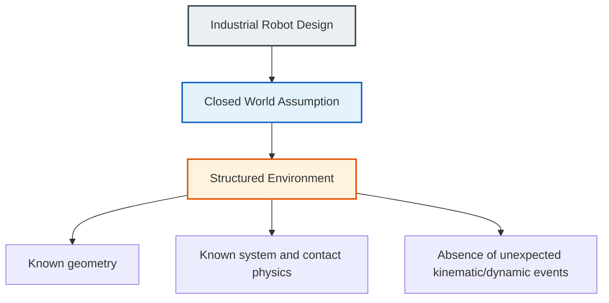
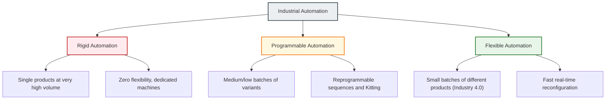
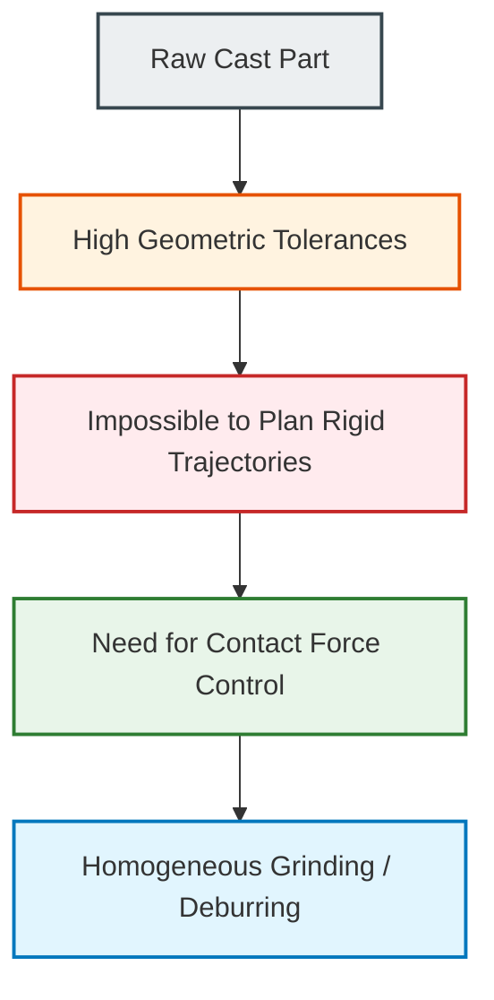
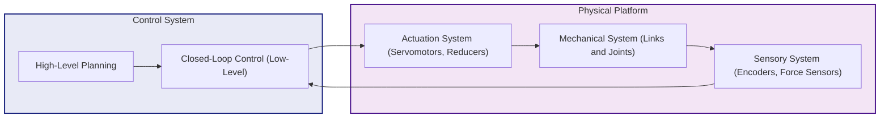
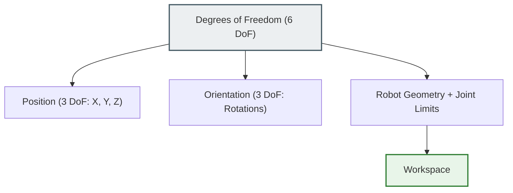
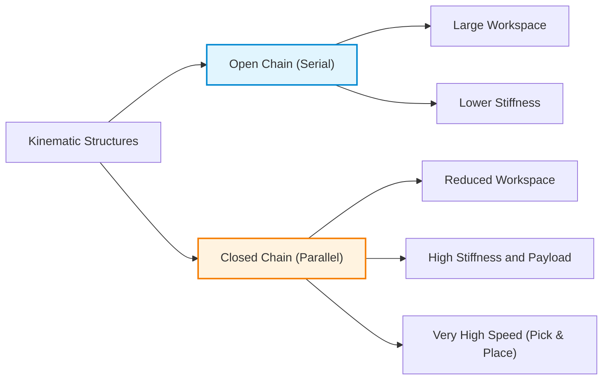

# Introduction to Industrial Robotics: Structured Environments and Operational Principles

## Educational Overview
This lecture introduces the fundamentals of Industrial Robotics (*Industrial Robotics*), marking the transition from the study of mobile robot locomotion to the discussion of fixed-base manipulation systems.

Although mobile platforms and industrial manipulators present different structural characteristics, the analysis begins with the definition of a shared mathematical framework (*common framework*) useful for describing and modeling the kinematics of both types of robots. The lecture then delves into the operational assumptions of robotics applied to manufacturing, first and foremost the *Closed World Assumption*. In this paradigm, the robot operates in highly structured environments (*structured environments*) with geometry and physics known a priori, a fundamental design constraint to minimize uncertainty, prevent collisions, and optimize trajectory planning.

Finally, the three core economic and performance objectives of adopting robotic systems in industry are outlined: cost reduction (*cost reduction*), the increase of overall productivity (*increase of productivity*), and standardized quality improvement of processes (*improved quality*).

---

### Course Organization and Conceptual Progression

In the course's educational path, the lectures trace a conceptual **common thread** (*fil rouge*) to connect the various aspects of robotics. The reference textbook offers a systematic and comprehensive coverage. For an exhaustive understanding, it is essential to integrate the slides with the study of the textbook chapters indicated at the beginning of the session.

> **[KEY CONCEPT]**  
> The lecture slides provide the logical structure and essential connections between topics; the detailed description and full formal coverage contained in the textbook form an integral part of the study program.

#### From Mobile Motion to Industrial Manipulators
In previous lectures, the locomotion of mobile robots (*mobile robots*) was analyzed, focusing mainly on wheeled robots (*wheeled robots*). In this context, we shift focus to **industrial robots** (*industrial robots*).

* **Mobile Robots**: Systems free to move in the operational space to travel from one point to another.
* **Industrial Robots (Manipulators)**: Systems typically anchored to a fixed base in the environment, whose movement is limited to the articulation of their own mechanical links (*limbs* or arms) to reach and perform operations on specific objects.

Despite deep structural and application differences, the mathematical description of the motion of both platforms shares a **common mathematical framework** (*common mathematical framework*). Each robot type requires specific models, but the basic terminology and algebraic formulations remain unified.

---

### Fundamentals of Industrial Automation and Robotics

**Industrial Robotics** (*Industrial Robotics*) defines the study, design, and application of robotic systems within manufacturing and industrial processes. It deals with the handling, transformation, and manipulation of goods and materials.



#### The Closed World Assumption (*Closed World Assumption*)
Unlike mobile robotics in unknown environments (where obstacle avoidance and dynamic mapping apply), classical industrial robotics is based on the **Closed World Assumption** (*Closed World Assumption*).

> **[KEY CONCEPT]**  
> An industrial robot operates in a **structured environment** (*structured environment*), which is an environment specifically designed and simplified to facilitate the robot's task, where the geometry and physics of the processes are perfectly known a priori.

Structuring an environment means eliminating uncertainties to avoid the computational complexity of real-time perception:
* The object to be picked up (*pick & place*) is presented in predetermined positions and orientations.
* Trajectories are free of unexpected obstacles, making expensive real-time collision avoidance algorithms (*collision avoidance*) unnecessary.

#### The Three Industrial Objectives
The adoption of robotic cells and manipulators in industry responds to three fundamental drivers:

1. **Cost Reduction (*Cost Reduction*)**:
   * **Capital amortization**: A robot can operate $24/7$ (24 hours a day, 7 days a week). The fixed cost of investment and maintenance is spread over a significantly higher production volume compared to human labor limited to shifts.
   * **Operating costs**: Unlike human resources, which require continuous periodic wages and retraining costs in case of turnover, the robot's investment is predominantly upfront (*Capital Expenditure - CAPEX*).
   * *Note on industrial economics*: The replacement of human labor with automated systems reduces labor tax revenue for states, which is why several economists support the introduction of a tax on the use of robots (*robot tax*).

2. **Increase of Productivity (*Increase of Productivity*)**:
   * Modern industrial robots offer operating speeds and high payload capacity (*payload*) exceeding human physiological limits.
   * Elimination of dead time for donning/doffing personal protective equipment (PPE) required for human operators in hostile environments (e.g., foundries, handling toxic substances or radioactive materials).

3. **Improved Quality (*Improved Quality*)**:
   * High **repeatability** (*repeatability*) and accuracy in executing serial tasks (e.g., deburring, surface grinding, arc welding).

---

### Taxonomy of Industrial Automation

Automation is divided into several categories, characterized by a structural trade-off (*trade-off*) between **production volumes** and **operational flexibility**.



#### 1. Rigid Automation (*Rigid Automation*)
Characterized by special-purpose machines (*special-purpose machines*) and fixed, immutable operational sequences.
* **Application context**: Mass production of a single item (*mass production*), typical of the traditional automotive industry.
* **Economies of scale**: The line is designed to produce extremely high volumes (e.g., 2 million units of the same chassis model).
* **Disadvantages**: Zero flexibility. If market demand drops and production settles at lower volumes (e.g., 1 million units), the fixed costs of the line are not sufficiently amortized, generating financial losses. Reconfiguration for a new model requires redesigning and replacing the machines.

#### 2. Programmable Automation (*Programmable Automation*)
Allows action sequences to be reprogrammed to handle medium or low batches (*medium/low batches*) of different products or products with customized options.
* **Batch Management**: Production takes place in homogeneous batches. To vary production (e.g., changing body color), the system accumulates orders until the minimum batch size (*batch size*) is reached, and then reprogram the machine and carry out processing on the line.
* **Kitting (*Assembly Kit Preparation*)**: Operational technique used when a product has variants and optional accessories (e.g., basic audio system vs. *premium* audio system). Automation or operators assemble in advance a box containing all and only the specific components (*assembly kit*), which is then placed alongside the main unit along the assembly line.

#### 3. Flexible Automation (*Flexible Automation*)
Represents convergence with the **Industry 4.0** (*Industry 4.0*) paradigm, where reprogramming and adaptation occur without machine downtime or significant delays between one part and the next.
* **Full reconfigurability**: Enables alternating the production of different items within extremely small batches (down to a single customized piece) on the same line.
* **Process integration**: Requires automatic and integrated reconfiguration not only of handling and assembly, but also of computational systems for quality control and visual/dimensional inspection (*quality inspection*).

---

### Plant Integration Strategies: Greenfield vs. Brownfield

In the design and integration of automated and robotic cells within a manufacturing context, two fundamental approaches are distinguished:

* **Greenfield Automation (*Greenfield Automation*)**: Ground-up design of an entire industrial plant ("green field"). 
  * *Advantages*: Maximum design freedom; layout natively optimized for flexibility and robot integration without pre-existing constraints.
  * *Disadvantages*: Very high initial capital investment.

* **Brownfield Automation (*Brownfield Automation*)**: Re-engineering and retrofitting (*revamping*) of an existing production plant.
  * *Advantages*: Significantly lower overall cost of the intervention compared to building a factory from scratch.
  * *Disadvantages*: High complexity for the robotics engineer due to the need to integrate machines and robotic arms with legacy technologies, restricted spaces, and pre-existing workflows that cannot be interrupted.

---

### Definition and Operational Scope of the Industrial Robot

An **Industrial Robot** (*Industrial Robot*) is fundamentally a manipulator designed to interact mechanically with the environment and with objects. In the industrial context, the act of **manipulation** (*manipulation*) is clearly distinguished from simple **locomotion** (*locomotion*): while locomotion concerns the displacement of the robot in space, manipulation includes all gripping, positioning, and processing operations performed on a workpiece (e.g., painting, polishing, drilling, bending).

In addition to direct processing, primary industrial applications are divided into three macro-categories:

1. **Workpiece Manipulation and Processing:** Execution of mechanical machining or chemical-physical processes on the workpiece.
2. **Material Handling** (*Material Handling*): Picking operations, machine tending, packaging, and palletizing (*palletizing*).
3. **Measurement and Inspection** (*Measurement and Inspection*): Utilization of the robot's mobility not to alter the object, but to verify its state or dimensions.

#### Qualitative Inspection vs. Metrology

The use of robots for quality control is divided into two fundamental approaches:

* **Quality Inspection** (*Quality Inspection*): Based mainly on Computer Vision systems (*Computer Vision*). Surface defects, paint continuity, or overall shape correctness are verified.
* **Metrology** (*Metrology*): It is the science of precision measurement. In robotics, metrology is referred to when the required accuracy falls below a tenth of a millimeter ($< 0.1 \text{ mm}$). 

To perform metrological tasks, the robot can use non-contact laser sensors or physical touch probes. In the second case, the robot touches the workpiece at designated points (e.g., the four corners of a screen); by leveraging high **repeatability** (*repeatability*), the system is able to reconstruct the geometry of the object or generate a **point cloud** (*point cloud*) for 3D scanning.

---

### Main Industrial Applications and Technological Challenges

Historical sectors of use are the automotive (*automotive*), chemical, nuclear, and precision electronics industries. Manufacturing processes typically entrusted to robots include:

* **Welding** (*Welding*): Wire/arc welding (*Arc welding*) or spot welding (*Spot welding*).
* **Painting and Coating** (*Painting and Coating*).
* **Gluing and Sealing** (*Gluing and Sealing*): Requires dispensing a constant quantity of fluid along a complex trajectory at a uniform speed. It is a task where the robot clearly outperforms the human operator in consistency and flexibility.
* **Laser and Water-Jet Cutting** (*Laser and Water-Jet Cutting*).

#### Key Concept: The Challenge of Deburring and Grinding

Particularly complex from a control perspective is the application of **deburring** (*deburring*) and **grinding** (*grinding*), especially on cast parts from foundries.

> **Why is this task critical?**
> Cast parts feature high and geometrically unpredictable dimensional tolerances due to material anisotropy and thermal contractions during the cooling phase. Consequently, **it is not possible to plan the rigid trajectory of the robot a priori**, since every piece differs slightly from the previous one. 
> The robot must therefore implement force control during dynamic contact: it must follow the actual surface while maintaining a **constant pressure**. If the pressure were to vary, the robot would remove more material in some areas than in others, ruining the part.



#### Internal Logistics and Automated Guided Vehicles (AGVs)

In modern factories, material handling relies on **Automated Guided Vehicles** (*Automated Guided Vehicles - AGVs*). An AGV is a mobile robot that moves within an **engineered environment** (*engineered environment*).

To navigate, AGVs use various guidance technologies:
1. **Physical Guides:** Mechatronic rails or magnetic/optical tapes applied to the floor.
2. **Virtual Mapping:** Laser Range Finders (*Laser Range Finders*) that constantly measure distances to walls to localize the vehicle with respect to a pre-loaded map.

---

### General Architecture and Performance Parameters

#### Block Architectural Model

The hardware/software architecture of a manipulator robot follows the same logical structure seen for autonomous mobile robots:



1. **Mechanical System** (*Mechanical System*): The physical structure composed of rigid elements (*links*) that implement motion.
2. **Actuation System** (*Actuation System*): Electric servomotors, hydraulic or pneumatic systems, along with transmissions (gears, belts).
3. **Sensory System** (*Sensors*): Internal sensors (proprioception, e.g., axis encoders) and external sensors (exteroception, e.g., force sensors or cameras).
4. **Control System** (*Control System*): Computational unit divided between high-level decisions (task and trajectory planning) and low-level control for closing the feedback loop (*feedback loop*).

#### Families of Manipulators: Fixed-Base vs. Mobile-Base

* **Fixed-Base Manipulators** (*Fixed-Base Manipulators*): Represent the most mature industrial technology. The first link of the chain is firmly anchored to the floor or to the workcell structure.
* **Mobile Manipulators** (*Mobile Manipulators*): A robotic arm is mounted on a mobile base (e.g., AGV/AMR). Although they offer an extended workspace, they present significantly higher control complexity and stability challenges, and are historically less common.

#### Key Concept: The Performance Triptych (Workspace, Stiffness, Payload)

Every industrial robot is characterized and chosen during the design phase based on three interdependent parameters:

$$\text{Prestazione Robot} = f(\text{Workspace}, \text{Rigidezza}, \text{Payload})$$

1. **Workspace** (*Workspace*): The set of points in three-dimensional space that the robot's end-effector can reach. It is determined by the geometry and length of the *links*.
2. **Stiffness** (*Stiffness*): The ability of the mechanical structure to resist elastic deformation when subjected to external loads or forces. A very stiff robot ensures that the calculated nominal position coincides with the actual one, regardless of the carried load.
3. **Payload** (*Payload*): The maximum mass that the robot can manipulate while guaranteeing nominal performance of precision and repeatability (e.g., a repeatability of $1 \text{ mm}$). 
   * Exceeding the rated *payload* (typical standard industrial sizes: $5\text{ kg}$, $10\text{ kg}$, $25\text{ kg}$, $50\text{ kg}$) does not necessarily cause immediate failure, but drastically degrades kinematic precision or triggers motor torque faults.

---

### Mechanical Structure and Kinematics of the Manipulator

An industrial manipulator is modeled as a sequence of rigid elements called **Links** (*Links*), connected to each other through articulated joints called **Joints** (*Joints*).

#### Anatomy of the Kinematic Chain

```
[Base / Ground] ---> [ Arm (Braccio) ] ---> [ Wrist (Polso) ] ---> [ End-Effector ]
```

* **Base** (*Ground*): The fixed point of anchorage to the support structure.
* **Arm** (*Arm*): The set of the first main links. Its primary function is to determine gross spatial positioning (*gross positioning*).
* **Wrist** (*Wrist*): A set of compact links and joints located at the end of the arm. Its function is to orient the final tool, ensuring manipulation **dexterity** (*dexterity*).
* **End-Effector** (*End-Effector*): The final device installed on the wrist to execute the specific task (e.g., gripper, welding torch, vacuum cup, cutting tool).

#### Open vs. Closed Kinematic Chains

* **Open Kinematic Chain** (*Open Kinematic Chain*): Serial structure without closed loops, starting from the base and ending freely with the end-effector. It is the most common type in industrial manipulators due to the large *workspace* it guarantees.
* **Closed Kinematic Chain** (*Closed Kinematic Chain*): Structure featuring one or more closed mechanical loops.
  * *Advantages:* Very high stiffness and high load capacity.
  * *Disadvantages:* Reduced workspace (*workspace*) and significantly more complex kinematic modeling and control.

#### Types of Mechanical Joints

Relative motions between two adjacent links are provided by joints. In industrial robotics, two main types of joints are used, each with **a single Degree of Freedom** (*Degree of Freedom - DoF*):

1. **Prismatic Joint** (*Prismatic Joint* - Symbol: $P$):
   * **Motion:** Pure relative translation along a linear axis (piston-like sliding).
   * **Joint Variable:** A scalar distance $d \in \mathbb{R}$ (expressed in $\text{mm}$ or $\text{m}$).
   * **Characteristics:** Provides high structural stiffness and a direct kinematic relationship with Cartesian coordinates, but has a large footprint and severely limits the *workspace*.

2. **Revolute Joint** (*Revolute Joint* - Symbol: $R$):
   * **Motion:** Pure relative rotation around an axis.
   * **Joint Variable:** A scalar angle $\theta \in \mathbb{S}^1$ (expressed in degrees or radians).
   * **Characteristics:** Very compact and reliable; guarantees high dexterity and an extended workspace for the robot. Conversely, it introduces a less stiff response (high bending moments on pins) and requires non-linear mathematical transformations to convert angular rotation into Cartesian positioning.

| Property | Revolute Joint ($R$) | Prismatic Joint ($P$) |
| :--- | :--- | :--- |
| **Motion Type** | Pure rotation ($\theta$) | Pure translation ($d$) |
| **Compactness** | High | Low (linear footprint) |
| **Workspace** | Large and flexible | Limited to the sliding axis |
| **Mechanical Stiffness** | Lower (subject to bending torques) | Higher (guided structure) |
| **Cartesian Mapping Complexity** | High (trigonometric functions) | Low (direct translation) |

---

### Workspace and Kinematic Redundancy

To arbitrarily position and orient a rigid object in three-dimensional space, **$6$ Degrees of Freedom (*Degrees of Freedom - DoF*)** are required:
*   **$3$ Position DoF**: translations along the Cartesian axes $(X, Y, Z)$;
*   **$3$ ;
*   ** $6$ Orientation DoF**: rotations around those same three axes.

Consequently, a robotic manipulator requires a minimum of $n > 6$ joints to reach a generic complete spatial configuration (positioning + orientation).

*   **Kinematic Redundancy (*Kinematic Redundancy*)**: If a manipulator possesses होतात limit space constraints defined as *kinematically redundant* for lower degrees. If a manipulator possesses kinematics with dynamic freedom where depth degrees exceeded target dimensions, it is kinematically redundant mathematically. If a manipulator possesses extra dimensions beyond six degrees of freedom, it is defined as *kinematically redundant*. Redundancy allows reaching the same end-effector (*end-effector*) position and orientation through multiple internal configurations of the kinematic chain.
    *   *Example*: The human arm is a redundant structure. We can keep our hand fixed at a point and vary the position of the elbow and shoulder.

*   **Workspace (*Workspace*)**: It is the set of all points in the surrounding environment reachable by the end-effector. Its shape and size depend on the geometry of the arms (*links*) and on **joint limits (*joint limits*)**.



---

### Classification and Geometries of Industrial Robots

Basic industrial manipulators are differentiated according to the nature of the first three joints in the chain (prismatic or revolute).

#### Cartesian Geometry ($3P$)
The structure is built using three prismatic joints (*Prismatic joints - P*) arranged along orthogonal axes (4 *links* connected by 3 joints). Movement occurs exclusively via linear translation.

*   **Workspace**: A parallelepiped (cube), limited by the maximum stroke extension of the arms.
*   **Advantages**: High stiffness (*high stiffness*) and uniform positioning accuracy throughout the entire workspace.
*   **Disadvantages**: Inability to vary the orientation of the end-effector (absence of revolute joints). The object can only be grasped with a single fixed orientation.

#### Cylindrical Geometry ($1R + 2P$)
Composed of a revolute joint at the base (*Revolute joint - R*) and two prismatic joints ($P$).

*   **Workspace**: Cylindrical (or a cylinder sector in the presence of angle limits at the base joint).
*   **Characteristics**: Maintains good stiffness along the vertical and horizontal directions, allowing rotation of the robot around its main axis.

#### Spherical Geometry ($2R + 1P$)
Composed of two revolute joints ($R$) and one prismatic joint ($P$).

*   **Workspace**: Sector of a sphere, intuitively modeled using spherical coordinates.
*   **Limitations**: Exhibits lower stiffness compared to Cartesian and cylindrical structures. This is due to mechanical **backlash** (*backlash*) typical of revolute joint gears, where contact between teeth is not continuous and tight as in the screw-locking of prismatic joints.

#### SCARA Geometry ($2R + 1P$ with parallel axes)
The **SCARA (Selective Compliance Assembly Robot Arm)** robot is equipped with two revolute joints and one vertical prismatic joint, all with **parallel** axes of rotation and translation.

> **Key Concept — Selective Compliance in SCARA**
> 
> The SCARA configuration offers high stiffness to vertical loads, but presents controlled **horizontal compliance** (*horizontal compliance*) in the $X-Y$plane, due to the slight flexibility/backlash of the two revolute joints.
> 
> This feature is fundamental for solving the **"Peg-in-the-Hole"** problem (inserting a pin or screw into a hole) and for assembling SMD technology electronic components on PCB boards. If the pin and hole are not perfectly aligned, compliance in the horizontal plane allows the pin to slide laterally and self-center into the hole without jamming or damaging the structure.

#### Articulated (Anthropomorphic) Geometry ($3R$)
Structure consisting of three revolute joints ($3R$) whose axes are arranged similarly to the shoulder and elbow joints of the human arm.

> **Key Concept — The Articulated Robot**
> 
> It is the **most widespread and used robotic configuration in industry**. It offers maximum **dexterity** (*dexterity*) among classical geometries and a large spherical workspace around the base of the robot. It serves as the standard reference model for the study of manipulator kinematics.

---

### Advanced Structures: Elastic Joints and Parallel Robots

#### Manipulators with Elastic Elements
To achieve controlled compliance along specific force directions, elastic elements (e.g., springs or components modeled as such) can be integrated in series between the motor transmission and the *link*.

*   **Transmission technologies**: The elastic/compliant effect can derive from the use of belts, cables, flexible shafts, or specific reducers such as **Harmonic Drives** or cycloidal drives.
*   **Applications**: *Harmonic Drives* are at the core of the success of the new generation of humanoid robots and cobots, guaranteeing smooth movements. However, elasticity makes kinematic control and positioning repeatability much more complex.

#### Parallel Robots and Stewart Platforms (Closed Chains)
Unlike serial arms (open kinematic chains), parallel manipulators use **closed kinematic chains** (*closed kinematic chains*).

*   **Workspace**: Smaller and more limited compared to an open chain of equal radius.
*   **Advantages**: Very high stiffness, high load capacity (*payload*) due to multiple load support, and very high movement speeds.
*   *Examples*: Delta parallel robots (*Delta robots*) for fast *pick-and-place* operations; six-jack Stewart platforms for simulators or precision positioning.
*   *Hybrid Solutions*: Serial robots integrated with closing rods (parallelograms) to increase stiffness in palletizing and heavy load lifting applications.



---

### End-Effectors, Spherical Wrist, and Redundancy

#### End-Effector (*End-Effector*) and Spherical Wrist (*Spherical Wrist*)
The end-effector performs the actual operational task and can vary from tools with $0$ DoF (e.g., a controlled suction cup in binary logic $0/1$) up to multifunctional anthropomorphic robotic hands.

To connect the end-effector to the arm structure and orient it freely, the **Spherical Wrist** (*Spherical Wrist*) structure is used, composed of $3$ revolute joints whose rotation axes intersect at a single central point.

> **Key Concept — Kinematic Decoupling**
> 
> The presence of a spherical wrist allows for **completely decoupling position from orientation**:
> 1. The first three joints of the chain (the arm) determine the **position** $X, Y, Z$ of the wrist center in space.
> 2. The three joints of the spherical wrist determine the **orientation** of the end-effector around that point.

#### Redundancy and Collaborative Robotics (Cobots)
The introduction of a $7^\circ$ degree of freedom (e.g., KUKA LBR iiwa robot) or the use of dual-arm architectures (*dual-arm*, e.g., ABB YuMi) provides native kinematic redundancy.

*   **Advantage in Cobots**: Redundancy allows the robot to reach the same operational pose while adopting different internal configurations of the arm. In a shared human-robot workspace, if a human operator obstructs the working volume, the collaborative robot can recalculate the trajectory and modify the shape of the arm to **avoid the collision**, keeping the end-effector stationary on the target.

---

> [!NOTE]
> ### Exam Notes and Instructor Notices
> - **Textbook content mandatory for the exam:** The exam will also include questions on the textbook chapters indicated by the instructor (for example, the first three chapters of Marris's book for the introductory part) and not solely on the material present in the slides. Studying the textbook chapters is mandatory, as the exam paper may contain questions on topics found exclusively in the text and not explained during lectures or in the slides.