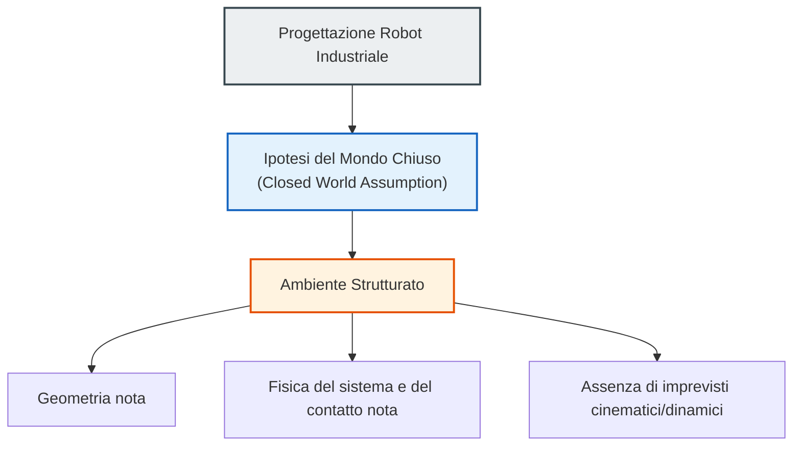
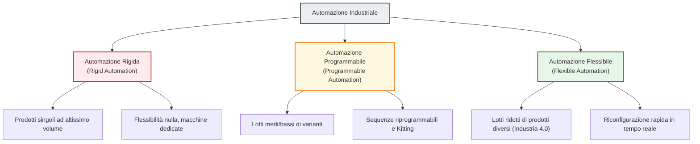
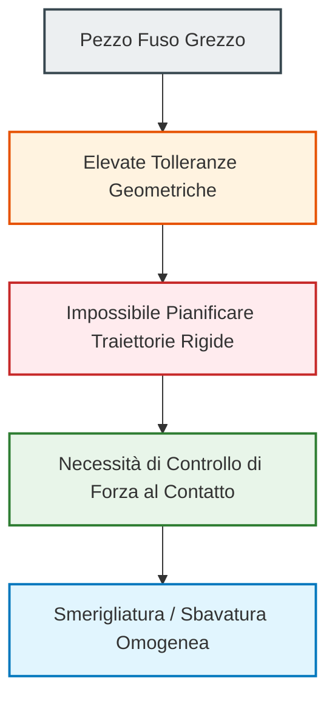
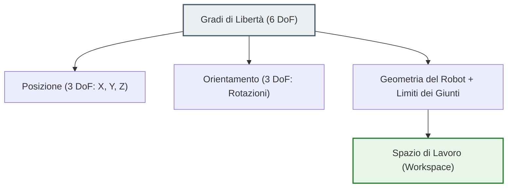
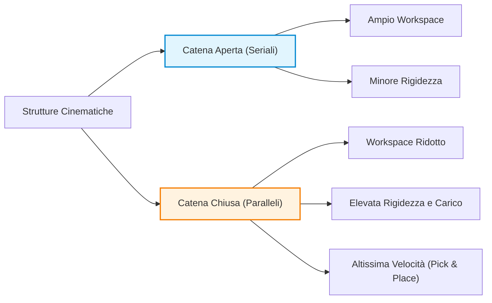

# Introduzione alla Robotica Industriale: Ambienti Strutturati e Principi Operativi

## Overview Didattica
Questa lezione introduce i fondamenti della Robotica Industriale (*Industrial Robotics*), segnando la transizione dallo studio della locomozione dei robot mobili alla trattazione dei sistemi di manipolazione operanti su base fissa. 

Sebbene le piattaforme mobili e i manipolatori industriali presentino caratteristiche costruttive differenti, l'analisi parte dalla definizione di un quadro matematico condiviso (*common framework*) utile a descrivere e modellare la cinematica di entrambe le tipologie di robot. La lezione approfondisce quindi i presupposti operativi della robotica applicata al manifatturiero, primo fra tutti l'*Assunzione di Mondo Chiuso* (*Closed World Assumption*). In questo paradigma, il robot opera in ambienti altamente strutturati (*structured environments*) con geometria e fisica note a priori, un vincolo progettuale fondamentale per minimizzare l'incertezza, prevenire le collisioni e ottimizzare la pianificazione delle traiettorie.

Infine, vengono delineati i tre obiettivi economici e prestazionali cardine dell'adozione di sistemi robotici nell'industria: la riduzione dei costi di produzione (*cost reduction*), l'incremento della produttività complessiva (*increase of productivity*) e il miglioramento qualitativo standardizzato dei processi (*improved quality*).

---

### Organizzazione dello Studio e Progression Concettuale

Nel percorso didattico del corso, le lezioni frontali tracciano un **filo conduttore** (*fil rouge*) concettuale per collegare tra loro i vari aspetti della robotica. Il testo di riferimento offre una trattazione sistematica e completa. Per una comprensione esaustiva è indispensabile integrare le slide con lo studio dei capitoli del libro di testo indicati a inizio sessione.

> **[CONCETTO CHIAVE]**  
> Le slide di lezione forniscono la struttura logica e le connessioni essenziali tra i temi; la descrizione dettagliata e la trattazione formale completa contenute nel libro di testo costituiscono parte integrante del programma di studio.

#### Dal Movimento Mobile ai Manipolatori Industriali
Nelle lezioni precedenti è stata analizzata la locomozione dei robot mobili (*mobile robots*), focalizzandosi principalmente sui robot con ruote (*wheeled robots*). In questo contesto ci si sposta sui **robot industriali** (*industrial robots*).

* **Robot Mobili**: Sistemi liberi di muoversi nello spazio operativo per spostarsi da un punto a un altro.
* **Robot Industriali (Manipolatori)**: Sistemi tipicamente ancorati a una base fissa nell'ambiente, il cui movimento è limitato all'articolazione dei propri elementi meccanici (*limbs* o bracci) per raggiungere ed effettuare operazioni su oggetti specifici.

Nonostante le profonde differenze strutturali e applicative, la descrizione matematica del movimento di entrambe le piattaforme condividono un **quadro cinematico e dinamico comune** (*common mathematical framework*). Ogni tipologia di robot richiede modelli specifici, ma la terminologia e le formulazioni algebriche di base rimangono unificate.

---

### Fondamenti dell'Automazione Industriale e Robotica

La **Robotica Industriale** (*Industrial Robotics*) definisce lo studio, la progettazione e l'applicazione di sistemi robotici all'interno di processi manifatturieri e industriali. Si occupa della movimentazione, trasformazione e manipolazione di beni e materiali.



#### L'Ipotesi del Mondo Chiuso (*Closed World Assumption*)
A differenza della robotica mobile in ambienti non noti (dove si applicano l'evitamento degli ostacoli e la mappatura dinamica), la robotica industriale classica si fonda sull'**Ipotesi del Mondo Chiuso** (*Closed World Assumption*).

> **[CONCETTO CHIAVE]**  
> Un robot industriale opera in un **ambiente strutturato** (*structured environment*), ovvero un ambiente appositamente progettato e semplificato per agevolare il compito del robot, in cui la geometria e la fisica dei processi sono perfettamente note a priori.

Strutturare un ambiente significa eliminare le incertezze per evitare la complessità computazionale della percezione in tempo reale:
* L'oggetto da afferrare (*pick & place*) viene presentato in posizioni e orientamenti predeterminati.
* Le traiettorie sono prive di ostacoli imprevisti, rendendo superflui i costosi algoritmi di evitamento delle collisioni (*collision avoidance*) in tempo reale.

#### I Tre Obiettivi Industriali
L'adozione di celle e manipolatori robotici nell'industria risponde a tre spinte fondamentali:

1. **Riduzione dei Costi (*Cost Reduction*)**:
   * **Ammortamento del capitale**: Un robot può operare $24/7$ (24 ore su 24, 7 giorni su 7). Il costo fisso dell'investimento e della manutenzione viene ripartito su un volume di produzione nettamente superiore rispetto al lavoro umano limitato a turni.
   * **Costi di gestione**: A differenza della risorsa umana, che richiede salari periodici continui e costi di riaddestramento in caso di turnover, l'investimento del robot è prevalentemente iniziale (*Capital Expenditure - CAPEX*).
   * *Nota di economia industriale*: La sostituzione del lavoro umano con sistemi automatizzati riduce il gettito fiscale sul lavoro per gli Stati, motivo per cui diversi economisti sostengono l'introduzione di una tassazione sull'uso dei robot (*robot tax*).

2. **Aumento della Produttività (*Increase of Productivity*)**:
   * I robot industriali moderni offrono velocità operative ed elevata capacità di carico (*payload*) superiori ai limiti fisiologici umani.
   * Eliminazione dei tempi mortali di vestizione/svestizione dei dispositivi di protezione individuale (DPI) necessari per gli operatori umani in ambienti ostili (es. fonderie, manipolazione di sostanze tossiche o materiali radioattivi).

3. **Miglioramento della Qualità (*Improved Quality*)**:
   * Elevata **ripetibilità** (*repeatability*) e accuratezza nell'esecuzione di compiti seriali (es. sbavatura, levigatura di superfici, saldatura a filo).

---

### Tassonomia dell'Automazione Industriale

L'automazione si articola in diverse categorie, caratterizzate da un compromesso (*trade-off*) strutturale tra **volumi di produzione** e **flessibilità operativa**.



#### 1. Automazione Rigida (*Rigid Automation*)
Caratterizzata da macchine a uso speciale (*special-purpose machines*) e sequenze operative fisse e immutabili.
* **Contesto applicativo**: Produzione di massa di un singolo elemento (*mass production*), tipica dell'industria automobilistica tradizionale.
* **Economia di scala**: La linea viene progettata per produrre volumi elevatissimi (es. 2 milioni di unità dello stesso modello di telaio).
* **Svantaggi**: Flessibilità nulla. Se la domanda di mercato cala e la produzione si attesta su volumi inferiori (es. 1 milione di unità), i costi fissi della linea non vengono ripartiti sufficientemente, generando perdite economiche. La riconfigurazione per un nuovo modello richiede la riprogettazione e sostituzione delle macchine.

#### 2. Automazione Programmabile (*Programmable Automation*)
Permette di riprogrammare le sequenze d'azione per gestire lotti medi o bassi (*medium/low batches*) di prodotti differenti o con opzioni personalizzate.
* **Gestione a Lotti**: La produzione avviene per lotti omogenei. Per variare la produzione (es. cambio colore della carrozzeria), il sistema accumula gli ordini fino al raggiungimento della dimensione minima del lotto (*batch size*), per poi riprogrammare la macchina ed effettuare la lavorazione in linea.
* **Kitting (*Preparazione Kit di Montaggio*)**: Tecnica operativa impiegata quando un prodotto presenta varianti e accessori opzionali (es. impianto audio base vs. impianto audio *premium*). L'automazione o gli operatori compongono preventivamente una scatola contenente tutti e soli i componenti specifici (*assembly kit*), che viene poi affiancata all'unità principale lungo la linea di montaggio.

#### 3. Automazione Flessibile (*Flexible Automation*)
Rappresenta la convergenza con il paradigma di **Industria 4.0** (*Industry 4.0*), dove la riprogrammazione e l'adattamento avvengono senza fermi macchina o ritardi significativi tra un pezzo e il successivo.
* **Piena riconfigurabilità**: Consente di alternare sulla stessa linea la produzione di articoli differenti all'interno di lotti estremamente ridotti (fino al singolo pezzo personalizzato).
* **Integrazione di processo**: Richiede la riconfigurazione automatica e integrata non solo della manipolazione e dell'assemblaggio, ma anche dei sistemi computazionali di controllo qualità e ispezione visiva/dimensionale (*quality inspection*).

---

### Strategie di Integrazione Impiantistica: Greenfield vs. Brownfield

Nella progettazione e nell'integrazione di celle automatizzate e robotiche all'interno di un contesto manifatturiero si distinguono due approcci fondamentali:

* **Automazione Greenfield (*Greenfield Automation*)**: Progettazione ex-novo di un intero impianto industriale ("campo verde"). 
  * *Vantaggi*: Massima libertà di progettazione; layout ottimizzato nativamente per la flessibilità e l'integrazione dei robot senza vincoli preesistenti.
  * *Svantaggi*: Investimento economico iniziale assai elevato.

* **Automazione Brownfield (*Brownfield Automation*)**: Re-ingegnerizzazione e ammodernamento (*revamping*) di un impianto produttivo esistente.
  * *Vantaggi*: Costo complessivo dell'intervento sensibilmente inferiore rispetto alla costruzione di uno stabilimento ex-novo.
  * *Svantaggi*: Elevata complessità per l'ingegnere robotico, dovuta alla necessità di integrare le macchine e i bracci robotici con tecnologie vetuste, spazi ridotti e flussi di lavoro pré-esistenti che non possono essere interrotti.

---

### Definizione e Ambiti Operativi del Robot Industriale

Un **Robot Industriale** (*Industrial Robot*) è fondamentalmente un manipolatore progettato per interagire meccanicamente con l'ambiente e con gli oggetti. Nel contesto industriale, l'atto della **manipolazione** (*manipulation*) si distingue nettamente dalla semplice **locomozione** (*locomotion*): mentre la locomozione riguarda lo spostamento del robot nello spazio, la manipolazione include tutte le operazioni di presa, posizionamento e lavorazione eseguite su un pezzo (es. verniciatura, lucidatura, foratura, piegatura).

Oltre alla lavorazione diretta, le applicazioni industriali principali si dividono in tre macro-categorie:

1. **Manipolazione e Lavorazione Pezzi:** Esecuzione di lavorazioni meccaniche o processi chimico-fisici sul pezzo.
2. **Movimentazione Materiali** (*Material Handling*): Operazioni di prelievo, asservimento macchine operatrici, imballaggio e palettizzazione (*palletizing*).
3. **Misura e Ispezione** (*Measurement and Inspection*): Utilizzo della mobilità del robot non per alterare l'oggetto, ma per verificarne lo stato o le dimensioni.

#### Ispezione Qualitativa vs. Metrologia

L'uso dei robot per il controllo qualità si divide in due approcci fondamentali:

* **Ispezione Qualitativa** (*Quality Inspection*): Basata principalmente su sistemi di visione artificiale (*Computer Vision*). Si verificano difetti superficiali, la continuità della verniciatura o la correttezza della forma generale.
* **Metrologia** (*Metrology*): È la scienza della misurazione di precisione. In ambito robotico si parla di metrologia quando la precisione richiesta scende al di sotto del decimo di millimetro ($< 0.1 \text{ mm}$). 

Per eseguire compiti metrologici, il robot può utilizzare sensori laser senza contatto oppure tastatori fisici. Nel secondo caso, il robot tocca il pezzo in punti prefissati (es. i quattro angoli di uno schermo); sfruttando un'elevata **ripetibilità** (*repeatability*), il sistema è in grado di ricostruire la geometria dell'oggetto o di generare una **nuvola di punti** (*point cloud*) per la scansione 3D.

---

### Applicazioni Industriali Principali e Sfide Tecnologiche

I settori d'impiego storici sono l'industria automobilistica (*automotive*), chimica, nucleare ed elettronica di precisione. I processi di fabbricazione tipicamente affidati ai robot includono:

* **Saldatura** (*Welding*): A filo/arco (*Arc welding*) o a punti (*Spot welding*).
* **Verniciatura e Rivestimento** (*Painting and Coating*).
* **Incollatura e Sigillatura** (*Gluing and Sealing*): Richiede l'erogazione di una quantità costante di fluido lungo una traiettoria complessa a velocità uniforme. È un compito in cui il robot supera nettamente l'operatore umano per costanza e flessibilità.
* **Taglio Laser e ad Acqua** (*Laser and Water-Jet Cutting*).

#### Concetto Chiave: La Sfida della Sbavatura e Smerigliatura

Particolarmente complessa dal punto di vista del controllo è l'applicazione di **sbavatura** (*deburring*) e **smerigliatura** (*grinding*), specialmente su pezzi provenienti da fonderia.

> **Perché questo compito è critico?**
> I pezzi fusi presentano tolleranze dimensionali elevate e geometricamente imprevedibili a causa dell'anisotropia del materiale e delle contrazioni termiche in fase di raffreddamento. Di conseguenza, **non è possibile pianificare a priori la traiettoria rigida del robot**, poiché ogni pezzo differisce leggermente dal precedente. 
> Il robot deve quindi implementare un controllo di forza in contatto dinamico: deve seguire la superficie reale mantenendo una **pressione costante**. Se la pressione variasse, il robot asporterebbe più materiale in alcune zone rispetto ad altre, rovinando il pezzo.



#### Logistica Interna e Veicoli a Guida Autonoma (AGV)

Nelle fabbriche moderne, il *material handling* si avvale di **Veicoli a Guida Automatizzata** (*Automated Guided Vehicles - AGV*). Un AGV è un robot mobile che si muove all'interno di un **ambiente ingegnerizzato** (*engineered environment*).

Per navigare, gli AGV utilizzano diverse tecnologie di guida:
1. **Guide Fisiche:** Rotaie meccatroniche o nastri magnetici/ottici applicati sul pavimento.
2. **Mappatura Virtuale:** Scanner laser (*Laser Range Finders*) che misurano costantemente le distanze dalle pareti per localizzare il veicolo rispetto ad una mappa pre-caricata.

---

### Architettura Generale e Parametri di Prestazione

#### Modello Architetturale a Blocchi

L'architettura hardware/software di un robot manipolatore ricalca la medesima struttura logica vista per i robot mobili autonomi:


1. **Sistema Meccanico** (*Mechanical System*): La struttura fisica composta dagli elementi rigidi (*link*) che attuano il movimento.
2. **Sistema di Attuazione** (*Actuation System*): Servomotori elettrici, sistemi idraulici o pneumatici, unitamente alle trasmissioni (ingranaggi, cinghie).
3. **Sistema Sensoriale** (*Sensors*): Sensori interni (propriocezione, es. encoder sugli assi) ed esterni (eterocezione, es. sensori di forza o telecamere).
4. **Sistema di Controllo** (*Control System*): Unità di calcolo divisa tra decisioni di alto livello (pianificazione del compito e delle traiettorie) e controllo di basso livello per la chiusura dell'anello di retroazione (*feedback loop*).

#### Famiglie di Manipolatori: Base Fissa vs. Base Mobile

* **Manipolatori a Base Fissa** (*Fixed-Base Manipulators*): Rappresentano la tecnologia industriale più matura. Il primo anello della catena è ancorato saldamente al pavimento o alla struttura della cella di lavoro.
* **Manipolatori Mobili** (*Mobile Manipulators*): Un braccio robotico è montato su una base mobile (es. AGV/AMR). Sebbene offrano un volume di lavoro esteso, presentano complessità di controllo e stabilità notevolmente superiori e sono storicamente meno diffusi.

#### Concetto Chiave: Il Trittico di Prestazione (Workspace, Rigidezza, Payload)

Ogni robot industriale è caratterizzato e scelto in fase di progettazione sulla base di tre parametri interdipendenti:

$$\text{Prestazione Robot} = f(\text{Workspace}, \text{Rigidezza}, \text{Payload})$$

1. **Spazio di Lavoro** (*Workspace*): L'insieme dei punti nello spazio tridimensionale che l'organo terminale del robot può raggiungere. È determinato dalla geometria e dalla lunghezza dei *link*.
2. **Rigidezza** (*Stiffness*): La capacità della struttura meccanica di opporsi alla deformazione elastica quando sottoposta a carichi o forze esterne. Un robot molto rigido garantisce che la posizione nominale calcolata coincida con quella reale, indipendentemente dal carico trasportato.
3. **Carico Utile** (*Payload*): La massa massima che il robot può manipolare garantendo le prestazioni nominali di precisione e ripetibilità (es. una ripetibilità di $1 \text{ mm}$). 
   * Superare il *payload* di targa (taglie standard industriali tipiche: $5\text{ kg}$, $10\text{ kg}$, $25\text{ kg}$, $50\text{ kg}$) non comporta necessariamente la rottura immediata, ma degrada drásticamente la precisione cinematica o manda i motori in blocco di coppia.

---

### Struttura Meccanica e Cinematica del Manipolatore

Un manipolatore industriale è modellato come una sequenza di elementi rigidi detti **Anelli** (*Links*), connessi tra loro tramite giunti articolati detti **Giunti** (*Joints*).

#### Anatomia della Catena Cinematica

```
[Base / Ground] ---> [ Arm (Braccio) ] ---> [ Wrist (Polso) ] ---> [ End-Effector ]
```

* **Base** (*Ground*): Il punto fisso di ancoraggio alla struttura di supporto.
* **Braccio** (*Arm*): L'insieme dei primi link principali. Ha la funzione primaria di determinare il posizionamento spaziale grossolano (*gross positioning*).
* **Polso** (*Wrist*): Insieme di link e giunti compatti posti al termine del braccio. Svolge la funzione di orientare l'utensile finale garantendo la **destrezza** (*dexterity*) di manipolazione.
* **Organo Terminale** (*End-Effector*): Il dispositivo finale installato sul polso per eseguire il compito specifico (es. pinza di presa, torcia di saldatura, ventosa a vuoto, utensile da stacco).

#### Catene Cinematiche Aperte vs. Chiuse

* **Catena Cinematica Aperta** (*Open Kinematic Chain*): Struttura seriale priva di cicli chiusi, che parte dalla base e termina liberamente con l'organo terminale. È la tipologia più diffusa nei manipolatori industriali per l'ampio *workspace* garantito.
* **Catena Cinematica Chiusa** (*Closed Kinematic Chain*): Struttura che presenta uno o più anelli meccanici chiusi.
  * *Vantaggi:* Altissima rigidezza e capacità di carico elevata.
  * *Svantaggi:* Spazio di lavoro (*workspace*) ridotto e modellazione/controllo cinematico notevolmente più complessi.

#### Tipologie di Giunti Meccanici

I movimenti relativi tra due link adiacenti sono forniti dai giunti. In robotica industriale, si utilizzano prevalentemente due tipi di giunti, ciascuno con **un singolo Grado di Libertà** (*Degree of Freedom - DoF*):

1. **Giunto Prismatico** (*Prismatic Joint* - Simbolo: $P$):
   * **Movimento:** Traslazione pura relativa lungo un asse lineare (scorrimento a pistone).
   * **Variabile di Giunto:** Una distanza scalare $d \in \mathbb{R}$ (espressa in $\text{mm}$ o $\text{m}$).
   * **Caratteristiche:** Fornisce un'elevata rigidezza strutturale e una relazione cinematica diretta con le coordinate cartesiane, ma ha ingombri elevati e limita fortemente il *workspace*.

2. **Giunto Rotoidale** (*Revolute Joint* - Simbolo: $R$):
   * **Movimento:** Rotazione pura relativa attorno a un asse.
   * **Variabile di Giunto:** Un angolo scalare $\theta \in \mathbb{S}^1$ (espresso in gradi o radianti).
   * **Caratteristiche:** Molto compatto e affidabile; garantisce al robot una grande destrezza e uno spazio di lavoro esteso. Di contro, introduce una risposta meno rigida (momenti flettenti elevati sui perni) e richiede trasformazioni matematiche non lineari per convertire la rotazione angolare in posizionamento cartesiano.

| Proprietà | Giunto Rotoidale ($R$) | Giunto Prismatico ($P$) |
| :--- | :--- | :--- |
| **Tipo di Moto** | Rotazione pura ($\theta$) | Traslazione pura ($d$) |
| **Compattezza** | Elevata | Ridotta (ingombro lineare) |
| **Spazio di Lavoro (Workspace)**| Ampio e flessibile | Limitato all'asse di scorrimento |
| **Rigidezza Meccanica** | Minore (soggetta a coppie flettenti) | Maggiore (struttura a guida) |
| **Complessità Mappatura Cartesiana** | Alta (funzioni trigonometriche) | Bassa (traslazione diretta) |

---

### Spazio di Lavoro e Ridondanza Cinematica

Per posizionare ed orientare arbitrariamente un oggetto rigido nello spazio tridimensionale sono necessari **$6$ Gradi di Libertà (Degrees of Freedom - DoF)**:
*   **$3$ DoF di Posizione**: traslazioni lungo gli assi cartesiani $(X, Y, Z)$;
*   **$3$ DoF di Orientamento**: rotazioni attorno ai tre assi medesimi.

Di conseguenza, un manipolatore robotico richiede al minimo $6$ giunti per raggiungere una generica configurazione spaziale completa (posizionamento + orientamento).

*   **Ridondanza Cinematica (Kinematic Redundancy)**: Se un manipolatore possiede $n > 6$ gradi di libertà, viene definito *cinematicamente ridondante*. La ridondanza permette di raggiungere la medesima posizione e orientamento dell'organo terminale (*end-effector*) attraverso molteplici configurazioni interne della catena cinematica.
    *   *Esempio*: Il braccio umano è una struttura ridondante. Possiamo mantenere la mano fissa in un punto e variare la posizione di gomito e spalla.

*   **Spazio di Lavoro (Workspace)**: È l'insieme di tutti i punti dell'ambiente circostante raggiungibili dall'organo terminale. La sua forma e ampiezza dipendono dalla geometria dei bracci (*links*) e dai **limiti dei giunti (joint limits)**.



---

### Classificazione e Geometrie dei Robot Industriali

I manipolatori industriali di base si differenziano in funzione della natura dei primi tre giunti della catena (prismatici o rotoidali).

#### Geometria Cartesiana ($3P$)
La struttura è realizzata mediante tre giunti prismatici (*Prismatic joints - P*) disposti lungo gli assi ortogonali (4 *links* collegati da 3 giunti). Il movimento avviene esclusivamente per traslazione lineare.

*   **Spazio di Lavoro**: Un parallelepipedo (cubo), limitato dalla corsa massima di estensione dei bracci.
*   **Vantaggi**: Elevata rigidezza (*high stiffness*) e accuratezza di posizionamento uniforme in tutto lo spazio di lavoro.
*   **Svantaggi**: Impossibilità di variare l'orientamento dell'organo terminale (assenza di giunti rotoidali). L'oggetto può essere afferrato solo con un'unica orientazione fissa.

#### Geometria Cilindrica ($1R + 2P$)
Composta da un giunto rotoidale alla base (*Revolute joint - R*) e due giunti prismatici ($P$).

*   **Spazio di Lavoro**: Cilindrico (o una porzione di cilindro in presenza di limiti d'angolo al giunto di base).
*   **Caratteristiche**: Mantiene una buona rigidezza lungo le direzioni verticale e orizzontale, consentendo la rotazione del robot attorno al suo asse principale.

#### Geometria Sferica ($2R + 1P$)
Composta da due giunti rotoidali ($R$) e un giunto prismatico ($P$).

*   **Spazio di Lavoro**: Porzione di sfera, modellabile intuitivamente mediante coordinate sferiche.
*   **Limitazioni**: Presenta una rigidezza inferiore rispetto alle strutture cartesiane e cilindriche. Ciò è dovuto al **gioco meccanico (backlash)** tipico degli ingranaggi dei giunti rotoidali, in cui il contatto tra i denti non è continuo e serrato come nella chiusura a vite dei giunti prismatici.

#### Geometria SCARA ($2R + 1P$ ad assi paralleli)
Il robot **SCARA (Selective Compliance Assembly Robot Arm)** è dotato di due giunti rotoidali e un giunto prismatico verticale, tutti con assi di rotazione e traslazione **paralleli** tra loro.

> **Concetto Chiave — Cedevolezza Selettiva nello SCARA**
> 
> La configurazione SCARA offre un'elevata rigidezza ai carichi verticali, ma presenta una controllata **cedevolezza orizzontale (horizontal compliance)** nel piano $X-Y$, dovuta alla leggera flessibilità/gioco dei due giunti rotoidali.
> 
> Questa caratteristica è fondamentale per risolvere il problema del **"Peg-in-the-Hole"** (inserimento di un perno o una vite in un foro) e per il montaggio di componenti elettronici a tecnologia SMD su schede PCB. Se il perno e il foro non sono perfettamente allineati, la cedevolezza sul piano orizzontale permette al perno di scivolare lateralmente e autocentrarsi nel foro senza incastrarsi o danneggiare la struttura.

#### Geometria Antropomorfa ($3R$)
Struttura costituita da tre giunti rotoidali ($3R$) i cui assi sono disposti in modo analogo all'articolazione di spalla e gomito del braccio umano.

> **Concetto Chiave — Il Robot Antropomorfo**
> 
> È la configurazione robotica **più diffusa e utilizzata nell'industria**. Offre la massima **destrezza (dexterity)** tra le geometrie classiche e un ampio spazio di lavoro sferico attorno alla base del robot. Costituisce il modello di riferimento standard per lo studio della cinematica dei manipolatori.

---

### Strutture Avanzate: Giunti Elastici e Robot Paralleli

#### Manipolatori con Elementi Elastici
Per ottenere una cedevolezza controllata lungo specifiche direzioni di forza, si possono integrare elementi elastici (es. molle o componenti modellate come tali) in serie tra la trasmissione del motore e il *link*.

*   **Tecnologie di trasmissione**: L'effetto elastico/cedevole può derivare dall'uso di cinghie, cavi, alberi flessibili o riduttori specifici come gli **Harmonic Drives** o i riduttori cicloidali.
*   **Applicazioni**: Gli *Harmonic Drives* sono alla base del successo della nuova generazione di robot umanoidi e cobot, garantendo movimenti fluidi. Tuttavia, l'elasticità rende il controllo cinematico e la ripetibilità di posizionamento molto più complessi.

#### Robot Paralleli e Piattaforme di Stewart (Catene Chiuse)
A differenza dei bracci seriali (catene cinematiche aperte), i manipolatori paralleli utilizzano **catene cinematiche chiuse (closed kinematic chains)**.

*   **Spazio di Lavoro**: Più ridotto e limitato rispetto a una catena aperta di pari raggio.
*   **Vantaggi**: Elevatissima rigidezza, grande capacità di carico (*payload*) grazie al supporto multiplo del carico, e altissima velocità nei movimenti.
*   *Esempi*: Robot paralleli a ragnatela (*Delta robots*) per operazioni veloci di *pick-and-place*; piattaforme di Stewart a sei martinetti per simulatori o posizionamenti di precisione.
*   *Soluzioni Ibride*: Robot seriali integrati con aste di chiusura (parallelogrammi) per aumentare la rigidezza nelle applicazioni di palettizzazione e sollevamento carichi pesanti.



---

### Organi Terminali, Polso Sferico e Ridondanza

#### Organo Terminale (End-Effector) e Polso Sferico (Spherical Wrist)
L'organo terminale esegue il compito operativo reale e può variare da strumenti a $0$ DoF (es. una ventosa ad aspirazione controllata in logica binaria $0/1$) fino a mani robotiche antropomorfe multifunzione.

Per collegare l'organo terminale alla struttura del braccio e orientarlo liberamente, si utilizza la struttura del **Polso Sferico (Spherical Wrist)**, composto da $3$ giunti rotoidali i cui assi di rotazione si intersecano in un unico punto centrale.

> **Concetto Chiave — Disaccoppiamento Cinematico**
> 
> La presenza di un polso sferico consente di **disaccoppiare completamente la posizione dall'orientamento**:
> 1. I primi tre giunti della catena (il braccio) determinano la **posizione** $X, Y, Z$ del centro del polso nello spazio.
> 2. I tre giunti del polso sferico determinano l'**orientamento** dell'organo terminale attorno a tale punto.

#### Ridondanza e Robotica Collaborativa (Cobot)
L'introduzione di un $7^\circ$ grado di libertà (es. robot KUKA LBR iiwa) o l'impiego di architetture a doppio braccio (*dual-arm*, es. ABB YuMi) fornisce ridondanza cinematica nativa.

*   **Vantaggio nei Cobot**: La ridondanza permette al robot di raggiungere la stessa posa di lavoro adottando diverse configurazioni interne del braccio. In un ambiente di lavoro condiviso uomo-robot, se un operatore umano ostacola il volume di lavoro, il robot collaborativo può ricalcolare la traiettoria e modificare la forma del braccio per **evitare la collisione**, mantenendo l'organo terminale immobile sull'obiettivo.

---

> [!NOTE]
> ### Note per l'Esame e Avvisi del Docente
> - **Contenuti del libro di testo obbligatori all'esame:** All'esame saranno presenti domande anche sui contenuti dei capitoli del libro indicati dal docente (ad esempio, i primi tre capitoli del libro di Marris per la parte introduttiva) e non solo sul materiale presente nelle slide. È obbligatorio studiare i capitoli del libro, poiché nella prova d'esame potrebbero esserci quesiti su argomenti contenuti unicamente nel testo e non spiegati a lezione o nelle slide.