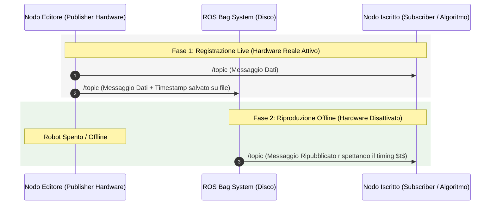
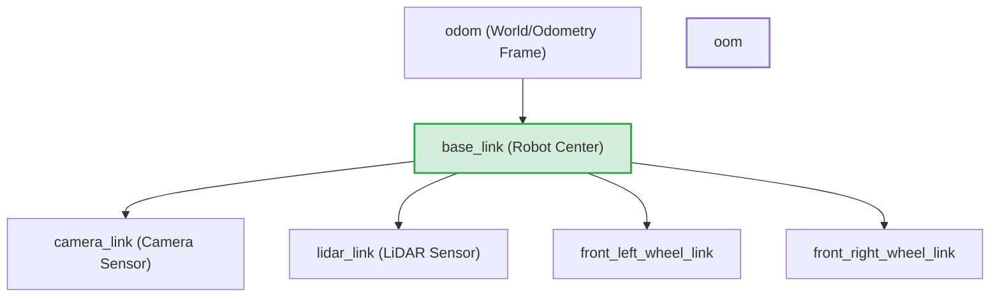
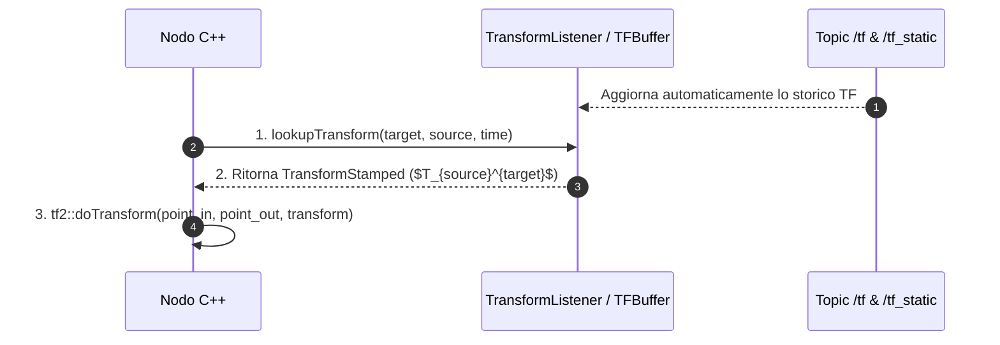
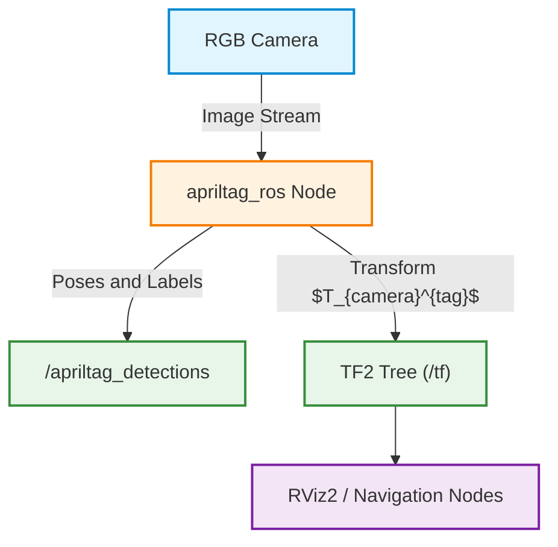
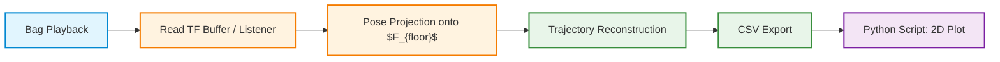
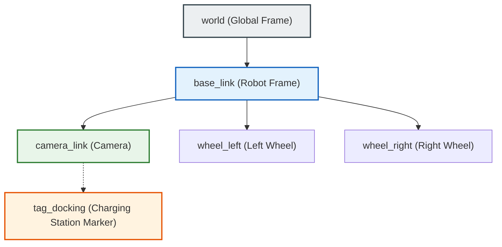
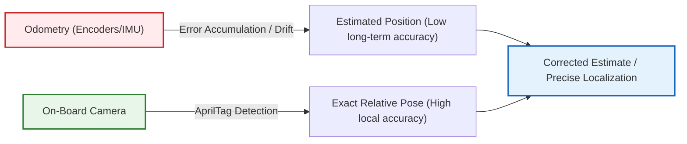

# ROS 2 Lab: Data Recording with ROS Bags and Reference Frame Management with TF2

## Educational Overview

In this lab lecture, two essential tools in **ROS 2** (*Robot Operating System 2*) development are addressed: the management and recording of data streams via **ROS Bags** and the management of spatial coordinates and reference frames using the **TF2** library.

The key points covered include:

* **ROS Bags (`ros2 bag`)**: Tool for **recording** and **playback** of messages exchanged on ROS 2 interfaces (topics, services, and actions). It ensures the preservation of temporal information (**timestamps**), allowing the playback of experiments and offline analysis of sensor data without needing direct access to the robot's physical hardware.
* **Coordinate Frames and Transforms**: Fundamental concept to coordinate data coming from different sensors (e.g., LiDAR, cameras, wheel odometry), each having its own local coordinate system. The transform is represented by a matrix describing relative position and orientation between two systems.
* **TF2 Library and TF Tree**: Tree data structure automatically managed by ROS 2 to organize spatial relationships between the various components. The structure allows calculating the relative transform between any two nodes by combining the chain of transformations along the path in the tree.
* **Types of Transforms**:
  * **Static Transforms**: Spatial relationships constant over time (e.g., a sensor rigidly attached to the robot chassis), published on the topic `/tf_static`.
  * **Dynamic Transforms**: Spatial relationships that vary over time with the movement of the robot or its parts.

---

### Introduction and Management of ROS Bags

In advanced robotic applications, robots are equipped with a plurality of sensors (cameras, LiDAR, wheel encoders, IMU units) that continuously publish data streams on their respective topics.

During testing phases and field experiments, having a tool capable of collecting and preserving this data for future use is fundamental. Running tests continuously on physical hardware is often expensive, complex, or difficult to replicate exactly.

To meet this requirement, the ROS 2 framework provides **ROS Bags**: a tool dedicated to recording and playing back messages exchanged via ROS 2 interfaces (topics, services, and actions).

---

### Operating Principles of ROS Bags

A ROS Bag does not simply save the content of a message, but creates an actual temporal recording of the communication that occurred between network nodes.

> **Key Concept**
>
> The fundamental feature of ROS Bags is the ability to record every single message along with its **timestamp**. Preserving temporal information guarantees that, during playback, the data is republished maintaining exactly the same dynamics and time frequencies of the original experiment.

The main advantages of using ROS Bags include:
* **Offline Data Analysis:** Ability to analyze sensor data retrospectively without having to rerun the robot.
* **Debugging and Testing:** Testing custom algorithms without needing constant access to physical hardware.
* **Architectural Transparency:** During playback, the ROS Bag acts for all practical purposes as a virtual publisher. Subscriber nodes do not require any modification: they receive data from the topic as if it came directly from the real hardware.



---

### Syntax of Management Commands

ROS 2 provides an integrated CLI (*Command Line Interface*) for bag management. The main commands are three:

1. **Record:**
   ```bash
   ros2 bag record -o <nome_bag> <topic_1> <topic_2> ...
   ```
   * *Option `-o`:* Specifies the name of the output file/folder associated with the bag. If not specified, ROS 2 will generate an automatic name based on the current timestamp.

2. **Inspection (*Info*):**
   ```bash
   ros2 bag info <nome_bag>
   ```
   Provides a summary of the bag's metadata: recording duration, total number of saved messages, list of recorded topics, and their relative message types.

3. **Playback (*Play*):**
   ```bash
   ros2 bag play <nome_bag>
   ```
   Reads the data stored in the bag and republishes it on the respective topics respecting the original timeline.

---

### Practical Exercise: Complete Workflow

Below is shown the practical procedure to record and play back messages exchanged between a publisher node (*Talker*) and a subscriber node (*Listener*).

*Note: Step integrated with educational clarity for a correct reconstruction of the steps performed in the terminal.*

#### Step 1: Execution of test nodes
In a first terminal, start the node publishing an increasing integer value:
```bash
ros2 run demo_nodes_cpp talker
```
In a second terminal, start the listening node to verify that messages are properly exchanged:
```bash
ros2 run demo_nodes_cpp listener
```

#### Step 2: Verify Topic List
To identify the exact topic name to record on, run the command:
```bash
ros2 topic list
```
*Expected result:* The topic found is `/topic`.

#### Step 3: Recording the ROS Bag
Start recording by saving messages from topic `/topic` inside a folder named `example_bag`:
```bash
ros2 bag record -o example_bag /topic
```
After accumulating a sufficient number of messages, you can stop recording by pressing `Ctrl+C`. Afterwards, you can also stop nodes `talker` and `listener`.

#### Step 4: Inspection of Bag Metadata
To verify the content of the file recorded on disk, use the command `info`:
```bash
ros2 bag info example_bag
```
Terminal output will show details similar to the following:
* **Duration:** Total duration of recording in seconds.
* **Count:** Total number of recorded messages.
* **Topic information:** Topic name (`/topic`), message type (e.g., `std_msgs/msg/String` or `std_msgs/msg/Int32`) and specific count.

#### Step 5: Offline Data Playback
To verify that the mechanism is simulating the presence of the real robot:
1. Keep the original publisher node (`talker`) **off**.
2. Relaunch only the subscriber node (`listener`):
   ```bash
   ros2 run demo_nodes_cpp listener
   ```
3. Start bag playback in a separate terminal:
   ```bash
   ros2 bag play example_bag
   ```

*Outcome:* Node `listener` will resume printing sequential messages to the screen as if the real hardware/node were running.

---

### Coordinate Transformation Management and TF2 Library

#### The Problem of Multiple Coordinate Frames
In a complex robotic system, multiple sensors are usually present, each characterized by its own **reference frame** or **coordinate system**.
For example:
* A camera detects objects with respect to its own *camera frame*.
* A LiDAR sensor measures distances with respect to its own *sensor frame*.
* The global robot pose is expressed with respect to an odometry reference frame (*odometry frame*).

To integrate and process data from different sensors, all measurements must be expressed in a single common reference frame. To do this, one must know the relative pose between each pair of frames.

This relative pose is called a **transformation** (*transform*). Mathematically, a transformation is represented by a homogeneous transformation matrix $T \in SE(3)$ describing the position and orientation of a reference frame $A$ with respect to a reference frame $B$. Multiplying a point $p^A$ expressed in frame $A$ by matrix $T_A^B$, we obtain the representation of the same point in frame $B$:

$$p^B = T_A^B \cdot p^A$$

---

#### The Architecture of the TF2 Library in ROS 2
In ROS 2, managing and tracking all reference frames and their relative transformations over time is entrusted to the **TF2** library.

##### Tree Structure of Transformations (*TF Tree*)
TF2 organizes all reference frames inside a **tree structure**:
* **Tree Nodes:** Represent individual reference frames.
* **Edges (Links):** Represent spatial transformations between the two connected frames.

> **KEY CONCEPT: Single Parent Rule and Concatenation**
> Being a tree structure, **every reference frame can have only one parent frame**.
> This property guarantees that a unique path exists between any pair of nodes. Consequently, TF2 can automatically compute the composite transformation between two frames that are not directly connected (for example, between the front left wheel and the front right wheel) simply by combining transformations along the path in the tree. The programmer does not need to perform matrix multiplications manually.



##### Transformation Types: Static vs Dynamic
In ROS 2, transformations are divided into two main categories:
1. **Static Transforms:** Represent spatial relationships that remain constant over time (for example, a camera rigidly fixed to the robot frame). They are published on the dedicated topic `/tf_static`.
2. **Dynamic Transforms:** Represent relationships that vary continuously over time (for example, the pose of a moving robot with respect to the starting point). They are published on topic `/tf`.

---

#### Main Components of the TF2 Library
TF2 provides several tools to publish, store, and retrieve transforms:

* **`Transform Broadcaster`:** The component in charge of publishing transforms between frames on ROS 2 topics.
* **`TFBuffer` and `TransformListener`:** The two components used inside C++ nodes to listen to topics `/tf` and `/tf_static`, store transform history in a circular buffer, and query them on demand.
* **`Robot State Publisher`:** A complex node that reads the robot's kinematic description (URDF/description file) and current joints, automatically publishing the robot's entire transform tree on `/tf` and `/tf_static`.

> **KEY CONCEPT: Operational Scope of the Course**
> Components such as `Transform Broadcaster` and `Robot State Publisher` are complex tools. Within the scope of this course, **you will not be required to publish transforms**, as transforms will already be provided by the infrastructure. Your main task will consist of creating nodes that use **`TransformListener`** and **`TFBuffer`** to extract and apply existing transforms to sensor data.

---

#### C++ Operational Workflow: Reading and Applying Transforms

To transform a point or a pose from a source reference frame (*source frame*) to a target one (*target frame*), a standardized four-phase process is followed.



##### Phase 1: Header Inclusion
Header files related to the buffer, listener, and geometric transform functions must be included:
```cpp
#include <tf2_ros/buffer.h>
#include <tf2_ros/transform_listener.h>
#include <tf2_geometry_msgs/tf2_geometry_msgs.hpp>
```

##### Phase 2: Buffer and Listener Initialization
Inside the C++ node, instantiate the objects responsible for implicitly listening to topics:
```cpp
// Creazione del buffer temporale per memorizzare le trasformazioni
auto tf_buffer = std::make_shared<tf2_ros::Buffer>(this->get_clock());

// Creazione del listener che sottoscrive i topic /tf e /tf_static e riempie il buffer
auto tf_listener = std::make_shared<tf2_ros::TransformListener>(*tf_buffer);
```

##### Phase 3: Querying the Buffer via `lookupTransform`
To obtain the transformation matrix $T_{\text{source}}^{\text{target}}$ between two frames at a given timestamp, call the method `lookupTransform()` on the buffer object.

Conceptual parameter syntax for `lookupTransform`:
1. **Target Frame (`target_frame`):** The reference frame in which you wish to express the data (e.g., `"base_link"`).
2. **Source Frame (`source_frame`):** The original reference frame in which the data is currently expressed (e.g., `"camera_link"`).
3. **Time Point (`time`):** The timestamp to which the transform must refer. By using `tf2::TimePointZero`, you request the latest transform available in the buffer.

```cpp
geometry_msgs::msg::TransformStamped transform_stamped;

try {
    transform_stamped = tf_buffer->lookupTransform(
        "base_link",           // Target frame
        "camera_link",         // Source frame
        tf2::TimePointZero     // Ultima trasformazione disponibile
    );
} catch (const tf2::TransformException & ex) {
    RCLCPP_WARN(this->get_logger(), "Impossibile ottenere la trasformazione: %s", ex.what());
}
```

##### Phase 4: Applying the Transform with `tf2::doTransform`
Having obtained the `TransformStamped`object, use the static function `tf2::doTransform` to concretely convert the geometric data (for example a point `geometry_msgs::msg::PointStamped`).

Parameter syntax of `doTransform`:
1. **Input Point:** The point expressed in the source reference frame (`frame_id` = `"camera_link"`).
2. **Output Point:** The variable (of the same type) in which the transformed point will be stored.
3. **Transform:** The transform `TransformStamped` obtained in the previous step via `lookupTransform`.

```cpp
geometry_msgs::msg::PointStamped point_in_camera_frame;
geometry_msgs::msg::PointStamped point_in_base_frame;

// ... Valorizzazione di point_in_camera_frame ...

// Esecuzione del cambio di sistema di riferimento
tf2::doTransform(point_in_camera_frame, point_in_base_frame, transform_stamped);
```

---

#### Summary of the Logical Steps

> **Summary of steps:**
> 1. **Include:** Include the necessary TF2 libraries for buffer, listener, and geometric message types.
> 2. **Instantiate:** Instantiate `TFBuffer` and `TransformListener` to passively receive and store data from `/tf` and `/tf_static`.
> 3. **Lookup:** Call `lookupTransform("target", "source", time)` to compute the relative transform $T_{\text{source}}^{\text{target}}$.
> 4. **Transform:** Apply `tf2::doTransform()` to convert the point or geometric object from the source frame to the target frame.

---

### AprilTags and 3D Pose Estimation

**AprilTags** are visual fiducial markers widely used in robotics and computer vision. Structurally similar to a QR code, their bit-matrix geometry allows encoding a unique ID within a specific family.



The fundamental property of AprilTags is providing a known visual reference frame in 3D space. When the camera detects a tag, the image processing algorithm locates the four corners of the square and computes the homogeneous transformation matrix $T_{camera}^{tag} \in SE(3)$:

$$T_{camera}^{tag} = \begin{bmatrix} R & t \\ 0_{1\times3} & 1 \end{bmatrix}$$

Where:
* $R \in SO(3)$ is the $3 \times 3$ rotation matrix describing the orientation of the tag relative to the camera.
* $t \in \mathbb{R}^3$ is the translation vector $t = [x, y, z]^T$ identifying its 3D position in space.

#### Main Applications
* **Robotic Localization and Navigation:** Precise estimation of robot position relative to fixed points.
* **Object Tracking and Manipulation:** Estimation of the pose of an object to be grasped by a robotic arm.
* **Hand-Eye Calibration:** Estimation of kinematic transformations between optical sensor and end-effector or environment.

---

### Integration Architecture in ROS 2

The ROS 2 ecosystem provides two standard packages for handling AprilTags:
1. `apriltag_msgs`: Contains data structure definitions (custom messages).
2. `apriltag_ros`: Contains computational nodes and algorithms for extracting and tracking tags starting from an RGB image stream.

Processed data is exposed on two main channels:
* **Detections Topic (`/apriltag_detections`):** Publishes messages containing semantic and geometric information of the tag (family, unique ID, image pixel coordinates, and estimated pose).
* **Transform Tree (`/tf` / `TF2`):** Publishes the spatial relationship between the camera frame (e.g., `camera_frame`) and the frame associated with the tag (e.g., `tag_0`).

A generic detection message contains the following fundamental fields:

```yaml
# Esempio di struttura del messaggio AprilTagDetection
header:
  stamp: {sec: 1711000000, nanosec: 0}
  frame_id: "camera"          # Frame sorgente di rilevamento
id: 0                          # ID numerico del tag
family: "36h11"                # Famiglia del marker
corners: [...]                 # Coordinate dei pixel dei vertici
pose:
  pose:
    position: {x: 0.12, y: -0.05, z: 1.45}
    orientation: {x: 0.0, y: 0.707, z: 0.0, w: 0.707}
```

---

### Data Visualization and Inspection via RViz 2

**RViz 2** (*ROS Visualization*) is ROS 2's primary tool for graphical rendering and 3D inspection of sensor data, robot states, and kinematic transformations ($TF$).

#### Analysis of Recording Files (`ros2 bag`)
Before starting visualization, it is common practice to check the contents of a recorded bag file using the system command:

```bash
ros2 bag info <nome_file_bag>
```

This command provides essential metadata:
* **Recording duration**
* **Total number of messages**
* **List of recorded Topics** (including `/tf`, `/tf_static` and `/apriltag_detections`).

To play back the data stream stored in the bag:
```bash
ros2 bag play <nome_file_bag>
```

During playback, messages on topic `/tf` carry the timestamp, parent frame ID (e.g., `camera`), child frame ID (e.g., `tag_0`), and their respective translation vector and rotation quaternion.

#### Scene Configuration in RViz 2
Starting RViz with the command:
```bash
rviz2
```

Access is granted to the interface split into two sections:
1. **3D Viewport (Center):** Displays point clouds, robot models, positions, and axes of reference frames in real time ($TF$).
2. **Displays Panel (Left):** Allows adding and configuring elements to render (`Add -> By display type -> TF / Pose / Image`).

> **KEY CONCEPT: Selection of Fixed Frame**
> 
> When visualizing kinematic transforms in RViz, the **`Fixed Frame`** field present in the *Global Options* section must correspond to a frame actually published and existing within the TF tree (e.g., `camera` or `world`). 
> 
> If the default `Fixed Frame` set does not exist in the current graph, RViz will not be able to compute the spatial kinematic chain, and the entire 3D rendering window will result empty or return *Status: Error* errors.

---

### Practical Exercise: Trajectory Tracking and Pose Projection

#### Experimental Setup Description
The setup for the exercise includes a fixed RGB camera mounted on the ceiling with its field of view facing downwards. The operating environment contains three elements tracked via distinct AprilTags:

1. **Tag 0 (`tag_0`):** Placed on the floor, acts as the planar reference origin of the environment ($F_{floor}$).
2. **Tag 1 (`tag_1`):** Placed on the charging station.
3. **Tag 2 (`tag_2`):** Placed on the robotic vacuum cleaner.

```
          [ Telecamera (soffitto) ]
                      |
        +-------------+-------------+
        |             |             |
        v             v             v
  [ Tag 0: Floor ] [ Tag 1: Base ] [ Tag 2: Robot ]
```

#### Logical Workflow of the Exercise
The student must develop a software processing pipeline structured into the following steps:



1. **Inspection and Visualization:** Play back the provided bag and verify the correct $TF$ tree via RViz 2.
2. **Develop TF Extraction Node:** Create a ROS 2 node in C++ or Python utilizing the `Buffer` and `TransformListener` classes from TF2 to query the relative transformation between the floor frame and the other elements:
   
   $$T_{floor}^{robot} = (T_{camera}^{floor})^{-1} \cdot T_{camera}^{robot}$$

3. **Planar Projection:** Project the 3D positions of the tags onto the floor plane ($x, y$) eliminating the orthogonal component $z$ and calculating the orientation angle around the vertical axis ($\theta_{yaw}$).
4. **Trajectory Reconstruction and Data Export:** Record the time evolution of the robot's pose and save structured data into a `.csv` file.
5. **Data Analysis in Python:** Create an external script that reads the `.csv` file to generate the required plots:
   * 2D map of the trajectory traveled by the vacuum robot.
   * Time plot of the Euclidean distance $d(t)$ between the robot and the charging station:

$$d(t) = \sqrt{(x_{robot}(t) - x_{base})^2 + (y_{robot}(t) - y_{base})^2}$$

---

### Topic Management and Data Playback in ROS 2

#### Visualization and Replay via ROS Bag
During the testing and analysis phase of robotic systems, recording data streams allows replaying the robot's behavior without having to rerun the hardware in a real or simulated environment. In ROS 2, this process is managed through **ROS Bag** files.

When executing bag replay (`ros2 bag play`):
1. The bag plays back exactly the messages published on the various **Topics** recorded previously.
2. By opening a new terminal and sourcing the environment (`source setup.bash`), you can inspect the list of active topics via the command:
   ```bash
   ros2 topic list
   ```
3. If replay execution finishes, the topic list in the reference frames becomes empty again until the play command is relaunched.

---

### Architecture of the TF Tree (Transform Tree)

#### Hierarchical Structure of Reference Frames
To determine the position and orientation of each robot component and object in the environment, the **Transform Tree** (*TF Tree*) is used.

The TF system organizes all reference frames according to a cycle-free tree structure (directed acyclic graph), ensuring that a unique direct transformation path exists between any pair of frames:

* **Root Frame (World/Map Frame):** Represents the global fixed reference frame of the environment $F_{\text{world}}$.
* **Base Link (`base_link`):** Represents the center of the robot's mobile reference frame $F_{\text{base\_link}}$.
* **Child Frames (Sub-frames):** Sensors (e.g., `camera_link`), wheels (`wheel_left`, `wheel_right`), and end-effectors connected directly to `base_link`.

The homogeneous spatial transformation $T_{\text{world}}^{\text{camera}}$ to determine the camera's position relative to the world is computed via transform composition:

$$T_{\text{world}}^{\text{camera}} = T_{\text{world}}^{\text{base\_link}} \cdot T_{\text{base\_link}}^{\text{camera}}$$



> **Key Concept: Uniqueness of the TF Tree**
> It is not possible to arbitrarily connect all components of a scene without respecting the hierarchical structure of the TF tree. Each additional sub-system or robot must possess its own well-defined kinematic chain to avoid geometric ambiguities and cycles in the transformation tree.

#### Static vs. Dynamic Transforms
Transformations within the TF system are divided into two main categories:

1. **Static Transform:**
   Represents a rigid spatial relationship that is invariant over time between two frames.
   * *Example:* The physical position of the camera installed on the robot frame relative to `base_link` ($T_{\text{base\_link}}^{\text{camera}}$. Since the camera is fixed, this transform does not change during code execution.
2. **Dynamic Transform:**
   Represents a spatial relationship that varies continuously over time due to motion.
   * *Example:* The position of the robot relative to the world ($T_{\text{world}}^{\text{base\_link}}$), updated continuously by odometry and localization systems.

---

### Robot Localization: Odometry and AprilTag

#### Odometry Limitations and Error Accumulation (Drift)
To estimate the displacement of the mobile robot in the environment, **Odometry** is used, based on measuring wheel rotations (via encoders) or inertial sensors (IMUs).

Odometry calculates the estimated position by integrating velocity over time:

$$x(t) = x(0) + \int_{0}^{t} v(\tau) \cos(\theta(\tau)) \, d\tau$$

$$y(t) = y(0) + \int_{0}^{t} v(\tau) \sin(\theta(\tau)) \, d\tau$$

However, odometry inherently suffers from **Odometric Drift**:
* Small measurement errors in wheels (slippage, terrain irregularities, mechanical tolerances) progressively accumulate over time.
* The robot "believes" it is at a point $P_{\text{stimato}}$, while its real position in the world is $P_{\text{reale}}$.

#### Role of AprilTags and Efficient Visual Recognition
To correct odometric drift and enable high-precision operations (e.g., docking to a charging station), **Fiducial Markers**, specifically **AprilTags**, are used.



An **AprilTag** is a 2D matrix barcode fiducial marker tag that functions as follows:
* **Unique Identifier:** Each tag belongs to a numerical ID code-associated with a specific physical object in the environment (e.g., `Tag ID 4` $\rightarrow$ Charging Station).
* **3D Pose Calculation:** The camera detects the AprilTag and, knowing the real dimensions of the marker and the camera's intrinsic parameters, instantly calculates the transformation matrix $T_{\text{camera}}^{\text{tag}}$ in terms of 3D distance and relative orientation (roll, pitch, pitch).

> **Key Concept: Utility of AprilTags in Docking**
> Odometry alone allows the robot to move approximately toward the charging area. However, to perform the final precise docking with the battery connectors, direct visual measurement provided by the AprilTag delivers the millimeter accuracy required to complete the operation.

#### Technical Comparison: Fiducial Markers vs Complex Object Detection

An alternative to using AprilTags could be employing neural networks or computer vision algorithms for shape- and color-based **Object Detection** (e.g., visually recognizing a red or round charging station).

However, in mobile robots this choice presents critical disadvantages:

| Feature | AprilTags (Fiducial Markers) | AI/Advanced Vision Object Recognition |
| :--- | :--- | :--- |
| **Computational Complexity** | Very Low (Lightweight and fast mathematical algorithms) | High (Requires dedicated GPUs/NPUs and high CPU load) |
| **Energy Consumption** | Minimal | High (Reduces robot battery autonomy) |
| **Geometric Accuracy** | Extremely High (Precise 6D pose estimation $x,y,z,\phi,\theta,\psi$) | Variable (Depends on lighting, occlusions, and training) |
| **Implementation Simplicity** | Direct mapping ID $\rightarrow$ Object via code | Need for complex training datasets |

> **Key Concept: Efficiency in Mobile Robots**
> In a mobile robot, energy efficiency is a binding constraint: computational resources must remain as lightweight and responsive as possible to avoid draining the battery. Using AprilTags guarantees a deterministic, fast, and computationally "cheap" algorithm to obtain the exact pose of critical objects in the environment.

---

> [!NOTE]
> ### Exam Notes and Instructor Warnings
> - **Handling transformations (TF/TF static)**: On the exam, you will exclusively be asked to write nodes that retrieve transformations using `TF listener` and `TF buffer` (without manually reading TF topics).
> - **Publishing transforms**: All transformations will already be provided by the instructors during the exam; you will not be asked (nor allowed) to publish any type of transform.