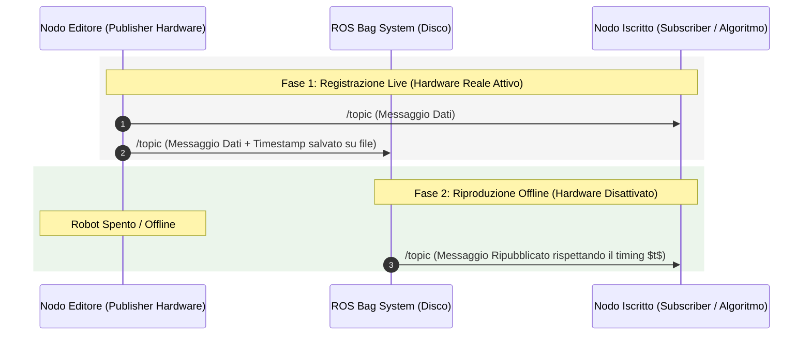
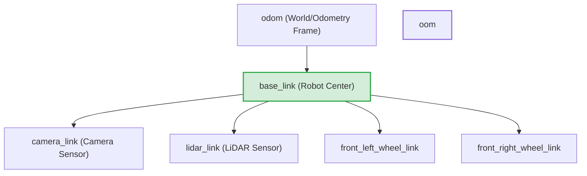
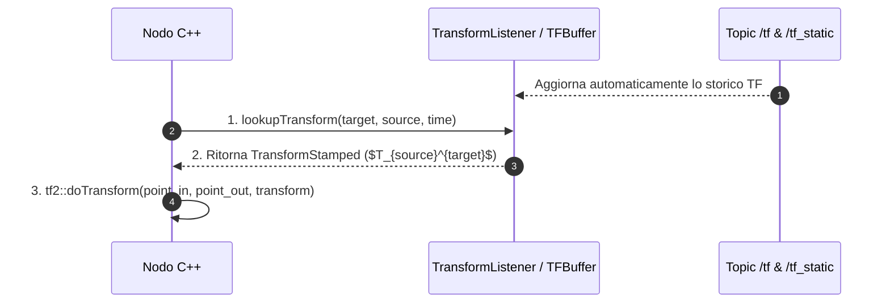
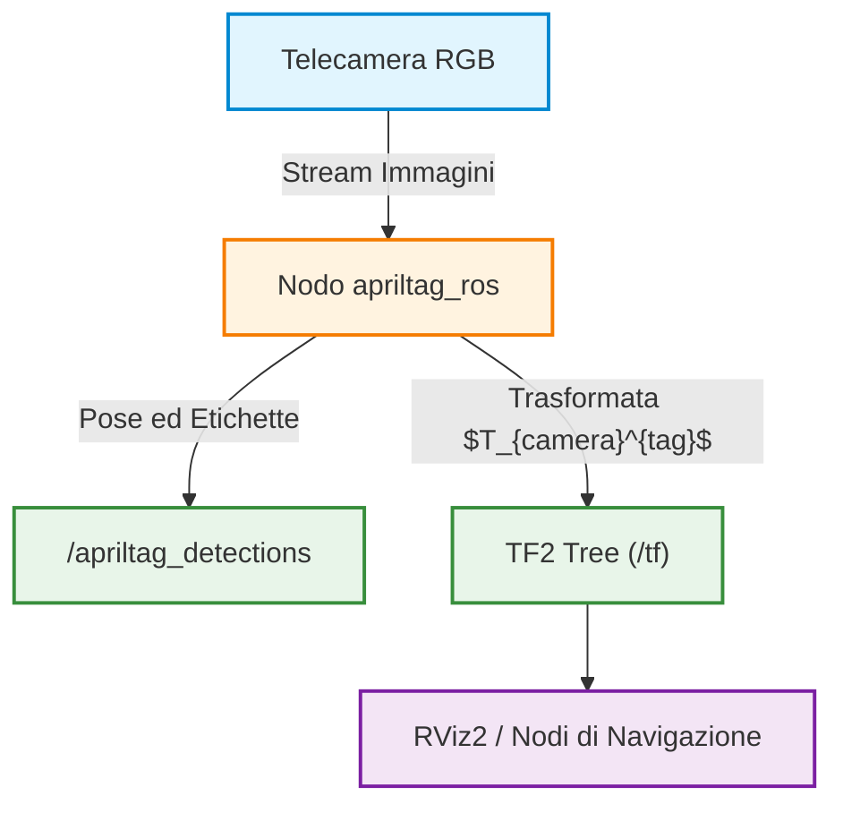
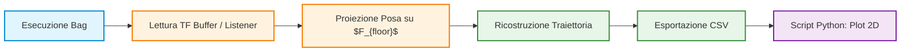
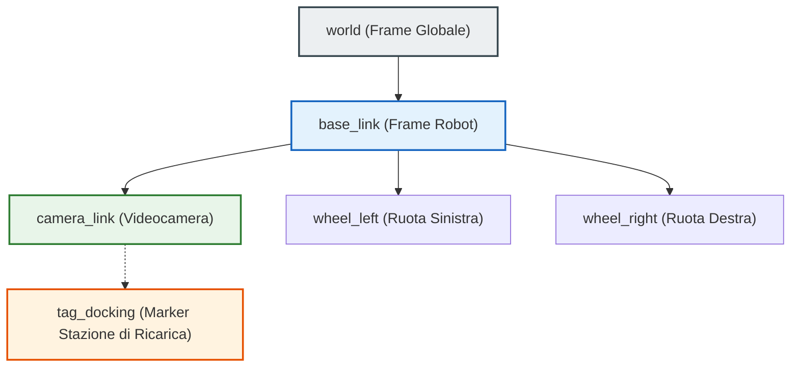
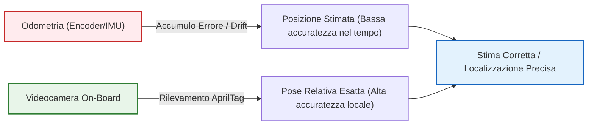

# Laboratorio ROS 2: Registrazione Dati con ROS Bags e Gestione dei Sistemi di Riferimento con TF2

## Overview Didattica

In questa lezione di laboratorio vengono affrontati due strumenti essenziali nello sviluppo con **ROS 2** (*Robot Operating System 2*): la gestione e registrazione dei flussi di dati tramite **ROS Bags** e la gestione delle coordinate spaziali e dei sistemi di riferimento mediante la libreria **TF2**.

I punti chiave trattati includono:

* **ROS Bags (`ros2 bag`)**: Strumento per la **registrazione** (*recording*) e **riproduzione** (*playback*) dei messaggi scambiati sulle interfacce ROS 2 (topic, servizi e azioni). Garantisce la conservazione delle informazioni temporali (**marca-tempo** o *timestamp*), consentendo la riproduzione di esperimenti e l'analisi di dati sensoriali offline senza dover accedere direttamente all'hardware fisico del robot.
* **Sistemi di Riferimento** (*Coordinate Frames*) **e Trasformate** (*Transforms*): Concetto fondamentale per coordinare dati provenienti da sensori differenti (es. LiDAR, telecamere, odometria delle ruote), ciascuno avente un proprio sistema di coordinate locale. La trasformata è rappresentata da una matrice che descrive posizione e orientamento relativi tra due sistemi.
* **Libreria TF2 e Albero delle Trasformate** (*TF Tree*): Struttura dati ad albero gestita automaticamente da ROS 2 per organizzare le relazioni spaziali tra i vari componenti. La struttura permette di calcolare la trasformata relativa tra due nodi qualsiasi combinando la catena di trasformazioni lungo il percorso nell'albero.
* **Tipologie di Trasformate**:
  * **Trasformate Statiche** (*Static Transforms*): Relazioni spaziali costanti nel tempo (es. un sensore fissato rigidamente sul telaio del robot), pubblicate sul topic `/tf_static`.
  * **Trasformate Dinamiche** (*Dynamic Transforms*): Relazioni spaziali che variano nel tempo con il movimento del robot o delle sue parti.

---

### Introduzione e Gestione dei ROS Bags

Nelle applicazioni robotiche avanzate, i robot sono dotati di una pluralità di sensori (telecamere, LiDAR, encoder delle ruote, unità IMU) che pubblicano continuamente flussi di dati sui rispettivi argomenti (*Topics*). 

Durante le fasi di test ed esperimenti sul campo, è fondamentale disporre di uno strumento in grado di raccogliere e preservare questi dati per utilizzi futuri. L'esecuzione continua di test su hardware fisico è spesso dispendiosa, complessa o difficile da replicare esattamente.

Per risolvere questa esigenza, il framework ROS 2 mette a disposizione i **ROS Bags**: uno strumento dedicato alla registrazione (*recording*) e riproduzione (*playback*) dei messaggi scambiati tramite le interfacce ROS 2 (topic, servizi e azioni).

---

### Principi di Funzionamento dei ROS Bags

Un ROS Bag non salva semplicemente il contenuto di un messaggio, ma crea una vera e propria registrazione temporale della comunicazione avvenuta tra i nodi della rete.

> **Concetto Chiave**
>
> La caratteristica fondamentale dei ROS Bags è la capacità di registrare ogni singolo messaggio unitamente alla sua **marca temporale** (*timestamp*). Preservare l'informazione temporale garantisce che, in fase di riproduzione, i dati vengano ripubblicati mantenendo esattamente le stesse dinamiche e frequenze temporali dell'esperimento originale.

I vantaggi principali dell'uso dei ROS Bags includono:
* **Analisi dati offline (*Offline Data Analysis*):** Possibilità di analizzare i dati dei sensori a posteriori senza dover eseguire nuovamente il robot.
* **Collaudo e Debugging (*Debugging and Testing*):** Test sui propri algoritmi senza dover accedere costantemente all'hardware fisico.
* **Trasparenza per l'architettura:** Durante il playback, il ROS Bag agisce a tutti gli effetti come un editore virtuale (*Virtual Publisher*). I nodi iscritti (*Subscriber Nodes*) non richiedono alcuna modifica: ricevono i dati dal topic come se provenissero direttamente dall'hardware reale.



---

### Sintassi dei Comandi di Gestione

ROS 2 fornisce una CLI (*Command Line Interface*) integrata per la gestione dei bag. I comandi principali sono tre:

1. **Registrazione (*Record*):**
   ```bash
   ros2 bag record -o <nome_bag> <topic_1> <topic_2> ...
   ```
   * *Opzione `-o`:* Specifica il nome del file/cartella di output associato al bag. Se non specificato, ROS 2 genererà un nome automatico basato sul timestamp corrente.

2. **Ispezione (*Info*):**
   ```bash
   ros2 bag info <nome_bag>
   ```
   Fornisce una sintesi dei metadati del bag: durata della registrazione, numero totale di messaggi salvati, elenco dei topic registrati e i relativi tipi di messaggio (*Message Types*).

3. **Riproduzione (*Play*):**
   ```bash
   ros2 bag play <nome_bag>
   ```
   Legge i dati memorizzati nel bag e li ripubblica sui rispettivi topic rispettando la scansione temporale originale.

---

### Esercitazione Pratica: Workflow Completo

Di seguito viene mostrato l'iter pratico per registrare e riprodurre i messaggi scambiati tra un nodo editore (*Talker*) e un nodo iscritto (*Listener*).

*Nota: Passaggio integrato con chiarezza didattica per una corretta ricostruzione dei passaggi eseguiti a terminale.*

#### Passo 1: Esecuzione dei nodi di test
In un primo terminale, avviamo il nodo che pubblica un valore intero progressivo:
```bash
ros2 run demo_nodes_cpp talker
```
In un secondo terminale, avviamo il nodo in ascolto per verificare che i messaggi siano correttamente scambiati:
```bash
ros2 run demo_nodes_cpp listener
```

#### Passo 2: Verificare l'elenco dei Topic
Per individuare l'esatto nome del topic su cui registrare, si esegue il comando:
```bash
ros2 topic list
```
*Risultato atteso:* Viene individuato il topic `/topic`.

#### Passo 3: Registrazione del ROS Bag
Avviamo la registrazione salvando i messaggi del topic `/topic` all'interno di una cartella chiamata `example_bag`:
```bash
ros2 bag record -o example_bag /topic
```
Dopo aver accumulato un numero sufficiente di messaggi, è possibile interrompere la registrazione premendo `Ctrl+C`. Successivamente, si possono arrestare anche i nodi `talker` e `listener`.

#### Passo 4: Ispezione dei Metadati del Bag
Per verificare il contenuto del file registrato sul disco, usiamo il comando `info`:
```bash
ros2 bag info example_bag
```
L'output a terminale mostrerà dettagli simili ai seguenti:
* **Duration:** Durata totale della registrazione in secondi.
* **Count:** Numero totale dei messaggi registrati.
* **Topic information:** Nome del topic (`/topic`), tipo di messaggio (es. `std_msgs/msg/String` o `std_msgs/msg/Int32`) e conteggio specifico.

#### Passo 5: Riproduzione Offline dei Dati
Per verificare che il meccanismo stia simulando la presenza del robot reale:
1. Manteniamo il nodo editore originale (`talker`) **spento**.
2. Avviamo nuovamente solo il nodo iscritto (`listener`):
   ```bash
   ros2 run demo_nodes_cpp listener
   ```
3. Avviamo la riproduzione del bag in un terminale separato:
   ```bash
   ros2 bag play example_bag
   ```

*Esito:* Il nodo `listener` riprenderà a stampare a schermo i messaggi sequenziali come se l'hardware/nodo reale fosse in esecuzione.

---

### Gestione delle Trasformazioni di Coordinate e Libreria TF2

#### Il Problema dei Sistemi di Riferimento Multipli
In un sistema robotico complesso sono solitamente presenti molteplici sensori, ciascuno caratterizzato da una propria **terna di riferimento** o **sistema di coordinate** (*coordinate frame*). 
Ad esempio:
* Una telecamera rileva oggetti rispetto al proprio *camera frame*.
* Un sensore LiDAR misura distanze rispetto al proprio *sensor frame*.
* La posa globale del robot viene espressa rispetto a un sistema di riferimento di odometria (*odometry frame*).

Per poter integrare ed elaborare i dati provenienti dai diversi sensori, è necessario esprimere tutte le misurazioni in un unico sistema di riferimento comune. Per fare ciò, occorre conoscere la posa relativa tra ciascuna terna di riferimento. 

Questa posa relativa prende il nome di **trasformazione** (*transform*). Matematicamente, una trasformazione è rappresentata da una matrice di trasformazione omogenea $T \in SE(3)$ che descrive la posizione e l'orientamento di un sistema di riferimento $A$ rispetto a un sistema di riferimento $B$. Moltiplicando un punto $p^A$ espresso nel frame $A$ per la matrice $T_A^B$, otteniamo la rappresentazione dello stesso punto nel frame $B$:

$$p^B = T_A^B \cdot p^A$$

---

#### L'Architettura della Libreria TF2 in ROS2
In ROS2, la gestione e il tracciamento nel tempo di tutte le terne di riferimento e delle relative trasformazioni sono affidati alla libreria **TF2**.

##### Struttura ad Albero delle Trasformazioni (*TF Tree*)
TF2 organizza tutti i sistemi di riferimento all'interno di una struttura dati ad **albero** (*tree structure*):
* **Nodi dell'albero:** Rappresentano i singoli sistemi di riferimento (*reference frames*).
* **Archi (Link):** Rappresentano le trasformazioni spaziali tra i due frame collegati.

> **CONCETTO CHIAVE: Regola del Padre Singolo e Concatenazione**
> Trattandosi di una struttura ad albero, **ogni sistema di riferimento può avere un solo frame padre (*parent frame*)**. 
> Questa proprietà garantisce che esista un unico cammino tra qualsiasi coppia di nodi. Di conseguenza, TF2 è in grado di calcolare automaticamente la trasformazione composta tra due frame non direttamente collegati (ad esempio tra la ruota anteriore sinistra e la ruota anteriore destra) semplicemente combinando le trasformazioni lungo il percorso nell'albero. Il programmatore non deve svolgere manualmente le moltiplicazioni matriciali.



##### Tipologie di Trasformazioni: Statiche vs Dinamiche
In ROS2, le trasformazioni si dividono in due categorie principali:
1. **Trasformazioni Statiche (*Static Transforms*):** Rappresentano relazioni spaziali che rimangono costanti nel tempo (ad esempio, una telecamera fissata rigidamente al telaio del robot). Vengono pubblicate sul topic dedicato `/tf_static`.
2. **Trasformazioni Dinamiche (*Dynamic Transforms*):** Rappresentano relazioni che variano continuamente nel tempo (ad esempio, la posa del robot in movimento rispetto al punto di partenza). Vengono pubblicate sul topic `/tf`.

---

#### Componenti Principali della Libreria TF2
TF2 mette a disposizione diversi strumenti per pubblicare, memorizzare e recuperare le trasformazioni:

* **`Transform Broadcaster`:** Il componente incaricato di pubblicare le trasformazioni tra i frame sui topic ROS2.
* **`TFBuffer` e `TransformListener`:** I due componenti utilizzati all'interno dei nodi C++ per ascoltare i topic `/tf` e `/tf_static`, memorizzare lo storico delle trasformazioni in un buffer circolare e consultarle su richiesta.
* **`Robot State Publisher`:** Un nodo complesso che legge la descrizione cinematica del robot (file URDF/description file) e i giunti correnti, pubblicando automaticamente l'intero albero delle trasformazioni del robot su `/tf` e `/tf_static`.

> **CONCETTO CHIAVE: Ambito Operativo del Corso**
> I componenti come il `Transform Broadcaster` e il `Robot State Publisher` sono strumenti complessi. Nell'ambito di questo corso, **non vi sarà richiesto di pubblicare trasformazioni**, in quanto le trasformazioni saranno già fornite dall'infrastruttura. Il vostro compito principale consisterà nel creare nodi che utilizzano **`TransformListener`** e **`TFBuffer`** per estrarre ed applicare le trasformazioni esistenti ai dati dei sensori.

---

#### Workflow Operativo in C++: Lettura ed Applicazione delle Trasformazioni

Per trasformare un punto o una posa da un sistema di riferimento sorgente (*source frame*) a uno di destinazione (*target frame*), si segue un processo standardizzato in quattro fasi.



##### Fase 1: Inclusione degli Header
È necessario includere i file di intestazione relativi al buffer, al listener e alle funzioni di trasformazione geometrica:
```cpp
#include <tf2_ros/buffer.h>
#include <tf2_ros/transform_listener.h>
#include <tf2_geometry_msgs/tf2_geometry_msgs.hpp>
```

##### Fase 2: Inizializzazione di Buffer e Listener
All'interno del nodo C++, si istanziano gli oggetti responsabili dell'ascolto implicito dei topic:
```cpp
// Creazione del buffer temporale per memorizzare le trasformazioni
auto tf_buffer = std::make_shared<tf2_ros::Buffer>(this->get_clock());

// Creazione del listener che sottoscrive i topic /tf e /tf_static e riempie il buffer
auto tf_listener = std::make_shared<tf2_ros::TransformListener>(*tf_buffer);
```

##### Fase 3: Interrogazione del Buffer mediante `lookupTransform`
Per ottenere la matrice di trasformazione $T_{\text{source}}^{\text{target}}$ tra due frame a un determinato istante temporale, si invoca il metodo `lookupTransform()` sull'oggetto buffer.

Sintassi concettuale dei parametri di `lookupTransform`:
1. **Target Frame (`target_frame`):** Il sistema di riferimento in cui si desidera esprimere il dato (es. `"base_link"`).
2. **Source Frame (`source_frame`):** Il sistema di riferimento originale in cui è attualmente espresso il dato (es. `"camera_link"`).
3. **Time Point (`time`):** L'istante temporale a cui deve fare riferimento la trasformazione. Utilizzando `tf2::TimePointZero`, si richiede l'ultima trasformazione disponibile nel buffer.

```cpp
geometry_msgs::msg::TransformStamped transform_stamped;

try {
    transform_stamped = tf_buffer->lookupTransform(
        "base_link",           // Target frame
        "camera_link",         // Source frame
        tf2::TimePointZero     // Ultima trasformazione disponibile
    );
} catch (const tf2::TransformException & ex) {
    RCLCPP_WARN(this->get_logger(), "Impossibile ottenere la trasformazione: %s", ex.what());
}
```

##### Fase 4: Applicazione della Trasformazione con `tf2::doTransform`
Ottenuto l'oggetto `TransformStamped`, si utilizza la funzione statica `tf2::doTransform` per convertire concretamente il dato geometrico (ad esempio un punto `geometry_msgs::msg::PointStamped`).

Sintassi dei parametri di `doTransform`:
1. **Input Point:** Il punto espresso nel sistema di riferimento sorgente (`frame_id` = `"camera_link"`).
2. **Output Point:** La variabile (dello stesso tipo) in cui verrà salvato il punto trasformato.
3. **Transform:** La trasformazione `TransformStamped` ottenuta al punto precedente tramite `lookupTransform`.

```cpp
geometry_msgs::msg::PointStamped point_in_camera_frame;
geometry_msgs::msg::PointStamped point_in_base_frame;

// ... Valorizzazione di point_in_camera_frame ...

// Esecuzione del cambio di sistema di riferimento
tf2::doTransform(point_in_camera_frame, point_in_base_frame, transform_stamped);
```

---

#### Sintesi dei Passaggi Logici

> **Riepilogo dei passaggi:**
> 1. **Include:** Includere le librerie TF2 necessarie per buffer, listener e tipi di messaggio geometrici.
> 2. **Instantiate:** Istanziare `TFBuffer` e `TransformListener` per ricevere e memorizzare passivamente i dati da `/tf` e `/tf_static`.
> 3. **Lookup:** Richiamare `lookupTransform("target", "source", time)` per calcolare la trasformazione relativa $T_{\text{source}}^{\text{target}}$.
> 4. **Transform:** Applicare `tf2::doTransform()` per convertire il punto o l'oggetto geometrico dal frame di origine a quello di destinazione.

---

### AprilTags e Stima della Posa 3D

Gli **AprilTags** sono marker visivi fiduciali ampiamente utilizzati in robotica e visione artificiale. Strutturalmente simili a un codice QR, la loro geometria a matrice di bit permette di codificare un ID univoco all'interno di una specifica famiglia (*family*).



La proprietà fondamentale degli AprilTag è quella di fornire un sistema di riferimento visivo noto nello spazio tridimensionale. Quando la telecamera rileva un tag, l'algoritmo di elaborazione delle immagini individua i quattro angoli del quadrato e calcola la matrice di trasformazione omogenea $T_{camera}^{tag} \in SE(3)$:

$$T_{camera}^{tag} = \begin{bmatrix} R & t \\ 0_{1\times3} & 1 \end{bmatrix}$$

Dove:
* $R \in SO(3)$ è la matrice di rotazione $3 \times 3$ che descrive l'orientamento del tag rispetto alla telecamera.
* $t \in \mathbb{R}^3$ è il vettore di traslazione $t = [x, y, z]^T$ che ne identifica la posizione 3D nello spazio.

#### Applicazioni Principali
* **Localizzazione e Navigazione Robotica:** Stima precisa della posizione del robot rispetto a punti fissi.
* **Tracciamento e Manipolazione Oggetti (*Object Tracking and Manipulation*):** Stima della posa di un oggetto da afferrare tramite un braccio robotico.
* **Calibrazione Robot-Telecamera (*Hand-Eye Calibration*):** Stima delle trasformazioni cinematiche tra sensore ottico ed effettore finale o ambiente.

---

### Architettura di integrazione in ROS 2

L'ecosistema ROS 2 fornisce due pacchetti standard per la gestione degli AprilTag:
1. `apriltag_msgs`: Contiene le definizioni delle strutture dati (messaggi custom).
2. `apriltag_ros`: Contiene i nodi computazionali e gli algoritmi per l'estrazione e il tracciamento dei tag a partire da uno stream di immagini RGB.

I dati processati vengono esposti su due canali principali:
* **Topic delle Detection (`/apriltag_detections`):** Pubblica messaggi contenenti informazioni semantiche e geometriche del tag (famiglia, ID univoco, coordinate dei pixel nell'immagine e posa stimata).
* **Albero delle Trasformazioni (`/tf` / `TF2`):** Pubblica la relazione spaziale tra il frame della telecamera (es. `camera_frame`) e il frame associato al tag (es. `tag_0`).

Un generico messaggio di detection contiene i seguenti campi fondamentali:

```yaml
# Esempio di struttura del messaggio AprilTagDetection
header:
  stamp: {sec: 1711000000, nanosec: 0}
  frame_id: "camera"          # Frame sorgente di rilevamento
id: 0                          # ID numerico del tag
family: "36h11"                # Famiglia del marker
corners: [...]                 # Coordinate dei pixel dei vertici
pose:
  pose:
    position: {x: 0.12, y: -0.05, z: 1.45}
    orientation: {x: 0.0, y: 0.707, z: 0.0, w: 0.707}
```

---

### Visualizzazione ed Ispezione Dati tramite RViz 2

**RViz 2** (*ROS Visualization*) è lo strumento principale di ROS 2 per la resa grafica e l'ispezione 3D di dati sensoriali, stati dei robot e trasformazioni cinematiche ($TF$).

#### Analisi dei file di Registrazione (`ros2 bag`)
Prima di avviare la visualizzazione, è prassi comune verificare i contenuti di un file bag registrato mediante il comando di sistema:

```bash
ros2 bag info <nome_file_bag>
```

Questo comando fornisce metadati essenziali:
* **Durata della registrazione**
* **Numero totale di messaggi**
* **Lista dei Topic registrati** (inclusi `/tf`, `/tf_static` e `/apriltag_detections`).

Per riprodurre il flusso dei dati memorizzati nel bag:
```bash
ros2 bag play <nome_file_bag>
```

Durante la riproduzione, i messaggi sul topic `/tf` trasportano la coordinata temporale (*timestamp*), il frame padre (*parent frame ID*, es. `camera`), il frame figlio (*child frame ID*, es. `tag_0`), e il rispettivo vettore di traslazione e quaternione di rotazione.

#### Configurazione della Scena in RViz 2
Avviando RViz con il comando:
```bash
rviz2
```

Si accede all'interfaccia divisa in due sezioni:
1. **Viewport 3D (Centrale):** Visualizza in tempo reale nuvole di punti (*Point Clouds*), modelli robotici, posizioni e assi dei sistemi di riferimento ($TF$).
2. **Pannello Displays (Sinistra):** Permette di aggiungere e configurare gli elementi da renderizzare (`Add -> By display type -> TF / Pose / Image`).

> **CONCETTO CHIAVE: Selezione del Fixed Frame**
> 
> Quando si visualizzano le trasformazioni cinematiche in RViz, la voce **`Fixed Frame`** presente nella sezione *Global Options* deve corrispondere a un frame effettivamente pubblicato ed esistente all'interno dell'albero TF (es. `camera` o `world`). 
> 
> Se il `Fixed Frame` impostato di default non esiste nel grafo corrente, RViz non sarà in grado di calcolare la catena cinemati-spaziale e l'intera finestra di resa 3D risulterà vuota o restituirà errori di *Status: Error*.

---

### Esercitazione Pratica: Tracciamento Traiettoria e Proiezione di Posa

#### Descrizione del Setup Sperimentale
Il setup dell'esercitazione prevede una telecamera RGB fissa montata a soffitto con campo visivo rivolto verso il basso. L'ambiente operativo contiene tre elementi tracciati tramite AprilTags distinti:

1. **Tag 0 (`tag_0`):** Posizionato sul pavimento, funge da origine dell'ambiente planarmente参照 ($F_{floor}$).
2. **Tag 1 (`tag_1`):** Posizionato sulla stazione di ricarica (*charging station*).
3. **Tag 2 (`tag_2`):** Posizionato sull'aspirapolvere robotico (*vacuum cleaner*).

```
          [ Telecamera (soffitto) ]
                      |
        +-------------+-------------+
        |             |             |
        v             v             v
  [ Tag 0: Floor ] [ Tag 1: Base ] [ Tag 2: Robot ]
```

#### Workflow Logico dell'Esercizio
Lo studente deve sviluppare una pipeline di elaborazione software articolata nei seguenti passaggi:



1. **Ispezione e Visualizzazione:** Riprodurre il bag fornito e verificare il corretto albero $TF$ tramite RViz 2.
2. **Sviluppo Nodo di Estrazione TF:** Creare un nodo ROS 2 in C++ o Python sfruttando le classi `Buffer` e `TransformListener` di TF2 per richiedere la trasformazione relativa tra il frame del pavimento e gli altri elementi:
   
   $$T_{floor}^{robot} = (T_{camera}^{floor})^{-1} \cdot T_{camera}^{robot}$$

3. **Proiezione Planare:** Proiettare le posizioni 3D dei tag sul piano del pavimento ($x, y$) eliminando la componente ortogonale $z$ e calcolando l'angolo di orientamento attorno all'asse verticale ($\theta_{yaw}$).
4. **Ricostruzione della Traiettoria ed Esportazione Data:** Registrare l'evoluzione temporale della posa del robot e salvare i dati strutturati in un file `.csv` (*Comma-Separated Values*).
5. **Analisi dati in Python:** Creare uno script esterno che legga il file `.csv` per generare i grafici richiesti:
   * Mappa 2D della traiettoria percorsa dal robot aspirapolvere.
   * Grafico temporale della distanza euclidea $d(t)$ tra il robot e la stazione di ricarica:

$$d(t) = \sqrt{(x_{robot}(t) - x_{base})^2 + (y_{robot}(t) - y_{base})^2}$$

---

### Gestione dei Topic e Riproduzione Dati in ROS 2

#### Visualizzazione e Replay tramite ROS Bag
Durante la fase di test e analisi dei sistemi robotici, la registrazione dei flussi di dati consente di riprodurre il comportamento del robot senza dover eseguire nuovamente l'hardware in ambiente reale o simulato. In ROS 2, questo processo è gestito mediante i file **ROS Bag** (*Registrazione Dati / ROS Bag*).

Quando si esegue il replay di una bag (`ros2 bag play`):
1. La bag riproduce esattamente i messaggi pubblicati sui vari **Topic** (*Canali di Comunicazione / ROS Topics*) registrati in precedenza.
2. Aprendo un nuovo terminale ed eseguendo il source dell'ambiente (`source setup.bash`), è possibile ispezionare l'elenco dei topic attivi tramite il comando:
   ```bash
   ros2 topic list
   ```
3. Se l'esecuzione del replay termina, l'elenco dei topic nei reference frame torna vuoto finché il comando di play non viene rilanciato.

---

### Architettura del TF Tree (Transform Tree)

#### Struttura Gerarchica dei Reference Frame
Per determinare la posizione e l'orientamento di ogni componente del robot e degli oggetti nell'ambiente, si utilizza l'**Albero di Trasformata** (*Transform Tree / TF Tree*). 

Il sistema TF organizza tutti i sistemi di riferimento (*Frames*) secondo una struttura ad albero priva di cicli (grafo aciclico diretto), garantendo che esista un unico percorso diretto di trasformazione tra qualsiasi coppia di frame:

* **Frame Radice (World/Map Frame):** Rappresenta il sistema di riferimento globale fisso dell'ambiente $F_{\text{world}}$.
* **Base Link (`base_link`):** Rappresenta il centro del sistema di riferimento mobile del robot $F_{\text{base\_link}}$.
* **Frame Figli (Sub-frames):** Sensori (es. `camera_link`), ruote (`wheel_left`, `wheel_right`), ed effettori finali collegati direttamente a `base_link`.

La trasformazione spaziale omogenea $T_{\text{world}}^{\text{camera}}$ per determinare la posizione della videocamera rispetto al mondo si calcola tramite composizione delle trasformazioni:

$$T_{\text{world}}^{\text{camera}} = T_{\text{world}}^{\text{base\_link}} \cdot T_{\text{base\_link}}^{\text{camera}}$$



> **Concetto Chiave: Unicità del TF Tree**
> Non è possibile collegare arbitrariamente tutti i componenti di una scena senza rispettare la struttura gerarchica dell'albero TF. Ogni sotto-sistema o robot aggiuntivo deve possedere una propria catena cinematica ben definita per evitare ambiguità geometriche e cicli nell'albero delle trasformazioni.

#### Trasformate Statiche vs. Dinamiche (Static vs Dynamic Transforms)
Le trasformazioni all'interno del sistema TF si dividono in due categorie principali:

1. **Trasformata Statica (*Static Transform*):**
   Rappresenta una relazione spaziale rigida e invariabile nel tempo tra due frame. 
   * *Esempio:* La posizione fisica della telecamera installata sul telaio del robot rispetto a `base_link` ($T_{\text{base\_link}}^{\text{camera}}$). Essendo la telecamera fissa, questa trasformata non cambia durante l'esecuzione del codice.
2. **Trasformata Dinamica (*Dynamic Transform*):**
   Rappresenta una relazione spaziale che varia continuamente nel tempo a causa del movimento.
   * *Esempio:* La posizione del robot rispetto al mondo ($T_{\text{world}}^{\text{base\_link}}$), aggiornata continuamente dai sistemi di odometria e localizzazione.

---

### Localizzazione del Robot: Odometria e AprilTag

#### Limiti dell'Odometria e Accumulo dell'Errore (Drift)
Per stimare lo spostamento del robot mobile nell'ambiente si utilizza l'**Odometria** (*Odometry*), basata sulla misura delle rotazioni delle ruote (tramite encoder) o su sensori inerziali (IMU).

L'odometria calcola la posizione stimata integrando la velocità nel tempo:

$$x(t) = x(0) + \int_{0}^{t} v(\tau) \cos(\theta(\tau)) \, d\tau$$

$$y(t) = y(0) + \int_{0}^{t} v(\tau) \sin(\theta(\tau)) \, d\tau$$

Tuttavia, l'odometria soffre intrinsecamente di **Deriva Odometrica** (*Odometric Drift*):
* Piccoli errori di misura nelle ruote (slittamento, irregolarità del terreno, tolleranze meccaniche) si accumulano progressivamente nel tempo.
* Il robot "crede" di trovarsi in un punto $P_{\text{stimato}}$, mentre la sua posizione reale nel mondo è $P_{\text{reale}}$.

#### Ruolo degli AprilTag e Riconoscimento Visivo Efficiente
Per correggere la deriva odometrica e consentire operazioni ad alta precisione (es. l'aggancio a una stazione di ricarica o il docking), si impiegano i **Marker Fiduciali** (*Fiducial Markers*), in particolare gli **AprilTag**.



Un **AprilTag** è un etichetta bidimensionale a codice a barre matrice di tipo fiduciale che funziona come segue:
* **Identificativo Unico:** Ogni etichetta appartiene a un ID numerico associato a livello di codice a uno specifico oggetto fisico dell'ambiente (es. `Tag ID 4` $\rightarrow$ Stazione di Ricarica).
* **Calcolo della Posa 3D:** La telecamera rileva l'AprilTag e, conoscendo le dimensioni reali del marker e i parametri intrinseci della telecamera, calcola istantaneamente la matrice di trasformazione $T_{\text{camera}}^{\text{tag}}$ in termini di distanza 3D e orientamento relativo (rollio, pitch, beccheggio).

> **Concetto Chiave: Utilità dell'AprilTag nel Docking**
> L'odometria da sola permette al robot di muoversi approssimativamente verso l'area di ricarica. Tuttavia, per compiere l'aggancio finale preciso con i connettori della batteria, la misura visiva diretta fornita dall'AprilTag fornisce l'accuratezza millimetrica necessaria per completare l'operazione.

#### Confronto Tecnico: Marker Fiduciali vs Object Detection Complessa

Un'alternativa all'uso degli AprilTag potrebbe essere l'impiego di reti neurali o algoritmi di visione computazionale per la **Rilevazione degli Oggetti** (*Object Detection*) basata su forma e colore (es. riconoscere visivamente una stazione di ricarica rossa o rotonda).

Tuttavia, nei robot mobili questa scelta presenta svantaggi critici:

| Caratteristica | AprilTag (Marker Fiduciali) | Riconoscimento Oggetti con IA/Visione Avanzata |
| :--- | :--- | :--- |
| **Complessità Computazionale** | Molto Bassa (Algoritmi matematici leggeri e veloci) | Elevata (Richiede GPU/NPU dedicate e alto carico CPU) |
| **Consumo Energetico** | Minimo | Elevato (Riduce l'autonomia della batteria del robot) |
| **Accuratezza Geometrica** | Estremamente Elevata (Stima precisa di posa 6D $x,y,z,\phi,\theta,\psi$) | Variabile (Dipende da illuminazione, occlusioni e addestramento) |
| **Semplicità di Implementazione** | Mappatura diretta ID $\rightarrow$ Oggetto tramite codice | Necessità di dataset di addestramento complessi |

> **Concetto Chiave: Efficienza nei Robot Mobili**
> In un robot mobile l'efficienza energetica è vincolante: le risorse di calcolo devono rimanere il più leggere e scattanti possibile per non prosciugare la batteria. L'uso degli AprilTag garantisce un algoritmo deterministico, veloce e computazionalmente "economico" per ottenere la posa esatta degli oggetti critici nell'ambiente.

---

> [!NOTE]
> ### Note per l'Esame e Avvisi del Docente
> - **Gestione delle trasformazioni (TF/TF static)**: All'esame verrà richiesto esclusivamente di scrivere nodi che recuperano le trasformazioni utilizzando `TF listener` e `TF buffer` (senza leggere manualmente i topic delle TF).
> - **Pubblicazione delle trasformate**: Tutte le trasformazioni saranno già fornite dai docenti anche in sede d'esame; non verrà richiesto (né sarà consentito) pubblicare alcun tipo di trasformata.