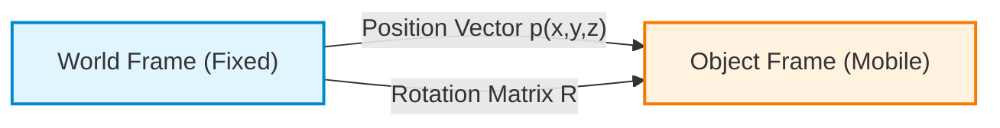
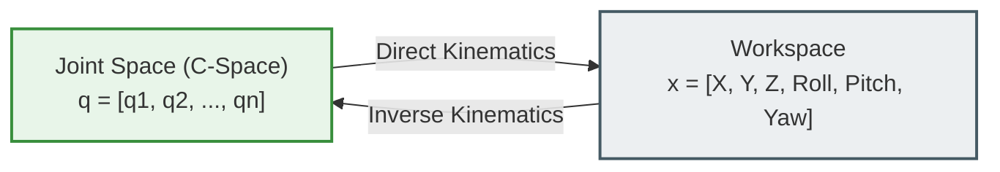
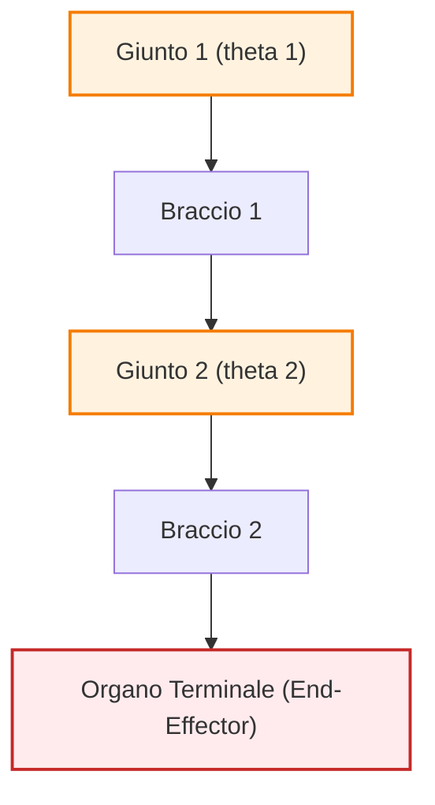
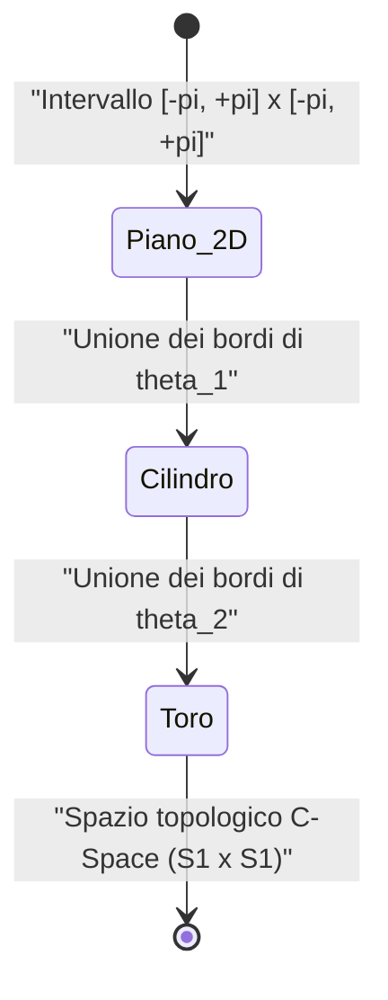
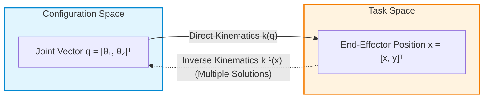
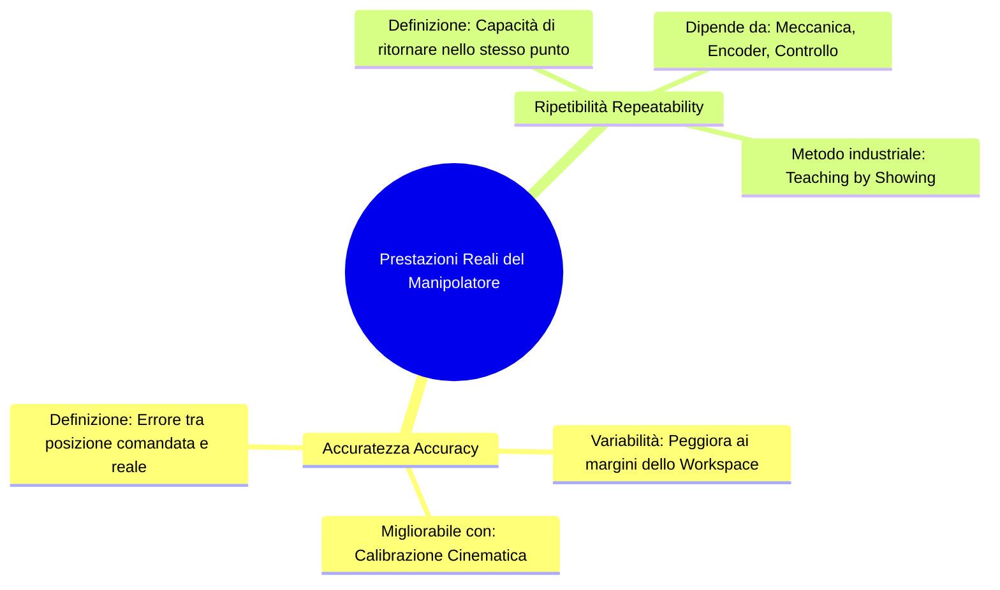
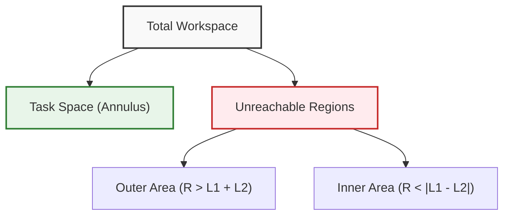
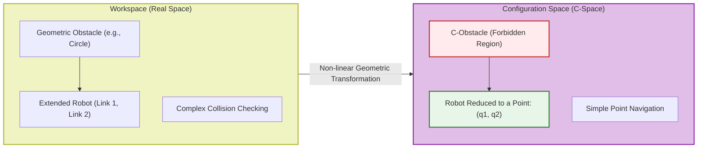

# Kinematics of Industrial Robots: Rigid Body Pose and Reference Frames

## Educational Overview

This lesson introduces the mathematical and geometric foundations of robot kinematics, focusing primarily on industrial manipulators and then extending the concepts to mobile robots.

Key concepts covered include:
* **Rigid Body Pose**: Definition of the spatial state of a rigid object in three-dimensional space ($\mathbb{R}^3$), described in combined terms of position (3D translational vector  $\mathbf{p} = [x, y, z]^T$) and orientation relative to a fixed reference frame.
* **Reference Frames**: Use of a static **World Reference Frame** and a **Body Reference Frame** rigidly attached to the moving object.
* **Orientation Representation**: Introduction to the Rotation Matrix to describe the spatial attitude of the object relative to the global reference frame.
* **Kinematic Structure of Robots**: Modeling interconnected rigid bodies using **Revolute Joints** and **Prismatic Joints**.
* **Configuration Space and Task Space**: Distinction between the robot's joint parameter space and the final position/orientation space.
* **Direct Kinematics and Inverse Kinematics**: Fundamental difference between calculating the end-effector pose starting from joint/wheel variables and the opposite control problem.

---

### Introduction and Educational Motivation

The goal of kinematics is to understand how to describe and control the motion of a robotic system. In the study of mobile robotics, control is achieved by acting on the motion of the wheels to position the vehicle in space. However, analyzing kinematics starting directly from mobile robots can be unintuitive due to nonholonomic constraints.

To build a solid conceptual foundation, it is preferable to first analyze the kinematics of **industrial manipulators** (articulated arms). Manipulators offer a more direct and structured geometric problem, extremely useful for mastering fundamental concepts before extending them to mobile robotics.

---

### Pose and Reference Frames of a Rigid Body

To define where an object is located in space, it is not enough to indicate the point where it is situated, but it is necessary to specify both its position and its orientation.

* **Position:** Identified by the Cartesian coordinates of the object's origin point relative to a global reference frame (or World Frame). In 3D space, it is described by a vector  $p$:
  $$p = \begin{bmatrix} x \\ y \\ z \end{bmatrix} \in \mathbb{R}^3$$
* **Orientation:** Described by the rotation of the axes of the reference frame attached to the object relative to the world reference frame.
* **Pose:** It is the combination of position and orientation. It represents the complete characterization of the object in 3D space (6 Degrees of Freedom - *DOF*).

To formalize the pose, a static reference frame is attached to the room or environment ($F_{world}$) and a mobile reference frame is attached to the object ($F_{object}$), usually aligned with its main geometric axes.

---

### Manipulator Structure: Kinematic Chain

A robotic manipulator is modeled as a **Kinematic Chain**: a sequence of rigid bodies called **Links** connected to each other by **Joints**.

The main joints are divided into:
1. **Revolute Joint:** Allows rotational motion around an axis. It is characterized by a single angular variable ($\theta$).
2. **Prismatic Joint:** Allows translational motion along an axis. It is characterized by a single linear variable ($d$).

At the end of the kinematic chain is the **End-Effector**, which is the component (gripper, tool, welder) through which the robot interacts visually and physically with the surrounding environment.

> **Key Concept: Difference between Pose and Posture**
> * **Pose:** It is the position and orientation of the **end-effector only** in space.
> * **Posture:** It is the complete geometric configuration of **all points and links** that compose the robot's structure. Two completely different arm postures can bring the end-effector to the exact same pose.

---

### Generalized Coordinates and Configuration Space (C-Space)

To describe the state of a robot, **Generalized Coordinates** are used, aggregated into a vector  $q$:

$$q = \begin{bmatrix} q_1 \\ q_2 \\ \vdots \\ q_n \end{bmatrix} \in \mathcal{C}$$

Where  $n$ is the number of joints of the robot.

* The **Configuration Space** (or **C-Space**), denoted by  $\mathcal{C}$, is the set of all admissible configurations that the robot can assume.
* The **Workspace** is the physical Euclidean space (2D or 3D) within which the robot's end-effector moves and operates.

#### Direct Kinematics vs Inverse Kinematics

The link between the C-Space (joint space) and the Workspace (Cartesian space) defines the two fundamental problems of kinematics:

* **Direct Kinematics:** Given the values of the joint coordinates  $q$, calculates the pose of the end-effector in the workspace. It is a single-solution, geometrically simple problem.
* **Inverse Kinematics:** Given the desired pose of the end-effector in the workspace, calculates the values of the joint coordinates  $q$ necessary to reach it. It is a complex problem, which may admit multiple solutions or no solution (if the point is outside the workspace).

---

### C-Space Topology: The 2-DOF Manipulator Case

Consider a 2-degrees-of-freedom (2-DOF) planar manipulator formed by 2 revolute joints ($\theta_1, \theta_2$) and 2 links.

The configuration of the system is identified by the vector  $q = [\theta_1, \theta_2]^T$. Since each angular coordinate varies in the interval  $[-\pi, +\pi]$, the C-Space has a **periodic nature**.

> **Key Concept: The Topology of the Torus ($\mathbb{T}^2$)**
> Representing the C-Space of a 2-DOF arm on a 2D Cartesian plane  $[\theta_1, \theta_2]$ is a simplification. Since the coordinate  $+\pi$ coincides exactly with  $-\pi$, opposite edges of the Cartesian plane are ideally "glued" together.
> 
> * Folding the plane along the  $\theta_1$ axis yields a cylinder.
> * Rejoining the ends of the cylinder along the  $\theta_2$axis yields a **Torus**-shaped surface (i.e., a 3D donut), formally defined as:
> $$\mathcal{C} = \mathbb{S}^1 \times \mathbb{S}^1 = \mathbb{T}^2$$

#### Advantages of Using C-Space

1. **Representation of Reachability Limits:** In C-Space, it is immediate to identify admissible positions and physical joint limits. In Cartesian Workspace ($X, Y$), reachable areas depend on the combination of link lengths (giving rise to concentric circles of minimum and maximum radius).
2. **Motion Planning:** Calculating the optimal distance or trajectory to move the entire robot considering its clearance (and not just the end-effector) is computationally simpler when performed on the C-Space manifold using geodesics.

---

### C-Space Dimension by Robot Type

The dimension of C-Space corresponds to the total number of independent variables required to uniquely define the robot's posture (that is, its effective degrees of freedom):

$$\dim(\mathcal{C}) = N_{variabili} - N_{vincoli}$$

| Robot Type | Workspace | C-Space Coordinates | C-Space Dimension ($\dim(\mathcal{C})$) | Topological Space |
| :--- | :--- | :--- | :--- | :--- |
| **Planar Rigid Body (2D)** | Plane $\mathbb{R}^2$ | $x, y, \theta$ | 3 | $SE(2) \cong \mathbb{R}^2 \times \mathbb{S}^1$ |
| **Spatial Rigid Body / Drone (3D)** | Space $\mathbb{R}^3$ | $x, y, z, \phi, \theta, \psi$ | 6 | $SE(3) \cong \mathbb{R}^3 \times SO(3)$ |
| **$n$-DOF Manipulator** | 2D or 3D space | $q_1, q_2, \dots, q_n$ | $n$ | Varies according to the joints (e.g., $\mathbb{T}^n$) |

For manipulators with a high number of joints ($n > 3$), direct graphical visualization of the C-Space becomes impossible for the human mind, but mathematically it constitutes an $n$-dimensional manifold to which the same algebraic rules described for the 2-degree-of-freedom case apply.

---

3. Task Space and Configuration Management

In industrial robotics, the description of robot motion does not take place solely in the space of joint variables, but also extends to the physical world in which the robot operates.

*   **Task Space**: The physical space in which the robot performs its operation (for example, a two-dimensional space described by Cartesian coordinates $x$ and $y$, or a three-dimensional space with orientation).
*   **End-Effector**: In most industrial applications, the main interest is controlling the position and orientation (the *pose*) of the end-effector alone, without considering the overall posture of the intermediate links.

#### Safety Management in the Workcell
Since for a given position of the end-effector there are often multiple possible configurations (such as the classic *elbow-up / elbow-down* duality), the robot could assume different postures in the environment. To simplify calculations and ensure safety without having to continuously check for collisions of every single link:
1. A **safety cage** is placed outside the entire reachable workspace.
2. It is guaranteed that every possible posture of the robot is collision-free inside the cage.
3. In this way, the risk of structural interference is eliminated, and one can focus exclusively on the mathematics of the end-effector.

---

### 4. Direct Kinematics, Inverse Kinematics and Kinematic Redundancy

The relationship between Configuration Space and Task Space is governed by the kinematic equations.

#### Direct Kinematics
Direct kinematics is the function (or mapping) that converts the joint variable vector in Configuration Space into the position/orientation vector in Task Space:

$$\boldsymbol{x} = k(\boldsymbol{q})$$

Where:
*   $\boldsymbol{q} \in \mathbb{R}^n$ is the joint variable vector (e.g.,  $\boldsymbol{q} = [\theta_1, \theta_2]^T$).
*   $\boldsymbol{x} \in \mathbb{R}^m$ is the task vector in physical space (e.g.,  $\boldsymbol{x} = [x, y]^T$).

Direct kinematics **always admits a single deterministic solution**: given a unique set of joint angles, the end-effector position is uniquely determined.

#### Inverse Kinematics
Inverse kinematics solves the opposite problem: given a desired end-effector position  $\boldsymbol{x}$ in Task Space, it calculates the joint values  $\boldsymbol{q}$ necessary to reach it:

$$\boldsymbol{q} = k^{-1}(\boldsymbol{x})$$

Unlike direct kinematics, inverse kinematics is characterized by **non-linearity and multiplicity of solutions**. Mathematically, inversion involves solving trigonometric/algebraic equations with quadratic terms or radicals, which generate multiple solutions (e.g. roots with sign  $\pm$). In the case of a 2-degrees-of-freedom (2-DOF) planar manipulator, for the same point  $(x, y)$ there are typically two distinct solutions: the *elbow-up* configuration and the *elbow-down* configuration.

#### Kinematic Redundancy

> **Key Concept: Redundancy depends on the task**  
> Redundancy is not an intrinsic and absolute property of the robot, but is defined **strictly in relation to the task to be performed**.

A robot is defined as **kinematically redundant** if the number of degrees of freedom of the Configuration Space ($n$) is greater than the dimension of the Task Space ($m$) required by the operation:

$$n > m$$

**Practical Example:**
*   Consider an industrial manipulator with 6 degrees of freedom ($n = 6$).
*   **Task 1 (Spot welding / Simple positioning):** If the task requires only positioning the tool tip along a profile, the Task Space requires only three-dimensional coordinates  $(x, y, z)$, so  $m = 3$. Since  $n (6) > m (3)$, the robot is **redundant** for this specific task. This means that there are infinitely many joint configurations that maintain the tip at the same point in space.
*   **Task 2 (Welding with controlled orientation):** If the task requires controlling both position  $(x, y, z)$ and full orientation (Roll-Pitch-Yaw angles) of the end-effector, the Task Space has dimension  $m = 6$. Since  $n (6) = m (6)$, the robot is **not redundant**.
*   To add redundancy to a 6-dimensional task, it would be necessary to add an additional degree of freedom (e.g., a translational slide or  $7^\circ$ axis).

---

### 5. Real Robot Performance: Accuracy vs Repeatability

The mathematical models analyzed so far operate under the *Closed-World Approach* assumption, assuming that the links are ideal rigid bodies of perfectly known length and that the motors position the joints with absolute precision (e.g. at exactly  $28^\circ$). In the real world, this ideal correspondence fails due to mechanical tolerances, backlash, structural flexure, and sensor errors.

#### Accuracy
**Accuracy** measures the deviation between the theoretical position calculated via direct kinematics (commanded position) and the actual position reached by the end-effector in physical space.

$$\text{Errore di Accuratezza} = \|\boldsymbol{x}_{\text{reale}} - \boldsymbol{x}_{\text{calcolata}}\|$$

*   Manufacturers provide a nominal accuracy value in technical datasheets, which for industrial robots is usually on the order of **a few millimeters** (not microns).
*   **Dependence on configuration:** Accuracy **is not constant** within the workspace. When the arm is fully extended, gravity generates a maximum torque ($\boldsymbol{\tau} = \boldsymbol{r} \times \boldsymbol{F}_g$) on the joints and causes mechanical deflections on the links. Consequently, accuracy is higher near the center of the workspace and degrades toward the outer margins.

##### Kinematic Calibration
It is possible to improve the accuracy of a specific robot through **Kinematic Calibration**. Measuring the actual length of the links or the position of the joint rotation centers directly with physical instruments is a complex and imprecise operation.
Instead, the kinematic calibration algorithm works as follows:
1. The robot is commanded to reach several positions in the workspace.
2. The actual position reached by the end-effector is measured using high-precision external measurement systems (e.g. Laser Trackers).
3. The error relative to the theoretical position is calculated, and an estimation algorithm is applied to deduce a **corrected geometric model** of the robot, incorporating the actual manufacturing imperfections.

#### Repeatability
**Repeatability** measures the robot's ability to return to exactly the same physical position when repeatedly commanded with the same set of joint coordinates  $\boldsymbol{q}$.

> **Key Concept: Repeatability vs Accuracy in Industry**  
> In most industrial applications, **repeatability is much more important than accuracy**. In commercial robots, repeatability is structurally and mechanically **much higher** than accuracy (often on the order of tenths or hundredths of a millimeter).

If the mathematical geometric model of the robot is imperfect (low accuracy), the robot will not reach the calculated theoretical point; however, if it exhibits high repeatability, it will always reach exactly the same physical point every time the same vector  $\boldsymbol{q}$is applied. Since physical effects (such as deflection due to gravity) are identical for the same configuration  $\boldsymbol{q}$, the systematic error cancels out in the repetition process.

#### Programming by Demonstration (Teaching by Showing)
By virtue of the prevalence of repeatability over accuracy, in industrial settings (for example, robotic system integrators) robots are almost never programmed by analytically solving complex kinematic equations. Instead, the **Teaching by Showing** technique is adopted:

1. The operator uses the **Teach Pendant** (a portable terminal) to manually move the robot's joints until bringing the end-effector to the desired working position.
2. Once the correct position in the real world is reached, the operator saves the point via a button.
3. The robot **does not store the Cartesian position  $(x, y, z)$**, but directly stores the joint coordinate vector  $\boldsymbol{q} = [\theta_1, \theta_2, \dots, \theta_n]^T$ corresponding to the Configuration Space.
4. To execute the task, the trajectory is generated by linearly interpolating the vectors  $\boldsymbol{q}$ saved in Configuration Space.

In this way, even in the presence of an imprecise mathematical model, the robot will execute the task with maximum precision thanks to its high **mechanical repeatability**.

---

### Reachable Workspace and Kinematic Singularities

#### Reachable Workspace
The **Reachable Workspace** is defined as the subset of the total workspace that contains all positions actually reachable by the robot's end-effector. This region is strictly constrained by link geometry and physical joint limits.

In a two-degree-of-freedom planar arm (2-DoF planar arm) with link lengths  $L_1$ and  $L_2$, if the links have different lengths ($L_1 \neq L_2$), the end-effector cannot access an inner circular region near the base.
*   **Inner Limit:** Minimum radius  $R_{min} = |L_1 - L_2|$
*   **Outer Limit:** Maximum radius  $R_{max} = L_1 + L_2$

The effective task space thus takes the form of a circular ring (annulus). The area outside  $R_{max}$ and the area inside  $R_{min}$ represent regions geometrically unreachable by the robot.

#### Kinematic Singularities
A **Kinematic Singularity** occurs when the robotic arm assumes a configuration in which it loses one or more degrees of freedom of motion in task space.

Geometrically, for a 2-DoF robot, a singularity occurs when the two distinct configurations of *elbow-up* and *elbow-down* collapse into a single solution.
*   When the second joint angle  $\theta_2 \neq 0$, there are two distinct solutions to reach the same point  $(x, y)$.
*   When  $\theta_2 \to 0$ (fully extended arm), the two solutions coincide. The configuration at  $\theta_2 = 0$ is a boundary singularity.

> **KEY CONCEPT: The Trade-off of Singularity Avoidance and Safety**
> 
> Near a singularity, the robot's Jacobian matrix loses rank, making inverse kinematics ill-conditioned (small displacements in task space require theoretically infinite joint angular velocities, causing motors to lock up).
> 
> To avoid singularities, motion planning algorithms introduce mathematical barriers. As the robot approaches  $\theta_2 \approx 0$, the algorithm forces a rapid change of posture (swap from *elbow-down* to *elbow-up*).
> 
> **Operational Disadvantage and Risk:** This sudden change of configuration causes rapid, high-speed joint movement. For high-DoF manipulators (e.g., 7-DoF), reconfiguration involves multiple joints simultaneously, drastically altering the robot's posture. This kinetic unpredictability is the main reason why traditional industrial robots require **safety cages** to isolate their operating range from human operators.

---

### Closed-Form Inverse Kinematics Solutions

#### Comparison between Direct and Inverse Kinematics

1.  **Direct Kinematics:**
    Maps the configuration space (joint space  $\mathcal{C}$) into the task space ( $\mathcal{T}$).
    $$k: \mathcal{C} \to \mathcal{T}, \quad \boldsymbol{q} = \begin{bmatrix} \theta_1 \\ \theta_2 \end{bmatrix} \mapsto \boldsymbol{x} = \begin{bmatrix} x \\ y \end{bmatrix}$$
    It is a single-valued function, always determinable analytically and directly.

2.  **Inverse Kinematics:**
    Determines the joint variable values  $\boldsymbol{q}$ necessary to position the end-effector in the desired pose  $\boldsymbol{x}$.
    $$k^{-1}: \mathcal{T} \to \mathcal{C}, \quad \boldsymbol{x} = \begin{bmatrix} x \\ y \end{bmatrix} \mapsto \boldsymbol{q} = \begin{bmatrix} \theta_1 \\ \theta_2 \end{bmatrix}$$

#### Properties of Inverse Kinematics
*   **Non-linearity:** The equations governing inverse kinematics are highly non-linear trigonometric equations.
*   **Closed-form Solutions:** Exact analytical formulas exist only for specific kinematic geometries (for example, for the 5 or 6 standard industrial manipulator architectures). If a custom, unconventional kinematics is designed, a closed-form solution may not exist, making the use of iterative numerical methods necessary.
*   **Multiplicity of Solutions:**
    *   For non-redundant robots: finite number of solutions (e.g., 2 solutions: *elbow-up* and *elbow-down*).
    *   For redundant robots (Degrees of Freedom in joint space  $>$  task space dimension): infinite number of solutions for the same end-effector pose.

---

### Obstacles and Motion Planning in Configuration Space (C-Space)

In operational reality, robots do not move in free spaces, but within environments populated by geometric obstacles.

#### Obstacle Mapping from Workspace to C-Space
Planning a trajectory directly in the real workspace in the presence of obstacles is extremely complex, as collision must be constantly checked for all vector bodies composing the robot links.

To simplify the problem, Workspace obstacles are mapped into the **Configuration Space ($C$-Space)**.

#### C-Space Decomposition
The  $C$-Space is divided into two complementary subsets:

1.  **$C_{obs}$ (Configuration Space Obstacle):**
    The subset of configurations  $\boldsymbol{q} = (\theta_1, \theta_2)^T$ that involve a physical collision of any robot component with environmental obstacles.
    $$C_{obs} = \{\boldsymbol{q} \in \mathcal{C} \mid \text{Robot}(\boldsymbol{q}) \cap \text{Obstacle} \neq \emptyset\}$$
2.  **$C_{free}$ (Collision-Free Configuration Space):**
    The subset of valid and collision-free configurations.
    $$C_{free} = \mathcal{C} \setminus C_{obs}$$

*Note: Integrated passage with educational clarity.* Regions  $C_{obs}$ often take on complex and distorted shapes in  $C$-Space due to non-linear trigonometric mapping between joint angles and Cartesian space.

#### Advantage of Planning in C-Space
The Motion Planning Algorithm works within  $C$-Space rather than in the Workspace:
*   In Workspace, the arm is an articulated object with extended geometry that must dodge obstacles.
*   In  $C$-Space, the robot is reduced to a **single point**  $\boldsymbol{q} = (\theta_1, \theta_2)^T$ moving within the boundaries of free space  $C_{free}$.

#### C-Space Topology for Revolute Joints
Since joint variables  $\theta_1$ and  $\theta_2$ are angles with a periodic domain  $[0, 2\pi)$, the configuration space features cyclic coordinates (topology of a torus  $S^1 \times S^1$). Visualizing the planar plot  $(\theta_1, \theta_2)$, opposite edges of the domain are contiguous (wrapping boundary effect, analogous to the map scrolling rules of *Pac-Man*). A continuous path can thus cross the boundaries  $0$ and  $2\pi$ to bypass centrally located  $C_{obs}$ regions.
