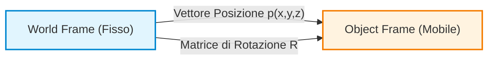
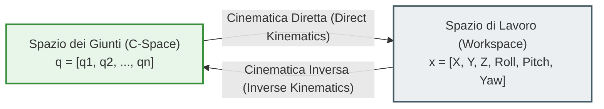
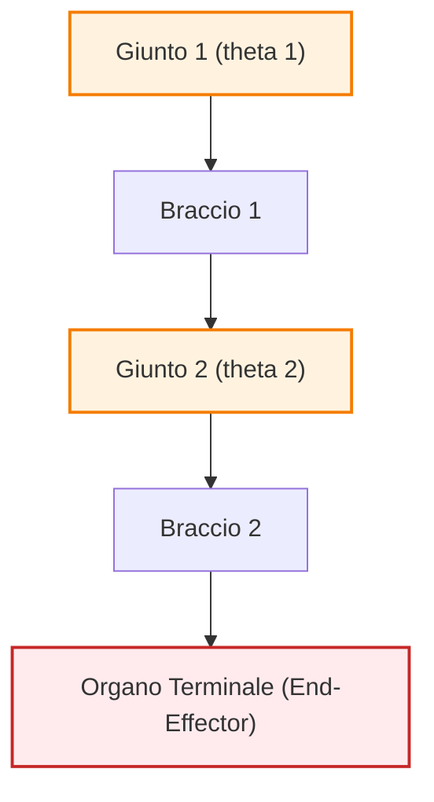
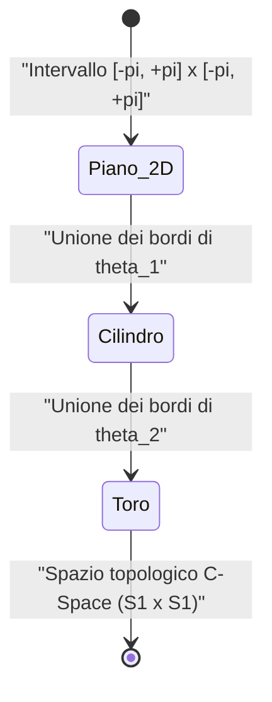
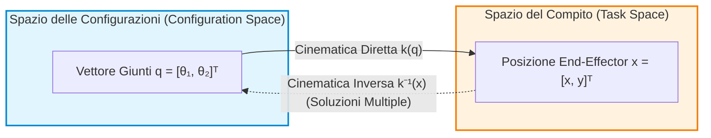
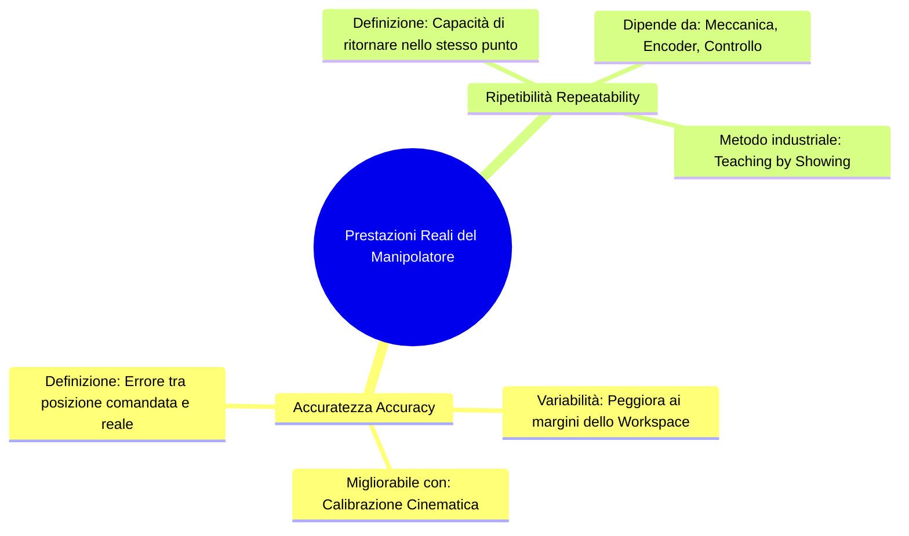
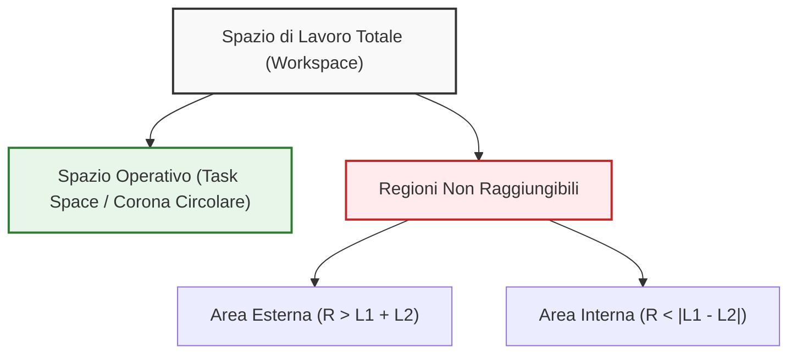
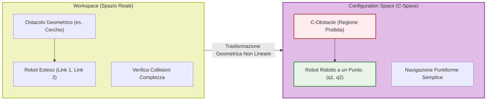

# Cinematica dei Robot Industriali: Posa del Corpo Rigido e Sistemi di Riferimento

## Overview Didattica

Questa lezione introduce i fondamenti matematici e geometrici della cinematica dei robot, focalizzandosi primariamente sui manipolatori industriali per poi estendere i concetti ai robot mobili. 

I concetti chiave trattati includono:
* **Posa (*Pose*) del Corpo Rigido**: Definizione dello stato spaziale di un oggetto rigido nello spazio tridimensionale ($\mathbb{R}^3$), descritto in termini combinati di posizione (vettore traslazionale 3D $\mathbf{p} = [x, y, z]^T$) e orientamento rispetto a un riferimento fisso.
* **Sistemi di Riferimento (*Reference Frames*)**: Utilizzo di un **Sistema di Riferimento Mondo (*World Reference Frame*)** statico e di un **Sistema di Riferimento Corpo (*Body Reference Frame*)** solidale con l'oggetto in movimento.
* **Rappresentazione dell'Orientamento**: Introduzione alla Matrice di Rotazione (*Rotation Matrix*) per descrivere l'attitudine spaziale dell'oggetto rispetto al riferimento globale.
* **Struttura Cinematica dei Robot**: Modellazione di corpi rigidi interconnessi mediante **Giunti Rotoidali (*Revolute Joints*)** e **Giunti Prismatici (*Prismatic Joints*)**.
* **Spazio di Configurazione (*Configuration Space*) e Spazio Operativo (*Task Space*)**: Distinzione tra lo spazio dei parametri di giunto del robot e lo spazio delle posizioni/orientamenti finali.
* **Cinematica Diretta (*Direct Kinematics*) e Inversa (*Inverse Kinematics*)**: Differenza fondamentale tra il calcolo della posa dell'organo terminale (*end-effector*) a partire dalle variabili di giunto/ruota e il problema opposto di controllo.

---

### Introduzione e Motivazione Didattica

L'obiettivo della cinematica è comprendere come descrivere e controllare il movimento di un sistema robotico. Nello studio della robotica mobile, il controllo avviene agendo sul moto delle ruote per posizionare il veicolo nello spazio. Tuttavia, analizzare la cinematica partendo direttamente dai robot mobili può risultare poco intuitivo a causa dei vincoli non olonomi.

Per costruire una solida base concettuale, è preferibile analizzare prima la cinematica dei **manipolatori industriali** (bracci articolati). I manipolatori offrono un problema geometrico più diretto e strutturato, utilissimo per padroneggiare i concetti fondamentali prima di estenderli alla robotica mobile.

---

### Posa e Sistemi di Riferimento di un Corpo Rigido

Per definire dove si trova un oggetto nello spazio, non basta indicare il punto in cui si trova, ma occorre specificare sia la sua posizione che la sua orientazione.

* **Posizione (*Position*):** Identificata dalle coordinate cartesiane del punto di origine dell'oggetto rispetto a un sistema di riferimento globale (o "mondo", *World Frame*). In uno spazio 3D, è descritta da un vettore vettoriale $p$:
  $$p = \begin{bmatrix} x \\ y \\ z \end{bmatrix} \in \mathbb{R}^3$$
* **Orientazione (*Orientation*):** Descritta dalla rotazione degli assi del sistema di riferimento solidale all'oggetto rispetto al sistema di riferimento del mondo.
* **Posa (*Pose*):** È la combinazione di posizione e orientazione. Rappresenta la caratterizzazione completa dell'oggetto nello spazio 3D (6 Gradi di Libertà - *Degrees of Freedom, DOF*).

Per formalizzare la posa, si fissa un sistema di riferimento statico alla stanza o all'ambiente ($F_{world}$) e si applica un sistema di riferimento mobile all'oggetto ($F_{object}$), solitamente allineato con i suoi assi geometrici principali.

---

### Struttura del Manipolatore: Catena Cinematica

Un manipolatore robotico è modellato come una **catena cinematica** (*Kinematic Chain*): una sequenza di corpi rigidi detti **bracci** (*Links*) collegati tra loro da giunti (*Joints*).

I giunti principali si dividono in:
1. **Giunto Rotoidale (*Revolute Joint*):** Consente un movimento di rotazione attorno a un asse. È caratterizzato da una singola variabile angolare ($\theta$).
2. **Giunto Prismatico (*Prismatic Joint*):** Consente un movimento di traslazione lungo un asse. È caratterizzato da una singola variabile lineare ($d$).

All'estremità della catena cinematica si trova l'**organo terminale** (*End-Effector*), ovvero la componente (pinza, utensile, saldatrice) tramite cui il robot interagisce visivamente e fisicamente con l'ambiente circostante.

> **Concetto Chiave: Differenza tra Posa e Postura (*Posture*)**
> * **Posa (*Pose*):** È la posizione e orientazione del **solo** organo terminale (*End-Effector*) nello spazio.
> * **Postura (*Posture*):** È la configurazione geometrica completa di **tutti i punti e i bracci** che compongono la struttura del robot. Due posture completamente diverse del braccio possono portare l'organo terminale esattamente nella stessa posa.

---

### Coordinate Generalizzate e Spazio delle Configurazioni (C-Space)

Per descrivere lo stato di un robot si utilizzano le **coordinate generalizzate** (*Generalized Coordinates*), aggregate in un vettore $q$:

$$q = \begin{bmatrix} q_1 \\ q_2 \\ \vdots \\ q_n \end{bmatrix} \in \mathcal{C}$$

Dove $n$ è il numero di giunti del robot. 

* Lo **Spazio delle Configurazioni** (*Configuration Space* o **C-Space**), indicato con $\mathcal{C}$, è l'insieme di tutte le configurazioni ammissibili che il robot può assumere.
* Lo **Spazio di Lavoro** (*Workspace*), è lo spazio fisico euclideo (2D o 3D) all'interno del quale l'organo terminale del robot si muove ed opera.

#### Cinematica Diretta vs Cinematica Inversa

Il legame tra il C-Space (spazio dei giunti) e lo Spazio di Lavoro (spazio cartesiano) definisce i due problemi fondamentali della cinematica:

* **Cinematica Diretta (*Direct Kinematics*):** Dati i valori delle coordinate dei giunti $q$, calcola la posa dell'organo terminale nello spazio di lavoro. È un problema a soluzione unica e geometricamente semplice.
* **Cinematica Inversa (*Inverse Kinematics*):** Data la posa desiderata dell'organo terminale nello spazio di lavoro, calcola i valori delle coordinate dei giunti $q$ necessari per raggiungerla. È un problema complesso, che può ammettere soluzioni multiple o nessuna soluzione (se il punto è fuori dallo spazio di lavoro).

---

### Topologia del C-Space: Il Caso del Manipolatore 2-DOF

Consideriamo un manipolatore planare a 2 gradi di libertà (2-DOF) formato da 2 giunti rotoidali ($\theta_1, \theta_2$) e 2 bracci.

La configurazione del sistema è identificata dal vettore $q = [\theta_1, \theta_2]^T$. Poiché ciascuna coordinata angolare varia nell'intervallo $[-\pi, +\pi]$, il C-Space ha una **natura periodica**.

> **Concetto Chiave: La Topologia del Toro ($\mathbb{T}^2$)**
> Rappresentare il C-Space di un braccio 2-DOF su un piano cartesiano 2D $[\theta_1, \theta_2]$ è una semplificazione. Poiché la coordinata $+\pi$ coincide esattamente con $-\pi$, i bordi opposti del piano cartesiano sono idealmente "incollati". 
> 
> * Piegando il piano lungo l'asse $\theta_1$ otteniamo un cilindro.
> * Ricongiungendo le estremità del cilindro lungo l'asse $\theta_2$, otteniamo una superficie a forma di **Toro** (ovvero una ciambella 3D), formalmente definita come:
> $$\mathcal{C} = \mathbb{S}^1 \times \mathbb{S}^1 = \mathbb{T}^2$$

#### Vantaggi nell'uso del C-Space

1. **Rappresentazione dei Limiti di Raggiungibilità:** Nel C-Space è immediato identificare le posizioni ammissibili e i limiti fisici dei giunti. Nello Spazio di Lavoro cartesiano ($X, Y$), le zone raggiungibili dipendono dalla combinazione delle lunghezze dei bracci (dando origine a circonferenze concentriche di raggio minimo e massimo).
2. **Pianificazione dei Movimenti:** Calcolare la distanza o la traiettoria ottima per muovere l'intero robot tenendo conto del suo ingombro (e non del solo end-effector) è computazionalmente più semplice se effettuato sulla varietà (*manifold*) del C-Space mediante geodetiche.

---

### Dimensione del C-Space per Tipologia di Robot

La dimensione del C-Space corrisponde al numero totale di variabili indipendenti necessarie a definire in modo univoco la postura del robot (ossia ai suoi gradi di libertà effettivi):

$$\dim(\mathcal{C}) = N_{variabili} - N_{vincoli}$$

| Tipologia di Robot | Spazio di Lavoro (*Workspace*) | Coordinate del C-Space | Dimensione C-Space ($\dim(\mathcal{C})$) | Spazio Topologico |
| :--- | :--- | :--- | :--- | :--- |
| **Rigido Planare (2D)** | Piano $\mathbb{R}^2$ | $x, y, \theta$ | 3 | $SE(2) \cong \mathbb{R}^2 \times \mathbb{S}^1$ |
| **Rigido Spaziale / Drone (3D)** | Spazio $\mathbb{R}^3$ | $x, y, z, \phi, \theta, \psi$ | 6 | $SE(3) \cong \mathbb{R}^3 \times SO(3)$ |
| **Manipolatore $n$-DOF** | Spazio 2D o 3D | $q_1, q_2, \dots, q_n$ | $n$ | Varia in base ai giunti (es. $\mathbb{T}^n$) |

Nel caso di manipolatori con elevato numero di giunti ($n > 3$), la visualizzazione grafica diretta del C-Space diventa impossibile per la mente umana, ma matematicamente costituisce una varietà $n$-dimensionale (*manifold*) su cui si applicano le stesse regole algebriche descritte per il caso a 2 gradi di libertà.

---

3. Spazio del Compito (Task Space) e Gestione delle Configurazioni

Nell'ambito della robotica industriale, la descrizione del movimento del robot non avviene unicamente nello spazio delle variabili di giunto, ma si estende al mondo fisico in cui il robot opera.

*   **Spazio del Compito (*Task Space*)**: È lo spazio fisico in cui il robot esegue la propria operazione (ad esempio, uno spazio bidimensionale descritto dalle coordinate Cartesian $x$ e $y$, oppure tridimensionale con orientamento).
*   **Organo Terminale (*End-Effector*)**: Nella maggior parte delle applicazioni industriali, l'interesse principale riguarda il controllo della posizione e dell'orientamento (la *pose*) del solo organo terminale, disinteressandosi della postura complessiva assunta dai bracci intermedi.

#### Gestione della Sicurezza nel Cella di Lavoro
Poiché per una data posizione dell'organo terminale esistono spesso più configurazioni possibili (come la classica dualità *gomito in alto / gomito in basso* o *elbow-up / elbow-down*), il robot potrebbe assumere posture differenti nell'ambiente. Per semplificare i calcoli e garantire la sicurezza senza dover verificare continuamente le collisioni di ogni singolo braccio:
1. Si posiziona una **gabbia di protezione** all'esterno dell'intero spazio di lavoro raggiungibile (*reachable workspace*).
2. Si garantisce che ogni possibile postura del robot sia priva di collisioni all'interno della gabbia.
3. In questo modo si azzera il rischio di interferenza strutturale e ci si può concentrare esclusivamente sulla matematica dell'organo terminale.

---

### 4. Cinematica Diretta, Inversa e Ridondanza Cinematica

La relazione tra lo Spazio delle Configurazioni e lo Spazio del Compito è governata dalle equazioni cinematiche.

#### Cinematica Diretta (*Direct Kinematics*)
La cinematica diretta è la funzione (o mappatura) che converte il vettore delle variabili di giunto nello Spazio delle Configurazioni nel vettore di posizione/orientamento nello Spazio del Compito:

$$\boldsymbol{x} = k(\boldsymbol{q})$$

Dove:
*   $\boldsymbol{q} \in \mathbb{R}^n$ è il vettore delle variabili articolari (es. $\boldsymbol{q} = [\theta_1, \theta_2]^T$).
*   $\boldsymbol{x} \in \mathbb{R}^m$ è il vettore del compito nello spazio fisico (es. $\boldsymbol{x} = [x, y]^T$).

La cinematica diretta ammette **sempre un'unica soluzione deterministica**: fornito un set univoco di angoli ai giunti, la posizione dell'organo terminale è univocamente determinata.

#### Cinematica Inversa (*Inverse Kinematics*)
La cinematica inversa risolve il problema opposto: data una posizione desiderata dell'organo terminale $\boldsymbol{x}$ nello Spazio del Compito, calcola i valori articolari $\boldsymbol{q}$ necessari per raggiungerla:

$$\boldsymbol{q} = k^{-1}(\boldsymbol{x})$$

A differenza della cinematica diretta, la cinematica inversa è caratterizzata da **non-linearità e molteplicità delle soluzioni**. Matematicamente, l'inversione comporta la risoluzione di equazioni trigonometriche/algebriche con termini quadratici o radicali, che generano soluzioni multiple (es. radici con segno $\pm$). Nel caso di un manipolatore planare a 2 gradi di libertà (2-DOF), per uno stesso punto $(x, y)$ esistono tipicamente due soluzioni distinte: la configurazione *elbow-up* e quella *elbow-down*.

#### Ridondanza Cinematica (*Kinematic Redundancy*)

> **Concetto Chiave: La ridondanza dipende dal compito**  
> La ridondanza non è una proprietà intrinseca ed assoluta del robot, ma è definita **strettamente in relazione al compito (*task*) da svolgere**.

Un robot si definisce **cinematicamente ridondante** se il numero di gradi di libertà dello Spazio delle Configurazioni ($n$) è superiore alla dimensione dello Spazio del Compito ($m$) richiesta dall'operazione:

$$n > m$$

**Esempio Pratico:**
*   Consideriamo un manipolatore industriale a 6 gradi di libertà ($n = 6$).
*   **Task 1 (Saldatura a punto / Posizionamento semplice):** Se il compito richiede esclusivamente di posizionare la punta dello strumento lungo un profilo, lo Spazio del Compito richiede solo le coordinate tridimensionali $(x, y, z)$, quindi $m = 3$. Poiché $n (6) > m (3)$, il robot è **ridondante** per questo specifico compito. Questo significa che esistono infinite configurazioni dei giunti che mantengono la punta nello stesso punto nello spazio.
*   **Task 2 (Saldatura con orientamento controllato):** Se il compito richiede di controllare sia la posizione $(x, y, z)$ che l'orientamento completo (angoli di Roll-Pitch-Yaw) dell'organo terminale, lo Spazio del Compito ha dimensione $m = 6$. Poiché $n (6) = m (6)$, il robot **non è ridondante**.
*   Per aggiungere ridondanza a un compito a 6 dimensioni, sarebbe necessario aggiungere un ulteriore grado di libertà (es. una slitta traslatoria o $7^\circ$ asse).

---

### 5. Prestazioni del Robot Reale: Accuratezza vs Ripetibilità

I modelli matematici analizzati finora operano nell'ipotesi di *Mondo Chiuso* (*Closed-World Approach*), ipotizzando che i link siano corpi rigidi ideali di lunghezza perfettamente nota e che i motori posizionino i giunti con precisione assoluta (es. esattamente a $28^\circ$). Nel mondo reale, questa ideale corrispondenza viene meno a causa di tolleranze meccaniche, giochi, flessioni strutturali ed errori dei sensori.

#### Accuratezza (*Accuracy*)
L'**Accuratezza** misura la scostamento tra la posizione teorica calcolata tramite la cinematica diretta (posizione comandata) e la posizione reale raggiunta dall'organo terminale nello spazio fisico.

$$\text{Errore di Accuratezza} = \|\boldsymbol{x}_{\text{reale}} - \boldsymbol{x}_{\text{calcolata}}\|$$

*   I costruttori forniscono nelle schede tecniche un valore nominale di accuratezza, che per i robot industriali è solitamente nell'ordine di **alcuni millimetri** (non micron).
*   **Dipendenza dalla configurazione:** L'accuratezza **non è costante** all'interno dello spazio di lavoro. Quando il braccio è completamente esteso, l'azione della gravità genera un momento torcente ($\boldsymbol{\tau} = \boldsymbol{r} \times \boldsymbol{F}_g$) massimo sui giunti e causa flessioni meccaniche sui link. Conseguentemente, l'accuratezza è più elevata vicino al centro dello spazio di lavoro e degrada verso i margini estesi.

##### Calibrazione Cinematica (*Kinematic Calibration*)
È possibile migliorare l'accuratezza di uno specifico robot tramite la **Calibrazione Cinematica**. Misurare direttamente la lunghezza reale dei link o la posizione dei centri di rotazione dei giunti con strumenti fisici è un'operazione complessa e poco precisa. 
L'algoritmo di calibrazione cinematica funziona invece nel seguente modo:
1. Si comanda al robot di raggiungere diverse posizioni nello spazio di lavoro.
2. Si misura la posizione reale raggiunta dall'organo terminale tramite sistemi di misura esterni ad alta precisione (es. Laser Tracker).
3. Si calcola l'errore rispetto alla posizione teorica e si applica un algoritmo di stima per dedurre un **modello geometrico corretto** del robot, integrando le effettive imperfezioni di fabbricazione.

#### Ripetibilità (*Repeatability*)
La **Ripetibilità** misura la capacità del robot di ritornare esattamente nella stessa posizione fisica quando gli viene comandato ripetutamente il medesimo insieme di coordinate articolari $\boldsymbol{q}$.

> **Concetto Chiave: Ripetibilità vs Accuratezza nell'Industria**  
> Nella maggior parte delle applicazioni industriali, la **ripetibilità è molto più importante dell'accuratezza**. Nei robot commerciali, la ripetibilità è strutturalmente e meccanicamente **molto più elevata** rispetto all'accuratezza (spesso nell'ordine dei decimi o centesimi di millimetro).

Se il modello matematico geometrico del robot è imperfetto (bassa accuratezza), il robot non raggiungerà il punto teorico calcolato; tuttavia, se presenta un'elevata ripetibilità, raggiungerà sempre ed esattamente lo stesso punto fisico ogni volta che si applica lo stesso vettore $\boldsymbol{q}$. Poiché gli effetti fisici (come la flessione dovuta alla gravità) sono identici a parità di configurazione $\boldsymbol{q}$, l'errore sistematico si annulla nel processo di ripetizione.

#### Programmazione per Apprendimento (*Teaching by Showing*)
In virtù della prevalenza della ripetibilità sull'accuratezza, nei contesti industriali (ad esempio, le aziende integratrici di impianti robotizzati) i robot non vengono quasi mai programmati risolvendo analiticamente equazioni cinematiche complesse. Si adotta invece la tecnica di **Programmazione per Apprendimento (*Teaching by Showing*)**:

1. L'operatore utilizza la **Tastiera di Programmazione (*Teach Pendant*)** (un terminale portatile) per muovere manualmente i giunti del robot fino a portare l'organo terminale nella posizione di lavoro desiderata.
2. Raggiunta la posizione corretta nel mondo reale, l'operatore memorizza il punto tramite un pulsante.
3. Il robot **non memorizza la posizione cartesiana $(x, y, z)$**, bensì memorizza direttamente il vettore delle coordinate articolari $\boldsymbol{q} = [\theta_1, \theta_2, \dots, \theta_n]^T$ corrispondente allo Spazio delle Configurazioni.
4. Per eseguire il compito, la traiettoria viene generata interpolando linearmente i vettori $\boldsymbol{q}$ salvati nello Spazio delle Configurazioni.

In questo modo, anche in presenza di un modello matematico impreciso, il robot eseguirà il lavoro con massima precisione grazie alla sua elevata **ripetibilità meccanica**.

---

### Spazio di Lavoro Raggiungibile e Singolarità Cinematiche

#### Spazio di Lavoro Raggiungibile (Reachable Workspace)
Lo **Spazio di Lavoro Raggiungibile (Reachable Workspace)** è definito come il sottoinsieme dello spazio di lavoro totale che racchiude tutte le posizioni effettivamente raggiungibili dall'organo terminale (*end-effector*) del robot. Tale regione è strettamente vincolata dalla geometria dei bracci (*links*) e dai limiti meccanici dei giunti.

In un braccio manipolatore a due gradi di libertà (*2-DoF planar arm*) con lunghezze dei bracci $L_1$ e $L_2$, se i bracci hanno lunghezze differenti ($L_1 \neq L_2$), l'end-effector non può accedere a una regione circolare interna vicina alla base.
*   **Limite Interno:** Raggio minimo $R_{min} = |L_1 - L_2|$
*   **Limite Esterno:** Raggio massimo $R_{max} = L_1 + L_2$

Lo spazio operativo effettivo (*task space*) assume quindi la forma di un anello circolare (corona circolare). L'area esterna a $R_{max}$ e l'area interna a $R_{min}$ rappresentano regioni non raggiungibili geometricamente dal robot.

#### Le Singolarità Cinematiche (Kinematic Singularities)
Una **Singolarità Cinematica (Kinematic Singularity)** si verifica quando il braccio robotico assume una configurazione per cui perde uno o più gradi di libertà di movimento nello spazio operativo.

Geometricamente, per un robot 2-DoF, la singolarità si manifesta quando le due configurazioni distinte di *gomito in alto (elbow-up)* e *gomito in basso (elbow-down)* collassano in un'unica soluzione.
*   Quando l'angolo del secondo giunto $\theta_2 \neq 0$, esistono due soluzioni distinte per raggiungere il medesimo punto $(x, y)$.
*   Quando $\theta_2 \to 0$ (braccio completamente disteso), le due soluzioni coincidono. La configurazione in $\theta_2 = 0$ è una singolarità di confine (*boundary singularity*).

> **CONCETTO CHIAVE: Il Trade-off dell'Evitamento delle Singolarità e la Sicurezza**
> 
> Nelle vicinanze di una singolarità, la matrice Jacobiana del robot perde rango, rendendo la cinematica inversa mal condizionata (piccoli spostamenti nello spazio operativo richiedono velocità angolari dei giunti teoricamente infinite, causando il blocco dei motori).
> 
> Per evitare le singolarità, gli algoritmi di pianificazione del moto (*motion planning*) introducono barriere matematiche. Quando il robot si avvicina a $\theta_2 \approx 0$, l'algoritmo forza un rapido cambio di postura (swap da *elbow-down* a *elbow-up*).
> 
> **Svantaggio Operativo e Rischio:** Questo cambio repentino di configurazione causa un movimento brusco e ad alta velocità dei giunti. Per manipolatori ad alti gradi di libertà (es. 7-DoF), la riconfigurazione coinvolge più giunti contemporaneamente, modificando drasticamente la postura dello robot. Questa imprevedibilità cinetica è il motivo principale per cui i robot industriali tradizionali richiedono **gabbie di protezione (safety cages)** per isolare il raggio d'azione dall'operatore umano.

---

### Cinematica Inversa e Soluzioni in Forma Chiusa

#### Confronto tra Cinematica Diretta e Inversa

1.  **Cinematica Diretta (Direct Kinematics):**
    Mappa lo spazio delle configurazioni (*joint space* $\mathcal{C}$) nello spazio operativo (*task space* $\mathcal{T}$).
    $$k: \mathcal{C} \to \mathcal{T}, \quad \boldsymbol{q} = \begin{bmatrix} \theta_1 \\ \theta_2 \end{bmatrix} \mapsto \boldsymbol{x} = \begin{bmatrix} x \\ y \end{bmatrix}$$
    È una funzione univoca, sempre determinabile in modo analitico e diretto.

2.  **Cinematica Inversa (Inverse Kinematics):**
    Determina i valori delle variabili di giunto $\boldsymbol{q}$ necessari per posizionare l'organo terminale nella posa desiderata $\boldsymbol{x}$.
    $$k^{-1}: \mathcal{T} \to \mathcal{C}, \quad \boldsymbol{x} = \begin{bmatrix} x \\ y \end{bmatrix} \mapsto \boldsymbol{q} = \begin{bmatrix} \theta_1 \\ \theta_2 \end{bmatrix}$$

#### Proprietà della Cinematica Inversa
*   **Non-linearità:** Le equazioni che regolano la cinematica inversa sono equazioni trigonometriche fortemente non lineari.
*   **Soluzioni in Forma Chiusa (Closed-form Solutions):** Esistono formule analitiche esatte solo per specifiche geometrie cinematiche (ad esempio per le 5 o 6 architetture di manipolatori industriali standard). Se si progetta una cinematica custom non convenzionale, potrebbe non esistere una soluzione in forma chiusa, rendendo necessario l'uso di metodi numerici iterativi.
*   **Molteplicità delle Soluzioni:**
    *   Per robot non ridondanti: numero finito di soluzioni (es. 2 soluzioni: *elbow-up* e *elbow-down*).
    *   Per robot ridondanti (Gradi di Libertà nel joint space $>$ dimensione del task space): numero infinito di soluzioni per la stessa posa dell'end-effector.

---

### Ostacoli e Pianificazione nel Configuration Space (C-Space)

Nella realtà operativa, i robot non si muovono in spazi liberi, ma all'interno di ambienti popolati da ostacoli geometrici.

#### Mappatura degli Ostacoli dal Workspace al C-Space
Pianificare una traiettoria direttamente nello spazio di lavoro reale (*Workspace*) in presenza di ostacoli è estremamente complesso, poiché occorre verificare costantemente la collisione di tutti i corpi vettoriali che compongono i bracci del robot.

Per semplificare il problema, gli ostacoli del *Workspace* vengono mappati nel **Configuration Space ($C$-Space)**.

#### Scomposizione del C-Space
Il $C$-Space viene suddiviso in due sottoinsiemi complementari:

1.  **$C_{obs}$ (Configuration Space Obstacle):**
    Il sottoinsieme delle configurazioni $\boldsymbol{q} = (\theta_1, \theta_2)^T$ che comportano una collisione fisica di un qualsiasi componente del robot con gli ostacoli dell'ambiente.
    $$C_{obs} = \{\boldsymbol{q} \in \mathcal{C} \mid \text{Robot}(\boldsymbol{q}) \cap \text{Obstacle} \neq \emptyset\}$$
2.  **$C_{free}$ (Collision-Free Configuration Space):**
    Il sottoinsieme delle configurazioni valide e libere da collisioni.
    $$C_{free} = \mathcal{C} \setminus C_{obs}$$

*Nota: Passaggio integrato con chiarezza didattica.* Le regioni $C_{obs}$ assumono spesso forme complesse e distorte nel $C$-Space a causa della mappatura trigonometrica non lineare tra gli angoli dei giunti e lo spazio cartesiano.

#### Vantaggio della Pianificazione nel C-Space
L'algoritmo di pianificazione del moto (*Motion Planning Algorithm*) lavora all'interno del $C$-Space anziché nel *Workspace*:
*   Nel *Workspace*, il braccio è un oggetto articolato a geometria estesa che deve schivare ostacoli.
*   Nel $C$-Space, il robot è ridotto a un **singolo punto** $\boldsymbol{q} = (\theta_1, \theta_2)^T$ che si muove all'interno dei confini dello spazio libero $C_{free}$.

#### Topologia del C-Space per Giunti Rotoidali
Poiché le variabili di giunto $\theta_1$ e $\theta_2$ sono angoli con dominio periodico $[0, 2\pi)$, lo spazio delle configurazioni presenta coordinate cicliche (topologia di un toro $S^1 \times S^1$). Visualizzando il grafico piano $(\theta_1, \theta_2)$, i bordi opposti del dominio sono contigui (effetto bordo avvolgente, analogo alle regole di scorrimento mappa di *Pac-Man*). Un cammino continuo può quindi attraversare i confini $0$ e $2\pi$ per aggirare le regioni $C_{obs}$ disposte centralmente.