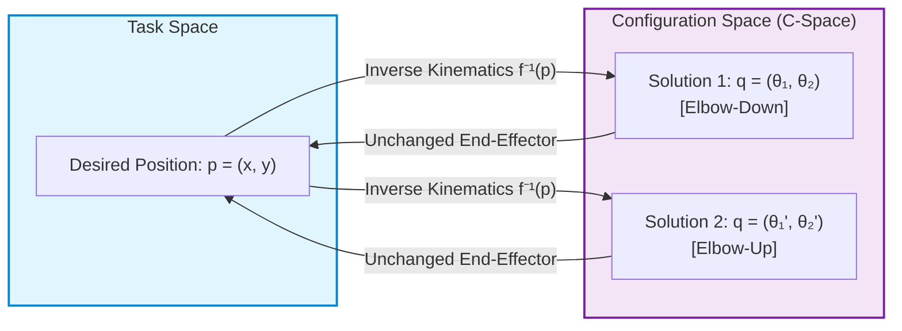
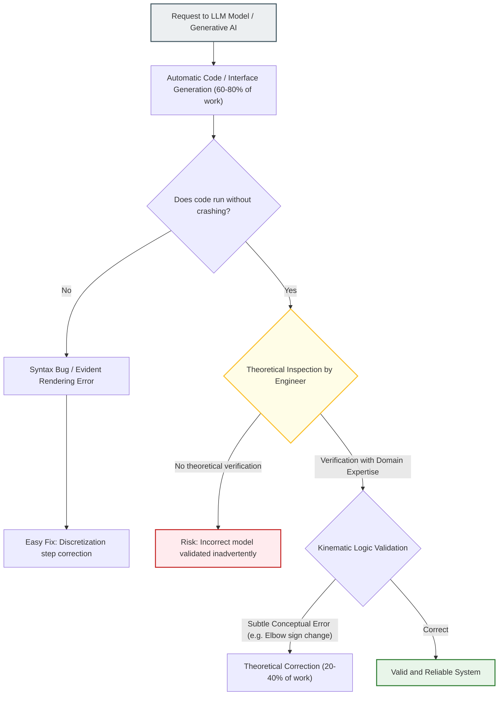
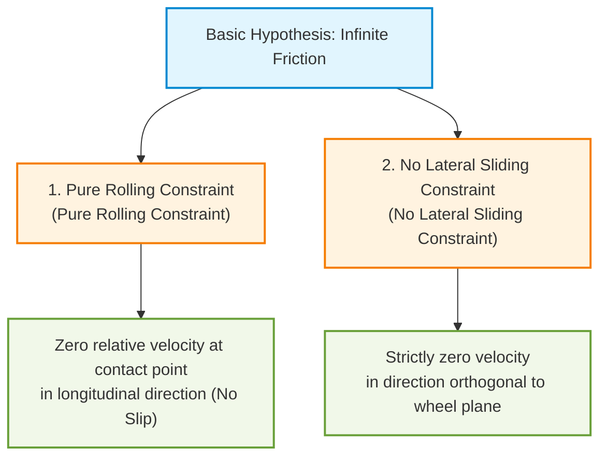
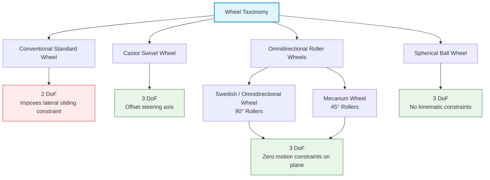
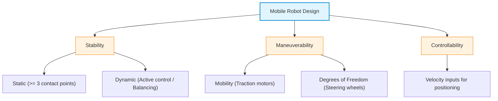
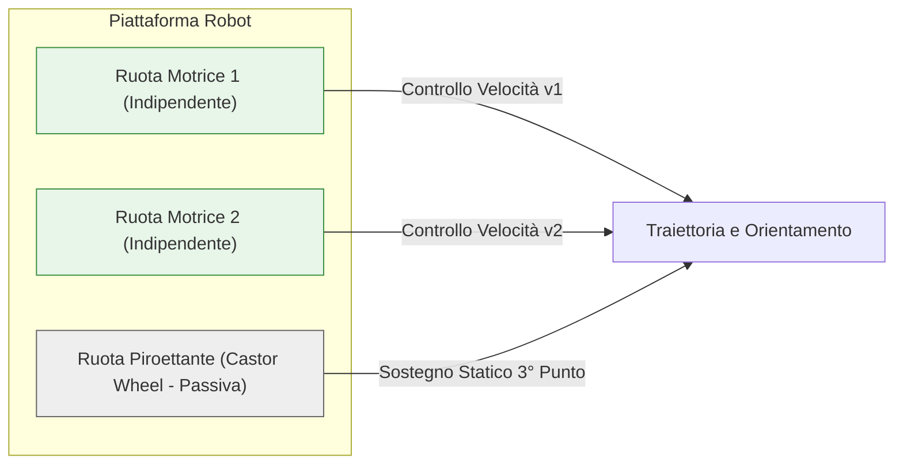
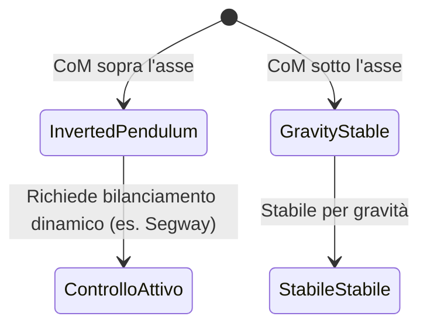
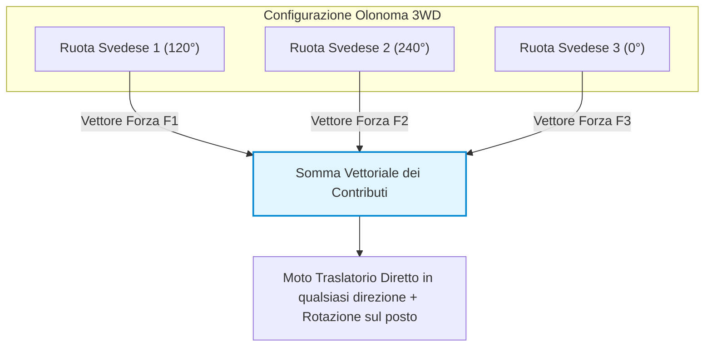

# Kinematics of Mobile Robots and Configuration Space Modeling

## Educational Overview

This lecture unfolds through two main thematic core areas: the consolidation of kinematic concepts for two-degree-of-freedom manipulators and the introduction to the kinematics of mobile robots (*Mobile Robots*).

In the first part, through the critical analysis of an interactive web tool for exploring the Configuration Space (*Configuration Space*), the conceptual difference between a simple sign change of a joint and the actual posture variation for the same end-effector position (*End-Effector*) — specifically in the configurations known as "elbow up" (*Elbow Up*) and "elbow down" (*Elbow Down*) — is thoroughly examined. This case study provides an opportunity for methodological reflection on the use of Generative Artificial Intelligence (*Generative AI*) in software engineering development, highlighting the essential need for deep domain knowledge (*Domain Knowledge*) to identify and eliminate subtle theoretical errors.

In the second part, the lecture shifts focus to differential drive mobile robots (*Differential Drive Robots*). The kinematic characterization of the robot in the two-dimensional operational space is introduced, representing its pose in the plane through the configuration space vector $q = [x, y, \theta]^T$, laying the foundation for direct and inverse kinematics calculation.

---

### Critical Evaluation of Generative AI and Conceptual Errors in Kinematic Models

#### Recall of Fundamental Concepts and Multiplicity of Kinematic Solutions

In previous lectures, the representation of the position and movement of the end-effector of a robot was introduced. For this purpose, two fundamental spaces were defined:
* **Configuration Space (*Configuration Space* or $C$-space):** The space of the robot joint parameters (for example, the angles $\theta_1, \theta_2$).
* **Task Space (*Task Space*):** The space of operational Cartesian coordinates in which the end-effector moves (for example, the positions $x, y$).

The link between these two spaces is governed by two dual problems:
1. **Direct Kinematics (*Direct Kinematics*):** Calculates the position of the end-effector in the task space starting from the joint values in the configuration space: 
   $$\boldsymbol{x} = f(\boldsymbol{q})$$
2. **Inverse Kinematics (*Inverse Kinematics*):** Calculates the joint values required to reach a given desired position of the end-effector: 
   $$\boldsymbol{q} = f^{-1}(\boldsymbol{x})$$

Due to the non-linear nature of the trigonometric equations of kinematics, the inverse problem almost always admits multiple solutions for the same Cartesian position. In the case of a 2-degree-of-freedom (2-DoF) planar manipulator, given a desired end-effector position $\boldsymbol{p} = [x, y]^T$, inverse kinematics generally provides two distinct joint solutions, commonly called postures:
* **Elbow-Up (*Elbow-Up*)**
* **Elbow-Down (*Elbow-Down*)**



---

#### Analysis of the Conceptual Error in the Simulation Application

Through a web graphical interface developed to explore the configuration space, a significant error generated automatically via a generative AI tool (*Code Generation* via LLM) emerged.

##### The Error Generated by AI
Clicking on the buttons to toggle the configuration between *Elbow-Up* and *Elbow-Down*, the first version of the software simply applied sign inversion to the second joint angle:
$$\theta_2 \leftarrow -\theta_2$$
keeping the angle of the first joint $\theta_1$unchanged.

**Why is this a serious conceptual error?**
By changing only the value of $\theta_2$ without recalculating $\theta_1$, the end-effector is physically moved to a new point in the task space $\boldsymbol{p}_{nuovo} \neq \boldsymbol{p}_{desiderato}$.

##### The Theoretically Correct Behavior
The definition of *Elbow-Up* and *Elbow-Down* postures dictates that **the position of the end-effector in the task space must remain identical**. 

To switch from *Elbow-Up* to *Elbow-Down* while keeping the end-effector fixed at $\boldsymbol{p}$, it is necessary to completely recalculate the joint vector $\boldsymbol{q} = [\theta_1, \theta_2]^T$. Both angular values must change simultaneously:
$$\text{Passaggio: } [\theta_{1, \text{down}}, \theta_{2, \text{down}}]^T \longrightarrow [\theta_{1, \text{up}}, \theta_{2, \text{up}}]^T$$
with:

---
$$f(\theta_{1, \text{down}}, \theta_{2, \text{down}}) = f(\theta_{1, \text{up}}, \theta_{2, \text{up}}) = \boldsymbol{p}$$

---

#### Discretization Error vs. Conceptual Error

In the development process conducted by the generative AI, two distinct types of malfunction emerged:

1. **Quantization / Rendering Error (Graphical):** 
   In the initial visualization of collision regions in the configuration space, the contiguous surface of the $C$-space appeared fragmented into disconnected islands (red and blue dots alternating irregularly). 
   * *Cause:* A sampling step (*discretization step*) that was too large during the numerical scanning of the domain.
   * *Solution:* Reduction of the discretization step to achieve a smooth and continuous rendering.
   * *Nature of the error:* Visually evident and easily identifiable even with a superficial inspection.

2. **Conceptual Error (Theoretical):**
   The misinterpretation of inverse kinematics in the *Elbow-Up/Down* commands.
   * *Cause:* The AI confused the sign inversion of a local coordinate with solving the system of constrained kinematic equations.
   * *Nature of the error:* The graphical interface appeared perfect, smooth, and free of traditional software bugs or code exceptions, but the modeled physical behavior was theoretically wrong.

---

> **KEY CONCEPT: Limits of Generative AI and Requirement of Domain Knowledge (*Domain Expertise*)**
>
> Generative AI tools applied to engineering make it possible to quickly complete a substantial percentage of the work (up to 60-80%). However, they frequently produce **subtle conceptual errors** that do not cause the software to crash, but violate the theoretical principles of the domain.
>
> The remaining part of the work (20-40%) necessarily requires the presence of a specialist with deep **domain knowledge (*Domain Expertise*)**. Without a solid understanding of the basic theory (in this case, robot kinematics), it is impossible to identify and correct such hidden errors, running the risk of validating conceptually incorrect models.

---



---

### Representation and Configuration Space of Mobile Robots

In moving from industrial manipulators to planar mobile robots, the first fundamental step is to define how to represent the position and orientation of the robot in the world. 

While the **Operational Space** (*Workspace*) in which the robot physically moves is two-dimensional (the floor plane defined by the Cartesian axes $x$ and $y$), the full description of the robot requires an additional parameter: the orientation $\theta$ with respect to a fixed global reference frame (*World Reference Frame*).

Consequently, the configuration or pose (*pose*) of the robot is identified by the three-dimensional vector:

$$q = \begin{bmatrix} x \\ y \\ \theta \end{bmatrix}$$

The **Configuration Space** (*Configuration Space* or *C-Space*) is therefore a three-dimensional space ($\mathbb{R}^2 \times S^1$). Representing the robot considering only the plane $(x, y)$ can be misleading: for the same Cartesian position, different orientations correspond to physically distinct states of the system.

```
       C-Space (3D: x, y, theta)
                ^ theta (orientamento angolare)
                |
                |   .---. Traiettoria elicoidale nel C-space
                |  /     \
                | |       |
                |  \     /
                +----------> y
               /
              / x
```

#### Trajectories in C-Space: Circular Motion
An intuitive example to understand the difference between *Workspace* and *C-Space* is motion on a circular trajectory in the plane:
* **In Workspace (2D):** the projection on the ground describes a simple closed circle.
* **In C-Space (3D):** since while moving along the circle the robot must continuously vary its orientation $\theta$ to remain tangent to the trajectory, the overall motion is a helical trajectory (helix) that develops along the vertical axis $\theta$.
* **Periodicity:** the angle $\theta$ is a periodic variable defined in the interval $[-\pi, +\pi]$ (or $[0, 2\pi]$). When the robot completes a full rotation and exits the upper limit ($+\pi$), the trajectory rewinds, re-entering from the lower limit ($-\pi$).

---

### Kinematics of Mobile Robots: Position vs Velocity

In the industrial manipulators seen previously, the joint variables directly correspond to geometric coordinates (linear displacements for prismatic joints, angles for revolute joints). In mobile robots, the situation is radically different:

* **Direct and Inverse Geometric Kinematics:** In principle, direct kinematics aims to determine the final pose $(x, y, \theta)$ in the operational space starting from the internal coordinates, while inverse kinematics calculates the configuration required to reach a specific target pose.
* **Wheel Control:** In actual practice, we cannot instantaneously set an arbitrary set of coordinates $(x, y, \theta)$ . Actuation occurs through the motors connected to the wheels (for example, the angular velocities of the left wheel $\omega_L$ and the right wheel $\omega_R$ in a differential drive robot, *Differential Drive*).

> **KEY CONCEPT:**  
> Unlike industrial manipulators, in wheeled mobile robots primary control does not act on absolute positions, but rather on **velocities** (the time derivatives of positions). One therefore works in the differential kinematics space, governed by precise kinematic constraints.

---

### Wheel Model and Degrees of Freedom (DoF)

To analyze how actuators influence motion, it is necessary to examine the contact between the wheel and the ground. Unlike manipulators with standard kinematic pairs (revolute and prismatic), in wheeled vehicles there are different types of wheels, distinguished between active (motorized) and passive (idle).

#### How many Degrees of Freedom does an ideal standard wheel have?
Consider a conventional fixed wheel (such as that mounted on the fork of a bicycle or on the frame of a unicycle), in contact with the ground at a **single ideal point**. This wheel possesses **2 Degrees of Freedom (*Degrees of Freedom* - DoF)**:

1. **Rolling around its main axis:** enables longitudinal movement (forward and backward).
2. **Rotation around the vertical contact point (steering / yaw):** the wheel is free to rotate on the spot (*pivot*) around the axis perpendicular to the contact plane.

One is often led to consider only 1 DoF because the wheel is thought of as driven by a traction motor along the longitudinal direction; rotation around the contact point is, however, a movement kinetically permitted by the ideal point contact type.

```
                  ^ Asse verticale (Sterzata / Pivot) -> 2° DoF
                  |
             [ Ruota ]
                 ===  <- Asse di rotolamento -> 1° DoF (Avanzamento)
                  |
             .----*----. (Punto di contatto ideale)
```

*Modeling Note:* In real tires with wide treads, the contact area is not a point but an extended footprint. Friction prevents pure steering on the spot without generating slipping; in ideal theoretical kinematics, however, the contact is approximated as point-like.

---

### Fundamental Kinematic Constraints

The motion of a standard wheel (and thus of the elementary single-wheel kinematic model, called **Unicycle** or *Unicycle*) is based on a fundamental physical hypothesis: the presence of **infinite friction** (*infinite friction*) at the wheel-surface interface. 

The infinite friction hypothesis prevents slipping and generates **two fundamental kinematic constraints**:



#### 1. Pure Rolling Constraint (*Pure Rolling Constraint*)
Establishes that the wheel moves forward without slipping longitudinally. From a kinematic point of view, the instantaneous contact point between wheel and ground has zero instantaneous relative velocity with respect to the ground itself along the direction of travel:

$$v_{\text{contatto, longitudinale}} = 0$$

All forward movement is converted solely by the rotation of the wheel around its axis.

#### 2. No Lateral Sliding Constraint (*No Lateral Sliding Constraint*)
The wheel cannot move laterally along the direction parallel to its axis of rotation (orthogonal to the rolling plane of the wheel). No displacement at transverse velocity is allowed:

$$v_{\text{contatto, laterale}} = 0$$

These two constraints prevent the vehicle from instantaneously translating in any arbitrary direction of the plane, making the system **non-holonomic** (*non-holonomic*): the space of instantaneously accessible velocities is limited, even if the entire configuration space $(x, y, \theta)$ remains reachable through appropriate maneuvers.

---

### Kinematic Hypotheses and Justification of Pure Rolling

To study the kinematics of wheeled mobile robots, two fundamental hypotheses regarding the wheel-ground interaction are introduced:
1. **No longitudinal slipping / Pure rolling** (*Pure Rolling*): the wheel rolls along the direction of motion without skidding.
2. **No lateral slipping** (*No Lateral Sliding*): the wheel exhibits infinite friction along the axis orthogonal to the direction of rotation, preventing the wheel from sliding sideways.

> **Key Concept: Why do we enforce infinite friction in kinematics?**
> From the perspective of kinematic control, we can act exclusively on the motor driving the rotation of the wheel. The ultimate goal is not to control the rotation of the individual joint, but to **control the position of the robot in space**. 
> If the wheel rotates but the robot remains stationary (longitudinal slipping), or if the robot translates laterally without the wheel being actuated (lateral slipping), the kinematic link between the actuator and the chassis is broken. The assumption of infinite friction is what guarantees that every movement of the actuator corresponds deterministically to a displacement of the robot.
>
> *A practical example is a car on ice or wet asphalt:* when the ABS engages, the control system attempts to restore the pure rolling hypothesis. If lateral friction is lost in a curve, the car continues straight regardless of the steering angle of the body, causing the vehicle's kinematic control to fail.

---

### Effect of Wheels on Robot Mobility: Constraints and Degrees of Freedom

Even before considering the application of motors (active wheels), let us analyze wheels as passive elements to understand how they influence the **Degrees of Freedom** (*Degrees of Freedom - DoF*) of the robot frame in two-dimensional space $\mathbb{SE}(2)$ (coordinates $x, y, \theta$).

*   **Single standard wheel:** Possesses $2 \text{ DoF}$ local DoF (direction of travel and rotation around the contact point). By itself, it does not excessively limit the movement of the chassis.
*   **Two standard wheels on the same chassis:** If we mount two parallel standard wheels on a rigid structure, things change. Each wheel imposes its own no lateral sliding constraint. If one wheel tries to rotate on the spot, it forces the other to move laterally; but the second wheel's constraint prevents this movement. Consequently, adding standard wheels **reduces overall mobility** of the platform, limiting allowable instantaneous movements.
*   **Three standard wheels oriented inconsistently:** If we add a third standard wheel locked in another direction, the constraints overlap to the point of **completely locking** the movement of the robot ($0 \text{ DoF}$).

To ensure mobility for the robot without adding locking kinematic constraints, it is necessary to introduce more flexible wheel types or types with more degrees of freedom.

---

### Wheel Taxonomy and DoF Analysis

We classify the main types of wheels used in mobile robotics by analyzing their structure, the allowed degrees of freedom, and the imposed kinematic constraints.



#### 1. Standard Wheel (*Standard Wheel*)
Can be fixed or steerable, but has its rotation axis passing directly through the center of the wheel.
*   **DoF:** $2 \text{ DoF}$ (rotation around its traction axis and rotation around the contact point with the ground).
*   **Constraint:** Rigidly imposes the *no lateral sliding* constraint. Does not allow instantaneous translations along its axis of rotation.

#### 2. Castor or Swivel Wheel (*Castor Wheel*)
Is the classic steerable wheel found on shopping carts or office chairs. A key feature is that the vertical steering axis is offset (*offset*) relative to the wheel's rotation axis.

```
       | <- Asse verticale del telaio (Giunto di orientamento)
       |
  +----+------+  <-- Distanza di offset
  |           |
 (O)         (O) <-- Asse della ruota (Rotazione di avanzamento)
```

*   **Degrees of Freedom ($3 \text{ DoF}$):**
    1. Rotation around the main axis of the wheel (forward/reverse).
    2. Rotation around the offset vertical axis (wheel orientation).
    3. Rotation of the robot base with respect to the ground contact point.
*   **Advantages and Practical Notes:** Being a wheel with $3 \text{ DoF}$, spontaneously orienting itself in the direction of motion imposed on the robot, **it adds no motion constraints to the chassis**.
*   *Application issue:* The presence of dust and dirt (very common in wheel hubs) can lock the vertical rotation joint. When this happens (e.g. a defective shopping cart), the wheel loses degrees of freedom and behaves like a poor, misaligned standard wheel, making control of the platform difficult.

---

#### 3. Omnidirectional and Mecanum Wheels (*Swedish / Mecanum Wheels*)
These wheels were designed to eliminate the lateral sliding constraint without having to add a mechanical steerable steering axis. The basic concept involves inserting **passive rollers** along the outer circumference of the main wheel.

*   The rollers have high friction in the direction normal to their axis, but rotate freely along their own axis.
*   Friction is therefore infinite in the roller rotation direction and zero along its sliding axis.

Two main variants are distinguished:
*   **Omnidirectional (or Swedish) Wheel:** The passive rollers have their axes inclined at $90^\circ$ (orthogonal) with respect to the main rotation axis of the wheel.
*   **Mecanum Wheel:** The passive rollers are inclined at an angle of $45^\circ$ with respect to the rotation axis of the main wheel.

> **Force Distribution in Mecanum Wheels:** 
> The inclination at $45^\circ$ of the rollers decomposes vector forces introducing a scaling factor proportional to $\sqrt{2}$. Decomposing roller friction, one obtains infinite friction along the roller direction and zero in the orthogonal direction.

```
      Ruota Omnidirezionale (90°)               Ruota Mecanum (45°)
             +---------+                            +---------+
             |   | |   |                            |   / /   |
             |   | |   |                            |  / /    |
             +---------+                            +---------+
         (Rulli a 90° rispetto                      (Rulli a 45° rispetto
           all'asse principale)                       all'asse principale)
```

*   **Analysis of the $3 \text{ DoF}$ and Contact Geometry:**
    Omnidirectional wheels provide $3 \text{ DoF}$ in the plane:
    1. Rotation around the main wheel axis.
    2. Passive sliding permitted by roller rotation along the periphery.
    3. Rotation on the spot around the vertical contact axis.

*Why is rotation on the spot guaranteed if rollers cover the periphery?*
In real roller wheels, rollers are often mounted on two parallel but staggered rings (for example with an angular offset of $60^\circ$). At any instant in time, the wheel touches the ground **exclusively at a single point of contact** (a single roller). This allows the wheel to rotate freely around that contact point without skidding.

#### 4. Spherical Wheel (*Spherical / Ball Wheel*)
This consists of a sphere free to rotate in any direction inside a housing (concept analogous to the ball in old mechanical computer mice).

*   **DoF:** Provides $3 \text{ DoF}$ full, instantaneous omnidirectional DoF. Imposes no kinematic constraint on the chassis.
*   **Constructive Limitations:** It is extremely difficult to implement on large real robots. Requires internal support/suspension points with very low friction. Furthermore, moving on the ground, the ball picks up dirt and debris that easily get trapped in the housing enclosure, jamming its sliding points and making the system unreliable.

---

### Fundamental Requirements of Mobile Robots

In the mechanical and kinematic design of a mobile robot (or vehicle), three key concepts must be balanced: **stability**, **maneuverability**, and **controllability**.



#### 1. Stability (*Stability*)
Stability defines the vehicle's ability not to tip over while stopping or in motion.
* **Static Stability (*Static Stability*)**: A vehicle is statically stable if, when stationary and without active control systems, it remains in equilibrium. To guarantee static stability in the plane, **at least 3 distinct contact points** with the ground are required, which define the *support polygon* (*support polygon*). If the projection of the center of gravity (or center of mass) falls inside this polygon, the robot does not fall over.
* **Dynamic Stability (*Dynamic Stability*)**: Systems with 1 or 2 contact points (e.g. unicycle or bicycle) do not possess static stability: if stopped without supports, they fall over. They require active dynamic control of trajectories and velocities to maintain balance in motion.

> **Key Concept**: Why do cars use 4 wheels instead of 3? 
> Although 3 contact points are theoretically sufficient for static stability, the area of the support polygon (a triangle) is small. An external disturbance or a high-speed turn can easily cause the center of mass to move outside the polygon. Adding a fourth wheel extends the support area to a rectangle/quadrilateral, significantly increasing the stability margin.

#### 2. Maneuverability (*Maneuverability*)
Maneuverability represents the combination of basic mobility provided by driven wheel constraints and additional degrees of freedom provided by steering wheels.
* In a bicycle, longitudinal mobility is provided by the pedals (driven wheel), while direction is provided by the handlebars (steering wheel).
* Total maneuverability is limited by the ability to coordinate traction motors and steering servomotors.

#### 3. Controllability (*Controllability*)
Controllability defines how easily the robot can be positioned in space by manipulating velocity control inputs (rotation speed of driving wheels and/or angle/speed of steering wheels).

> **Key Concept**: There is a **structural trade-off** between maneuverability and controllability. Extremely maneuverable platforms (capable of moving in any direction instantaneously) can be complex to control, while platforms with rigid kinematic constraints are simpler to control but less flexible in tight spaces.

---

### Passive Wheels and the Swivel Wheel (*Castor Wheel*)

It is possible to achieve complete steering and maneuverability even **without active steerable or steering wheels**.

A classic example is domestic robot vacuum cleaners:
* Movement and rotation rely exclusively on the differential velocity control of two fixed drive wheels.
* The third contact point, necessary to ensure static stability, is provided by a **swivel wheel (*castor wheel*)** or a ball wheel.

The *castor wheel* is a completely **passive** element (lacking motors). It imposes no steering kinematic constraints on the vehicle, orienting itself spontaneously along the direction of motion imparted by the drive wheels.



---

### Architectures and Kinematic Configurations

Depending on the number of wheels, wheel type (standard, steering, Swedish/omni), and motor arrangement, different mobile robot configurations are identified.

#### 1. Single-Wheel Configurations (Unicycle / *Unicycle*)
* **Characteristics**: Single drive and steerable wheel.
* **Critical Issues**: No static stability. The system requires continuous dynamic balancing. Reversing or changing direction generates high torsional stress on the ground contact point. Rare in industrial or service applications.

#### 2. Two-Wheel Configurations
* **Bicycle / Scooter**: One rear drive wheel (fixed axis) and one front steering wheel (non-driven). Requires dynamic stability or external support (stand) when stationary.
* **2-Wheel Differential Drive (*Differential Drive*)**:
  * Consists of two independent drive wheels mounted on the same transverse axis.
  * *Stability*: Lacking a third contact point, the platform tends to rotate around the wheel axis. 
  * To stabilize it, two approaches can be adopted:
    1. **Active inverted pendulum control (*Inverted Pendulum*)**: As in the case of the Segway, the robot drives the wheels to constantly maintain the center of mass above the axis.
    2. **Mechanical design of Center of Mass**: Position the center of mass ($CoM$) of the robot below the rotation axis of the wheels, guaranteeing gravity-based equilibrium.



#### 3. Three-Wheel Configurations

##### A. Differential Drive with Passive Wheel
* Consists of two independent drive wheels (differential drive) and a third passive support point (*castor* or spherical wheel).
* Offers static stability and high maneuverability while keeping simple kinematic control.

##### B. Classic Tricycle (*Tricycle*)
* **Variant A (Rear-wheel drive)**: Two rear wheels connected to a single traction motor and one front steering wheel, passive from a traction perspective.
* **Variant B (Steerable front-wheel drive)**: Front wheel both driven and steerable, two free rear wheels. 

> **Note**: When traction and steering are concentrated on the same wheel (e.g. children's tricycles or simple industrial carts), sudden steering at high speeds reduces grip, causing loss of traction and potential instability.

##### C. 3-Swedish-Wheel Holonomic Platform (*Omnidirectional / Holonomic Drive*)
Using **three Swedish (or omnidirectional) wheels** driven by three independent motors and arranged at $120^\circ$ from each other along the circumference of the chassis, a holonomic system is obtained.



* **Operating Principle**:
  * Each Swedish wheel transmits traction along the direction orthogonal to its main rotation axis, while peripheral rollers rotate freely, allowing frictionless transverse sliding.
  * There are no kinematic constraints on instantaneous lateral motion.
  * The resulting movement of the robot $\vec{v}_{tot}$ is given by the **vector sum** of the forces generated by the three individual motors:
  
  $$\vec{v}_{tot} = \sum_{i=1}^{3} \vec{v}_i$$

* **Advantages**:
  * **Holonomic** platform (*holonomic*): The robot can translate in any direction in the plane without having to first rotate the chassis.
  * It can spin on itself (*spin on the spot*) simultaneously with translation.

#### 4. Notes on *Synchro Drive* Configuration
In the *Synchro Drive* configuration, three or more standard wheels mounted on rotating turrets are used. 
* A dedicated motor synchronously aligns the direction of all turrets/wheels.
* A second motor synchronously drives the traction of all wheels.
* The robot maintains a fixed orientation of the chassis while translating in any direction in space.