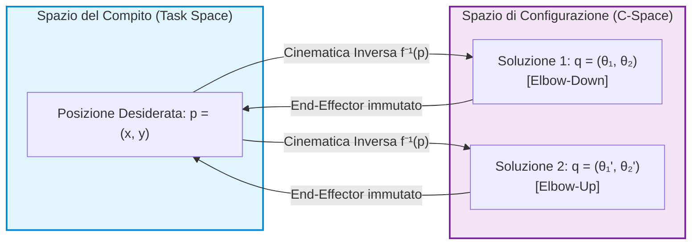
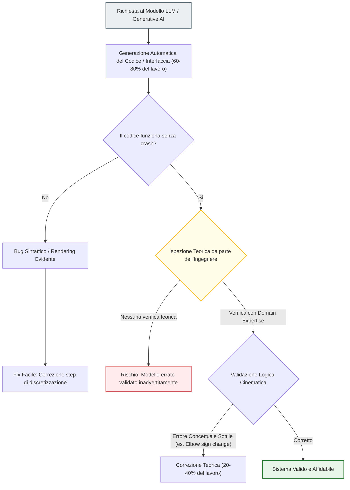
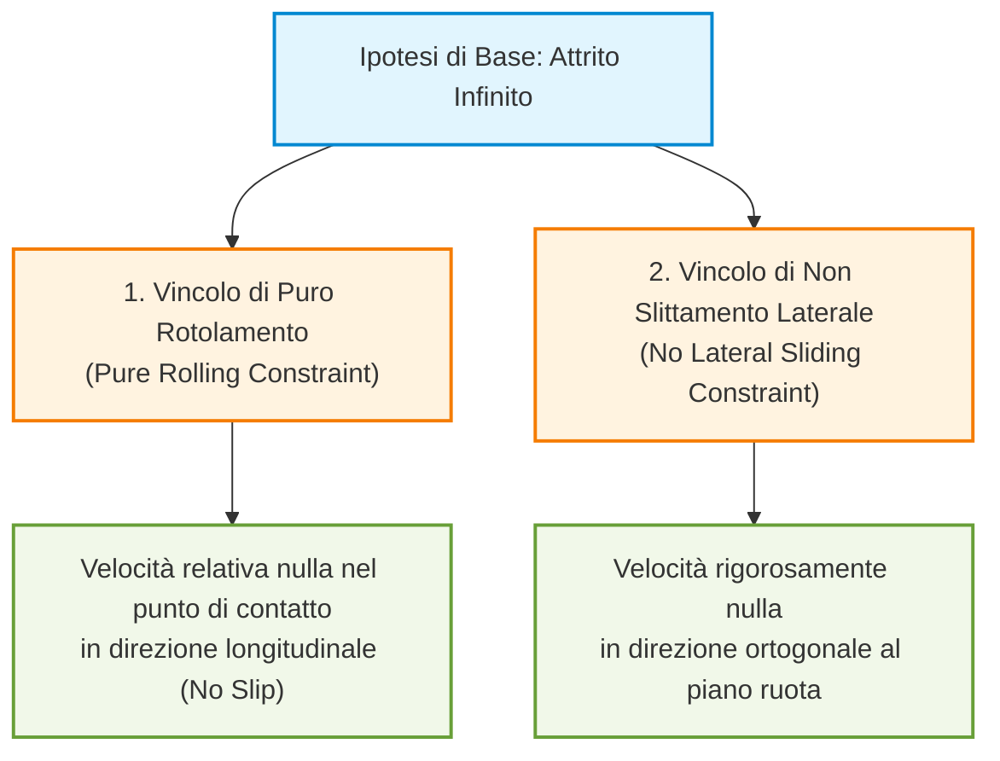
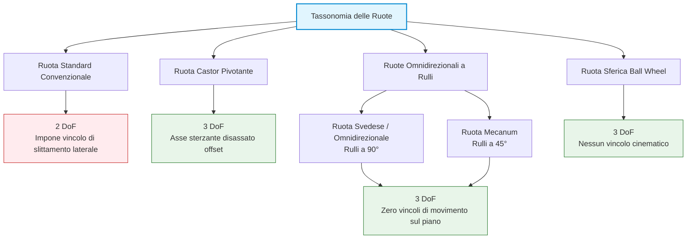
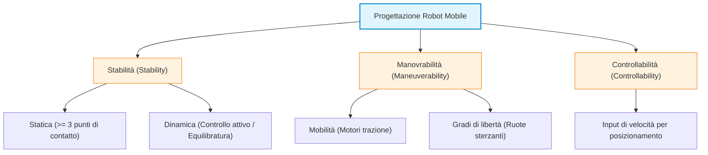
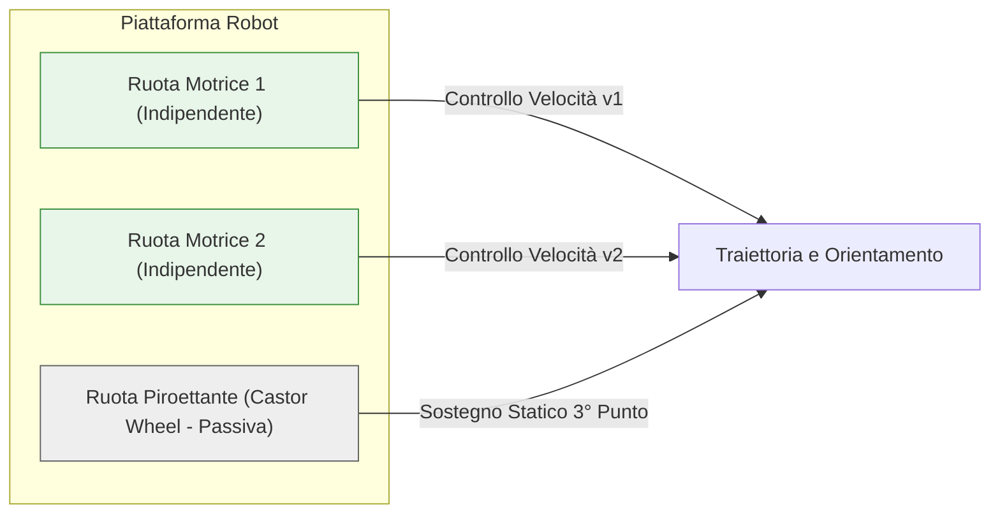
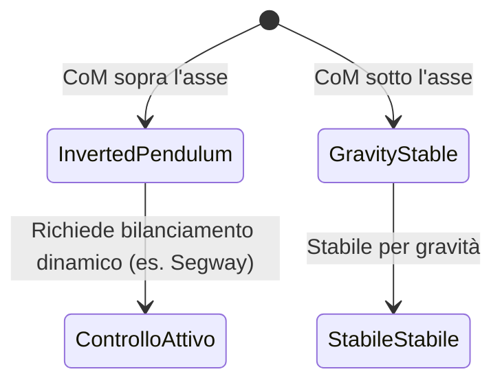
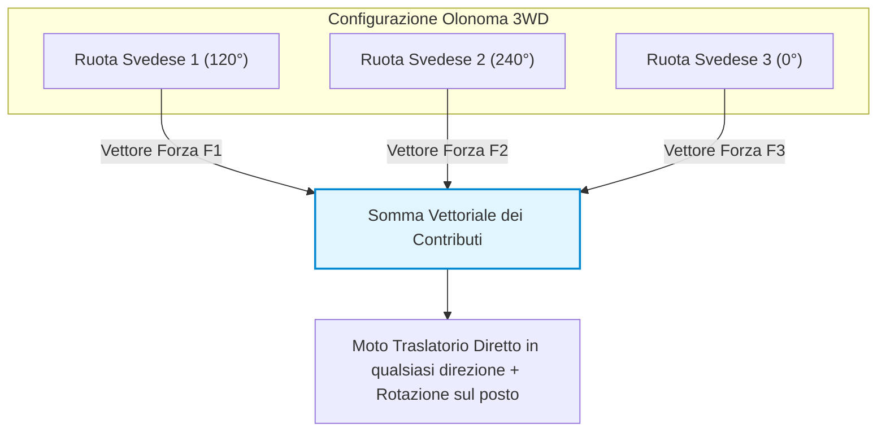

# Cinematica dei Robot Mobili e Modellazione dello Spazio delle Configurazioni

## Overview Didattica

Questa lezione si snoda attraverso due nuclei tematici principali: il consolidamento dei concetti di cinematica per manipolatori a due gradi di libertà e l'introduzione alla cinematica dei robot mobili (*Mobile Robots*). 

Nella prima parte, attraverso l'analisi critica di uno strumento web interattivo per l'esplorazione dello Spazio delle Configurazioni (*Configuration Space*), viene sviscerata la differenza concettuale tra il semplice cambio di segno di un giunto e l'effettiva variazione di postura a parità di posizione dell'organo terminale (*End-Effector*) — specificamente nelle configurazioni note come "gomito in alto" (*Elbow Up*) e "gomito in basso" (*Elbow Down*). Questo caso di studio offre lo spunto per una riflessione metodologica sull'uso dell'Intelligenza Artificiale Generativa (*Generative AI*) nello sviluppo di software ingegneristico, evidenziando la necessità imprescindibile di una profonda conoscenza del dominio (*Domain Knowledge*) per individuare ed eliminare errori teorici sottili.

Nella seconda parte, la lezione sposta il focus sui robot mobili a guida differenziale (*Differential Drive Robots*). Viene introdotta la caratterizzazione cinematica del robot nello spazio operativo bidimensionale, rappresentando la sua posa nel piano attraverso il vettore dello spazio delle configurazioni $q = [x, y, \theta]^T$, ponendo le basi per il calcolo della cinematica diretta e inversa.

---

### Valutazione Critica dell'IA Generativa ed Errori Concettuali nei Modelli Cinematici

#### Richiamo dei Concetti Fondamentali e Molteplicità delle Soluzioni Cinematiche

Nelle lezioni precedenti è stata introdotta la rappresentazione della posizione e del movimento del terminale d'organo (*end-effector*) di un robot. A questo scopo sono stati definiti due spazi fondamentali:
* **Spazio di Configurazione (*Configuration Space* o $C$-space):** Lo spazio dei parametri di giunto del robot (ad esempio gli angoli $\theta_1, \theta_2$).
* **Spazio del Compito (*Task Space*):** Lo spazio delle coordinate cartesiane operative in cui muove l'end-effector (ad esempio le posizioni $x, y$).

Il legame tra questi due spazi è governato da due problemi duali:
1. **Cinematica Diretta (*Direct Kinematics*):** Calcola la posizione dell'end-effector nello spazio del compito a partire dai valori dei giunti nello spazio di configurazione: 
   $$\boldsymbol{x} = f(\boldsymbol{q})$$
2. **Cinematica Inversa (*Inverse Kinematics*):** Calcola i valori dei giunti necessari per raggiungere una determinata posizione desiderata dell'end-effector: 
   $$\boldsymbol{q} = f^{-1}(\boldsymbol{x})$$

A causa della natura non lineare delle equazioni trigonometriche della cinematica, il problema inverso ammette quasi sempre soluzioni multiple per una stessa posizione cartesiana. Nel caso di un manipolatore planare a 2 gradi di libertà (2-DoF), data una posizione desiderata dell'end-effector $\boldsymbol{p} = [x, y]^T$, la cinematica inversa fornisce in genere due soluzioni distinte di giunto, comunemente denominate posture:
* **Gomito in alto (*Elbow-Up*)**
* **Gomito in basso (*Elbow-Down*)**



---

#### Analisi dell'Errore Concettuale nell'Applicazione di Simulazione

Attraverso un'interfaccia grafica web sviluppata per esplorare lo spazio di configurazione, è emerso un errore significativo generato automaticamente tramite uno strumento di IA generativa (*Code Generation* via LLM). 

##### L'Errore Generato dall'IA
Facendo clic sui pulsanti per alternare la configurazione tra *Elbow-Up* ed *Elbow-Down*, la prima versione del software applicava semplicemente l'inversione di segno al secondo angolo di giunto:
$$\theta_2 \leftarrow -\theta_2$$
mantenendo inalterato l'angolo del primo giunto $\theta_1$.

**Perché questo è un errore concettuale grave?**
Cambiando unicamente il valore di $\theta_2$ senza ricalcolare $\theta_1$, si sposta fisicamente l'end-effector in un nuovo punto dello spazio del compito $\boldsymbol{p}_{nuovo} \neq \boldsymbol{p}_{desiderato}$. 

##### Il Comportamento Teoricamente Corretto
La definizione di posture *Elbow-Up* ed *Elbow-Down* impone che **la posizione dell'end-effector nello spazio del compito debba rimanere identica**. 

Per passare da *Elbow-Up* a *Elbow-Down* mantenendo fisso l'end-effector in $\boldsymbol{p}$, è necessario ricalcolare completamente il vettore dei giunti $\boldsymbol{q} = [\theta_1, \theta_2]^T$. Entrambi i valori angolari devono cambiare simultaneamente:
$$\text{Passaggio: } [\theta_{1, \text{down}}, \theta_{2, \text{down}}]^T \longrightarrow [\theta_{1, \text{up}}, \theta_{2, \text{up}}]^T$$
con:
$$f(\theta_{1, \text{down}}, \theta_{2, \text{down}}) = f(\theta_{1, \text{up}}, \theta_{2, \text{up}}) = \boldsymbol{p}$$

---

#### Errore di Discretizzazione vs. Errore Concettuale

Nel processo di sviluppo condotto dall'IA generativa sono emersi due tipi distinti di malfunzionamento:

1. **Errore di Quantizzazione / Rendering (Grafico):** 
   Nella visualizzazione iniziale delle regioni di collisione nello spazio di configurazione, la superficie contigua del $C$-space appariva frammentata in isole disconnesse (punti rossi e blu alternati in modo irregolare). 
   * *Causa:* Un passo di campionamento (*discretization step*) troppo ampio durante la scansione numerica del dominio.
   * *Soluzione:* Riduzione del passo di discretizzazione per ottenere un rendering fluido e continuo.
   * *Natura dell'errore:* Visivamente evidente e facilmente individuabile anche con un'ispezione superficiale.

2. **Errore Concettuale (Teorico):**
   La cattiva interpretazione della cinemática inversa nei comandi *Elbow-Up/Down*.
   * *Causa:* L'IA ha confuso l'inversione di segno di una coordinata locale con la risoluzione del sistema di equazioni cinematiche vincolate.
   * *Natura dell'errore:* L'interfaccia grafica appariva perfetta, fluida e priva di bug software tradizionali o eccezioni nel codice, ma il comportamento fisico modellato era teoricamente errato.

---

> **CONCETTO CHIAVE: Limiti dell'IA Generativa ed Esigenza della Conoscenza del Dominio (*Domain Expertise*)**
>
> Gli strumenti di IA generativa applicati all'ingegneria permettono di completare velocemente una percentuale consistente del lavoro (fino al 60-80%). Tuttavia, producono frequentemente **errori concettuali sottili** che non causano il crash del software, ma violano i principi teorici del dominio.
>
> La parte restante del lavoro (il 20-40%) richiede necessariamente la presenza di uno specialista dotato di una profonda **conoscenza del dominio (*Domain Expertise*)**. Senza una solida comprensione della teoria di base (in questo caso, la cinematica dei robot), è impossibile individuare e correggere tali errori nascosti, con il rischio di validare modelli concettualmente errati.

---



---

### Rappresentazione e Spazio di Configurazione dei Robot Mobili

Nel passaggio dai manipolatori industriali ai robot mobili planari, il primo passo fondamentale consiste nel definire come rappresentare la posizione e l'orientamento del robot nel mondo. 

Mentre lo **Spazio Operativo** (*Workspace*) in cui il robot si muove fisicamente è bidimensionale (il piano di calpestio definito dagli assi cartesiani $x$ e $y$), la descrizione completa del robot richiede un parametro aggiuntivo: l'orientamento $\theta$ rispetto a una terna di riferimento fissa globale (*World Reference Frame*).

Di conseguenza, la configurazione o posa (*pose*) del robot è individuata dal vettore a tre dimensioni:

$$q = \begin{bmatrix} x \\ y \\ \theta \end{bmatrix}$$

Lo **Spazio di Configurazione** (*Configuration Space* o *C-Space*) è quindi uno spazio tridimensionale ($\mathbb{R}^2 \times S^1$). Rappresentare il robot considerando solo il piano $(x, y)$ può risultare fuorviante: a parità di posizione cartesiana, orientamenti diversi corrispondono a stati fisicamente distinti del sistema.

```
       C-Space (3D: x, y, theta)
                ^ theta (orientamento angolare)
                |
                |   .---. Traiettoria elicoidale nel C-space
                |  /     \
                | |       |
                |  \     /
                +----------> y
               /
              / x
```

#### Traiettorie nel C-Space: il moto circolare
Un esempio intuitivo per comprendere la differenza tra *Workspace* e *C-Space* è il moto su una traiettoria circolare nel piano:
* **Nel Workspace (2D):** la proiezione a terra descrive una semplice circonferenza chiusa.
* **Nel C-Space (3D):** poiché durante la percorrenza della circonferenza il robot deve continuamente variare il proprio orientamento $\theta$ per mantenersi tangente alla traiettoria, il moto complessivo è una traiettoria elicoidale (ad elica) che si sviluppa lungo l'asse verticale $\theta$.
* **Periodicità:** l'angolo $\theta$ è una variabile periodica definita nell'intervallo $[-\pi, +\pi]$ (oppure $[0, 2\pi]$). Quando il robot compie una rotazione completa ed esce dall'estremo superiore ($+\pi$), la traiettoria si riavvolge rientrando dall'estremo inferiore ($-\pi$).

---

### Cinematica dei Robot Mobili: Posizione vs Velocità

Nei manipolatori industriali visti in precedenza, le variabili di giunto corrispondono direttamente a coordinate geometriche (spostamenti lineari per i giunti prismatici, angoli per i giunti rotoidali). Nei robot mobili la situazione è radicalmente diversa:

* **Cinematica Diretta e Inversa Geometrica:** In linea di principio, la cinematica diretta mira a determinare la posa finale $(x, y, \theta)$ nello spazio operativo a partire dalle coordinate interne, mentre l'inversa calcola la configurazione richiesta per raggiungere una determinata posa target.
* **Controllo alle Ruote:** Nella pratica reale, non possiamo impostare istantaneamente una terna di coordinate $(x, y, \theta)$ arbitraria. L'attuazione avviene tramite i motori collegati alle ruote (ad esempio, le velocità angolari della ruota sinistra $\omega_L$ e della ruota destra $\omega_R$ in un robot a trazione differenziale, *Differential Drive*).

> **CONCETTO CHIAVE:**  
> A differenza dei manipolatori industriali, nei robot mobili a ruote il controllo primario non agisce sulle posizioni assolute, bensì sulle **velocità** (le derivate temporali delle posizioni). Si lavora quindi nello spazio della cinematica differenziale, governata da precisi vincoli cinematici.

---

### Modello della Ruota e Gradi di Libertà (DoF)

Per analizzare come gli attuatori influenzano il moto, occorre esaminare il contatto tra la ruota e il piano. A differenza dei manipolatori con coppie cinematiche standard (rotoidali e prismatiche), nei veicoli a ruote esistono diverse tipologie di ruote, distinte tra attive (motorizzate) e passive (folli).

#### Quanti Gradi di Libertà possiede una ruota standard ideale?
Consideriamo una ruota convenzionale fissa (come quella montata sulla forcella di una bicicletta o sul telaio di un monociclo), a contatto con il suolo in un **singolo punto ideale**. Questa ruota possiede **2 Gradi di Libertà (*Degrees of Freedom* - DoF)**:

1. **Rotolamento attorno al proprio asse principale:** consente il movimento longitudinale (avanti e indietro).
2. **Rotazione attorno al punto di contatto verticale (sterzata / imbardata):** la ruota è libera di ruotare sul posto (*pivot*) attorno all'asse perpendicolare al piano di contatto.

Spesso si è portati a considerare solo 1 DoF perché si pensa alla ruota come azionata da un motore di trazione lungo la direzione longitudinale; la rotazione attorno al punto di contatto è tuttavia un movimento cinematicamente consentito dal tipo di contatto puntiforme ideale.

```
                  ^ Asse verticale (Sterzata / Pivot) -> 2° DoF
                  |
             [ Ruota ]
                 ===  <- Asse di rotolamento -> 1° DoF (Avanzamento)
                  |
             .----*----. (Punto di contatto ideale)
```

*Nota di modellazione:* Nei pneumatici reali con battistrada largo, l'area di contatto non è un punto ma un'impronta estesa. L'attrito impedisce la sterzata pura sul posto senza generare strisciamento; nella cinematica teorica ideale, tuttavia, il contatto viene approssimato come puntiforme.

---

### Vincoli Cinematici Fondamentali

Il moto di una ruota standard (e quindi del modello cinematico elementare a ruota singola, detto **Monociclo** o *Unicycle*) si basa su una fondamentale ipotesi fisica: la presenza di un **attrito infinito** (*infinite friction*) all'interfaccia tra ruota e superficie. 

L'ipotesi di attrito infinito impedisce lo slittamento e genera **due vincoli cinematici fondamentali**:



#### 1. Vincolo di Puro Rotolamento (*Pure Rolling Constraint*)
Stabilisce che la ruota avanza senza slittare longitudinalmente. Dal punto di vista cinematico, il punto di contatto istantaneo tra ruota e terreno ha velocità relativa istantanea nulla rispetto al terreno stesso lungo la direzione di avanzamento:

$$v_{\text{contatto, longitudinale}} = 0$$

Tutto il movimento in avanti è convertito unicamente dalla rotazione della ruota attorno al proprio asse.

#### 2. Vincolo di Non Slittamento Laterale (*No Lateral Sliding Constraint*)
La ruota non può muoversi lateralmente lungo la direzione parallela al proprio asse di rotazione (ortogonale al piano di rotolamento della ruota). Non è concesso alcuno spostamento a velocità trasversale:

$$v_{\text{contatto, laterale}} = 0$$

Questi due vincoli impediscono al veicolo di traslare istantaneamente in qualsiasi direzione arbitraria del piano, rendendo il sistema **non olonomo** (*non-holonomic*): lo spazio delle velocità accessibili istantaneamente è limitato, anche se l'intero spazio di configurazione $(x, y, \theta)$ rimane raggiungibile mediante opportune manovre.

---

### Ipotesi Cinematiche e Giustificazione del Rotolamento Puro

Per studiare la cinematica dei robot mobili su ruote, si introducono due ipotesi fondamentali sull'interazione ruota-suolo:
1. **Assenza di slittamento longitudinale / Rotolamento puro** (*Pure Rolling*): la ruota rotola lungo la direzione di marcia senza pattinare.
2. **Assenza di slittamento laterale** (*No Lateral Sliding*): la ruota presenta un attrito infinito lungo l'asse ortogonale alla direzione di rotazione, impedendo alla ruota di scivolare di lato.

> **Concetto Chiave: Perché imponiamo l'attrito infinito nella cinematica?**
> Dal punto di vista del controllo cinematico, noi possiamo agire esclusivamente sul motore che aziona la rotazione della ruota. L'obiettivo finale non è controllare la rotazione del singolo giunto, ma **controllare la posizione del robot nello spazio**. 
> Se la ruota gira ma il robot resta fermo (slittamento longitudinale), o se il robot trasla lateralmente senza che la ruota sia azionata (slittamento laterale), il legame cinematico tra l'attuatore e il telaio si spezza. L'assunzione di attrito infinito è ciò che garantisce che ogni movimento dell'attuatore corrisponda in modo deterministico a uno spostamento del robot.
>
> *Un esempio pratico è l'auto su fondo ghiacciato o su asfalto bagnato:* quando entra in funzione l'ABS, il sistema di controllo cerca di ripristinare l'ipotesi di rotolamento puro. Se si perde l'attrito laterale in curva, la macchina continua ad andare dritta indipendentemente dall'angolo di sterzata dell'involucro, facendo fallire il controllo cinematico del veicolo.

---

### Effetto delle Ruote sulla Mobilità del Robot: Vincoli e Gradi di Libertà

Prima ancora di considerare l'applicazione di motori (ruote attive), analizziamo le ruote come elementi passivi per comprendere come esse influenzino i **Gradi di Libertà** (*Degrees of Freedom - DoF*) del telaio del robot nello spazio bidimensionale $\mathbb{SE}(2)$ (coordinate $x, y, \theta$).

*   **Singola ruota standard:** Possiede $2 \text{ DoF}$ locali (direzione di avanzamento e rotazione attorno al punto di contatto). Di per sé non limita eccessivamente il movimento del telaio.
*   **Due ruote standard sullo stesso telaio:** Se montiamo due ruote standard parallele su una struttura rigida, le cose cambiano. Ciascuna ruota impone il proprio vincolo di assenza di slittamento laterale. Se una ruota cerca di ruotare sul posto, costringe l'altra a muoversi lateralmente; ma il vincolo della seconda ruota impedisce questo movimento. Di conseguenza, l'aggiunta di ruote standard **riduce la mobilità** complessiva della piattaforma, limitando i movimenti istantanei ammissibili.
*   **Tre ruote standard orientate in modo incoerente:** Se aggiungiamo una terza ruota standard bloccata in un'altra direzione, i vincoli si sovrappongono al punto da **bloccare completamente** il movimento del robot ($0 \text{ DoF}$).

Per garantire mobilità al robot senza aggiungere vincoli cinematici bloccanti, occorre introdurre tipologie di ruote più flessibili o a più gradi di libertà.

---

### Tassonomia delle Ruote e Analisi dei DoF

Classifichiamo i principali tipi di ruote impiegati nella robotica mobile analizzandone la struttura, i gradi di libertà ammessi e i vincoli cinematici imposti.



#### 1. Ruota Standard (*Standard Wheel*)
Può essere fissa o orientabile (sterzante), ma ha l'asse di rotazione che passa direttamente per il centro della ruota.
*   **DoF:** $2 \text{ DoF}$ (rotazione attorno al proprio asse di trazione e rotazione attorno al punto di contatto con il terreno).
*   **Vincolo:** Impone in modo rigido il vincolo di *no lateral sliding*. Non permette traslazioni istantanee lungo il proprio asse di rotazione.

#### 2. Ruota Castor o Pivotante (*Castor Wheel*)
È la classica ruota orientabile presente nei carrelli della spesa o nelle sedie da ufficio. Caratteristica fondamentale è che l'asse di sterzo verticale è disassato (*offset*) rispetto all'asse di rotazione della ruota.

```
       | <- Asse verticale del telaio (Giunto di orientamento)
       |
  +----+------+  <-- Distanza di offset
  |           |
 (O)         (O) <-- Asse della ruota (Rotazione di avanzamento)
```

*   **Gradi di Libertà ($3 \text{ DoF}$):**
    1. Rotazione attorno all'asse principale della ruota (avanzamento/retromarcia).
    2. Rotazione attorno all'asse verticale disassato (orientamento della ruota).
    3. Rotazione della base del robot rispetto al punto di contatto a terra.
*   **Vantaggi e Note Pratiche:** Essendo una ruota a $3 \text{ DoF}$, orientandosi spontaneamente nella direzione del moto imposto al robot, **non aggiunge vincoli di movimento al telaio**. 
*   *Problema applicativo:* La presenza di polvere e sporco (molto comune nei mozzi di ruota) può bloccare il giunto di rotazione verticale. Quando questo accade (es. carrello della spesa difettoso), la ruota perde gradi di libertà e si comporta come una pessima ruota standard orientata male, rendendo difficile il controllo della piattaforma.

#### 3. Ruote Omnidirezionali e Mecanum (*Swedish / Mecanum Wheels*)
Queste ruote nascono per eliminare il vincolo di slittamento laterale senza dover aggiungere un asse sterzante meccanico orientabile. Il concetto di base prevede l'inserimento di **rulli passivi** lungo la circonferenza esterna della ruota principale.

*   I rulli possiedono attrito elevato nella direzione normale al loro asse, ma ruotano liberamente lungo il proprio asse.
*   L'attrito risulta quindi infinito nella direzione di rotazione del rullo e nullo lungo il suo asse di scorrimento.

Si distinguono due varianti principali:
*   **Ruota Omnidirezionale (o Svedese):** I rulli passivi hanno i propri assi inclinati di $90^\circ$ (ortogonali) rispetto all'asse di rotazione principale della ruota.
*   **Ruota Mecanum:** I rulli passivi sono inclinati di un angolo di $45^\circ$ rispetto all'asse di rotazione della ruota principale.

> **Ripartizione della forza nelle Ruote Mecanum:** 
> L'inclinazione a $45^\circ$ dei rulli scompone le forze vettoriali introducendo un fattore scalare proporzionale a $\sqrt{2}$. Decomponendo l'attrito dei rulli, si ottiene attrito infinito lungo la direzione del rullo e nullo nella direzione ortogonale.

```
      Ruota Omnidirezionale (90°)               Ruota Mecanum (45°)
             +---------+                            +---------+
             |   | |   |                            |   / /   |
             |   | |   |                            |  / /    |
             +---------+                            +---------+
         (Rulli a 90° rispetto                      (Rulli a 45° rispetto
           all'asse principale)                       all'asse principale)
```

*   **Analisi dei $3 \text{ DoF}$ e Geometria del Contatto:**
    Le ruote omnidirezionali forniscono $3 \text{ DoF}$ al piano:
    1. Rotazione attorno all'asse della ruota principale.
    2. Scorrimento passivo consentito dalla rotazione dei rulli lungo la periferia.
    3. Rotazione sul posto attorno all'asse verticale di contatto.

*Perché è garantita la rotazione sul posto se i rulli coprono la periferia?*
Nelle ruote a rulli reali, i rulli sono spesso montati su due corone parallele ma sfalsate tra loro (ad esempio con uno sfasamento angolare di $60^\circ$). In ogni istante di tempo, la ruota tocca il suolo **esclusivamente su un singolo punto di contatto** (un singolo rullo). Ciò consente alla ruota di ruotare liberamente attorno a tale punto di contatto senza strisciare.

#### 4. Ruota Sferica (*Spherical / Ball Wheel*)
Si tratta di una sfera libera di ruotare in qualsiasi direzione all'interno di un alloggiamento (concetto analogo alla sfera dei vecchi mouse meccanici da computer).

*   **DoF:** Fornisce $3 \text{ DoF}$ completi e omnidirezionali istantanei. Non impone alcun vincolo cinematico al telaio.
*   **Limitazioni Costruttive:** È estremamente difficile da implementare su robot reali di grandi dimensioni. Richiede punti di supporto/sospensione interni a bassissimo attrito. Inoltre, muovendosi a terra, la sfera raccoglie sporco e detriti che si incastrano facilmente nell'alloggiamento di contenimento, bloccandone i punti di scorrimento e rendendo il sistema inaffidabile.

---

### Requisiti Fondamentali dei Robot Mobili

Nella progettazione meccanica e cinematica di un robot mobile (o veicolo), occorre bilanciare tre concetti chiave: **stabilità**, **manovrabilità** e **controllabilità**.



#### 1. Stabilità (*Stability*)
La stabilità definisce la capacità del veicolo di non ribaltarsi durante l'arresto o il moto.
* **Stabilità Statica (*Static Stability*)**: Un veicolo è staticamente stabile se, da fermo e privo di sistemi di controllo attivi, rimane in equilibrio. Per garantire la stabilità statica nel piano, sono necessari **almeno 3 punti di contatto** distinti con il suolo, i quali definiscono il *poligono di supporto* (*support polygon*). Se la proiezione del centro di gravità (o baricentro) cade all'interno di questo poligono, il robot non cade.
* **Stabilità Dinamica (*Dynamic Stability*)**: Sistemi con 1 o 2 punti di contatto (es. monociclo o bicicletta) non posseggono stabilità statica: se fermati senza sostegni, cadono. Essi richiedono un controllo dinamico attivo delle traiettorie e delle velocità per mantenere l'equilibrio in moto.

> **Concetto Chiave**: Perché le auto usano 4 ruote invece di 3? 
> Sebbene 3 punti di contatto siano teoricamente sufficienti per la stabilità statica, l'area del poligono di supporto (un triangolo) è ridotta. Una perturbazione esterna o una curva ad alta velocità possono facilmente far uscire il baricentro dal poligono. L'aggiunta di una quarta ruota estende l'area di supporto a un rettangolo/quadrilatero, aumentando significativamente il margine di stabilità.

#### 2. Manovrabilità (*Maneuverability*)
La manovrabilità rappresenta la combinazione tra la mobilità di base fornita dai vincoli delle ruote motrici e i gradi di libertà aggiuntivi forniti dalle ruote sterzanti.
* In una bicicletta, la mobilità longitudinale è data dai pedali (ruota motrice), mentre la direzione è fornita dal manubrio (ruota sterzante).
* La manovrabilità totale è limitata dalla capacità di coordinare i motori di trazione e i servomotori di sterzo.

#### 3. Controllabilità (*Controllability*)
La controllabilità definisce la facilità con cui è possibile posizionare il robot nello spazio manipolando gli input di controllo in velocità (velocità di rotazione delle ruote motrici e/o angolo/velocità delle ruote sterzanti).

> **Concetto Chiave**: Esiste un **trade-off strutturale** tra manovrabilità e controllabilità. Piattaforme estremamente manovrabili (capaci di muoversi in qualsiasi direzione istantaneamente) possono risultare complesse da controllare, mentre piattaforme con vincoli cinematici rigidi sono più semplici da controllare ma meno flessibili negli spazi stretti.

---

### Ruote Passive e la Ruota Piroettante (*Castor Wheel*)

È possibile ottenere una sterzata e una manovrabilità completa anche **senza ruote orientabili o sterzanti attive**.

Un classico esempio è costituito dai robot aspirapolvere domestici:
* Il movimento e la rotazione sono affidati esclusivamente al controllo differenziale di velocità di due ruote motrici fisse.
* Il terzo punto di contatto, necessario per garantire la stabilità statica, è fornito da una **ruota piroettante (*castor wheel*)** o da una ruota sferica.

La *castor wheel* è un elemento completamente **passivo** (privo di motori). Non impone vincoli cinematici di sterzo al veicolo, orientandosi spontaneamente lungo la direzione del moto impressa dalle ruote motrici.



---

### Architetture e Configurazioni Cinematiche

A seconda del numero di ruote, del tipo di ruota (standard, sterzante, svedese/omni) e della disposizione dei motori, si identificano diverse configurazioni di robot mobili.

#### 1. Configurazioni ad Una Ruota (Monociclo / *Unicycle*)
* **Caratteristiche**: Singola ruota motrice e orientabile.
* **Criticità**: Nessuna stabilità statica. Il sistema richiede un bilanciamento dinamico continuo. L'inversione o il cambio di rotta genera un'elevata sollecitazione di torsione sul punto di contatto con il terreno. Raro nelle applicazioni industriali o di servizio.

#### 2. Configurazioni a Due Ruote
* **Bicicletta / Scooter**: Una ruota posteriore motrice (asse fisso) e una ruota anteriore sterzante (non motrice). Richiede stabilità dinamica o un supporto esterno (cavalletto) da fermo.
* **Guida Differenziale a 2 Ruote (*Differential Drive*)**:
  * Composta da due ruote motrici indipendenti montate sullo stesso asse trasversale.
  * *Stabilità*: Mancando il terzo punto di contatto, la piattaforma tende a ruotare attorno all'asse delle ruote. 
  * Per stabilizzarla si possono adottare due approcci:
    1. **Controllo attivo a pendolo invertito (*Inverted Pendulum*)**: Come nel caso del Segway, il robot aziona le ruote per mantenere costantemente il baricentro sopra l'asse.
    2. **Progettazione meccanica del Baricentro**: Posizionare il centro di massa ($CoM$) del robot al di sotto dell'asse di rotazione delle ruote, garantendo l'equilibrio per gravità.



#### 3. Configurazioni a Tre Ruote

##### A. Differential Drive con Ruota Passiva
* Composto da due ruote motrici indipendenti (guida differenziale) e un terzo punto di supporto passivo (ruota *castor* o sferica).
* Offre stabilità statica ed elevata manovrabilità mantenendo un controllo cinematico semplice.

##### B. Triciclo Classico (*Tricycle*)
* **Variante A (Trazione posteriore)**: Due ruote posteriori collegate a un unico motore di trazione e una ruota anteriore sterzante passiva dal punto di vista della trazione.
* **Variante B (Trazione anteriore sterzante)**: Ruota anteriore sia motrice che sterzante, due ruote posteriori libere. 

> **Nota**: Quando la trazione e lo sterzo sono concentrati sulla stessa ruota (es. tricicli per bambini o carrelli industriali semplici), sterzate improvvise ad elevate velocità riducono l'aderenza, causando perdite di trazione e potenziale instabilità.

##### C. Piattaforma Olonoma a 3 Ruote Svedesi (*Omnidirectional / Holonomic Drive*)
Utilizzando **tre ruote Svedesi (od omnidirezionali)** azionate da tre motori indipendenti e disposte a $120^\circ$ l'una dall'altra lungo la circonferenza dello chassis, si ottiene un sistema olonomo.



* **Principio di Funzionamento**:
  * Ciascuna ruota Svedese trasmette trazione lungo la direzione ortogonale al proprio asse di rotazione principale, mentre i rulli periferici ruotano liberamente consentendo lo scorrimento trasversale senza attrito.
  * Non esistono vincoli cinematici al moto laterale istantaneo.
  * Il movimento risultante del robot $\vec{v}_{tot}$ è dato dalla **somma vettoriale** delle forze generate dai tre singoli motori:
  
  $$\vec{v}_{tot} = \sum_{i=1}^{3} \vec{v}_i$$

* **Vantaggi**:
  * Piattaforma **olonoma** (*holonomic*): Il robot può traslare in qualsiasi direzione nel piano senza dover prima ruotare lo chassis.
  * Può ruotare su se stesso (*spin on the spot*) contemporaneamente alla traslazione.

#### 4. Cenni alla Configurazione *Synchro Drive*
Nella configurazione *Synchro Drive*, si utilizzano tre o più ruote standard montate su torrette rotanti. 
* Un motore dedicato orienta in modo sincronizzato la direzione di tutte le torrette/ruote.
* Un secondo motore aziona in modo sincronizzato la trazione di tutte le ruote.
* Il robot mantiene un orientamento fisso dello chassis mentre trasla in qualsiasi direzione nello spazio.