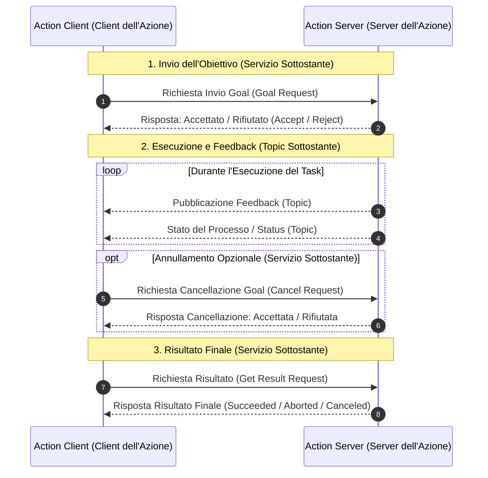
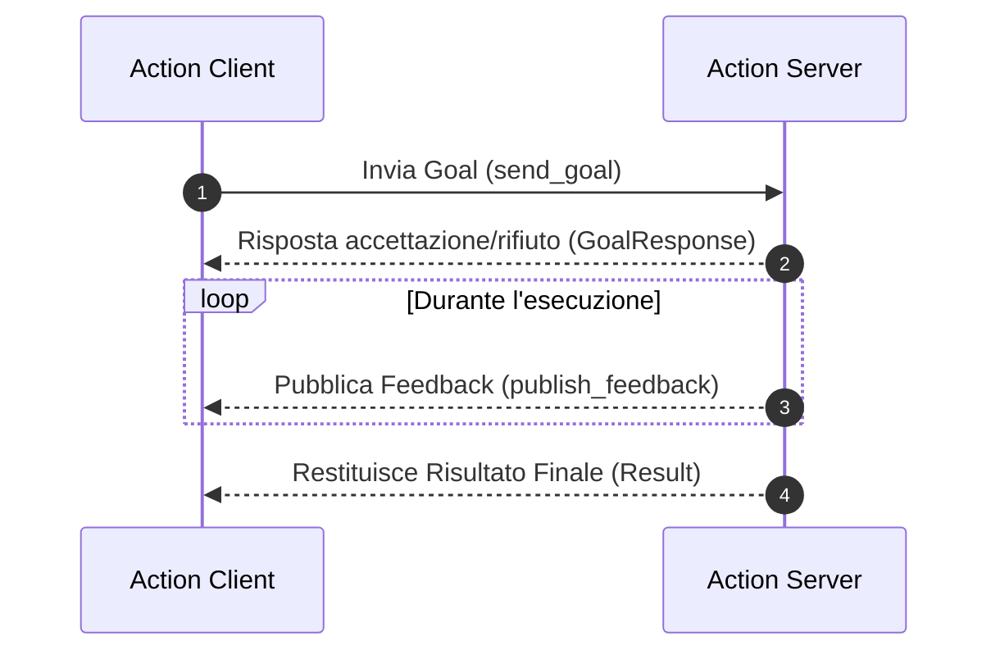
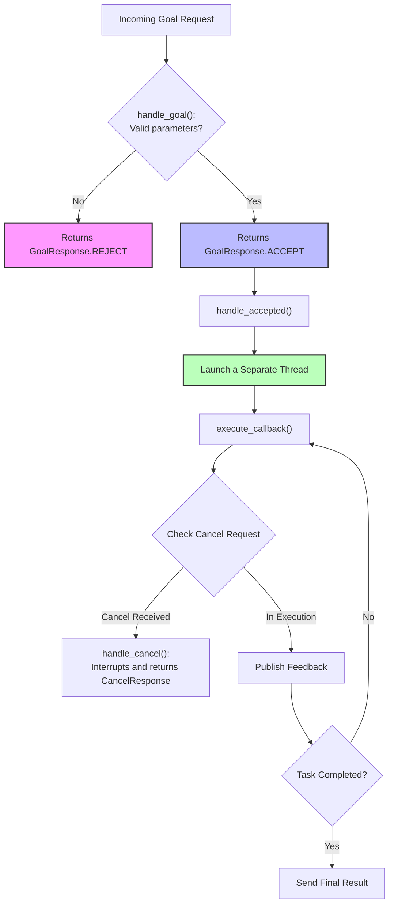
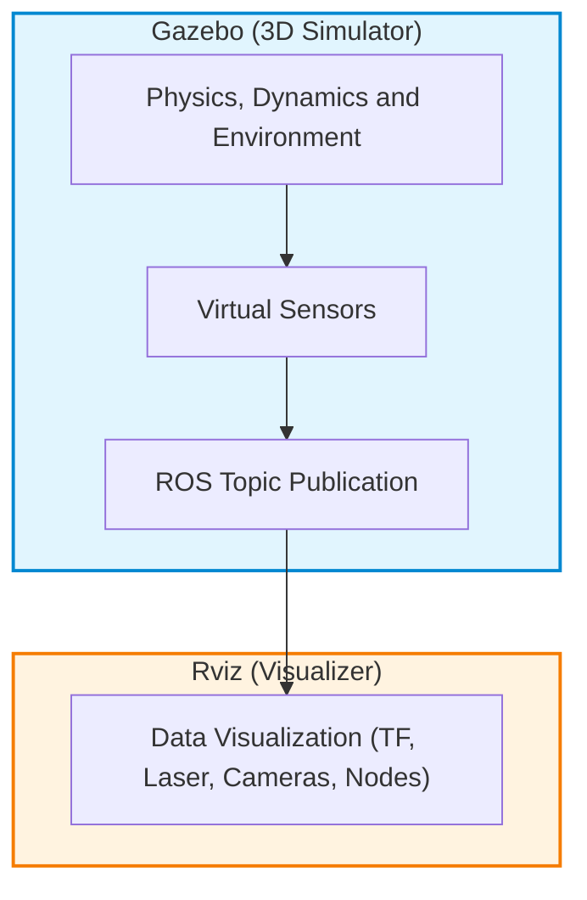

# Action Architecture in ROS 2: Fundamental Concepts and Internal Mechanisms

## Educational Overview

In this lecture, the third fundamental Inter-Process Communication (*IPC*) paradigm in ROS 2 is analyzed: **Actions**. After addressing *Topics* (intended for continuous streaming data exchange) and *Services* (designed for fast, synchronous request-response interactions), the focus shifts to long-running tasks, such as autonomous robot navigation or object manipulation.

The key concepts covered include:
* **Three-field structure of the action interface**: the formal composition of `.action` files, strictly divided into *Goal*, *Result*, and *Feedback*.
* **Internal architecture of ROS 2**: how the framework abstracts and manages an action by transparently combining internal Services (for *Goal* acceptance/rejection, cancellation requests, and *Result* delivery) and internal Topics (for transmitting *Feedback* and current status).
* **Lifecycle of the Client-Server interaction**: the complete operational flow between *Action Client* and *Action Server*, from sending the *Goal* up to completion or potential cancellation of the task.

---

### Introduction to Actions in ROS 2

In robotics and robot operating systems (ROS - *Robot Operating System*), information passing between nodes can occur through various communication paradigms. So far, we have analyzed two main modes:
1. **Topics**: dedicated to continuous and streaming communication (unidirectional, *Publisher/Subscriber*).
2. **Services**: dedicated to point-to-point communications based on the request-response paradigm (*Request/Response*), ideal for short and instantaneous operations.

However, when a Client node requests a Server node to execute a task with high temporal complexity (i.e., a *long-running task*), neither conventional Topics nor Services prove sufficient. In these contexts, **Actions** are used.

#### What is an Action and When to Use It
An **Action** is an asynchronous communication mechanism designed specifically for tasks that require a significant amount of time to complete, such as:
* **Robotic navigation**: moving from a position $A$ to a position $B$.
* **Robotic manipulation**: grasping and moving an object in space.

Unlike a simple service (where the Client remains blocked waiting or has no visibility into progress), an action allows to:
* Confirm whether the Server has **accepted or rejected** the initial request.
* Send continuous **Feedback** information from the Server to the Client during execution.
* Obtain the final **Result** at the end of the process.
* Allow the Client to send a **Cancel Goal** request at any time.

---

### Structure of an Action Interface (`.action`)

The data structure of an action is defined within an interface file with extension `.action`. Similar to what happens for custom messages and services, an `.action` file consists of three distinct sections, separated by dashes `---`:

```text
# 1. GOAL (Inviato dal Client al Server)
---
# 2. RESULT (Inviato dal Server al Client al completamento)
---
# 3. FEEDBACK (Inviato periodicamente dal Server al Client durante l'esecuzione)
```

1. **Goal**: defines the requested task (e.g., target coordinates $(x, y, \theta)$).
2. **Result**: defines the information returned by the Server at the end of the task (e.g., time elapsed, final outcome).
3. **Feedback**: defines the data periodically sent by the Server to update the Client on the progress (e.g., current position of the robot during the journey).

---

### Internal Architecture: How ROS Manages Actions

> **KEY CONCEPT: Internal Mechanism of Actions**
> Although to the developer the Action appears as a single high-level entity, **ROS internally manages an action by combining underlying Services and Topics**. It is not necessary to manually implement these individual elements, but it is essential to understand their architecture to correctly visualize data flow.

Actions rely internally on $5$ communication primitives:

* **Goal Service**: the Client sends the goal to the Server. Before starting the task, the Server responds with an *Accept* or *Reject* message.
* **Result Service**: the Client formally requests the final result and the Server responds after completing the execution.
* **Cancel Service**: handles any request by the Client to cancel the goal currently in execution.
* **Feedback Topic**: channel on which the Server continuously publishes status updates for the Client.
* **Status Topic**: channel on which the current state of the action state machine is notified.



---

### Lifecycle and Communication Flow

The typical execution cycle of an action between an **Action Client** and an **Action Server** follows a very specific sequence:

1. **Goal Transmission**: the Action Client sends the desired goal. The Action Server evaluates the request and responds immediately, confirming whether the goal has been accepted or rejected.
2. **Execution and Feedback**: if the goal is accepted, the Server starts execution. At the same time, it sends continuous feedback messages on the relevant Topic.
   * *Practical example*: in a navigation task from room $A$ to room $D$, the feedback published by the Server will progressively update the Client with the current position: $A \to B \to C \to D$.
3. **Goal Cancellation (Optional)**: during execution, the Client has the option to request cancellation of the task. The Server will evaluate the request and interrupt execution if cancellation is feasible.
4. **Execution Termination and Result**: once the task is finished (by natural completion or interruption), the Server notifies the Client. The final result of the action can assume three main states:
   * **Succeeded**: the task was completed successfully.
   * **Aborted**: an internal error occurred on the Server that prevented completion.
   * **Canceled**: execution was interrupted following a Client request.

---

### Educational Approach: The "Bare Minimum" Model

To fully understand how actions work without getting lost in the complexities of production code, we will analyze an **essential ("bare minimum")** version of an Action Client and an Action Server.

This approach aims to isolate exclusively the software components and mandatory methods required to ensure node operation, providing the necessary foundation to carry out standard application exercises and understand the official ROS 2 documentation.

---

### Action Interface Structure (`.action`)

Before analyzing the Client and Server nodes, it is essential to understand the interface on which communication is based. A ROS 2 action file (extension `.action`) is divided into three cross-sections separated by `---`:

1. **Goal:** The parameters sent by the Client to start the task.
2. **Result:** The data returned by the Server upon task completion.
3. **Feedback:** The data periodically sent by the Server during task execution.

In our example case (action `DriveDistance`), the interface is defined in the relevant package and requires as Goal fields a distance (`distance`) and a speed (`speed`).

---

### Implementation of the Action Client

The **Action Client** is the node responsible for requesting the execution of an asynchronous task from the Server, monitoring its progress, and managing its outcome.



#### 1. Initialization and Client Creation
The node imports the action interface from the dedicated package (e.g.,  `DriveDistance`). Inside the node class constructor, the client is created using the function:

```python
self._action_client = ActionClient(self, DriveDistance, 'drive_distance')
```

Unlike a *Topic*, where publication is continuous over time, an Action Client typically sends the request **only once**. To implement this behavior in ROS 2, a timer is configured that invokes the Goal sending function (`send_goal`) and is immediately canceled (or destroyed) after the first execution.

#### 2. Sending the Goal (`send_goal`)
The function `send_goal` handles preparing and sending the request by following these steps:
* **Waiting for the Server:** Verifies that the Action Server is active and ready to receive requests (`wait_for_server()`).
* **Goal Instantiation:** Creates an object `DriveDistance.Goal`  and populates the required fields (e.g., `distance` and `speed`  passed as parameters).
* **Callback Configuration:** Defines the response functions that the node will execute upon the occurrence of the three main events.

> **KEY CONCEPT: The Three Action Client Callbacks**
> 
> A well-structured Action Client must set up **three different callbacks** to asynchronously handle the Server's response:
> 1. **Goal Response Callback:** Handles the immediate server response communicating acceptance (`ACCEPT`) or rejection (`REJECT`) of the Goal.
> 2. **Feedback Callback:** Receives progress data sent by the server during processing.
> 3. **Result Callback:** Receives the final outcome of the operation when the task completes.

#### 3. Handling Callbacks in the Client
The callbacks use the argument `goal_handle` to identify the instance of the current task:
* **`goal_response_callback`**: Analyzes the status of the handle to verify if the Goal was accepted.
* **`feedback_callback`**: Receives the feedback object and allows real-time progress monitoring.
* **`get_result_callback`**: Invoked when the server finishes execution. Allows checking the final status of the action (whether completed successfully, canceled, or aborted: $Success$, $Canceled$, $Aborted$) and extracting the result fields (e.g., `travel` and `message`).

---

### Implementation of the Action Server

The **Action Server** is the node that receives requests from the Client, evaluates whether to execute them, manages cancellation requests, and performs the computational work while sending feedback.



#### 1. Initialization and Three Fundamental Handlers
Inside the Action Server, creation requires specifying the action type and binding three fundamental management methods:

```python
self._action_server = ActionServer(
    self,
    DriveDistance,
    'drive_distance',
    execute_callback=self.execute_callback,
    goal_callback=self.handle_goal,
    cancel_callback=self.handle_cancel,
    handle_accepted_callback=self.handle_accepted
)
```

> **KEY CONCEPT: The Three Action Server Control Methods**
>
> 1. **`handle_goal` (Request Handling):** Receives the Goal ID and the sent parameters. It must return a response of type `GoalResponse.ACCEPT` or `GoalResponse.REJECT`. Validity checks on Goal parameters are placed here.
> 2. **`handle_cancel` (Cancellation Handling):** Receives the interruption request from a client and returns a response of type `CancelResponse.ACCEPT` or `CancelResponse.REJECT`.
> 3. **`handle_accepted` (Acceptance and Execution):** Method invoked immediately after Goal acceptance. It has the fundamental task of **launching a separate execution thread**.

#### 2. The Importance of Multithreading in the Server
When the Action Server accepts a Goal, it must not perform the work directly in the main thread of the node. If it did, the node would become unresponsive and could no longer receive other requests, publish feedback, or listen to any cancellation commands.

For this reason, the function `handle_accepted` delegates the heavy processing to a method `execute_callback` launched on a parallel thread.

#### 3. The Execution Loop (`execute_callback`)
The method `execute_callback` contains the actual business logic of the task:

* **Initialization:** Instantiates local objects for `Feedback` and `Result`.
* **Execution Loop:** Iteratively executes the work (e.g., controlling robot motion). During each loop iteration:
  1. Checks if a cancellation request has arrived via the Goal handle (`is_cancel_requested`). If so, sets the status to canceled (`goal_handle.canceled()`) and interrupts execution.
  2. Calculates progress and publishes the feedback message via `goal_handle.publish_feedback(feedback)`.
* **Conclusion:** Once the loop finishes successfully, sets the final status of the Goal (`goal_handle.succeeded()`) and returns the object `Result` to the Client.

---

### Architectural Pattern and Software Engineering Template

All actions in ROS 2 share this exact same conceptual and syntactic structure. It is a highly standardized **Software Engineering** pattern:

* The code boilerplate — client/server creation, callback binding, thread management, and sending acceptance/cancellation responses — **remains identical** for any application.
* The only part that changes depending on the specific application is the **custom logic** contained within:
  * Validation checks in `handle_goal`.
  * Task computation loop in `execute_callback`.
  * Processing data received in the Client callbacks.

Once the distinction between the fixed template structure and the customizable parts is understood, one is capable of implementing any Action Server and Client in ROS 2.

---

### Robotic Simulation and ROS Software Architecture

---

#### Simulation Setup with TurtleBot3: Distinction between Gazebo and Rviz

When working with simulated robotic platforms, such as **TurtleBot3**, it is essential to clearly distinguish the roles of the different tools provided by the ROS ecosystem.

The standard operational workflow for launching the simulation involves the following steps:

1. **Environment Sourcing**: Adding the necessary environment variables in the working terminal.
2. **Robot Model Export**: Defining the specific environment variable for the target robot architecture (for example, setting the environment variable related to the TurtleBot3 model).
3. **Launch Simulation**: Starting the simulation world (for example, an *Empty World*).

#### Gazebo vs Rviz: Roles and Operational Differences

A common mistake is confusing the role of **Gazebo** with that of **Rviz**. Although both offer a 3D graphical interface, they perform conceptually opposite functions within the system architecture:

* **Gazebo — 3D World Simulator**: 
  It is a full physics simulation engine. It generates the three-dimensional structure and dynamics of the robot, calculates interactions with the environment (collisions, gravity, friction), and simulates the hardware behavior of synthetic sensors. Gazebo creates and calculates the "virtual real world".

* **Rviz — ROS Visualization Tool**: 
  **It simulates nothing**. It is a tool purely for visualizing data flowing inside the ROS network. It receives and processes messages coming from active topics (whether generated by real sensors or by a simulator like Gazebo), displaying on screen the status of transformation frames ($\text{TF}$), LIDAR data, video streams, and the status of individual nodes.



---

#### Software Architecture Best Practices: Separation of ROS Packages

During the development of a complex robotic application in ROS, managing code and dependencies requires a rigorous organization of the package structure (*Packages*).

#### Isolation of Interfaces and Messages

A fundamental architectural rule concerns **Custom Message Definitions**:

> **Key Concept:** 
> It is highly recommended to **separate the definition of custom messages from the components that use them**, isolating them within a ROS package dedicated exclusively to interfaces.

#### Advantages of Modular Separation

1. **Code Decoupling**: Nodes implementing the control algorithm or navigation logic only import data definitions from the message package, without having to directly depend on the full source code of other nodes.
2. **Interchangeability and Redundancy**: If it is decided to replace a node with another component (for example, a different planning algorithm or a node with redundant logic), it is sufficient to keep the message structure unchanged in the dedicated data package. The new component will be able to import the same interface without breaking system compatibility.
3. **Clean Build System Management**: Prevents circular dependency issues during the workspace build phase (*Workspace Build*).

---

> [!NOTE]
> ### Exam Notes and Instructor Notices
> - The instructor explicitly mentioned that it is necessary to know how to use the binding function/mechanism (`bind`) to connect methods to their respective callbacks, specifying that it will also be required for the exam.
