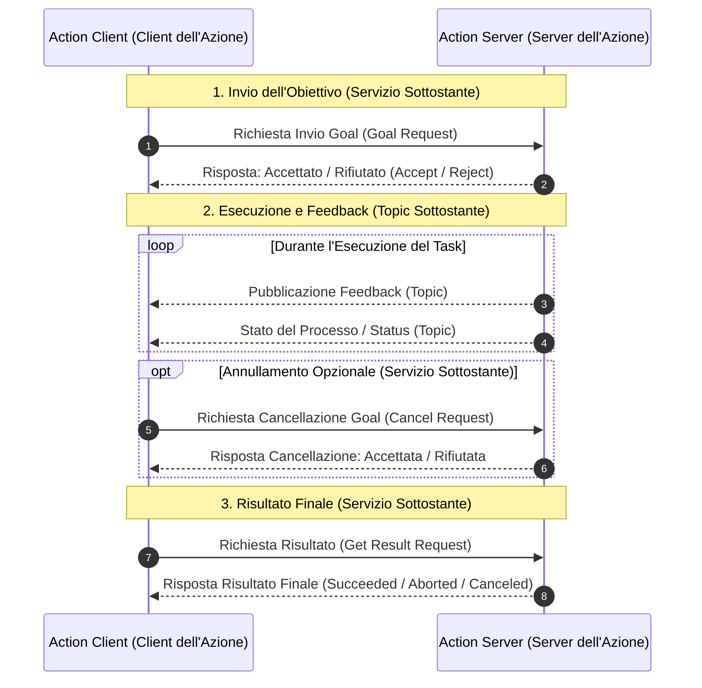
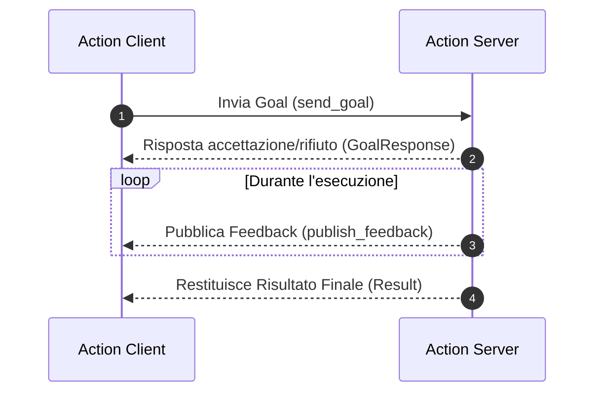
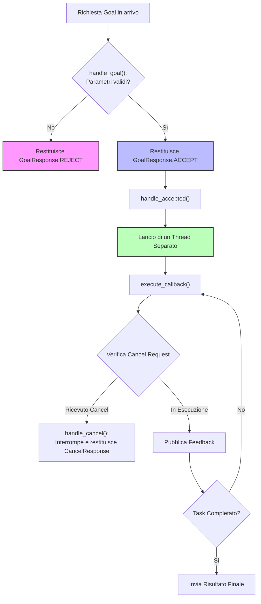
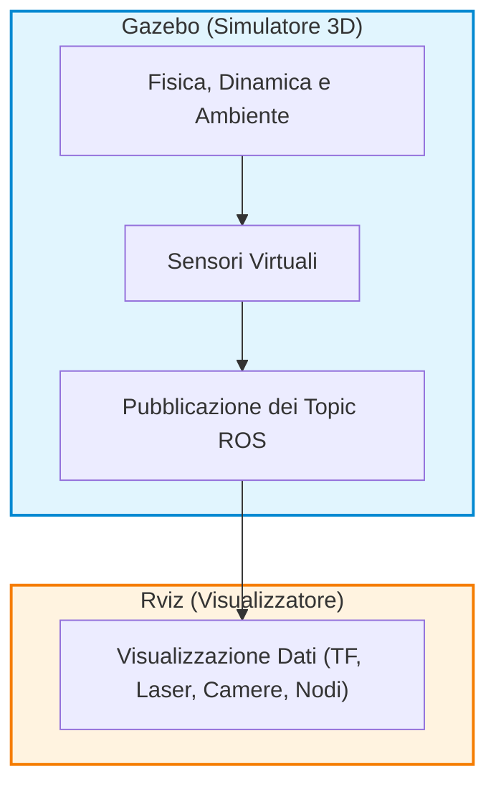

# Architettura delle Azioni in ROS 2: Concetti Fondamentali e Meccanismi Interni

## Overview Didattica

In questa lezione viene analizzato il terzo paradigma fondamentale di Comunicazione Inter-Processo (*Inter-Process Communication - IPC*) in ROS 2: le **Azioni (*Actions*)**. Dopo aver affrontato i *Topic* (destinati allo scambio continuo di dati in streaming) e i *Servizi (Services)* (progettati per interazioni sincrone e veloci di tipo richiesta-risposta), l'attenzione si sposta sulle operazioni a lunga durata (*long-running tasks*), quali la navigazione autonoma di un robot o la manipolazione di oggetti.

I concetti chiave trattati includono:
* **Struttura a tre campi dell'interfaccia dell'azione**: la composizione formale dei file `.action`, suddivisi rigorosamente in *Obiettivo (Goal)*, *Risultato (Result)* e *Feedback*.
* **Architettura interna di ROS 2**: come il *framework* astrae e gestisce un'azione combinando trasparentemente Servizi interni (per l'accettazione/rifiuto del *Goal*, la richiesta di cancellazione e la consegna del *Result*) e Topic interni (per la trasmissione del *Feedback* e dello stato corrente).
* **Ciclo di vita dell'interazione Client-Server**: il flusso operativo completo tra *Action Client* e *Action Server*, dal momento dell'invio del *Goal* fino al completamento o all'eventuale annullamento del compito.

---

### Introduzione agli Action in ROS 2

Nella robotica e nei sistemi operativi per robot (ROS - *Robot Operating System*), il passaggio di informazioni tra nodi può avvenire secondo diversi paradigmi di comunicazione. Fino a questo momento abbiamo analizzato due modalità principali:
1. **Topic**: dedicati alla comunicazione continua e a flusso fluttuante (unidirezionale, *Publisher/Subscriber*).
2. **Servizi (Services)**: dedicati a comunicazioni puntuali basate sul paradigma richiesta-risposta (*Request/Response*), ideali per operazioni brevi ed istantanee.

Tuttavia, quando un nodo Client richiede a un nodo Server l'esecuzione di un compito ad elevata complessità temporale (ovvero un *long-running task*), né i Topic né i Servizi convenzionali si rivelano sufficienti. In questi contesti si utilizzano le **Azioni (Actions)**.

#### Cos'è un'Azione e Quando Usarla
Un'**Azione (Action)** è un meccanismo di comunicazione asincrono progettato specificamente per task che richiedono un tempo significativo per essere completati, come ad esempio:
* **Navigazione robotica**: spostarsi da una posizione $A$ a una posizione $B$.
* **Manipolazione robotica**: afferrare e muovere un oggetto nello spazio.

A differenza di un semplice servizio (in cui il Client rimane bloccato in attesa o non ha visibilità dell'avanzamento), un'azione permette di:
* Confermare se il Server ha **accettato o rifiutato** la richiesta iniziale.
* Inviare informazioni continue di **riscontro (Feedback)** dal Server al Client durante l'esecuzione.
* Ottenere il **Risultato (Result)** finale al termine del processo.
* Consentire al Client di inviare una richiesta di **cancellazione dell'obiettivo (Cancel Goal)** in qualsiasi momento.

---

### Struttura dell'Interfaccia di un'Azione (`.action`)

La struttura dati di un'azione viene definita all'interno di un file di interfaccia con estensione `.action`. Analogamente a quanto avviene per i messaggi e per i servizi custom, un file `.action` si compone di tre sezioni ben distinte, separate da trattini `---`:

```text
# 1. GOAL (Inviato dal Client al Server)
---
# 2. RESULT (Inviato dal Server al Client al completamento)
---
# 3. FEEDBACK (Inviato periodicamente dal Server al Client durante l'esecuzione)
```

1. **Goal (Obiettivo)**: definisce il task richiesto (es. coordinate di destinazione $(x, y, \theta)$).
2. **Result (Risultato)**: definisce le informazioni restituite dal Server al termine del task (es. tempo impiegato, esito finale).
3. **Feedback (Riscontro)**: definisce i dati inviati periodicamente dal Server per aggiornare il Client sullo stato di avanzamento (es. posizione corrente del robot durante il tragitto).

---

### Architettura Interna: Come ROS Gestisce le Azioni

> **CONCETTO CHIAVE: Meccanismo Interno degli Action**
> Sebbene per lo sviluppatore l'Azione si presenti come un'unica entità ad alto livello, **ROS gestisce internamente un'azione combinando Servizi e Topic sottostanti**. Non è necessario implementare manualmente questi elementi singoli, ma è fondamentale comprenderne l'architettura per visualizzare correttamente il flusso dei dati.

Le Azioni si basano internamente su $5$ primitive di comunicazione:

* **Servizio Goal**: il Client invia l'obiettivo al Server. Prima di avviare il task, il Server risponde con un messaggio di *Accept* (accettato) o *Reject* (rifiutato).
* **Servizio Result**: il Client richiede formalmente il risultato finale e il Server risponde dopo aver concluso l'esecuzione.
* **Servizio Cancel**: gestisce l'eventuale richiesta da parte del Client di annullare l'obiettivo in corso di esecuzione.
* **Topic Feedback**: canale su cui il Server pubblica continuamente gli aggiornamenti di stato per il Client.
* **Topic Status**: canale su cui viene notificato lo stato corrente della macchina a stati dell'azione.



---

### Ciclo di Vita e Flusso di Comunicazione

Il ciclo di esecuzione tipico di un'azione tra un **Client dell'Azione (Action Client)** e un **Server dell'Azione (Action Server)** segue una sequenza ben precisa:

1. **Invio del Goal**: l'Action Client invia l'obiettivo desiderato. L'Action Server valuta la richiesta e risponde immediatamente confermando se l'obiettivo è stato accettato o rifiutato.
2. **Esecuzione e Feedback**: se l'obiettivo viene accettato, il Server avvia l'esecuzione. Contestualmente, invia messaggi di feedback continui sul Topic relativo. 
   * *Esempio prassico*: in un task di navigazione dalla stanza $A$ alla stanza $D$, il feedback pubblicato dal Server aggiornerà progressivamente il Client con la posizione corrente: $A \to B \to C \to D$.
3. **Cancellazione dell'Obiettivo (Opzionale)**: durante l'esecuzione, il Client ha la facoltà di richiedere la cancellazione del task. Il Server valuterà la richiesta e interromperà l'esecuzione se la disdetta è fattibile.
4. **Termine dell'Esecuzione e Risultato**: terminato il task (per completamento naturale o interruzione), il Server notifica il Client. Il risultato finale dell'azione può assumere tre stati principali:
   * **Succeeded (Raggiunto con successo)**: il task è stato completato correttamente.
   * **Aborted (Abortito)**: si è verificato un errore interno al Server che ha impedito il completamento.
   * **Canceled (Cancellato)**: l'esecuzione è stata interrotta a seguito di una richiesta del Client.

---

### Approccio Didattico: Il Modello "Bare Minimum"

Per comprendere appieno il funzionamento delle azioni senza disperdersi nelle complessità del codice di produzione, analizzeremo una versione **essenziale ("bare minimum")** di un Action Client e di un Action Server. 

Questo approccio mira a isolare esclusivamente le componenti software e i metodi obbligatori per garantire il funzionamento del nodo, fornendo le basi necessarie per svolgere gli esercizi applicativi standard e comprendere la documentazione ufficiale di ROS 2.

---

### Struttura dell'Action Interface (`.action`)

Prima di analizzare i nodi di Client e Server, è fondamentale comprendere l'interfaccia su cui si basa la comunicazione. Un file di azione ROS 2 (estensione `.action`) è diviso in tre sezioni trasversali separate da `---`:

1. **Goal (Obiettivo):** I parametri inviati dal Client per avviare il task.
2. **Result (Risultato):** I dati restituiti dal Server al completamento del task.
3. **Feedback (Aggiornamento):** I dati inviati periodicamente dal Server durante l'esecuzione del task.

Nel nostro caso di esempio (azione `DriveDistance`), l'interfaccia è definita nel relativo pacchetto e richiede come campi del Goal una distanza (`distance`) e una velocità (`speed`).

---

### Implementazione dell'Action Client

L'**Action Client** (Client dell'Azione) è il nodo responsabile di richiedere l'esecuzione di un task asincrono al Server, di monitorarne l'avanzamento e di gestirne l'esito.



#### 1. Inizializzazione e Creazione del Client
Il nodo importa l'interfaccia dell'azione dal pacchetto dedicato (es. `DriveDistance`). All'interno del costruttore della classe del nodo, il client viene creato tramite la funzione:

```python
self._action_client = ActionClient(self, DriveDistance, 'drive_distance')
```

A differenza di un *Topic*, in cui la pubblicazione è continua nel tempo, un Action Client invia la richiesta tipicamente **una sola volta**. Per implementare questo comportamento in ROS 2, si configura un timer che invoca la funzione di invio del Goal (`send_goal`) e che viene immediatamente annullato (o distrutto) dopo la prima esecuzione.

#### 2. Invio del Goal (`send_goal`)
La funzione `send_goal` gestisce la preparazione e l'invio della richiesta seguendo questi passaggi:
* **Attesa del Server:** Verifica che l'Action Server sia attivo e pronto a ricevere richieste (`wait_for_server()`).
* **Istanziazione del Goal:** Crea un oggetto `DriveDistance.Goal` e popola i campi requisiti (es. `distance` e `speed` passati come parametri).
* **Configurazione delle Callback:** Definisce le funzioni di risposta che il nodo eseguirà al verificarsi dei tre eventi principali.

> **CONCETTO CHIAVE: Le Tre Callback dell'Action Client**
> 
> Un Action Client ben strutturato deve predisporre **tre differenti callback** per gestire in modo asincrono la risposta del Server:
> 1. **Goal Response Callback:** Gestisce la risposta immediata del server che comunica l'accettazione (`ACCEPT`) o il rifiuto (`REJECT`) del Goal.
> 2. **Feedback Callback:** Riceve i dati di avanzamento inviati dal server durante l'elaborazione.
> 3. **Result Callback:** Riceve l'esito finale dell'operazione quando il task termina.

#### 3. Gestione delle Callback nel Client
Le callback usano l'argomento `goal_handle` per identificare l'istanza del task corrente:
* **`goal_response_callback`**: Analizza lo stato dell'handle per verificare se il Goal è stato preso in carico.
* **`feedback_callback`**: Riceve l'oggetto di feedback e permette di monitorare lo stato di avanzamento in tempo reale.
* **`get_result_callback`**: Viene invocata quando il server termina l'esecuzione. Permette di verificare lo stato finale dell'azione (se completata con successo, annullata o abortita: $Success$, $Canceled$, $Aborted$) ed estrarre i campi del risultato (es. `travel` e `message`).

---

### Implementazione dell'Action Server

L'**Action Server** (Server dell'Azione) è il nodo che riceve le richieste dal Client, valuta se eseguirle, gestisce le richieste di cancellazione ed esegue il lavoro computazionale inviando il feedback.



#### 1. Inizializzazione e Tre Handler Fondamentali
All'interno dell'Action Server, la creazione richiede la specifica del tipo di azione e il binding di tre metodi fondamentali di gestione:

```python
self._action_server = ActionServer(
    self,
    DriveDistance,
    'drive_distance',
    execute_callback=self.execute_callback,
    goal_callback=self.handle_goal,
    cancel_callback=self.handle_cancel,
    handle_accepted_callback=self.handle_accepted
)
```

> **CONCETTO CHIAVE: I Tre Metodi di Controllo dell'Action Server**
>
> 1. **`handle_goal` (Gestione della Richiesta):** Riceve l'ID del Goal e i parametri inviati. Deve restituire una risposta di tipo `GoalResponse.ACCEPT` o `GoalResponse.REJECT`. Qui si inseriscono i controlli di validità sui parametri del Goal.
> 2. **`handle_cancel` (Gestione della Cancellazione):** Riceve la richiesta di interruzione da parte di un client e restituisce una risposta di tipo `CancelResponse.ACCEPT` o `CancelResponse.REJECT`.
> 3. **`handle_accepted` (Accettazione ed Esecuzione):** Metodo invocato subito dopo l'accettazione del Goal. Ha il compito fondamentale di **avviare un thread di esecuzione separato**.

#### 2. L'importanza del Multi-threading nel Server
Quando l'Action Server accetta un Goal, non deve eseguire il lavoro direttamente nel *thread principal* del nodo. Se lo facesse, il nodo diventerebbe "non reattivo" (unresponsive) e non potrebbe più ricevere altre richieste, pubblicare feedback o ascoltare eventuali comandi di annullamento. 

Per questo motivo, la funzione `handle_accepted` delega l'elaborazione pesante a un metodo `execute_callback` avviato su un thread parallelo.

#### 3. Il Ciclo di Esecuzione (`execute_callback`)
Il metodo `execute_callback` contiene la logica di business vera e propria del task:

* **Inizializzazione:** Istanzia gli oggetti locali per `Feedback` e `Result`.
* **Loop di Esecuzione (Execution Loop):** Esegue iterativamente il lavoro (es. controllo del movimento del robot). Durante ogni iterazione del ciclo:
  1. Controlla se è pervenuta una richiesta di cancellazione mediante l'handle del Goal (`is_cancel_requested`). In caso affermativo, imposta lo stato a cancellato (`goal_handle.canceled()`) e interrompe l'esecuzione.
  2. Calcola i progressi e pubblica il messaggio di feedback tramite `goal_handle.publish_feedback(feedback)`.
* **Conclusione:** Una volta terminato il ciclo con successo, imposta lo stato finale del Goal (`goal_handle.succeeded()`) e restituisce l'oggetto `Result` al Client.

---

### Modello Architetturale e Template di Software Engineering

Tutte le azioni in ROS 2 condividono esattamente questa medesima struttura concettuale e sintattica. Si tratta di un modello di **Software Engineering** fortemente standardizzato:

* L'impalcatura (*boilerplate*) del codice — la creazione del client/server, il binding delle callback, la gestione dei thread e l'invio delle risposte di accettazione/cancellazione — **rimane identica** per qualsiasi applicazione.
* La sola parte che cambia in base alla specifica applicazione è la **logica custom** contenuta all'interno di:
  * Controlli di validazione in `handle_goal`.
  * Ciclo di calcolo del task in `execute_callback`.
  * Elaborazione dei dati ricevuti nelle callback del Client.

Compresa la distinzione tra la struttura fissa del template e le parti personalizzabili, si è in grado di implementare qualsiasi Action Server e Client in ROS 2.

---

### Simulazione Robotica e Architettura del Software ROS

---

#### Setup della Simulazione con TurtleBot3: Distinzione tra Gazebo e Rviz

Quando si lavora con piattaforme robotiche simulate, come il **TurtleBot3**, è fondamentale distinguere chiaramente i ruoli dei diversi strumenti forniti dall'ecosistema ROS.

Il workflow operativo standard per l'avvio della simulazione prevede i seguenti passaggi:

1. **Configurazione dell'Ambiente (*Environment Sourcing*)**: Inserimento delle variabili d'ambiente necessarie nel terminale di lavoro.
2. **Esportazione del Modello del Robot (*Robot Model Export*)**: Definizione della variabile di ambiente specifica per l'architettura del robot target (ad esempio, impostando la variabile di ambiente relativa al modello TurtleBot3).
3. **Lancio del Simulatore (*Launch Simulation*)**: Avvio del mondo di simulazione (ad esempio un ambiente vuoto, *Empty World*).

#### Gazebo vs Rviz: Ruoli e Differenze Operative

Un errore comune è confondere il ruolo di **Gazebo** con quello di **Rviz**. Sebbene entrambi offrano un'interfaccia grafica 3D, svolgono funzioni concettualmente opposte nell'architettura del sistema:

* **Gazebo — Simulatore di Mondo 3D (*3D World Simulator*)**: 
  È un motore di simulazione fisica completo. Genera la struttura tridimensionale e la dinamica del robot, calcola le interazioni con l'ambiente (collisioni, gravità, attrito) e simula il comportamento hardware dei sensori sintetici. Gazebo crea e calcola il "mondo reale virtuale".

* **Rviz — Strumento di Visualizzazione (*ROS Visualization Tool*)**: 
  **Non simula nulla**. È uno strumento di pura visualizzazione dei dati che viaggia all'interno della rete ROS. Riceve ed elabora i messaggi provenienti dai topic attivi (siano essi generati da sensori reali o da un simulatore come Gazebo), mostrando a schermo lo stato dei frame di trasformazione ($\text{TF}$), i dati LIDAR, i flussi video e lo stato dei singoli nodi.



---

#### Buone Pratiche di Architettura Software: Separazione dei Pacchetti ROS

Durante lo sviluppo di un'applicazione robotica complessa in ROS, la gestione del codice e delle dipendenze richiede un'organizzazione rigorosa della struttura dei pacchetti (*Packages*).

#### Isolamento delle Interfacce e dei Messaggi

Una regola architetturale fondamentale riguarda le **Definizioni di Messaggi Personalizzati (*Custom Message Definitions*)**:

> **Concetto Chiave:** 
> È altamente consigliato **separare la definizione dei messaggi custom dalle componenti che li utilizzano**, isolandoli all'interno di un pacchetto ROS dedicato esclusivamente alle interfacce.

#### Vantaggi della Separazione Modulare

1. **Disaccoppiamento del Codice (*Code Decoupling*)**: I nodi che implementano l'algoritmo di controllo o la logica di navigazione si limitano a importare le definizioni dei dati dal pacchetto messaggi, senza dover dipendere direttamente dall'intero codice sorgente di altri nodi.
2. **Intercambiabilità e Ridondanza (*Component Intersect & Redundancy*)**: Se si decide di sostituire un nodo con un'altra componente (ad esempio, un diverso algoritmo di pianificazione o un nodo con logica ridondante), è sufficiente mantenere invariata la struttura dei messaggi nel pacchetto dati dedicato. La nuova componente potrà importare la medesima interfaccia senza rompere la compatibilità del sistema.
3. **Gestione Pulita del Build System**: Evita problemi di dipendenze circolari durante la fase di compilazione dell'area di lavoro (*Workspace Build*).

---

> [!NOTE]
> ### Note per l'Esame e Avvisi del Docente
> - Il docente ha menzionato esplicitamente che occorre saper utilizzare la funzione/meccanismo di *binding* (`bind`) per collegare i metodi ai rispettivi callback, specificando che sarà necessario anche per l'esame.