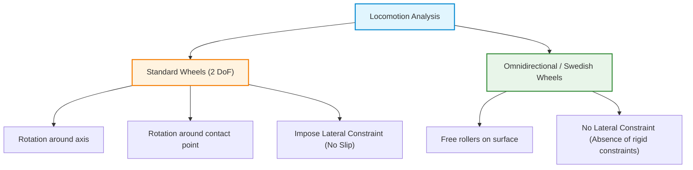
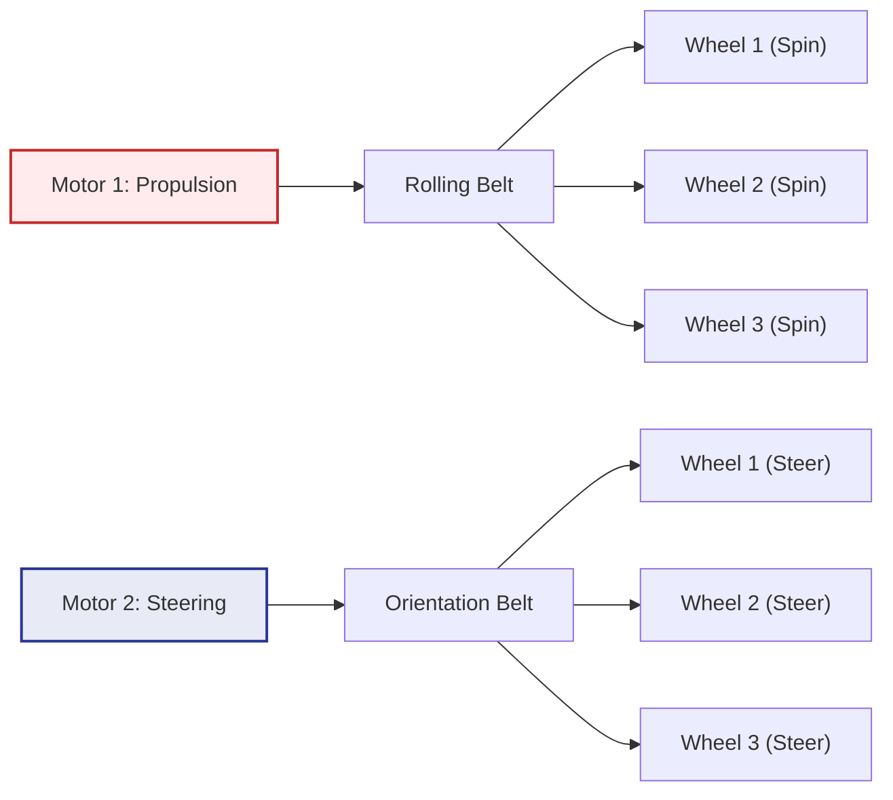
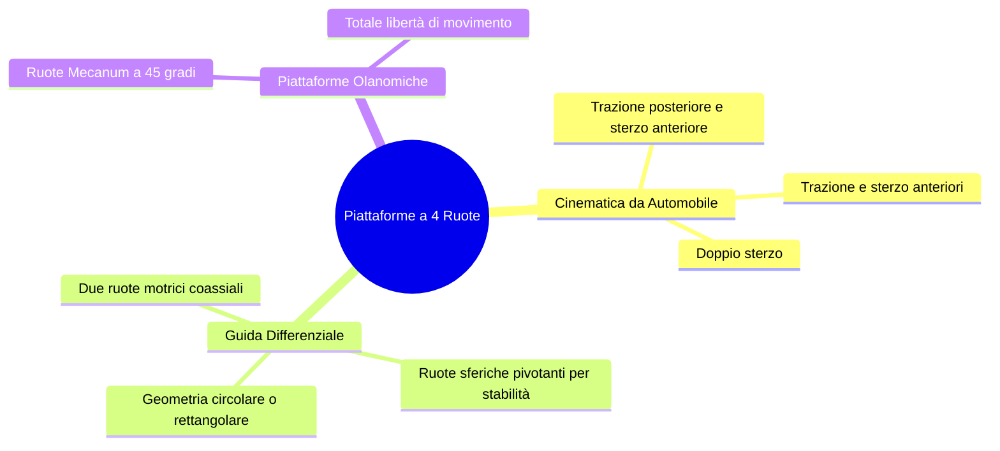
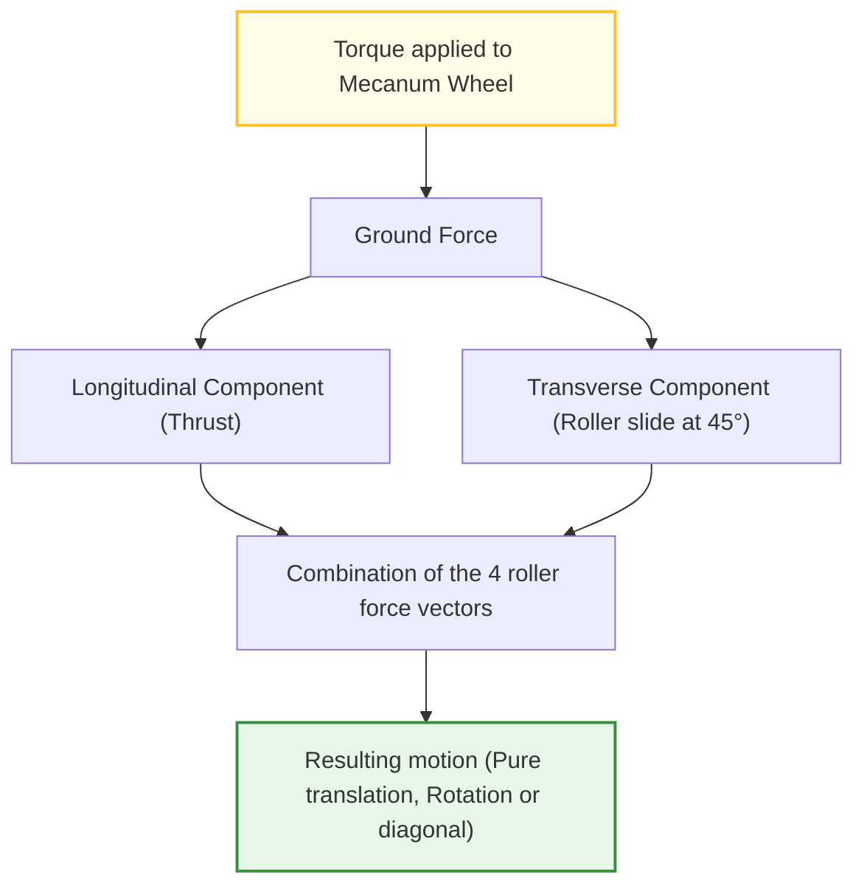
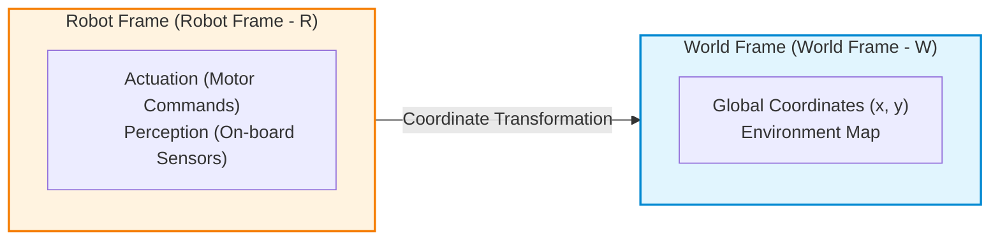
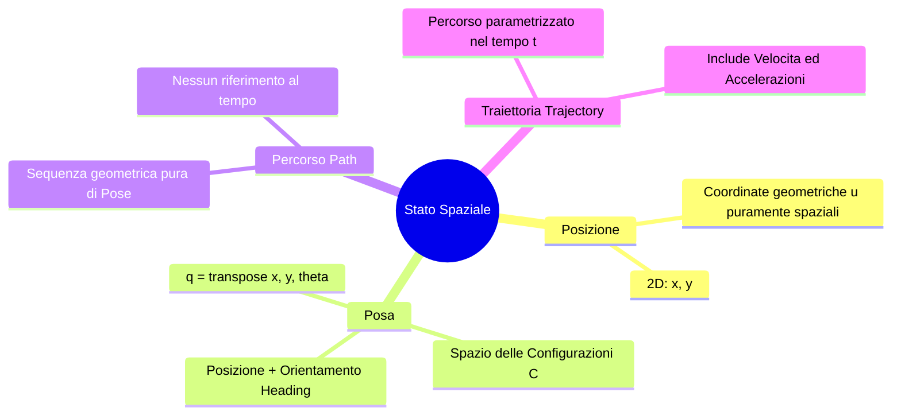
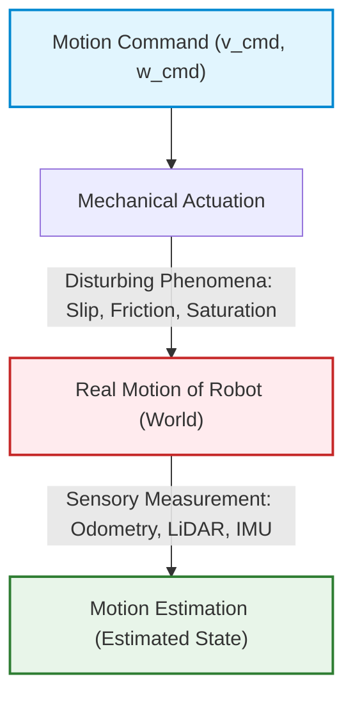
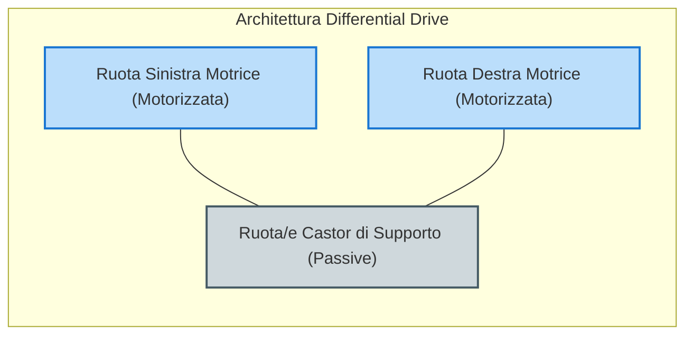
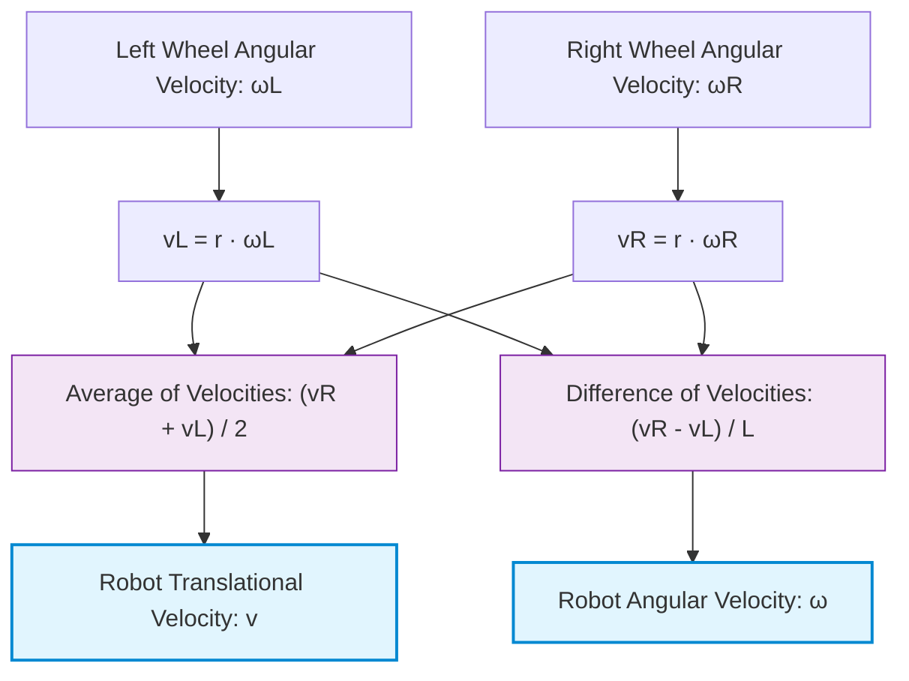
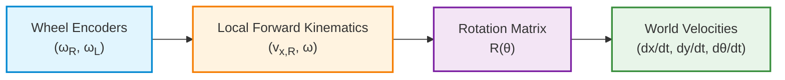

# Kinematics of Mobile Robots: Kinematic Constraints and Synchro Drive and Omnidirectional Architectures

## Educational Overview

The lecture addresses the problem of locomotion control in mobile robots (*Mobile Robots*), drawing a parallel with Direct Kinematics (*Direct Kinematics*) and Inverse Kinematics (*Inverse Kinematics*) already analyzed for industrial manipulators. The primary goal is to define how to guide a robotic platform from an initial position/pose $A$ to a desired one $B$.

Key concepts covered include:

*   **Degrees of Freedom and Kinematic Constraints (*Kinematic Constraints*):** Unlike manipulator joints, the use of wheels introduces degrees of freedom (*Degrees of Freedom - DoF*) in the plane, but simultaneously imposes constraints on motion. Standard wheels (*Standard Wheels*), both fixed and steerable, guarantee rolling along their main axis but introduce a non-slipping lateral constraint (*Lateral Constraint*).
*   **Synchro Drive Architecture:** Analysis of the operation of a three- or four-wheeled platform driven by only two motors via drive belts (*Drive Belts*). One motor synchronously controls the rolling of all wheels, while the second controls their steering. The fundamental feature of this system is maintaining a constant orientation (*Heading*) of the structure during any translational trajectory.
*   **Omnidirectional Platforms (*Omnidirectional Platforms*):** Introduction to holonomic structures based on three roller wheels (such as Swedish wheels, *Swedish Wheels*), each driven by an independent motor. This system allows the robot to move in any direction on the plane (including lateral motions) and to vary the platform's orientation in a completely decoupled way relative to the translational trajectory.

---

### Recap on Locomotion Kinematics and Mechanical Constraints

The fundamental goal of locomotion control in mobile robots (*Mobile Robot Locomotion*) is to define the control laws to transfer the platform from an initial configuration (Position A) to a desired configuration (Position B).

In **robot manipulators** (*Robot Manipulators*), this problem is addressed via:
* **Direct Kinematics** (*Direct Kinematics*): knowing the joint configuration, the pose of the End-Effector is calculated.
* **Inverse Kinematics** (*Inverse Kinematics*): given the desired pose of the End-Effector, the actuation commands for the individual joints are calculated.

In **wheeled mobile robots**, the kinematics differs substantially from that of articulated arms with revolute or prismatic joints. The addition of wheels increases the theoretical degrees of freedom of the system in space, but simultaneously introduces **kinematic constraints** (*Kinematic Constraints*).

#### Standard Wheels and Motion Constraints
A standard wheel has 2 Degrees of Freedom (*Degrees of Freedom - DoF*):
1. Rotation along its rolling axis.
2. Rotation around the contact point with the ground (orientation or *steering*).

However, each standard wheel positioned on the chassis introduces a **no-side-slip constraint** (*Lateral Constraint* / *No-Side-Slip Constraint*). The wheel cannot translate in a direction orthogonal to its rolling plane.

> **Intuitive Example:** Consider a mining cart on rails with four fixed, non-steerable wheels. The system has an almost total motion constraint: it can move exclusively forward or backward along a fixed direction. The wheels and rails eliminate the ability to steer or translate laterally.

To understand the kinematics of a mobile robot, each individual wheel must be analyzed by evaluating:
* **Negative Contribution (Constraint):** how much the wheel limits the overall degrees of freedom of the chassis.
* **Positive Contribution (Propulsion):** how the active rotation of the wheel pushes the platform through space.

---

### Architecture Analysis: The Synchro Drive System

The **Synchro Drive** is a peculiar mechanical configuration that uses three (or four) mechanically synchronized steerable standard wheels, controlled by only **two motors**.

#### Operating Mechanism
* **First Motor:** Governs the rolling (*rolling*) of all wheels simultaneously via a first transmission belt (*drive belt*).
* **Second Motor:** Governs the steering (*steering*) and orientation of all wheels synchronously via a second transmission belt.

> **Key Concept: Steering vs Heading**
> In Synchro Drive, **changing the steering direction does not imply changing the robot's orientation (*Heading*)**. 
> Since all wheels steer together by the same angle and rotate at the same speed, the chassis translates in any direction while keeping its rigid body axis always oriented in the same direction in space.

#### Advantages and Applications
1. **Reduction of Actuators:** Allows controlling the kinematic extension of 3 or 4 wheels with only 2 motors.
2. **Specific Applications:** It is ideal for structured environments (e.g. material handling between industrial shelves) where the robot must move along arbitrary directions without ever rotating on itself, avoiding collisions due to sweeping footprint clearance.

---

### Four-Wheel Configurations and Differential Drive

Despite the educational interest of Synchro Drive, most industrial and service platforms use four-wheel configurations to guarantee static stability and mechanical efficiency.

Among these, **Differential Drive** (*Differential Drive*) represents the benchmark standard for vacuum cleaner robots and light transport platforms:
* Uses two independent drive wheels placed on a common axis passing through the geometric center of the platform.
* Integrates one or two passive caster/spherical wheels (*Caster Wheels*) to ensure static stability without introducing rigid kinematic constraints.
* The external geometric shape is often circular to simplify contact modeling and collision-free trajectory planning.

---

### Holonomic Platforms and Mecanum Wheels

**Holonomic platforms** (*Holonomic Platforms*) are systems capable of instantaneously controlling all degrees of freedom in the plane ($x, y, \theta$). One of the most common solutions uses **Mecanum wheels** (also called *Ilon* wheels).

#### Geometry and Traction Principle
Unlike traditional Swedish wheels (with rollers at $90^\circ$ with respect to the main axis), the Mecanum wheel features passive peripheral rollers inclined at an angle of $\pm 45^\circ$ with respect to the wheel plane.

* When the wheel is rotated by the motor, the force exerted on the ground from the contact point is decomposed: one part generates longitudinal thrust, while the roller inclination at $45^\circ$ generates a transverse force component.
* Through the proper combination of angular velocities and rotation directions of the four Mecanum wheels, it is possible to achieve:
  1. Pure forward/backward translation.
  2. Pure lateral translation (*Crabbing*).
  3. Diagonal translation at any angle.
  4. Pure turning on the spot (*Turning on the spot*).
  5. Combined motion (simultaneous translation and rotation).

#### Operational Advantages and Disadvantages

| Advantages | Disadvantages and Physical Limitations |
| :--- | :--- |
| **Absence of kinematic constraints:** smooth transitions and instantaneous trajectories in all directions. | **Vibrations and Noise:** the continuous transition of contact between one roller and the next creates geometric imperfections and impact discontinuities. |
| **High load capacity:** supports high payloads (*Payload*) distributed over 4 wheels. | **Low Friction and Slippage:** the tiny contact area of the rollers limits grip, causing continuous sliding (*skating effect*). |
| **Maneuverability in tight spaces:** ability to rotate while keeping the central point fixed. | **Unstable Dynamics:** requires low-level **Dynamic Control** (*Dynamic Control*) on the motors, as kinematics alone does not guarantee accuracy at high speeds. |

> **Key Concept: Dynamic Behavior of Mecanum Wheels**
> Due to the point-like and intermittent contact of rollers inclined at $45^\circ$, Mecanum platforms suffer from high slippage. It is not possible to rely exclusively on the open-loop theoretical kinematic model (*Open-Loop Kinematic Control*): at high speeds the robot tends to "skate as if on ice", making the use of continuous feedback dynamic control algorithms essential for trajectory stabilization.

---

### Passive Support Wheels and Kinematic Constraints

When a mobile robot must carry heavy loads (hundreds of kilograms), placing the entire weight directly and exclusively on the drive wheels would damage their axles. The bending stress on the motor shaft, connected to rotor and stator, would bend the transmission shaft.

To distribute the load without altering the vehicle's kinematics, **passive support wheels** are added (such as caster/faceted wheels or *castor wheels*, spherical wheels, or omnidirectional wheels).
These wheels:
* Provide structural support to the chassis.
* **Do not introduce additional kinematic constraints** on the robot's motion.

---

### Frames of Reference: World Frame and Robot Frame

To describe the motion of a mobile robot in the plane, it is necessary to manage two distinct **Frames of Reference** (*Frames of Reference*) simultaneously:

1. **World Frame (*World Coordinate Frame*)**: It is the global fixed reference frame relative to which we measure the robot's absolute displacement in the environment.
2. **Robot Frame (*Robot Coordinate Frame*)**: It is the reference frame attached to the robot's body.

> **Key Concept**: All **actuation** operations (commands sent to motors) and **perception** operations (obstacle measurements via on-board sensors) naturally occur in the **Robot Frame**. If the sensor detects an obstacle at $1\text{ m}$ distance, that data is expressed relative to the robot. To build a coherent map of the environment, it is essential to mathematically transform the coordinates from the Robot Frame to the World Frame.

---

### Fundamental Terminology: Position, Pose, Path, and Trajectory

In mobile robotics, it is essential not to confuse terms that are used as synonyms in common language.

#### 1. Position (*Position*)
Indicates solely the spatial localization of the robot. For a robot operating on a 2D plane, the position is defined by the vector of Cartesian coordinates:
$$\mathbf{p} = \begin{bmatrix} x \\ y \end{bmatrix}$$

#### 2. Pose (*Pose*)
Represents the complete state of the robot in the **Configuration Space** (*Configuration Space*, $C$). Since on the plane indicating position alone is not sufficient to define the direction the robot is facing (*heading*), the pose adds the orientation variable $\theta$:
$$\mathbf{q} = \begin{bmatrix} x \\ y \\ \theta \end{bmatrix}$$

#### 3. Path (*Path*)
It is the geometric sequence of poses that the robot traverses to move from an initial to a final configuration. The path contains no temporal information; it describes exclusively "where" the robot is geometrically situated.

#### 4. Trajectory (*Trajectory*)
It is a path explicitly parameterized as a function of time $t$:
$$\mathbf{q}(t) = \begin{bmatrix} x(t) \\ y(t) \\ \theta(t) \end{bmatrix}$$
The trajectory links the robot's poses to specific time instants ($t_0, t_1, t_2, \dots$), thus introducing the concepts of **velocity** and **acceleration**.

If the time sampling intervals are constant ($\Delta t = t_{i+1} - t_i = \text{costante}$), a larger geometric distance between successive poses along the trajectory indicates a higher acceleration or velocity of the robot in that segment.

---

### Mobile Robot Kinematics and Velocity Components

Considering the pose $\mathbf{q}(t)$ as a function of time, differentiating with respect to $t$ yields the velocity in the configuration space $\dot{\mathbf{q}}(t)$.

In mobile robotics applications, the vehicle's overall velocity is decomposed into two main components:

1. **Translational (or Linear) Velocity ($v$)**: Indicates the rate of change of the robot's position in space:
   $$v(t) = \sqrt{\dot{x}^2(t) + \dot{y}^2(t)}$$
2. **Angular Velocity ($\omega$)**: Indicates the rate of change of the robot's orientation (*heading*) over time:
   $$\omega(t) = \dot{\theta}(t)$$

---

### The Gap Between Commanded Motion, Real Motion, and Estimated Motion

In industrial robots (ground-anchored manipulators) there is high **repeatability** (*repeatability*): an open-loop command (*open-loop*) is executed with millimeter accuracy. In mobile robotics the situation is completely different.

> **Key Concept**: In mobile robotics, the discrepancy relationship always holds:
> $$\text{Moto Comandato} \neq \text{Moto Reale} \neq \text{Moto Stimato}$$

The discrepancies between the sent command and the actual movement are caused by several physical factors:
* **Wheel Slip (*Wheel Slip*)**: Loss of traction between wheel and ground (due to terrain irregularities or sudden accelerations).
* **Actuator Dynamics (*Actuator Dynamics*)**:
  * *Static Friction (*Static Friction*)*: To start motion from rest, breakaway static friction must be overcome by supplying current peaks, producing a jerky movement (*jerk*).
  * *Motor Saturation (*Motor Saturation*)*: Physical limits of deliverable current and torque beyond which the motor cannot accelerate further.

Consequently:
* **Open-Loop Control (*Open-Loop Control*)**: Sends the command and assumes the robot reaches its destination. It is usable almost exclusively on high-precision industrial manipulators.
* **Closed-Loop Control (*Closed-Loop Control*)**: Fundamental for mobile robots. Continuously estimates the real state of the robot via sensors to correct drift and slip errors in real time.

---

### Introduction to Differential Drive

Among the various kinetic-mechanical architectures for mobile robots (such as *Tricycle*, *Car-like/Ackermann*, or *Skid-Steering*), the **Differential Drive (*Differential Drive*)** configuration is among the most widespread.

#### Features of the Differential Drive Architecture:
1. **Mechanical and Economic Simplicity**: Uses only two drive wheels powered by independent motors mounted on the same transverse axis, without any dedicated steering mechanism.
2. **High Maneuverability**: By independently controlling the angular velocities of the right and left wheels, the robot can rotate on the spot (zero turning radius).
3. **High Reliability**: The absence of rigid linkages and steering arms reduces mechanical wear.
4. **Kinematic Modelability**: The geometric relationship between the speeds of individual wheels and the resulting motion ($v, \omega$) has a simple mathematical formulation and is extremely effective for indoor environments (*indoor*).

---

### Geometric Architecture and Basic Notation

Let us now analyze the kinematic modeling of a differential drive robot (*Differential Drive Robot*). The fundamental mechanical structure consists of:
*   **Two independent drive wheels**: each driven by its own motor.
*   **A pivoting or idle wheel** (*Caster Wheel* or *Castor Wheel*): serves solely to provide a point of support and mechanical stability to the chassis (*chassis*), without introducing kinematic constraints on the robot's motion.
*   **Plane and contact constraint**: the robot moves on a two-dimensional plane and is subject to the condition of **pure rolling without slipping** (*Pure Rolling without Slipping*).

To derive the equations of motion, we define the following geometric and kinematic parameters:

*   $r$: radius of the drive wheels (assumed identical).
*   $L$: track width of the robot (*wheel separation* or *track width*), i.e., the distance between the contact points of the two drive wheels.
*   $\omega_R, \omega_L$: angular velocities of the right wheel (*Right Wheel*) and left wheel (*Left Wheel*), respectively.
*   $v_R, v_L$: linear forward velocities of the center of each wheel ($v_R = r \cdot \omega_R$ and $v_L = r \cdot \omega_L$).
*   $v$: linear translational velocity of the geometric center (or center of mass) of the robot.
*   $\omega$: angular rotational velocity of the entire platform around its center.

---

### Intuitive Motion Analysis

Control of the robot's entire trajectory occurs solely by appropriately modulating the two input angular velocities $\omega_L$ and $\omega_R$.

#### 1. Straight-Line Motion ($\omega_L = \omega_R$)
If both wheels rotate at the same speed in the same direction ($\omega_L = \omega_R = \omega_0$):
*   The contribution to forward motion from each wheel is identical ($v_L = v_R$).
*   The robot translates forward along a straight line with linear velocity $v = r \cdot \omega_0$.
*   The angular velocity of the platform is zero ($\omega = 0$).

#### 2. Rotation on the Spot ($\omega_L = -\omega_R$)
If the wheels rotate at the same angular speed but in opposite directions ($\omega_L = -\omega_R$):
*   The right wheel pushes forward and the left backward (or vice versa) with equal magnitude.
*   The center of the robot remains stationary in space ($v = 0$).
*   The platform rotates on itself around its geometric center with an angular velocity proportional to that of the wheels.

#### 3. Generic Steering ($\omega_L \neq \omega_R$)
If the two angular velocities differ, one wheel provides a greater thrust than the other. The combination of the two contributions forces the robot to curve towards the side of the slower wheel.

> **Key Concept**
> The motion of a differential drive vehicle is completely determined by the principle of superposition of the effects of the individual drives: the **sum** of the wheel velocities governs translation, while their **difference** governs rotation of the platform.

---

### Formal Mathematical Derivation via the ICR

By treating the robot as a rigid body in planar motion, at constant wheel speeds the platform executes uniform circular motion around an instantaneous center of rotation, called the **Instantaneous Center of Rotation (ICR)** (*Instantaneous Center of Rotation*).

#### Geometric Definitions relative to the ICR
Let $R$ be the distance between the geometric center of the robot and the ICR (radius of curvature of the trajectory). 
All points of the robot rotate around the ICR with the same angular velocity $\omega$. Consequently, the linear tangential velocity of any point on the robot is directly proportional to its distance from the ICR.

*   Distance of the left wheel from the ICR: $R_L = R - \frac{L}{2}$
*   Distance of the right wheel from the ICR: $R_R = R + \frac{L}{2}$

We can therefore express the linear velocities of the individual wheels $v_L$ and $v_R$ in two different ways:

1.  **As a function of rigid body kinematics relative to the ICR**:
    $$v_L = \omega \cdot R_L = \omega \left( R - \frac{L}{2} \right)$$
    $$v_R = \omega \cdot R_R = \omega \left( R + \frac{L}{2} \right)$$

2.  **As a function of the wheels' own rotation speed**:
    $$v_L = r \cdot \omega_L$$
    $$v_R = r \cdot \omega_R$$

#### Limit Cases of the ICR
*   **$R \to \infty$**: The center of rotation is at infinity. The trajectory becomes a straight line ($\omega \to 0$, straight-line motion).
*   **$R = 0$**: The ICR coincides with the center of the robot. The robot rotates on the spot ($v = 0$).

---

### Proof and Calculation of Platform Velocities

We equate the kinematic expressions and solve the system to obtain the translational velocity $v = \omega R$ and angular velocity $\omega$ of the robot.

*Note: Step integrated with educational clarity to make explicit the algebraic steps omitted in the oral lecture.*

Equating the two systems of equations:
$$r \cdot \omega_L = \omega \left( R - \frac{L}{2} \right)$$
$$r \cdot \omega_R = \omega \left( R + \frac{L}{2} \right)$$

#### 1. Calculation of the Robot's Angular Velocity ($\omega$)
Subtracting the first equation from the second, member by member:
$$v_R - v_L = \omega \left( R + \frac{L}{2} \right) - \omega \left( R - \frac{L}{2} \right)$$

$$v_R - v_L = \omega \cdot R + \omega \cdot \frac{L}{2} - \omega \cdot R + \omega \cdot \frac{L}{2}$$

$$v_R - v_L = \omega \cdot L$$

Solving for $\omega$:
$$\omega = \frac{v_R - v_L}{L}$$

Substituting the relation to wheel angular velocities ($v_R = r \omega_R$ and $v_L = r \omega_L$):
$$\omega = \frac{r \cdot (\omega_R - \omega_L)}{L}$$

#### 2. Calculation of the Robot's Linear Velocity ($v$)
Adding the two equations member by member:
$$v_R + v_L = \omega \left( R + \frac{L}{2} \right) + \omega \left( R - \frac{L}{2} \right)$$

$$v_R + v_L = \omega \cdot R + \omega \cdot \frac{L}{2} + \omega \cdot R - \omega \cdot \frac{L}{2}$$

$$v_R + v_L = 2 \cdot \omega R$$

Since by definition the linear velocity of the robot center is $v = \omega R$, we obtain:
$$v_R + v_L = 2v \implies v = \frac{v_R + v_L}{2}$$

Substituting wheel velocities:
$$v = \frac{r \cdot (\omega_R + \omega_L)}{2}$$

---

### General Kinematic Equations of the Platform

Grouping the results obtained, we can summarize the forward kinematic model of the differential drive vehicle:

$$\begin{cases} 
v = \dfrac{r (\omega_R + \omega_L)}{2} \\[12pt]
\omega = \dfrac{r (\omega_R - \omega_L)}{L} 
\end{cases}$$

> **Key Concept**
> The architecture takes the name **Differential Drive** (*Differential Drive*) precisely because complete control of the vehicle (both its translational speed and its rate of orientation change) is obtained by modulating the **difference** and the **sum** of the wheel angular velocities.
> *   The **translational velocity** $v$ of the robot is proportional to the **average** of the wheel velocities.
> *   The **angular velocity** $\omega$ of the robot is proportional to the **difference** between the wheel velocities, scaled with respect to the track width $L$.

---

### Motion Representation and Reference Frames

To describe the kinematics of a mobile robot, two fundamental quantities are used: **linear velocity** ($v$) and **angular velocity** ($\omega$). In robotics literature, the set of these velocities constitutes the **Twist Vector** (*Twist vector*).

In a two-dimensional space (plane), the twist describes the velocity state of the robot:

$$\mathbf{\nu} = \begin{bmatrix} v_x \\ v_y \\ \omega \end{bmatrix}$$

It is essential to distinguish two coordinate systems:
1. **Robot Reference Frame** (*Robot Reference Frame* or *Body Frame* $\{R\}$): centered on the robot, attached to its body.
2. **World Reference Frame** (*World Reference Frame* or *Global Frame* $\{W\}$): fixed in the surrounding environment.

Immediate measurements and commands of the robot occur within its local reference frame $\{R\}$. To track the robot's position in the environment, it is necessary to project these quantities into the global reference frame $\{W\}$.

---

### Odometry and Pose Estimation

> **Key Concept: Odometry (*Odometry*)**  
> Odometry is the ability to reconstruct the robot's trajectory and final pose starting from the measurement of its wheel motion, given a known initial pose. 

The process is based on the following fundamental aspects:

*   **Sensors:** **Rotary Encoders** (*Rotary encoders*) mounted on the wheel shafts are used. They measure the angular rotation performed by each wheel.
*   **Physical Limit:** Wheel movement **does not always correspond** to the actual movement of the robot. For example, if the wheels slip without gripping the ground (*slippage*), the encoder will register a rotation even if the robot remains stationary.
*   **Incremental Nature:** Odometry does not measure an absolute global position, but calculates an **incremental estimate** of relative motion with respect to the starting pose (which in turn might not be perfectly localized in the world map).

---

### Kinematic Model for Differential Drive Robots

A differential drive robot (*Differential Drive Robot*) has specific kinematic constraints determined by its structural geometry.

#### Non-Lateral Sliding Constraint
In the local reference frame of the robot $\{R\}$, the vehicle can only move forward or backward along the axis $x_R$, and rotate around the vertical axis $z_R$. It cannot move laterally along the axis $y_R$. This constraint is known as the **non-lateral sliding constraint** (*non-lateral sliding constraint* or non-holonomic constraint).

Consequently, in the robot frame we always have:

$$v_{y,R} = 0$$

#### Transformation Equations (from Robot Frame to World Frame)
To transform the velocities expressed in the local frame $\{R\}$ into position variations in the global frame $\{W\}$, the rotation matrix associated with the robot's current orientation $\theta$ is applied:

$$\begin{bmatrix} \dot{x} \\ \dot{y} \\ \dot{\theta} \end{bmatrix} = \begin{bmatrix} \cos\theta & 0 \\ \sin\theta & 0 \\ 0 & 1 \end{bmatrix} \begin{bmatrix} v \\ \omega \end{bmatrix}$$

Where:
*   $\dot{x}, \dot{y}$ represent the linear velocity components in the world reference frame $\{W\}$.
*   $\dot{\theta}$ represents the rate of change of the robot's orientation (*heading angle*).
*   $v$ is the forward velocity along the axis $x_R$ of the robot.
*   $\omega$ is the angular rotational velocity of the robot.

> **Underlying Assumptions:** This kinematic model assumes two fundamental conditions to be valid: **pure rolling** (*pure rolling*) of the wheels on the ground and **planar motion** (*planar motion*) on a two-dimensional surface.

---

### Forward and Inverse Kinematics

The robot's kinematic model allows converting the rotational speeds of individual wheel motors into the vehicle's overall motions and vice versa.

Considering:
*   $r$: wheel radius
*   $b$: wheelbase (*wheelbase* or *track width*), i.e., the distance between the contact points of the two wheels
*   $\omega_R, \omega_L$: angular velocities of the right (*right*) and left (*left*) wheels, respectively

#### Forward Kinematics (*Forward Kinematics*)
Forward kinematics answers the question: *given the angular velocities applied to the wheel motors ($\omega_R, \omega_L$), what are the linear velocity ($v$) and angular velocity ($\omega$) of the robot?*

$$v = \frac{r}{2} (\omega_R + \omega_L)$$

$$\omega = \frac{r}{b} (\omega_R - \omega_L)$$

In extended matrix form relative to the world frame $\{W\}$:

$$\begin{bmatrix} \dot{x} \\ \dot{y} \\ \dot{\theta} \end{bmatrix} = \begin{bmatrix} \frac{r}{2}\cos\theta & \frac{r}{2}\cos\theta \\ \frac{r}{2}\sin\theta & \frac{r}{2}\sin\theta \\ \frac{r}{b} & -\frac{r}{b} \end{bmatrix} \begin{bmatrix} \omega_R \\ \omega_L \end{bmatrix}$$

#### Inverse Kinematics (*Inverse Kinematics*)
Inverse kinematics answers the opposite question: *given a desired linear velocity ($v$) and angular velocity ($\omega$) for the robot, what rotational frequency commands ($\omega_R, \omega_L$) must be sent to the individual motors?*

Solving the system with respect to $\omega_R$ and $\omega_L$:

$$\omega_R = \frac{v + \frac{b}{2}\omega}{r}$$

$$\omega_L = \frac{v - \frac{b}{2}\omega}{r}$$