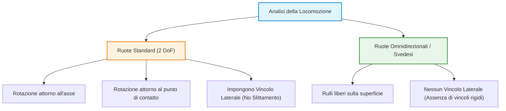
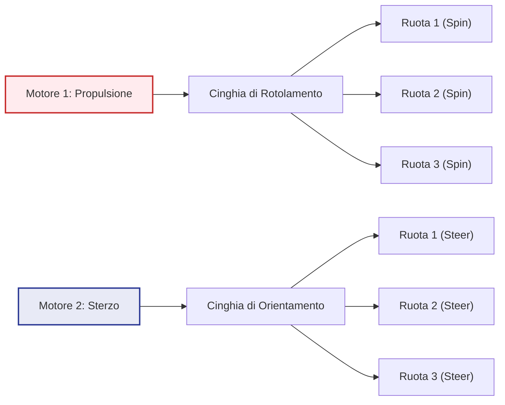
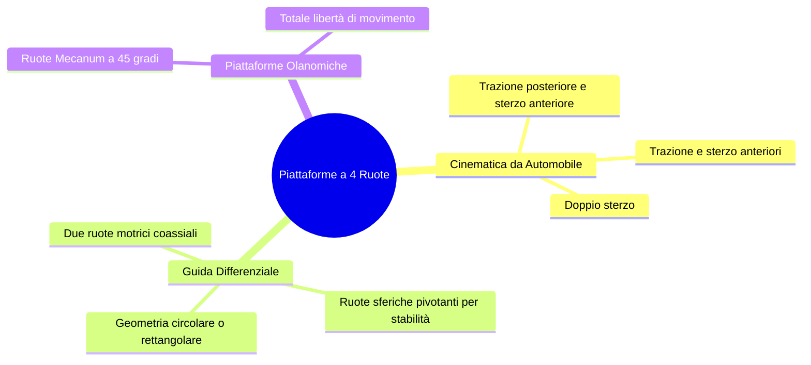
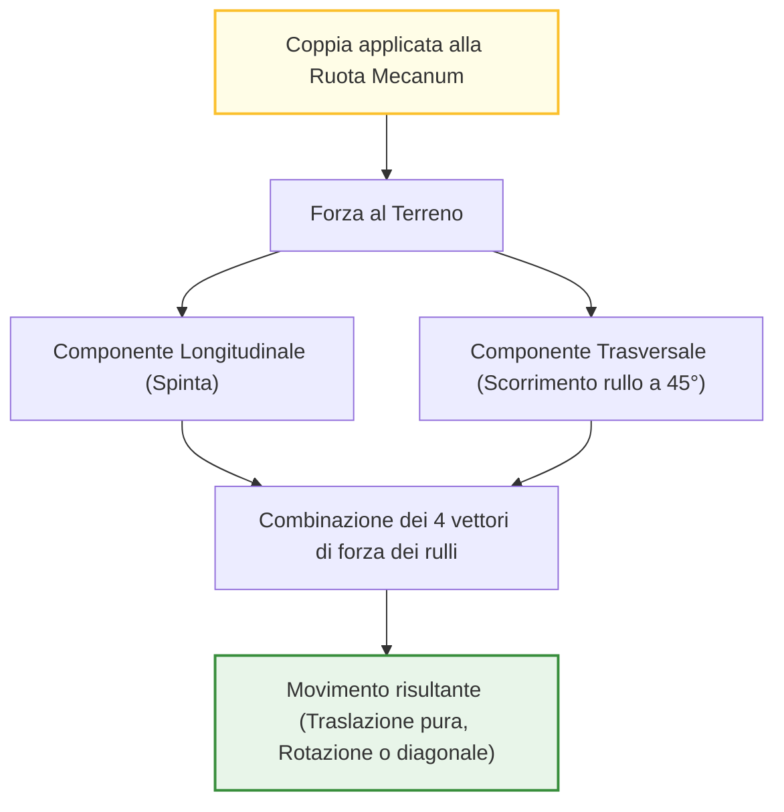
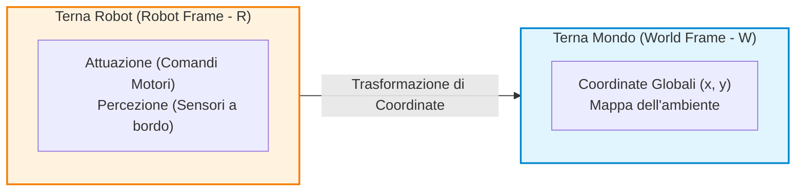
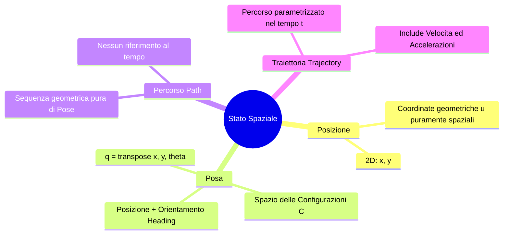
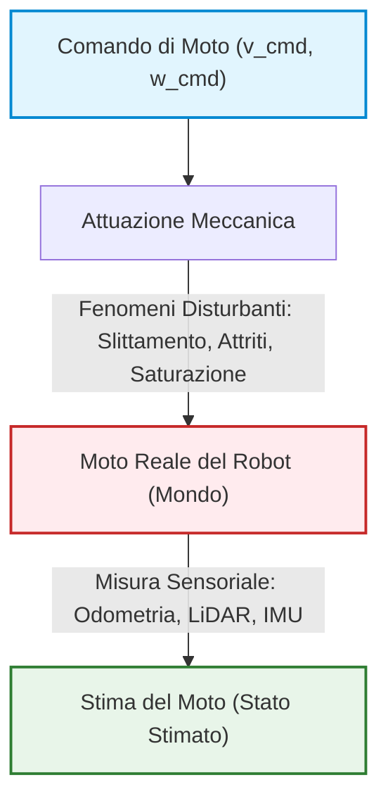
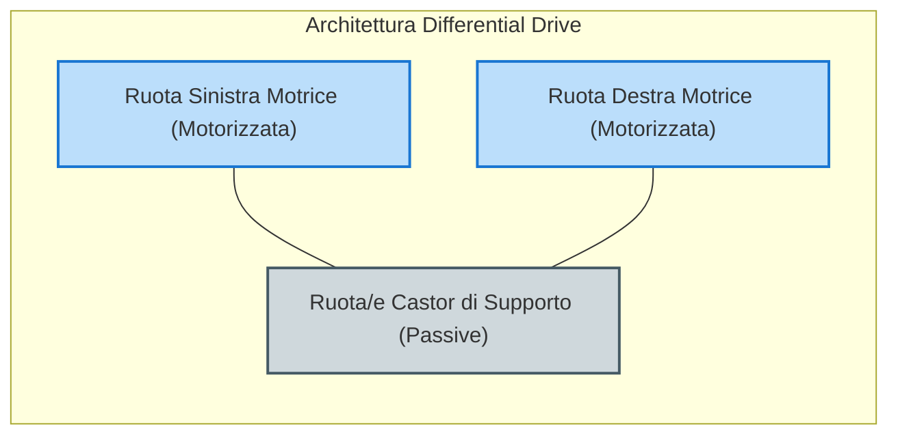
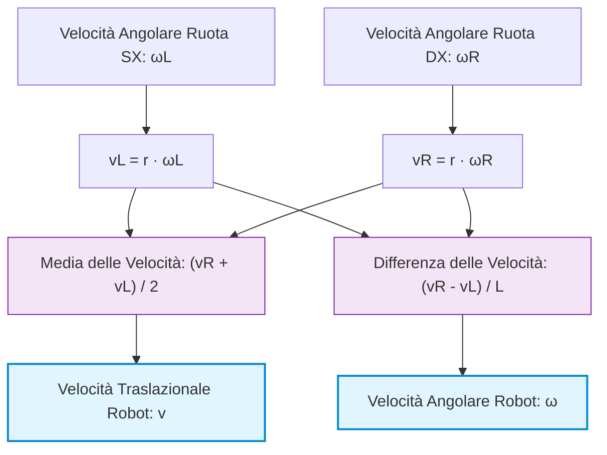
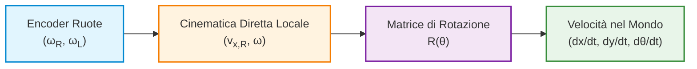

# Cinematica dei Robot Mobili: Vincoli Cinematici e Architetture Synchro Drive e Onnidirezionali

## Overview Didattica

La lezione affronta il problema del controllo della locomozione nei robot mobili (*Mobile Robots*), operando un parallelo con la Cinematica Diretta (*Direct Kinematics*) e la Cinematica Inversa (*Inverse Kinematics*) già analizzate per i manipolatori industriali. L'obiettivo primario è definire come guidare una piattaforma robotica da una posizione/posa iniziale $A$ ad una desiderata $B$.

I concetti chiave trattati includono:

*   **Gradi di Libertà e Vincoli Cinematici (*Kinematic Constraints*):** A differenza dei giunti dei manipolatori, l'uso delle ruote introduce gradi di libertà (*Degrees of Freedom - DoF*) nel piano, ma impone contemporaneamente dei vincoli al moto. Le ruote standard (*Standard Wheels*), sia fisse che orientabili, garantiscono il rotolamento lungo il proprio asse principale ma introducono un vincolo di non slittamento laterale (*Lateral Constraint*).
*   **Architettura Synchro Drive:** Analisi del funzionamento di una piattaforma a tre o quattro ruote guidata da soli due motori mediante cinghie di trasmissione (*Drive Belts*). Un motore controlla in modo sincronizzato il rotolamento di tutte le ruote, mentre il secondo ne controlla la sterzatura. La peculiarità fondamentale di questo sistema è il mantenimento di un orientamento (*Heading*) costante della struttura durante qualsiasi traiettoria di traslazione.
*   **Piattaforme Onnidirezionali (*Omnidirectional Platforms*):** Introduzione alle strutture oloconomiche basate su tre ruote a rulli (come le ruote svedesi, *Swedish Wheels*), ciascuna mossa da un motore indipendente. Questo sistema consente al robot di muoversi in qualsiasi direzione del piano (inclusi i moti laterali) e di variare l'orientamento della piattaforma in modo totalmente disaccoppiato rispetto alla traiettoria traslazionale.

---

### Recap sulla Cinematica della Locomozione e Vincoli Meccanici

L'obiettivo fondamentale del controllo della locomozione nei robot mobili (*Mobile Robot Locomotion*) è definire le legge di comando per trasferire la piattaforma da una configurazione iniziale (Posizione A) a una configurazione desiderata (Posizione B).

Nei **robot manipolatori** (*Robot Manipulators*), questo problema viene affrontato tramite:
* **Cinematica Diretta** (*Direct Kinematics*): nota la configurazione dei giunti, si calcola la posa dell' *End-Effector*.
* **Cinematica Inversa** (*Inverse Kinematics*): data la posa desiderata dell' *End-Effector*, si calcolano i comandi di attuazione per i singoli giunti.

Nei **robot mobili su ruote**, la cinematica differisce in modo sostanziale da quella dei bracci articolati a giunti rotoidali o prismatici. L'aggiunta di ruote aumenta i gradi di libertà teorici del sistema nello spazio, ma introduce contemporaneamente dei **vincoli cinematici** (*Kinematic Constraints*).

#### Ruote Standard e Vincoli di Movimento
Una ruota standard possiede 2 Gradi di Libertà (*Degrees of Freedom - DoF*):
1. Rotazione lungo il proprio asse di rotolamento.
2. Rotazione attorno al punto di contatto con il terreno (orientamento o *steering*).

Tuttavia, ogni ruota standard posizionata sul telaio introduce un **vincolo di non slittamento laterale** (*Lateral Constraint* / *No-Side-Slip Constraint*). La ruota non può traslare in direzione ortogonale al proprio piano di rotolamento.

> **Esempio Intuitivo:** Consideriamo un carrello da miniera su rotaie con quattro ruote fisse non orientabili. Il sistema ha un vincolo di movimento quasi totale: può muoversi esclusivamente in avanti o all'indietro lungo una direzione fissa. Le ruote e le rotaie annullano la capacità di sterzare o traslare lateralmente.

Per comprendere la cinematica di un robot mobile, occorre analizzare ogni singola ruota valutando:
* **Contributo Negativo (Vincolo):** quanto la ruota limita i gradi di libertà complessivi del telaio.
* **Contributo Positivo (Propulsione):** come la rotazione attiva della ruota spinge la piattaforma nello spazio.

---

### Analisi delle Architetture: Il Sistema Synchro Drive

Il **Synchro Drive** è una configurazione meccanica peculiare che utilizza tre (o quattro) ruote standard orientabili sincronizzate meccanicamente, controllate da soli **due motori**.

#### Meccanismo di Funzionamento
* **Primo Motore:** Governa il rotolamento (*rolling*) di tutte le ruote simultaneamente tramite una prima cinghia di trasmissione (*drive belt*).
* **Secondo Motore:** Governa lo sterzo (*steering*) e l'orientamento di tutte le ruote in modo sincrono tramite una seconda cinghia di trasmissione.

> **Concetto Chiave: Steering vs Heading**
> Nel Synchro Drive, **cambiare la direzione di sterzo non implica cambiare l'orientamento del robot (*Heading*)**. 
> Poiché tutte le ruote sterzano insieme dello stesso angolo e ruotano alla stessa velocità, il telaio trasla in qualsiasi direzione mantenendo il proprio asse corporeo rigido sempre orientato nella stessa direzione nello spazio.

#### Vantaggi e Applicazioni
1. **Riduzione degli Attuatori:** Permette di controllare l'estensione cinematica di 3 o 4 ruote con soli 2 motori.
2. **Applicazioni Specifiche:** È ideale per ambienti strutturati (es. movimentazione tra scaffali industriali) dove il robot deve spostarsi lungo direzioni arbitrarie senza mai ruotare su se stesso, evitando collisioni dovute all'ingombro di sferzata.

---

### Configurazioni a Quattro Ruote e Guida Differenziale

Nonostante l'interesse didattico del Synchro Drive, la maggior parte delle piattaforme industriali e di servizio utilizza configurazioni a quattro ruote per garantire stabilità statica ed efficienza meccanica.

Tra queste, la **Guida Differenziale** (*Differential Drive*) rappresenta lo standard di riferimento per i robot aspirapolvere e le piattaforme di trasporto leggero:
* Utilizza due ruote motrici indipendenti poste su un asse comune passante per il centro geometrico della piattaforma.
* Integra una o due ruote sferiche/pivotanti (*Caster Wheels*) passive per garantire la stabilità statica senza introdurre vincoli cinematici rigidi.
* La forma geometrica esterna è spesso circolare per semplificare la modellazione dei contatti e la pianificazione di traiettorie prive di collisioni.

---

### Piattaforme Olanomiche e Ruote Mecanum

Le **piattaforme olanomiche** (*Holonomic Platforms*) sono sistemi in grado di controllare istantaneamente tutti i gradi di libertà sul piano ($x, y, \theta$). Una delle soluzioni più diffuse sfrutta le **ruote Mecanum** (dette anche ruote *Ilon*).

#### Geometria e Principio di Trazione
A differenza delle ruote svedesi tradizionali (con rulli a $90^\circ$ rispetto all'asse principale), la ruota Mecanum presenta rulli periferici passivi inclinati a un angolo di $\pm 45^\circ$ rispetto al piano della ruota.

* Quando la ruota viene posta in rotazione dal motore, la forza esercitata sul terreno dal punto di contatto si scompone: una parte genera spinta longitudinale, mentre l'inclinazione del rullo a $45^\circ$ genera una componente di forza trasversale.
* Attraverso la combinazione opportuna delle velocità angularie e dei versi di rotazione delle quattro ruote Mecanum, è possibile ottenere:
  1. Traslazione pura in avanti/indietro.
  2. Traslazione pura laterale (*Crabbing*).
  3. Traslazione diagonale a qualsiasi angolo.
  4. Rotazione pura sul posto (*Turning on the spot*).
  5. Moto combinato (traslazione con rotazione simultanea).

#### Vantaggi e Svantaggi Operativi

| Vantaggi | Svantaggi e Limiti Fisici |
| :--- | :--- |
| **Assenza di vincoli cinematici:** raccordi e traiettorie istantanee in tutte le direzioni. | **Vibrazioni e Rumore:** il passaggio continuo di contatto tra un rullo e il successivo crea imperfezioni geometriche e discontinuità d'impatto. |
| **Elevata capacità di carico:** supporta carichi utili (*Payload*) elevati distribuiti su 4 ruote. | **Basso Attrito e Slittamento:** l'area di contatto minuscola dei rulli limita l'aderenza, causando scivolamento continuo (*skating effect*). |
| **Manovrabilità in spazi ristretti:** capacità di ruotare mantenendo fisso il punto centrale. | **Dinamica Instabile:** richiede un **Controllo Dinamico** (*Dynamic Control*) di basso livello sui motori, poiché la sola cinematica non garantisce accuratezza a velocità elevate. |

> **Concetto Chiave: Comportamento Dinamico delle Ruote Mecanum**
> A causa del contatto puntiforme e intermittente dei rulli inclinati a $45^\circ$, le piattaforme Mecanum soffrono di elevato slittamento. Non è possibile affidarsi esclusivamente al modello cinematico teorico a cielo aperto (*Open-Loop Kinematic Control*): ad alte velocità il robot tende a "scivolare come sul ghiaccio", rendendo indispensabile l'uso di algoritmi di controllo dinamico a feedback continuo per la stabilizzazione della traiettoria.

---

### Ruote di Supporto Passive e Vincoli Cinematici

Quando un robot mobile deve trasportare carichi pesanti (centinaia di chilogrammi), posizionare l'intero peso direttamente ed esclusivamente sulle ruote motrici ne danneggerebbe gli assi. Lo sforzo flessionale sull'albero motore, collegato a rotore e statore, piegherebbe l'asse di trasmissione.

Per distribuire il carico senza alterare la cinematica del veicolo si aggiungono **ruote di supporto passive** (come ruote pivotanti/sfaccettate o *castor wheels*, ruote sferiche o omnidirezionali). 
Queste ruote:
* Forniscono supporto strutturale al telaio.
* **Non introducono vincoli cinematici aggiuntivi** sul moto del robot.

---

### Sistemi di Riferimento: Terna Mondo e Terna Robot

Per descrivere il movimento di un robot mobile nel piano, è necessario gestire contemporaneamente due distinti **Sistemi di Riferimento** (*Frames of Reference*):

1. **Terna Mondo (*World Coordinate Frame*)**: È la terna di riferimento fissa globale rispetto alla quale misuriamo lo spostamento assoluto del robot nell'ambiente.
2. **Terna Robot (*Robot Coordinate Frame*)**: È la terna solidale al corpo del robot. 

> **Concetto Chiave**: Tutte le operazioni di **attuazione** (comandi inviati ai motori) e di **percezione** (misurazioni di ostacoli tramite sensori a bordo) avvengono nativamente nella **Terna Robot**. Se il sensore rileva un ostacolo a $1\text{ m}$ di distanza, tale dato è espresso rispetto al robot. Per costruire una mappa coerente dell'ambiente, è indispensabile trasformare matematicamente le coordinate dalla Terna Robot alla Terna Mondo.

---

### Terminologia Fondamentale: Posizione, Posa, Percorso e Traiettoria

In robotica mobile è fondamentale non confondere termini che nel linguaggio comune sono usati come sinonimi.

#### 1. Posizione (*Position*)
Indica unicamente la localizzazione spaziale del robot. Per un robot operante su un piano 2D, la posizione è definita dal vettore delle coordinate Cartesian:
$$\mathbf{p} = \begin{bmatrix} x \\ y \end{bmatrix}$$

#### 2. Posa (*Pose*)
Rappresenta lo stato completo del robot nello **Spazio delle Configurazioni** (*Configuration Space*, $C$). Poiché sul piano l'indicazione della sola posizione non è sufficiente a definire la direzione verso cui il robot è rivolto (*heading*), la posa aggiunge la variabile di orientamento $\theta$:
$$\mathbf{q} = \begin{bmatrix} x \\ y \\ \theta \end{bmatrix}$$

#### 3. Percorso (*Path*)
È la sequenza geometrica delle pose che il robot attraversa per spostarsi da una configurazione iniziale a una finale. Il percorso non contiene alcuna informazione temporale; descrive esclusivamente "dove" il robot si trova geometricamente.

#### 4. Traiettoria (*Trajectory*)
È un percorso parametrizzato esplicitamente in funzione del tempo $t$:
$$\mathbf{q}(t) = \begin{bmatrix} x(t) \\ y(t) \\ \theta(t) \end{bmatrix}$$
La traiettoria lega le pose del robot a specifici istanti temporali ($t_0, t_1, t_2, \dots$), introducendo quindi i concetti di **velocità** e **accelerazione**. 

Se gli intervalli di campionamento temporale sono costanti ($\Delta t = t_{i+1} - t_i = \text{costante}$), una distanza geometrica maggiore tra pose successive lungo la traiettoria indica un'accelerazione o una velocità più elevata del robot in quel tratto.

---

### Cinematica del Robot Mobile e Componenti di Velocità

Considerando la posa $\mathbf{q}(t)$ come funzione del tempo, derivando rispetto a $t$ otteniamo la velocità nello spazio delle configurazioni $\dot{\mathbf{q}}(t)$. 

Nelle applicazioni di robotica mobile, si scompone la velocità complessiva del veicolo in due componenti principali:

1. **Velocità Traslazionale (o Lineare) ($v$)**: Indica il tasso di variazione della posizione del robot nello spazio:
   $$v(t) = \sqrt{\dot{x}^2(t) + \dot{y}^2(t)}$$
2. **Velocità Angolare ($\omega$)**: Indica il tasso di variazione dell'orientamento (*heading*) del robot nel tempo:
   $$\omega(t) = \dot{\theta}(t)$$

---

### Il Divario tra Moto Comandato, Moto Reale e Moto Stimato

Nei robot industriali (manipolatori ancorati a terra) si ha un'elevata **ripetibilità** (*repeatability*): un comando in anello aperto (*open-loop*) viene eseguito con precisione millimetrica. Nella robotica mobile la situazione è completamente diversa.

> **Concetto Chiave**: In robotica mobile vale sempre la relazione di discrepanza:
> $$\text{Moto Comandato} \neq \text{Moto Reale} \neq \text{Moto Stimato}$$

Le discrepanze tra il comando inviato e il movimento effettivo sono causate da diversi fattori fisici:
* **Slittamento delle ruote (*Wheel Slip*)**: La perdita di aderenza tra ruota e terreno (dovuta a irregolarità del suolo o accelerazioni improvvise).
* **Dinamica degli attuatori (*Actuator Dynamics*)**:
  * *Attrito statico (*Static Friction*)*: Per avviare il moto da fermo occorre superare l'attrito di primo distacco erogando picchi di corrente, producendo un movimento a scatto (*jerk*).
  * *Saturazione dei motori (*Motor Saturation*)*: Limiti fisici di corrente e coppia erogabile oltre i quali il motore non può accelerare ulteriormente.

Di conseguenza:
* **Controllo in Anello Aperto (*Open-Loop Control*)**: Invia il comando e presuppone che il robot arrivi a destinazione. È utilizzabile quasi esclusivamente su manipolatori industriali ad alta precisione.
* **Controllo in Anello Chiuso (*Closed-Loop Control*)**: Fondamentale per i robot mobili. Stima continuamente lo stato reale del robot tramite sensori per correggere gli errori di derivazione e slittamento in tempo reale.

---

### Introduzione al Differential Drive

Tra le varie architetture cinetico-meccaniche per robot mobili (come *Triciclo*, *Car-like/Ackermann*, o *Skid-Steering*), la configurazione a **Guida Differenziale (*Differential Drive*)** è tra le più diffuse.

#### Caratteristiche dell'Architettura Differential Drive:
1. **Semplicità meccanica ed economica**: Utilizza soltanto due ruote motrici azionate da motori indipendenti montate sullo stesso asse trasversale, senza alcun meccanismo di sterzo dedicato.
2. **Elevata Manovrabilità**: Controllando in modo indipendente le velocità angolari della ruota destra e della ruota sinistra, il robot può ruotare su sé stesso (raggio di sterzata nullo).
3. **Elevata Affidabilità**: L'assenza di articolazioni e bracci di sterzo rigidi ne riduce il deterioramento meccanico.
4. **Modellabilità Cinematica**: La relazione geometrica tra la velocità delle singole ruote e il movimento risultante ($v, \omega$) è di semplice formulazione matematica ed estremamente efficace per ambienti chiusi (*indoor*).

---

### Architettura Geometrica e Notazione di Base

Analizziamo ora la modellizzazione cinematica di un robot a guida differenziale (*Differential Drive Robot*). La struttura meccanica fondamentale è composta da:
*   **Due ruote motrici indipendenti**: ciascuna guidata da un proprio motore.
*   **Una ruota pivottante o folle** (*Caster Wheel* o *Castor Wheel*): ha la sola funzione di fornire un punto di appoggio e stabilità meccanica al telaio (*chassis*), senza introdurre vincoli cinematici al moto del robot.
*   **Vincolo di piano e di contatto**: il robot si muove su un piano bidimensionale ed è soggetto alla condizione di **puro rotolamento senza strisciamento** (*Pure Rolling without Slipping*).

Per derivare le equazioni del moto, definiamo i seguenti parametri geometrici e cinematici:

*   $r$: raggio delle ruote motrici (assunte identiche).
*   $L$: interasse del robot (*wheel separation* o *track width*), ovvero la distanza tra i punti di contatto delle due ruote motrici.
*   $\omega_R, \omega_L$: velocità angolari rispettivamente della ruota destra (*Right Wheel*) e della ruota sinistra (*Left Wheel*).
*   $v_R, v_L$: velocità lineari di avanzamento del centro di ciascuna ruota ($v_R = r \cdot \omega_R$ e $v_L = r \cdot \omega_L$).
*   $v$: velocità lineare di traslazione del centro geometrico (o centro di massa) del robot.
*   $\omega$: velocità angolare di rotazione dell'intera piattaforma attorno al proprio centro.

---

### Analisi Intuitiva del Movimento

Il controllo dell'intera traiettoria del robot avviene unicamente modulando in modo opportuno le due velocità angolari di ingresso $\omega_L$ e $\omega_R$.

#### 1. Moto Rettilineo ($\omega_L = \omega_R$)
Se entrambe le ruote ruotano alla stessa velocità nello stesso verso ($\omega_L = \omega_R = \omega_0$):
*   Il contributo all'avanzamento di ciascuna ruota è identico ($v_L = v_R$).
*   Il robot trasla in avanti lungo una linea retta con velocità lineare $v = r \cdot \omega_0$.
*   La velocità angolare della piattaforma è nulla ($\omega = 0$).

#### 2. Rotazione sul Posto ($\omega_L = -\omega_R$)
Se le ruote ruotano alla stessa velocità angolare ma in versi opposti ($\omega_L = -\omega_R$):
*   La ruota destra spinge in avanti e la sinistra all'indietro (o viceversa) con intensità uguale in modulo.
*   Il centro del robot rimane fermo nello spazio ($v = 0$).
*   La piattaforma ruota su sé stessa attorno al proprio centro geometrico con una velocità angolare proporzionale a quella delle ruote.

#### 3. Sterzata Generica ($\omega_L \neq \omega_R$)
Se le due velocità angolari differiscono, una ruota garantisce una spinta maggiore dell'altra. La combinazione dei due contributi forza il robot ad curvare verso il lato della ruota più lenta.

> **Concetto Chiave**
> Il moto di un veicolo a guida differenziale è completamente determinato dal principio di sovrapposizione degli effetti dei singoli azionamenti: la **somma** delle velocità delle ruote governa la traslazione, mentre la loro **differenza** governa la rotazione della piattaforma.

---

### Derivazione Matematica formale tramite l'ICR

Trattando il robot come un corpo rigido in moto piano, a velocità costanti delle ruote la piattaforma compie un moto circolare uniforme attorno ad un centro di rotazione istantaneo, chiamato **Centro Istantaneo di Rotazione (ICR)** (*Instantaneous Center of Rotation*).

#### Definizioni Geometriche rispetto all'ICR
Sia $R$ la distanza tra il centro geometrico del robot e l'ICR (raggio di curvatura della traiettoria). 
Tutti i punti del robot ruotano attorno all'ICR con la medesima velocità angolare $\omega$. Di conseguenza, la velocità tangenziale lineare di un qualsiasi punto del robot è direttamente proporzionale alla sua distanza dall'ICR.

*   Distanza della ruota sinistra dall'ICR: $R_L = R - \frac{L}{2}$
*   Distanza della ruota destra dall'ICR: $R_R = R + \frac{L}{2}$

Possiamo quindi esprimere le velocità lineari delle singole ruote $v_L$ e $v_R$ in due modi differenti:

1.  **In funzione della cinematica del corpo rigido rispetto all'ICR**:
    $$v_L = \omega \cdot R_L = \omega \left( R - \frac{L}{2} \right)$$
    $$v_R = \omega \cdot R_R = \omega \left( R + \frac{L}{2} \right)$$

2.  **In funzione della velocità di rotazione propria delle ruote**:
    $$v_L = r \cdot \omega_L$$
    $$v_R = r \cdot \omega_R$$

#### Casi Limite dell'ICR
*   **$R \to \infty$**: Il centro di rotazione si trova all'infinito. La traiettoria diventa una retta ($\omega \to 0$, moto rettilineo).
*   **$R = 0$**: L'ICR coincide con il centro del robot. Il robot ruota su sé stesso ($v = 0$).

---

### Dimostrazione e Calcolo delle Velocità della Piattaforma

Uguagliamo le espressioni cinematiche e risolviamo il sistema per ricavare la velocità di traslazione $v = \omega R$ e la velocità angolare $\omega$ del robot.

*Nota: Passaggio integrato con chiarezza didattica per esplicitare i passaggi algebrici omitted nella lezione orale.*

Uguagliando i due sistemi di equazioni:
$$r \cdot \omega_L = \omega \left( R - \frac{L}{2} \right)$$
$$r \cdot \omega_R = \omega \left( R + \frac{L}{2} \right)$$

#### 1. Calcolo della Velocità Angolare del Robot ($\omega$)
Sottraendo membro a membro la prima equazione dalla seconda:
$$v_R - v_L = \omega \left( R + \frac{L}{2} \right) - \omega \left( R - \frac{L}{2} \right)$$

$$v_R - v_L = \omega \cdot R + \omega \cdot \frac{L}{2} - \omega \cdot R + \omega \cdot \frac{L}{2}$$

$$v_R - v_L = \omega \cdot L$$

Esplicitando $\omega$:
$$\omega = \frac{v_R - v_L}{L}$$

Sostituendo la relazione con le velocità angolari delle ruote ($v_R = r \omega_R$ e $v_L = r \omega_L$):
$$\omega = \frac{r \cdot (\omega_R - \omega_L)}{L}$$

#### 2. Calcolo della Velocità Lineare del Robot ($v$)
Sommando membro a membro le due equazioni:
$$v_R + v_L = \omega \left( R + \frac{L}{2} \right) + \omega \left( R - \frac{L}{2} \right)$$

$$v_R + v_L = \omega \cdot R + \omega \cdot \frac{L}{2} + \omega \cdot R - \omega \cdot \frac{L}{2}$$

$$v_R + v_L = 2 \cdot \omega R$$

Poiché per definizione la velocità lineare del centro del robot è $v = \omega R$, otteniamo:
$$v_R + v_L = 2v \implies v = \frac{v_R + v_L}{2}$$

Sostituendo le velocità delle ruote:
$$v = \frac{r \cdot (\omega_R + \omega_L)}{2}$$

---

### Equazioni Cinematiche Generali della Piattaforma

Raggruppando i risultati ottenuti, possiamo sintetizzare il modello cinematico diretto del veicolo a guida differenziale:

$$\begin{cases} 
v = \dfrac{r (\omega_R + \omega_L)}{2} \\[12pt]
\omega = \dfrac{r (\omega_R - \omega_L)}{L} 
\end{cases}$$

> **Concetto Chiave**
> L'architettura prende il nome di **Guida Differenziale** (*Differential Drive*) proprio perché il controllo completo del veicolo (sia la sua velocità di traslazione che la velocità di cambio di orientamento) si ottiene modulando la **differenza** e la **somma** delle velocità angolari delle ruote.
> *   La **velocità traslazionale** $v$ del robot è proporzionale alla **media** delle velocità delle ruote.
> *   La **velocità angolare** $\omega$ del robot è proporzionale alla **differenza** tra le velocità delle ruote, scalata rispetto all'interasse $L$.

---

### Rappresentazione del Moto e Sistemi di Riferimento

Per descrivere la cinematica di un robot mobile si utilizzano due grandezze fondamentali: la **velocità lineare** ($v$) e la **velocità angolare** ($\omega$). Nella letteratura della robotica, l'insieme di queste velocità costituisce il **Vettore di Twist** (*Twist vector*).

In uno spazio bidimensionale (piano), il twist descrive lo stato di velocità del robot:

$$\mathbf{\nu} = \begin{bmatrix} v_x \\ v_y \\ \omega \end{bmatrix}$$

È fondamentale distinguere due sistemi di coordinate:
1. **Sistema di Riferimento del Robot** (*Robot Reference Frame* o *Body Frame* $\{R\}$): centrato sul robot, solidale al suo corpo.
2. **Sistema di Riferimento del Mondo** (*World Reference Frame* o *Global Frame* $\{W\}$): fisso nell'ambiente circostante.

Le misurazioni e i comandi immediati del robot avvengono all'interno del suo sistema di riferimento locale $\{R\}$. Per tracciare la posizione del robot nell'ambiente, occorre proiettare queste grandezze nel sistema di riferimento globale $\{W\}$.

---

### Odometria e Stima della Posa

> **Concetto Chiave: Odometria (*Odometry*)**  
> L'odometria è la capacità di ricostruire la traiettoria e la posa finale del robot a partire dalla misura del movimento delle sue ruote, data una posa iniziale nota. 

Il processo si basa sui seguenti aspetti fondamentali:

*   **Sensori:** Si utilizzano **Encoder Rotativi** (*Rotary encoders*) calettati sugli assi delle ruote. Essi misurano la rotazione angolare compiuta da ciascuna ruota.
*   **Limite Fisico:** Il movimento delle ruote **non corrisponde sempre** al movimento effettivo del robot. Ad esempio, se le ruote slittano senza fare presa sul terreno (*slippage*), l'encoder registrerà una rotazione anche se il robot rimane fermo.
*   **Natura Incrementale:** L'odometria non misura una posizione globale assoluta, ma calcola una **stima incrementale** del movimento relativo rispetto alla posa di partenza (che a sua volta potrebbe non essere perfettamente localizzata nella mappa del mondo).

---

### Modello Cinematico per Robot a Guida Differenziale

Un robot a guida differenziale (*Differential Drive Robot*) possiede vincoli cinematici specifici determinati dalla sua geometria costruttiva.

#### Vincolo di Non Slittamento Laterale
Nel sistema di riferimento locale del robot $\{R\}$, il veicolo può muoversi solo in avanti o all'indietro lungo l'asse $x_R$, e ruotare attorno all'asse verticale $z_R$. Non può muoversi lateralmente lungo l'asse $y_R$. Questo vincolo è noto come **vincolo di non slittamento laterale** (*non-lateral sliding constraint* o vincolo non-olonomo).

Di conseguenza, nel sistema del robot si ha sempre:

$$v_{y,R} = 0$$

#### Equazioni di Trasformazione (da Frame Robot a Frame Mondo)
Per trasformare le velocità espresse nel sistema locale $\{R\}$ in variazioni di posizione nel sistema globale $\{W\}$, si applica la matrice di rotazione legata all'orientamento attuale del robot $\theta$:

$$\begin{bmatrix} \dot{x} \\ \dot{y} \\ \dot{\theta} \end{bmatrix} = \begin{bmatrix} \cos\theta & 0 \\ \sin\theta & 0 \\ 0 & 1 \end{bmatrix} \begin{bmatrix} v \\ \omega \end{bmatrix}$$

Dove:
*   $\dot{x}, \dot{y}$ rappresentano le componenti della velocità lineare nel sistema di riferimento del mondo $\{W\}$.
*   $\dot{\theta}$ rappresenta la variazione dell'orientamento (*heading angle*) del robot.
*   $v$ è la velocità avanzante lungo l'asse $x_R$ del robot.
*   $\omega$ è la velocità angolare di rotazione del robot.

> **Ipotesi Sottostanti:** Questo modello cinematico assume valide due condizioni fondamentali: **puro rotolamento** (*pure rolling*) delle ruote sul terreno e **moto planare** (*planar motion*) su superficie bidimensionale.

---

### Cinematica Diretta e Inversa

Il modello cinematico del robot consente di convertire le velocità di rotazione dei singoli motori delle ruote nei movimenti complessivi del veicolo e viceversa.

Considerando:
*   $r$: raggio delle ruote
*   $b$: interasse (*wheelbase* o *track width*), ossia la distanza tra i punti di contatto delle due ruote
*   $\omega_R, \omega_L$: velocità angolari rispettivamente della ruota destra (*right*) e sinistra (*left*)

#### Cinematica Diretta (*Forward Kinematics*)
La cinematica diretta risponde alla domanda: *date le velocità angolari imposte ai motori delle ruote ($\omega_R, \omega_L$), quali sono la velocità lineare ($v$) e angolare ($\omega$) del robot?*

$$v = \frac{r}{2} (\omega_R + \omega_L)$$

$$\omega = \frac{r}{b} (\omega_R - \omega_L)$$

In forma matriciale estesa rispetto al frame del mondo $\{W\}$:

$$\begin{bmatrix} \dot{x} \\ \dot{y} \\ \dot{\theta} \end{bmatrix} = \begin{bmatrix} \frac{r}{2}\cos\theta & \frac{r}{2}\cos\theta \\ \frac{r}{2}\sin\theta & \frac{r}{2}\sin\theta \\ \frac{r}{b} & -\frac{r}{b} \end{bmatrix} \begin{bmatrix} \omega_R \\ \omega_L \end{bmatrix}$$

#### Cinematica Inversa (*Inverse Kinematics*)
La cinematica inversa risponde alla domanda opposta: *data una velocità lineare ($v$) e angolare ($\omega$) desiderata per il robot, quali comandi in frequenza di rotazione ($\omega_R, \omega_L$) occorre inviare ai singoli motori?*

Risolvendo il sistema rispetto a $\omega_R$ e $\omega_L$:

$$\omega_R = \frac{v + \frac{b}{2}\omega}{r}$$

$$\omega_L = \frac{v - \frac{b}{2}\omega}{r}$$